# Manage daily cash and funding (one business day's cash cycle)

`pam-daily-cash-management` · public-sector asset management · investment operations · part of `public-asset-manager`

Each business day the cash team checks yesterday's closing balances in every pool, client and mandate account, collects the day's expected flows from trade settlements, unit transactions, client instructions, capital calls, distributions, fees and margin calls, and builds a projection by account and currency. It then funds shortfalls, buys currencies through the trading desk, keys payments in the custodian portal for a second and sometimes a senior authoriser to release, verifies new payment details by call-back, re-projects at midday and lets the custodian sweep surplus cash into the short-term fund. Late capital call notices, same-day client requests and failed settlements cause most exceptions, and the cash ladder lives in spreadsheets across hundreds of accounts.

| | |
|---|---|
| Unit of work | one business day's cash cycle |
| Starts when | The business day starts: the custodian's overnight statements and pending settlements are available. |
| Done when | All required payments and transfers are released and sent, shortfalls are funded, surplus cash is swept, the forecast is updated and the manager has signed the daily checklist, with any overdraft or returned payment investigated. |
| Organisation | A Canadian provincial public-sector asset manager with about $79 billion in pools and segregated client and mandate accounts at one global custodian, with a four-person cash, collateral and treasury team. (242 employees, 2019-2022) |
| Volume | 21 cases a month (range 20 to 23) |

## Where it sits

- Starts with **settlement_status** from trade-settlement-fails (25% of cases)
- Starts with **funding_wire** from capital-call-processing (15% of cases)
- Starts with **funding_wire** from pool-unit-transactions (12% of cases)
- Starts with **funding_wire** from client-cash-flow-instructions (10% of cases)
- Starts with **funding_wire** from collateral-margin (10% of cases)
- Starts with **cash_forecast** from distribution-processing (8% of cases)
- Starts with **funding_wire** from pool-rebalancing-cash-deployment (6% of cases)
- Starts with **funding_wire** from manager-fee-validation-payment (5% of cases)
- Starts with **funding_wire** from private-deal-closing-funding (4% of cases)
- Starts with **funding_wire** from hedge-fund-dealing (3% of cases)
- Starts with **sale_proceeds** from private-investment-exit (2% of cases)
- Sends **funding_wire** to custodian (outcome: any)
- Sends **cash_forecast** to liquidity-forecasting (outcome: any)

## Flow

```mermaid
flowchart TD
    s01["s01 Load overnight custodian cash statements and pending settlements<br/>Automated"]
    s02["s02 Check prior-day closing balances and overdrafts<br/>Analyst, cash and collateral"]
    s03["s03 Collect today's expected flows from each source<br/>Analyst, cash and collateral"]
    s04{{"s04 Build the cash projection by account and currency<br/>Analyst, cash and collateral"}}
    s05["s05 Record a same-day client request or late capital call<br/>Analyst, cash and collateral"]
    s06{{"s06 Chase late or unconfirmed items<br/>Analyst, cash and collateral"}}
    s07{{"s07 Decide funding and sweep actions<br/>Analyst, cash and collateral"}}
    s08{{"s08 Total portfolio manager decides how to fund a large shortfall<br/>Portfolio manager, total portfolio  rebalancing, liquidity, overlays"}}
    s09["s09 Request foreign exchange for settlements and payments<br/>Analyst, cash and collateral"]
    s10["s10 Trader executes the FX trades<br/>Trader  equities, fixed income, FX and derivatives"]
    s11{{"s11 Prepare the day's wires and transfers in the custodian portal<br/>Analyst, cash and collateral"}}
    s12["s12 Verify new or changed payment details by call-back<br/>Analyst, cash and collateral"]
    s13{{"s13 Second authoriser reviews and releases the payments<br/>Manager, cash, collateral and treasury operations"}}
    s14["s14 Senior authoriser releases payments above the high-value limit<br/>Vice president, investment operations"]
    s15["s15 Custodian sends the payments before the cut-off<br/>Outside party"]
    s16{{"s16 Re-project cash at midday from intraday statements<br/>Analyst, cash and collateral"}}
    s17["s17 Arrange same-day funding for an unexpected shortfall<br/>Analyst, cash and collateral"]
    s18["s18 Update the multi-day cash forecast and send it to liquidity forecasting<br/>Analyst, cash and collateral"]
    s19["s19 Confirm payments went out and check end-of-day balances<br/>Analyst, cash and collateral"]
    s20["s20 Custodian sweeps residual balances into the short-term fund<br/>Automated"]
    s21{{"s21 Manager reviews the daily cash checklist and signs off<br/>Manager, cash, collateral and treasury operations"}}
    s22["s22 Investigate an overdraft, returned or misdirected payment<br/>Analyst, cash and collateral"]
    s01 --> s02
    s02 --> s03
    s03 --> s04
    s04 -->|"50%"| s07
    s04 -->|"50%"| s06
    s05 --> s07
    s06 -->|"75%"| s07
    s06 -->|"25%"| s05
    s07 -->|"55%"| s09
    s07 -->|"25%"| s11
    s07 -->|"20%"| s08
    s08 -->|"70%"| s09
    s08 -->|"30%"| s11
    s09 --> s10
    s10 --> s11
    s11 -->|"88%"| s13
    s11 -->|"12%"| s12
    s12 --> s13
    s13 -->|"71%"| s15
    s13 -->|"25%"| s14
    s13 -->|"4%"| s11
    s14 --> s15
    s15 --> s16
    s16 -->|"80%"| s18
    s16 -->|"20%"| s17
    s17 --> s13
    s18 --> s19
    s19 --> s20
    s20 --> s21
    s21 -->|"92%"| end0
    s21 -->|"8%"| s22
    s22 --> end1
    end0(["closed"])
    end1(["closed_with_exception"])
```

## Roles

| Role | Department | Layer | FTE on this process | Loaded cost per hour | Evidence |
|---|---|---|---:|---:|---|
| Analyst, cash and collateral | Cash, collateral and treasury operations | individual contributor | 1 | 56 CAD | B [jobbank_11101] |
| Manager, cash, collateral and treasury operations | Cash, collateral and treasury operations | manager | 0.12 | 90 CAD | B [jobbank_10010] |
| Vice president, investment operations | Investment operations | director | 0.01 | 240 CAD | C |
| Trader (equities, fixed income, FX and derivatives) | Public markets trading desk | senior specialist | 0.02 | 170 CAD | C |
| Portfolio manager, total portfolio (rebalancing, liquidity, overlays) | Total portfolio management and rebalancing | senior specialist | 0.01 | 195 CAD | C |

## Steps

Hands-on time and the wait before each step show the most common value. Evidence tier A is a sourced number, B a sourced description, C the author's estimate.

| Step | Who | Kind | Hands-on | Wait before | Control | Evidence |
|---|---|---|---:|---:|---|---|
| **s01 Load overnight custodian cash statements and pending settlements.** Overnight the custodian's end-of-day cash statements and the list of pending settlements for every pool, client and mandate account load into the custodian portal and the book of record's cash view; no one touches this step. | Automated | system auto | 0 min | 6.0 h |  | B [ct_cash] |
| **s02 Check prior-day closing balances and overdrafts.** A cash analyst compares each account's closing balance with yesterday's projection, lists unexpected debits and credits, overdrafts and unapplied receipts, and starts queries with the custodian or the owning team. | Analyst, cash and collateral | validation | 40 min | 1.5 h |  | B [ct_cash], [sifma_soc1] |
| **s03 Collect today's expected flows from each source.** A second analyst gathers today's known flows: trade settlements and fails from trade support, unit subscriptions and redemptions, client contributions and withdrawals, capital calls and distributions due, manager fees, margin calls, FX maturities and hedge fund dealing. | Analyst, cash and collateral | lookup | 40 min | 0 min |  | B [ni24101], [mgr_ar21] |
| **s04 Build the cash projection by account and currency.** The analyst rolls the cash ladder workbook forward, enters the expected flows against each account and currency, and identifies which accounts will be short or have surplus cash at the end of the day. | Analyst, cash and collateral | analysis | 50 min | 10 min |  | B [ct_cash] |
| **s05 Record a same-day client request or late capital call.** When a client sends a same-day withdrawal request or a general partner's notice arrives late, the analyst adds the flow to the projection once client service or private markets operations confirms it is verified and approved. | Analyst, cash and collateral | data entry | 10 min | 15 min |  | C |
| **s06 Chase late or unconfirmed items.** The analyst chases trade support on unconfirmed settlements, the collateral desk on margin amounts, private markets operations on calls due and client service on expected client wires, and updates the projection. | Analyst, cash and collateral | communication | 20 min | 15 min |  | C |
| **s07 Decide funding and sweep actions.** For each account the analyst decides how to cover shortfalls (draw on the short-term fund holding or move cash within the same owner) and which currencies to buy, following the funding rules set by total portfolio management. | Analyst, cash and collateral | judgment | 20 min | 15 min |  | B [ct_cash] |
| **s08 Total portfolio manager decides how to fund a large shortfall.** For a shortfall larger than the short-term holdings, such as a big capital call or client withdrawal, a total portfolio manager decides whether to sell money market or bond holdings, redeem pool units or adjust an overlay, and places the orders. | Portfolio manager, total portfolio (rebalancing, liquidity, overlays) | judgment | 20 min | 1.0 h |  | B [mgr_ar21] |
| **s09 Request foreign exchange for settlements and payments.** The analyst nets the currency needs by account and raises FX orders in the order management system for the trading desk, noting value dates and settlement accounts. | Analyst, cash and collateral | data entry | 15 min | 10 min |  | C |
| **s10 Trader executes the FX trades.** A trader executes the FX orders on the multi-dealer platform before the currency cut-offs; the executed tickets flow to trade capture and confirmation. | Trader (equities, fixed income, FX and derivatives) | data entry | 10 min | 20 min |  | C |
| **s11 Prepare the day's wires and transfers in the custodian portal.** The analyst keys the day's payments and inter-account transfers in the custodian portal (funding transfers, capital calls due, manager fees, margin payments, client withdrawals) or approves those pre-entered by other teams, and checks beneficiary details against the approved list. | Analyst, cash and collateral | data entry | 40 min | 15 min |  | B [ct_cash] |
| **s12 Verify new or changed payment details by call-back.** For a new beneficiary or changed bank details the analyst calls a known contact at the payee on a number already on file, never one from the request, records the confirmation and holds the payment if it cannot be verified. | Analyst, cash and collateral | validation | 20 min | 1.0 h | Payment instruction change verification: outbound call to a known contact before paying new or changed bank details | B [latham_bec], [fc_fraud], [afp2021] |
| **s13 Second authoriser reviews and releases the payments.** The manager reviews each payment against its support and the projection and releases it in the custodian portal as the second authoriser; errors go back to the preparer. | Manager, cash, collateral and treasury operations | approval | 20 min | 20 min | Maker-checker over payments: the analyst who prepares a payment cannot release it; no one person initiates, approves and records a transaction | B [fc_fraud], [sifma_soc1] |
| **s14 Senior authoriser releases payments above the high-value limit.** Payments above the high-value threshold, such as large capital calls or client withdrawals, also need the vice president of investment operations, who checks the support and releases them. | Vice president, investment operations | approval | 10 min | 1.0 h | Payment signing authority matrix: high-value payments need a senior authoriser | B [latham_bec] |
| **s15 Custodian sends the payments before the cut-off.** The custodian processes the released payments and sends them through the payment systems before the currency cut-offs, and posts confirmations in the portal. | Outside party | external wait | 0 min | 45 min |  | C |
| **s16 Re-project cash at midday from intraday statements.** Around midday the analyst checks intraday statements for incoming client contributions, distributions and sale proceeds and for settlements that failed, and updates the projection for each account. | Analyst, cash and collateral | validation | 25 min | 45 min |  | C |
| **s17 Arrange same-day funding for an unexpected shortfall.** When a sale fails to settle, a margin call rises or an expected receipt is late, the analyst arranges an extra transfer from the short-term fund holding or agrees overdraft cover with the custodian and prepares the payment for release. | Analyst, cash and collateral | coordination | 30 min | 15 min |  | C |
| **s18 Update the multi-day cash forecast and send it to liquidity forecasting.** The analyst rolls forward the forecast for the next days and weeks with known settlements, calls and client flows and sends it to total portfolio management for the weekly liquidity forecast and to portfolio managers. | Analyst, cash and collateral | data entry | 20 min | 15 min |  | B [mgr_ar21] |
| **s19 Confirm payments went out and check end-of-day balances.** Late in the afternoon the analyst confirms every released payment shows as sent, checks expected receipts arrived, and lists any account heading for an overdraft or holding unexpected cash. | Analyst, cash and collateral | validation | 20 min | 1.0 h |  | C |
| **s20 Custodian sweeps residual balances into the short-term fund.** After the payment cut-offs the custodian's automatic sweep invests each account's remaining settled cash in the short-term investment fund overnight, so surplus cash earns money market returns without anyone keying a trade. | Automated | system auto | 0 min | 30 min |  | B [ct_cash] |
| **s21 Manager reviews the daily cash checklist and signs off.** The manager reviews the day's checklist: projections, payments released, call-backs, overdrafts and open items, and signs it off as evidence for the controls report. | Manager, cash, collateral and treasury operations | review | 15 min | 20 min | SOC 1 control objectives over contributions and distributions and cash reconciliation, evidenced daily for the service auditor | B [sifma_soc1], [mgr_ar22] |
| **s22 Investigate an overdraft, returned or misdirected payment.** The analyst finds why an account went overdrawn or a payment was returned, arranges the fix, asks the custodian to waive or confirm the overdraft interest, and recharges the cost to the counterparty or owning team where they caused it. | Analyst, cash and collateral | communication | 45 min | 4.0 h |  | C |

## Exceptions

| Exception | Share of cases | What happens |
|---|---:|---|
| Late or unconfirmed items | 50% | Settlements, margin amounts, calls or client wires are unconfirmed in the morning and must be chased. |
| Same-day client request or late capital call | 12% | A verified same-day withdrawal or a late capital call notice is added to the day's projection and funding. |
| Large shortfall needs a portfolio decision | 20% | A shortfall larger than short-term holdings needs a total portfolio manager to decide what to sell or redeem. |
| New or changed payment details | 12% | A new beneficiary or changed bank details are verified by an outbound call to a known contact before release. |
| High-value payment | 25% | A payment above the high-value limit needs the vice president's release as well. |
| Unexpected intraday shortfall | 20% | A failed sale, larger margin call or late receipt needs an extra same-day transfer and release. |
| Overdraft or returned payment | 8% | An account goes overdrawn or a payment comes back and the cause, fix and interest are pursued. |

## Benchmarks

| Metric | Value | Unit | Population | Evidence |
|---|---|---|---|---|
| cycle_time_days | p50 0.75, p90 1.2 | calendar days from the start of the business day (overnight statement load) to the manager's sign-off | Daily cash cycles of a Canadian public-sector asset manager, 2019-2022 | C |
| organizations_targeted_by_business_email_compromise_2020 | 0.76 | share of organizations | More than 500 treasury and finance professionals (AFP 2021 survey) | A [afp2021] |
| organizations_with_wire_transfer_fraud_2020 | 0.39 | share of organizations reporting wire transfers affected by fraud | AFP 2021 survey respondents | A [afp2021] |
| settlement_cycle | T+2 | business days after trade date for Canadian and US securities from 5 September 2017 | Canadian securities markets | A [cibcm17] |

## Pain points

- Late capital call notices and same-day client requests arrive after the morning projection and force rework of funding and payments close to cut-offs. (steps s05, s06, s17; C)
- The cash ladder is kept in spreadsheets across hundreds of pool, client and mandate accounts and many currencies, and payments are re-keyed into the custodian portal; pooling was expected to bring efficiencies in cash management. (steps s03, s04, s11; B [mgr_ar21])
- Payment fraud through compromised email and changed bank details is common, so call-backs and dual release add time to every new or changed payment. (steps s12, s13; B [afp2021], [latham_bec])
- Failed settlements and late receipts create unexpected shortfalls and overdraft interest that must be chased afterwards. (steps s16, s17, s22; C)

## Assumptions

- One case is one business day's cash cycle across all accounts. Individual payments are prepared and documented in the processes that trigger them (capital calls, client cash instructions, unit transactions, fees, margin); this process projects the day's cash, funds and releases payments and sweeps surplus.
- interfaces.triggered_by shares describe the rough mix of the day's cash items by source; the cycle itself starts every business day.
- The balance check and flow collection are done by two analysts at the same time (s02 and s03), and are listed in sequence with concurrent_with; the simulator adds both hands-on times to elapsed time, so the simulated median (about 0.95 days) is above the 0.75-day estimate.
- Approval thresholds, the share of days with high-value payments and the call-back share are author estimates; the model manager's payment authority limits are not published. In the period CAD wires settled through LVTS, replaced by Lynx in 2021; cut-off times are not modelled step by step.
- The trader and total portfolio manager take part although the process map lists only the cash team and the vice president; both roles exist in the organisation file.
- Loaded costs come from the organisation file: Job Bank Toronto wages deflated 9% to 2021, plus variable pay, times a 1.35 loading.
- Staffing: about 1.2 FTE stated (1.0 analyst); hands-on time times volume implies a similar figure. With 0.34 analyst FTE already claimed by other workflows, the three analysts keep about 1.3 FTE for collateral and margin work.
- Times, waits and branch probabilities are author estimates (tier C).

## Sources

- [ct_cash] [Cash Management Overview (Office of the Treasurer, Connecticut)](https://portal.ct.gov/ott/cash-management/overview) (State of Connecticut, 2025). A public-sector cash control unit works daily: forecasts available cash, funds disbursement accounts, concentrates cash, sweeps available cash into short-term investment vehicles and executes electronic transfers.
- [mgr_ar21] The model manager 2021 Annual Report (link withheld) (The model manager, 2022). Enhanced quarterly risk reports for clients and the Board and a new Quarterly Risk Insights report in 2021; risk measured with sensitivities, historical and custom stress tests, total, active and factor risk and a liquidity coverage ratio; new risk and total portfolio management system selected in 2021 for delivery in 2022; investment risk support facilitates transaction reviews; private market risks assessed by a devoted team; Management Investment Committee co-chaired by the CIO and CRO and Investment Department Committees co-chaired by Investments and Investment Risk; three pools launched in 2021 and work begun on private equity and infrastructure pools; pooling brings efficiencies in pool activities and cash management; clean SOC 1 Type I report as at 30 September 2021. Read from a text copy saved under scratch/ by earlier work.
- [mgr_ar22] The model manager 2022 Annual Report (link withheld) (The model manager, 2023). More stress tests and scenario analysis in 2022 (historical, prospective single and combined shocks, inflation and rate scenarios); investment risk support facilitates transaction reviews and limit monitoring; Infrastructure Pool, the first private markets pool ($8.4 billion), needed legal structures and an asset transition plan, launched first phase October 2022 then transferred client holdings; new risk system partly live December 2022. Read from a text copy saved under scratch/ by earlier work.
- [ni24101] [National Instrument 24-101 Institutional Trade Matching and Settlement (consolidated to 5 September 2017)](https://www.fcnb.ca/sites/default/files/2020-02/24-101-NI-CONS-2017-09-05-E.pdf) (Canadian Securities Administrators (via Financial and Consumer Services Commission of New Brunswick), 2017). Matching means trade details and settlement instructions are reported, verified, confirmed and affirmed among trade-matching parties; registered dealers and advisers must have policies to match DAP/RAP trades no later than noon Eastern Time on T+1; institutional investors sign a trade-matching agreement or statement; quarterly exception report if less than 90% matched on time. Read from a text copy saved under scratch/ by earlier work.
- [cibcm17] [Shortening the Settlement Cycle: Final CSA Amendments to NI 24-101](https://www.cibcmellon.com/en/_locale-assets/pdf/our-thinking/2017/ot201707-csa-ni-24-101-en.pdf) (CIBC Mellon, 2017). Canada moved to T+2 settlement on 5 September 2017; the institutional trade matching deadline became noon on T+1 for all trades because later matching leaves too little time to avoid fails. Read from a text copy saved under scratch/ by earlier work.
- [sifma_soc1] [Asset Manager's Guide to SOC 1 (June 2017)](https://www.sifma.org/wp-content/uploads/2017/08/SIFMA_AMG_asset-managers-guide-soc-2017.pdf) (SIFMA Asset Management Group and Grant Thornton, 2017). Baseline SOC 1 control objectives for asset managers: new account set-up authenticated and established accurately; trades properly authorized, allocated, settled and recorded accurately, completely and timely; contributions and distributions authorized; cash and positions reconciled to custodians; change management. Read from a text copy saved under scratch/ by earlier work.
- [afp2021] [Survey: Pandemic impact on payments fraud activity (2021 AFP Payments Fraud and Control Survey)](https://www.financialprofessionals.org/about/learn-more/press-releases/Details/survey-pandemic-impact-on-payments-fraud-activity) (Association for Financial Professionals, 2021). 74% of organizations were targets of payment scams in 2020; 76% were targeted by business email compromise; 39% reported wire transfers affected by fraud; more than 500 respondents.
- [latham_bec] [The Pervasive Threat of Business Email Compromise Fraud and How to Prevent It](https://www.lw.com/en/insights/2020/02/the-pervasive-threat-of-business-email-compromise-fraud-and-how-to-prevent-it) (Latham & Watkins, 2020). The payer should always verify banking instructions by an outbound call to a known contact; treat any change of payment instructions with suspicion; require phone authorization for transactions over a threshold. Read from a text copy saved under scratch/ by earlier work.
- [fc_fraud] [8 Ways to Strengthen Protection Against Funds Transfer Fraud](https://fundbanking.firstcitizens.com/insights/operating-best-practices/funds-transfer-fraud-prevention) (First Citizens Bank, 2026). Verify all banking changes using a known, previously validated phone number; two people approve any change to standing payment instructions; no single person should initiate, approve and record transactions.
- [jobbank_11101] [Wages: Financial Analyst (NOC 11101) in the Toronto Region](https://www.jobbank.gc.ca/marketreport/wages-occupation/12417/22437) (Job Bank, Government of Canada, 2025). Toronto hourly wages for NOC 11101: low 27.97, median 41.60, high 73.57 (reference period 2023-2024).
- [jobbank_10010] [Wages: Finance Director (NOC 10010) in the Toronto Region](https://www.jobbank.gc.ca/marketreport/wages-occupation/1225/22437) (Job Bank, Government of Canada, 2025). Toronto hourly wages for NOC 10010: low 41.21, median 62.37, high 96.15 (reference period 2023-2024).

Written by claude-opus on 2026-11-17.
