# Reconcile positions and cash daily

`pam-daily-reconciliation` · public-sector institutional asset management · investment operations (reconciliations) · part of `public-asset-manager`

Every business day the reconciliations team checks the model manager's investment book of record against the custodian, external managers and derivative counterparties for positions, cash and transactions across a few hundred pool, client and mandate accounts. A reconciliation tool matches most items automatically; analysts first clear the accounts that feed unit prices and risk so positions can be released by mid-morning, then investigate the remaining breaks, assign them to owning teams, book or request corrections and update the ageing log for the manager's sign-off. Breaks that age or grow are escalated, and late files, corporate actions and external manager timing differences are the main sources of work.

| | |
|---|---|
| Unit of work | one business day's reconciliation across all accounts |
| Starts when | The business day closes and the custodian, managers and counterparties send their end-of-day files. |
| Done when | Positions are released to pricing, risk and performance, every break has an owner and comment, and the manager has signed off the day, with aged or material breaks escalated. |
| Organisation | A provincial not-for-profit asset manager of about 240 staff with one global custodian, about 120 external managers, four to five pools, five client portfolios and derivative overlays. (242 employees, 2019-2022) |
| Volume | 21 cases a month (range 20 to 23) |

## Where it sits

- Starts with **custodian_statement** from custodian (70% of cases)
- Starts with **manager_report** from external_managers (10% of cases)
- Starts with **settlement_status** from trade-settlement-fails (10% of cases)
- Starts with **corporate_action_notice** from corporate-actions (5% of cases)
- Starts with **security_reference_data** from investment-data-management (5% of cases)
- Sends **reconciled_positions** to pool-unit-pricing (outcome: any)
- Sends **reconciled_positions** to fund-accounting-close (outcome: any)
- Sends **reconciled_positions** to daily-risk-limit-monitoring (outcome: any)
- Sends **reconciled_positions** to performance-attribution (outcome: any)
- Sends **reconciled_positions** to data-warehouse-operations (outcome: any)
- Sends **reconciliation_breaks** to trade-settlement-fails (outcome: any)
- Sends **reconciliation_breaks** to enterprise-operational-risk (outcome: signed_off_with_escalation)

## Flow

```mermaid
flowchart TD
    s01{{"s01 Capture close-of-business positions in the book of record<br/>Automated"}}
    s02["s02 Hold over the weekend or holiday<br/>Automated"]
    s03["s03 Custodian, managers and counterparties deliver overnight files<br/>Outside party"]
    s04["s04 Load files and run automatic matching<br/>Automated"]
    s05{{"s05 Check every expected file has loaded<br/>Analyst, reconciliations and corporate actions"}}
    s06["s06 Chase missing or late files and reload<br/>Analyst, reconciliations and corporate actions"]
    s07{{"s07 Triage breaks on pool and pricing-critical accounts<br/>Analyst, reconciliations and corporate actions"}}
    s08["s08 Escalate a break that holds up pricing<br/>Manager, reconciliations and corporate actions"]
    s09["s09 Release reconciled positions to pricing, risk and performance<br/>Analyst, reconciliations and corporate actions"]
    s10["s10 Investigate cash breaks across all accounts<br/>Analyst, reconciliations and corporate actions"]
    s11["s11 Investigate position and transaction breaks<br/>Analyst, reconciliations and corporate actions"]
    s12["s12 Reconcile derivatives, collateral and FX forwards<br/>Analyst, reconciliations and corporate actions"]
    s13["s13 Reconcile external manager records to the custodian<br/>Analyst, reconciliations and corporate actions"]
    s14["s14 Assign breaks to owning teams<br/>Analyst, reconciliations and corporate actions"]
    s15["s15 Trade support resolves settlement-related breaks<br/>Analyst, trade support and settlements"]
    s16["s16 Book or request corrections in the book of record<br/>Analyst, reconciliations and corporate actions"]
    s17["s17 Raise queries with the custodian<br/>Analyst, reconciliations and corporate actions"]
    s18{{"s18 Re-run matching after corrections<br/>Automated"}}
    s19["s19 Update the break ageing log and commentary<br/>Analyst, reconciliations and corporate actions"]
    s20{{"s20 Manager reviews break ageing and signs off the day<br/>Manager, reconciliations and corporate actions"}}
    s21["s21 Prepare the escalation for aged or material breaks<br/>Manager, reconciliations and corporate actions"]
    s22["s22 Vice president reviews the escalation<br/>Vice president, investment operations"]
    s01 -->|"77%"| s03
    s01 -->|"23%"| s02
    s02 --> s03
    s03 --> s04
    s04 --> s05
    s05 -->|"85%"| s07
    s05 -->|"15%"| s06
    s06 --> s07
    s07 -->|"90%"| s09
    s07 -->|"10%"| s08
    s08 --> s09
    s09 --> s10
    s10 --> s11
    s11 --> s12
    s12 --> s13
    s13 --> s14
    s14 --> s15
    s15 --> s16
    s16 --> s17
    s17 --> s18
    s18 -->|"85%"| s19
    s18 -->|"15%"| s16
    s19 --> s20
    s20 -->|"80%"| end0
    s20 -->|"12%"| s21
    s20 -->|"8%"| s19
    s21 --> s22
    s22 --> end1
    end0(["reconciled_signed_off"])
    end1(["signed_off_with_escalation"])
```

## Roles

| Role | Department | Layer | FTE on this process | Loaded cost per hour | Evidence |
|---|---|---|---:|---:|---|
| Analyst, reconciliations and corporate actions | Reconciliations and corporate actions | individual contributor | 2.4 | 56 CAD | B [jb11101] |
| Manager, reconciliations and corporate actions | Reconciliations and corporate actions | manager | 0.3 | 90 CAD | B [jb10010] |
| Analyst, trade support and settlements | Trade support and settlements | individual contributor | 0.15 | 56 CAD | B [jb11101] |
| Vice president, investment operations | Investment operations | director | 0.01 | 240 CAD | C |

## Steps

Hands-on time and the wait before each step show the most common value. Evidence tier A is a sourced number, B a sourced description, C the author's estimate.

| Step | Who | Kind | Hands-on | Wait before | Control | Evidence |
|---|---|---|---:|---:|---|---|
| **s01 Capture close-of-business positions in the book of record.** At the end of each business day the investment book of record finalises positions, cash balances and transactions for every pool, client and external mandate account, and a scheduled extract is prepared for the reconciliation tool. Weekend and holiday days are skipped and Friday's positions are reconciled on Monday. | Automated | system auto | 0 min | 0 min |  | C |
| **s02 Hold over the weekend or holiday.** When the business day is a Friday or precedes a holiday, the files are reconciled on the next business day, so the cycle waits through the non-business days with no work done. | Automated | external wait | 0 min | 2.0 d |  | C |
| **s03 Custodian, managers and counterparties deliver overnight files.** Overnight the custodian sends position, cash and transaction statements for all custody accounts (SWIFT statement messages and flat files), external managers send their daily holdings files for mandates that provide them, and clearing brokers and swap counterparties send position and margin statements. | Outside party | external wait | 0 min | 10.0 h | Custodian's CSAE 3416 / SOC 1 controls over completeness and accuracy of client reporting | B [autorek], [csae] |
| **s04 Load files and run automatic matching.** The reconciliation tool loads the external files and the IBOR extract, maps security identifiers and accounts, and matches positions, cash balances and transactions by rule, leaving the unmatched items as breaks carried forward with their age. | Automated | system auto | 0 min | 30 min |  | B [autorek], [smartstream] |
| **s05 Check every expected file has loaded.** The first analyst in opens the tool's load monitor and confirms that every expected custodian, manager and broker file arrived for the right date with plausible record counts, and that the matching run completed for all account groups. | Analyst, reconciliations and corporate actions | validation | 25 min | 30 min | Reconciliation procedure: daily completeness check of all expected data sources before breaks are worked | C |
| **s06 Chase missing or late files and reload.** The analyst emails the custodian, external manager or broker for the missing or corrected file, loads it when it arrives and re-runs matching for that account group; accounts without a file are marked as not reconciled for the day. | Analyst, reconciliations and corporate actions | communication | 30 min | 10 min |  | C |
| **s07 Triage breaks on pool and pricing-critical accounts.** Before working the full list, the analyst filters the breaks on accounts that feed the pool unit prices and the daily risk and limit run, sorts them by value, and decides for each whether it is a timing item, such as a trade not yet settled, or a real difference that would change a price or exposure. | Analyst, reconciliations and corporate actions | analysis | 45 min | 10 min |  | B [smartstream], [fundcount] |
| **s08 Escalate a break that holds up pricing.** The manager of reconciliations reviews the material break with the unit pricing manager and the owning team, agrees whether the custodian or the model manager record is right and whether the NAV must be adjusted before the price is approved, and records the decision. | Manager, reconciliations and corporate actions | judgment | 40 min | 45 min |  | C |
| **s09 Release reconciled positions to pricing, risk and performance.** The analyst marks the pricing-critical account groups as reconciled in the tool and emails the release note listing any open breaks and their expected impact to unit pricing, portfolio risk, performance and investment accounting. | Analyst, reconciliations and corporate actions | communication | 10 min | 5 min | Operations procedure: positions released downstream only after daily reconciliation, with open breaks disclosed (reconciliations in each pricing cycle, RG 94 good practice) | B [rg94], [fundcount] |
| **s10 Investigate cash breaks across all accounts.** The analyst works the unmatched cash items: dividends and coupons received but not booked or booked at the wrong amount, withholding tax differences, fees and expenses, FX settlements and transfers between accounts, using custodian cash statements, the corporate action calendar and the book of record. | Analyst, reconciliations and corporate actions | analysis | 2.0 h | 15 min |  | B [smartstream], [autorek] |
| **s11 Investigate position and transaction breaks.** A second analyst works the quantity differences: trades booked in one record and not the other, failed or partial settlements, corporate actions applied differently, security identifier mapping errors and manager trades not yet reported, comparing custodian transaction statements with the book of record. | Analyst, reconciliations and corporate actions | analysis | 3.0 h | 0 min |  | B [smartstream] |
| **s12 Reconcile derivatives, collateral and FX forwards.** The analyst agrees futures positions and variation margin with the clearing broker statements, and swap and FX forward positions, valuations and collateral balances with counterparty statements, investigating differences in trade population, notional or price. | Analyst, reconciliations and corporate actions | analysis | 1.2 h | 0 min |  | C |
| **s13 Reconcile external manager records to the custodian.** For mandates whose managers send daily holdings, the analyst compares the manager's positions and cash with the custodian's, and chases the manager about trades it has not yet instructed or reported; monthly-reporting managers are reconciled at month end. | Analyst, reconciliations and corporate actions | analysis | 1.5 h | 0 min |  | C |
| **s14 Assign breaks to owning teams.** The analyst gives each new break a reason code and an owner in the tool: trade support for settlement and trade booking breaks, cash operations for cash items, corporate actions, investment data management for security mapping, the custodian or the external manager, and sends the daily break report to the owners. | Analyst, reconciliations and corporate actions | coordination | 40 min | 0 min |  | B [autorek] |
| **s15 Trade support resolves settlement-related breaks.** A trade support analyst checks the assigned trade and settlement breaks against settlement status and broker confirmations, fixes booking errors or explains them as pending settlements, and updates the break comment. | Analyst, trade support and settlements | analysis | 1.0 h | 1.5 h |  | C |
| **s16 Book or request corrections in the book of record.** The reconciliation analyst prepares the corrections for breaks where the model manager's record is wrong, such as a missed dividend, a corporate action entitlement or a fee, and they are entered by the owning team or entered and approved by a second person. | Analyst, reconciliations and corporate actions | data entry | 1.0 h | 45 min | Operations procedure: manual adjustments to the book of record entered by one person and approved by another | C |
| **s17 Raise queries with the custodian.** For breaks where the custodian's record looks wrong, such as unbooked income, a misapplied corporate action or a missing transfer, the analyst opens a query with the custodian's client service team with evidence and a requested correction date. | Analyst, reconciliations and corporate actions | communication | 40 min | 15 min |  | B [autorek] |
| **s18 Re-run matching after corrections.** The tool reloads the corrected book of record extract and re-runs matching so that fixed breaks close and only open items remain on the ageing report. | Automated | system auto | 0 min | 30 min |  | B [autorek] |
| **s19 Update the break ageing log and commentary.** The analyst updates the comment, owner and expected resolution date on every open break, and prepares the daily summary of breaks by age band, value and owner for the manager. | Analyst, reconciliations and corporate actions | drafting | 30 min | 15 min |  | B [smartstream] |
| **s20 Manager reviews break ageing and signs off the day.** The manager of reconciliations reviews the ageing report, challenges old or large breaks and weak comments, checks that every account group was reconciled or has a documented reason, and signs off the day's reconciliation in the tool. | Manager, reconciliations and corporate actions | review | 35 min | 2.0 h | Internal control over financial reporting for the pools and client portfolios: daily reconciliation to the custodian, reviewed and signed off, as relied on by external auditors and expected alongside the custodian's CSAE 3416 report | B [autorek], [csae] |
| **s21 Prepare the escalation for aged or material breaks.** The manager writes up breaks past the ageing tolerance or above the value limit with their cause, owner and plan, proposes write-offs or adjustments where recovery is unlikely, and logs a risk incident when a break reflects a control failure. | Manager, reconciliations and corporate actions | drafting | 40 min | 30 min |  | C |
| **s22 Vice president reviews the escalation.** The vice president of investment operations reviews the escalated breaks, approves write-offs or adjustments within authority, pushes owners or the custodian for resolution and reports persistent breaks to enterprise risk. | Vice president, investment operations | review | 20 min | 8.0 h | Operations break escalation and write-off authority policy | C |

## Exceptions

| Exception | Share of cases | What happens |
|---|---:|---|
| Weekend or holiday hold | 23% | Friday and pre-holiday positions are reconciled on the next business day. |
| Missing or late file | 15% | A custodian, manager or broker file is missing or wrong and must be chased and reloaded. |
| Material break holds up pricing | 10% | A break on a pool account could change a unit price and is escalated before positions are released. |
| Aged or material breaks escalated | 12% | Breaks past the ageing tolerance or value limit are written up and reviewed by the vice president, sometimes with a write-off or risk incident. |

## Benchmarks

| Metric | Value | Unit | Population | Evidence |
|---|---|---|---|---|
| cycle_time_days | p50 1.0, p90 3.2 | calendar days from close of business to manager sign-off of the day's reconciliation | Daily custody reconciliation at institutional asset managers | C |
| client_money_reconciliation_frequency | 1 | reconciliations per business day (external custody reconciliation at least monthly) | UK firms holding client money and custody assets under FCA CASS | A [autorek] |
| firms_relying_on_spreadsheets_for_reconciliation | 0.57 | share of asset management firms using spreadsheets or a mix of in-house and legacy systems | AutoRek survey of asset management firms (published 2025, after the reference period) | A [ftf] |
| auto_match_rate | low 0.9, mode 0.95, high 0.98 | share of position and cash items matched automatically | This workflow | C |
| breaks_older_than_30_days | 0.1 | share of open breaks older than 30 days | This workflow | C |

## Pain points

- Files from about 120 external managers and several counterparties arrive in different formats and at different times, so most days begin with chasing a missing or wrong file. (steps s03, s05, s06; B [smartstream])
- Analysts must triage and release pricing-critical accounts within a couple of hours, under pressure to class breaks as timing items so prices and risk runs are not delayed. (steps s07, s08, s09; B [fundcount])
- Investigating breaks means flipping between the tool, the custodian portal and the book of record, and derivative and some manager reconciliations still run in spreadsheets. (steps s10, s11, s12, s13; A [ftf])
- Breaks owned by the custodian or external managers age while queries wait for replies, and the ageing report grows with items the model manager cannot fix itself. (steps s14, s17, s19, s20; C)

## Assumptions

- One case is one business day's reconciliation across all accounts (about 250 custody, mandate, pool and client accounts in 2021); step times are for the whole day's work, so a single analysis step can take several hours.
- Steps s10 to s13 are worked by different analysts at the same time; the validator adds their hands-on time in sequence, so its simulated cycle time overstates real elapsed time by roughly four to six hours.
- Positions on pricing-critical accounts are triaged and released before the full break list is worked, so pricing is not held for the whole reconciliation.
- interfaces.triggered_by shares: the custodian's statements trigger the day almost always; manager files, settlement status, corporate action notices and reference data fixes are the inputs that most often add work.
- Auto-match rates, break counts and ageing are author estimates; vendor material describes the practice but no published benchmark for pension managers was opened.
- Loaded costs come from the organisation file (Job Bank Toronto wages deflated to 2021, plus variable pay, times 1.35).

## Sources

- [autorek] [How to Meet CASS Requirements: Custody Assets and Client Money](https://www.fstech.co.uk/fst/autorek/How%20to%20Meet%20CASS%20Requirements%20-%20AutoRek.pdf) (AutoRek, 2016). Reconciliation tool practice: daily feeds from custody systems, automatic matching of transactions and balances, labelling and analysis of breaks, routing break cases to resolvers inside or outside the firm, carrying unresolved breaks forward, and sign-off evidence for auditors; UK client asset rules require external reconciliations at least monthly and client money reconciliations each business day.
- [smartstream] [Smart Reconciliations: Custody and Securities use case](https://smart.stream/wp-content/uploads/smartstream-resources/Smart-Reconciliations-Custody-Securities-Use-Case.pdf) (SmartStream, 2026). Asset manager reconciliation of positions, cash, transactions, valuations and corporate actions across custodians, prime brokers, fund accountants and internal books of record; breaks cause misstated NAV, settlement failures and pricing discrepancies; spreadsheet-based processes slow exception resolution; dashboards on break ageing and NAV impact.
- [ftf] [The Tipping Point for Asset Management Operations (AutoRek survey)](https://www.ftfnews.com/FTF-Research-Institute/the-tipping-point-for-asset-management-operations-the-rising-costs-of-operational-complacency/) (FTF News, 2025). Survey of asset management firms: 57% still rely on spreadsheets or a mix of in-house and legacy systems for reconciliation, 79% call reconciliation a major operational challenge and 36% name manual processes as a top daily challenge.
- [fundcount] [NAV Oversight: Controls, Review Workflow, and Common Breakpoints](https://fundcount.com/nav-oversight-controls-review-workflow-breakpoints/) (FundCount, 2026). Eight-step NAV review workflow (readiness, reconciliation review, pricing and stale price oversight, accrual review, investor allocations, analytical review, approval and release, remediation); stop-the-line criteria such as unreconciled positions, missing pricing approvals and unexplained NAV movement; common breakpoints including stale prices, FX inconsistency and NAV reruns.
- [rg94] [RG 94 Unit pricing: Guide to good practice](https://download.asic.gov.au/media/zn0cv11h/rg94-published-august-2008-20260409.pdf) (Australian Securities and Investments Commission and Australian Prudential Regulation Authority, 2008). Monitoring controls in unit pricing such as movements outside agreed tolerances and tracking prices against benchmarks; data feeds with stale prices, zero amounts and out-of-tolerance moves; reconciliations in each pricing cycle; incident and error logs; compensation when an error is 0.3% (30 basis points) or more; price as often as units can be bought or sold; batching of applications on the day a price is struck.
- [csae] [Reports on Controls at Service Organizations FAQs](https://www.bccpa.ca/kbase/kbase-search/assurance-standards/audit/guidance/reports-on-controls-at-service-organizations-faqs/) (Chartered Professional Accountants of British Columbia, 2021). CSAE 3416 (SOC 1 equivalent) reports on controls at a service organization relevant to user entities' financial reporting; Type 1 covers design at a date and Type 2 covers operating effectiveness over a period; used by user entities and their auditors.
- [bci_fs21] [Public Equity Pooled Fund Financial Statements, December 2021](https://www.bci.ca/wp-content/uploads/2023/05/PublicEquities-PooledFundFinancialStmts-Dec2021.pdf) (British Columbia Investment Management Corporation, 2022). Units issued and redeemed at a unit value equal to net assets divided by units outstanding on each valuation date, recorded on a trade date basis; open-ended pools where each client's units issued or redeemed depend on changes to its asset allocation; purchase and redemption limits set by the CIO; pool cash and liquidity monitored daily.
- [jb11101] [Wages: Financial analyst (NOC 11101) in the Toronto region](https://www.jobbank.gc.ca/marketreport/wages-occupation/12417/22437) (Job Bank, Government of Canada, 2025). Toronto hourly wages low 27.97, median 41.60, high 73.57 dollars (reference period 2023-2024); the organisation file uses it as the proxy for operations analysts.
- [jb10010] [Wages: Finance director (NOC 10010) in the Toronto region](https://www.jobbank.gc.ca/marketreport/wages-occupation/1225/22437) (Job Bank, Government of Canada, 2025). Toronto hourly wages low 41.21, median 62.37, high 96.15 dollars (reference period 2023-2024); the organisation file uses it for operations managers.

Written by claude-opus on 2026-11-17.
