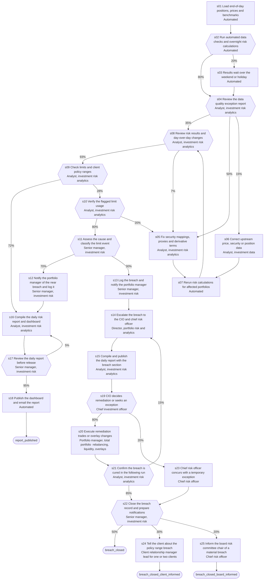

# Measure investment risk and monitor limits each business day

`pam-daily-risk-limit-monitoring` · Public sector institutional asset management · Investment risk (portfolio risk and analytics) · part of `public-asset-manager`

Every business day the portfolio risk team turns the previous day's positions, prices and benchmarks into risk numbers for each pool and client portfolio (active risk, value at risk, factor and currency exposures, leverage and liquidity) and checks them against board limits and each client's policy ranges. Most of the morning goes to fixing data: new securities without a risk mapping, stale prices, proxies for private holdings and position breaks. Warnings go to portfolio managers; breaches are escalated through the director to the chief investment officer, cured by trades or formally excepted, and reported to clients or the board when needed. The daily report usually goes out by mid-morning, but limits held in spreadsheets, proxy-based private asset risk and value at risk measures that miss tail risk are known weak points.

| | |
|---|---|
| Unit of work | one business day's risk run |
| Starts when | The investment book of record closes the business day and end-of-day positions, prices and benchmark data become available for the overnight risk batch. |
| Done when | The daily risk report is published to the CIO and portfolio managers, every warning is logged and notified, and any breach has been cured or formally excepted and reported to the client or board where required. |
| Organisation | A provincial not-for-profit asset manager with about 240 staff and $79 billion under management for four public sector clients (five portfolios) and four pools, with an 18-person risk division. (242 employees, 2019-2022) |
| Volume | 21 cases a month (range 20 to 23) |

## Where it sits

- Starts with **reconciled_positions** from daily-reconciliation (60% of cases)
- Starts with **security_reference_data** from investment-data-management (30% of cases)
- Starts with **client_ips** from client-ips-asset-mix-review (5% of cases)
- Starts with **investment_plan** from annual-investment-plan-benchmarks (5% of cases)
- Sends **risk_report** to risk-reporting-stress-testing (outcome: any)
- Sends **risk_report** to client-portfolio-rebalancing (outcome: any)

## Flow

## Roles

| Role | Department | Layer | FTE on this process | Loaded cost per hour | Evidence |
|---|---|---|---:|---:|---|
| Analyst, investment risk analytics | Portfolio risk and analytics | individual contributor | 1 | 65 CAD | B [jobbank_11101], [mgr_client] |
| Senior manager, investment risk | Portfolio risk and analytics | senior specialist | 0.2 | 120 CAD | C |
| Director, portfolio risk and analytics | Portfolio risk and analytics | director | 0.02 | 240 CAD | C |
| Chief risk officer | Investment risk | executive | 0.01 | 850 CAD | B [plan_is2022], [fsra2021] |
| Chief investment officer | Investments | executive | 0.01 | 1800 CAD | B [plan_is2022] |
| Portfolio manager, total portfolio (rebalancing, liquidity, overlays) | Total portfolio management and rebalancing | senior specialist | 0.03 | 195 CAD | C |
| Analyst, investment data | Investment data management | individual contributor | 0.04 | 56 CAD | C |
| Client relationship manager (lead for one or two clients) | Client relationship management | senior specialist | 0.01 | 160 CAD | C |

## Steps

Hands-on time and the wait before each step show the most common value. Evidence tier A is a sourced number, B a sourced description, C the author's estimate.

| Step | Who | Kind | Hands-on | Wait before | Control | Evidence |
|---|---|---|---:|---:|---|---|
| **s01 Load end-of-day positions, prices and benchmarks.** After the investment book of record closes the day, scheduled jobs extract positions and cash for every pool, client portfolio and external mandate, together with vendor prices, exchange rates, index constituents and the latest proxy values for private holdings, and load them into the risk system. | Automated | system auto | 0 min | 6.0 h |  | B [plan_ar2021], [barraone] |
| **s02 Run automated data checks and overnight risk calculations.** The risk system flags missing or stale prices, securities not mapped to the factor model, large day-over-day position changes and benchmark file gaps, then calculates active risk, value at risk, factor and currency exposures, leverage and liquidity for each pool and client portfolio. | Automated | system auto | 0 min | 20 min |  | B [barraone], [iclient2019] |
| **s03 Results wait over the weekend or holiday.** When the run falls on a Friday or before a statutory holiday, the overnight results and exception report sit unreviewed until the risk team returns on the next business day, unless a market event prompts someone to look in. | Automated | system auto | 0 min | 2.0 d |  | C |
| **s04 Review the data quality exception report.** The analyst on the morning rotation opens the exception report, compares position totals with the book of record and the reconciliation status for each account, and decides which exceptions are cosmetic, which can be fixed in the risk system and which need corrected data from investment data management or operations. | Analyst, investment risk analytics | validation | 40 min | 6.5 h | The model manager risk data control standard: daily review of risk data completeness and accuracy before results are used | C |
| **s05 Fix security mappings, proxies and derivative terms.** The analyst maps new securities to the factor model, assigns a public market proxy to a new or revalued private holding, corrects the terms of a swap or option, or overrides a stale price with a documented alternative, keeping a log of each manual override. | Analyst, investment risk analytics | data entry | 40 min | 0 min |  | C |
| **s06 Correct upstream price, security or position data.** An investment data analyst receives the risk team's email or ticket, fixes the security master record or price, or chases operations for a corrected position after a reconciliation break, and confirms when the corrected feed has been resent to the risk system. | Analyst, investment data | data entry | 30 min | 1.0 h |  | C |
| **s07 Rerun risk calculations for affected portfolios.** The risk system recalculates exposures and risk measures for the pools and portfolios touched by the corrections, which for large multi-asset portfolios with derivatives can take a noticeable part of the morning. | Automated | system auto | 0 min | 30 min |  | C |
| **s08 Review risk results and day-over-day changes.** The analyst reads each pool's and client portfolio's active risk, value at risk, factor, currency and liquidity numbers against yesterday, ties large moves to trades, cash flows or market moves, and treats any move that has no business explanation as a possible data error. | Analyst, investment risk analytics | analysis | 1.2 h | 0 min |  | B [plan_ar2021], [iclient2019] |
| **s09 Check limits and client policy ranges.** The analyst compares each measure with the board-approved limits and with every client's asset mix ranges and risk targets, held partly in the risk system and partly in a controlled spreadsheet, and highlights any measure above the warning threshold or outside a limit. | Analyst, investment risk analytics | validation | 30 min | 0 min | The model manager investment risk policy: board-approved limits on active risk, value at risk, leverage and liquidity, with breach escalation and remediation procedures; Client statements of investment policies and procedures: asset mix ranges, benchmarks and risk targets | B [plan_is2022], [mgr_client], [pclient_sipp], [iclient_sipp] |
| **s10 Verify the flagged limit usage.** Before raising an alarm the analyst rechecks the positions, prices, benchmark weights, pending trades and expected cash flows behind the flagged measure and, where needed, asks the portfolio manager or operations whether a trade or cash movement explains it. | Analyst, investment risk analytics | validation | 45 min | 15 min |  | C |
| **s11 Assess the cause and classify the limit event.** The risk manager reviews the confirmed event, judges whether it is passive (market move, client cash flow) or active (a portfolio decision), classifies it as a warning or a breach under the policy, and sets the required action and date. | Senior manager, investment risk | judgment | 40 min | 30 min |  | B [plan_is2022], [aimco_volts] |
| **s12 Notify the portfolio manager of the near breach and log it.** The risk manager emails the responsible portfolio manager, the total portfolio team and the asset class head with the measure, the threshold and the date by which the position should be reviewed, and records the warning in the limit event register. | Senior manager, investment risk | communication | 15 min | 0 min |  | C |
| **s13 Log the breach and notify the portfolio manager.** The risk manager records the breach, its cause, the required action and the cure date in the limit event register and calls and emails the portfolio manager and the head of the asset class or total portfolio management. | Senior manager, investment risk | communication | 25 min | 0 min | The model manager investment risk policy: board-approved limits on active risk, value at risk, leverage and liquidity, with breach escalation and remediation procedures: breach logged with required action and date | B [plan_is2022], [aimco_volts] |
| **s14 Escalate the breach to the CIO and chief risk officer.** The director of portfolio risk reviews the breach note and sends it to the chief investment officer and the chief risk officer with the recommended action, the cure date and whether a board or client notification will be needed. | Director, portfolio risk and analytics | communication | 25 min | 1.0 h | The model manager investment risk policy: board-approved limits on active risk, value at risk, leverage and liquidity, with breach escalation and remediation procedures: escalation of breaches to senior management | B [aimco_volts], [fsra2021] |
| **s15 Compile and publish the daily report with the breach section.** On a breach day the analyst builds the daily dashboard and report with a breach section showing the measure, limit, cause and required action, has the risk manager check that section, and sends it to the CIO, portfolio managers and the total portfolio team. | Analyst, investment risk analytics | drafting | 1.0 h | 0 min |  | C |
| **s16 Compile the daily risk report and dashboard.** The analyst refreshes the business intelligence dashboard, exports the summary tables for each pool and client portfolio, writes short commentary on the main changes and any warnings, and saves the report for review. | Analyst, investment risk analytics | drafting | 45 min | 0 min |  | B [barraone] |
| **s17 Review the daily report before release.** A risk manager scans the draft for figures that look wrong, checks warnings against the register and the commentary against the numbers, and releases the report or sends it back for correction. | Senior manager, investment risk | review | 20 min | 30 min | The model manager risk reporting procedure: second-person review of risk reports before distribution | C |
| **s18 Publish the dashboard and email the report.** The reporting tool publishes the approved dashboard and emails the daily report to the CIO, asset class heads, portfolio managers and the total portfolio team, and stores it for the monthly risk report and the board risk committee. | Automated | system auto | 0 min | 5 min |  | C |
| **s19 CIO decides remediation or seeks an exception.** The chief investment officer reads the escalation memo, talks to the portfolio manager and decides whether to reduce the position within the cure period or to ask for a temporary exception, for example when a client cash flow or a private asset revaluation caused the breach. | Chief investment officer | approval | 30 min | 4.0 h | The model manager investment risk policy: board-approved limits on active risk, value at risk, leverage and liquidity, with breach escalation and remediation procedures: only the CIO may direct a cure or request an exception; variations outside board limits need prior board approval (peer practice) | B [plan_is2022] |
| **s20 Execute remediation trades or overlay changes.** The total portfolio manager, or the strategy's portfolio manager, places futures, swaps or physical trades, or switches pool units, to bring the measure back inside the limit, and tells the risk team what was done. | Portfolio manager, total portfolio (rebalancing, liquidity, overlays) | judgment | 1.0 h | 4.0 h |  | B [plan_ar2021], [pclient_sipp] |
| **s21 Confirm the breach is cured in the following run.** In the next day's run the analyst checks the measure against the limit again and records whether the breach is cured or still open, re-escalating any breach that remains past its cure date. | Analyst, investment risk analytics | validation | 20 min | 1.0 d |  | C |
| **s22 Close the breach record and prepare notifications.** The risk manager closes the register entry with the cure date or the exception reference, drafts the summary for the monthly risk report and the board risk committee, and decides who outside the risk team must be told. | Senior manager, investment risk | data entry | 30 min | 2.0 h |  | B [plan_is2022], [iclient_sipp] |
| **s23 Chief risk officer concurs with a temporary exception.** The chief risk officer reviews the CIO's request, agrees or refuses a temporary exception with an expiry date and any conditions, and records it so the daily check shows the exception until it lapses. | Chief risk officer | approval | 30 min | 8.0 h | The model manager risk policy: exceptions require concurrence of the independent second line (chief risk officer), separate from the investment team | B [fsra2021], [plan_is2022] |
| **s24 Tell the client about the policy range breach.** The client relationship manager calls or emails the client's investment staff to explain the breach of its asset mix range or risk target, the cause and the cure, and notes it for the client's quarterly compliance report. | Client relationship manager (lead for one or two clients) | communication | 30 min | 8.0 h | Client investment management agreement and statement of investment policies: notice of policy breaches and quarterly compliance reporting | B [iclient_sipp], [pclient_sipp] |
| **s25 Inform the board risk committee chair of a material breach.** The chief risk officer sends a short note to the chair of the board committee that oversees investment risk, ahead of the regular quarterly report, describing the breach, its cause and how it was cured or excepted. | Chief risk officer | communication | 30 min | 1.0 d | The model manager investment risk policy: board-approved limits on active risk, value at risk, leverage and liquidity, with breach escalation and remediation procedures: material board limit breaches reported to the board | B [plan_is2022], [aimco_volts] |

## Exceptions

| Exception | Share of cases | What happens |
|---|---:|---|
| Upstream data correction and rerun | 17% | A missing price, wrong security record or position break has to be fixed by investment data management or operations and the risk calculations rerun before the report can go out. |
| False flag from bad data | 5% | A flagged limit turns out to come from a data error, which is fixed and rerun before the check is repeated. |
| Near breach warning | 16% | A measure crosses the warning threshold; the portfolio manager is told and the warning is logged. |
| Hard breach cured by trades | 5% | A board limit or client range is breached, escalated to the CIO, cured by trades and closed after the next run confirms it. |
| Temporary exception | 1% | The CIO asks for a temporary exception, for example after a private asset revaluation pushed an asset class outside its range, and the chief risk officer agrees it with an expiry date. |
| Weekend or holiday run | 20% | Results for the last business day before a weekend or holiday are reviewed on the next business day. |

## Benchmarks

| Metric | Value | Unit | Population | Evidence |
|---|---|---|---|---|
| cycle_time_days | p50 0.8, p90 2.9 | calendar days from market close to the published daily risk report (longer for breach follow-up) | Canadian public pension investment managers running daily risk monitoring | C [mgr_client], [plan_ar2021] |
| board_risk_reporting_frequency | at least quarterly | frequency | The national pension fund manager board reporting of risk exposures; the insurance client review of the model manager's fund risk and compliance | A [plan_is2022], [iclient_sipp] |
| active_risk_var_confidence_level | 0.95 | confidence level of annual value at risk | AIMCo legacy public markets risk system before 2020, described as a common method of sizing active risk | A [aimco_volts] |
| runs_per_month | 21 | business days | Canadian business days | C |

## Pain points

- Most of the morning goes to data exceptions (new securities, stale prices, position breaks), so the risk team reviews the numbers late and under time pressure. (steps s04, s05, s06, s07; C)
- Private holdings are represented by public market proxies and quarterly values, so reported risk for a large part of the portfolio is smoothed and lags. (steps s05, s08; C)
- Value at risk based limits can miss non-linear and tail risks, and escalation depends on judgment, as the AIMCo VOLTS review found at a Canadian peer in 2020. (steps s09, s11, s14; B [aimco_volts])
- Client asset mix ranges, benchmarks and some limits live in spreadsheets maintained by hand across five client portfolios, so a stale range can cause a missed or false breach. (steps s09, s10; C)
- Breach escalation waits on the availability of the CIO and chief risk officer, and the breach register is an email and spreadsheet trail. (steps s14, s19, s23; C)

## Assumptions

- The unit of work is one business day's run covering all pools and client portfolios; touch minutes are the team's total work on that run, not per portfolio.
- Daily pre-trade and post-trade guideline compliance is a separate process (investment compliance monitoring) and is not modelled here; this workflow covers risk measures and client asset mix ranges.
- Per day, about 28% of runs show a warning or limit flag and about 7% end in a confirmed breach of a board limit or client range; these rates are estimates for nine pools and portfolios with dozens of limits.
- The overnight batch starts four to nine hours after the book of record closes, and the morning analyst starts about six to nine hours after the batch; the weekend hold covers about one run in five.
- Breach follow-up (CIO decision, trades, cure confirmation, notifications) is counted in the run's cycle time, so the 90th percentile reflects weekend runs and the few breach days.
- The chief risk officer, not the board, approves temporary exceptions for management-level limits; exceptions to board limits would need board approval as in peer policies, which is rarer and not modelled separately.
- Loaded costs per hour are taken unchanged from the org file (wage plus variable pay times a 1.35 loading).
- The insurance client and the pension client policies cited for client ranges include versions dated after 2022; the insurance client 2019 policy shows the same kind of risk measures were in force in the reference period.

## Sources

- [plan_is2022] Investment Statement for the base plan and additional plan investment portfolios (February 2022) (link withheld) (The national pension fund manager, 2022). Board approves market risk limits annually in equity/debt risk terms and value-at-risk terms; limits wide enough for normal daily variation; variation outside limits needs prior Board approval, with de minimis variances approved by the CEO; management monitors market, credit, liquidity and leverage risks daily; risk exposures reported to the Board at least quarterly; breach treatment and escalation set out in the Risk Policy.
- [plan_ar2021] The national pension fund manager F2021 Annual Report (link withheld) (The national pension fund manager, 2021). Daily aggregation of risk, factor, currency and geographic exposures with trades when exposures diverge from targets; risk group independently measures and monitors key risks and reports to the Board and a management risk committee; a management risk limit standard cascades Board limits to investment departments; a new risk limits framework with systematic and timely calculation of measures.
- [fsra2021] [Alternative Assets and Risk Management: Insights into Practices Observed from FSRA's Review of Six Large Public Sector Pension Plans in Ontario](https://fsrao.ca/media/4946/download) (Financial Services Regulatory Authority of Ontario, 2021). Centralised risk control team separate from the investment team with an independent channel to senior management and the board; three lines of defence; a range of acceptable risk levels; liquidity management process; stress testing on an ongoing basis.
- [iclient2019] The insurance client Pension Fund Statement of Investment Policies and Procedures, effective January 1, 2019 (link withheld) (The insurance client, 2019). Client policy managed by the model manager: risk measured with total portfolio risk (standard deviation), active risk (tracking error), sensitivity analysis and factor decomposition; deviations from the policy asset mix addressed through a rebalancing policy; concentration limits.
- [iclient_sipp] Insurance fund: statement of investment policies and procedures (The insurance client web page) (link withheld) (The insurance client, 2025). Performance, risk and compliance reviewed against objectives and the policy asset mix at least quarterly; liquidity coverage monitored at least monthly; minimum, target and maximum allocations per asset class; the model manager sets relative return and risk targets for its strategies.
- [pclient_sipp] Statement of Investment Policies and Procedures for the Public Service Pension Plan (approved December 3, 2025) (link withheld) (The pension client, 2025). Asset class targets with minimum and maximum ranges that the model manager must follow; private asset deviations are not violations but require a plan to reach targets; the model manager's risk discipline keeps portfolio risk close to the volatility implied by the strategic asset mix.
- [mgr_client] Our Commitment to Client Success (The model manager web page) (link withheld) (The model manager, 2026). The model manager's dedicated risk team monitors portfolios daily against target asset allocations and defined risk tolerances.
- [aimco_volts] [VOLTS Investment Strategy Review: Summary of Results (AIMCo Board of Directors, June 30, 2020)](https://www.sfu.ca/~poitras/AIMCo_VOLTS.pdf) (Alberta Investment Management Corporation (copy hosted by Simon Fraser University), 2020). A Canadian public sector manager's risk system measured active risk as 95% value at risk, which missed non-linear tail risk; escalation of risk analytics to senior management and the board was incomplete and late; the board required reporting of exposures against all limits and an escalation and remediation procedure.
- [barraone] [BarraOne (MSCI product page)](https://www.msci.com/data-and-analytics/portfolio-management/barra-one) (MSCI, 2026). Vendor multi-asset risk system: factor risk models across public and private assets and derivatives, value at risk, full revaluation stress tests and automated risk reporting workflows.
- [jobbank_11101] [Wages: Financial Analyst (NOC 11101) in the Toronto Region](https://www.jobbank.gc.ca/marketreport/wages-occupation/12417/22437) (Job Bank, Government of Canada, 2025). Toronto hourly wages for NOC 11101: low 27.97, median 41.60, high 73.57 (reference period 2023-2024).

Written by claude-opus on 2026-11-17.
