# Process distributions from private investments

`pam-distribution-processing` · public-sector asset management · investment operations · part of `public-asset-manager`

Private equity, credit, real estate and infrastructure funds return cash to the organisation when they sell holdings or earn income, and each payment comes with a distribution notice from the general partner. A private markets operations analyst checks the notice against the commitment record, splits it into return of capital, gains, income and any recallable amount, divides it across the client accounts that own the interest, records it and, once the cash reaches the custodian, matches the receipt and has the custodian book it. A manager checks each record. Notices that arrive after the cash, give only a total, or disagree with the record are the main sources of delay, because each needs a query to the general partner.

| | |
|---|---|
| Unit of work | one distribution notice |
| Starts when | A general partner's distribution notice arrives by email or portal, or an unexplained receipt appears on the custodian's cash report. |
| Done when | The distribution is matched to cash, booked by the custodian for each owning account, and the commitment balances and cash forecast are updated; or the item is closed as a duplicate. |
| Organisation | A provincial not-for-profit asset manager of about $79 billion with roughly 190 fund interests and direct holdings, held mainly in segregated client accounts at a single global custodian. (242 employees, 2019-2022) |
| Volume | 40 cases a month (range 25 to 65) |

## Where it sits

- Starts with **distribution_notice** from general_partners (100% of cases)
- Sends **ledger_postings** to fund-accounting-close (outcome: settled)
- Sends **cash_forecast** to liquidity-forecasting (outcome: settled)
- Sends **cash_forecast** to daily-cash-management (outcome: settled)

## Flow

```mermaid
flowchart TD
    s01{{"s01 Retrieve notice or unidentified receipt<br/>Analyst, private markets operations"}}
    s02["s02 Request notice and breakdown from general partner<br/>Analyst, private markets operations"]
    s03["s03 Wait for general partner to send the notice<br/>Outside party"]
    s04["s04 Log notice in distribution tracker and file it<br/>Analyst, private markets operations"]
    s05{{"s05 Check notice against commitment record and prior balances<br/>Analyst, private markets operations"}}
    s06{{"s06 Classify the distribution components<br/>Analyst, private markets operations"}}
    s07["s07 Query general partner on discrepancy or missing breakdown<br/>Analyst, private markets operations"]
    s08["s08 Wait for general partner reply<br/>Outside party"]
    s09["s09 Arrange receipt of distributed shares<br/>Analyst, private markets operations"]
    s10{{"s10 Split the distribution across owning client accounts<br/>Analyst, private markets operations"}}
    s11["s11 Record withholding tax and refer to tax team<br/>Analyst, private markets operations"]
    s12["s12 Enter pending distribution in private markets system<br/>Analyst, private markets operations"]
    s13{{"s13 Independent check of distribution record<br/>Manager, private markets operations"}}
    s14["s14 Pre-advise the custodian of the expected receipt<br/>Analyst, private markets operations"]
    s15["s15 Update the cash forecast and notify teams<br/>Analyst, private markets operations"]
    s16["s16 Wait for the cash to reach the custodian<br/>Outside party"]
    s17{{"s17 Match cash received to the notice<br/>Analyst, private markets operations"}}
    s18["s18 Investigate the cash difference<br/>Analyst, private markets operations"]
    s19["s19 Wait for trace or corrected wire<br/>Outside party"]
    s20["s20 Instruct custodian accounting to book the distribution<br/>Analyst, private markets operations"]
    s21["s21 Update remaining commitment and recallable balance<br/>Analyst, private markets operations"]
    s22{{"s22 Check the custodian's booking<br/>Analyst, private markets operations"}}
    s01 -->|"86%"| s04
    s01 -->|"11%"| s02
    s01 -->|"3%"| end0
    s02 --> s03
    s03 --> s04
    s04 --> s05
    s05 -->|"93%"| s06
    s05 -->|"7%"| s07
    s06 -->|"88%"| s10
    s06 -->|"10%"| s07
    s06 -->|"2%"| s09
    s07 --> s08
    s08 --> s05
    s09 --> s10
    s10 -->|"90%"| s12
    s10 -->|"10%"| s11
    s11 --> s12
    s12 --> s13
    s13 -->|"93%"| s14
    s13 -->|"7%"| s10
    s14 --> s15
    s15 --> s16
    s16 --> s17
    s17 -->|"90%"| s20
    s17 -->|"10%"| s18
    s18 --> s19
    s19 --> s17
    s20 --> s21
    s21 --> s22
    s22 -->|"93%"| end1
    s22 -->|"7%"| s20
    end0(["duplicate"])
    end1(["settled"])
```

## Roles

| Role | Department | Layer | FTE on this process | Loaded cost per hour | Evidence |
|---|---|---|---:|---:|---|
| Analyst, private markets operations | Private markets operations | individual contributor | 0.85 | 56 CAD | B [jb_11101] |
| Manager, private markets operations | Private markets operations | manager | 0.08 | 90 CAD | B [jb_10010] |

## Steps

Hands-on time and the wait before each step show the most common value. Evidence tier A is a sourced number, B a sourced description, C the author's estimate.

| Step | Who | Kind | Hands-on | Wait before | Control | Evidence |
|---|---|---|---:|---:|---|---|
| **s01 Retrieve notice or unidentified receipt.** The analyst checks the shared private markets mailbox and the general partner portals each morning, downloads new distribution notices and reads the custodian's report of unidentified incoming cash. Each item is matched by fund name and limited partner entity to an interest in the private markets system to see whether it is new. | Analyst, private markets operations | intake | 6 min | 4.0 h |  | B [ilpa_cc], [mgr_ar22] |
| **s02 Request notice and breakdown from general partner.** When cash has arrived with only a fund name on the wire, or the notice gives only a fund total, the analyst emails the general partner's investor relations or fund administrator contact asking for the investor-level notice and its breakdown. The receipt stays as unapplied cash at the custodian in the meantime. | Analyst, private markets operations | communication | 15 min | 2.0 h |  | C |
| **s03 Wait for general partner to send the notice.** The general partner or its administrator prepares and sends the investor-level notice. Smaller and non-North American managers often take several days, and the analyst sends reminders if nothing arrives within a week. | Outside party | external wait | 0 min | 2.0 d |  | C |
| **s04 Log notice in distribution tracker and file it.** The analyst saves the notice to the document management system under the fund's folder and adds a line to the capital activity tracker with fund, notice date, distribution date, currency and gross amount. The tracker is the team's working list of items in progress. | Analyst, private markets operations | data entry | 8 min | 1.0 h |  | B [ilpa_cc] |
| **s05 Check notice against commitment record and prior balances.** The analyst compares the limited partner name, commitment, ownership share and the cumulative contributions, distributions and unfunded commitment the general partner reports before this notice with the private markets system. Any difference from the balances after the last notice has to be explained before the distribution is booked. | Analyst, private markets operations | validation | 15 min | 2.0 h | Private markets operations procedure: each notice is checked against the commitment record and the general partner's reported cumulative balances (ILPA notice guidelines) before booking | B [ilpa_cc] |
| **s06 Classify the distribution components.** The analyst splits the gross amount into return of capital, realised gain, income or dividends, carry withheld, escrow and any recallable portion, using the notice's description and template section, and maps each piece to the accounting and tax categories the custodian and fund accounting use. Notices that give only a total or a vague description cannot be classified. | Analyst, private markets operations | analysis | 15 min | 1.0 h |  | B [ilpa_cc], [ilpa_p3] |
| **s07 Query general partner on discrepancy or missing breakdown.** The analyst writes to the general partner or administrator setting out the balance difference or the missing split, attaching the last notice and the record, and asks for a corrected or supplementary notice. The item is marked as pending in the tracker. | Analyst, private markets operations | communication | 20 min | 4.0 h |  | C |
| **s08 Wait for general partner reply.** The general partner's finance team or administrator answers, often with a revised notice or a breakdown table. Answers that need the fund's auditors or a waterfall recalculation take a week or more. | Outside party | external wait | 0 min | 3.0 d |  | C |
| **s09 Arrange receipt of distributed shares.** For a distribution in kind the analyst checks the security name, identifier, share count, value per the partnership agreement and any lock-up, asks the investment data team to set up the security if needed, and instructs the custodian to receive the shares into each owning account. The asset class team is told so it can decide when to sell. | Analyst, private markets operations | coordination | 1.0 h | 1.0 d |  | B [ilpa_cc], [ilpa_p3] |
| **s10 Split the distribution across owning client accounts.** Because most private interests in 2021 were held in segregated client accounts, one fund interest can belong to several client portfolios. The analyst applies the ownership percentages in the commitment record to each component, rounds to the cent so the parts add up to the wire, and notes which custody account each part will land in. | Analyst, private markets operations | analysis | 12 min | 1.0 h |  | C [mgr_ar21] |
| **s11 Record withholding tax and refer to tax team.** Where the fund withheld foreign tax, for example on income from United States partnerships, the analyst records the gross amount, the tax withheld and the net cash, and sends the notice and any tax certificate to the tax team, which decides whether a reclaim or treaty exemption applies. | Analyst, private markets operations | communication | 12 min | 1.0 h | Foreign income tax withholding on partnership distributions (for example United States rules on foreign partners); withheld tax must be recorded for reclaim or exemption | C |
| **s12 Enter pending distribution in private markets system.** The analyst keys the distribution into the private markets system for each owning account: components, currency, distribution date and the recallable amount, attaching the notice. The record stays pending until a second person has checked it and the cash has arrived. | Analyst, private markets operations | data entry | 12 min | 1.0 h |  | B [mgr_ar22], [ca2006] |
| **s13 Independent check of distribution record.** The manager, or a second analyst when the manager is away, compares the system entry with the notice, the classification and the account split, and approves it or sends it back with comments. Distributions that change a commitment's recallable balance get extra attention. | Manager, private markets operations | review | 12 min | 12.0 h | Maker-checker on private markets transactions: the person who records a distribution does not approve it (internal control framework covered by the model manager's SOC 1 report) | B [mgr_ar21], [mgr_ar22] |
| **s14 Pre-advise the custodian of the expected receipt.** If the cash has not yet arrived, the analyst enters an expected receipt for each custody account in the custodian portal, which the custodian treats like a notice to receive, so that the incoming wire is credited to the right account rather than held as unidentified cash. | Analyst, private markets operations | data entry | 8 min | 1.0 h |  | B [mt210] |
| **s15 Update the cash forecast and notify teams.** The analyst adds the expected inflow by account, currency and date to the cash forecast used by cash management and total portfolio management, and emails the asset class team a summary of the distribution and the remaining position, since realisations change pacing and liquidity plans. | Analyst, private markets operations | data entry | 8 min | 30 min |  | C |
| **s16 Wait for the cash to reach the custodian.** The general partner wires the distribution on its distribution date, which is often a few days after the notice and sometimes before it. Foreign currency distributions arrive in the fund's currency and conversion is left to cash management. | Outside party | external wait | 0 min | 4.0 h |  | C |
| **s17 Match cash received to the notice.** The next morning the analyst reads the custodian's cash activity report and matches each credit to the expected receipt by account, currency, amount and value date. Small differences from wire fees and missing or late credits are flagged. | Analyst, private markets operations | validation | 8 min | 1.0 d | Cash reconciliation control: every receipt is agreed to an approved expected receipt before the transaction is settled (client reporting controls under SOC 1) | B [mgr_ar21] |
| **s18 Investigate the cash difference.** The analyst works out whether the difference is a bank fee, an exchange rate, a payment to the wrong client account or a wire that has not been sent, then asks the custodian to trace it or the general partner to confirm the payment details and amount. | Analyst, private markets operations | coordination | 45 min | 8.0 h |  | C |
| **s19 Wait for trace or corrected wire.** The custodian traces the payment through correspondent banks or the general partner resends or tops up the wire. Cross-border traces commonly take two to five business days. | Outside party | external wait | 0 min | 2.0 d |  | C |
| **s20 Instruct custodian accounting to book the distribution.** The analyst marks the distribution received in the private markets system and sends the custodian's accounting team the booking for each account: cash received, cost reduced by return of capital, realised gain and income. These entries are the ledger postings fund accounting relies on at month end. | Analyst, private markets operations | data entry | 12 min | 4.0 h |  | C |
| **s21 Update remaining commitment and recallable balance.** The analyst updates the interest's unfunded commitment, cumulative distributions and the recallable amount, which is added back to what the general partner can call. Recallable balances and their expiry dates are often kept in a side spreadsheet because the system does not track them well. | Analyst, private markets operations | data entry | 8 min | 30 min |  | B [ml_cc], [ilpa_p3] |
| **s22 Check the custodian's booking.** Once the custodian has posted the entries, usually a day or two later, the analyst compares the custodian's transaction records with the private markets system for each account, closes the tracker line or sends a correction to be rebooked. | Analyst, private markets operations | validation | 8 min | 1.0 d | Review of custodian postings against the book of record before period close (user control relied on in the custodian's and the model manager's SOC 1 reports) | B [mgr_ar22] |

## Exceptions

| Exception | Share of cases | What happens |
|---|---:|---|
| Cash arrives before or without a notice | 11% | An unexplained credit sits as unidentified cash until the general partner sends the investor-level notice. |
| Breakdown missing or unclear | 10% | The notice gives only a total or a vague description, so the split between capital, gain and income has to be requested. |
| Notice disagrees with the commitment record | 7% | Cumulative balances, ownership or commitment on the notice differ from the record and the general partner must explain. |
| Distribution in kind | 2% | Shares are distributed instead of cash and must be received into each account and set up as a security. |
| Tax withheld at source | 10% | The fund withheld foreign tax, which is recorded and referred to the tax team. |
| Cash differs from the notice or does not arrive | 10% | Bank fees, exchange rates, a wrong account or an unsent wire require a trace with the custodian or general partner. |
| Record returned at independent check | 7% | The checker finds a classification, split or keying error and sends the record back. |
| Duplicate notice | 3% | The same notice arrives through a second channel or contact and is closed without processing. |

## Benchmarks

| Metric | Value | Unit | Population | Evidence |
|---|---|---|---|---|
| cycle_time_days | p50 7, p90 18 | calendar days from notice receipt to distribution settled and booked by the custodian | Limited partner operations teams at Canadian public pension and asset managers, 2019 to 2022 | C |
| share_of_notices_queried_with_general_partner | 0.27 | share of notices | This organisation, 2019 to 2022 | C |
| distribution_notices_per_month | 40 | notices | This organisation, 2021 | C |

## Pain points

- Notices come in many layouts and the ILPA template was voluntary, so classification and balance checks are manual and depend on the analyst's reading of the notice. (steps s04, s05, s06; B [ilpa_cc], [ilpa_tpl])
- Cash that arrives before the notice sits as unidentified cash at the custodian and distorts daily cash positions until the general partner responds. (steps s01, s02, s03; C)
- Recallable amounts and their expiry are tracked in side spreadsheets, so unfunded commitments used in liquidity forecasts can be understated. (steps s21; B [ilpa_p3])
- The private markets system was an interim solution and bookings go to the custodian by separate instruction, so each distribution is keyed twice and checked twice. (steps s12, s20, s22; B [mgr_ar22])

## Assumptions

- One case is one distribution notice for one fund interest or direct holding; the analyst splits it across the client accounts that own the interest. Cash events from direct holdings and co-investments (dividends, sale proceeds) are handled the same way and are counted in the volume.
- In 2021 most private interests sat in segregated client accounts rather than pools (organisation file), so most notices need an account split; this falls once private market pools exist.
- Foreign exchange conversion of distributions and the sweep of cash into investments are done in daily cash management, which receives the cash forecast; they are not steps here.
- The custodian keeps the official accounting records, so the distribution is booked by the custodian on the model manager's instruction and checked afterwards; fund accounting sees the result at month end.
- Withholding tax reclaims are worked by the tax team in tax-compliance-reclaims; only the referral is modelled here.
- Security set-up for in-kind distributions is requested from investment data management inside step s09 and not modelled as a separate role, because it happens in about 2% of cases.
- Shares, times and probabilities are author estimates (tier C) unless a source is cited; no published time study of limited partner distribution processing was found.
- Loaded costs per hour are taken unchanged from the organisation file (Job Bank Toronto wages deflated to 2021, plus variable pay, times a 1.35 loading).

## Sources

- [ilpa_cc] [Capital Call & Distribution Notice Best Practices, Version 1.1 (revised September 2016)](https://ilpa.org/wp-content/uploads/2019/05/ILPA-Best-Practices-Capital-Calls-Distribution-Notices_Version-1.1.pdf) (Institutional Limited Partners Association (ILPA), 2016). Content a distribution notice should carry: cover letter, description and template with fund and LP balances before and after the notice (unfunded commitment, cumulative contributions and distributions), the split of return of capital, gain and income, carry and escrow, stock distribution details, beginning balance variance; transaction type definitions for distributions; stated aim of reducing LP processing times and follow-up questions.
- [ilpa_tpl] [Capital Call & Distribution Template (web page)](https://ilpa.org/capital-call-distribution-quarterly-reporting/) (Institutional Limited Partners Association (ILPA), 2025). ILPA template provides the accounting details and transaction components of calls and distributions in a standard format; the 2011 template was replaced by version 2.0 released in 2025, so the 2011 version applied in the reference period.
- [ilpa_p3] [ILPA Principles 3.0: Fostering Transparency, Governance and Alignment of Interests for General and Limited Partners](https://ilpa.org/wp-content/uploads/2019/06/ILPA-Principles-3.0_2019.pdf) (Institutional Limited Partners Association (ILPA), 2019). Recycling of distributions should be capped or monitored so LPs can project cash needs; recallable distributions should expire at the end of the investment period; distributions can be cash or securities in kind; LPs reconcile GP cash flows to their ledgers using the notice template categories.
- [ml_cc] [Capital Calls (Venture Capital and Private Equity Funds Deskbook series)](https://www.morganlewis.com/-/media/files/special-topics/vcpefdeskbook/fundoperation/vcpefdeskbook_capitalcalls.pdf) (Morgan, Lewis & Bockius LLP, 2019). Sample notice wording reporting amounts distributed to the investor that are subject to recall and so increase unpaid capital commitment.
- [mt210] [SWIFT ISO 15022 message type MT210 (Notice to Receive)](https://www.iotafinance.com/en/SWIFT-ISO15022-Message-type-MT210.html) (IotaFinance, 2024). An MT210 is an advance notice sent by an account owner to its account servicing institution that funds will arrive for credit to its account, with value date, amount and ordering party.
- [ca2006] [Auditing Alternative Investments: An Endowment Investment Perspective](https://publishedresearch.cambridgeassociates.com/wp-content/uploads/2006/09/Auditing-Alternative-Investments-Sept-2006.pdf) (Cambridge Associates, 2006). Investors' internal systems track cash invested and distributed in each limited partnership; auditors test valuations and cash flows reported by general partners.
- [mgr_ar21] The model manager 2021 Annual Report (link withheld) (The model manager, 2022). Clean SOC 1 Type I report on the design of the model manager's controls at 30 September 2021 supporting clients' financial reporting; private assets largely outside pools in 2021.
- [mgr_ar22] The model manager 2022 Annual Report (link withheld) (The model manager, 2023). SOC 1 Type 2 report with clean opinion on controls operating from 1 October 2021 to 30 September 2022; in 2022 the model manager implemented software to administer private market assets as an interim solution while evaluating a long-term private markets portfolio management solution.
- [jb_11101] [Wages: Financial Analyst (NOC 11101), Toronto region](https://www.jobbank.gc.ca/marketreport/wages-occupation/12417/22437) (Government of Canada, Job Bank, 2025). Toronto hourly wages low 27.97, median 41.60, high 73.57 (2023-2024), the base of the organisation file's analyst costs.
- [jb_10010] [Wages: Finance Director (NOC 10010), Toronto region](https://www.jobbank.gc.ca/marketreport/wages-occupation/1225/22437) (Government of Canada, Job Bank, 2025). Toronto hourly wages low 41.21, median 62.37, high 96.15 (2023-2024), the base of the organisation file's manager costs.

Written by claude-opus on 2026-11-17.
