# Monitor external managers

`pam-ext-manager-monitoring` · Public sector institutional asset management · Investments: external manager research · part of `public-asset-manager`

Every month each of about 124 external mandates is reviewed: the manager's report is collected, its return is reconciled with the custodian-based figure, the analyst updates a scorecard against the benchmark and checks compliance exceptions and organisational news, and the portfolio manager writes an assessment. Quarter ends add a manager meeting and about once a year each manager gets an operational due diligence refresh. Mandates that hit written criteria go on a watch list, where a deeper review can end in a termination or resize decision. The work is a steady load of copying data between systems and waiting for late reports, with judgment concentrated in a few watch list cases.

| | |
|---|---|
| Unit of work | one monthly review of one external mandate |
| Starts when | Month end, with the manager's monthly report and the performance team's mandate returns. |
| Done when | The month's review is recorded with the mandate's watch status, or a termination or resize decision is approved and handed to the transition process. |
| Organisation | A provincial not-for-profit asset manager of about $79 billion with about 124 external managers after a 2020 roster cut from 200. (242 employees, 2019-2022) |
| Volume | 124 cases a month (range 110 to 150) |

## Where it sits

- Starts with **manager_report** from external_managers (55% of cases)
- Starts with **performance_results** from performance-attribution (35% of cases)
- Starts with **compliance_exception** from investment-compliance-monitoring (5% of cases)
- Starts with **manager_mandate** from ext-manager-onboarding (5% of cases)
- Sends **manager_termination_decision** to ext-manager-termination-transition (outcome: terminate_or_resize)
- Sends **manager_review** to annual-investment-plan-benchmarks (outcome: reviewed)

## Flow

```mermaid
flowchart TD
    s01{{"s01 Receive and file manager monthly report<br/>Senior analyst, manager research and operational due diligence"}}
    s02["s02 Chase late manager report<br/>Senior analyst, manager research and operational due diligence"]
    s03{{"s03 Reconcile manager return to custodian-based return<br/>Analyst, performance measurement and attribution"}}
    s04["s04 Investigate return difference<br/>Analyst, performance measurement and attribution"]
    s05["s05 Update mandate monitoring scorecard<br/>Senior analyst, manager research and operational due diligence"]
    s06{{"s06 Check guideline compliance log<br/>Senior analyst, manager research and operational due diligence"}}
    s07["s07 Follow up guideline breach with manager<br/>Portfolio manager, public equities"]
    s08["s08 Check organisational news<br/>Senior analyst, manager research and operational due diligence"]
    s09{{"s09 Review mandate and write assessment<br/>Portfolio manager, public equities"}}
    s10["s10 Hold quarterly manager review meeting<br/>Portfolio manager, public equities"]
    s11{{"s11 Write meeting note<br/>Senior analyst, manager research and operational due diligence"}}
    s12["s12 Request annual operational due diligence update<br/>Senior analyst, manager research and operational due diligence"]
    s13["s13 Wait for manager's operational update<br/>Outside party"]
    s14["s14 Review operational update and rerate<br/>Senior analyst, manager research and operational due diligence"]
    s15["s15 Sign off operational rating<br/>Director, external manager research and operational due diligence"]
    s16{{"s16 Test mandate against watch list criteria<br/>Senior analyst, manager research and operational due diligence"}}
    s17{{"s17 Decide watch list placement<br/>Director, external manager research and operational due diligence"}}
    s18["s18 Notify manager of watch status<br/>Portfolio manager, public equities"]
    s19{{"s19 Run watch list review<br/>Portfolio manager, public equities"}}
    s20["s20 Draft termination or resize recommendation<br/>Portfolio manager, public equities"]
    s21{{"s21 Review recommendation<br/>Director, external manager research and operational due diligence"}}
    s22{{"s22 Approve termination or resize<br/>Chief investment officer"}}
    s23["s23 Record review conclusion<br/>Senior analyst, manager research and operational due diligence"]
    s01 -->|"90%"| s03
    s01 -->|"10%"| s02
    s02 --> s03
    s03 -->|"88%"| s05
    s03 -->|"12%"| s04
    s04 --> s05
    s05 --> s06
    s06 -->|"95%"| s08
    s06 -->|"5%"| s07
    s07 --> s08
    s08 --> s09
    s09 -->|"32%"| s10
    s09 -->|"6%"| s12
    s09 -->|"58%"| s16
    s09 -->|"4%"| s05
    s10 --> s11
    s11 -->|"8%"| s12
    s11 -->|"92%"| s16
    s12 --> s13
    s13 --> s14
    s14 --> s15
    s15 --> s16
    s16 -->|"90%"| s23
    s16 -->|"2%"| s17
    s16 -->|"8%"| s19
    s17 -->|"80%"| s18
    s17 -->|"20%"| s23
    s18 --> s19
    s19 -->|"88%"| s23
    s19 -->|"12%"| s20
    s20 --> s21
    s21 -->|"85%"| s22
    s21 -->|"15%"| s23
    s22 -->|"95%"| end0
    s22 -->|"5%"| s23
    s23 --> end1
    end0(["terminate_or_resize"])
    end1(["reviewed"])
```

## Roles

| Role | Department | Layer | FTE on this process | Loaded cost per hour | Evidence |
|---|---|---|---:|---:|---|
| Senior analyst, manager research and operational due diligence | External manager research | senior specialist | 2 | 140 CAD | C [jb_11101] |
| Director, external manager research and operational due diligence | External manager research | director | 0.12 | 300 CAD | C |
| Portfolio manager, public equities | Public equities | senior specialist | 0.9 | 195 CAD | C |
| Portfolio manager, public market alternatives | Public market alternatives | senior specialist | 0.45 | 195 CAD | C |
| Principal, global credit (private and public credit) | Global credit (public and private credit) | senior specialist | 0.45 | 195 CAD | C |
| Portfolio manager, fixed income and money markets | Fixed income and money markets | senior specialist | 0.4 | 195 CAD | C |
| Analyst, performance measurement and attribution | Performance measurement and attribution | individual contributor | 0.5 | 56 CAD | B [jb_11101] |
| Chief investment officer | Investments | executive | 0.01 | 1800 CAD | C |

## Steps

Hands-on time and the wait before each step show the most common value. Evidence tier A is a sourced number, B a sourced description, C the author's estimate.

| Step | Who | Kind | Hands-on | Wait before | Control | Evidence |
|---|---|---|---:|---:|---|---|
| **s01 Receive and file manager monthly report.** After month end the analyst collects the manager's monthly report, holdings and transactions from email or the manager's portal, saves them to the research database and ticks receipt in the monitoring tracker. Late reports are listed for a chase. | Senior analyst, manager research and operational due diligence | intake | 10 min | 7.0 d |  | B [uwo] |
| **s02 Chase late manager report.** The analyst emails the manager's client service contact for the missing report or holdings file and records the delay, since repeated late reporting counts as an administrative issue. | Senior analyst, manager research and operational due diligence | communication | 15 min | 3.0 d |  | B [uwo] |
| **s03 Reconcile manager return to custodian-based return.** The performance analyst compares the return the manager reports with the return calculated from custodian records in the performance system for the month, gross and net of fees. Differences above the tolerance (for example 10 basis points) are investigated. | Analyst, performance measurement and attribution | validation | 20 min | 3.0 d | Performance measurement controls: mandate returns used for client and board reporting are reconciled to an independent source | C |
| **s04 Investigate return difference.** The performance analyst traces the difference to pricing sources, cash flow timing, accruals or fee treatment, queries the manager and the custodian and records the explanation or a correction. | Analyst, performance measurement and attribution | analysis | 1.0 h | 2.0 d |  | C |
| **s05 Update mandate monitoring scorecard.** The analyst refreshes the mandate scorecard: returns against benchmark over one month, quarter, one, three and five years, tracking error, information ratio, factor and style exposures from the risk system and top positions from holdings, copying figures from the performance system into the workbook. | Senior analyst, manager research and operational due diligence | data entry | 25 min | 1.0 d |  | B [uwo], [aicio_sfers] |
| **s06 Check guideline compliance log.** The analyst looks up the compliance exception log and the manager's guideline compliance certificate for the month to see whether any breach or open exception affects the mandate. | Senior analyst, manager research and operational due diligence | lookup | 10 min | 1.0 h |  | C |
| **s07 Follow up guideline breach with manager.** The portfolio manager calls the manager about the breach, agrees how and when it will be corrected and whether the client must be compensated, and confirms the fix with compliance. | Portfolio manager, public equities | communication | 1.0 h | 2.0 d | Investment compliance policy: every confirmed mandate breach has an agreed remediation and is reported | C |
| **s08 Check organisational news.** The analyst scans manager notifications, trade press and regulatory filings for departures of named portfolio managers, ownership changes, asset flows and regulatory actions, and notes anything material. | Senior analyst, manager research and operational due diligence | lookup | 15 min | 1.0 h |  | B [uwo], [gfoa] |
| **s09 Review mandate and write assessment.** The portfolio manager reads the scorecard, holdings changes, manager commentary and notes, judges whether results fit the manager's style and the market, and writes a short assessment. At quarter ends and when an annual operational review is due, further steps follow. | Portfolio manager, public equities | review | 30 min | 3.0 d |  | B [uwo], [sbai2024] |
| **s10 Hold quarterly manager review meeting.** The portfolio manager and analyst hold the quarterly call or meeting with the manager's portfolio managers: attribution, positioning, outlook, team and business changes and any open issues. | Portfolio manager, public equities | communication | 1.5 h | 7.0 d |  | B [uwo] |
| **s11 Write meeting note.** The analyst writes the meeting note with actions and any change in conviction and files it in the research database for the quarterly client and board reporting. | Senior analyst, manager research and operational due diligence | drafting | 45 min | 1.0 d |  | C |
| **s12 Request annual operational due diligence update.** The analyst sends the manager the annual update questionnaire and document request: latest controls report (SOC 1) and bridge letter, audited financial statements, compliance attestations, insurance, business continuity test results and changes in service providers. | Senior analyst, manager research and operational due diligence | communication | 30 min | 1.0 d |  | A [sbai2024], [gfoa] |
| **s13 Wait for manager's operational update.** The manager's operations and compliance staff complete the update and send the documents, often after their own audit cycle produces the controls report. | Outside party | external wait | 0 min | 14.0 d |  | C |
| **s14 Review operational update and rerate.** The analyst reviews the responses and documents, reads exceptions in the controls report, compares them with last year's findings, holds a call with the chief operating officer if something changed, and proposes an updated operational rating. | Senior analyst, manager research and operational due diligence | review | 6.0 h | 3.0 d |  | B [aima_ddq], [sbai2024] |
| **s15 Sign off operational rating.** The head of manager research reads the analyst's update note and the controls report exceptions, approves or changes the proposed rating, and flags any downgrade so it feeds the watch list test. | Director, external manager research and operational due diligence | approval | 30 min | 2.0 d | Operational due diligence policy: ratings approved by the head of manager research | C |
| **s16 Test mandate against watch list criteria.** The analyst checks the mandate against the watch list criteria: trailing three-year excess return below the tolerance, tracking error outside its range, style drift, departure of key people, an operational downgrade or repeated breaches. Mandates already on the watch list get a fuller monthly review. | Senior analyst, manager research and operational due diligence | judgment | 10 min | 1.0 h | Manager monitoring policy with written watch list criteria | B [sers2026], [aicio_sfers] |
| **s17 Decide watch list placement.** The head of manager research reviews the trigger with the portfolio manager and decides whether to place the mandate on the watch list, recording the reasons and what would take it off. | Director, external manager research and operational due diligence | approval | 1.0 h | 2.0 d |  | B [sers2026], [uwo] |
| **s18 Notify manager of watch status.** The portfolio manager tells the manager about the watch status and the specific concerns and asks for a written plan or explanation before the next review. | Portfolio manager, public equities | communication | 1.0 h | 2.0 d |  | B [uwo] |
| **s19 Run watch list review.** The portfolio manager and analyst examine attribution, style consistency, team changes and the manager's plan, meet the manager if needed and recommend keeping the mandate on watch, removing it, reducing its size or terminating it. Withholding new cash is a common interim step. | Portfolio manager, public equities | analysis | 4.0 h | 3.0 d |  | B [uwo], [aicio_sfers] |
| **s20 Draft termination or resize recommendation.** The portfolio manager writes the recommendation: evidence, reallocation target (internal strategy, another manager or a new search), notice terms in the agreement and a first estimate of transition cost. | Portfolio manager, public equities | drafting | 7.0 h | 3.0 d |  | B [uwo] |
| **s21 Review recommendation.** The head of manager research reviews the recommendation with the asset class managing director and either sends it to the CIO or keeps the mandate on watch for another period. | Director, external manager research and operational due diligence | review | 1.5 h | 2.0 d |  | C |
| **s22 Approve termination or resize.** The CIO approves the termination or resize, or takes it to the investment committee when the reallocation is large; the decision then starts the termination and transition process. | Chief investment officer | approval | 30 min | 5.0 d | Delegated authority: terminating or resizing an external mandate needs CIO approval | C |
| **s23 Record review conclusion.** The analyst records the month's conclusion, watch status and any actions in the research database and the roster dashboard used for quarterly client reports and the annual plan. | Senior analyst, manager research and operational due diligence | data entry | 10 min | 1.0 d |  | C |

## Exceptions

| Exception | Share of cases | What happens |
|---|---:|---|
| Return break with custodian figure | 12% | The manager's reported return differs from the custodian-based return beyond tolerance, usually from pricing sources, accrual or cash flow timing. |
| Late manager report | 10% | The report or holdings file is missing at the cut-off and is chased. |
| Guideline breach | 5% | An open compliance exception needs the portfolio manager to agree remediation with the manager. |
| Termination or resize | 1% | A watch list mandate is recommended for termination or a smaller allocation and the CIO approves. |

## Benchmarks

| Metric | Value | Unit | Population | Evidence |
|---|---|---|---|---|
| cycle_time_days | p50 25, p90 45 | calendar days from month end to the review being recorded | Monthly external mandate reviews at Canadian public asset owners (author's estimate) | C [uwo] |
| share_of_investors_monitoring_managers_less_than_annually | 0.07 | share of respondents | SBAI investor members, 2024 survey | A [sbai2024] |
| external_managers | 124 | managers at end of 2020 | This organisation | A [mgr2020] |

## Pain points

- Analysts copy returns, risk figures and holdings from the performance and risk systems into spreadsheet scorecards for every mandate every month. (steps s05; C)
- Reviews wait on late manager reports and on custodian-based returns, which arrive one to three weeks after month end. (steps s01, s02, s03; C)
- Annual operational refreshes across more than 100 managers compete with new-manager due diligence for the same analysts; 41% of ODD professionals say they lack time to complete reviews. (steps s12, s14; A [sbai2024])
- Watch list decisions are slow and managers can stay on watch for several quarters before a decision. (steps s19, s21, s22; B [sers2026], [aicio_sfers])

## Assumptions

- Steps show a public equity mandate reviewed by pm_public_equities; mandates in public market alternatives, credit and fixed income follow the same steps with pm_pma, pm_global_credit and pm_fixed_income, and FTE is split by an assumed share of mandates (40/20/20/20).
- One case is one mandate-month. A quarter-end month (33% of cases) adds the manager meeting; about one case in twelve includes the annual operational refresh, so each manager gets one a year.
- About 10 of 124 mandates (8%) are on the watch list at any time, about 2% of mandate-months hit a new trigger, and about 1% end in a termination or resize decision (roughly 1 to 1.5 a month), consistent with the organisation file's 0.5 to 6 terminations a month in steady state.
- Trigger shares are allocations of the same monthly case to the objects that start it (manager report, performance results, compliance exceptions, new mandates), not separate cases.
- Return reconciliation is shown as a monitoring step done by a performance analyst; the full performance calculation sits in performance-attribution.
- Hands-on time of about 5 hours per mandate-month on average (about 3 hours in an ordinary month, more at quarter ends and in operational refresh months) is the author's estimate; with 124 mandates this is about 5 FTE spread over four research analysts, fifteen portfolio managers and the performance team.
- The research analysts' implied load here (about 2.5 FTE) plus searches (about 1 FTE), onboarding and terminations exceeds the four analysts in the organisation file; stated FTE is held at 2.0 on the assumption that asset class analysts update some scorecards and ordinary-month reviews are sometimes lighter than modelled. The research team in the organisation file may be small for 124 mandates.
- Loaded costs come from the organisation file.

## Sources

- [uwo] [Selecting, Reviewing and Replacing Managers](https://www.uwo.ca/hr/form_doc/pension/doc/governance/mgrdoc.pdf) (Western University Joint Pension Board, 2018). Canadian pension board practice: quarterly review of each manager's short and long term performance against a market benchmark with consultant attribution and manager quarterly reports; staff meet each manager periodically and the consultant meets each manager every year; consultant ratings HIRE, RETAIN, REVIEW, TERMINATE; a downgrade to REVIEW triggers a meeting with the manager; responses to continued underperformance include withholding cash flows, reducing weight, reviewing notice periods and termination clauses, a replacement search and termination once a replacement is chosen; administrative problems (late reporting, inaccurate accounting) handled separately; benchmarks reassessed annually.
- [sers2026] [Public Benefit Plan Investment Manager Evaluation List (as of March 31, 2026)](https://www.sers.pa.gov/pdf/Investments/InvestmentManagerEvaluationList_DB_Investment%20Manager_1Q_2026.pdf) (RVK, Inc. and Pennsylvania SERS Investment Office (memo to the SERS Investment Committee), 2026). Quarterly evaluation list compiled by the consultant and investment office under a board-adopted Investment Manager Monitoring Policy (2014, amended 2016 and 2022); placement flags quantitative or qualitative pattern changes for greater review and is not by itself evidence of a problem; two managers on the list for performance, one recommended for termination.
- [aicio_sfers] [Three Managers Put Under Review By San Francisco Pension Plan](https://ai-cio.com/news/three-managers-put-review-san-francisco-pension-plan) (Chief Investment Officer (ai-cio.com), 2018). Staff added three international equity strategies to the managers-under-review list for underperformance over the quarter and trailing one- and three-year periods and weak peer rankings; managers on the list receive in-depth monitoring and are subject to termination; allocations were reduced while contracts stayed in place.
- [sbai2024] [SBAI 2024 Operational Due Diligence Practices Survey](https://sbai.org/asset/F03D5F7C-D906-44C2-95E68B62FDEC57F6) (Standards Board for Alternative Investments, 2024). 70% of responding institutional investors have dedicated ODD teams, 80% of which report outside the investment function; 77% do a full ODD review at the start of a new manager relationship; 60% conduct onsite reviews for new managers and 7% do not; results go to the investment committee alone for 50%; 32% of ODD teams have a formal veto, used rarely or at most once a year by 73% of those; only 7% monitor managers less than annually, with a trend to risk-based monitoring; 59% use bespoke DDQs; 41% say they do not always have enough time to complete an ODD review; for private markets ODD is often embedded in the investment team's due diligence.
- [gfoa] [Selecting Third-Party Investment Professionals for Pension Fund Assets (best practice)](https://gfoa.org/materials/selecting-third-party-investment-professionals-for) (Government Finance Officers Association, undated). Competitive, merit-based selection run by a consultant or review committee; candidate sources (consultant databases, references from other plans); conflict disclosure; RFP evaluation criteria (organisational, financial, investment, fee, operational); review of track record over 3, 5 and 10 years, risk management, back office and SOC 2 type reports; references from other pension clients and a presentation by the decision makers; management agreement terms; at least annual due diligence review of policy compliance and performance.
- [aima_ddq] [Due Diligence Questionnaires (2019)](https://www.aima.org/compass/ddqs/ddqs-2019.html) (Alternative Investment Management Association (AIMA), 2019). AIMA Illustrative Questionnaire for the Due Diligence of Investment Managers with modules for overview, governance, operations and risk management and fund terms, plus strategy modules (hedge fund, private credit, private equity) and topic modules (responsible investment, cyber security, outsourcing). Investors use it as an early step that guides further questions; standard questions let investors compare responses from several managers like for like.
- [mgr2020] The model manager posts solid 2020 return, meets benchmark index (news release) (link withheld) (The model manager via Cision Newswire, 2021). External manager roster cut from 200 to 124 in 2020, fund-of-funds eliminated, new strategic partnerships; $10 million of investment management fees saved; 2020 private commitments: three mid-market buyout fund commitments totalling $1 billion, real estate funds (KingSett Affordable Housing, Breakthrough Life Science, Dermody Industrial III), credit funds (Sagard Credit Partners II, Oaktree Opportunities XI).
- [jb_11101] [Wages: Financial Analyst near Toronto (ON), NOC 11101](https://www.jobbank.gc.ca/marketreport/wages-occupation/12417/22437) (Job Bank, Government of Canada, 2025). Toronto region hourly wages low $27.97, median $41.60, high $73.57 (reference period 2023-2024).

Written by claude-opus on 2026-11-17.
