# Onboard an external manager

`pam-ext-manager-onboarding` · public sector asset management · external manager research and investment operations · part of `public-asset-manager`

Once the investment committee approves a new external mandate and the management agreement is signed, the manager research team coordinates a checklist across legal, operations, compliance, data and finance. Operations opens the custody account and settlement instructions, data management sets up the book of record and feeds, compliance codes the guidelines into monitoring rules and finance loads the fee schedule, then the account is funded in cash or in kind. Most of the elapsed time is waiting for the manager's documents and the custodian's account opening, and mismatches between the legal guidelines and the coded rules are a common source of later false or missed breaches.

| | |
|---|---|
| Unit of work | one new external mandate |
| Starts when | The investment committee approves a new external mandate and legal reports the management agreement as agreed. |
| Done when | The mandate is funded, reconciled, monitored by coded compliance rules and handed to monthly monitoring, or the onboarding is cancelled. |
| Organisation | A provincial public-sector asset manager of about 240 staff that consolidated its roster to about 80 to 120 external managers and added strategic partners and managed accounts. (242 employees, 2019-2022) |
| Volume | 1.5 cases a month (range 0.5 to 3) |

## Where it sits

- Starts with **ic_decision** from investment-committee-approval (60% of cases)
- Starts with **legal_agreement** from investment-legal-agreements (40% of cases)
- Sends **manager_mandate** to ext-manager-monitoring (outcome: onboarded)
- Sends **manager_mandate** to investment-compliance-monitoring (outcome: onboarded)
- Sends **manager_mandate** to pool-rebalancing-cash-deployment (outcome: onboarded)
- Sends **manager_mandate** to manager-fee-validation-payment (outcome: onboarded)
- Sends **manager_mandate** to external_managers (outcome: onboarded)
- Sends **client_account_setup** to custodian (outcome: onboarded)

## Flow

```mermaid
flowchart TD
    s01["s01 Open the onboarding checklist<br/>Senior analyst, manager research and operational due diligence"]
    s02["s02 Request the manager's onboarding documents<br/>Senior analyst, manager research and operational due diligence"]
    s03["s03 Wait for the manager's documents<br/>Outside party"]
    s04{{"s04 Confirm the executed agreement and final guidelines<br/>Senior legal counsel, investments"}}
    s05["s05 Check the manager's registration, sanctions and conflicts<br/>Compliance analyst"]
    s06["s06 Prepare the custody account opening package<br/>Manager, reconciliations and corporate actions"]
    s07{{"s07 Wait for the custodian to open the account and markets<br/>Outside party"}}
    s08{{"s08 Set up settlement instructions and the broker list<br/>Manager, reconciliations and corporate actions"}}
    s09["s09 Put derivatives documents in place<br/>Senior legal counsel, investments"]
    s10["s10 Set up the mandate in the book of record and data feeds<br/>Manager, investment data management"]
    s11{{"s11 Test the feeds with parallel files<br/>Manager, investment data management"}}
    s12["s12 Set up the reconciliation<br/>Analyst, reconciliations and corporate actions"]
    s13["s13 Code the guidelines into compliance rules<br/>Compliance analyst"]
    s14{{"s14 Review and approve the coded rules<br/>Chief compliance officer"}}
    s15["s15 Load the fee schedule and accrual<br/>Senior accountant, investment accounting"]
    s16["s16 Add the mandate to the monitoring scorecard<br/>Senior analyst, manager research and operational due diligence"]
    s17{{"s17 Hold the readiness review and approve go-live<br/>Director, external manager research and operational due diligence"}}
    s18["s18 Agree the funding plan and send the funding notice<br/>Senior analyst, manager research and operational due diligence"]
    s19["s19 Wait for cash or assets to arrive<br/>Outside party"]
    s20{{"s20 Reconcile the opening positions<br/>Analyst, reconciliations and corporate actions"}}
    s21{{"s21 Run the first compliance check<br/>Compliance analyst"}}
    s22["s22 Fix the coding error and re-approve the rule<br/>Compliance analyst"]
    s23["s23 Confirm go-live and hand over to monitoring<br/>Senior analyst, manager research and operational due diligence"]
    s01 --> s02
    s02 --> s03
    s03 --> s04
    s04 -->|"97%"| s05
    s04 -->|"3%"| end0
    s05 --> s06
    s06 --> s07
    s07 -->|"88%"| s08
    s07 -->|"12%"| s06
    s08 -->|"35%"| s09
    s08 -->|"65%"| s10
    s09 --> s10
    s10 --> s11
    s11 -->|"75%"| s12
    s11 -->|"25%"| s11
    s12 --> s13
    s13 --> s14
    s14 -->|"80%"| s15
    s14 -->|"20%"| s13
    s15 --> s16
    s16 --> s17
    s17 -->|"82%"| s18
    s17 -->|"18%"| s17
    s18 --> s19
    s19 --> s20
    s20 -->|"80%"| s21
    s20 -->|"20%"| s20
    s21 -->|"85%"| s23
    s21 -->|"15%"| s22
    s22 --> s23
    s23 --> end1
    end0(["cancelled"])
    end1(["onboarded"])
```

## Roles

| Role | Department | Layer | FTE on this process | Loaded cost per hour | Evidence |
|---|---|---|---:|---:|---|
| Senior analyst, manager research and operational due diligence | External manager research | senior specialist | 0.1 | 140 CAD | B [osc_registration] |
| Director, external manager research and operational due diligence | External manager research | director | 0.01 | 300 CAD | C |
| Senior legal counsel, investments | Legal services | senior specialist | 0.05 | 170 CAD | B [nc_imd] |
| Manager, reconciliations and corporate actions | Reconciliations and corporate actions | manager | 0.12 | 90 CAD | B [ss_acct], [sifma_soc1] |
| Analyst, reconciliations and corporate actions | Reconciliations and corporate actions | individual contributor | 0.08 | 56 CAD | B [sifma_soc1] |
| Compliance analyst | Compliance | individual contributor | 0.17 | 65 CAD | B [osc_registration] |
| Chief compliance officer | Compliance | director | 0.03 | 190 CAD | C |
| Manager, investment data management | Investment data management | manager | 0.15 | 90 CAD | C |
| Senior accountant, investment accounting | Investment accounting (pools and client portfolios) | individual contributor | 0.02 | 56 CAD | C |

## Steps

Hands-on time and the wait before each step show the most common value. Evidence tier A is a sourced number, B a sourced description, C the author's estimate.

| Step | Who | Kind | Hands-on | Wait before | Control | Evidence |
|---|---|---|---:|---:|---|---|
| **s01 Open the onboarding checklist.** After the investment committee approves a new mandate, the manager research analyst opens the onboarding checklist, records the mandate size, owning pool or client account, benchmark, target funding date and whether derivatives are allowed, and sends a kick-off email to legal, operations, compliance, data and finance. | Senior analyst, manager research and operational due diligence | intake | 2.0 h | 1.0 d |  | B [osc_registration], [gfoa] |
| **s02 Request the manager's onboarding documents.** The analyst sends the manager the organisation's onboarding pack: authorised signatory and contact lists, registration evidence, insurance certificate, legal entity identifier, approved broker and counterparty list, data feed specifications and the reporting calendar. | Senior analyst, manager research and operational due diligence | communication | 1.5 h | 4.0 h |  | B [gfoa] |
| **s03 Wait for the manager's documents.** The manager's client service and operations teams gather the documents and return them, often in several batches with follow-up emails for missing items. | Outside party | external wait | 0 min | 5.0 d |  | C |
| **s04 Confirm the executed agreement and final guidelines.** Investment counsel confirms the management agreement is signed by both sides and circulates the final schedules: investment guidelines, benchmark, fee schedule, reporting and termination terms. A few onboardings stop here when the manager will not accept final terms. | Senior legal counsel, investments | review | 3.0 h | 4.0 d | Delegation of authority for executing investment management agreements | B [nc_imd], [gfoa] |
| **s05 Check the manager's registration, sanctions and conflicts.** The compliance analyst confirms the manager's registration or exemption to advise in Ontario, screens the firm and principals against sanctions lists and records any conflicts in the compliance file. | Compliance analyst | validation | 1.0 h | 4.0 h | National Instrument 31-103 adviser registration or exemption; OSC exemption order condition on vetting and monitoring sub-advisers | B [osc_registration], [nc_imd] |
| **s06 Prepare the custody account opening package.** The reconciliations manager completes the custodian's account opening forms for a segregated account under the owning pool or client, lists the markets and currencies needed, attaches tax and structure documents and the manager's trading authority letter, and has authorised signers sign it. | Manager, reconciliations and corporate actions | data entry | 4.0 h | 1.0 d | SOC 1 control objective: account opening documentation received, authenticated and set up accurately | B [ss_acct], [sifma_soc1] |
| **s07 Wait for the custodian to open the account and markets.** The custodian runs its own checks, opens the account and sub-accounts in each market through its agent banks and confirms account numbers; some emerging markets need local registrations that take weeks. Incomplete packages come back for correction. | Outside party | external wait | 0 min | 10.0 d |  | B [ss_acct] |
| **s08 Set up settlement instructions and the broker list.** The reconciliations manager exchanges standard settlement instructions between the custodian and the manager, loads the approved broker list, sets up trade matching and confirms how foreign exchange will be executed and settled. | Manager, reconciliations and corporate actions | data entry | 4.0 h | 1.0 d | Due diligence on brokers before they hold or access assets (OSC order condition) and approved broker list | B [osc_registration] |
| **s09 Put derivatives documents in place.** Investment counsel arranges futures give-up agreements with the manager's executing brokers and the organisation's clearing broker, and adds the account to existing ISDA and collateral agreements or agrees new ones for currency forwards. | Senior legal counsel, investments | coordination | 5.0 h | 7.0 d |  | C |
| **s10 Set up the mandate in the book of record and data feeds.** The data management manager creates the portfolio in the investment book of record, assigns the benchmark, maps the manager's daily holdings and transactions files and the custodian feed, and sets up the account in the performance system and data warehouse. | Manager, investment data management | data entry | 8.0 h | 2.0 d |  | C |
| **s11 Test the feeds with parallel files.** The data management manager loads test files from the manager and custodian, compares positions and transactions, fixes mapping errors and asks the manager to correct its file layout where needed. | Manager, investment data management | validation | 3.0 h | 2.0 d |  | C |
| **s12 Set up the reconciliation.** A reconciliation analyst sets up daily position and cash matching between the manager's records, the custodian and the book of record in the reconciliation tool, with tolerances and break owners. | Analyst, reconciliations and corporate actions | data entry | 4.0 h | 4.0 h | SOC 1 control objective: positions and cash reconcile to custodian records with breaks researched and resolved | B [sifma_soc1], [gfoa] |
| **s13 Code the guidelines into compliance rules.** The compliance analyst reads each guideline clause, decides how to measure it (issuer, rating, sector, country, derivatives and concentration limits), codes post-trade rules in the compliance engine and writes down each interpretation. | Compliance analyst | data entry | 8.0 h | 8.0 h | OSC exemption order: policies to prevent investments that contravene the restrictions in each IMA | B [osc_registration], [sifma_soc1], [gfoa] |
| **s14 Review and approve the coded rules.** The chief compliance officer or a second analyst tests the coded rules against the guideline text and sample portfolios, sends back errors and refers unclear clauses to legal and the manager. | Chief compliance officer | review | 2.0 h | 2.0 d | Maker-checker review of compliance rule coding | C |
| **s15 Load the fee schedule and accrual.** The investment accountant enters the fee schedule (tiered rates, minimums, any performance fee, hurdle and high-water mark) in the fee calculation workbook, sets up the accrual in the accounting records and records invoice contacts. | Senior accountant, investment accounting | data entry | 2.0 h | 4.0 h |  | B [gfoa], [sifma_soc1] |
| **s16 Add the mandate to the monitoring scorecard.** The analyst adds the mandate to the manager research database with its benchmark, watch list criteria, reporting calendar and meeting schedule so monthly monitoring starts with the first report. | Senior analyst, manager research and operational due diligence | data entry | 2.0 h | 4.0 h |  | B [osc_registration], [uwo_mgr] |
| **s17 Hold the readiness review and approve go-live.** The director of manager research walks the checklist with operations, compliance, data and finance and signs off funding only when the account, instructions, feeds, reconciliation, rules and fees are ready. | Director, external manager research and operational due diligence | approval | 1.0 h | 3.0 d | Operational readiness sign-off before funding a new mandate | C |
| **s18 Agree the funding plan and send the funding notice.** The analyst agrees with total portfolio management whether the account is funded in cash from the pool or client account or in kind from a terminated mandate, fixes the date and sends the manager its cash notice. | Senior analyst, manager research and operational due diligence | coordination | 2.0 h | 2.0 d |  | B [mjh_tm] |
| **s19 Wait for cash or assets to arrive.** The cash transfer settles, or the custodian moves securities in kind from the legacy account, and the manager confirms it can start trading. | Outside party | external wait | 0 min | 2.0 d |  | C |
| **s20 Reconcile the opening positions.** The reconciliation analyst compares opening positions and cash in the manager's file, the custodian and the book of record and chases breaks with the manager and custodian. | Analyst, reconciliations and corporate actions | validation | 3.0 h | 1.0 d |  | B [sifma_soc1] |
| **s21 Run the first compliance check.** The compliance analyst reviews the first post-trade compliance run on live holdings, clears false alerts caused by coding and confirms real issues with the manager. | Compliance analyst | validation | 1.0 h | 1.0 d |  | C |
| **s22 Fix the coding error and re-approve the rule.** The compliance analyst corrects the rule that raised false alerts, documents the new interpretation and has it approved by the chief compliance officer before the next daily run. | Compliance analyst | data entry | 1.5 h | 8.0 h | Maker-checker review of compliance rule changes | C |
| **s23 Confirm go-live and hand over to monitoring.** The analyst confirms the mandate is live to the portfolio manager, operations, compliance and finance, files the executed documents and set-up evidence and closes the checklist. | Senior analyst, manager research and operational due diligence | communication | 1.0 h | 1.0 d |  | C |

## Exceptions

| Exception | Share of cases | What happens |
|---|---:|---|
| Custodian returns the account package | 12% | A missing market, tax form or signature sends the package back and adds one to two weeks. |
| Derivatives documentation | 35% | Mandates allowed to use futures or currency forwards need give-up and ISDA documents, often the longest item. |
| Guideline wording unclear or coded wrongly | 20% | The reviewer finds coding errors, or a clause cannot be coded as written and legal clarifies it with the manager, sometimes by side letter. |
| Not ready at the readiness review | 18% | A feed, reconciliation or rule is incomplete and funding is postponed. |
| False compliance alerts after funding | 15% | The first run shows coding errors that must be fixed and re-approved. |

## Benchmarks

| Metric | Value | Unit | Population | Evidence |
|---|---|---|---|---|
| cycle_time_days | p50 60, p90 110 | calendar days from committee approval to a funded, monitored mandate | New segregated external mandates at a Canadian public asset manager | C [mjh_tm] |
| external_managers_end_2020 | 124 | managers | The model manager | A [mgr_nr20], [mgr_ar20] |

## Pain points

- Custody account and market openings depend on paper forms, wet signatures and agent banks, so they set the critical path and are hard to track. (steps s06, s07; B [ss_acct])
- Guidelines are re-keyed by hand from the legal text into compliance rules; interpretation differences cause false alerts or missed breaches later. (steps s13, s14, s21; B [osc_registration], [sifma_soc1])
- Coordination runs on a spreadsheet checklist and email across five teams and the manager, so items stall without anyone noticing until the readiness review. (steps s01, s17; C)
- Feed mapping needs several test rounds with the manager's operations team. (steps s10, s11; C)

## Assumptions

- The workflow starts after committee approval with the agreement close to signature; negotiation itself is in the investment-legal-agreements process, so the trigger shares split between the two inputs.
- Custody account opening, derivatives documents and data set-up overlap in practice; the simulation runs them in sequence with short waits for the overlapping steps, which may overstate elapsed time slightly.
- The chief compliance officer role stands in for the second reviewer of coded rules; in some months a second compliance analyst does it.
- In-kind funding from a terminated mandate is coordinated with the termination and transition workflow.
- Roles, titles and hourly costs come from the organisation file; full-time equivalents are set from simulated hands-on time times volume. The manager research analysts have under one FTE left after monitoring, searches and fund commitments, which this workflow stays within.

## Sources

- [osc_registration] The model manager, Commission and Director decisions (exemption order, June 2017) (link withheld) (Ontario Securities Commission, 2017). Board-approved policies required for: a compliance system and a chief compliance officer; books and records; conflicts including insider trading and front running; prevention of any investment that contravenes the investment restrictions set out in each member's IMA; a KYC policy; an escalation process for member concerns or complaints that may be set out in the IMA; a due diligence process for vetting and monitoring sub-advisers; due diligence on custodians and brokers before they hold or access assets.
- [sifma_soc1] [Asset Manager's Guide to SOC 1 (June 2017)](https://www.sifma.org/wp-content/uploads/2017/08/SIFMA_AMG_asset-managers-guide-soc-2017.pdf) (SIFMA Asset Management Group, 2017). Baseline control objectives: documentation for opening and modifying accounts is received, authenticated and set up accurately and timely; trades follow portfolio guidelines and account restrictions (client investment guideline and restriction compliance); positions and cash reconcile to custodian records with breaks researched and resolved; client account statements are complete, correct and timely; fee calculation and billing listed as an area to consider.
- [gfoa] [Selecting Third-Party Investment Professionals for Pension Fund Assets (best practice)](https://gfoa.org/materials/selecting-third-party-investment-professionals-for) (Government Finance Officers Association, undated). Management agreement should name account personnel and fiduciary duties, commit to the investment policy, require prompt notice of ownership or key personnel changes, set reporting, insurance, fee, invoicing and payment terms and termination procedures for either party; review a transition and implementation plan; ongoing risk control with at least annual compliance review, guideline compliance checks and timely reconciliations.
- [nc_imd] [External Investment Manager and Vehicle Selection Policy and Procedures (IMD-POL-1001)](https://www.nctreasurer.gov/documents/files/imd/meetingdocumentsarchives/meeting5-29-13/iacvehicleselection-052913/download) (North Carolina Department of State Treasurer, Investment Management Division, 2013). After approval, the director and external counsel negotiate contracts with in-house legal and compliance; final approval package holds final documents, counsel's memo comparing terms with preferred terms, the recommendation memo, a signed compliance review form and conflict certifications before execution.
- [ss_acct] [Transforming custody account opening with technology (roundtable)](https://www.statestreet.com/in/en/insights/transforming-custody-account-opening-with-technology) (State Street, undated). Custody account opening needs legal agreements, structure documents, tax forms and regulatory disclosures, some notarised, apostilled or wet-signed; documents reviewed by at least two people in separate teams; KYC and AML run in parallel to shorten opening time; pain points are paper forms, email back-and-forth, lack of status visibility and many agent banks; three main parties (investors and their managers, global custodians, sub-custodians).
- [mgr_ar20] The model manager 2020 Annual Report (link withheld) (The model manager, 2021). 200 fund managers (including underlying funds) in mid-2019, 124 at end 2020 and a plan for about 80 to 85 by mid-2021; fund-of-funds eliminated; one-time manager transition costs in 2020 from repositioning public equity portfolios; hedge fund portfolio moved from fund-of-funds to direct hedge fund investments on a managed account platform; senior roles filled to support more direct and co-investing; a client engagement protocol rolled out to all employees in December 2020 setting guidelines and accountability for client communications.
- [mgr_nr20] The model manager posts solid 2020 return, meets benchmark index (news release) (link withheld) (The model manager via Cision Newswire, 2021). External manager roster cut from 200 to 124 in 2020, fund-of-funds eliminated, new strategic partnerships formed and about $10 million of investment management fees saved.
- [mjh_tm] [Top Ten Tips For Transition Management (MJ Hudson)](https://www.mondaq.com/uk/fund-management-reits/836798/top-ten-tips-for-transition-management) (Mondaq (republished), 2019). Delays from infrequent meetings, searches, legal negotiation and operations; implementation shortfall is the industry standard cost measure; transition managers chosen on cost estimates should also be judged on solution and conflicts; target managers are not always best placed to transition legacy assets; hedge FX during transitions; citing State Street research, 70% of US transitions in 2015 had a delay or implementation period of 1 to 12 months.
- [uwo_mgr] [Selecting, Reviewing and Replacing Managers](https://www.uwo.ca/hr/form_doc/pension/doc/governance/mgrdoc.pdf) (Western University pension plans (Joint Pension Board), undated). On a terminate recommendation: withhold future cash flows, terminate and invoke a pre-agreed backup manager, search for a replacement, identify and estimate the costs of changing managers with strategies to minimise them, and identify administrative issues such as notification periods and termination clauses; administrative problems include failure to report and incomplete documentation.

Written by claude-opus on 2026-11-17.
