# Search for and select an external manager

`pam-ext-manager-search-selection` · Public sector institutional asset management · Investments: external manager research · part of `public-asset-manager`

When the annual investment plan calls for a new or replacement public market mandate (credit, public equities or hedge fund strategies), the manager research team and the sponsoring portfolio manager screen the market, send an RFP and due diligence questionnaire, narrow the field to two or three finalists and run investment and operational due diligence, references, compliance checks and fee negotiation. The portfolio manager writes the memo, the risk team adds an independent opinion and the investment committee decides; the approved terms then go to legal. Most of the four-month elapsed time is waiting for managers' responses, meeting slots and committee dates, and finalists that fail operational due diligence send the team back a stage.

| | |
|---|---|
| Unit of work | one manager search |
| Starts when | An approved asset class plan, or an opportunistic approach by a manager reopening capacity, calls for a new or replacement external mandate. |
| Done when | The investment committee has approved the selected manager and the term sheet has been sent to legal, or the search is rejected or cancelled. |
| Organisation | A provincial not-for-profit asset manager of about $79 billion and 240 staff that cut its external roster from 200 to 124 managers in 2020 and keeps hiring strategic external partners. (242 employees, 2019-2022) |
| Volume | 1.5 cases a month (range 0.5 to 3) |

## Where it sits

- Starts with **investment_plan** from annual-investment-plan-benchmarks (80% of cases)
- Starts with **manager_rfp_response** from external_managers (20% of cases)
- Sends **legal_instruction** to investment-legal-agreements (outcome: approved)
- Sends **investment_memo** to investment-committee-approval (outcome: approved)
- Sends **investment_memo** to investment-committee-approval (outcome: rejected)
- Sends **investment_memo** to new-investment-risk-review (outcome: approved)
- Sends **investment_memo** to new-investment-risk-review (outcome: rejected)

## Flow

```mermaid
flowchart TD
    s01["s01 Define mandate need and search criteria<br/>Principal, global credit  private and public credit"]
    s02{{"s02 Approve search scope<br/>Managing director, global credit"}}
    s03["s03 Screen manager universe and build long list<br/>Senior analyst, manager research and operational due diligence"]
    s04["s04 Issue RFP and due diligence questionnaire<br/>Senior analyst, manager research and operational due diligence"]
    s05["s05 Managers prepare RFP responses<br/>Outside party"]
    s06{{"s06 Log responses and check completeness<br/>Senior analyst, manager research and operational due diligence"}}
    s07["s07 Chase missing information<br/>Senior analyst, manager research and operational due diligence"]
    s08["s08 Evaluate and score responses<br/>Senior analyst, manager research and operational due diligence"]
    s09{{"s09 Agree shortlist<br/>Director, external manager research and operational due diligence"}}
    s10["s10 Hold preliminary calls with semi-finalists<br/>Principal, global credit  private and public credit"]
    s11["s11 Conduct investment due diligence on finalists<br/>Principal, global credit  private and public credit"]
    s12["s12 Visit finalists' offices<br/>Principal, global credit  private and public credit"]
    s13["s13 Call references<br/>Senior analyst, manager research and operational due diligence"]
    s14["s14 Review operational due diligence documents<br/>Senior analyst, manager research and operational due diligence"]
    s15["s15 Hold operational due diligence meeting<br/>Senior analyst, manager research and operational due diligence"]
    s16{{"s16 Sign off operational due diligence rating<br/>Director, external manager research and operational due diligence"}}
    s17{{"s17 Run compliance and conflict checks<br/>Compliance analyst"}}
    s18["s18 Choose preferred manager<br/>Managing director, global credit"]
    s19["s19 Negotiate fees and key terms<br/>Principal, global credit  private and public credit"]
    s20{{"s20 Wait for manager's revised fee offer<br/>Outside party"}}
    s21["s21 Draft investment memo<br/>Principal, global credit  private and public credit"]
    s22{{"s22 Review memo<br/>Managing director, global credit"}}
    s23{{"s23 Obtain independent risk opinion<br/>Manager, investment risk oversight  private markets and counterparty"}}
    s24["s24 Submit paper to investment committee<br/>Manager, investment office and committee secretariat"]
    s25{{"s25 Investment committee decides<br/>Chief investment officer"}}
    s26["s26 Notify finalists and record decision<br/>Senior analyst, manager research and operational due diligence"]
    s27["s27 Send legal instruction<br/>Principal, global credit  private and public credit"]
    s01 --> s02
    s02 -->|"90%"| s03
    s02 -->|"10%"| s01
    s03 --> s04
    s04 --> s05
    s05 --> s06
    s06 -->|"75%"| s08
    s06 -->|"25%"| s07
    s07 --> s08
    s08 --> s09
    s09 -->|"92%"| s10
    s09 -->|"8%"| s01
    s10 --> s11
    s11 --> s12
    s12 --> s13
    s13 --> s14
    s14 --> s15
    s15 --> s16
    s16 -->|"88%"| s17
    s16 -->|"9%"| s11
    s16 -->|"3%"| end0
    s17 -->|"97%"| s18
    s17 -->|"3%"| s11
    s18 --> s19
    s19 --> s20
    s20 -->|"65%"| s21
    s20 -->|"35%"| s19
    s21 --> s22
    s22 -->|"75%"| s23
    s22 -->|"25%"| s21
    s23 -->|"85%"| s24
    s23 -->|"15%"| s21
    s24 --> s25
    s25 -->|"88%"| s26
    s25 -->|"9%"| s21
    s25 -->|"3%"| end1
    s26 --> s27
    s27 --> end2
    end0(["cancelled"])
    end1(["rejected"])
    end2(["approved"])
```

## Roles

| Role | Department | Layer | FTE on this process | Loaded cost per hour | Evidence |
|---|---|---|---:|---:|---|
| Senior analyst, manager research and operational due diligence | External manager research | senior specialist | 1 | 140 CAD | C [jb_11101] |
| Director, external manager research and operational due diligence | External manager research | director | 0.1 | 300 CAD | C |
| Principal, global credit (private and public credit) | Global credit (public and private credit) | senior specialist | 0.45 | 195 CAD | C |
| Portfolio manager, public equities | Public equities | senior specialist | 0.35 | 195 CAD | C |
| Portfolio manager, public market alternatives | Public market alternatives | senior specialist | 0.25 | 195 CAD | C |
| Managing director, global credit | Global credit (public and private credit) | director | 0.05 | 420 CAD | C |
| Managing director, public equities | Public equities | director | 0.04 | 420 CAD | C |
| Managing director, public market alternatives | Public market alternatives | director | 0.03 | 420 CAD | C |
| Compliance analyst | Compliance | individual contributor | 0.02 | 65 CAD | C |
| Manager, investment risk oversight (private markets and counterparty) | Investment risk oversight | senior specialist | 0.1 | 120 CAD | C |
| Manager, investment office and committee secretariat | Investments | manager | 0.01 | 130 CAD | C |
| Chief investment officer | Investments | executive | 0.005 | 1800 CAD | C |

## Steps

Hands-on time and the wait before each step show the most common value. Evidence tier A is a sourced number, B a sourced description, C the author's estimate.

| Step | Who | Kind | Hands-on | Wait before | Control | Evidence |
|---|---|---|---:|---:|---|---|
| **s01 Define mandate need and search criteria.** The sponsoring portfolio manager turns the approved asset class plan into a search request: why a new or replacement mandate is needed, target size, benchmark, style, tracking error range, fee budget, vehicle (separate account or pooled fund) and a timetable. They check the current roster in the research database for overlap and draft the screening criteria. | Principal, global credit (private and public credit) | drafting | 8.0 h | 5.0 d | Investment plan and delegated authority: a search starts only for a mandate in the approved asset class plan | B [nc_imd], [mgr2020] |
| **s02 Approve search scope.** The asset class managing director reviews the search request with the head of manager research, confirms the mandate size against the plan and agrees who runs the search, then approves it by email with the CIO copied. Requests with unclear rationale go back to the portfolio manager. | Managing director, global credit | approval | 1.0 h | 3.0 d | Delegated authority: managing director approves search rationale and criteria with CIO concurrence (practice described in nc_imd) | B [nc_imd] |
| **s03 Screen manager universe and build long list.** The manager research analyst screens vendor and consultant manager databases, peer information and internal research notes for firms meeting the criteria on assets, track record length, style and capacity, then ranks them on risk-adjusted returns. They agree a long list of about 8 to 15 firms to receive the RFP. | Senior analyst, manager research and operational due diligence | analysis | 15.0 h | 3.0 d |  | B [nc_imd], [gfoa] |
| **s04 Issue RFP and due diligence questionnaire.** The analyst adapts the standard RFP and due diligence questionnaire (AIMA or in-house format) to the mandate, adds the fee proposal template and confidentiality terms and sends them to the long list with a response deadline. Questions from managers are answered to all candidates. | Senior analyst, manager research and operational due diligence | drafting | 7.0 h | 1.0 d | Manager research procedure: same RFP, DDQ and deadline for every candidate so responses can be compared | B [aima_ddq], [gfoa], [bpm_search] |
| **s05 Managers prepare RFP responses.** Candidate managers complete the RFP, questionnaire and fee proposal and send performance data, holdings and team biographies. Some decline because capacity is closed. The research team waits for the deadline. | Outside party | external wait | 0 min | 14.0 d |  | B [gsic_ocio] |
| **s06 Log responses and check completeness.** The analyst files each response in the research database, checks that every required section, document and the fee proposal are present, and loads return series into the analysis workbook. Gaps are listed for a chase. | Senior analyst, manager research and operational due diligence | validation | 2.5 h | 1.0 d |  | C |
| **s07 Chase missing information.** The analyst emails the managers with incomplete responses, lists the missing items and checks what comes back against the list before the evaluation starts. | Senior analyst, manager research and operational due diligence | communication | 45 min | 3.0 d |  | C |
| **s08 Evaluate and score responses.** The analyst, with input from the portfolio manager, scores each response on organisation, team, process, track record over three, five and ten years, risk, operations and fees using a weighted scorecard, and runs returns and holdings analysis in the risk system to check style and factor exposures against the claimed approach. | Senior analyst, manager research and operational due diligence | analysis | 20.0 h | 4.0 d |  | B [gfoa], [nc_imd], [bpm_search] |
| **s09 Agree shortlist.** The head of manager research meets the portfolio manager and analyst, challenges the scores and agrees three or four semi-finalists. If no candidate fits, the criteria are reopened with the portfolio manager. | Director, external manager research and operational due diligence | judgment | 2.0 h | 3.0 d |  | B [gsic_ocio], [nc_imd] |
| **s10 Hold preliminary calls with semi-finalists.** The portfolio manager holds an hour-long call with each semi-finalist on strategy, capacity, operations, conflicts and willingness to accept the organisation's standard terms and fee levels, and makes informal reference calls to peers. One or two firms are usually dropped. | Principal, global credit (private and public credit) | communication | 6.0 h | 5.0 d |  | B [nc_imd] |
| **s11 Conduct investment due diligence on finalists.** The portfolio manager runs deep-dive sessions with each finalist's portfolio managers and analysts, reviews sample research, trade and risk processes, rebuilds attribution from holdings and tests how past underperformance was handled. Notes and a draft assessment go into the research database. | Principal, global credit (private and public credit) | analysis | 20.0 h | 5.0 d |  | B [nc_imd], [gfoa] |
| **s12 Visit finalists' offices.** The portfolio manager and analyst visit each finalist's office, often in New York, London or Boston, to meet the wider team, watch the investment meeting and see trading and risk systems. In 2020 and 2021 most visits were video calls. | Principal, global credit (private and public credit) | physical | 12.0 h | 7.0 d |  | A [sbai2024], [nc_imd] |
| **s13 Call references.** The analyst calls three to five current and former clients of each finalist, preferably in the same strategy, using a standard question list on service, reporting, errors and how the manager handled poor periods. | Senior analyst, manager research and operational due diligence | communication | 4.0 h | 1.0 d |  | B [gfoa], [nc_imd] |
| **s14 Review operational due diligence documents.** The analyst, acting as operational due diligence reviewer, reads the operations, compliance and risk sections of the questionnaire and the supporting documents: controls report (SOC 1), audited financial statements, compliance manual, valuation and trade error policies, regulatory registration and insurance. They confirm custodian, administrator and auditor relationships directly with those firms. | Senior analyst, manager research and operational due diligence | review | 16.0 h | 1.0 d |  | B [aima_journal], [aima_ddq], [gfoa], [sbai2024] |
| **s15 Hold operational due diligence meeting.** The analyst meets the finalist's chief operating officer, chief compliance officer and head of operations, walks through trade flow, reconciliations, cash controls and cyber security, and focuses on the issues found in the documents. | Senior analyst, manager research and operational due diligence | communication | 6.0 h | 5.0 d |  | A [aima_journal] |
| **s16 Sign off operational due diligence rating.** The head of manager research reviews the operational due diligence report and approves a pass, a pass with conditions to be written into the agreement, or a fail. A failed finalist is replaced by the runner-up, and the search is cancelled if no finalist passes. | Director, external manager research and operational due diligence | approval | 2.0 h | 2.0 d | Operational due diligence policy: a pass rating is required before a manager is recommended; ODD has an effective veto | A [sbai2024] |
| **s17 Run compliance and conflict checks.** The compliance analyst checks the selected firm's securities registrations and disciplinary history, screens the firm and principals against sanctions and adverse media, collects conflict of interest declarations from staff on the search and confirms any placement agent disclosures. | Compliance analyst | validation | 2.0 h | 2.0 d | Code of business conduct, conflict of interest and placement agent disclosure rules (independent compliance review as in nc_imd) | B [nc_imd], [gfoa] |
| **s18 Choose preferred manager.** The managing director reviews the investment and operational findings, references and fee proposals with the portfolio manager and head of manager research and chooses the preferred manager and a runner-up. | Managing director, global credit | judgment | 1.5 h | 2.0 d |  | B [gsic_ocio] |
| **s19 Negotiate fees and key terms.** The portfolio manager negotiates the fee schedule, breakpoints, most favoured nation fee protection, capacity commitment and the vehicle with the preferred manager, comparing the offer with fees paid for similar mandates. | Principal, global credit (private and public credit) | communication | 6.0 h | 3.0 d |  | B [gsic_ocio], [mgr2020] |
| **s20 Wait for manager's revised fee offer.** The manager takes the request to its pricing committee and replies with a revised fee schedule and term positions. A second round is common. | Outside party | external wait | 0 min | 5.0 d |  | C |
| **s21 Draft investment memo.** The portfolio manager, with the analyst, writes the investment committee memo: mandate rationale, comparison of finalists, investment and operational findings, references, agreed fees, expected value added, risks, funding source and the client portfolios or pool that will hold the mandate. | Principal, global credit (private and public credit) | drafting | 14.0 h | 3.0 d |  | B [nc_imd] |
| **s22 Review memo.** The managing director reads the memo, checks sizing against the asset class plan and sends comments. Most memos go through one round of edits. | Managing director, global credit | review | 2.0 h | 2.0 d |  | C |
| **s23 Obtain independent risk opinion.** The investment risk manager reviews the memo for fit with the risk budget, expected tracking error, concentration, liquidity and key person risk and writes the risk opinion attached to the committee paper. Questions sometimes require memo changes. | Manager, investment risk oversight (private markets and counterparty) | review | 8.0 h | 4.0 d | Investment risk policy: independent risk opinion required for every new mandate paper (see new-investment-risk-review) | C |
| **s24 Submit paper to investment committee.** The investment office checks the paper against the committee template, adds it to the next agenda and circulates the pack. Papers wait for the next scheduled committee and its submission deadline. | Manager, investment office and committee secretariat | coordination | 1.0 h | 5.0 d |  | C |
| **s25 Investment committee decides.** The investment committee, chaired by the CIO with the CEO and chief risk officer, hears the portfolio manager, questions the case and approves, approves with conditions, defers for more work or rejects. The decision is minuted by the investment office. | Chief investment officer | approval | 45 min | 3.0 d | Investment committee terms of reference and delegated authority limits approved by the board | B [nc_imd], [sbai2024] |
| **s26 Notify finalists and record decision.** The analyst tells unsuccessful finalists the outcome, keeps the runner-up warm until contracts are signed, and records the decision, scorecards and due diligence files in the research database. | Senior analyst, manager research and operational due diligence | communication | 1.5 h | 1.0 d |  | B [gsic_ocio], [nc_imd] |
| **s27 Send legal instruction.** The portfolio manager sends investment counsel the term sheet: agreed fees, draft investment guidelines, vehicle, owning accounts and any operational conditions from the due diligence, starting negotiation of the management agreement. | Principal, global credit (private and public credit) | drafting | 2.0 h | 1.0 d |  | B [nc_imd] |

## Exceptions

| Exception | Share of cases | What happens |
|---|---:|---|
| Finalist fails operational due diligence | 9% | The ODD review finds a material control weakness (valuation, cash controls, trade allocation) that the manager will not fix; the runner-up is taken through investment due diligence. |
| No suitable candidates on the shortlist | 8% | Scores show no firm meets the criteria at an acceptable fee, so the portfolio manager revises the criteria and the screen is rerun. |
| Committee defers the paper | 9% | The committee asks for more analysis (for example on sizing or fees) and the memo returns to the next meeting. |
| Search cancelled | 3% | No finalist passes operational due diligence; the mandate is covered internally or the search restarts later. |

## Benchmarks

| Metric | Value | Unit | Population | Evidence |
|---|---|---|---|---|
| cycle_time_days | p50 120, p90 190 | calendar days from search request to committee approval and legal instruction | Public market manager searches at Canadian and US public asset owners (author's synthesis) | C [gsic_ocio] |
| rfp_issue_to_finalists_weeks | low 6, high 9 | weeks | Outsourced investment manager searches | A [gsic_ocio] |
| share_of_investors_doing_onsite_review_for_new_managers | 0.6 | share of respondents | SBAI investor members, 2024 survey | A [sbai2024] |

## Pain points

- Investment and operational due diligence on several finalists piles up on a small research team; 41% of ODD professionals say they do not always have enough time for a review. (steps s11, s14, s15; A [sbai2024])
- Bespoke RFPs and questionnaires are re-keyed into scoring workbooks, so comparing managers is slow and error-prone. (steps s06, s08; B [aima_ddq], [sbai2024])
- Papers wait for the next committee date and memo rework loops add weeks. (steps s22, s23, s24; C)
- Fee negotiation runs through the manager's pricing committee in rounds. (steps s19, s20; C)

## Assumptions

- Steps show a credit search (md_global_credit, pm_global_credit). Public equity and public market alternatives searches follow the same steps with md_public_equities, pm_public_equities, md_pma and pm_pma; FTE is split across them by an assumed share of searches (credit 40%, equities 35%, alternatives 25%).
- pm_public_equities is not listed among the process map roles but does the portfolio manager steps in equity searches; compliance_analyst, investment_risk_manager, investment_office_manager and cio appear for short steps that link to other processes.
- The independent risk review and the committee decision are documented in detail in new-investment-risk-review and investment-committee-approval; they appear here as single steps so that their elapsed time counts in the search.
- The manager research analysts also act as operational due diligence reviewers, as the organisation file's role title says; there is no separate ODD team.
- Triggers: 80% of searches start from the annual plan and 20% from an opportunistic approach by a manager (manager_rfp_response), reflecting the opportunistic search path in nc_imd.
- Branch probabilities (rework, ODD fail 9%, deferral 9%, rejection 3%, cancellation 3%) are the author's estimates.
- Hands-on time of roughly 200 to 230 hours per search (about 100 for the sponsoring portfolio manager and 90 for the research analyst) is the author's estimate; with 1.5 searches a month this needs about 2.5 FTE across the roles.
- Loaded costs come from the organisation file (Job Bank wages deflated to 2021, variable pay and a 1.35 loading for staff, total-pay estimates for investment professionals).

## Sources

- [nc_imd] [External Investment Manager and Vehicle Selection Policy and Procedures (IMD-POL-1001)](https://www.nctreasurer.gov/documents/files/imd/meetingdocumentsarchives/meeting5-29-13/iacvehicleselection-052913/download) (North Carolina Department of State Treasurer, Investment Management Division, 2013). Public pension manager and fund selection steps: director proposes search rationale, staff and consultant roles and criteria for CIO approval; first-level database screen and short-form questionnaire; requests for information to typically 3 or more managers; screen of responses; preliminary conference calls covering operations, risk, compliance, conflicts and willingness to accept preferred terms, with informal reference calls; finalist interviews with CIO, risk, operations and compliance invited. For private funds: annual work plan sets commitment pace; opportunity database; preliminary fund screen; intensive due diligence (PPM review, performance and fee analysis, comparison with competing offerings, presentations or onsite visits, reference checks, risk and operational review, conflicts, placement agent forms, willingness to accept preferred terms); limited partnership offering periods cycle every 4 to 6 years; investment recommendation memo with SWOT; documents requested (code of ethics, compliance manual, valuation policy, SSAE 16 report, insurance, ADV, audited financials); independent compliance review; conditional approval before negotiation; external counsel negotiates and writes a memo comparing terms with preferred terms; final approval and execution; no-contact communication protocol.
- [gfoa] [Selecting Third-Party Investment Professionals for Pension Fund Assets (best practice)](https://gfoa.org/materials/selecting-third-party-investment-professionals-for) (Government Finance Officers Association, undated). Competitive, merit-based selection run by a consultant or review committee; candidate sources (consultant databases, references from other plans); conflict disclosure; RFP evaluation criteria (organisational, financial, investment, fee, operational); review of track record over 3, 5 and 10 years, risk management, back office and SOC 2 type reports; references from other pension clients and a presentation by the decision makers; management agreement terms; at least annual due diligence review of policy compliance and performance.
- [aima_ddq] [Due Diligence Questionnaires (2019)](https://www.aima.org/compass/ddqs/ddqs-2019.html) (Alternative Investment Management Association (AIMA), 2019). AIMA Illustrative Questionnaire for the Due Diligence of Investment Managers with modules for overview, governance, operations and risk management and fund terms, plus strategy modules (hedge fund, private credit, private equity) and topic modules (responsible investment, cyber security, outsourcing). Investors use it as an early step that guides further questions; standard questions let investors compare responses from several managers like for like.
- [aima_journal] [Operational due diligence: what are investors seeking? (AIMA Journal, edition 120)](https://www.aima.org/journal/aima-journal---edition-120/article/operational-due-diligence-what-are-investors-seeking.html) (Alternative Investment Management Association (AIMA), undated). ODD teams collect documents before meetings, focus meeting time on the highest-risk areas and review policies, compliance controls and legal documents; ODD meetings now run at least twice as long as the couple of hours they once took; private market managers sometimes ask for a review on a week's notice, which panellists called impractical.
- [sbai2024] [SBAI 2024 Operational Due Diligence Practices Survey](https://sbai.org/asset/F03D5F7C-D906-44C2-95E68B62FDEC57F6) (Standards Board for Alternative Investments, 2024). 70% of responding institutional investors have dedicated ODD teams, 80% of which report outside the investment function; 77% do a full ODD review at the start of a new manager relationship; 60% conduct onsite reviews for new managers and 7% do not; results go to the investment committee alone for 50%; 32% of ODD teams have a formal veto, used rarely or at most once a year by 73% of those; only 7% monitor managers less than annually, with a trend to risk-based monitoring; 59% use bespoke DDQs; 41% say they do not always have enough time to complete an ODD review; for private markets ODD is often embedded in the investment team's due diligence.
- [gsic_ocio] [OCIO search guidance (foundation impact investing toolkit)](https://gasocialimpact.github.io/resources/foundation-toolkit/guidance.html) (Georgia Social Impact Collaborative, undated). Phases of an outsourced investment manager search: preparation 4 to 6 weeks, RFP issuance and response 4 to 6 weeks, initial evaluation 2 to 3 weeks to three to five finalists, finalist presentations 2 to 4 weeks, final evaluation and selection 2 to 3 weeks (reference checks, fee negotiation, notifying participants); 4 to 6 months from RFP preparation to contract signing.
- [bpm_search] [Lessons learned during an investment manager search](https://benefitsandpensionsmonitor.com/news/opinion/lessons-learned-during-an-investment-manager-search/384667) (Benefits and Pensions Monitor, 2024). A Canadian foundation's manager search: define priorities first, issue a detailed RFP with a schedule, compare offerings and fee components, deliberate in committee; the author would add an itemised fee breakdown and a scorecard and describes the effort as enormous.
- [mgr2020] The model manager posts solid 2020 return, meets benchmark index (news release) (link withheld) (The model manager via Cision Newswire, 2021). External manager roster cut from 200 to 124 in 2020, fund-of-funds eliminated, new strategic partnerships; $10 million of investment management fees saved; 2020 private commitments: three mid-market buyout fund commitments totalling $1 billion, real estate funds (KingSett Affordable Housing, Breakthrough Life Science, Dermody Industrial III), credit funds (Sagard Credit Partners II, Oaktree Opportunities XI).
- [jb_11101] [Wages: Financial Analyst near Toronto (ON), NOC 11101](https://www.jobbank.gc.ca/marketreport/wages-occupation/12417/22437) (Job Bank, Government of Canada, 2025). Toronto region hourly wages low $27.97, median $41.60, high $73.57 (reference period 2023-2024).

Written by claude-opus on 2026-11-17.
