# Terminate a manager and transition its assets

`pam-ext-manager-termination-transition` · public sector asset management · external manager research and total portfolio management · part of `public-asset-manager`

When an external mandate is terminated or resized, or a new client's legacy managers are replaced, the manager research team and a total portfolio manager plan how to move the assets: in kind to a new manager or internal team, sold by the legacy manager, or traded by a transition manager chosen on its cost estimate. Legal reads the termination clause, the director signs the notice, operations switches trading authority at the custodian and compliance suspends the old rules. Trading itself takes days, but closing the old account waits weeks to months for final fees, trailing income and tax reclaims, and poorly timed notices or delays add unmeasured market and cost risk.

| | |
|---|---|
| Unit of work | one mandate termination or transition |
| Starts when | The chief investment officer approves a termination or resize decision, or a new client's legacy transition plan names a manager to replace. |
| Done when | The assets sit with the target mandates, the transition cost has been reviewed and the legacy account is closed after final fees and residual cash are settled. |
| Organisation | A provincial public-sector asset manager of about 240 staff that cut its roster from 200 to 124 managers in 2020 and kept replacing legacy mandates afterwards. (242 employees, 2019-2022) |
| Volume | 1.5 cases a month (range 0.5 to 6) |

## Where it sits

- Starts with **manager_termination_decision** from ext-manager-monitoring (85% of cases)
- Starts with **transition_plan** from client-onboarding-transition (15% of cases)
- Sends **transition_plan** to transition_manager (outcome: terminated)
- Sends **manager_termination_notice** to external_managers (outcome: terminated)
- Sends **transition_plan** to pool-rebalancing-cash-deployment (outcome: terminated)

## Flow

```mermaid
flowchart TD
    s01["s01 Open the transition file<br/>Senior analyst, manager research and operational due diligence"]
    s02["s02 Review the termination terms and draft the notice<br/>Senior legal counsel, investments"]
    s03{{"s03 Choose the transition method and target allocation<br/>Portfolio manager, total portfolio  rebalancing, liquidity, overlays"}}
    s04["s04 Request pre-trade estimates from transition managers<br/>Senior analyst, manager research and operational due diligence"]
    s05["s05 Wait for the pre-trade estimates<br/>Outside party"]
    s06["s06 Compare estimates and choose the transition manager<br/>Senior analyst, manager research and operational due diligence"]
    s07{{"s07 Approve the transition plan<br/>Director, external manager research and operational due diligence"}}
    s08["s08 Sign and send the termination notice<br/>Director, external manager research and operational due diligence"]
    s09["s09 Wait for the legacy manager to acknowledge and stop trading<br/>Outside party"]
    s10["s10 Instruct the custodian and switch trading authority<br/>Analyst, trade support and settlements"]
    s11["s11 Suspend the legacy compliance rules and set transition limits<br/>Compliance analyst"]
    s12["s12 Lock the trade list and transition day<br/>Portfolio manager, total portfolio  rebalancing, liquidity, overlays"]
    s13["s13 Transition trading and in-kind transfers<br/>Outside party"]
    s14{{"s14 Monitor settlement of transition trades and transfers<br/>Analyst, trade support and settlements"}}
    s15["s15 Confirm target exposures and release residual cash<br/>Portfolio manager, total portfolio  rebalancing, liquidity, overlays"]
    s16["s16 Review the post-transition report<br/>Senior analyst, manager research and operational due diligence"]
    s17["s17 Wait for final fees, income and trailing items<br/>Outside party"]
    s18{{"s18 Sweep residual cash and request account closure<br/>Analyst, trade support and settlements"}}
    s19["s19 Wait for the custodian to close the account<br/>Outside party"]
    s20["s20 Close the file and update records<br/>Senior analyst, manager research and operational due diligence"]
    s01 --> s02
    s02 --> s03
    s03 -->|"40%"| s04
    s03 -->|"60%"| s07
    s04 --> s05
    s05 --> s06
    s06 --> s07
    s07 -->|"88%"| s08
    s07 -->|"12%"| s03
    s08 --> s09
    s09 --> s10
    s10 --> s11
    s11 --> s12
    s12 --> s13
    s13 --> s14
    s14 -->|"82%"| s15
    s14 -->|"18%"| s14
    s15 --> s16
    s16 --> s17
    s17 --> s18
    s18 -->|"85%"| s19
    s18 -->|"15%"| s17
    s19 --> s20
    s20 --> end0
    end0(["terminated"])
```

## Roles

| Role | Department | Layer | FTE on this process | Loaded cost per hour | Evidence |
|---|---|---|---:|---:|---|
| Senior analyst, manager research and operational due diligence | External manager research | senior specialist | 0.12 | 140 CAD | B [uwo_mgr] |
| Director, external manager research and operational due diligence | External manager research | director | 0.04 | 300 CAD | B [uwo_mgr] |
| Portfolio manager, total portfolio (rebalancing, liquidity, overlays) | Total portfolio management and rebalancing | senior specialist | 0.2 | 195 CAD | B [russell_cs] |
| Senior legal counsel, investments | Legal services | senior specialist | 0.03 | 170 CAD | B [gfoa] |
| Analyst, trade support and settlements | Trade support and settlements | individual contributor | 0.14 | 56 CAD | C |
| Compliance analyst | Compliance | individual contributor | 0.01 | 65 CAD | C |

## Steps

Hands-on time and the wait before each step show the most common value. Evidence tier A is a sourced number, B a sourced description, C the author's estimate.

| Step | Who | Kind | Hands-on | Wait before | Control | Evidence |
|---|---|---|---:|---:|---|---|
| **s01 Open the transition file.** The manager research analyst receives the approved termination or resize decision, or a new client's legacy manager plan, pulls the management agreement's termination clause, the latest holdings and the target mandates, and sets up the transition checklist and team. | Senior analyst, manager research and operational due diligence | intake | 2.0 h | 1.0 d |  | B [uwo_mgr] |
| **s02 Review the termination terms and draft the notice.** Investment counsel reads the agreement's termination clause (notice period, effective date, fees on termination, return of records, duty to cooperate with a successor or transition manager) and drafts the termination notice and instructions to stop trading. | Senior legal counsel, investments | review | 2.0 h | 2.0 d |  | B [gfoa], [uwo_mgr] |
| **s03 Choose the transition method and target allocation.** The total portfolio manager compares legacy holdings with the target mandates or internal portfolios, estimates overlap for in-kind transfer, decides between in-kind transfer, liquidation by the legacy manager or a transition manager, and plans interim market exposure and currency hedging. | Portfolio manager, total portfolio (rebalancing, liquidity, overlays) | analysis | 8.0 h | 1.0 d |  | B [russell_cs], [mjh_tm] |
| **s04 Request pre-trade estimates from transition managers.** The analyst sends the legacy and target portfolios, under confidentiality, to two or three transition managers on the organisation's panel and asks for a pre-trade cost estimate, strategy and conflicts disclosure on a standard template. | Senior analyst, manager research and operational due diligence | communication | 2.0 h | 1.0 d |  | B [russell_conf], [mjh_tm] |
| **s05 Wait for the pre-trade estimates.** The transition managers analyse the liquidity of each holding and the overlap with the target portfolio and return an estimated implementation shortfall by cost component, a trading strategy and a timetable. | Outside party | external wait | 0 min | 4.0 d |  | C |
| **s06 Compare estimates and choose the transition manager.** The analyst compares the estimates like for like, checks crossing and conflicts disclosures and the proposed strategy, and recommends a transition manager in the transition plan. | Senior analyst, manager research and operational due diligence | analysis | 3.0 h | 1.0 d |  | B [mjh_tm], [russell_conf] |
| **s07 Approve the transition plan.** The director of manager research reviews the method, cost estimate, timetable, interim exposure and any transition manager appointment, and approves the plan or sends it back. | Director, external manager research and operational due diligence | approval | 1.5 h | 2.0 d | Delegation of authority for transition plans and transition manager appointments | B [uwo_mgr] |
| **s08 Sign and send the termination notice.** The director signs the notice and instructions, timed with the transition manager or target manager so information does not leak, and sends it to the legacy manager with any transition manager appointment letter. | Director, external manager research and operational due diligence | communication | 1.0 h | 1.0 d | Signing authority for termination notices under the management agreement | C |
| **s09 Wait for the legacy manager to acknowledge and stop trading.** The legacy manager acknowledges the notice, stops discretionary trading from the effective time and sends its final holdings and open trade report. | Outside party | external wait | 0 min | 2.0 d |  | C |
| **s10 Instruct the custodian and switch trading authority.** The trade settlement analyst sends the custodian authorised instructions to remove the legacy manager's trading authority, add the transition or target manager, set up any transition account and update settlement instructions, confirming by call-back. | Analyst, trade support and settlements | data entry | 2.0 h | 1.0 d | Authorised signatory instructions to the custodian with call-back verification | B [sifma_soc1] |
| **s11 Suspend the legacy compliance rules and set transition limits.** The compliance analyst switches the legacy mandate's rules to transition status so expected deviations do not raise breaches, and sets the limits that apply to the transition account. | Compliance analyst | data entry | 1.0 h | 4.0 h | OSC exemption order: policies to prevent investments that contravene IMA restrictions | B [osc_registration] |
| **s12 Lock the trade list and transition day.** The total portfolio manager confirms final legacy holdings, the target portfolios from the receiving managers, the in-kind lists, currency hedges and any futures overlay, and gives the go to trade. | Portfolio manager, total portfolio (rebalancing, liquidity, overlays) | coordination | 4.0 h | 2.0 d |  | B [russell_cs] |
| **s13 Transition trading and in-kind transfers.** The transition manager or receiving manager trades the legacy holdings into the target portfolio, the custodian moves in-kind securities between accounts and currency trades are executed. | Outside party | external wait | 0 min | 4.0 d |  | B [russell_cs] |
| **s14 Monitor settlement of transition trades and transfers.** The trade settlement analyst tracks settlement of the transition trades, in-kind deliveries and currency trades, chases fails with the custodian and brokers and confirms the legacy account holds only residual cash. | Analyst, trade support and settlements | validation | 5.0 h | 4.0 h |  | C |
| **s15 Confirm target exposures and release residual cash.** The total portfolio manager checks the receiving mandates and internal portfolios hold the intended allocation, removes any interim overlay and sends residual cash to pool rebalancing. | Portfolio manager, total portfolio (rebalancing, liquidity, overlays) | review | 2.0 h | 2.0 d |  | C |
| **s16 Review the post-transition report.** The analyst reviews the transition manager's or receiving manager's post-trade report, compares implementation shortfall by component with the estimate, questions unexplained costs or delays and files the result. | Senior analyst, manager research and operational due diligence | review | 3.0 h | 10.0 d |  | B [russell_conf], [mjh_tm], [russell_cs] |
| **s17 Wait for final fees, income and trailing items.** The legacy manager's final fee invoice is validated and paid in the fee process, and dividends, coupons, tax reclaims and corporate action proceeds still arrive in the legacy account. | Outside party | external wait | 0 min | 21.0 d |  | C |
| **s18 Sweep residual cash and request account closure.** The trade settlement analyst sweeps residual cash and trailing income to the pool account, confirms no open items, reclaims or securities remain, and sends the custodian an authorised closure instruction. | Analyst, trade support and settlements | data entry | 1.5 h | 1.0 d | Authorised signatory instructions to the custodian | C |
| **s19 Wait for the custodian to close the account.** The custodian checks that no positions, cash or pending items remain, closes the account and its market sub-accounts with its agent banks and sends a written closure confirmation. | Outside party | external wait | 0 min | 5.0 d |  | C |
| **s20 Close the file and update records.** The analyst marks the mandate terminated in the manager research database, asks data management and compliance to retire feeds and rules, stores the transition records and reports the cost to the director. | Senior analyst, manager research and operational due diligence | data entry | 1.0 h | 1.0 d |  | C |

## Exceptions

| Exception | Share of cases | What happens |
|---|---:|---|
| Transition manager appointed | 40% | Large or multi-asset moves use a transition manager selected on pre-trade estimates. |
| Plan sent back | 12% | The director asks for a different method or timing, for example to keep market exposure during the move. |
| Settlement fails during the transition | 18% | In-kind deliveries or trades fail and are chased, delaying the release of residual cash. |
| Trailing items keep the account open | 15% | A tax reclaim, class action or late income keeps the legacy account open for further months. |

## Benchmarks

| Metric | Value | Unit | Population | Evidence |
|---|---|---|---|---|
| cycle_time_days | p50 80, p90 160 | calendar days from termination decision to legacy account closed | Segregated external mandates terminated by an institutional investor | C [mjh_tm] |
| transition_trading_days | 6 | days | Nine-mandate pension fund transition, 2020 | A [russell_cs] |
| parties_coordinated | 17 | parties | Nine-mandate pension fund transition, 2020 | A [russell_cs] |
| managers_removed_2020 | 76 | managers | The model manager | A [mgr_ar20], [mgr_nr20] |

## Pain points

- Time between the decision and the move is rarely measured; delays in plans, approvals and notices leave assets with a manager the organisation no longer wants. (steps s03, s07, s08; B [mjh_tm])
- Transition cost is judged on estimates and post-trade reports from the parties doing the work, so in-house review is needed to spot unexplained costs. (steps s06, s16; B [mjh_tm], [russell_conf])
- Closing the legacy account drags on for months because of final fee invoices, trailing income and tax reclaims. (steps s17, s18, s19; C)
- Many parties (legacy and receiving managers, transition manager, custodian, internal teams) coordinate by email around a fixed transition day. (steps s10, s12, s14; B [russell_cs])

## Assumptions

- The transition manager is drawn from a pre-approved panel, so no separate procurement is modelled; its trading and the custodian's transfers are modelled as an external wait.
- Final fee validation and payment run in the manager fee process; this workflow only waits for them before closing the account.
- About 40% of cases use a transition manager; the rest move in kind to a receiving manager or internal team or are sold by the legacy manager.
- Hedge fund redemptions on the managed account platform follow the hedge fund dealing process and are not counted here, although they formed part of the 2020 roster cut.
- Roles, titles and hourly costs come from the organisation file; full-time equivalents are set from simulated hands-on time times volume, using the 1.5 a month mode rather than the 2020 peak.

## Sources

- [uwo_mgr] [Selecting, Reviewing and Replacing Managers](https://www.uwo.ca/hr/form_doc/pension/doc/governance/mgrdoc.pdf) (Western University pension plans (Joint Pension Board), undated). On a terminate recommendation: withhold future cash flows, terminate and invoke a pre-agreed backup manager, search for a replacement, identify and estimate the costs of changing managers with strategies to minimise them, and identify administrative issues such as notification periods and termination clauses; administrative problems include failure to report and incomplete documentation.
- [mjh_tm] [Top Ten Tips For Transition Management (MJ Hudson)](https://www.mondaq.com/uk/fund-management-reits/836798/top-ten-tips-for-transition-management) (Mondaq (republished), 2019). Delays from infrequent meetings, searches, legal negotiation and operations; implementation shortfall is the industry standard cost measure; transition managers chosen on cost estimates should also be judged on solution and conflicts; target managers are not always best placed to transition legacy assets; hedge FX during transitions; citing State Street research, 70% of US transitions in 2015 had a delay or implementation period of 1 to 12 months.
- [russell_cs] [Client case study: Managing transition costs when consolidating pension funds](https://russellinvestments.com/content/dam/ri/files/uk/Transition%20management%20case%20study.pdf) (Russell Investments, 2020). Nine legacy mandates, 17 parties, over 1,000 emails and weekly project calls; pre-transition cost comparison of in-specie transfer versus liquidation; legacy asset list received 14 February, trading started 19 February and completed within six days in line with the pre-trade estimate; post-transition report compared actual implementation shortfall with the estimate.
- [russell_conf] [Confessions of a transition manager](https://russellinvestments.com/us/blog/confessions-transition-manager) (Russell Investments, undated). T-Standard (2003) is the industry method for implementation shortfall measured from the last close before the transition manager has all information to trade; T-Charter (2007) sets ten principles and pro forma cost estimate templates; implementation shortfall components include commissions, taxes, spreads, market impact and opportunity cost; without measurement there is no accountability.
- [mgr_ar20] The model manager 2020 Annual Report (link withheld) (The model manager, 2021). 200 fund managers (including underlying funds) in mid-2019, 124 at end 2020 and a plan for about 80 to 85 by mid-2021; fund-of-funds eliminated; one-time manager transition costs in 2020 from repositioning public equity portfolios; hedge fund portfolio moved from fund-of-funds to direct hedge fund investments on a managed account platform; senior roles filled to support more direct and co-investing; a client engagement protocol rolled out to all employees in December 2020 setting guidelines and accountability for client communications.
- [mgr_nr20] The model manager posts solid 2020 return, meets benchmark index (news release) (link withheld) (The model manager via Cision Newswire, 2021). External manager roster cut from 200 to 124 in 2020, fund-of-funds eliminated, new strategic partnerships formed and about $10 million of investment management fees saved.
- [gfoa] [Selecting Third-Party Investment Professionals for Pension Fund Assets (best practice)](https://gfoa.org/materials/selecting-third-party-investment-professionals-for) (Government Finance Officers Association, undated). Management agreement should name account personnel and fiduciary duties, commit to the investment policy, require prompt notice of ownership or key personnel changes, set reporting, insurance, fee, invoicing and payment terms and termination procedures for either party; review a transition and implementation plan; ongoing risk control with at least annual compliance review, guideline compliance checks and timely reconciliations.
- [osc_registration] The model manager, Commission and Director decisions (exemption order, June 2017) (link withheld) (Ontario Securities Commission, 2017). Board-approved policies required for: a compliance system and a chief compliance officer; books and records; conflicts including insider trading and front running; prevention of any investment that contravenes the investment restrictions set out in each member's IMA; a KYC policy; an escalation process for member concerns or complaints that may be set out in the IMA; a due diligence process for vetting and monitoring sub-advisers; due diligence on custodians and brokers before they hold or access assets.
- [sifma_soc1] [Asset Manager's Guide to SOC 1 (June 2017)](https://www.sifma.org/wp-content/uploads/2017/08/SIFMA_AMG_asset-managers-guide-soc-2017.pdf) (SIFMA Asset Management Group, 2017). Baseline control objectives: documentation for opening and modifying accounts is received, authenticated and set up accurately and timely; trades follow portfolio guidelines and account restrictions (client investment guideline and restriction compliance); positions and cash reconcile to custodian records with breaks researched and resolved; client account statements are complete, correct and timely; fee calculation and billing listed as an area to consider.

Written by claude-opus on 2026-11-17.
