# Close the monthly books for pools and client portfolios

`pam-fund-accounting-close` · Public sector institutional asset management · Finance (investment accounting) · part of `public-asset-manager`

Each month the investment accounting team closes the books for every investment pool and client portfolio. The custodian keeps the official accounting records, so the model manager's senior accountants reconcile the custodian's month-end figures to their own book of record, review prices, book private market and hedge fund activity, accrue manager fees and cost recovery charges, check the unitholder register against pool net assets and explain the month's movement before the director signs off. The close is slowed by waiting on the custodian for reports and corrections, by late inputs such as the cost allocation, by manual journals that the custodian has to key, and by private market information that arrives after the period is locked.

| | |
|---|---|
| Unit of work | one monthly close for one pool or client portfolio |
| Starts when | Month end, followed by the custodian's preliminary month-end accounting reports for the pool or portfolio. |
| Done when | The director (and at quarter end the CFO) has signed off the month's net assets and the package has been released to performance, client reporting and cost allocation, with any later private market adjustment booked or the period restated. |
| Organisation | A provincial not-for-profit asset manager with about 240 staff and $79 billion under management, four public equity and alternatives pools and five client portfolios holding pool units and segregated private assets, with fund accounting outsourced to a global custodian. (242 employees, 2019-2022) |
| Volume | 9 cases a month (range 5 to 10) |

## Where it sits

- Starts with **reconciled_positions** from daily-reconciliation (25% of cases)
- Starts with **pool_unit_price** from pool-unit-pricing (10% of cases)
- Starts with **unitholder_register** from pool-unit-transactions (10% of cases)
- Starts with **ledger_postings** from capital-call-processing (10% of cases)
- Starts with **ledger_postings** from distribution-processing (8% of cases)
- Starts with **ledger_postings** from manager-fee-validation-payment (10% of cases)
- Starts with **approved_valuations** from private-quarterly-valuation (10% of cases)
- Starts with **ledger_postings** from cost-allocation-billing (7% of cases)
- Starts with **ledger_postings** from hedge-fund-dealing (4% of cases)
- Starts with **ledger_postings** from private-investment-exit (3% of cases)
- Starts with **ledger_postings** from tax-compliance-reclaims (3% of cases)
- Sends **pool_nav_package** to performance-attribution (outcome: any)
- Sends **pool_nav_package** to client-monthly-reporting (outcome: any)
- Sends **pool_nav_package** to cost-allocation-billing (outcome: any)
- Sends **pool_nav_package** to annual-financial-statements-audit (outcome: any)
- Sends **pool_nav_package** to client-year-end-audit-support (outcome: any)

## Flow

```mermaid
flowchart TD
    s01["s01 Custodian completes month-end accounting and issues preliminary reports<br/>Outside party"]
    s02["s02 Download the month-end reports and load the close workbook<br/>Senior accountant, investment accounting"]
    s03{{"s03 Reconcile custodian accounting to the book of record<br/>Senior accountant, investment accounting"}}
    s04["s04 Investigate breaks and query the custodian<br/>Analyst, reconciliations and corporate actions"]
    s05["s05 Custodian researches the query and posts corrections<br/>Outside party"]
    s06{{"s06 Review month-end prices and exchange rates<br/>Senior accountant, investment accounting"}}
    s07{{"s07 Book private market and hedge fund activity and carry values<br/>Senior accountant, investment accounting"}}
    s08["s08 Private markets operations explains unmatched activity<br/>Analyst, private markets operations"]
    s09{{"s09 Collect accrual inputs<br/>Senior accountant, investment accounting"}}
    s10["s10 FP&A provides the month's cost recovery allocation<br/>Analyst, budgeting, cost allocation and billing"]
    s11["s11 Prepare accrual and adjustment journals<br/>Senior accountant, investment accounting"]
    s12{{"s12 Director approves the manual journals<br/>Director, investment accounting"}}
    s13["s13 Custodian posts journals and issues final month-end reports<br/>Outside party"]
    s14{{"s14 Review final reports, income and expense accruals<br/>Senior accountant, investment accounting"}}
    s15{{"s15 Reconcile the unitholder register to pool net assets<br/>Senior accountant, investment accounting"}}
    s16["s16 Unit pricing corrects the register or dealing record<br/>Analyst, pool unit pricing and transfer agency"]
    s17{{"s17 Reconcile client portfolio net assets<br/>Senior accountant, investment accounting"}}
    s18{{"s18 Analyse the movement in net assets<br/>Senior accountant, investment accounting"}}
    s19["s19 Prepare the month-end package<br/>Senior accountant, investment accounting"]
    s20{{"s20 Director reviews and signs off the package<br/>Director, investment accounting"}}
    s21{{"s21 CFO signs off quarter-end net assets<br/>Chief financial officer"}}
    s22{{"s22 Release the package and lock the period<br/>Senior accountant, investment accounting"}}
    s23{{"s23 Assess late private market information after close<br/>Senior accountant, investment accounting"}}
    s24["s24 Director approves reopening and the restated package<br/>Director, investment accounting"]
    s01 --> s02
    s02 --> s03
    s03 -->|"60%"| s06
    s03 -->|"40%"| s04
    s04 --> s05
    s05 --> s06
    s06 -->|"87%"| s07
    s06 -->|"13%"| s05
    s07 -->|"70%"| s09
    s07 -->|"30%"| s08
    s08 --> s09
    s09 -->|"65%"| s11
    s09 -->|"35%"| s10
    s10 --> s11
    s11 --> s12
    s12 -->|"90%"| s13
    s12 -->|"10%"| s11
    s13 --> s14
    s14 -->|"44%"| s15
    s14 -->|"56%"| s17
    s15 -->|"85%"| s18
    s15 -->|"15%"| s16
    s16 --> s18
    s17 -->|"88%"| s18
    s17 -->|"12%"| s11
    s18 -->|"85%"| s19
    s18 -->|"10%"| s11
    s18 -->|"5%"| s13
    s19 --> s20
    s20 -->|"60%"| s22
    s20 -->|"30%"| s21
    s20 -->|"10%"| s19
    s21 -->|"95%"| s22
    s21 -->|"5%"| s19
    s22 -->|"84%"| end0
    s22 -->|"16%"| s23
    s23 -->|"75%"| end1
    s23 -->|"25%"| s24
    s24 --> end2
    end0(["closed"])
    end1(["closed_adjusted_next_month"])
    end2(["closed_and_restated"])
```

## Roles

| Role | Department | Layer | FTE on this process | Loaded cost per hour | Evidence |
|---|---|---|---:|---:|---|
| Senior accountant, investment accounting | Investment accounting (pools and client portfolios) | individual contributor | 1.7 | 56 CAD | B [jobbank_11100] |
| Director, investment accounting | Investment accounting (pools and client portfolios) | director | 0.2 | 240 CAD | B [jobbank_10010] |
| Chief financial officer | Finance | executive | 0.01 | 750 CAD | C |
| Analyst, reconciliations and corporate actions | Reconciliations and corporate actions | individual contributor | 0.08 | 56 CAD | C |
| Analyst, private markets operations | Private markets operations | individual contributor | 0.06 | 56 CAD | C |
| Analyst, pool unit pricing and transfer agency | Pool unit pricing and transfer agency | individual contributor | 0.02 | 56 CAD | C |
| Analyst, budgeting, cost allocation and billing | Financial planning, cost allocation and client billing | individual contributor | 0.03 | 56 CAD | C |

## Steps

Hands-on time and the wait before each step show the most common value. Evidence tier A is a sourced number, B a sourced description, C the author's estimate.

| Step | Who | Kind | Hands-on | Wait before | Control | Evidence |
|---|---|---|---:|---:|---|---|
| **s01 Custodian completes month-end accounting and issues preliminary reports.** After month end the custodian, which keeps the official accounting records and calculates pool net asset values, closes its books with final month-end prices, income accruals and exchange rates and posts preliminary trial balances, holdings, transaction and net asset reports for each pool and client account on its portal. | Outside party | external wait | 0 min | 3.5 d |  | B [rg94], [sifma_soc] |
| **s02 Download the month-end reports and load the close workbook.** The senior accountant downloads the custodian's trial balance, holdings, income and net asset reports for the pool or portfolio, loads them into the reconciliation tool and the close workbook, and opens the month's close checklist. | Senior accountant, investment accounting | data entry | 45 min | 4.0 h |  | C |
| **s03 Reconcile custodian accounting to the book of record.** The accountant matches the custodian's month-end positions, cash, market values, accrued income and pending trades against the investment book of record and the daily reconciliation results, and lists every unexplained difference above tolerance with its age and owner. | Senior accountant, investment accounting | validation | 3.0 h | 1.0 h | Complementary user entity control expected by the custodian's CSAE 3416 / SOC 1 Type 2 report on fund accounting and custody, and internal control over financial reporting for the pools' audited statements: reconciliation of custodian records to the user's records with breaks resolved | B [sifma_soc], [isaca_soc], [aicpa_soc1], [rg94] |
| **s04 Investigate breaks and query the custodian.** A reconciliations analyst traces each break to trade, corporate action, income or pricing records, decides whether the custodian or the book of record is wrong, corrects internal records, and raises queries with the custodian's client service team for its errors. | Analyst, reconciliations and corporate actions | coordination | 1.0 h | 4.0 h |  | B [sifma_soc] |
| **s05 Custodian researches the query and posts corrections.** The custodian's fund accounting team researches the query, posts corrected trades, income or prices in its accounting system and confirms the fix, which can take several days when the item involves a sub-custodian or a complex corporate action. | Outside party | external wait | 0 min | 2.0 d |  | C |
| **s06 Review month-end prices and exchange rates.** The accountant reviews the custodian's price exception report for stale, manually overridden or unusually moved prices and differences against a second vendor, checks month-end exchange rates, and approves or challenges each exception under the pricing policy. | Senior accountant, investment accounting | validation | 1.0 h | 1.0 h | The model manager Investments Valuation Policy and Complementary user entity control expected by the custodian's CSAE 3416 / SOC 1 Type 2 report on fund accounting and custody, and internal control over financial reporting for the pools' audited statements: review of pricing exceptions and approval of overrides | B [sifma_soc], [plan_ar2021], [iclient2019] |
| **s07 Book private market and hedge fund activity and carry values.** The accountant agrees the month's capital calls, distributions and fees from the private markets system to custodian cash, records non-custodied private and hedge fund holdings at the latest approved value adjusted for cash flows, or at the new quarter's approved valuations when they have arrived, and prepares the custodian instructions. | Senior accountant, investment accounting | data entry | 2.5 h | 2.0 h |  | B [ilpa_cc], [optrust2021] |
| **s08 Private markets operations explains unmatched activity.** A private markets operations analyst checks the notice, the wire and the split across client accounts for each unmatched call, distribution or fee, corrects the private markets system where it was wrong and sends the accountant the explanation. | Analyst, private markets operations | communication | 45 min | 6.0 h |  | C |
| **s09 Collect accrual inputs.** The accountant gathers the month's external manager fee accruals from fee validation, the model manager's cost recovery charge for the pool or portfolio, custody and other expense accruals, estimated hedge fund values and withholding tax reclaims, and checks that each covers the right period. | Senior accountant, investment accounting | lookup | 30 min | 1.0 h |  | B [optrust2021] |
| **s10 FP&A provides the month's cost recovery allocation.** When it is missing, the financial planning analyst runs the month's allocation of the model manager's operating costs to each pool and client portfolio with the agreed keys, has it checked, and sends the figures and support to investment accounting. | Analyst, budgeting, cost allocation and billing | data entry | 1.0 h | 1.0 d |  | C |
| **s11 Prepare accrual and adjustment journals.** The accountant calculates the accruals, writes journal entries for fees, cost recovery, expenses and any corrections, attaches the support to each entry and fills in the custodian's journal instruction template for the pool or portfolio. | Senior accountant, investment accounting | drafting | 2.0 h | 2.0 h |  | C |
| **s12 Director approves the manual journals.** The director of investment accounting reviews each journal against its support, checks the accounts and period, and approves it for sending to the custodian or returns it to the preparer with questions. | Director, investment accounting | approval | 20 min | 8.0 h | Internal control over financial reporting: manual journals approved by someone other than the preparer before posting (COSO 2013 control activities) | B [plan_ar2021] |
| **s13 Custodian posts journals and issues final month-end reports.** The custodian keys the approved journal instructions and private holding values, reruns its month-end net asset calculation and posts the final trial balance and net asset statement for the pool or portfolio. | Outside party | external wait | 0 min | 2.0 d |  | C |
| **s14 Review final reports, income and expense accruals.** The accountant checks that every journal posted as approved, reviews dividend and interest accruals, withholding tax and expense accruals for reasonableness against last month and the holdings, and clears or escalates anything odd. | Senior accountant, investment accounting | validation | 1.0 h | 2.0 h | Complementary user entity control expected by the custodian's CSAE 3416 / SOC 1 Type 2 report on fund accounting and custody, and internal control over financial reporting for the pools' audited statements: review of reports returned by the service organisation | B [sifma_soc], [isaca_soc] |
| **s15 Reconcile the unitholder register to pool net assets.** For a pool, the accountant multiplies units outstanding in the register by the month-end unit price, compares the result with the custodian's net assets, and agrees the month's subscriptions, redemptions and switches in the register to the pool's capital activity. | Senior accountant, investment accounting | validation | 1.0 h | 1.0 h | The model manager unit pricing and transfer agency procedures: units on issue reconciled to net assets every pricing cycle (good practice in ASIC RG 94) | B [rg94], [iclient2019] |
| **s16 Unit pricing corrects the register or dealing record.** A unit pricing analyst traces the difference to a late or mis-keyed subscription, redemption or switch, corrects the register spreadsheet or custodian module with approval, and confirms the corrected units to investment accounting. | Analyst, pool unit pricing and transfer agency | data entry | 45 min | 6.0 h |  | C |
| **s17 Reconcile client portfolio net assets.** For a client portfolio, the accountant adds the value of the client's units in each pool to its segregated holdings and cash, agrees the month's contributions and withdrawals to the client's cash instructions, and compares the total with the custodian's account-level statements. | Senior accountant, investment accounting | validation | 1.5 h | 1.0 h | Complementary user entity control expected by the custodian's CSAE 3416 / SOC 1 Type 2 report on fund accounting and custody, and internal control over financial reporting for the pools' audited statements: contributions and withdrawals agreed to client authorisations | B [sifma_soc] |
| **s18 Analyse the movement in net assets.** The accountant builds the bridge from opening to closing net assets (flows, income, expenses, realised and unrealised gains), compares the implied return with the performance team's preliminary figure and the benchmark, and explains every variance above the threshold. | Senior accountant, investment accounting | analysis | 2.0 h | 2.0 h | Internal control over financial reporting: management analytical review of net assets before sign-off | C |
| **s19 Prepare the month-end package.** The accountant assembles the net asset statement, trial balance, reconciliations, journal list, open items with owners and dates, and the signed close checklist for the pool or portfolio, and saves it for review. | Senior accountant, investment accounting | drafting | 1.5 h | 2.0 h |  | C |
| **s20 Director reviews and signs off the package.** The director of investment accounting reviews the reconciliations, open items, journals and net asset bridge, asks for explanations of anything unusual and signs off the pool's or portfolio's net assets for the month. | Director, investment accounting | review | 45 min | 1.0 d | The model manager financial close procedures and internal control over financial reporting: director sign-off of each pool and portfolio's monthly net assets | B [plan_ar2021], [rg94] |
| **s21 CFO signs off quarter-end net assets.** At quarter end the chief financial officer reviews the summary of net assets by pool and client, the valuation true-ups booked and open items, and signs off before quarterly client reporting and cost statements go out. | Chief financial officer | approval | 30 min | 2.0 d | The model manager financial reporting policy: CFO sign-off of quarter-end figures reported to clients (voluntary certification practice at peers) | B [plan_ar2021] |
| **s22 Release the package and lock the period.** The accountant files the signed package, marks the period closed in the close workbook, and notifies performance, client reporting and cost allocation that the month's net assets for the pool or portfolio are final. | Senior accountant, investment accounting | communication | 20 min | 1.0 h |  | C |
| **s23 Assess late private market information after close.** When a late general partner statement, a valuation true-up or a final hedge fund value arrives after the period is locked, the accountant measures its effect on the closed net assets and proposes booking it in the next month or reopening the period. | Senior accountant, investment accounting | analysis | 1.0 h | 7.0 d |  | C |
| **s24 Director approves reopening and the restated package.** For a material late item the director approves reopening the period, reviews the restating journal and the reissued package, and tells performance and client reporting which figures change. | Director, investment accounting | approval | 1.0 h | 1.0 d | The model manager financial close procedures: reopening a closed period needs director approval | C |

## Exceptions

| Exception | Share of cases | What happens |
|---|---:|---|
| Custodian accounting breaks | 40% | Differences between the custodian's records and the book of record are investigated, queried with the custodian and corrected before the close can continue. |
| Price challenge | 13% | A stale or unusual month-end price is challenged and the custodian reprices. |
| Unmatched private market activity | 30% | Capital calls, distributions or fees do not agree to custodian cash and private markets operations has to explain them. |
| Late cost allocation or fee estimate | 35% | The cost recovery allocation or a manager fee estimate is missing, so the close waits for FP&A. |
| Register difference | 7% | Units in the register times the unit price do not agree to pool net assets and unit pricing corrects the register. |
| Reopened period | 4% | A material late private market item leads the director to reopen the closed month and reissue the package. |

## Benchmarks

| Metric | Value | Unit | Population | Evidence |
|---|---|---|---|---|
| cycle_time_days | p50 14, p90 22 | calendar days from month end to the signed and released month-end package | Canadian institutional asset managers overseeing custodian fund accounting for pools and client portfolios with private assets | C [apqc_close] |
| cross_industry_close_cycle_days | p25 4.8, p50 6.4, p75 10 | calendar days from trial balance to consolidated statements | APQC Open Standards Benchmarking, 2,300 organisations (as cited, 2018) | A [apqc_close] |
| closes_per_month | 9 | pool and client portfolio closes | The model manager at the end of 2021 | A [mgr_2021] |

## Pain points

- The close waits on the custodian twice, for the preliminary reports and again to key journals and reissue final reports, and custodian queries take days to resolve. (steps s01, s05, s13; B [rg94])
- Manual journals for fees, cost recovery and corrections are prepared in spreadsheets, approved by email and re-keyed by the custodian. (steps s11, s12, s13; C)
- Private market activity and values arrive late and in many formats, so holdings are carried at stale values and adjusted after the period is locked. (steps s07, s08, s23, s24; B [ilpa_cc])
- Accrual inputs from other teams (cost allocation, fee estimates, hedge fund values) are often late, holding up the journals. (steps s09, s10; C)
- One director approves every journal and signs every package, so sign-off queues at peak days. (steps s12, s20, s24; C)

## Assumptions

- The custodian keeps the official accounting records and calculates net assets for pools and client accounts; the model manager oversees and adjusts them through journal instructions, as the org file assumes a single custodian and fund accounting provider.
- Controls in the custodian's own processing are relied on through its annual CSAE 3416 or SOC 1 Type 2 report, which the model manager reviews once a year with a bridge letter for the gap to year end; that annual review is not modelled per close. The monthly steps that the report expects user entities to perform (reconciliation, review of returned reports, price exception review, authorisation of cash flows) are marked as controls.
- Pools are four of the nine monthly closes and client portfolios five; private assets sit mainly in client portfolios in 2021 because only public equity and alternatives were pooled.
- Manager fee validation, capital call processing and cost allocation are separate processes that feed this close; only the follow-up when their output is late or unmatched is modelled here.
- Quarter-end months add CFO sign-off on a third of closes; the CFO step is an assumption, as the model manager's sign-off hierarchy is not public.
- The org file shows no manager between the director and the five senior accountants, so the director approves journals and signs off packages; this may overstate the director's load.
- Loaded costs per hour are taken unchanged from the org file (wage plus variable pay times a 1.35 loading).

## Sources

- [sifma_soc] [Asset Manager's Guide to SOC 1 (June 2017)](https://www.sifma.org/wp-content/uploads/2017/08/SIFMA_AMG_asset-managers-guide-soc-2017.pdf) (SIFMA Asset Management Group with Grant Thornton, 2017). Baseline SOC 1 control objectives for investment servicing: valuation from an authorised source, investment income, corporate actions, contributions and distributions, reconciliation of portfolio accounting to custodian positions with discrepancies researched and resolved, client reporting; complementary user entity controls addressed by the service auditor; Type 1 and Type 2 reports.
- [isaca_soc] [How to Properly Audit a Client Who Uses a Service Organization: SOC Report or No SOC Report (T. W. Singleton, ISACA Journal)](https://www.isaca.org/resources/isaca-journal/past-issues/2013/how-to-properly-audit-a-client-who-uses-a-service-organization-soc-report-or-no-soc-report) (ISACA, 2013). User entities keep complementary controls over data sent to and returned from a service organisation, such as review and reconciliation of returned data; auditors map service organisation controls to these user controls; Type 2 reports test operating effectiveness over a period.
- [aicpa_soc1] [SOC 1: SOC for Service Organizations: ICFR (AICPA and CIMA web page)](https://www.aicpa-cima.com/topic/audit-assurance/audit-and-assurance-greater-than-soc-1) (AICPA and CIMA, 2024). A SOC 1 report examines controls at a service organisation likely to be relevant to user entities' internal control over financial reporting, for use by user entities and their auditors.
- [rg94] [Regulatory Guide 94: Unit pricing: Guide to good practice (August 2008)](https://download.asic.gov.au/media/zn0cv11h/rg94-published-august-2008-20260409.pdf) (Australian Securities and Investments Commission with APRA, 2008). Fund operators remain responsible for outsourced functions; asset valuation and fund accounting are the functions most commonly outsourced; reconciliations in each pricing cycle with inconsistencies investigated; exception reporting against agreed tolerances; reviewing service provider reports to be satisfied that checks are done.
- [apqc_close] [Metric of the Month: Cycle Time for Monthly Close (citing APQC Open Standards Benchmarking)](https://www.cfo.com/news/metric-of-the-month-cycle-time-for-monthly-close/659297/) (CFO.com, 2018). Cross-industry monthly close cycle time from running the trial balance to completed consolidated statements: median 6.4 calendar days, top quartile 4.8 days or less, bottom quartile 10 days or more, 2,300 organisations.
- [plan_ar2021] The national pension fund manager F2021 Annual Report (link withheld) (The national pension fund manager, 2021). A Canadian public pension investment manager voluntarily evaluates the design and operating effectiveness of internal control over financial reporting against the COSO 2013 framework under CEO and CFO certification; public security prices sourced and reviewed daily, with controls over data sourcing, position updates and valuation.
- [optrust2021] [OPTrust 2021 Funding and Financial Statements Report](https://select.optrust.com/documents/OPTrust-2021-FSR.pdf) (OPSEU Pension Trust, 2022). Ontario public sector plan statements under CPA Canada Handbook section 4600; investments recognised on a trade date basis at fair value under IFRS 13; investment income recognised on an accrual basis; external management and performance fees accrued, with fees not directly invoiced netted against investment income.
- [iclient2019] The insurance client Pension Fund Statement of Investment Policies and Procedures, effective January 1, 2019 (link withheld) (The insurance client, 2019). Client policy managed by the model manager: investments at fair value under IFRS; unit values for pooled fund investments determined with the same pricing method; publicly traded investments and pooled funds holding them valued at least monthly; non-traded investments valued at least quarterly.
- [ilpa_cc] [Capital Call and Distribution Template (ILPA web page)](https://ilpa.org/capital-call-distribution-quarterly-reporting/) (Institutional Limited Partners Association, 2025). Standard template giving limited partners the accounting details and transaction components of capital calls and distributions needed to monitor fund activity; the 2011 template was in use in the reference period.
- [mgr_2021] The model manager posts 2021 net return of 9.6%, outperforms benchmark (news release, April 25, 2022) (link withheld) (The model manager via Cision Newswire, 2022). Assets under management of $79 billion at December 31, 2021; Canadian, global and emerging markets public equity pools (about $25.2 billion) and a public market alternatives pool launched in 2021.
- [jobbank_11100] [Wages: Accountant (NOC 11100) in the Toronto Region](https://www.jobbank.gc.ca/marketreport/wages-occupation/113/geo9219) (Job Bank, Government of Canada, 2025). Toronto hourly wages for NOC 11100: low 25.00, median 41.34, high 74.36 (reference period 2023-2024).
- [jobbank_10010] [Wages: Finance Director (NOC 10010) in the Toronto Region](https://www.jobbank.gc.ca/marketreport/wages-occupation/1225/22437) (Job Bank, Government of Canada, 2025). Toronto hourly wages for NOC 10010: low 41.21, median 62.37, high 96.15 (reference period 2023-2024).

Written by claude-opus on 2026-11-17.
