# Make a private fund commitment

`pam-fund-commitment` · Public sector institutional asset management · Investments: private markets · part of `public-asset-manager`

A private markets team (private equity, real estate, infrastructure or private credit) takes a general partner's fund offering from first screen through due diligence, committee approval and negotiation of the partnership agreement and side letter. The work covers data room review, track record analysis, meetings with the general partner, references, operational due diligence, fee and term analysis, a pacing check that splits the commitment across client accounts, the memo, an independent risk opinion and the committee decision. Elapsed time is driven by meeting slots, committee dates and rounds of comments with the general partner's counsel, all against the fund's closing deadline.

| | |
|---|---|
| Unit of work | one fund commitment |
| Starts when | A general partner or placement agent sends a fund offering that the team logs and screens against the annual pacing plan. |
| Done when | The committee-approved commitment has agreed partnership agreement and side letter terms and a client account split, and is handed to the closing team; or the offering is declined or rejected. |
| Organisation | A provincial not-for-profit asset manager of about $79 billion whose private market teams made roughly ten fund commitments a year, mostly held in segregated client accounts. (242 employees, 2019-2022) |
| Volume | 1.3 cases a month (range 0.8 to 2.5) |

## Where it sits

- Starts with **deal_opportunity** from general_partners (85% of cases)
- Starts with **investment_plan** from annual-investment-plan-benchmarks (15% of cases)
- Sends **legal_instruction** to investment-legal-agreements (outcome: terms_agreed)
- Sends **investment_memo** to investment-committee-approval (outcome: terms_agreed)
- Sends **investment_memo** to investment-committee-approval (outcome: rejected)
- Sends **investment_memo** to new-investment-risk-review (outcome: terms_agreed)
- Sends **investment_memo** to new-investment-risk-review (outcome: rejected)

## Flow

```mermaid
flowchart TD
    s01["s01 Log offering and do first screen<br/>Principal, private equity"]
    s02{{"s02 Decide to start due diligence<br/>Managing director, private equity"}}
    s03["s03 Review confidentiality agreement<br/>Senior legal counsel, investments"]
    s04["s04 Wait for data room and questionnaire<br/>Outside party"]
    s05["s05 Review data room and questionnaire<br/>Associate, private equity"]
    s06["s06 Analyse track record<br/>Associate, private equity"]
    s07{{"s07 Meet general partner team<br/>Principal, private equity"}}
    s08["s08 Call references<br/>Associate, private equity"]
    s09["s09 Conduct operational due diligence on the general partner<br/>Senior analyst, manager research and operational due diligence"]
    s10{{"s10 Sign off operational assessment<br/>Director, external manager research and operational due diligence"}}
    s11["s11 Wait for general partner's remediation<br/>Outside party"]
    s12["s12 Analyse fees and terms<br/>Principal, private equity"]
    s13["s13 Run conflict, sanctions and placement agent checks<br/>Compliance analyst"]
    s14["s14 Size and split commitment across client accounts<br/>Portfolio manager, total portfolio  rebalancing, liquidity, overlays"]
    s15["s15 Draft investment memo<br/>Principal, private equity"]
    s16{{"s16 Review memo<br/>Managing director, private equity"}}
    s17{{"s17 Obtain independent risk opinion<br/>Manager, investment risk oversight  private markets and counterparty"}}
    s18["s18 Submit paper to investment committee<br/>Manager, investment office and committee secretariat"]
    s19{{"s19 Investment committee decides<br/>Chief investment officer"}}
    s20{{"s20 Board approves large commitment<br/>Outside party"}}
    s21["s21 Send legal instruction<br/>Principal, private equity"]
    s22["s22 Mark up partnership agreement and draft side letter<br/>Senior legal counsel, investments"]
    s23["s23 Wait for general partner's counsel<br/>Outside party"]
    s24{{"s24 Review responses and negotiate<br/>Senior legal counsel, investments"}}
    s25["s25 Approve final negotiated terms<br/>Principal, private equity"]
    s26["s26 Hand off to closing<br/>Senior legal counsel, investments"]
    s01 --> s02
    s02 -->|"88%"| s03
    s02 -->|"12%"| end0
    s03 --> s04
    s04 --> s05
    s05 --> s06
    s06 --> s07
    s07 -->|"95%"| s08
    s07 -->|"5%"| end0
    s08 --> s09
    s09 --> s10
    s10 -->|"85%"| s12
    s10 -->|"12%"| s11
    s10 -->|"3%"| end0
    s11 --> s10
    s12 --> s13
    s13 --> s14
    s14 --> s15
    s15 --> s16
    s16 -->|"75%"| s17
    s16 -->|"25%"| s15
    s17 -->|"85%"| s18
    s17 -->|"15%"| s15
    s18 --> s19
    s19 -->|"78%"| s21
    s19 -->|"8%"| s20
    s19 -->|"9%"| s15
    s19 -->|"5%"| end1
    s20 -->|"95%"| s21
    s20 -->|"5%"| end1
    s21 --> s22
    s22 --> s23
    s23 --> s24
    s24 -->|"55%"| s25
    s24 -->|"45%"| s23
    s25 --> s26
    s26 --> end2
    end0(["declined"])
    end1(["rejected"])
    end2(["terms_agreed"])
```

## Roles

| Role | Department | Layer | FTE on this process | Loaded cost per hour | Evidence |
|---|---|---|---:|---:|---|
| Principal, private equity | Private equity | senior specialist | 0.3 | 195 CAD | C [jb_11101] |
| Associate, private equity | Private equity | individual contributor | 0.3 | 85 CAD | C |
| Managing director, private equity | Private equity | director | 0.03 | 420 CAD | C |
| Senior principal, real estate (transactions and asset management) | Real estate | senior specialist | 0.12 | 195 CAD | C |
| Associate, real estate | Real estate | individual contributor | 0.12 | 85 CAD | C |
| Managing director, real estate | Real estate | director | 0.01 | 420 CAD | C |
| Principal, infrastructure | Infrastructure | senior specialist | 0.08 | 195 CAD | C |
| Associate, infrastructure | Infrastructure | individual contributor | 0.08 | 85 CAD | C |
| Managing director, infrastructure | Infrastructure | director | 0.01 | 420 CAD | C |
| Principal, global credit (private and public credit) | Global credit (public and private credit) | senior specialist | 0.1 | 195 CAD | C |
| Associate, global credit | Global credit (public and private credit) | individual contributor | 0.1 | 85 CAD | C |
| Managing director, global credit | Global credit (public and private credit) | director | 0.01 | 420 CAD | C |
| Senior analyst, manager research and operational due diligence | External manager research | senior specialist | 0.12 | 140 CAD | C |
| Director, external manager research and operational due diligence | External manager research | director | 0.01 | 300 CAD | C |
| Portfolio manager, total portfolio (rebalancing, liquidity, overlays) | Total portfolio management and rebalancing | senior specialist | 0.04 | 195 CAD | C |
| Compliance analyst | Compliance | individual contributor | 0.02 | 65 CAD | C |
| Manager, investment risk oversight (private markets and counterparty) | Investment risk oversight | senior specialist | 0.06 | 120 CAD | C |
| Manager, investment office and committee secretariat | Investments | manager | 0.01 | 130 CAD | C |
| Chief investment officer | Investments | executive | 0.005 | 1800 CAD | C |
| Senior legal counsel, investments | Legal services | senior specialist | 0.25 | 170 CAD | C |

## Steps

Hands-on time and the wait before each step show the most common value. Evidence tier A is a sourced number, B a sourced description, C the author's estimate.

| Step | Who | Kind | Hands-on | Wait before | Control | Evidence |
|---|---|---|---:|---:|---|---|
| **s01 Log offering and do first screen.** A general partner or placement agent sends a fund offering (pitch book and private placement memorandum). The principal logs it in the team's pipeline tracker, reads the materials and checks fit with the annual pacing plan, strategy, the relationship (re-up or new manager) and prior fund performance, then writes a one-page screening note. | Principal, private equity | intake | 4.0 h | 2.0 d | Annual investment plan: commitments only within the approved pacing and strategy plan | B [nc_imd] |
| **s02 Decide to start due diligence.** At the weekly team pipeline meeting the managing director reviews the screening note against competing offerings and the team's capacity and decides whether to commit due diligence resources. | Managing director, private equity | judgment | 30 min | 3.0 d |  | B [nc_imd] |
| **s03 Review confidentiality agreement.** Investment counsel reviews the general partner's confidentiality agreement and data room terms, adding the public-sector records and regulator disclosure carve-outs the organisation needs, and returns it for signature. | Senior legal counsel, investments | review | 1.0 h | 2.0 d | Legal sign-off required on confidentiality agreements; public records carve-out | B [cooley_sl] |
| **s04 Wait for data room and questionnaire.** The general partner opens the virtual data room and supplies its completed due diligence questionnaire, draft partnership agreement, track record data and predecessor fund reports. | Outside party | external wait | 0 min | 3.0 d |  | B [ilpa_ddq], [ilpa_ddq_guide] |
| **s05 Review data room and questionnaire.** The associate works through the data room: private placement memorandum, draft partnership agreement, questionnaire answers, audited reports of predecessor funds and advisory committee minutes, and builds the due diligence checklist and question list for the general partner. | Associate, private equity | analysis | 15.0 h | 1.0 d |  | B [ilpa_ddq], [nc_imd] |
| **s06 Analyse track record.** The associate rebuilds deal-level cash flows from the track record file, calculates net and gross IRR, multiples, realised and unrealised splits, loss ratios and dispersion, compares them with public market equivalents and peer benchmarks, and attributes returns by deal partner. | Associate, private equity | analysis | 20.0 h | 2.0 d |  | B [nc_imd], [ilpa_ddq] |
| **s07 Meet general partner team.** The principal and associate hold management meetings with the fund's partners, often at the general partner's office, covering strategy, deal sourcing, value creation, team stability, succession and the questions from the data room review. Some offerings are dropped here. | Principal, private equity | communication | 12.0 h | 7.0 d |  | B [nc_imd] |
| **s08 Call references.** The associate calls references given by the general partner and others found independently: other limited partners, portfolio company chief executives, co-investors and former employees. | Associate, private equity | communication | 7.0 h | 2.0 d |  | B [nc_imd] |
| **s09 Conduct operational due diligence on the general partner.** The manager research analyst reviews the operations, accounting and valuation, reporting, compliance and data security sections of the questionnaire, the fund administrator arrangement, cash movement controls and valuation policy, and holds a call with the general partner's chief financial officer. | Senior analyst, manager research and operational due diligence | review | 14.0 h | 3.0 d |  | B [sbai2024], [ilpa_ddq], [aima_journal] |
| **s10 Sign off operational assessment.** The head of manager research approves the operational rating, notes conditions to be secured in the side letter, or asks the general partner to fix a weakness before the team proceeds. | Director, external manager research and operational due diligence | approval | 1.0 h | 2.0 d | Operational due diligence policy: an acceptable rating is required before a commitment is recommended | B [sbai2024] |
| **s11 Wait for general partner's remediation.** The general partner provides documents, policy changes or a commitment to appoint an independent administrator or change controls; the analyst then reassesses. | Outside party | external wait | 0 min | 7.0 d |  | C |
| **s12 Analyse fees and terms.** The principal models management fees, carried interest, hurdle, fee offsets and expenses, compares the draft partnership agreement with the ILPA Principles and the organisation's preferred terms (key person, removal, advisory committee, reporting) and drafts the list of changes and side letter requests. | Principal, private equity | analysis | 10.0 h | 2.0 d |  | B [ilpa_p3], [nc_imd], [cooley_sl] |
| **s13 Run conflict, sanctions and placement agent checks.** The compliance analyst screens the general partner, its principals and any placement agent against sanctions and adverse media, collects placement agent disclosures and staff conflict declarations, and confirms clearance. | Compliance analyst | validation | 2.0 h | 1.0 d | Code of conduct, conflict of interest and placement agent disclosure rules (independent compliance review as in nc_imd) | B [nc_imd] |
| **s14 Size and split commitment across client accounts.** The total portfolio manager runs the commitment pacing model for each client portfolio, checking its private market target weight, existing unfunded commitments and liquidity, and proposes how the commitment is split across the client accounts (or pool) that will hold it. | Portfolio manager, total portfolio (rebalancing, liquidity, overlays) | analysis | 4.0 h | 3.0 d |  | C [mgr2021] |
| **s15 Draft investment memo.** The principal, with the associate, writes the investment committee memo: strategy and market, team, track record, strengths and weaknesses, due diligence and operational findings, fees and terms, sizing and split across client accounts, and risks with mitigants. | Principal, private equity | drafting | 1.0 d | 3.0 d |  | B [nc_imd] |
| **s16 Review memo.** The managing director challenges the memo's case, sizing and terms and returns comments; most memos get one round of edits. | Managing director, private equity | review | 2.0 h | 2.0 d |  | C |
| **s17 Obtain independent risk opinion.** The investment risk manager reviews concentration by manager, vintage and sector, leverage, currency, liquidity and fit with each client's risk budget, and writes the risk opinion for the committee paper. | Manager, investment risk oversight (private markets and counterparty) | review | 7.0 h | 4.0 d | Investment risk policy: independent risk opinion required for every commitment paper (see new-investment-risk-review) | C |
| **s18 Submit paper to investment committee.** The investment office checks the paper against the template, places it on the next committee agenda and circulates the pack; papers wait for the next meeting unless a closing deadline forces a special one. | Manager, investment office and committee secretariat | coordination | 1.0 h | 5.0 d |  | C |
| **s19 Investment committee decides.** The investment committee chaired by the CIO hears the deal team and approves, approves with conditions, defers or rejects. Commitments above the committee's delegated limit go to the board. | Chief investment officer | approval | 45 min | 3.0 d | Investment committee terms of reference and board-approved delegated authority limits | B [nc_imd] |
| **s20 Board approves large commitment.** For commitments above the delegated limit, the paper goes to the next board or investment committee of the board, which approves or rejects it. | Outside party | external wait | 0 min | 21.0 d |  | C |
| **s21 Send legal instruction.** The principal instructs investment counsel with the approved commitment amount by client account, committee conditions, the requested partnership agreement changes and side letter requests, and the general partner's closing date. | Principal, private equity | drafting | 2.0 h | 1.0 d |  | B [nc_imd] |
| **s22 Mark up partnership agreement and draft side letter.** Investment counsel, using outside counsel on large or complex funds, marks up the partnership agreement and drafts the side letter covering tax, reporting, confidentiality, sovereign immunity, most favoured nation rights and the committee's conditions, and sends them to the general partner's counsel. | Senior legal counsel, investments | drafting | 15.0 h | 3.0 d |  | B [cooley_sl], [ilpa_p3] |
| **s23 Wait for general partner's counsel.** The general partner's counsel consolidates comments from many limited partners and replies with positions on the partnership agreement comments and the side letter. | Outside party | external wait | 0 min | 7.0 d |  | C |
| **s24 Review responses and negotiate.** Counsel reviews the general partner's response, confers with the principal on business points such as fees and key person terms, decides what to concede and sends a revised draft. Two or three rounds are common. | Senior legal counsel, investments | review | 4.0 h | 2.0 d |  | C |
| **s25 Approve final negotiated terms.** The principal, with the managing director, confirms that the final partnership agreement and side letter meet the committee's conditions and that the client account split is unchanged. | Principal, private equity | approval | 1.0 h | 2.0 d | Committee conditions must be met before closing; deal team confirms in writing | B [nc_imd] |
| **s26 Hand off to closing.** Counsel sends the execution versions, side letter, committee approval and client account split to the closing team, which prepares subscription documents, anti-money-laundering forms and tax forms, and records key terms such as fees and most favoured nation rights in the term tracker. | Senior legal counsel, investments | coordination | 1.0 h | 1.0 d |  | C |

## Exceptions

| Exception | Share of cases | What happens |
|---|---:|---|
| Operational weakness at the general partner | 12% | ODD finds a weakness (self-administration, weak cash controls, valuation policy) and the general partner is asked to remediate or accept side letter protections. |
| Commitment above committee limit | 8% | The commitment exceeds delegated authority and waits for the board. |
| Extra negotiation rounds | 45% | The general partner's counsel rejects key side letter or partnership agreement points and further rounds are needed, sometimes pushing the commitment to a later closing. |
| Most favoured nation election after final close | 90% | After the fund's final close the general partner sends an MFN disclosure package and counsel has about 30 days to elect provisions; this falls after the case ends and is handled in investment-legal-agreements. |

## Benchmarks

| Metric | Value | Unit | Population | Evidence |
|---|---|---|---|---|
| cycle_time_days | p50 110, p90 200 | calendar days from logging the offering to terms agreed and handed to closing | Fund commitments by Canadian public asset owners (author's estimate) | C [pfcfo2014], [ilpa_p3] |
| pe_fund_commitments_2021 | count 4, total_cad 1500000000 | commitments and CAD | This organisation, private equity | A [mgr2021] |
| investors_taking_over_12_months_per_commitment | 0.25 | share of investors | Survey reported in 2014 | A [pfcfo2014] |

## Pain points

- General partners set closing deadlines that squeeze due diligence, risk review and committee dates; ODD reviews are sometimes requested at a week's notice. (steps s09, s17, s18; B [aima_journal])
- Track record data arrives in many formats and is rebuilt by hand in spreadsheets. (steps s06; C)
- Customised questionnaires and repeated document requests burden both sides; the ILPA DDQ exists to cut this. (steps s04, s05; B [ilpa_ddq], [ilpa_ddq_guide])
- Side letter negotiation runs in rounds through the general partner's counsel, who batches comments from many limited partners. (steps s22, s23, s24; B [ilpa_p3], [cooley_sl])

## Assumptions

- Steps show a private equity commitment (md_private_equity, principal_private_equity, associate_private_equity). Real estate, infrastructure and private credit commitments follow the same steps with their own managing director, principal and associate or analyst, and FTE is split by an assumed share of commitments (45/20/15/20).
- associate_private_equity and the other teams' associates and analysts are not in the process map roles but do most of the data room, track record and reference work; head_manager_research, compliance_analyst, investment_risk_manager, investment_office_manager, cio and investment_counsel appear for steps that link to other processes.
- The case ends when terms are agreed and handed to closing. Subscription documents, anti-money-laundering and tax forms, signatures, acceptance by the general partner and set-up in the private markets system belong to private-deal-closing-funding, which produces the commitment record, as the organisation file sets out.
- Cases are counted when an offering reaches the pipeline decision; about 12% are declined there and 8% later in due diligence (20% declined in all) and 5% are rejected by committee or board, so roughly 1 commitment a month results from 1.3 cases.
- 8% of commitments are assumed to exceed the committee's delegated limit and need board approval; the threshold is not public.
- Volume in the organisation file (about 15 a year) is above the 6 to 8 fund commitments a year named in the 2020 and 2021 releases; unpublished credit, real estate and infrastructure commitments may explain part of the gap.
- Hands-on time of roughly 170 to 200 hours per commitment across the team is the author's estimate.
- Loaded costs come from the organisation file.

## Sources

- [nc_imd] [External Investment Manager and Vehicle Selection Policy and Procedures (IMD-POL-1001)](https://www.nctreasurer.gov/documents/files/imd/meetingdocumentsarchives/meeting5-29-13/iacvehicleselection-052913/download) (North Carolina Department of State Treasurer, Investment Management Division, 2013). Public pension manager and fund selection steps: director proposes search rationale, staff and consultant roles and criteria for CIO approval; first-level database screen and short-form questionnaire; requests for information to typically 3 or more managers; screen of responses; preliminary conference calls covering operations, risk, compliance, conflicts and willingness to accept preferred terms, with informal reference calls; finalist interviews with CIO, risk, operations and compliance invited. For private funds: annual work plan sets commitment pace; opportunity database; preliminary fund screen; intensive due diligence (PPM review, performance and fee analysis, comparison with competing offerings, presentations or onsite visits, reference checks, risk and operational review, conflicts, placement agent forms, willingness to accept preferred terms); limited partnership offering periods cycle every 4 to 6 years; investment recommendation memo with SWOT; documents requested (code of ethics, compliance manual, valuation policy, SSAE 16 report, insurance, ADV, audited financials); independent compliance review; conditional approval before negotiation; external counsel negotiates and writes a memo comparing terms with preferred terms; final approval and execution; no-contact communication protocol.
- [ilpa_ddq] [ILPA Due Diligence Questionnaire 2.0](https://ilpa.org/wp-content/uploads/2021/11/ILPA-DDQ-2.0.pdf) (Institutional Limited Partners Association, 2021). Standard LP due diligence questionnaire in 20 sections (firm, fund, succession and key persons, strategy, co-investments, GP-led secondaries, credit facilities, investment process, team, alignment, market, fund terms, governance, risk and compliance, track record, accounting and valuation, reporting, legal, data security and third parties, ESG, diversity) with a requested-documents appendix (LPA, PPM, predecessor fund reports, audited financials, examples of capital call and distribution notices); asks whether LPs get more than 10 business days' notice of capital calls and asks the GP to describe its procedures for capital movements.
- [ilpa_ddq_guide] [ILPA DDQ 2.0 User Guide (version 1.0)](https://ilpa.org/wp-content/uploads/2021/11/ILPA-DDQ-2.0-User-Guide.pdf) (Institutional Limited Partners Association, 2021). Released 9 November 2021; aims to cut the burden of redundant customised DDQs; built around private equity and only a starting point for real estate, credit and infrastructure; GPs may answer sensitive questions in person.
- [ilpa_p3] [ILPA Principles 3.0](https://ilpa.org/wp-content/uploads/2019/06/ILPA-Principles-3.0_2019.pdf) (Institutional Limited Partners Association, 2019). Capital calls should follow the ILPA standardised format with fee and carry detail and the LP's percentage, with quarterly projections of calls; LPs should have a window of at least 10 business days to respond to capital call requests; ILPA Capital Call and Distribution Notice Template dated 2011; side letter negotiation costs can be sizeable and GPs should disclose side letters; fundraising should end within a reasonable period after initial close, for example 12 months.
- [cooley_sl] [Primer: Side Letters in Private Equity and Venture Capital Funds](https://thefundlawyer.cooley.com/?p=15024) (Cooley LLP (TheFundLawyer blog), 2026). Institutional LP side letter requests (reporting, tax, confidentiality and public-records carve-outs, advisory committee seats, sanctions and placement agent representations, transfers, sovereign immunity); 21 provision categories; MFN eligibility tiered by commitment size; at the end of fundraising the GP sends an MFN disclosure package and investors often have 30 days to elect.
- [mgr2020] The model manager posts solid 2020 return, meets benchmark index (news release) (link withheld) (The model manager via Cision Newswire, 2021). External manager roster cut from 200 to 124 in 2020, fund-of-funds eliminated, new strategic partnerships; $10 million of investment management fees saved; 2020 private commitments: three mid-market buyout fund commitments totalling $1 billion, real estate funds (KingSett Affordable Housing, Breakthrough Life Science, Dermody Industrial III), credit funds (Sagard Credit Partners II, Oaktree Opportunities XI).
- [mgr2021] The model manager posts 2021 net return of 9.6%, outperforms benchmark (news release) (link withheld) (The model manager via Cision Newswire, 2022). Private equity made four new fund commitments totalling $1.5 billion with new managers Ardian, GI Partners, KKR and Peloton in 2021; US$500 million commitment with new credit strategic partner Ares; initial investor in Brookfield Global Transition Fund; 35 direct and co-investment transactions; AUM $79 billion.
- [pfcfo2014] [LP due diligence crossing year marks](https://www.privatefundscfo.com/lp-due-diligence-crossing-year-marks/) (Private Funds CFO, 2014). A quarter of investors take more than 12 months to make a single fund commitment.
- [sbai2024] [SBAI 2024 Operational Due Diligence Practices Survey](https://sbai.org/asset/F03D5F7C-D906-44C2-95E68B62FDEC57F6) (Standards Board for Alternative Investments, 2024). 70% of responding institutional investors have dedicated ODD teams, 80% of which report outside the investment function; 77% do a full ODD review at the start of a new manager relationship; 60% conduct onsite reviews for new managers and 7% do not; results go to the investment committee alone for 50%; 32% of ODD teams have a formal veto, used rarely or at most once a year by 73% of those; only 7% monitor managers less than annually, with a trend to risk-based monitoring; 59% use bespoke DDQs; 41% say they do not always have enough time to complete an ODD review; for private markets ODD is often embedded in the investment team's due diligence.
- [aima_journal] [Operational due diligence: what are investors seeking? (AIMA Journal, edition 120)](https://www.aima.org/journal/aima-journal---edition-120/article/operational-due-diligence-what-are-investors-seeking.html) (Alternative Investment Management Association (AIMA), undated). ODD teams collect documents before meetings, focus meeting time on the highest-risk areas and review policies, compliance controls and legal documents; ODD meetings now run at least twice as long as the couple of hours they once took; private market managers sometimes ask for a review on a week's notice, which panellists called impractical.
- [jb_11101] [Wages: Financial Analyst near Toronto (ON), NOC 11101](https://www.jobbank.gc.ca/marketreport/wages-occupation/12417/22437) (Job Bank, Government of Canada, 2025). Toronto region hourly wages low $27.97, median $41.60, high $73.57 (reference period 2023-2024).

Written by claude-opus on 2026-11-17.
