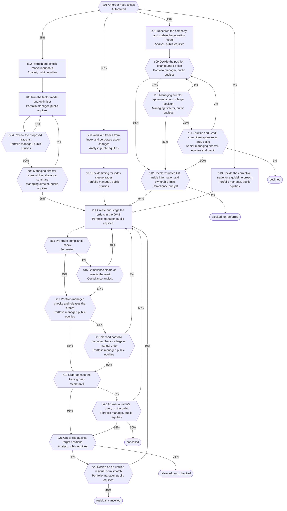

# Make internal public equity investment decisions

`pam-internal-equity-decisions` · public-sector asset management · Investments (public equities) · part of `public-asset-manager`

Internal portfolio managers run factor, index, portfolio completion and fundamental strategies inside the public equity pools and decide which stocks to buy or sell. Most orders come in lists from a monthly factor rebalance or an index change, where an analyst checks data, the portfolio manager runs the model and reviews the trade list and a managing director signs off; fewer orders come from fundamental research, which takes far longer per order and may need managing director or committee approval and a compliance check for inside information. Every order is staged in the order management system, passes pre-trade compliance and is released to the trading desk; data problems, false compliance alerts and waits for index effective dates and approvals drive the elapsed time.

| | |
|---|---|
| Unit of work | one equity order |
| Starts when | A scheduled factor rebalance, an index or corporate action change, a fundamental research conclusion, or a compliance exception requiring a corrective trade. |
| Done when | The order has been released to the trading desk and the resulting position checked against target the next day; or the decision is declined, blocked or the order cancelled. |
| Organisation | A Canadian provincial public-sector asset manager with about 240 staff whose public equities team runs internal factor, index, completion and fundamental strategies inside three equity pools next to external managers. (242 employees, 2019-2022) |
| Volume | 600 cases a month (range 350 to 1,000) |

## Where it sits

- Starts with **security_reference_data** from investment-data-management (60% of cases)
- Starts with **investment_plan** from annual-investment-plan-benchmarks (36% of cases)
- Starts with **compliance_exception** from investment-compliance-monitoring (4% of cases)
- Sends **trade_order** to trade-execution (outcome: released_and_checked)
- Sends **trade_order** to trade-execution (outcome: residual_cancelled)
- Sends **trade_order** to trade-execution (outcome: cancelled)

## Flow

## Roles

| Role | Department | Layer | FTE on this process | Loaded cost per hour | Evidence |
|---|---|---|---:|---:|---|
| Portfolio manager, public equities | Public equities | senior specialist | 1.4 | 195 CAD | C |
| Analyst, public equities | Public equities | individual contributor | 1.3 | 85 CAD | C |
| Managing director, public equities | Public equities | director | 0.08 | 420 CAD | C |
| Senior managing director, equities and credit | Equities and credit | director | 0.01 | 700 CAD | C |
| Compliance analyst | Compliance | individual contributor | 0.08 | 65 CAD | C |

## Steps

Hands-on time and the wait before each step show the most common value. Evidence tier A is a sourced number, B a sourced description, C the author's estimate.

| Step | Who | Kind | Hands-on | Wait before | Control | Evidence |
|---|---|---|---:|---:|---|---|
| **s01 An order need arises.** A need for an equity order appears: the monthly factor rebalance date arrives, an index provider announces constituent changes or a corporate action changes index weights, the fundamental team concludes research on a company, or compliance reports a guideline breach that needs a corrective trade. The order management system and team calendar route the work to the right strategy team. | Automated | system auto | 0 min | 0 min |  | B [mgr_ar21], [mgr_pe] |
| **s02 Refresh and check model input data.** Before the scheduled rebalance the analyst loads prices, fundamentals, factor scores, index weights and security reference data from the data warehouse and vendor feeds into the model, and checks for missing, stale or extreme values, new listings and pending corporate actions, sending data problems to investment data management. Touch time is this order's share of work done for a whole rebalance list, so it is small per order. | Analyst, public equities | validation | 2 min | 2.0 h |  | C [mgr_ar21] |
| **s03 Run the factor model and optimiser.** The portfolio manager runs the scoring model and the portfolio optimiser with the strategy's risk model and constraints (tracking error, factor exposures, sector and name limits, turnover and liquidity), and reviews the target portfolio and the resulting trade list. Touch time is this order's share of work done for a whole rebalance list, so it is small per order. | Portfolio manager, public equities | analysis | 3 min | 1.0 h |  | B [mgr_ar21], [mgr_pe] |
| **s04 Review the proposed trade list.** The portfolio manager screens the list name by name: drops trades too small to be worth the cost, holds names with pending takeovers or index events, checks sizes against average daily volume and decides whether illiquid names should be spread over several days. Touch time is this order's share of work done for a whole rebalance list, so it is small per order. | Portfolio manager, public equities | review | 1 min | 30 min |  | B [cfa_tse] |
| **s05 Managing director signs off the rebalance summary.** The managing director reviews a one-page summary of the rebalance (turnover, expected cost, tracking error, factor and sector shifts) and approves it by email or asks for a rerun. Touch time is this order's share of work done for a whole rebalance list, so it is small per order. | Managing director, public equities | approval | 0.2 min | 4.0 h | Strategy procedures: rebalance summary approved by the head of the strategy before orders are created (author's assumption) | C |
| **s06 Work out trades from index and corporate action changes.** The analyst reads the index provider's announcement or the corporate action notice, builds the pro forma index weights, and calculates the buys and sells the index or completion sleeve needs, including trades to invest dividends or small flows, in a spreadsheet linked to holdings. | Analyst, public equities | lookup | 4 min | 4.0 h |  | B [msci_ir], [mgr_pe] |
| **s07 Decide timing for index sleeve trades.** Near the effective date the portfolio manager decides whether to trade at the effective-date close to keep tracking error low, to pre-position some names, or to leave small differences, and sets the order instructions. | Portfolio manager, public equities | judgment | 1.5 min | 1.0 d |  | B [cfa_tse], [msci_ir] |
| **s08 Research the company and update the valuation model.** The fundamental analyst updates the company model (discounted cash flow, comparables), reads filings and industry data, joins meetings with management and sell-side analysts, notes environmental, social and governance issues and writes up the investment case for an addition, a trim or a new position. | Analyst, public equities | analysis | 1.0 h | 1.0 d |  | B [mgr_job_fe], [mgr_ar21] |
| **s09 Decide the position change and its size.** The portfolio manager challenges the research, decides the target position size within the strategy's limits and the entry or exit plan (limit price, horizon, urgency), and records the rationale in the research file. | Portfolio manager, public equities | judgment | 30 min | 8.0 h |  | B [mgr_ar21], [cfa_tse] |
| **s10 Managing director approves a new or large position.** The managing director reviews the research note and sizing for a new holding or a change above the portfolio manager's limit and approves, asks for more work, or sends very large stakes to the department committee. | Managing director, public equities | approval | 30 min | 1.0 d | Approval authorities in the model manager's investment approval framework (department level; thresholds not published) | B [mgr_ar21] |
| **s11 Equities and Credit committee approves a large stake.** For a large ownership stake, for example one that may bring board representation, the Equities and Credit Investment Department Committee, co-chaired by investments and investment risk with legal and responsible investing present, hears the team at its next meeting and approves, attaches conditions or declines. | Senior managing director, equities and credit | approval | 1.0 h | 5.0 d | The model manager Investment Approval Policy: Investment Department Committees approve decisions up to set thresholds; larger ones go to the Management Investment Committee and the Board | B [mgr_ar21], [mgr_ar22] |
| **s12 Check restricted list, inside information and ownership limits.** A compliance analyst checks the company against the restricted and watch lists (for example after a management meeting that may have passed inside information, or where the model manager has a board nominee), the pool's ownership threshold limits and any client exclusion, and clears or holds the trade. | Compliance analyst | validation | 10 min | 1.0 h | Securities law prohibition on trading with undisclosed material information and the OSC exemption order's conflict policies (insider trading, front running) | B [osc_mgr_2017] |
| **s13 Decide the corrective trade for a guideline breach.** When compliance reports a breach (for example a holding pushed over an issuer limit by a market move or a corporate action), the portfolio manager agrees with compliance how and by when to cure it and sizes the corrective sale or purchase. | Portfolio manager, public equities | judgment | 30 min | 4.0 h | OSC exemption order condition: policies preventing investments that contravene the restrictions in each investment management agreement; breaches cured and reported | B [osc_mgr_2017], [sifma_soc] |
| **s14 Create and stage the orders in the OMS.** The portfolio manager uploads the optimiser or index trade file into the order management system, or keys a fundamental order by hand, choosing the pool or client account, side, quantity and the instructions for the desk (urgency, benchmark such as arrival price or close, limit price). | Portfolio manager, public equities | data entry | 1 min | 30 min |  | B [cfa_tse] |
| **s15 Pre-trade compliance check.** The order management system tests each staged order against coded restrictions for the pool or account (restricted list, issuer and ownership limits, prohibited instruments, cash) and passes it, warns or blocks. | Automated | system auto | 0 min | 1 min | OSC exemption order condition on preventing contraventions of investment restrictions; SOC 1 objective that trades follow portfolio guidelines | B [osc_mgr_2017], [sifma_soc], [deloitte_tc] |
| **s16 Compliance clears or rejects the alert.** A compliance analyst checks whether the warning is a real breach or a reference data problem (unclassified new security, stale share count) and records an override with the reason, or rejects the order back to the portfolio manager. | Compliance analyst | review | 15 min | 45 min | Soft-block overrides decided and logged by compliance, not by the portfolio manager | B [deloitte_tc], [osc_mgr_2017] |
| **s17 Portfolio manager checks and releases the orders.** The portfolio manager looks over the staged orders (sides, sizes against daily volume, accounts, instructions) and releases them to the trading desk's blotter. Orders above a size threshold or keyed by hand need a second portfolio manager's check first. | Portfolio manager, public equities | review | 0.5 min | 15 min |  | B [deloitte_tc], [cfa_tse] |
| **s18 Second portfolio manager checks a large or manual order.** Another portfolio manager compares the order with the approved decision or trade file (security, side, quantity, account) and approves it in the system before it goes to the desk. | Portfolio manager, public equities | review | 2 min | 30 min | Four-eyes check on large or manually keyed orders under the trade management policy (author's assumption) | C [deloitte_tc] |
| **s19 Order goes to the trading desk.** The released order appears on the trading desk's blotter with the portfolio manager's instructions and becomes the desk's to execute. | Automated | system auto | 0 min | 0 min |  | C |
| **s20 Answer a trader's query on the order.** The trader reports a problem (limit away from the market, order large against volume, trading halt, news) and the portfolio manager decides to amend the order, confirm it as it is, or cancel it. | Portfolio manager, public equities | judgment | 5 min | 30 min |  | B [cfa_tse] |
| **s21 Check fills against target positions.** The next morning the analyst compares the strategy's positions after execution with the target portfolio or index weights and flags names left unfilled or filled in the wrong account. Touch time is this order's share of work done for a whole rebalance list, so it is small per order. | Analyst, public equities | validation | 0.5 min | 1.0 d |  | C |
| **s22 Decide on an unfilled residual or mismatch.** The portfolio manager decides whether an unfilled residual is still wanted (new order), can be left until the next rebalance, or whether a misallocated fill needs a correcting trade with operations. | Portfolio manager, public equities | judgment | 5 min | 2.0 h |  | C |

## Exceptions

| Exception | Share of cases | What happens |
|---|---:|---|
| Pre-trade compliance alert | 5% | An order raises a warning or block; compliance overrides a false alert caused by reference data or sends the order back. |
| Large fundamental stake to committee | 0% | A large ownership stake goes to the Equities and Credit Investment Department Committee at its next meeting. |
| Restricted name or inside information | 1% | Compliance holds a fundamental trade because the company is on the restricted list or the team may hold inside information. |
| Model rerun | 6% | The portfolio manager or managing director rejects the factor trade list and the optimiser is rerun with changed constraints. |
| Trader query | 5% | The desk queries an order because of its limit, size or market conditions and the portfolio manager amends or cancels it. |
| Corrective trade for a breach | 4% | Compliance reports a guideline breach and the portfolio manager places a corrective trade. |

## Benchmarks

| Metric | Value | Unit | Population | Evidence |
|---|---|---|---|---|
| cycle_time_days | p50 2, p90 12 | calendar days from the order need arising to the post-trade check | Orders of an institutional internal equity team mixing factor, index and fundamental strategies | C [msci_ir], [cfa_tse] |
| index_reviews_per_year | 4 | MSCI index reviews (two quarterly, two semi-annual in 2022) | MSCI global equity indexes | A [msci_ir] |
| fundamental_analyst_base_pay | low 85000, high 110000 | CAD per year plus incentive | The model manager Analyst, Fundamental Equities posting | A [mgr_job_fe] |

## Pain points

- Bad or late reference data (new listings, share counts, classifications) causes model problems and false pre-trade compliance alerts that hold orders on busy days. (steps s02, s15, s16; B [deloitte_tc])
- Trade lists move between the model, spreadsheets and the order system by file upload and re-keying, which invites fat-finger and account errors. (steps s03, s06, s14; C)
- Fundamental decisions wait for managing director and committee calendars while prices move. (steps s10, s11; C [mgr_ar21])
- Index changes bunch at review effective dates, so a week's work lands on one close. (steps s06, s07; B [msci_ir], [cfa_tse])

## Assumptions

- The unit is one single-security order. Work done once for a whole factor or index list (data checks, model runs, sign-off) is spread across the orders in the list, so per-order touch times on those steps are small.
- Order shares by strategy (45% factor, 38% index and completion, 13% fundamental, 4% corrective) are the author's estimates; the model manager does not publish order counts.
- The process map lists the annual plan, security reference data and compliance exceptions as triggers; scheduled model runs and index changes are counted under reference data and fundamental decisions under the plan's strategy mandate.
- The senior managing director of equities and credit stands for the Equities and Credit Investment Department Committee; that role is in the organisation file but not in the process map's role list.
- The compliance analyst is added for restricted list checks and alert reviews; it is not in the process map's role list.
- Approval thresholds and the four-eyes rule on large orders are assumed; the model manager publishes only that approval authorities are defined.
- Execution itself belongs to trade execution; the case waits through the trading day and ends with the next-morning post-trade check.
- Loaded costs per hour come from the organisation file.

## Sources

- [mgr_ar21] The model manager 2021 Annual Report (link withheld) (The model manager, 2022). Read as the text copy saved under scratch/. Three equity pools and the public market alternatives pool ($29.2 billion pooled at end 2021); pooling brings operational efficiencies in day-to-day pool activities and cash management; public equities combine internal fundamental, factor (size, quality, value, momentum) and index strategies with external managers; fixed income ($17.2 billion) is managed internally for capital preservation and liquidity against FTSE Canada government indices; global credit ($6.0 billion) does not separate public and private credit, plans to internalise through direct co-investments, invested US$500 million with Antares (sponsor-backed middle-market direct lending) and US$500 million with Ares; PMA uses a managed account platform with 12 managers; Investment Policy Statements per strategy set permitted investments and restrictions; Management Investment Committee and three Investment Department Committees (Total Portfolio, Equities and Credit, Real Assets) approve up to thresholds; clean SOC 1 Type I report at 30 September 2021.
- [mgr_ar22] The model manager 2022 Annual Report (link withheld) (The model manager, 2023). Read as the text copy saved under scratch/. Investment Department Committees for Total Portfolio, Equities and Credit and Real Assets, co-chaired by Investments and Investment Risk with Legal and Responsible Investing, approve decisions up to thresholds; Management Investment Committee co-chaired by the CIO and CRO recommends anything needing Board approval.
- [osc_mgr_2017] The model manager, Commission and Director decisions (exemption order) (link withheld) (Ontario Securities Commission, 2017). Read as the text copy saved under scratch/. The model manager exempted from adviser registration on conditions; Board-approved policies must cover a compliance system, books and records, conflicts including front running, soft dollars and fairness in allocating investment opportunities among members and pools, prevention of investments that contravene restrictions set out in each investment management agreement, due diligence on sub-advisers, and due diligence on custodians and brokers before they hold or access assets.
- [sifma_soc] [Asset Manager's Guide to SOC 1](https://www.sifma.org/wp-content/uploads/2017/08/SIFMA_AMG_asset-managers-guide-soc-2017.pdf) (SIFMA Asset Management Group and Grant Thornton, 2017). Read as the text copy saved under scratch/. Baseline SOC 1 control objectives: trades properly authorised, settled and recorded in accordance with portfolio guidelines and account restrictions; contributions and distributions authorised by the client and processed accurately; other control areas include brokerage allocation (best execution, soft dollars, IPO and new issue allocation), broker selection and retention, trade aggregation, trade allocation, trade errors and guideline breaches.
- [mgr_pe] Public Equities (The model manager web page) (link withheld) (The model manager, 2026). Passive strategy tracks a market benchmark for efficient liquidity; factor investing builds exposure to quality, value, momentum and low volatility; fundamental equities including large stakes, sometimes with board representation; external partnerships; a portfolio completion programme manages unintended concentrations; managing directors for factor investing and fundamental equity.
- [mgr_job_fe] Analyst - Fundamental Equities (The model manager job posting) (link withheld) (The model manager via Simplify, 2025). Analyst researches companies and industries, builds financial and valuation models (DCF, comparables, merger models), supports due diligence and investment reports, meets management teams and sell-side analysts, and works with Finance and Investment Operations on accounting for public equities; base pay CA$85,000 to $110,000 plus incentive.
- [cfa_tse] [Trade Strategy and Execution (refresher reading)](https://cfainstitute.org/insights/professional-learning/refresher-readings/2024/trade-strategy-execution) (CFA Institute, 2024). Trade strategy depends on order, security, market and portfolio manager inputs including urgency and alpha decay; portfolio managers work with traders on strategy; liquidity-driven and index trades typically use closing prices; arrival price, VWAP and close benchmarks; implementation shortfall is the standard cost measure; regulators expect a written trade policy covering best execution, trade errors, eligible brokers and execution monitoring.
- [deloitte_tc] [Trading Controls: Prevention and Automation](https://www.deloitte.com/uk/en/Industries/financial-services/blogs/preventative-trading-controls-a-step-change.html) (Deloitte UK (Ed Waller and Jaspreet Jhaj), 2024). Preventative trading controls range from a pre-trade check or prompt to supervisory approval or a hard block; soft blocks can be too easily clicked through, raising fat-finger risk; regulatory or legal restrictions should never be breached while some internal limits allow judgement-based exceptions; manual detective controls are weaker.
- [msci_ir] [Index Review (MSCI web page)](https://www.msci.com/eqb/gimi/stdindex/index_review.html) (MSCI, 2026). MSCI index reviews take place in February, May, August and November; in 2022 February and August were quarterly index reviews and May and November semi-annual index reviews; each review has published announcement and effective dates.

Written by claude-opus on 2026-11-17.
