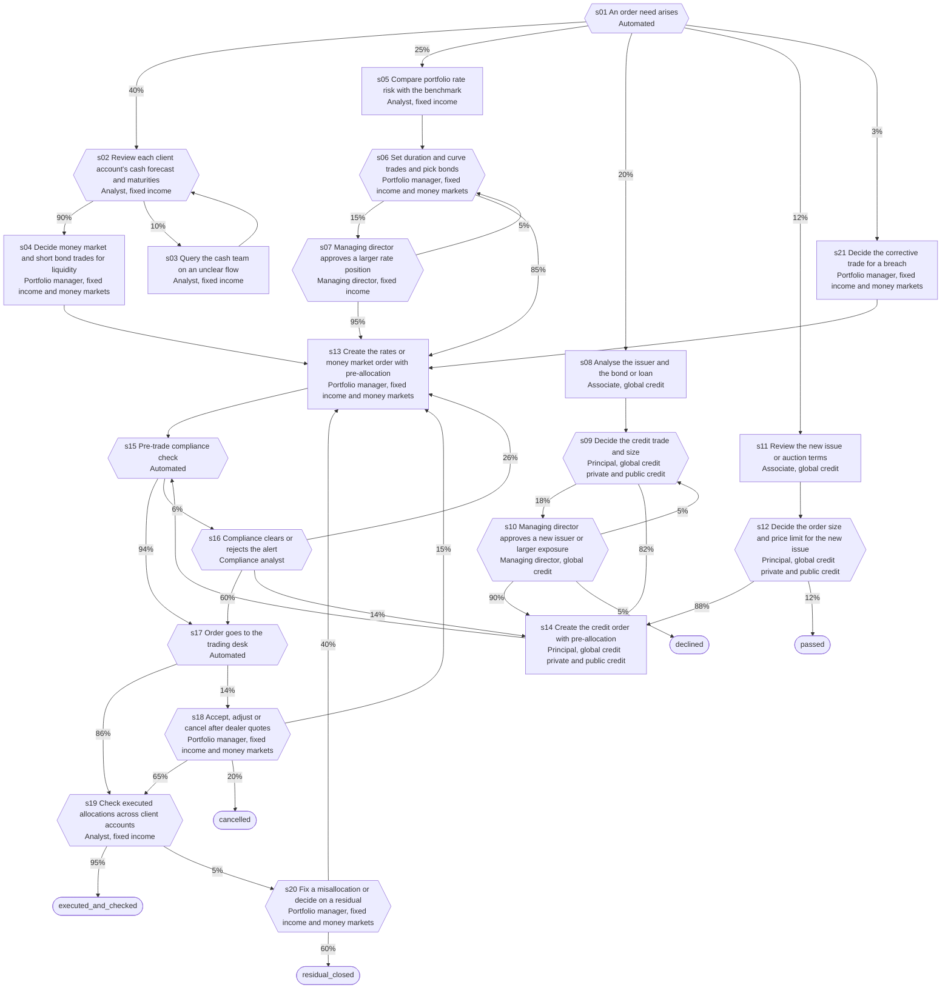

# Make internal fixed income and public credit decisions

`pam-internal-fixed-income-credit-decisions` · public-sector asset management · Investments (fixed income and money markets; global credit) · part of `public-asset-manager`

Fixed income portfolio managers run government bond and money market portfolios held in each client's segregated account for liquidity and interest rate matching, and the global credit team buys and sells public bonds and loans for its single credit portfolio. Each morning an analyst turns the cash forecast into liquidity trades; other orders come from duration and curve views against the benchmark, credit research and new issues, with managing director approval for larger positions or new issuers. Orders carry a pre-allocation across client accounts, pass pre-trade compliance against client and legal limits and go to the desk, which often comes back when dealer quotes are outside the limit. Errors come from missed cash flows, re-keyed allocations and reference data gaps on new issues.

| | |
|---|---|
| Unit of work | one fixed income or credit order |
| Starts when | A liquidity need or surplus in a client account, a duration or curve decision, a credit research view, a new issue or auction, or a compliance exception. |
| Done when | The order is executed and its allocations across client accounts checked, or it is cancelled, declined or passed. |
| Organisation | A Canadian provincial public-sector asset manager with about 240 staff whose fixed income and global credit teams manage segregated client accounts internally alongside external credit partners. (242 employees, 2019-2022) |
| Volume | 300 cases a month (range 150 to 500) |

## Where it sits

- Starts with **security_reference_data** from investment-data-management (40% of cases)
- Starts with **investment_plan** from annual-investment-plan-benchmarks (57% of cases)
- Starts with **compliance_exception** from investment-compliance-monitoring (3% of cases)
- Sends **trade_order** to trade-execution (outcome: executed_and_checked)
- Sends **trade_order** to trade-execution (outcome: residual_closed)
- Sends **trade_order** to trade-execution (outcome: cancelled)

## Flow

## Roles

| Role | Department | Layer | FTE on this process | Loaded cost per hour | Evidence |
|---|---|---|---:|---:|---|
| Portfolio manager, fixed income and money markets | Fixed income and money markets | senior specialist | 0.6 | 195 CAD | C |
| Analyst, fixed income | Fixed income and money markets | individual contributor | 0.45 | 85 CAD | C |
| Managing director, fixed income | Fixed income and money markets | director | 0.03 | 420 CAD | C |
| Principal, global credit (private and public credit) | Global credit (public and private credit) | senior specialist | 0.45 | 195 CAD | C |
| Associate, global credit | Global credit (public and private credit) | individual contributor | 0.45 | 85 CAD | C |
| Managing director, global credit | Global credit (public and private credit) | director | 0.02 | 420 CAD | C |
| Compliance analyst | Compliance | individual contributor | 0.04 | 65 CAD | C |

## Steps

Hands-on time and the wait before each step show the most common value. Evidence tier A is a sourced number, B a sourced description, C the author's estimate.

| Step | Who | Kind | Hands-on | Wait before | Control | Evidence |
|---|---|---|---:|---:|---|---|
| **s01 An order need arises.** A fixed income or credit order need appears: the morning cash forecast shows client withdrawals, capital calls or maturing bills to fund or reinvest; the month-end benchmark extension or a change in rate views calls for duration or curve trades; credit research favours a bond or loan; a new issue or auction is announced; or compliance reports a breach to cure. | Automated | system auto | 0 min | 0 min |  | B [mgr_ar21], [mgr_gc] |
| **s02 Review each client account's cash forecast and maturities.** First thing in the morning the fixed income analyst reads the cash team's forecast for each segregated client account (benefit payment funding, client withdrawals, capital calls, margin, coupons and maturing bills) and lists the cash each account must raise or can invest today and over the next week. | Analyst, fixed income | lookup | 5 min | 1.0 h |  | B [boc_san] |
| **s03 Query the cash team on an unclear flow.** The analyst emails or calls the cash team or the private markets operations team about a flow that looks wrong or is missing a value date, such as a capital call whose notice has not been booked, and updates the list. | Analyst, fixed income | communication | 10 min | 1.0 h |  | C |
| **s04 Decide money market and short bond trades for liquidity.** The portfolio manager decides how each account meets its need or invests surplus cash: buy or sell treasury bills, bankers' acceptances, commercial paper or short government bonds, keeping a ladder of maturities and the account's liquidity buffer, and avoiding forced sales of longer bonds. | Portfolio manager, fixed income and money markets | judgment | 5 min | 30 min |  | B [boc_san], [mgr_ar21] |
| **s05 Compare portfolio rate risk with the benchmark.** The analyst runs the risk system's comparison of each government bond and money market portfolio with its FTSE Canada benchmark: duration, key rate exposures, provincial versus federal weights and the month-end index extension, and prepares the gaps for the portfolio manager. Touch time is this order's share of a portfolio-level review. | Analyst, fixed income | analysis | 8 min | 4.0 h |  | B [mgr_ar21], [pclient_sipp] |
| **s06 Set duration and curve trades and pick bonds.** The portfolio manager decides the duration and curve positions within the portfolio's risk budget, then picks bonds (federal or provincial, on-the-run or off-the-run, maturity) by relative value, and sizes the trade for each client account holding that portfolio. | Portfolio manager, fixed income and money markets | judgment | 10 min | 4.0 h |  | C [cfa_tse] |
| **s07 Managing director approves a larger rate position.** The managing director of fixed income reviews a proposed duration or curve position beyond the portfolio manager's limit, against the team's rate view and tracking error budget, and approves or trims it. | Managing director, fixed income | approval | 15 min | 2.0 h | Fixed income investment policy statement risk budget and delegated limits (thresholds not published) | B [mgr_ar21] |
| **s08 Analyse the issuer and the bond or loan.** A global credit associate reviews the issuer's financial statements, ratings, covenants and, for a loan, the credit agreement terms; compares the spread with similar issuers and the public curve; notes ESG risks; and updates the credit file. Many orders add to or trim names already held, which needs less work. | Associate, global credit | analysis | 40 min | 1.0 d |  | B [mgr_gc] |
| **s09 Decide the credit trade and size.** The global credit principal decides whether to buy or sell, the size for the single global credit portfolio and its split across client accounts, and a price or spread limit, and notes the rationale in the credit file. | Principal, global credit (private and public credit) | judgment | 20 min | 4.0 h |  | B [mgr_gc], [mgr_ar21] |
| **s10 Managing director approves a new issuer or larger exposure.** The managing director of global credit reviews the credit note for an issuer new to the approved list, or an exposure above the principal's single-name limit, and approves, sets a lower limit or declines. | Managing director, global credit | approval | 30 min | 2.0 d | Global credit investment policy statement: approved issuer list and single-name limits (author's assumption of their form) | C [mgr_ar21] |
| **s11 Review the new issue or auction terms.** For a corporate or provincial new issue the associate reads the offering summary, price talk and use of proceeds from the syndicate's announcement; for a Government of Canada auction the fixed income team checks the call for tenders and the bond's place on the curve. | Associate, global credit | lookup | 25 min | 30 min |  | B [bc_auctions] |
| **s12 Decide the order size and price limit for the new issue.** The principal or portfolio manager decides whether to participate, the order size (often larger than the amount wanted because books are scaled back) and the price or spread limit, and the split across client accounts. | Principal, global credit (private and public credit) | judgment | 10 min | 30 min |  | C |
| **s13 Create the rates or money market order with pre-allocation.** The fixed income portfolio manager enters the order in the order management system with security, side, size, limit and the pre-allocation to each client account, so that partial fills are later shared fairly. | Portfolio manager, fixed income and money markets | data entry | 3 min | 15 min | OSC exemption order condition: policies for fairness in allocating investment opportunities among members and pools (pre-allocation recorded before the order) | B [osc_mgr_2017], [sifma_soc] |
| **s14 Create the credit order with pre-allocation.** The global credit principal enters the bond, loan or new issue order with size, limit and the pre-allocation across the client accounts that hold global credit. | Principal, global credit (private and public credit) | data entry | 3 min | 15 min | OSC exemption order condition on fair allocation of investment opportunities among members and pools | B [osc_mgr_2017] |
| **s15 Pre-trade compliance check.** The order management system tests the order against each client account's coded restrictions: permitted instruments, minimum credit ratings, issuer and related-group limits (including the 10% rule of the federal investment rules), duration bands and cash limits. | Automated | system auto | 0 min | 1 min | Federal Investment Rules (Schedule III, Pension Benefits Standards Regulations) incorporated by client pension law and policies; OSC exemption order condition to prevent contraventions of IMA restrictions | B [pclient_sipp], [osc_mgr_2017], [deloitte_tc] |
| **s16 Compliance clears or rejects the alert.** A compliance analyst checks whether the alert is real or caused by data (an unrated new issue, a missing issuer parent link) and records an override with its reason or rejects the order back to the portfolio manager. | Compliance analyst | review | 15 min | 45 min | Overrides of soft blocks decided and logged by compliance, not by the portfolio manager | B [deloitte_tc] |
| **s17 Order goes to the trading desk.** The order appears on the trading desk's blotter, where the trader asks dealers for quotes, submits the bid at auction or places the order with the new issue syndicate. | Automated | system auto | 0 min | 0 min |  | B [cfa_tse] |
| **s18 Accept, adjust or cancel after dealer quotes.** When dealer quotes come back outside the limit, or a new issue is scaled back, the trader asks the portfolio manager, who accepts the level, adjusts size or switches to another bond, or cancels the order. | Portfolio manager, fixed income and money markets | judgment | 5 min | 20 min |  | B [cfa_tse] |
| **s19 Check executed allocations across client accounts.** Next morning the analyst checks that each fill, including partial fills and scaled-back new issues, was allocated to client accounts as pre-allocated or pro rata, and that the resulting duration and cash positions are as intended. | Analyst, fixed income | validation | 2 min | 1.0 d | SOC 1 control objective that trades are allocated and recorded accurately in accordance with portfolio guidelines; fair allocation policy | B [sifma_soc], [osc_mgr_2017] |
| **s20 Fix a misallocation or decide on a residual.** The portfolio manager has operations rebook a misallocated fill before settlement, or decides whether an unfilled residual or a short liquidity position needs a new order. | Portfolio manager, fixed income and money markets | judgment | 10 min | 2.0 h |  | C |
| **s21 Decide the corrective trade for a breach.** When compliance reports a breach (for example a downgrade below a client's minimum rating or an issuer limit exceeded after a market move), the portfolio manager agrees with compliance how and by when to cure it and sizes the sale. | Portfolio manager, fixed income and money markets | judgment | 30 min | 4.0 h | Client investment policies and the Federal Investment Rules; OSC exemption order condition on restrictions in each investment management agreement | B [pclient_sipp], [osc_mgr_2017] |

## Exceptions

| Exception | Share of cases | What happens |
|---|---:|---|
| Unclear cash flow | 4% | The analyst cannot reconcile a forecast flow and queries the cash or private markets operations team before trading. |
| New issuer approval | 4% | A credit purchase in an issuer not on the approved list waits for the managing director. |
| Pre-trade compliance alert | 6% | Rating, issuer or related-group limits fire; compliance overrides a data-driven alert or the order is changed. |
| Quotes outside the limit or scaled-back allocation | 14% | The desk returns to the portfolio manager, who accepts, adjusts, switches bonds or cancels. |
| Stress liquidity day | 2% | Large same-day client withdrawals or margin calls force sales of bills and short bonds and delay rebalancing purchases. |
| Corrective trade | 3% | A downgrade or limit breach requires a sale agreed with compliance. |

## Benchmarks

| Metric | Value | Unit | Population | Evidence |
|---|---|---|---|---|
| cycle_time_days | p50 1.2, p90 4 | calendar days from the order need to the next-day allocation check | Internal government bond, money market and public credit orders of an institutional manager | C |
| single_related_group_limit | 0.1 | share of plan market value | Ontario public service pension plan investments under the Federal Investment Rules | A [pclient_sipp] |
| fixed_income_assets_end_2021 | 17.2 | CAD billions | The model manager | A [mgr_ar21] |
| global_credit_assets_end_2021 | 6.0 | CAD billions | The model manager | A [mgr_ar21] |

## Pain points

- The morning cash forecast depends on other teams booking capital calls, client instructions and margin on time; late or missing flows cause last-minute bill sales or overdrafts. (steps s02, s03, s04; B [boc_san])
- Fixed income is held in each client's segregated account, so one decision becomes several allocated trades that must be pre-allocated, checked and sometimes rebooked. (steps s13, s14, s19, s20; B [osc_mgr_2017])
- New issues often lack ratings or issuer links in reference data at launch, causing compliance alerts at the moment the book is closing. (steps s15, s16; C)
- Dealer quotes in less liquid bonds come back outside limits, sending orders back and forth between desk and portfolio manager. (steps s17, s18; B [cfa_tse])

## Assumptions

- The unit is one order for one security, which may be allocated across several client accounts; portfolio-level reviews are spread over the orders they produce.
- Order shares (40% liquidity, 25% duration and curve, 20% secondary credit, 12% new issues and auctions, 3% corrective) are the author's estimates.
- Process map triggers are kept: daily data (cash forecasts, prices, benchmark changes) is counted under reference data, research and plan-driven positioning under the investment plan.
- Shared steps after order creation are assigned to the fixed income roles, which handle most orders; global credit staff do the same work for credit orders.
- The managing director of global credit and the compliance analyst are added from the organisation file; they are not in the process map's role list.
- Approval limits and the approved issuer list are assumed; the 10% related-group rule comes from a client's published policy and federal pension investment rules.
- Execution belongs to trade execution; the case waits through it and ends with the next-morning allocation check.
- Loaded costs per hour come from the organisation file.

## Sources

- [mgr_ar21] The model manager 2021 Annual Report (link withheld) (The model manager, 2022). Read as the text copy saved under scratch/. Three equity pools and the public market alternatives pool ($29.2 billion pooled at end 2021); pooling brings operational efficiencies in day-to-day pool activities and cash management; public equities combine internal fundamental, factor (size, quality, value, momentum) and index strategies with external managers; fixed income ($17.2 billion) is managed internally for capital preservation and liquidity against FTSE Canada government indices; global credit ($6.0 billion) does not separate public and private credit, plans to internalise through direct co-investments, invested US$500 million with Antares (sponsor-backed middle-market direct lending) and US$500 million with Ares; PMA uses a managed account platform with 12 managers; Investment Policy Statements per strategy set permitted investments and restrictions; Management Investment Committee and three Investment Department Committees (Total Portfolio, Equities and Credit, Real Assets) approve up to thresholds; clean SOC 1 Type I report at 30 September 2021.
- [osc_mgr_2017] The model manager, Commission and Director decisions (exemption order) (link withheld) (Ontario Securities Commission, 2017). Read as the text copy saved under scratch/. The model manager exempted from adviser registration on conditions; Board-approved policies must cover a compliance system, books and records, conflicts including front running, soft dollars and fairness in allocating investment opportunities among members and pools, prevention of investments that contravene restrictions set out in each investment management agreement, due diligence on sub-advisers, and due diligence on custodians and brokers before they hold or access assets.
- [sifma_soc] [Asset Manager's Guide to SOC 1](https://www.sifma.org/wp-content/uploads/2017/08/SIFMA_AMG_asset-managers-guide-soc-2017.pdf) (SIFMA Asset Management Group and Grant Thornton, 2017). Read as the text copy saved under scratch/. Baseline SOC 1 control objectives: trades properly authorised, settled and recorded in accordance with portfolio guidelines and account restrictions; contributions and distributions authorised by the client and processed accurately; other control areas include brokerage allocation (best execution, soft dollars, IPO and new issue allocation), broker selection and retention, trade aggregation, trade allocation, trade errors and guideline breaches.
- [mgr_gc] Global Credit (The model manager web page) (link withheld) (The model manager, 2026). One consolidated global credit portfolio across public credit (investment grade and high yield bonds, leveraged loans, specialty credit) and private credit (direct middle-market lending, structured credit and capital solutions, real asset lending); bond selection by credit analysis; ESG risk analysis in direct investment decisions; strategic partners include Antares, Ares, Blackstone, Carlyle and KKR; managing directors of global credit.
- [boc_san] [COVID-19 crisis: Liquidity management at Canada's largest public pension funds (Staff Analytical Note 2021-11)](https://bankofcanada.ca/san2021-11) (Bank of Canada, 2021). Read as the text copy saved under scratch/. Large Canadian public pension funds keep liquidity buffers of high-quality assets they can sell, pledge as margin or repo; March 2020 liquidity demands came mainly from derivative margin calls; funds raised cash through term repos and sales of bankers' acceptances; rebalancing into equities led to Government of Canada bond sales; most funds delayed rebalancing until April; opportunistic purchases of corporate and provincial bonds were small.
- [bc_auctions] [Government securities auctions](https://www.bankofcanada.ca/markets/government-securities-auctions/) (Bank of Canada, 2026). The Bank sells Government of Canada bonds and treasury bills at auction to government securities distributors and dealers (16 distributors, 10 primary dealers for bonds); standard terms cover participation by distributors and customers; auction timetable and quarterly bond schedule published.
- [pclient_sipp] Statement of Investment Policies and Procedures for the Public Service Pension Plan (link withheld) (The pension client, 2025). Read as the text copy saved under scratch/. Permitted investments are those in the applicable the model manager Investment Policy Statements (cash and short-term, fixed income including private placements, private debt); investments must comply with the Income Tax Act, the Pension Benefits Act and the Federal Investment Rules (Schedule III of the Pension Benefits Standards Regulations); the fund may not lend to or invest in one related group more than 10% of plan market value unless government-guaranteed; government bond allocation split into short, mid and long term with ranges.
- [cfa_tse] [Trade Strategy and Execution (refresher reading)](https://cfainstitute.org/insights/professional-learning/refresher-readings/2024/trade-strategy-execution) (CFA Institute, 2024). Fixed income trades bilaterally through dealers; trade strategy depends on order size, liquidity, volatility and the portfolio manager's urgency; portfolio managers work with traders on strategy; implementation shortfall is the standard cost measure.
- [deloitte_tc] [Trading Controls: Prevention and Automation](https://www.deloitte.com/uk/en/Industries/financial-services/blogs/preventative-trading-controls-a-step-change.html) (Deloitte UK (Ed Waller and Jaspreet Jhaj), 2024). Preventative controls range from a pre-trade check or prompt to supervisory approval or a hard block; soft blocks can be clicked through; legal restrictions should never be breached while internal limits allow judgement.

Written by claude-opus on 2026-11-17.
