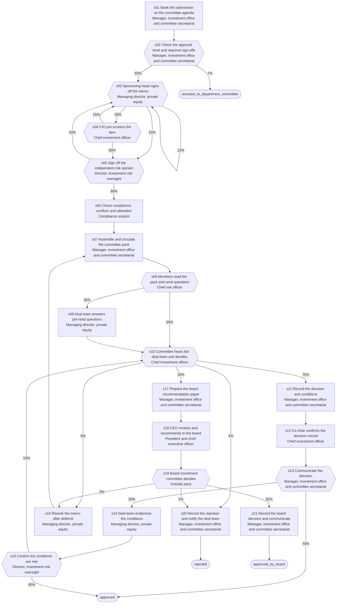

# Approve investments at the investment committee

`pam-investment-committee-approval` · public-sector asset management · investments (investment governance) · part of `public-asset-manager`

Direct investments, co-investments, fund commitments, new external mandates, follow-ons and exits above an asset class team's authority go to the weekly Management Investment Committee, co-chaired by the chief investment officer and chief risk officer with the general counsel. The investment office checks the approval level, collects the sponsor's sign-off, the independent risk opinion and a compliance check, circulates the pack, records the decision and any conditions, and sends items above the committee's authority to the board's investment committee. Elapsed time is driven by the weekly cut-off, members' calendars, risk review queues and, for large items, the board calendar, which presses deal teams facing seller deadlines.

| | |
|---|---|
| Unit of work | one investment committee submission |
| Starts when | A deal team, manager research or a private markets team submits an investment memo with its independent risk opinion and asks for a committee decision. |
| Done when | The decision and any conditions are recorded and communicated, conditions are confirmed met, or the item is rejected or rerouted; for items above the committee's authority, the board has decided. |
| Organisation | A provincial not-for-profit asset manager of about 240 staff that invests about $79 billion for a few public pension plans and an insurance board through pooled funds and segregated accounts, on a cost recovery basis. (242 employees, 2019-2022) |
| Volume | 8 cases a month (range 6 to 14) |

## Where it sits

- Starts with **investment_memo** from ext-manager-search-selection (15% of cases)
- Starts with **investment_memo** from pe-coinvest-screening-dd (25% of cases)
- Starts with **investment_memo** from real-asset-direct-investment-dd (20% of cases)
- Starts with **investment_memo** from private-credit-underwriting (15% of cases)
- Starts with **investment_memo** from fund-commitment (12% of cases)
- Starts with **investment_memo** from private-investment-exit (8% of cases)
- Starts with **risk_opinion** from new-investment-risk-review (5% of cases)
- Sends **ic_decision** to private-deal-closing-funding (outcome: approved)
- Sends **ic_decision** to private-deal-closing-funding (outcome: approved_by_board)
- Sends **ic_decision** to ext-manager-onboarding (outcome: approved)
- Sends **ic_decision** to private-investment-exit (outcome: approved)
- Sends **ic_decision** to board-committee-meetings (outcome: approved_by_board)
- Sends **ic_decision** to board-committee-meetings (outcome: approved)

## Flow

## Roles

| Role | Department | Layer | FTE on this process | Loaded cost per hour | Evidence |
|---|---|---|---:|---:|---|
| Chief investment officer | Investments | executive | 0.05 | 1800 CAD | A [mgr_ar21], [mgr_ar22] |
| Chief risk officer | Investment risk | executive | 0.03 | 850 CAD | A [mgr_ar21], [mgr_ar22] |
| President and chief executive officer | Executive office and board secretariat | executive | 0.01 | 1800 CAD | C |
| Manager, investment office and committee secretariat | Investments | manager | 0.45 | 130 CAD | C |
| Managing director, private equity | Private equity | director | 0.03 | 420 CAD | C |
| Managing director, infrastructure | Infrastructure | director | 0.02 | 420 CAD | C |
| Managing director, real estate | Real estate | director | 0.02 | 420 CAD | C |
| Managing director, global credit | Global credit (public and private credit) | director | 0.02 | 420 CAD | C |
| Director, investment risk oversight | Investment risk oversight | director | 0.05 | 240 CAD | B [jobbank_11101] |
| Compliance analyst | Compliance | individual contributor | 0.03 | 65 CAD | B [jobbank_11101] |

## Steps

Hands-on time and the wait before each step show the most common value. Evidence tier A is a sourced number, B a sourced description, C the author's estimate.

| Step | Who | Kind | Hands-on | Wait before | Control | Evidence |
|---|---|---|---:|---:|---|---|
| **s01 Book the submission on the committee agenda.** A deal team asks the investment office for a slot at an upcoming weekly committee meeting. The office logs the item in the pipeline tracker with its type (direct investment, co-investment, fund commitment, new mandate, follow-on or exit), size, stage (preliminary or final approval) and any seller or closing deadline. | Manager, investment office and committee secretariat | intake | 30 min | 12.0 h |  | B [mgr_nr21], [umbrex] |
| **s02 Check the approval level and required sign-offs.** The investment office compares the size and type of the item with the delegated approval authorities: below a threshold it goes to the relevant Investment Department Committee, otherwise to the Management Investment Committee, and above that committee's authority to the board. It lists the sign-offs the paper needs: risk opinion, legal and compliance. | Manager, investment office and committee secretariat | validation | 30 min | 4.0 h | The model manager Investment Approval Policy and delegated authorities between the board, Management Investment Committee and Investment Department Committees | A [mgr_ar21], [mgr_ar22] |
| **s03 Sponsoring head signs off the memo.** The asset class head reviews the investment memo, the model, the sizing and the split across client accounts or pools, and signs it off for submission or sends it back to the deal team for more work. | Managing director, private equity | review | 2.0 h | 1.0 d |  | C |
| **s04 CIO pre-screens the item.** For preliminary approvals and new strategies, the chief investment officer previews the memo outline at the weekly pipeline meeting and decides whether it is ready for the committee or needs more work first. | Chief investment officer | review | 20 min | 2.0 d |  | B [umbrex], [sow_pe] |
| **s05 Sign off the independent risk opinion.** The director of investment risk oversight reviews the written risk opinion prepared by the risk team on the final memo (concentration, leverage, liquidity, currency, fit with risk budgets) and signs it for the committee pack; preliminary items get a short risk note. Risk questions sometimes force memo changes. | Director, investment risk oversight | review | 45 min | 2.0 d | Independent risk review of new investments before a committee decision (risk function separate from investment teams) | B [mgr_ar21], [fsra21] |
| **s06 Check compliance, conflicts and allocation.** A compliance analyst checks the restricted list and staff conflicts, whether regulatory filings are needed (ownership, competition or foreign investment), and that the split of the investment across client accounts and pools follows each client's restrictions and the allocation policy. | Compliance analyst | validation | 1.0 h | 1.0 d | OSC exemption order on the model manager: compliance system prevents contraventions of each investment management agreement and allocates opportunities fairly among members and pools | B [osc_mgr_2017] |
| **s07 Assemble and circulate the committee pack.** The investment office checks the paper against the committee template, adds the risk opinion, compliance note and draft resolution, places it on the agenda and circulates the pack to members before the weekly cut-off. Papers that miss the cut-off wait a week. | Manager, investment office and committee secretariat | coordination | 1.0 h | 1.0 d | Committee mandate: papers circulated to members before the meeting | B [ca_gov20] |
| **s08 Members read the pack and send questions.** Committee members, including the chief risk officer and general counsel, read the pack and send questions to the deal team through the investment office. | Chief risk officer | review | 1.0 h | 2.0 d |  | C |
| **s09 Deal team answers pre-read questions.** The deal team prepares short written answers or extra analysis, such as a downside case or a different client split, and the investment office adds them to the pack. | Managing director, private equity | drafting | 1.5 h | 12.0 h |  | C |
| **s10 Committee hears the deal team and decides.** The Management Investment Committee, co-chaired by the chief investment officer and chief risk officer with the general counsel and other senior managers, hears the deal team, questions the case, records recusals and approves, approves with conditions, recommends the item to the board, defers it for more work or rejects it. | Chief investment officer | approval | 45 min | 1.0 h | Management Investment Committee mandate: approval, review and governance process for investment decisions; every decision needing board approval is first recommended by the committee | A [mgr_ar21], [mgr_ar22] |
| **s11 Record the decision and conditions.** The investment office writes the decision record: the approval, any conditions, the amount by client account or pool, recusals and the vote, and logs it in the approvals register against delegated limits for quarterly reporting to the board. | Manager, investment office and committee secretariat | drafting | 45 min | 12.0 h |  | B [ca_gov20] |
| **s12 Co-chair confirms the decision record.** The chief investment officer, as co-chair, reads the draft decision record, corrects the wording of any conditions or amounts by client account, and confirms it as the official record. | Chief investment officer | approval | 15 min | 1.0 d | Decision records confirmed by the committee chair | C |
| **s13 Communicate the decision.** The investment office emails the decision memo to the deal team, legal, private markets operations and finance so the team can sign or bid, legal can start documents and operations can prepare funding. | Manager, investment office and committee secretariat | communication | 20 min | 1.0 h |  | C |
| **s14 Deal team evidences the conditions.** Where approval carried conditions, such as a maximum price, final terms, a confirmatory diligence finding or a co-investor's commitment, the deal team gathers the evidence as the deal progresses and sends it to the investment office. | Managing director, private equity | drafting | 1.0 h | 7.0 d |  | B [sow_pe] |
| **s15 Confirm the conditions are met.** The director of investment risk oversight, with the investment office, checks the evidence against each condition and closes the item in the register, or sends it back to the committee if a condition cannot be met. | Director, investment risk oversight | validation | 30 min | 1.0 d | Conditions of approval verified before closing | C |
| **s16 Rework the memo after deferral.** The deal team does the extra work the committee asked for, such as more diligence, a revised price or a smaller commitment, and resubmits for a later meeting. | Managing director, private equity | drafting | 8.0 h | 5.0 d |  | C |
| **s17 Prepare the board recommendation paper.** For items above the committee's authority, the investment office turns the memo, risk opinion and committee recommendation into a board paper with a draft resolution for the Board Investment Committee (from September 2021) or the board. | Manager, investment office and committee secretariat | drafting | 3.0 h | 1.0 d |  | A [mgr_ar21], [mgr_ar22] |
| **s18 CEO reviews and recommends to the board.** The chief executive reviews the board paper and the committee's recommendation and signs the recommendation, sometimes after a call with the deal team. | President and chief executive officer | approval | 30 min | 1.0 d | Investment Approval Policy: material investment decisions approved by the board | A [mgr_ar21], [mgr_ar22] |
| **s19 Board investment committee decides.** The Board Investment Committee, made up of all directors, considers the item at its next meeting or at a special meeting called for a seller deadline, and approves, defers or rejects it. | Outside party | approval | 0 min | 10.0 d | Board Investment Committee mandate: review and approve investment decisions and activities | A [mgr_ar21], [mgr_ar22] |
| **s20 Record the rejection and notify the deal team.** The investment office records the rejection and its reasons in the register and tells the deal team, which informs the seller or general partner. | Manager, investment office and committee secretariat | communication | 20 min | 12.0 h |  | B [gkm_nber] |
| **s21 Record the board decision and communicate.** The investment office records the board resolution with any conditions in the approvals register and sends the decision to the deal team, legal and operations so documents and funding can proceed. | Manager, investment office and committee secretariat | communication | 30 min | 12.0 h |  | C |

## Exceptions

| Exception | Share of cases | What happens |
|---|---:|---|
| Item within department committee authority | 7% | The size or type is within an Investment Department Committee's threshold, so the item leaves this process. |
| Memo returned before submission | 25% | The sponsoring head, the CIO's pre-screen or risk questions send the memo back to the deal team. |
| Deferred for more work | 8% | The committee asks for more diligence, a different price or a smaller size and the item returns to a later meeting. |
| Board approval needed | 10% | The item is above the committee's authority and goes to the Board Investment Committee, often at a special meeting when a seller deadline is close. |
| Conditions precedent | 23% | Approval carries conditions that the deal team must evidence before signing; a condition that cannot be met returns the item to the committee. |

## Benchmarks

| Metric | Value | Unit | Population | Evidence |
|---|---|---|---|---|
| cycle_time_days | p50 14, p90 35 | calendar days from booking on the agenda to the decision being communicated (or conditions closed) | Management Investment Committee submissions at a Canadian public-sector asset manager | C |
| board_investment_committee_meetings_per_year | 2021 2, 2022 7 | meetings | The model manager Board Investment Committee (created 23 September 2021) | A [mgr_ar21], [mgr_ar22] |
| direct_and_coinvestment_transactions | 35 | transactions in 2021 | The model manager | A [mgr_nr21] |
| share_of_opportunities_closed_after_committee_review | 0.1 | about 6 closed per 62 reviewed by the committee | Private equity investors surveyed by Gompers, Kaplan and Mukharlyamov | A [gkm_nber] |

## Pain points

- Papers that miss the weekly cut-off or wait for a risk opinion lose a week, which presses deal teams facing seller deadlines. (steps s05, s07; C)
- Several reviews before the meeting (sponsor, CIO pre-screen, risk, compliance) each can send the memo back. (steps s03, s04, s05, s06; B [umbrex])
- Items above management authority wait for the board's investment committee, which met only twice in late 2021 and seven times in 2022, so special meetings are needed for deadlines. (steps s17, s18, s19; A [mgr_ar21], [mgr_ar22])

## Assumptions

- The organisation file describes the committee as chaired by the CIO with the CEO and chief risk officer; the model manager's 2021 and 2022 annual reports describe it as co-chaired by the CIO and chief risk officer with the general counsel and other senior managers. This workflow follows the annual reports and has the CEO review only items going to the board.
- Deal-team steps are shown under md_private_equity as the representative sponsor; the infrastructure, real estate and credit heads do the same steps with the same cost range. compliance_analyst is an organisation file role added for the compliance check.
- Only one member's reading time (the chief risk officer's) is counted at s08; other members' reading and meeting time is not counted as hands-on time.
- The share of items above the committee's authority (10%), deferrals (8%), rejections (4%) and conditional approvals (30%) are author estimates; the model manager has not published its thresholds.
- Loaded costs are the organisation file's ranges.

## Sources

- [mgr_ar21] The model manager 2021 Annual Report (link withheld) (The model manager, 2022). 10 board, 6 finance and audit, 6 human resources and compensation, 4 nominating and governance meetings and 2 Board Investment Committee meetings in 2021; nine directors; Board Investment Committee of all directors created 23 September 2021 to approve investment decisions and review asset allocation advice; four board committees and their mandates; annual board evaluation; Management Investment Committee co-chaired by the CIO and chief risk officer with the general counsel and other senior managers, which must first recommend every investment decision needing board approval; three Investment Department Committees (Total Portfolio, Equities and Credit, Real Assets) set up in 2021 that approve up to thresholds; Investment Approval Policy; one benchmark per asset class investment policy statement; benchmark policy (Risk researches and reviews, Management Investment Committee recommends, board approves); liquidity coverage ratio of high-quality liquid assets to stressed net outflows including client outflows, rebalancing, capital calls and foreign exchange hedging, under past stresses and a one-in-20-year event; counterparty exposure measured daily with ISDA netting and collateral; clean SOC 1 Type I report on control design. Read from a text copy saved under scratch/.
- [mgr_ar22] The model manager 2022 Annual Report (link withheld) (The model manager, 2023). 5 board, 7 Board Investment Committee, 6 finance and audit, 4 human resources and compensation and 5 nominating and governance meetings in 2022; board meets at least quarterly; Management Investment Committee composition and delegation to Investment Department Committees; benchmark policy; leverage used for the first time in 2022 at the total portfolio level and a leverage framework and guideline setting client targets and pool-level limits; new risk and total portfolio management system partly live December 2022; systematic rebalancing; currency hedging named as a useful tool; liquidity coverage ratio definition; expanded liquidity analysis in 2022. Read from a text copy saved under scratch/.
- [mgr_nr21] The model manager posts 2021 net return of 9.6%, outperforms benchmark (news release) (link withheld) (The model manager via Cision Newswire, 2022). 35 direct and co-investment transactions in 2021; four private equity fund commitments totalling $1.5 billion; new pools; money market and other includes active asset allocation and dynamic foreign exchange; $79 billion under management.
- [fsra21] [Alternative Assets and Risk Management: Insights into Practices Observed from FSRA's Review of Six Large Public Sector Pension Plans in Ontario](https://fsrao.ca/media/4946/download) (Financial Services Regulatory Authority of Ontario, 2021). Observed practice: a liquidity management process keeps high-quality liquid assets available for potential cash demands over conservative horizons, allowing for severe events that freeze funding markets; centralised risk control separate from investment teams; plans faced significant liquidity demands in March 2020. Read from a text copy saved under scratch/.
- [ca_gov20] [Endowment Governance Part 3: Process and Engagement](https://www.cambridgeassociates.com/insight/endowment-governance-part-3-process-and-engagement/) (Cambridge Associates, 2020). Chair owns the agenda with staff; materials at least a week before the meeting; regular meetings of two to four hours; record attendance, votes by name and recusals; circulate minutes promptly to confirm decisions; members should vote on asset allocation, benchmark and risk parameter changes.
- [umbrex] [Investment-Decision Process (Twenty-four ways to classify private equity firms)](https://umbrex.com/resources/twenty-four-ways-to-classify-private-equity-firms/investment-decision-process/) (Umbrex, 2025). Decision processes range from a single central committee meeting twice a week to tiered pre-IC, interim and final committees and cheque-size limits below which heads approve alone.
- [sow_pe] [Private Equity New Investment Process](https://streetofwalls.com/finance-training-courses/private-equity-training/private-equity-investment-process/) (Street of Walls, 2015). Staged committee approvals: short first review, 30 to 40 page preliminary memo, final memo with a recommended price; approvals tied to valuation ranges and budgets; confirmatory diligence takes three to six weeks.
- [gkm_nber] [What Do Private Equity Firms Say They Do? (NBER Working Paper 21133)](https://www.nber.org/papers/w21133.pdf) (National Bureau of Economic Research, 2015). Survey deal funnel: of 100 opportunities about 62 are reviewed with the partner group or investment committee, 24 get deep diligence, 14 reach a signed agreement and 6 close. Read from a text copy saved under scratch/.
- [osc_mgr_2017] The model manager, Commission and Director decisions (exemptions for the model manager and its investment pools) (link withheld) (Ontario Securities Commission, 2017). Compliance system must prevent investments that contravene restrictions set out in each investment management agreement; fairness in allocating investment opportunities among members and pools; commodity futures advising rules. Read from a text copy saved under scratch/.
- [jobbank_11101] [Wages: Financial Analyst (NOC 11101) in the Toronto Region](https://www.jobbank.gc.ca/marketreport/wages-occupation/12417/22437) (Job Bank, Government of Canada, 2025). Toronto hourly wages low $27.97, median $41.60, high $73.57 (reference period 2023-2024), used by the organisation file for analyst costs.

Written by claude-opus on 2026-11-17.
