# Monitor investment compliance

`pam-investment-compliance-monitoring` · public sector asset management · compliance · part of `public-asset-manager`

Every business day a three-person compliance team checks the overnight run of the compliance engine, which tests each pool, client account and external manager account against the restrictions coded from client IMAs, investment policies, pool guidelines and pension investment rules. Analysts triage a few dozen alerts, spend much of the morning chasing alerts caused by bad security reference data, answer pre-trade override requests and investigate the few possible real breaches with portfolio managers or external managers. Confirmed breaches are classified by the chief compliance officer, logged, reported to the client where required and tracked until cured; stale feeds, weekend gaps and external manager response times stretch the elapsed time.

| | |
|---|---|
| Unit of work | one business day's compliance run with its alerts |
| Starts when | The investment book of record closes the business day and the overnight compliance batch runs on the day's positions and trades. |
| Done when | Every alert has a disposition, pre-trade overrides are decided, confirmed breaches are classified, logged, notified and tracked to cure, and the daily checklist is signed. |
| Organisation | A provincial not-for-profit asset manager of about $79 billion with pools, segregated client accounts and about 120 external manager mandates. (242 employees, 2019-2022) |
| Volume | 21 cases a month (range 20 to 23) |

## Where it sits

- Starts with **trade_ticket** from trade-capture-confirmation (85% of cases)
- Starts with **manager_mandate** from ext-manager-onboarding (7% of cases)
- Starts with **client_ips** from client-ips-asset-mix-review (5% of cases)
- Starts with **client_account_setup** from client-onboarding-transition (3% of cases)
- Sends **compliance_exception** to ext-manager-monitoring (outcome: signed_off)
- Sends **compliance_exception** to client-monthly-reporting (outcome: signed_off)
- Sends **compliance_exception** to internal-equity-decisions (outcome: signed_off)
- Sends **compliance_exception** to internal-fixed-income-credit-decisions (outcome: signed_off)
- Sends **compliance_exception** to regulatory-filings (outcome: signed_off)

## Flow

```mermaid
flowchart TD
    s01{{"s01 Load end-of-day positions, trades, prices and reference data<br/>Automated"}}
    s02["s02 Results wait over the weekend or holiday<br/>Automated"]
    s03["s03 Run the overnight post-trade compliance rules<br/>Automated"]
    s04{{"s04 Check the run is complete and the feeds are current<br/>Compliance analyst"}}
    s05["s05 Chase the missing feed and rerun<br/>Compliance analyst"]
    s06{{"s06 Triage the day's alerts<br/>Compliance analyst"}}
    s07["s07 Investigate data-driven false alerts<br/>Compliance analyst"]
    s08["s08 Correct the security reference data<br/>Analyst, investment data"]
    s09["s09 Rerun the affected rules<br/>Automated"]
    s10{{"s10 Review ownership and regulatory threshold report<br/>Compliance analyst"}}
    s11["s11 Notify legal of a threshold crossing<br/>Compliance analyst"]
    s12{{"s12 Answer pre-trade warnings and override requests<br/>Compliance analyst"}}
    s13{{"s13 Investigate the possible breach<br/>Compliance analyst"}}
    s14["s14 Portfolio manager explains the breach and proposes the fix<br/>Portfolio manager, public equities"]
    s15["s15 Notify the external manager and request its explanation<br/>Compliance analyst"]
    s16["s16 External manager confirms the cause and the fix<br/>Outside party"]
    s17["s17 Chief compliance officer reviews and classifies the breach<br/>Chief compliance officer"]
    s18{{"s18 Log the breach and notify the teams<br/>Compliance analyst"}}
    s19["s19 Tell the client about the breach<br/>Client relationship manager  lead for one or two clients"]
    s20{{"s20 Close the day's run<br/>Compliance analyst"}}
    s21{{"s21 Confirm the breach is cured<br/>Compliance analyst"}}
    s22["s22 Escalate an uncured breach<br/>Chief compliance officer"]
    s23["s23 Weekly review of dispositions and overrides<br/>Chief compliance officer"]
    s01 -->|"78%"| s03
    s01 -->|"22%"| s02
    s02 --> s03
    s03 --> s04
    s04 -->|"85%"| s06
    s04 -->|"15%"| s05
    s05 --> s06
    s06 -->|"85%"| s07
    s06 -->|"15%"| s10
    s07 --> s08
    s08 --> s09
    s09 --> s10
    s10 -->|"3%"| s11
    s10 -->|"97%"| s12
    s11 --> s12
    s12 -->|"25%"| s13
    s12 -->|"75%"| s20
    s13 -->|"30%"| s20
    s13 -->|"40%"| s14
    s13 -->|"30%"| s15
    s14 --> s17
    s15 --> s16
    s16 --> s17
    s17 --> s18
    s18 -->|"30%"| s19
    s18 -->|"70%"| s21
    s19 --> s21
    s20 -->|"20%"| s23
    s20 -->|"80%"| end0
    s21 -->|"85%"| s20
    s21 -->|"15%"| s22
    s22 --> s21
    s23 --> end0
    end0(["signed_off"])
```

## Roles

| Role | Department | Layer | FTE on this process | Loaded cost per hour | Evidence |
|---|---|---|---:|---:|---|
| Compliance analyst | Compliance | individual contributor | 1.1 | 65 CAD | B [jb_11109] |
| Chief compliance officer | Compliance | director | 0.06 | 190 CAD | B [osc_mgr_2017] |
| Portfolio manager, public equities | Public equities | senior specialist | 0.02 | 195 CAD | C |
| Analyst, investment data | Investment data management | individual contributor | 0.1 | 56 CAD | C |
| Client relationship manager (lead for one or two clients) | Client relationship management | senior specialist | 0.005 | 160 CAD | C |

## Steps

Hands-on time and the wait before each step show the most common value. Evidence tier A is a sourced number, B a sourced description, C the author's estimate.

| Step | Who | Kind | Hands-on | Wait before | Control | Evidence |
|---|---|---|---:|---:|---|---|
| **s01 Load end-of-day positions, trades, prices and reference data.** After the investment book of record closes the day, the compliance engine in the order management platform loads positions and trades for every pool, client and external manager account, custodian holdings for external mandates, prices, exchange rates and security reference data. | Automated | system auto | 0 min | 6.0 h |  | B [bbg_comp] |
| **s02 Results wait over the weekend or holiday.** When the run falls before a weekend or holiday, the overnight results and alerts sit until the next business day because the compliance team does not work weekends. | Automated | system auto | 0 min | 2.0 d |  | C |
| **s03 Run the overnight post-trade compliance rules.** The engine tests every coded rule (client IMA and policy restrictions, pool guidelines, mandate guidelines, concentration and voting share limits, leverage and derivative limits) against the day's holdings and produces the alert list. | Automated | system auto | 0 min | 20 min | OSC exemption order for the model manager: compliance system preventing investments that contravene IMA restrictions | A [osc_mgr_2017], [pbsr_sch3] |
| **s04 Check the run is complete and the feeds are current.** In the morning the compliance analyst checks that the run finished for every account, that custodian and external manager holdings files arrived for the right date and that prices are not stale, before trusting the alerts. | Compliance analyst | validation | 20 min | 7.0 h |  | B [mm_ptc] |
| **s05 Chase the missing feed and rerun.** The analyst asks investment data management or the custodian for the missing or stale holdings or price file, waits for the reload and reruns the affected accounts. | Compliance analyst | communication | 30 min | 1.0 h |  | C |
| **s06 Triage the day's alerts.** The analyst works down the alert list, typically a few dozen items, separating known and approved exceptions, passive drifts within cure periods, alerts caused by bad reference data and possible real breaches, and records a first disposition for each. | Compliance analyst | analysis | 2.0 h | 15 min |  | C |
| **s07 Investigate data-driven false alerts.** For each suspect alert the analyst looks up the security in the market data terminal and the security master, finds the wrong issuer link, sector, country, rating or asset type behind it and raises a correction request to investment data management. | Compliance analyst | lookup | 45 min | 0 min |  | C |
| **s08 Correct the security reference data.** An investment data analyst checks the request against vendor data, corrects the security master record (issuer hierarchy, classification, rating or identifiers) with a second check and confirms the fix to compliance. | Analyst, investment data | data entry | 30 min | 2.0 h |  | C |
| **s09 Rerun the affected rules.** The compliance engine reruns the rules for the accounts holding the corrected securities so that false alerts clear and any remaining alerts reflect real positions. | Automated | system auto | 0 min | 30 min |  | C |
| **s10 Review ownership and regulatory threshold report.** The analyst reviews the aggregate holdings report across all pools and client accounts for issuers near the voting share limit or securities law reporting thresholds, and for related party and restricted list hits. | Compliance analyst | validation | 15 min | 0 min | Pension Benefits Standards Regulations Schedule III (30% rule, related party rules) as incorporated in client policies | A [pbsr_sch3], [pclient_sipp] |
| **s11 Notify legal of a threshold crossing.** The analyst confirms the aggregate position, the date the threshold was crossed and the accounts involved, and sends it to legal for the ownership or regulatory filing and to the portfolio managers to stop further buying. | Compliance analyst | communication | 1.0 h | 30 min | Securities law ownership reporting thresholds in Canada and abroad | C |
| **s12 Answer pre-trade warnings and override requests.** During the trading day the analyst reviews soft pre-trade warnings that portfolio managers or traders ask to override, checks the rule and the reason given and approves or rejects the override, escalating hard blocks to the chief compliance officer. | Compliance analyst | approval | 1.0 h | 0 min | Compliance approval of pre-trade override requests, independent of the portfolio manager | B [bbg_comp] |
| **s13 Investigate the possible breach.** The analyst confirms the holding with custodian or manager records, rereads the guideline or IMA wording, checks whether the rule is coded correctly and whether the position arose from a trade (active) or from market movement or a corporate action (passive). | Compliance analyst | analysis | 1.0 h | 30 min |  | C |
| **s14 Portfolio manager explains the breach and proposes the fix.** The internal portfolio manager confirms how the position arose and proposes a fix and timing, such as selling the excess, closing a derivative or waiting for a cure period, and states whether the client lost money. | Portfolio manager, public equities | judgment | 40 min | 2.0 h |  | C |
| **s15 Notify the external manager and request its explanation.** The analyst emails the external manager's compliance officer with the position, the guideline breached and the date, copies the mandate's portfolio manager and manager research, and asks for the cause, the fix and any compensation proposal. | Compliance analyst | communication | 30 min | 30 min |  | B [osc_mgr_2017] |
| **s16 External manager confirms the cause and the fix.** The manager's compliance team confirms or disputes the breach, explains the cause and the corrective trades and says whether it will compensate the account for any loss. | Outside party | external wait | 0 min | 1.0 d |  | C |
| **s17 Chief compliance officer reviews and classifies the breach.** The chief compliance officer reviews the assessment and fix, classifies the breach as material or not under the compliance policy, approves the remediation and cure date and decides who must be told: the client, the CIO and the board committee. | Chief compliance officer | approval | 30 min | 4.0 h | OSC exemption order for the model manager: chief compliance officer oversight of the compliance system | A [osc_mgr_2017] |
| **s18 Log the breach and notify the teams.** The analyst records the breach, cause, remediation, cure date and loss in the breach register, and sends the compliance exception to the portfolio manager or manager research, client reporting and the investment team. | Compliance analyst | data entry | 30 min | 1.0 h | Breach register as evidence for the SOC 1 controls report and board compliance reporting | B [osc_mgr_2017] |
| **s19 Tell the client about the breach.** The client relationship manager calls and writes to the client's investment staff about the breach, its cause, the fix and any compensation, as the client's policy or IMA requires for material breaches. | Client relationship manager (lead for one or two clients) | communication | 30 min | 8.0 h | Client IMA and investment policy breach reporting terms | C |
| **s20 Close the day's run.** The analyst finishes dispositions for every alert with a comment, updates the exception log, saves the evidence and signs the daily compliance checklist. | Compliance analyst | data entry | 30 min | 1.0 h | Daily evidence of post-trade compliance review tested in the SOC 1 Type 2 report | B [mgr_ar21], [mgr_ar22] |
| **s21 Confirm the breach is cured.** In the following runs the analyst checks that the corrective trades settled and the alert cleared by the agreed cure date, and records the cure in the breach register. | Compliance analyst | validation | 20 min | 1.0 d |  | C |
| **s22 Escalate an uncured breach.** The chief compliance officer escalates a breach that is not cured on time to the general counsel and the chief investment officer, agrees a new deadline or forced action, and notes it for the board committee report. | Chief compliance officer | communication | 40 min | 1.0 d |  | B [osc_mgr_2017] |
| **s23 Weekly review of dispositions and overrides.** Once a week the chief compliance officer samples the alert dispositions and pre-trade overrides, reviews open breaches and repeat false alerts, and asks for rule or data fixes. | Chief compliance officer | review | 45 min | 2.0 h | Compliance policy: supervisory review of alert dispositions and overrides | C |

## Exceptions

| Exception | Share of cases | What happens |
|---|---:|---|
| Missing or stale feed | 15% | Custodian or external manager holdings or prices arrive late or for the wrong date and the run is repeated for the affected accounts. |
| Breach in an internal portfolio | 10% | A possible breach is confirmed in an internally managed portfolio and the portfolio manager proposes the fix. |
| Breach in an external manager account | 8% | The external manager is notified, explains and corrects the breach; the portfolio manager follows up in ext-manager-monitoring. |
| Uncured breach escalated | 3% | The breach is not cured by the agreed date and the CCO escalates to the general counsel and CIO. |
| Ownership threshold crossing | 3% | Aggregate holdings near a voting share limit or reporting threshold go to legal for filing. |

## Benchmarks

| Metric | Value | Unit | Population | Evidence |
|---|---|---|---|---|
| cycle_time_days | p50 1.0, p90 4.0 | calendar days from close of business to the signed daily checklist (longer on breach days) | Daily post-trade compliance runs at a Canadian public asset manager (author's estimate) | C [bbg_comp] |
| schedule_iii_concentration_limit | 0.1 | share of plan market value in one person or group | Pension plans under the federal investment rules, applied by Ontario pension clients | A [pbsr_sch3] |
| schedule_iii_voting_share_limit | 0.3 | share of votes to elect directors | Pension plans under the federal investment rules | A [pbsr_sch3] |
| related_party_nominal_threshold | 0.03 | share of fund market value | The insurance client pension fund policy, 2019 | A [iclient2019] |
| runs_per_month | 21 | business days | This organisation | C |

## Pain points

- False alerts from wrong issuer links, classifications and ratings take much of the morning and need a data fix and rerun. (steps s06, s07, s08, s09; C)
- External manager holdings come from custodian files a day late and managers take a day or more to answer breach notices. (steps s04, s05, s16; B [mm_ptc])
- The breach register and exception log are spreadsheets, so cure tracking and board reporting are assembled by hand. (steps s18, s21, s23; C)
- Derivative and leverage limits are hard to code and test, so they generate more warnings and manual checks. (steps s03, s12; B [mm_ptc])

## Assumptions

- One case is one business day's run across all pools, client accounts and external mandates; touch minutes are the team's total work on that run, not per account.
- Coding of rules for new clients, new policies and new mandates is done in client-onboarding-transition, client-ips-asset-mix-review and ext-manager-onboarding; those triggers appear here as the inputs that change the rule set, with small shares, and the daily trades captured by trade-capture-confirmation trigger the run.
- Pre-trade override requests are answered during the trading day while the post-trade alerts are worked; the step is marked concurrent, so the simulated cycle time overstates real elapsed time by up to an hour.
- On about 25% of days a possible real breach survives triage; about 70% of those are confirmed, so roughly 3 to 4 breaches a month are logged, mostly passive. These rates are estimates for about 250 accounts and 120 mandates.
- pm_public_equities stands in for all internal portfolio managers; follow-up of external managers by the portfolio manager is counted in ext-manager-monitoring, not here.
- The simulator adds every role's hands-on minutes in sequence (about 7 hours a day), while in practice two or three analysts split the alert list; the simulated median of about 1.3 days therefore sits above the 1.0 day estimate, and the 90th percentile reflects weekends and breach follow-up.
- Daily investment risk limits and client asset mix ranges are monitored in daily-risk-limit-monitoring, not here.
- data_analyst and client_relationship_manager are organisation file roles that the process map does not list for this process; they appear for reference data fixes and client notification.
- The pension client policy cited is the December 2025 version; the Schedule III rules it incorporates and the insurance client 2019 policy show the same restrictions applied in the reference period.
- Loaded costs come from the organisation file (Job Bank Toronto wages deflated to 2021, variable pay and a 1.35 loading).
- Web searching ran out while this workflow was researched, so sources were limited to pages fetched by address and saved copies; alert volumes and rates are tier C.

## Sources

- [osc_mgr_2017] The model manager, Commission and Director decisions (exemptions for the model manager and its investment pools) (link withheld) (Ontario Securities Commission, 2017). Board-approved policies must establish the model manager's compliance system; a chief compliance officer with direct board access presents annual compliance reports to the board; policies must prevent investments by a pool or for a member that contravene the restrictions set out in the IMAs; books and records must show compliance; sub-advisers must be vetted and monitored; personal trading and insider trading restrictions.
- [pbsr_sch3] [Pension Benefits Standards Regulations, 1985 (SOR/87-19), Schedule III Permitted Investments](https://laws-lois.justice.gc.ca/eng/regulations/SOR-87-19/FullText.html) (Justice Laws Website, Government of Canada, undated). Section 9: no loan or investment in one person, associated persons or affiliated corporations if 10% or more of the plan's total market value is already, or would as a result be, invested in them; section 11: no investment in securities carrying more than 30% of the votes to elect directors, with exemptions for real estate, resource and investment corporations.
- [pclient_sipp] Statement of Investment Policies and Procedures for the Public Service Pension Plan (approved 3 December 2025) (link withheld) (The pension client, 2025). Investments must comply with the Income Tax Act, the Pension Benefits Act and the Federal Investment Rules in Schedule III; the 10% concentration test applies at the time of the loan or investment; recourse and non-recourse debt limited to 10% of fund value; related party transactions only as Schedule III permits; leverage within the strategic asset allocation and the model manager's leverage policy.
- [iclient2019] The insurance client Pension Fund Statement of Investment Policies and Procedures, effective January 1, 2019 (link withheld) (The insurance client, 2019). Pooled funds must meet the 10% rule (section 9) and 30% rule (section 11) of Schedule III; related party transactions only if nominal (no more than 3% of fund value) or immaterial; derivatives permitted for stated purposes under a derivatives policy; securities lending under an approved policy.
- [mgr_ar21] The model manager 2021 Annual Report (link withheld) (The model manager, 2022). Investment risk management monitors compliance with client mandates and performs limit monitoring; the model manager gave clients a clean SOC 1 Type I report on the design of its controls and planned a Type II report for 2022.
- [mgr_ar22] The model manager 2022 Annual Report (link withheld) (The model manager, 2023). Inaugural SOC 1 Type 2 report with a clean opinion that controls were designed and operated effectively from 1 October 2021 to 30 September 2022.
- [bbg_comp] [Trading and investment compliance solutions](https://professional.bloomberg.com/products/compliance/) (Bloomberg Professional Services, undated). Compliance constraints checked at order modelling and trade entry in the order management system, end-of-day checks validating firm and portfolio positions at market close with an audit trail, automated alerts letting compliance supervisors approve or reject blocked trades, and curated regulatory reference data.
- [mm_ptc] [Buy side assesses pre-trade compliance](https://www.marketsmedia.com/buy-side-assesses-pre-trade-compliance) (Markets Media, 2014). Derivatives, leverage and long-short strategies strain pre-trade compliance engines; pension funds and funds of funds often lack a holistic view of holdings spread across several systems and sub-advisers; gaps push firms to add compliance staff.
- [jb_11109] [Wages: Financial Compliance Officer (NOC 11109) in the Toronto Region](https://www.jobbank.gc.ca/marketreport/wages-occupation/296408/geo9219) (Job Bank, Government of Canada, 2025). Toronto region hourly wages low $23.00, median $34.62, high $66.46 (reference period 2023-2024).

Written by claude-opus on 2026-11-17.
