# Maintain security, price and reference data

`pam-investment-data-management` · public-sector asset management · investment operations · part of `public-asset-manager`

Every business day the four-person investment data team makes sure the prices, exchange rates, benchmark data, security records and account structures in the book of record are complete and correct before pricing, risk, performance, reconciliations and the trading desk use them. Overnight vendor files are loaded and checked by rules, then analysts work the exceptions, challenge doubtful prices, apply overrides that the manager approves, set up new securities with a second analyst's review, and release the data by mid-morning. Failed feeds, stale prices on illiquid holdings and changes made by system releases are the usual sources of delay, and errors found later by users force republishing.

| | |
|---|---|
| Unit of work | one business day's data validation cycle |
| Starts when | The market close and the overnight arrival of vendor price, rate, index and reference files. |
| Done when | The day's prices, rates, benchmark and reference data are released to downstream systems and the manager has signed off the daily checklist. |
| Organisation | A provincial not-for-profit asset manager of about $79 billion with a vendor-hosted order management and investment book of record platform fed by several market data vendors. (242 employees, 2019-2022) |
| Volume | 21 cases a month (range 20 to 23) |

## Where it sits

- Starts with **security_reference_data** from data_vendors (93% of cases)
- Starts with **system_release** from it-change-release (7% of cases)
- Sends **security_reference_data** to pool-unit-pricing (outcome: signed_off)
- Sends **security_reference_data** to daily-risk-limit-monitoring (outcome: signed_off)
- Sends **security_reference_data** to performance-attribution (outcome: signed_off)
- Sends **security_reference_data** to daily-reconciliation (outcome: signed_off)
- Sends **security_reference_data** to internal-equity-decisions (outcome: signed_off)
- Sends **security_reference_data** to internal-fixed-income-credit-decisions (outcome: signed_off)
- Sends **security_reference_data** to data-warehouse-operations (outcome: signed_off)
- Sends **change_request** to it-change-release (outcome: signed_off)

## Flow

```mermaid
flowchart TD
    s01{{"s01 Load overnight vendor price, rate and reference files<br/>Automated"}}
    s02["s02 Hold the cycle over the weekend or holiday<br/>Automated"]
    s03["s03 Run automated validation rules<br/>Automated"]
    s04{{"s04 Check every feed has arrived and loaded<br/>Analyst, investment data"}}
    s05["s05 Raise the failed feed with data engineering and the vendor<br/>Analyst, investment data"]
    s06{{"s06 Validate data after an overnight release<br/>Analyst, investment data"}}
    s07{{"s07 Review price exceptions for listed and evaluated securities<br/>Analyst, investment data"}}
    s08["s08 Data engineer reruns or repairs the feed<br/>Data engineer and BI developer"]
    s09["s09 Challenge prices with the vendor or ask for a broker quote<br/>Analyst, investment data"]
    s10["s10 Wait for the vendor or dealer reply<br/>Outside party"]
    s11{{"s11 Review stale and unpriced holdings<br/>Analyst, investment data"}}
    s12["s12 Obtain a manual price from the portfolio manager or valuations<br/>Analyst, investment data"]
    s13["s13 Apply price overrides with reason codes<br/>Analyst, investment data"]
    s14{{"s14 Approve price overrides<br/>Manager, investment data management"}}
    s15["s15 Validate exchange rates<br/>Analyst, investment data"]
    s16{{"s16 Load and check benchmark index data<br/>Analyst, investment data"}}
    s17["s17 Chase the index provider for missing or revised data<br/>Analyst, investment data"]
    s18["s18 Set up new securities and update reference data<br/>Analyst, investment data"]
    s19{{"s19 Second analyst reviews new securities and reference changes<br/>Analyst, investment data"}}
    s20["s20 Set up or change account structures<br/>Analyst, investment data"]
    s21["s21 Release validated data and notify downstream teams<br/>Analyst, investment data"]
    s22["s22 Publish data to downstream systems<br/>Automated"]
    s23{{"s23 Answer downstream data queries<br/>Analyst, investment data"}}
    s24{{"s24 Log data incidents and recurring issues<br/>Analyst, investment data"}}
    s25["s25 Analyse the recurring issue and raise a change request<br/>Data engineer and BI developer"]
    s26["s26 Manager reviews the day's data quality checklist<br/>Manager, investment data management"]
    s01 -->|"77%"| s03
    s01 -->|"23%"| s02
    s02 --> s03
    s03 --> s04
    s04 -->|"82%"| s07
    s04 -->|"11%"| s05
    s04 -->|"7%"| s06
    s05 --> s08
    s06 -->|"85%"| s07
    s06 -->|"15%"| s08
    s07 -->|"55%"| s09
    s07 -->|"45%"| s11
    s08 --> s04
    s09 --> s10
    s10 --> s11
    s11 -->|"45%"| s13
    s11 -->|"15%"| s12
    s11 -->|"40%"| s15
    s12 --> s13
    s13 --> s14
    s14 -->|"95%"| s15
    s14 -->|"5%"| s13
    s15 --> s16
    s16 -->|"92%"| s18
    s16 -->|"8%"| s17
    s17 --> s18
    s18 --> s19
    s19 -->|"76%"| s21
    s19 -->|"20%"| s20
    s19 -->|"4%"| s18
    s20 --> s21
    s21 --> s22
    s22 --> s23
    s23 -->|"85%"| s24
    s23 -->|"15%"| s21
    s24 -->|"88%"| s26
    s24 -->|"12%"| s25
    s25 --> s26
    s26 --> end0
    end0(["signed_off"])
```

## Roles

| Role | Department | Layer | FTE on this process | Loaded cost per hour | Evidence |
|---|---|---|---:|---:|---|
| Analyst, investment data | Investment data management | individual contributor | 1.2 | 56 CAD | B [jb_11101] |
| Manager, investment data management | Investment data management | manager | 0.12 | 90 CAD | B [jb_10010] |
| Data engineer and BI developer | Data engineering and reporting | individual contributor | 0.08 | 75 CAD | C |

## Steps

Hands-on time and the wait before each step show the most common value. Evidence tier A is a sourced number, B a sourced description, C the author's estimate.

| Step | Who | Kind | Hands-on | Wait before | Control | Evidence |
|---|---|---|---:|---:|---|---|
| **s01 Load overnight vendor price, rate and reference files.** After the 4 p.m. close the scheduled jobs pull end-of-day prices, evaluated bond prices, exchange rates, index levels and constituents, corporate action and security reference files from the market data vendors into the investment book of record platform. The last files land in the early morning. | Automated | system auto | 0 min | 12.0 h |  | B [eagle_pv], [ataccama] |
| **s02 Hold the cycle over the weekend or holiday.** Friday and pre-holiday data waits until the next business morning, when the team validates it together with any weekend vendor corrections. | Automated | external wait | 0 min | 2.0 d |  | C |
| **s03 Run automated validation rules.** The platform runs the validation rules on every price and rate: day-over-day move against tolerance bands by asset type, prices unchanged for several days, missing or zero prices, and differences between primary and secondary vendors. It picks the gold copy price and lists the failures in an exception queue. | Automated | system auto | 0 min | 30 min |  | B [eagle_pv], [rg94] |
| **s04 Check every feed has arrived and loaded.** At the start of the day an analyst opens the job monitor and the load report and confirms each expected vendor file arrived with a normal record count, and checks whether last night's system release touched any data feed. | Analyst, investment data | lookup | 15 min | 2.5 h |  | C |
| **s05 Raise the failed feed with data engineering and the vendor.** The analyst logs a ticket, phones or emails the vendor's support desk to ask for a resend, and asks the on-call data engineer to rerun the load once the file is available. | Analyst, investment data | communication | 15 min | 10 min | SOC 1 information system operations objective: processing incidents are identified, tracked and resolved on time | B [sifma_soc1] |
| **s06 Validate data after an overnight release.** When a release changed a feed, mapping or validation rule, the analyst compares a sample of prices, identifiers and classifications before and after the change and confirms downstream extracts still populate. Defects go back to data engineering. | Analyst, investment data | validation | 45 min | 10 min | SOC 1 change management objective: application changes are authorised, tested and approved before and after deployment | B [sifma_soc1] |
| **s07 Review price exceptions for listed and evaluated securities.** The analyst works the exception queue: for each price outside tolerance or missing, compares the primary and secondary vendor, checks for corporate actions, trading halts and news on the terminal, and decides to accept the move, switch to another approved source, or challenge the vendor. | Analyst, investment data | validation | 45 min | 10 min | SOC 1 valuation objective: prices and exchange rates come from an authorised source and are updated accurately and on time; pricing policy tolerances | B [rg94], [eagle_pv], [sifma_soc1] |
| **s08 Data engineer reruns or repairs the feed.** The data engineer checks the job log, reruns the load once the vendor resends, or rolls back or patches a mapping broken by a release, then tells the analyst to recheck. | Data engineer and BI developer | data entry | 40 min | 1.0 h |  | C |
| **s09 Challenge prices with the vendor or ask for a broker quote.** The analyst submits a price challenge through the vendor's challenge tool or email with the evidence, or asks a dealer through the traders for an indicative quote on an illiquid bond. | Analyst, investment data | communication | 30 min | 10 min |  | C |
| **s10 Wait for the vendor or dealer reply.** Vendors usually answer a challenge within a few hours, either confirming or correcting the price; dealers send quotes during their trading day. Prices still in dispute are carried at the prior approved value until answered. | Outside party | external wait | 0 min | 1.0 h |  | C |
| **s11 Review stale and unpriced holdings.** The analyst runs the stale price report for holdings whose price has not changed for several days, such as thinly traded bonds, suspended shares and private placements, and decides whether the price is still fair or needs an evaluated or manual price. | Analyst, investment data | validation | 20 min | 15 min |  | B [rg94], [ataccama] |
| **s12 Obtain a manual price from the portfolio manager or valuations.** For a holding with no usable vendor price, the analyst asks the portfolio manager or the valuations team for a price with its basis, such as a matrix price, last trade or broker quote, and records the evidence for audit. | Analyst, investment data | coordination | 30 min | 15 min |  | B [bci_fs21] |
| **s13 Apply price overrides with reason codes.** The analyst enters each override in the book of record with the source, reason code and supporting evidence, so the gold copy reflects the corrected or manual price for all downstream users. | Analyst, investment data | data entry | 15 min | 10 min |  | B [eagle_pv] |
| **s14 Approve price overrides.** The manager reviews each override against its evidence and approves it in the system, or sends it back. Overrides above a size threshold or on pool holdings get a closer look because they move unit prices. | Manager, investment data management | approval | 10 min | 30 min | Pricing policy dual control: a manual price or override entered by one person is approved by another (dual control tolerance rules) | B [eagle_pv], [bci_fs21] |
| **s15 Validate exchange rates.** The analyst compares the day's exchange rates with the WM/Reuters 4 p.m. London rates and a second source, checks for missing currencies and inverted quotes, and corrects any rate before it flows to valuations and risk. | Analyst, investment data | validation | 15 min | 0 min | SOC 1 valuation objective: foreign exchange rates come from an authorised source | B [wmr_fix], [rg94] |
| **s16 Load and check benchmark index data.** The analyst checks index levels, returns and constituent and weight changes from the index providers against the prior day and announced changes, and loads them for risk, compliance and performance. Missing or revised index data is chased with the provider and a provisional file is used meanwhile. | Analyst, investment data | validation | 30 min | 0 min |  | C |
| **s17 Chase the index provider for missing or revised data.** The analyst contacts the index provider's client service, records the issue and loads the corrected file when it arrives, telling performance and risk which days were affected. | Analyst, investment data | communication | 20 min | 30 min |  | C |
| **s18 Set up new securities and update reference data.** The analyst creates securities requested by traders and portfolio managers before they trade (new issues, new listings, derivatives), filling identifiers, issuer, country, currency, classification and pricing source, and applies reference changes from corporate actions such as identifier changes, maturities and rating changes. | Analyst, investment data | data entry | 45 min | 0 min |  | B [sifma_soc1], [ataccama] |
| **s19 Second analyst reviews new securities and reference changes.** Another analyst checks each new or changed security record against the vendor data and the request before it is released for trading and compliance rules, and sends errors back to be fixed. | Analyst, investment data | review | 15 min | 30 min | SOC 1 objective: new securities and changes to existing securities are authorised and processed accurately (four-eyes review) | B [sifma_soc1] |
| **s20 Set up or change account structures.** When a new mandate, pool account or client portfolio change is requested, the analyst sets up the account, its hierarchy, benchmark and attributes in the book of record and the central account repository, and the manager approves it against the signed documents. | Analyst, investment data | data entry | 1.0 h | 1.0 h | SOC 1 new account set-up objective and the model manager account data standards: account set-up is authenticated and approved by the manager | B [sifma_soc1], [mgr_ar22] |
| **s21 Release validated data and notify downstream teams.** The analyst completes the daily checklist, marks the day's prices and reference data as final in the book of record and emails pricing, risk, performance, reconciliations and the trading desk that data is released, listing any prices still provisional. | Analyst, investment data | communication | 10 min | 15 min |  | B [rg94] |
| **s22 Publish data to downstream systems.** The released gold copy flows to the risk system, the performance system and the data warehouse in scheduled extracts, and front office screens refresh. | Automated | system auto | 0 min | 20 min |  | C |
| **s23 Answer downstream data queries.** Through the day the analysts answer questions from unit pricing, risk, compliance and portfolio managers about particular prices, classifications or missing securities, and correct errors that users find. | Analyst, investment data | analysis | 30 min | 30 min |  | C |
| **s24 Log data incidents and recurring issues.** The analyst records the day's exceptions, overrides, late feeds and user-found errors in the data quality log with cause and owner, and flags issues that keep recurring. | Analyst, investment data | drafting | 15 min | 30 min |  | B [mgr_ar22] |
| **s25 Analyse the recurring issue and raise a change request.** A data engineer looks at the root cause, such as a vendor field mapping, a tolerance set too tight or loose, or a missing identifier crosswalk, and raises a change request in the IT service management tool with the business case. | Data engineer and BI developer | analysis | 1.0 h | 1.0 h |  | C |
| **s26 Manager reviews the day's data quality checklist.** Late in the day the manager reviews the checklist, the override log and open incidents, signs off the day's cycle and escalates anything that could affect a unit price or a client report. | Manager, investment data management | review | 15 min | 1.0 h | Evidence of daily review of pricing exceptions and overrides for the SOC 1 valuation control objective | B [sifma_soc1], [mgr_ar22] |

## Exceptions

| Exception | Share of cases | What happens |
|---|---:|---|
| Failed or late vendor feed | 11% | A file is missing or truncated, so the analyst raises an incident, the vendor resends and data engineering reruns the load. |
| Release changed a feed or mapping | 7% | An overnight system release needs post-release checks, and a defect sends the feed back to data engineering. |
| Price challenged with vendor or dealer | 55% | At least one price is disputed and carried at the prior value until the vendor or dealer replies. |
| Manual price needed | 15% | A holding has no usable vendor price and the portfolio manager or valuations team supplies a supported price. |
| Index data missing or revised | 8% | The index provider is chased and a provisional file used until the correction arrives. |
| Account structure change | 20% | A new mandate or account change is set up and approved by the manager. |
| Error found by a downstream user | 15% | A user finds a wrong price or classification after release, and data is corrected and republished. |
| Recurring issue needs a change request | 12% | A recurring feed or rule problem is analysed by data engineering and sent to IT change. |

## Benchmarks

| Metric | Value | Unit | Population | Evidence |
|---|---|---|---|---|
| cycle_time_days | p50 1.1, p90 3.2 | calendar days from the market close to the manager's sign-off of the day's data cycle | Daily investment data cycles at a Canadian public-sector asset manager, 2019 to 2022 | C |
| external_data_vendors | low 30, high 100 | vendors used by large asset managers | Large asset managers (vendor article, 2026) | B [ataccama] |
| share_of_days_with_price_challenge | 0.55 | share of daily cycles | This organisation, 2019 to 2022 | C |

## Pain points

- Tolerance and stale price rules produce long exception lists on volatile days, and a stale price inside the tolerance can pass unnoticed. (steps s07, s11; B [rg94], [ataccama])
- Identifiers and classifications differ between vendors, so new security set-up and corrections are manual and need a second review. (steps s18, s19; B [ataccama])
- Failed feeds and release side effects are found only in the morning check, which pushes back the release that pricing and risk wait for. (steps s04, s05, s06, s08; C)
- Override evidence, the data quality log and checklists sit in spreadsheets and email, which makes audit evidence slow to assemble. (steps s13, s24, s26; C)

## Assumptions

- One case is one business day's cycle across all asset classes; the team splits the work, so price review, exchange rates, benchmark data and security set-up run in parallel in the morning (marked concurrent_with).
- The custodian strikes pool net asset values with its own pricing; this workflow covers the model manager's own book of record data. Price questions raised by unit pricing and risk are worked inside those workflows by the data analyst and only general queries are modelled here.
- Monthly benchmark return loading for performance is part of performance-attribution in this organisation and not repeated here.
- The second-analyst review of security set-ups uses the same role id as the maker; the simulator therefore does not count it as a handoff.
- Daily hands-on time of about 6.5 analyst hours, 40 manager minutes and 15 data engineer minutes is the author's estimate for a firm with about 124 external mandates, internal equity and bond strategies and derivatives overlays.
- The simulator adds the hands-on time of steps that run in parallel in the morning (s15, s16, s18 alongside s07), so its median cycle of about 1.4 days overstates the real close-to-sign-off time of about 1.0 to 1.1 days.
- Validation rules, tolerances and source hierarchies are taken as given; changing them goes through it-change-release.
- Loaded costs per hour are taken unchanged from the organisation file (Job Bank Toronto wages deflated to 2021, plus variable pay, times a 1.35 loading).

## Sources

- [sifma_soc1] [Asset Manager's Guide to SOC 1 (June 2017)](https://www.sifma.org/wp-content/uploads/2017/08/SIFMA_AMG_asset-managers-guide-soc-2017.pdf) (SIFMA Asset Management Group and Grant Thornton, 2017). Baseline SOC 1 control objectives for asset managers: new securities and changes to existing securities are authorised and processed accurately, completely and on time; valuation including securities, foreign exchange rates and derivatives is received from an authorised source; new account set-up is authenticated; processing incidents are tracked and resolved; changes to applications are authorised and tested.
- [rg94] [RG 94 Unit pricing: Guide to good practice](https://download.asic.gov.au/media/zn0cv11h/rg94-published-august-2008-20260409.pdf) (Australian Securities and Investments Commission and Australian Prudential Regulation Authority, 2008). Commercial data feeds may include stale prices, zero amounts or daily movements outside accepted tolerances; incorrect foreign exchange rates have been applied; tolerance thresholds should be specified and checklists with evidence of review used; exception reports should cover movements outside agreed tolerances.
- [eagle_pv] [About Price Validation Rules (Eagle Reference Data Center documentation)](https://eagledocs.atlassian.net/wiki/spaces/ReferenceData2017/pages/10955030555/About+Price+Validation+Rules) (BNY Mellon Eagle Investment Systems, 2017). Vendor documentation: user-defined validation rules applied to vendor prices (days unchanged or stale price, price tolerance and dual control tolerance rules), release logic that picks a gold copy price from the best source, and review and correction of failed prices before rules are rerun.
- [ataccama] [From legacy silos to strategic data: fixing third-party data fragmentation in asset management](https://www.ataccama.com/blog/from-legacy-silos-to-strategic-data-fixing-third-party-data-fragmentation-in-asset-management) (Ataccama, 2026). Large asset managers take data from 30 to 100 or more vendors with different identifiers; a stale corporate bond price passed because it sat inside the tolerance; manual cross-check spreadsheets and reconciliation effort before deadlines.
- [wmr_fix] [Foreign Exchange Market Microstructure and the WM/Reuters 4pm Fix](https://ar5iv.arxiv.org/html/1501.07778) (Record Currency Management (arXiv 1501.07778), 2016). The WM/Reuters 4pm London fix is a reference rate used by many institutional investors, and index trackers convert currency at the same rates as their target index; the fix window widened to five minutes from 15 February 2015.
- [bci_fs21] [Public Equity Pooled Fund Financial Statements, December 2021](https://www.bci.ca/wp-content/uploads/2023/05/PublicEquities-PooledFundFinancialStmts-Dec2021.pdf) (British Columbia Investment Management Corporation, 2022). A peer public-sector pool manager's valuation framework: when broker quotes or pricing services are used, management verifies the broker or pricing service is approved for that type of instrument and documents the evidence.
- [mgr_ar22] The model manager 2022 Annual Report (link withheld) (The model manager, 2023). The model manager developed a data management strategy focused on quality (governance and stewardship of data) and timeliness, implemented a central repository of account information with a standard taxonomy to reduce error, and received a SOC 1 Type 2 report on controls operating from October 2021 to September 2022.
- [jb_11101] [Wages: Financial Analyst (NOC 11101), Toronto region](https://www.jobbank.gc.ca/marketreport/wages-occupation/12417/22437) (Government of Canada, Job Bank, 2025). Toronto hourly wages low 27.97, median 41.60, high 73.57 (2023-2024), the base of the organisation file's analyst costs.
- [jb_10010] [Wages: Finance Director (NOC 10010), Toronto region](https://www.jobbank.gc.ca/marketreport/wages-occupation/1225/22437) (Government of Canada, Job Bank, 2025). Toronto hourly wages low 41.21, median 62.37, high 96.15 (2023-2024), the base of the organisation file's manager costs.

Written by claude-opus on 2026-11-17.
