# Negotiate investment legal agreements

`pam-investment-legal-agreements` · public sector asset management · legal · part of `public-asset-manager`

Four investment counsel and two paralegals negotiate the agreements behind the model manager's investments: co-investment and direct deal documents, fund partnership agreements and side letters, external manager agreements, ISDA and clearing agreements, and a steady flow of amendments, consents and waivers. Counsel checks each instruction against the committee approval and the client IMAs, marks up the other side's paper, gets business, tax, compliance or risk input, and negotiates over one to three rounds before two officers sign and key terms go into a tracker. Most elapsed time is waiting on the other side and on internal reviewers; outside law firms are used on about a third of matters.

| | |
|---|---|
| Unit of work | one negotiated agreement |
| Starts when | An investment team, the manager research team, treasury or a counterparty's counsel sends a request for legal documentation: a term sheet, draft agreement, amendment or consent request. |
| Done when | The agreement is executed by both sides, its key terms are recorded and it is handed to the team that closes or onboards the investment, manager or counterparty; or the negotiation is abandoned. |
| Organisation | A provincial not-for-profit asset manager of about $79 billion with a six-person legal services team inside legal and compliance, using outside firms on large deals. (242 employees, 2019-2022) |
| Volume | 14 cases a month (range 8 to 22) |

## Where it sits

- Starts with **legal_agreement** from legal_counsel (25% of cases)
- Starts with **legal_instruction** from counterparty-onboarding (15% of cases)
- Starts with **legal_instruction** from ext-manager-search-selection (10% of cases)
- Starts with **legal_instruction** from pe-coinvest-screening-dd (15% of cases)
- Starts with **legal_instruction** from real-asset-direct-investment-dd (15% of cases)
- Starts with **legal_instruction** from private-credit-underwriting (10% of cases)
- Starts with **legal_instruction** from fund-commitment (10% of cases)
- Sends **legal_agreement** to private-deal-closing-funding (outcome: executed_for_closing)
- Sends **legal_agreement** to ext-manager-onboarding (outcome: executed_manager_agreement)
- Sends **legal_agreement** to counterparty-onboarding (outcome: executed_counterparty_agreement)
- Sends **legal_instruction** to legal_counsel (outcome: any)

## Flow

```mermaid
flowchart TD
    s01{{"s01 Log the request and open the legal matter<br/>Law clerk and paralegal"}}
    s02{{"s02 Triage the matter and decide on outside counsel<br/>General counsel and corporate secretary"}}
    s03["s03 Engage outside counsel<br/>Senior legal counsel, investments"]
    s04["s04 Check the instruction against the approval and set positions<br/>Senior legal counsel, investments"]
    s05["s05 Counterparty or outside counsel provides the draft<br/>Outside party"]
    s06{{"s06 Review the draft and prepare the mark-up and issues list<br/>Senior legal counsel, investments"}}
    s07{{"s07 Deal team settles the business points<br/>Principal, private equity"}}
    s08["s08 Portfolio manager settles the manager agreement terms<br/>Principal, global credit  private and public credit"]
    s09["s09 Total portfolio management settles derivative agreement terms<br/>Portfolio manager, total portfolio  rebalancing, liquidity, overlays"]
    s10["s10 Tax review of the provisions<br/>Manager, tax"]
    s11{{"s11 Compliance checks the investment guidelines<br/>Compliance analyst"}}
    s12["s12 Risk reviews counterparty credit and collateral terms<br/>Manager, investment risk oversight  private markets and counterparty"]
    s13["s13 Send the mark-up to the other side<br/>Senior legal counsel, investments"]
    s14["s14 Wait for the counterparty's response<br/>Outside party"]
    s15{{"s15 Review the response and negotiate open points<br/>Senior legal counsel, investments"}}
    s16{{"s16 General counsel decides on a non-standard position<br/>General counsel and corporate secretary"}}
    s17{{"s17 Confirm the final terms are within the approval and mandates<br/>Senior legal counsel, investments"}}
    s18{{"s18 Committee re-approves a material change<br/>Chief investment officer"}}
    s19["s19 Confirm the fund documents negotiated under the commitment<br/>Senior legal counsel, investments"]
    s20["s20 Prepare execution versions and signature packets<br/>Law clerk and paralegal"]
    s21["s21 Authorised officers sign<br/>General counsel and corporate secretary"]
    s22["s22 Counterparty countersigns and delivers the executed agreement<br/>Outside party"]
    s23{{"s23 Record key terms and file the agreement<br/>Law clerk and paralegal"}}
    s24{{"s24 Review the most favoured nation disclosure and elect terms<br/>Senior legal counsel, investments"}}
    s25{{"s25 Review the outside counsel invoice against the estimate<br/>Senior legal counsel, investments"}}
    s01 -->|"90%"| s02
    s01 -->|"10%"| s19
    s02 -->|"30%"| s03
    s02 -->|"70%"| s04
    s03 --> s04
    s04 --> s05
    s05 --> s06
    s06 -->|"55%"| s07
    s06 -->|"22%"| s08
    s06 -->|"23%"| s09
    s07 -->|"35%"| s10
    s07 -->|"65%"| s13
    s08 --> s11
    s09 --> s12
    s10 --> s13
    s11 -->|"15%"| s10
    s11 -->|"85%"| s13
    s12 --> s13
    s13 --> s14
    s14 --> s15
    s15 -->|"42%"| s14
    s15 -->|"8%"| s16
    s15 -->|"47%"| s17
    s15 -->|"3%"| end0
    s16 -->|"75%"| s13
    s16 -->|"25%"| s17
    s17 -->|"94%"| s20
    s17 -->|"6%"| s18
    s18 -->|"90%"| s20
    s18 -->|"10%"| end0
    s19 --> s20
    s20 --> s21
    s21 --> s22
    s22 --> s23
    s23 -->|"8%"| s24
    s23 -->|"25%"| s25
    s23 -->|"34%"| end1
    s23 -->|"11%"| end2
    s23 -->|"9%"| end3
    s23 -->|"13%"| end4
    s24 -->|"50%"| end1
    s24 -->|"17%"| end2
    s24 -->|"13%"| end3
    s24 -->|"20%"| end4
    s25 -->|"50%"| end1
    s25 -->|"17%"| end2
    s25 -->|"13%"| end3
    s25 -->|"20%"| end4
    end0(["abandoned"])
    end1(["executed_for_closing"])
    end2(["executed_manager_agreement"])
    end3(["executed_counterparty_agreement"])
    end4(["executed_amendment_or_consent"])
```

## Roles

| Role | Department | Layer | FTE on this process | Loaded cost per hour | Evidence |
|---|---|---|---:|---:|---|
| Senior legal counsel, investments | Legal services | senior specialist | 1.9 | 170 CAD | B [jb_counsel] |
| Law clerk and paralegal | Legal services | individual contributor | 0.3 | 50 CAD | C |
| General counsel and corporate secretary | Legal and compliance | executive | 0.05 | 750 CAD | B [mgr_ar21] |
| Principal, private equity | Private equity | senior specialist | 0.12 | 195 CAD | C |
| Principal, global credit (private and public credit) | Global credit (public and private credit) | senior specialist | 0.05 | 195 CAD | C |
| Portfolio manager, total portfolio (rebalancing, liquidity, overlays) | Total portfolio management and rebalancing | senior specialist | 0.03 | 195 CAD | C |
| Manager, tax | Tax | manager | 0.03 | 130 CAD | C |
| Compliance analyst | Compliance | individual contributor | 0.02 | 65 CAD | B [osc_mgr_2017] |
| Manager, investment risk oversight (private markets and counterparty) | Investment risk oversight | senior specialist | 0.02 | 120 CAD | C |
| Chief investment officer | Investments | executive | 0.003 | 1800 CAD | B [mgr_ar21] |

## Steps

Hands-on time and the wait before each step show the most common value. Evidence tier A is a sourced number, B a sourced description, C the author's estimate.

| Step | Who | Kind | Hands-on | Wait before | Control | Evidence |
|---|---|---|---:|---:|---|---|
| **s01 Log the request and open the legal matter.** The paralegal logs the legal instruction in the matter tracker, opens a matter folder in the document system, attaches the term sheet, approval and the counterparty's draft if any, and pulls the precedent agreements and side letters held with the same general partner, manager or dealer. | Law clerk and paralegal | intake | 30 min | 8.0 h |  | C |
| **s02 Triage the matter and decide on outside counsel.** The general counsel reviews the new matters each day or two, assigns an investment counsel by asset class and workload, and decides whether outside counsel is needed for size, foreign law, tax structuring or a tight deadline. | General counsel and corporate secretary | judgment | 20 min | 1.0 d |  | C |
| **s03 Engage outside counsel.** Investment counsel instructs the outside law firm with the scope, approved terms, key positions and deadline, asks for a fee estimate, and has the engagement letter and estimate approved under the procurement and outside counsel guidelines. | Senior legal counsel, investments | communication | 1.0 h | 8.0 h | Procurement policy and outside counsel guidelines: approved engagement and fee estimate before work starts | C |
| **s04 Check the instruction against the approval and set positions.** Counsel compares the instruction with the committee approval or term sheet, checks the client IMA permits the investment and that the model manager signs as agent, and sets the negotiating positions from the playbook: confidentiality carve-outs for clients and regulators, liability limited to client assets, tax, reporting and most favoured nation rights. | Senior legal counsel, investments | analysis | 1.5 h | 1.0 d | OSC exemption order for the model manager: policies preventing investments that contravene the restrictions in each member's IMA | B [osc_mgr_2017], [ilpa_gov] |
| **s05 Counterparty or outside counsel provides the draft.** Most agreements start on the other side's paper: the general partner's partnership agreement, the sponsor's co-investment agreement, the manager's agreement or the dealer's ISDA schedule. For the model manager-form documents, outside counsel or the other side returns a first mark-up. | Outside party | external wait | 0 min | 4.0 d |  | B [utsa_cycle] |
| **s06 Review the draft and prepare the mark-up and issues list.** Counsel, or outside counsel with in-house review, reads the draft clause by clause against the position list and precedents, marks it up and writes an issues list that separates legal points from business points for the investment team. | Senior legal counsel, investments | drafting | 7.0 h | 2.0 d |  | B [ilpa_gov], [ilpa_models] |
| **s07 Deal team settles the business points.** The principal on the deal or fund reviews the issues list, decides on fees, governance rights, key person, transfer and exit terms, and tells counsel which points to press, trade or concede, often after a call with the managing director. | Principal, private equity | judgment | 1.5 h | 1.0 d |  | B [ilpa_gpled] |
| **s08 Portfolio manager settles the manager agreement terms.** The portfolio manager who owns the mandate confirms the investment guidelines, benchmark, fee schedule, reporting and termination terms in the manager's agreement match what the committee approved and the manager offered in the search. | Principal, global credit (private and public credit) | judgment | 1.5 h | 1.0 d |  | C |
| **s09 Total portfolio management settles derivative agreement terms.** The total portfolio manager reviews the ISDA schedule, credit support annex or clearing agreement terms that affect trading: eligible products, termination events, collateral thresholds, minimum transfer amounts and eligible collateral, and agrees positions with counsel. | Portfolio manager, total portfolio (rebalancing, liquidity, overlays) | judgment | 1.0 h | 1.0 d |  | B [osfi_e22] |
| **s10 Tax review of the provisions.** The tax manager reviews withholding, tax status representations, structure and treaty positions, FATCA and CRS clauses and any tax indemnity, and returns comments or confirms the drafting protects each client's tax-exempt status. | Manager, tax | review | 1.0 h | 2.0 d | Tax sign-off on tax provisions of investment agreements | C |
| **s11 Compliance checks the investment guidelines.** A compliance analyst checks that each guideline in the manager agreement is clear enough to code in the compliance engine and is consistent with the restrictions in the client IMA and pool documents, and suggests drafting fixes. | Compliance analyst | validation | 1.0 h | 1.0 d | OSC exemption order for the model manager: compliance system covering IMA restrictions and sub-adviser monitoring | B [osc_mgr_2017] |
| **s12 Risk reviews counterparty credit and collateral terms.** The investment risk manager checks the counterparty's approved credit limit, the collateral thresholds, eligible collateral and haircuts, termination triggers and netting opinion coverage, and confirms or requests changes. | Manager, investment risk oversight (private markets and counterparty) | review | 1.0 h | 1.0 d | Counterparty credit policy: risk approval of credit terms before trading | B [osfi_e22] |
| **s13 Send the mark-up to the other side.** Counsel consolidates the business, tax, compliance and risk comments into one mark-up and covering issues list and sends it to the counterparty's counsel, proposing a call for the open points. | Senior legal counsel, investments | communication | 30 min | 4.0 h |  | C |
| **s14 Wait for the counterparty's response.** The general partner, sponsor, manager or dealer reviews the mark-up with its counsel; general partners collect comments from many limited partners before replying, and dealers queue documentation behind other clients. | Outside party | external wait | 0 min | 5.0 d |  | B [utsa_cycle] |
| **s15 Review the response and negotiate open points.** Counsel reviews the counterparty's response, holds a negotiation call, updates the issues list, checks business concessions with the investment team by email and either agrees the text, sends another turn or escalates a non-standard position. | Senior legal counsel, investments | judgment | 2.5 h | 1.0 d |  | B [utsa_cycle], [gcai_cycle] |
| **s16 General counsel decides on a non-standard position.** The general counsel reviews a point the counterparty will not move on, such as uncapped indemnities, foreign governing law, waiver of public body protections or weak confidentiality, and accepts the risk, proposes a compromise or instructs counsel to hold firm. | General counsel and corporate secretary | approval | 30 min | 1.0 d | Legal department escalation: general counsel approval of deviations from standard positions | B [ilpa_gov] |
| **s17 Confirm the final terms are within the approval and mandates.** Counsel checks the agreed text against the committee approval, the client IMAs and pool documents and the conditions attached to the approval, and confirms the signing structure and authorised signatories. | Senior legal counsel, investments | validation | 45 min | 12.0 h | The model manager Investment Approval Policy: execution within approved terms | B [mgr_ar21], [osc_mgr_2017] |
| **s18 Committee re-approves a material change.** The investment team submits a short update to the approving committee, co-chaired by the chief investment officer, which approves the changed terms by circulation or at its next meeting, or withdraws approval. | Chief investment officer | approval | 30 min | 3.0 d | The model manager Investment Approval Policy: re-approval of material changes | B [mgr_ar21] |
| **s19 Confirm the fund documents negotiated under the commitment.** For a fund commitment whose partnership agreement and side letter were negotiated during the commitment process, counsel compares the general partner's execution versions with the agreed text and confirms the committee conditions are reflected. | Senior legal counsel, investments | validation | 1.0 h | 1.0 d |  | C |
| **s20 Prepare execution versions and signature packets.** The paralegal prepares clean execution versions, signature pages for the model manager as agent for each client account or entity, and incumbency or authority certificates, and routes them for electronic or wet signature. | Law clerk and paralegal | drafting | 1.0 h | 12.0 h |  | C |
| **s21 Authorised officers sign.** Two authorised signing officers, usually the general counsel and a senior investment officer, sign the agreement after checking counsel's confirmation note; signatures are often collected electronically in the period. | General counsel and corporate secretary | approval | 15 min | 1.0 d | The model manager signing authority policy: two authorised signatories | C |
| **s22 Counterparty countersigns and delivers the executed agreement.** The general partner, sponsor, manager or dealer countersigns and returns the executed agreement; general partners often countersign side letters only at their next closing. | Outside party | external wait | 0 min | 3.0 d |  | C |
| **s23 Record key terms and file the agreement.** The paralegal files the executed agreement, enters key terms in the term tracker (fees, most favoured nation rights, consent and transfer rights, reporting duties, notice periods, collateral terms) and sends the agreement to the team that onboards the investment, manager or counterparty. | Law clerk and paralegal | data entry | 45 min | 1.0 d |  | C |
| **s24 Review the most favoured nation disclosure and elect terms.** After the fund's final closing the general partner sends the compendium of other investors' side letter terms; counsel reviews which provisions the model manager may elect, consults the deal team and returns the election form before the deadline. | Senior legal counsel, investments | judgment | 4.0 h | 30.0 d |  | B [ilpa_gov] |
| **s25 Review the outside counsel invoice against the estimate.** Counsel checks the outside firm's invoice against the engagement estimate and the work done, queries overruns, approves it for payment and closes the matter. | Senior legal counsel, investments | approval | 30 min | 10.0 d | Delegation of financial authority: budget holder approval of outside counsel invoices | C |

## Exceptions

| Exception | Share of cases | What happens |
|---|---:|---|
| Extra drafting rounds | 30% | The counterparty rejects key points and the draft goes through a third or fourth turn. |
| Non-standard position escalated | 12% | The other side will not move on indemnity, governing law, public body protections or confidentiality and the general counsel decides. |
| Material change re-approved | 5% | Negotiated terms move outside the committee approval and the committee re-approves or withdraws. |
| Most favoured nation election | 8% | After a fund's final closing counsel reviews other investors' side letter terms and elects those available. |
| Negotiation abandoned | 7% | The deal is lost, the sponsor moves on, the manager or dealer will not agree terms, or approval is withdrawn. |

## Benchmarks

| Metric | Value | Unit | Population | Evidence |
|---|---|---|---|---|
| cycle_time_days | p50 40, p90 110 | calendar days from legal instruction to executed agreement with key terms recorded | Negotiated investment agreements at a Canadian public asset manager (author's estimate) | C [utsa_cycle], [gcai_cycle], [ironclad_cycle] |
| legal_contract_review_median | 15 | days from receipt to turnaround | 69 companies in the APQC benchmark | A [gcai_cycle] |
| supplier_contract_establishment_median | 40 | calendar days | 3,081 companies in the APQC benchmark | A [gcai_cycle] |
| initial_margin_phase_in_thresholds | sept_2021 75, sept_2022 12 | CAD billion average notional of non-centrally cleared derivatives | Counterparties of OSFI-regulated institutions | A [osfi_e22] |
| direct_and_coinvestment_transactions | 35 | transactions in 2021 | This organisation | A [mgr_nr21] |

## Pain points

- Most time is spent waiting for the other side's turn of the draft, especially general partners collecting comments from many investors and dealers queuing documentation. (steps s05, s14; B [utsa_cycle])
- Business, tax, compliance and risk input is collected one reviewer at a time by email, adding days per round. (steps s07, s08, s09, s10, s11, s12; B [utsa_cycle])
- Key terms such as most favoured nation rights, consents and reporting duties live in a spreadsheet tracker, so obligations are missed or rechecked by hand. (steps s23, s24; C)
- Initial margin rules phased in during 2021 and 2022 added custody and credit support documentation to every new derivative counterparty. (steps s09, s12; B [osfi_e22])

## Assumptions

- Mix of agreements (tier C): deal and fund documents and their consents about 50%, external manager agreements 17%, derivative, clearing and broker agreements 13%, other amendments, consents and waivers 20%. The END outcomes are drawn in these proportions because the step graph does not remember the agreement type.
- Fund partnership agreements and side letters are negotiated inside fund-commitment (its steps s22 to s25); here those cases (10%) only confirm execution versions, sign and record terms, so negotiation time is not counted twice.
- principal_private_equity stands in for all private market principals, and pm_global_credit for all portfolio managers who own external mandates; their FTE covers those peers.
- Outside law firm hours are not modelled as roles; outside counsel is used on about 30% of matters, shown as the engagement step, waits and in-house review time.
- The general partner's or dealer's paper is the starting point for most agreements; the model manager-form manager agreements start with outside counsel or the manager's first mark-up, which is modelled as the same external wait.
- Two authorised signatories are assumed; the model manager's signing authority policy is not public.
- tax_manager, compliance_analyst, investment_risk_manager, principal_private_equity, pm_global_credit, tpm_portfolio_manager and cio are organisation file roles that the process map does not list for this process.
- Loaded costs come from the organisation file (Job Bank Toronto wages deflated to 2021, variable pay and a 1.35 loading). Hands-on time of about 24 hours per agreement across in-house roles (about 18 for counsel) is the author's estimate. The simulated 90th percentile (about 68 days) is below the 110-day estimate because long ISDA and partnership negotiations are a small share of cases.
- Web searching ran out while this workflow was researched, so sources were limited to pages fetched by address; several step times and rates remain tier C.

## Sources

- [osc_mgr_2017] The model manager, Commission and Director decisions (exemptions for the model manager and its investment pools) (link withheld) (Ontario Securities Commission, 2017). The model manager manages each member's assets under an investment management agreement (IMA); board-approved policies must prevent investments that contravene the restrictions set out in the IMAs, provide due diligence on sub-advisers and on custodians and brokers before they hold assets, and keep books and records of transactions for members.
- [mgr_ar21] The model manager 2021 Annual Report (link withheld) (The model manager, 2022). Management Investment Committee with the General Counsel; three Investment Department Committees with Legal representatives approve decisions up to thresholds; eight new private equity co-investments or direct deals and two follow-ons in 2021; the model manager reduced external managers and added strategic partners.
- [mgr_nr21] The model manager posts 2021 net return of 9.6%, outperforms benchmark (news release, 25 April 2022) (link withheld) (The model manager via Cision Newswire, 2022). 35 direct and co-investment transactions in 2021; four private equity fund commitments; new strategic partner commitments named.
- [ilpa_gov] [ILPA Principles 3.0: fund governance (fiduciary duties, exculpation and indemnification, conflicts, equal treatment)](https://ilpa.org/wp-content/flash/ILPA%20Principles%203.0/inc/html/21.html) (Institutional Limited Partners Association, 2019). Limited partners should reject partnership agreement terms that dilute fiduciary duties; minimum exculpation standard; indemnification expenses capped; no conflicted actions without prior written advisory committee approval; arrangements with some investors should not disadvantage others.
- [ilpa_gpled] [ILPA Principles 3.0: GP-led secondary transactions](https://ilpa.org/wp-content/flash/ILPA%20Principles%203.0/inc/html/24.html) (Institutional Limited Partners Association, 2019). GP-led transactions need advisory committee approval of conflicts, disclosure of bids and terms, sufficient time for limited partners to evaluate and elect, and a status quo option.
- [ilpa_models] [ILPA templates, standards and model documents](https://ilpa.org/industry-guidance/templates-standards-model-documents/) (Institutional Limited Partners Association, undated). ILPA publishes a model limited partnership agreement, a model non-disclosure agreement and a model subscription agreement (December 2017) for negotiating fund terms.
- [osfi_e22] [Guideline E-22: Margin Requirements for Non-Centrally Cleared Derivatives](https://www.osfi-bsif.gc.ca/en/guidance/guidance-library/margin-requirements-non-centrally-cleared-derivatives) (Office of the Superintendent of Financial Institutions, undated). Initial margin phase-in: groups above $75 billion average notional from 1 September 2021 and above $12 billion from 1 September 2022; initial margin methodology and dispute procedures agreed before trading; initial margin held so the poster is protected; written netting contracts with legal review.
- [utsa_cycle] [Cycle times and contract timeframes](https://www.utsa.edu/bco/resources/average-contract-cycle-time.html) (University of Texas at San Antonio, Business Contracts Office, undated). Negotiated agreements: low risk 10 to 14 business days, moderate risk one to two months, high risk three to four months to full execution; after first review, timing depends on the other party's flexibility and response time, secondary reviews and internal approvals.
- [gcai_cycle] [Contract cycle time: benchmarks and how to measure it](https://gc.ai/blog/contract-cycle-time) (GC AI, undated). APQC benchmarks reported: median legal contract review of 15 days across 69 companies (receipt to turnaround) and median of 40 calendar days across 3,081 companies from opening negotiation to a signed supplier contract.
- [ironclad_cycle] [How to slash contract cycle time](https://ironcladapp.com/resources/articles/how-to-slash-contract-cycle-time) (Ironclad, undated). Citing a 2025 contracting benchmark report: a simple NDA averages 5 days and a complex master agreement 50 days in technology companies; custom agreements take weeks to months.
- [jb_counsel] [Summary: Legal Counsel (NOC 41101) near Toronto (ON)](https://www.jobbank.gc.ca/marketreport/summary-occupation/15824/22437) (Job Bank, Government of Canada, 2026). Median wage $69.74 an hour for NOC 41101 in the Toronto region; fair job prospects.

Written by claude-opus on 2026-11-17.
