# Forecast liquidity for each client portfolio

`pam-liquidity-forecasting` · public-sector asset management · investments (total portfolio management) · part of `public-asset-manager`

Every week the total portfolio team rolls forward a cash and liquidity forecast for each of the five client portfolios and the pools: client contributions and withdrawals, capital calls and distributions on private commitments, margin and currency hedge settlements, hedge fund dealing and fees, against the stock of liquid assets. Risk then tests whether liquid assets cover stressed outflows with a liquidity coverage ratio, and the portfolio manager decides whether any client risks becoming a forced seller. The work is spreadsheet-heavy and depends on inputs from cash operations, private markets operations and clients; uncertain general partner call timing and late warnings of large client payments are the main sources of forecast error.

| | |
|---|---|
| Unit of work | one weekly liquidity forecast across all portfolios |
| Starts when | The weekly cycle starts on Monday once the prior week's cash and positions are reconciled and the cash, capital call, distribution, client flow and hedge fund teams have updated their forecasts. |
| Done when | The liquidity report is published, any low-coverage actions are sent to rebalancing and overlays, month-end figures go to reporting, and the model version is archived. |
| Organisation | A provincial not-for-profit asset manager of about 240 staff that invests about $79 billion for a few public pension plans and an insurance board through pooled funds and segregated accounts, on a cost recovery basis. (242 employees, 2019-2022) |
| Volume | 4.3 cases a month (range 4 to 5) |

## Where it sits

- Starts with **cash_forecast** from daily-cash-management (35% of cases)
- Starts with **cash_forecast** from capital-call-processing (25% of cases)
- Starts with **cash_forecast** from client-cash-flow-instructions (20% of cases)
- Starts with **cash_forecast** from distribution-processing (12% of cases)
- Starts with **cash_forecast** from hedge-fund-dealing (8% of cases)
- Sends **liquidity_report** to client-portfolio-rebalancing (outcome: any)
- Sends **liquidity_report** to overlay-fx-leverage (outcome: any)
- Sends **liquidity_report** to risk-reporting-stress-testing (outcome: any)

## Flow

```mermaid
flowchart TD
    s01["s01 Pull opening cash, positions and last week's flows<br/>Analyst, total portfolio management"]
    s02["s02 Compare last week's forecast with actual flows<br/>Analyst, total portfolio management"]
    s03["s03 Get the cash team's short-term projection<br/>Analyst, cash and collateral"]
    s04{{"s04 Update expected client contributions and withdrawals<br/>Analyst, total portfolio management"}}
    s05["s05 Confirm large client flows with relationship managers<br/>Client relationship manager  lead for one or two clients"]
    s06["s06 Get capital call notices and general partner guidance<br/>Analyst, private markets operations"]
    s07["s07 Update capital call and distribution projections<br/>Analyst, total portfolio management"]
    s08["s08 Project margin, collateral and currency hedge settlements<br/>Analyst, cash and collateral"]
    s09["s09 Add hedge fund dealing, pool flows and fees<br/>Analyst, total portfolio management"]
    s10["s10 Build the base-case forecast<br/>Analyst, total portfolio management"]
    s11["s11 Run stressed outflows and the liquidity coverage ratio<br/>Senior manager, investment risk"]
    s12{{"s12 Portfolio manager reviews the forecast<br/>Portfolio manager, total portfolio  rebalancing, liquidity, overlays"}}
    s13["s13 Agree actions for low coverage<br/>Managing director, total portfolio management"]
    s14["s14 Write commentary and publish the liquidity report<br/>Analyst, total portfolio management"]
    s15{{"s15 Discuss at the weekly total portfolio meeting<br/>Portfolio manager, total portfolio  rebalancing, liquidity, overlays"}}
    s16{{"s16 Send action requests to rebalancing and overlays<br/>Portfolio manager, total portfolio  rebalancing, liquidity, overlays"}}
    s17["s17 Provide month-end coverage for risk and client reports<br/>Senior manager, investment risk"]
    s18["s18 Save the model version and log assumption changes<br/>Analyst, total portfolio management"]
    s01 --> s02
    s02 --> s03
    s03 --> s04
    s04 -->|"35%"| s05
    s04 -->|"65%"| s06
    s05 --> s06
    s06 --> s07
    s07 --> s08
    s08 --> s09
    s09 --> s10
    s10 --> s11
    s11 --> s12
    s12 -->|"78%"| s14
    s12 -->|"12%"| s13
    s12 -->|"10%"| s10
    s13 --> s14
    s14 --> s15
    s15 -->|"25%"| s16
    s15 -->|"17%"| s17
    s15 -->|"58%"| s18
    s16 -->|"23%"| s17
    s16 -->|"77%"| s18
    s17 --> s18
    s18 --> end0
    end0(["published"])
```

## Roles

| Role | Department | Layer | FTE on this process | Loaded cost per hour | Evidence |
|---|---|---|---:|---:|---|
| Analyst, total portfolio management | Total portfolio management and rebalancing | individual contributor | 0.3 | 85 CAD | B [jobbank_11101] |
| Portfolio manager, total portfolio (rebalancing, liquidity, overlays) | Total portfolio management and rebalancing | senior specialist | 0.1 | 195 CAD | B [jobbank_11101] |
| Analyst, cash and collateral | Cash, collateral and treasury operations | individual contributor | 0.08 | 56 CAD | B [jobbank_11101] |
| Senior manager, investment risk | Portfolio risk and analytics | senior specialist | 0.08 | 120 CAD | B [jobbank_11101] |
| Managing director, total portfolio management | Total portfolio management and rebalancing | director | 0.01 | 420 CAD | C |
| Analyst, private markets operations | Private markets operations | individual contributor | 0.03 | 56 CAD | B [jobbank_11101] |
| Client relationship manager (lead for one or two clients) | Client relationship management | senior specialist | 0.01 | 160 CAD | B [jobbank_11101] |

## Steps

Hands-on time and the wait before each step show the most common value. Evidence tier A is a sourced number, B a sourced description, C the author's estimate.

| Step | Who | Kind | Hands-on | Wait before | Control | Evidence |
|---|---|---|---:|---:|---|---|
| **s01 Pull opening cash, positions and last week's flows.** On Monday morning a total portfolio analyst pulls reconciled cash and positions for each client portfolio and pool from the book of record, custodian and unitholder register, and the actual flows of the past week: client contributions and withdrawals, capital calls, distributions, margin, settlements and fees. | Analyst, total portfolio management | lookup | 1.0 h | 2.0 h |  | B [afp23] |
| **s02 Compare last week's forecast with actual flows.** The analyst compares last week's forecast with what actually happened by flow type and client, explains the main differences (a call arriving early, a client changing a withdrawal date, a margin spike) and adjusts the assumptions behind the next forecast. | Analyst, total portfolio management | validation | 45 min | 30 min |  | B [afp23] |
| **s03 Get the cash team's short-term projection.** The cash and collateral analyst exports the daily cash projection for the next two to four weeks by account: trade settlements, unit transactions, scheduled wires, manager fees and foreign exchange settlements, and sends it to the analyst. | Analyst, cash and collateral | data entry | 45 min | 2.0 h |  | C |
| **s04 Update expected client contributions and withdrawals.** The analyst updates each client's expected contributions and withdrawals (pension payroll funding, benefit payments, insurance fund set-asides) from the client cash instruction log and the clients' own forecasts, and marks large or uncertain amounts. | Analyst, total portfolio management | data entry | 1.0 h | 1.0 h |  | B [mgr_ar21] |
| **s05 Confirm large client flows with relationship managers.** For large or uncertain flows, the analyst asks the client relationship manager, who checks with the client's finance staff whether the amount and date still hold. Clients do not always warn early about large payments. | Client relationship manager (lead for one or two clients) | communication | 30 min | 1.0 d |  | C |
| **s06 Get capital call notices and general partner guidance.** A private markets operations analyst sends the list of capital call and distribution notices received but not yet paid, with due dates usually about ten business days out, and any guidance general partners have given about upcoming calls or exits. | Analyst, private markets operations | lookup | 30 min | 2.0 h |  | C |
| **s07 Update capital call and distribution projections.** The analyst updates expected calls and distributions on each fund's unfunded commitment by client account: known notices for the next two weeks, then model-based estimates by month for a year. Call timing is uncertain, so the projection is often revised. | Analyst, total portfolio management | analysis | 1.5 h | 1.0 h |  | B [chronograph24], [ortec25] |
| **s08 Project margin, collateral and currency hedge settlements.** The cash and collateral analyst estimates variation margin on futures, settlements of maturing currency forwards at their roll dates and collateral on swaps, including what a sharp fall in the Canadian dollar or in equities would demand in cash. | Analyst, cash and collateral | analysis | 1.0 h | 2.0 h |  | A [pclient_ar21], [osfi_e22] |
| **s09 Add hedge fund dealing, pool flows and fees.** The analyst adds expected hedge fund redemption proceeds and holdbacks, subscriptions with notice deadlines, planned pool rebalancing flows and quarterly manager fee payments. | Analyst, total portfolio management | data entry | 30 min | 30 min |  | C |
| **s10 Build the base-case forecast.** The analyst rolls forward sources and uses for each client portfolio and pool, by week for 13 weeks and by month for a year, against the stock of liquid assets (cash, treasury bills, government bonds and repo capacity), in the forecast workbook. | Analyst, total portfolio management | analysis | 2.5 h | 1.0 h |  | B [afp23], [mgr_ar20] |
| **s11 Run stressed outflows and the liquidity coverage ratio.** A senior risk manager runs the stressed case: high-quality liquid assets compared with net outflows from client withdrawals, rebalancing needs, capital calls and currency hedge settlements under past stresses and a one-in-20-year event, for each client portfolio and pool. | Senior manager, investment risk | analysis | 2.0 h | 6.0 h | The model manager liquidity risk framework: liquidity coverage ratio under past stresses and a one-in-20-year event | A [mgr_ar21], [mgr_ar22] |
| **s12 Portfolio manager reviews the forecast.** A total portfolio manager reviews each client's base case and coverage, looks for weeks where outflows bunch, and decides whether any client is at risk of becoming a forced seller and needs action, or whether the numbers need correcting first. | Portfolio manager, total portfolio (rebalancing, liquidity, overlays) | review | 1.0 h | 4.0 h |  | B [ppulse_2020], [fsra21] |
| **s13 Agree actions for low coverage.** The head of total portfolio management agrees what to do: raise cash in fixed income or money markets, slow rebalancing, reduce overlay or hedge exposure, use repo, or ask the relationship manager to warn the client. | Managing director, total portfolio management | judgment | 1.0 h | 4.0 h | Liquidity escalation thresholds in the liquidity risk framework | B [mgr_ar22], [fsra21] |
| **s14 Write commentary and publish the liquidity report.** The analyst writes a one-page summary per client and pool (large upcoming flows, coverage, actions) and publishes the report to the CIO, total portfolio team, cash team, risk and client relationship managers, saving it for the monthly risk report. | Analyst, total portfolio management | drafting | 1.0 h | 2.0 h |  | C |
| **s15 Discuss at the weekly total portfolio meeting.** The portfolio manager takes the team through liquidity alongside rebalancing and overlays, agrees which clients' flows can be used to rebalance and which overlay or hedge changes are needed. | Portfolio manager, total portfolio (rebalancing, liquidity, overlays) | coordination | 45 min | 4.0 h |  | C |
| **s16 Send action requests to rebalancing and overlays.** The portfolio manager sends requests to the rebalancing and overlay work: use a client inflow to rebalance, raise cash ahead of a large withdrawal, or cut a hedge or futures exposure to free margin. | Portfolio manager, total portfolio (rebalancing, liquidity, overlays) | communication | 20 min | 1.0 h |  | B [russell_overlay], [nbim18] |
| **s17 Provide month-end coverage for risk and client reports.** In the week after month end the risk manager sends each client's coverage figures and commentary to the monthly risk report and client reporting, as clients' policies require liquidity coverage to be monitored at least monthly. | Senior manager, investment risk | communication | 1.0 h | 8.0 h | Client statement of investment policies (The insurance client): liquidity coverage monitored at least monthly | A [iclient_if] |
| **s18 Save the model version and log assumption changes.** The analyst saves the dated version of the forecast workbook in the controlled folder and records changes to assumptions or formulas in the change log reviewed under the firm's spreadsheet controls. | Analyst, total portfolio management | data entry | 15 min | 1.0 h | End-user computing controls over key spreadsheets in the SOC 1 control environment | B [mgr_ar21], [sifma_soc17] |

## Exceptions

| Exception | Share of cases | What happens |
|---|---:|---|
| Large client flow to confirm | 35% | A large or uncertain contribution or withdrawal is checked with the client through the relationship manager, which can take a day or two. |
| Coverage below warning level | 12% | A client's stressed coverage falls below the warning level, usually from bunched capital calls, a large withdrawal or margin in volatile markets, and the head of total portfolio management agrees actions. |
| Forecast errors corrected | 10% | The portfolio manager finds a mapping or formula error and sends the forecast back. |
| Liquidity-driven rebalancing or overlay change | 25% | The forecast leads to a request to use flows for rebalancing or to reduce overlay or hedge exposure. |
| Market stress | 5% | In stress such as March 2020, margin and hedge settlements jump, funding markets tighten and the forecast is rerun more often than weekly. |

## Benchmarks

| Metric | Value | Unit | Population | Evidence |
|---|---|---|---|---|
| cycle_time_days | p50 3, p90 5 | calendar days from Monday data pull to archived report | Weekly liquidity forecasts at a Canadian public-sector asset manager | C |
| liquidity_coverage_monitoring_frequency | at least monthly | frequency | The insurance client insurance fund policy | A [iclient_if] |
| liquidity_coverage_stress_horizon | past stress periods and a one-in-20-year event | scenario | The model manager liquidity coverage ratio | A [mgr_ar21], [mgr_ar22] |
| share_of_pension_plans_lacking_adverse_scenario_liquidity | 0.22 | share of respondents | 50 US pension executives, November 2024 | A [ortec25] |
| capital_calls_in_volatile_markets | low 0.25, high 0.35 | share of normal call levels | US pension plans (Cambridge Associates analysis) | A [ca_liq21] |

## Pain points

- General partners' call timing is uncertain and notices arrive with about ten business days' warning, so the call projection is revised every week. (steps s06, s07; A [ortec25])
- Clients do not always warn early about large payments, so large flows have to be chased through relationship managers. (steps s04, s05; C)
- The forecast is assembled in spreadsheets from several teams' exports, which invites mapping and formula errors and makes the run slow. (steps s03, s06, s10, s18; B [afp23])
- Derivative margin and hedge settlements can demand large amounts of cash within a day or two in stress, when funding markets are also strained. (steps s08, s11; B [boc_san21], [dnb24], [fsb24])

## Assumptions

- Unit of work is the weekly forecast across all portfolios, as in the organisation file; daily cash funding and daily margin calls are separate processes that feed this one.
- private_markets_ops_analyst and client_relationship_manager are organisation file roles not listed on this process_map entry; they supply inputs.
- The model manager describes its liquidity coverage ratio but not its warning thresholds or how often it is run; a weekly run alongside the forecast is assumed.
- Shares of weeks with escalation (12%), corrections (10%) and follow-up requests (25%) and all times are author estimates.
- Loaded costs are the organisation file's ranges.

## Sources

- [mgr_ar20] The model manager 2020 Annual Report (link withheld) (The model manager, 2021). 11 board, 6 finance and audit, 5 human resources and compensation and 5 nominating and governance meetings in 2020; the board meets at least once each quarter and met more often in 2020; investment strategies, benchmarks and investment policy statements formalised in 2019 and used from January 2020; money market line includes active asset allocation and dynamic foreign exchange; 2021 focus on client access to liquidity and total portfolio leverage; aim to balance liquidity against idle capital. Read from a text copy saved under scratch/.
- [mgr_ar21] The model manager 2021 Annual Report (link withheld) (The model manager, 2022). 10 board, 6 finance and audit, 6 human resources and compensation, 4 nominating and governance meetings and 2 Board Investment Committee meetings in 2021; nine directors; Board Investment Committee of all directors created 23 September 2021 to approve investment decisions and review asset allocation advice; four board committees and their mandates; annual board evaluation; Management Investment Committee co-chaired by the CIO and chief risk officer with the general counsel and other senior managers, which must first recommend every investment decision needing board approval; three Investment Department Committees (Total Portfolio, Equities and Credit, Real Assets) set up in 2021 that approve up to thresholds; Investment Approval Policy; one benchmark per asset class investment policy statement; benchmark policy (Risk researches and reviews, Management Investment Committee recommends, board approves); liquidity coverage ratio of high-quality liquid assets to stressed net outflows including client outflows, rebalancing, capital calls and foreign exchange hedging, under past stresses and a one-in-20-year event; counterparty exposure measured daily with ISDA netting and collateral; clean SOC 1 Type I report on control design. Read from a text copy saved under scratch/.
- [mgr_ar22] The model manager 2022 Annual Report (link withheld) (The model manager, 2023). 5 board, 7 Board Investment Committee, 6 finance and audit, 4 human resources and compensation and 5 nominating and governance meetings in 2022; board meets at least quarterly; Management Investment Committee composition and delegation to Investment Department Committees; benchmark policy; leverage used for the first time in 2022 at the total portfolio level and a leverage framework and guideline setting client targets and pool-level limits; new risk and total portfolio management system partly live December 2022; systematic rebalancing; currency hedging named as a useful tool; liquidity coverage ratio definition; expanded liquidity analysis in 2022. Read from a text copy saved under scratch/.
- [ppulse_2020] The model manager Gains 5.4% in 2020 (link withheld) (Pension Pulse (blog), 2021). Managing total portfolio liquidity to avoid being a forced seller; clients had sufficient liquidity in 2020; leverage not yet used but under discussion with clients and the board; board met more often by video in spring 2020 to review liquidity and risk; external managers cut from 200 to 124.
- [iclient_if] Insurance fund (The insurance client web page with the statement of investment policies and procedures) (link withheld) (The insurance client, 2025). The model manager is sole investment manager; the model manager establishes benchmarks and relative return and risk targets for each strategy; liquidity coverage monitored at least monthly; derivatives may be used to manage allocations including rebalancing; leverage target 10% within 5% to 15%; currency exposure handled under the insurance client or the model manager policies; performance, risk and compliance reviewed at least quarterly; SIPP reviewed every fiscal year.
- [pclient_ar21] The pension client 2021 Annual Report (link withheld) (The pension client, 2022). New strategic asset allocation approved April 2021 and implemented by the model manager over four years, adding portfolio leverage; futures subject to daily cash margining; foreign exchange forwards used for passive and active hedging; currency forwards notional of about $6.5 billion at end 2021, all maturing within one year. Read from a text copy saved under scratch/.
- [fsra21] [Alternative Assets and Risk Management: Insights into Practices Observed from FSRA's Review of Six Large Public Sector Pension Plans in Ontario](https://fsrao.ca/media/4946/download) (Financial Services Regulatory Authority of Ontario, 2021). Observed practice: a liquidity management process keeps high-quality liquid assets available for potential cash demands over conservative horizons, allowing for severe events that freeze funding markets; centralised risk control separate from investment teams; plans faced significant liquidity demands in March 2020. Read from a text copy saved under scratch/.
- [boc_san21] [COVID-19 crisis: Liquidity management at Canada's largest public pension funds (Staff Analytical Note 2021-11, abstract page)](https://www.bankofcanada.ca/2021/05/staff-analytical-note-2021-11/) (Bank of Canada, 2021). The eight largest Canadian public pension funds faced large demands for liquidity in March 2020, were generally resilient and relied heavily on core funding markets.
- [ortec25] [One in five US pension plans lack adverse scenario liquidity (survey news release)](https://www.ortecfinance.com/en/about-ortec-finance/news-and-events/one-in-five-us-pension-plans-lack-adverse-scenario-liquidity) (Ortec Finance, 2025). Survey of 50 senior US pension executives (November 2024): 22% lack liquidity for adverse scenarios, 60% say liquidity could become a problem in extreme cases; projecting capital calls is largely unpredictable.
- [ca_liq21] [Overestimating Liquidity Needs Can Undercut the Return Potential of US Pension Plans](https://www.cambridgeassociates.com/en-as/insight/overestimating-liquidity-needs-can-undercut-the-return-potential-of-us-pension-plans/) (Cambridge Associates, 2021). Liquidity demand from benefits, capital calls (historically 25% to 35% of normal in volatile markets) and rebalancing (3% to 7% of assets a year); supply to demand ratio of 2x to 3x; stress assumes no distributions and a two-year down market.
- [afp23] [Fundamentals and Best Practices of Cash Forecasting](https://www.financialprofessionals.org/training-resources/resources/articles/Details/fundamentals-and-best-practices-of-cash-forecasting-for-2023) (Association for Financial Professionals, 2023). Practitioners review cash positions weekly, often in Excel dashboards with many manual adjustments; data comes from bank portals, payables and receivables and business units; short-term forecasts are the most accurate.
- [chronograph24] [The Evolution of the Yale Model for Institutional Investing](https://chronograph.pe/the-evolution-of-the-yale-model-for-institutional-investing) (Chronograph, 2024). Takahashi-Alexander model projects contributions, distributions and NAV per quarter from rate of contribution, commitment, fund life, bow factor, growth and yield; widely used by limited partners; deterministic, so Monte Carlo is suggested.
- [osfi_e22] [Guideline: Margin Requirements for Non-Centrally Cleared Derivatives (2020)](https://www.osfi-bsif.gc.ca/en/guidance/guidance-library/margin-requirements-non-centrally-cleared-derivatives) (Office of the Superintendent of Financial Institutions, 2020). Variation margin called daily with a minimum transfer amount of at most $750,000 and exchanged within two business days; initial margin phased in from September 2021 and September 2022; physically settled FX forwards and swaps excluded from margin requirements but counted toward thresholds.
- [dnb24] [Dutch pension funds can meet margin calls on derivatives, but depend on functioning money markets](https://www.dnb.nl/en/sector-news/supervision-2024/dutch-pension-funds-can-meet-margin-calls-on-derivatives-but-depend-on-functioning-money-markets) (De Nederlandsche Bank, 2024). Pension funds must post collateral within one or two days of a derivative losing value; they draw on cash, repo and money market funds; stress tests used sharp interest rate and currency shocks.
- [fsb24] [Liquidity Preparedness for Margin and Collateral Calls: Final report](https://www.fsb.org/2024/12/liquidity-preparedness-for-margin-and-collateral-calls-final-report/) (Financial Stability Board, 2024). Non-bank participants should include margin and collateral calls in liquidity risk management, stress test them under extreme but plausible conditions, hold sufficient liquid assets and keep collateral processes resilient; cites March 2020 and the September 2022 LDI fund episode.
- [nbim18] [The rule for rebalancing the equity share in the Government Pension Fund Global](https://nbim.no/en/publications/submissions-to-ministry/2018/the-rule-for-rebalancing-the-equity-share-in-the-government-pension-fund-global) (Norges Bank Investment Management, 2018). Large rebalancing trades are spread over time and use fund inflows to cut transaction costs; band-based triggers.
- [russell_overlay] [Overlay program with an OCIO (insight article)](https://russellinvestments.com/us/insights/articles/overlay-program-with-ocio) (Russell Investments, 2022). Futures overlays keep allocations on target without selling physical assets, useful with illiquid assets; swaps for precise hedges; collateral pools back overlay exposure.
- [sifma_soc17] [Asset Manager's Guide to SOC 1 (June 2017)](https://www.sifma.org/wp-content/uploads/2017/08/SIFMA_AMG_asset-managers-guide-soc-2017.pdf) (SIFMA Asset Management Group, 2017). Baseline control objective: trades properly authorised, settled and recorded in line with portfolio guidelines and account restrictions; block orders allocated by approved methods. Read from a text copy saved under scratch/.
- [jobbank_11101] [Wages: Financial Analyst (NOC 11101) in the Toronto Region](https://www.jobbank.gc.ca/marketreport/wages-occupation/12417/22437) (Job Bank, Government of Canada, 2025). Toronto hourly wages low $27.97, median $41.60, high $73.57 (reference period 2023-2024), used by the organisation file for analyst costs.

Written by claude-opus on 2026-11-17.
