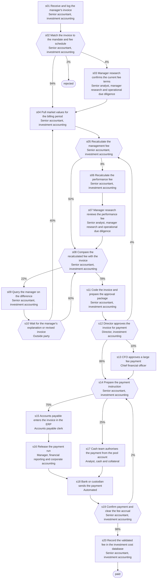

# Validate and pay external manager fees

`pam-manager-fee-validation-payment` · public-sector asset management · finance (investment accounting) · part of `public-asset-manager`

About 120 external public market managers bill management fees, and some performance fees, after each quarter. A senior accountant in investment accounting matches each invoice to the mandate's fee schedule, recalculates the fee from custodian asset values, queries the manager when the figures differ, and has it approved before it is paid, mostly by the organisation as agent for its clients and otherwise from pool accounts. Validated fees then clear the monthly accruals and feed cost allocation and net-of-fee returns. The work is slowed by invoices arriving in waves after quarter end, by managers billing on their own asset values, and by approvals that queue at the same time.

| | |
|---|---|
| Unit of work | one manager fee invoice |
| Starts when | An external manager's quarterly (sometimes monthly) fee invoice arrives in the fund accounting mailbox. |
| Done when | The fee is agreed, approved, paid and recorded in the ledger and cost database; or the invoice is returned as not payable. |
| Organisation | A provincial not-for-profit asset manager of about $79 billion that pays roughly $190 million a year of external fees as agent for four client institutions. (242 employees, 2019-2022) |
| Volume | 45 cases a month (range 30 to 60) |

## Where it sits

- Starts with **manager_invoice** from external_managers (100% of cases)
- Relies on **manager_mandate** from ext-manager-onboarding (a standing input; it does not start a case)
- Sends **funding_wire** to daily-cash-management (outcome: paid)
- Sends **ledger_postings** to fund-accounting-close (outcome: paid)
- Sends **investment_cost_data** to cost-allocation-billing (outcome: paid)

## Flow

## Roles

| Role | Department | Layer | FTE on this process | Loaded cost per hour | Evidence |
|---|---|---|---:|---:|---|
| Senior accountant, investment accounting | Investment accounting (pools and client portfolios) | individual contributor | 1 | 56 CAD | B [jb_11100] |
| Director, investment accounting | Investment accounting (pools and client portfolios) | director | 0.06 | 240 CAD | B [jb_10010] |
| Senior analyst, manager research and operational due diligence | External manager research | senior specialist | 0.03 | 140 CAD | C |
| Chief financial officer | Finance | executive | 0.005 | 750 CAD | C |
| Accounts payable clerk | Financial reporting and corporate accounting | individual contributor | 0.05 | 32 CAD | C |
| Manager, financial reporting and corporate accounting | Financial reporting and corporate accounting | manager | 0.02 | 90 CAD | C |
| Analyst, cash and collateral | Cash, collateral and treasury operations | individual contributor | 0.02 | 56 CAD | C |

## Steps

Hands-on time and the wait before each step show the most common value. Evidence tier A is a sourced number, B a sourced description, C the author's estimate.

| Step | Who | Kind | Hands-on | Wait before | Control | Evidence |
|---|---|---|---:|---:|---|---|
| **s01 Receive and log the manager's invoice.** A senior accountant picks the invoice up from the fund accounting mailbox, saves it to the manager's folder and adds it to the fee tracker with manager, billing period, accounts, amount and due date. Most invoices arrive in the four to eight weeks after each quarter end, so they come in waves. | Senior accountant, investment accounting | intake | 10 min | 2.0 d |  | B [nmerb_ps], [mgr_ar21] |
| **s02 Match the invoice to the mandate and fee schedule.** The accountant finds the mandate's management agreement and fee schedule, checks that the legal entity, accounts and billing period on the invoice belong to an active mandate, and notes the fee basis: tiered rates, aggregation with related accounts, minimum fees, any most-favoured-nation discount and the asset values to use. | Senior accountant, investment accounting | lookup | 12 min | 4.0 h |  | C |
| **s03 Manager research confirms the current fee terms.** When the schedule was amended, renegotiated or is ambiguous, a manager research analyst who owns the relationship confirms the agreed terms and effective date, often by checking the side letter or emailing the manager. | Senior analyst, manager research and operational due diligence | lookup | 30 min | 1.0 d |  | B [mgr_ar20] |
| **s04 Pull market values for the billing period.** The accountant downloads month-end or daily market values for each account in the mandate from the custodian's accounting records, adjusts for contributions and withdrawals during the quarter as the agreement requires, and converts currencies at the agreed rates. | Senior accountant, investment accounting | lookup | 15 min | 1.0 h |  | B [sifma_soc1] |
| **s05 Recalculate the management fee.** In the manager's fee workbook the accountant applies the rate tiers, aggregation and discounts to the asset values for each month or day of the period and totals the fee by account, then documents the calculation for review. | Senior accountant, investment accounting | analysis | 25 min | 1.0 h |  | C |
| **s06 Recalculate the performance fee.** For a performance fee the accountant obtains the mandate's return and benchmark return for the measurement period from the performance team's records, applies the hurdle, high-water mark, cap and any clawback in the agreement, and computes the fee owed. | Senior accountant, investment accounting | analysis | 1.5 h | 4.0 h |  | C |
| **s07 Manager research reviews the performance fee.** A manager research analyst checks the performance fee calculation against the agreement and the manager's own return figures and confirms the fee is consistent with how the mandate actually performed. | Senior analyst, manager research and operational due diligence | review | 30 min | 1.0 d | Fee validation procedure: performance fees are reviewed by the investment team that oversees the mandate before approval | C |
| **s08 Compare the recalculated fee with the invoice.** The accountant compares the model manager's figure with the invoice account by account and checks whether any difference is within the tolerance in the fee procedure, usually a small percentage or dollar amount caused by rounding or day counts. | Senior accountant, investment accounting | validation | 10 min | 0 min | Fee validation procedure under the model manager's cost governance: every invoice is independently recalculated and agreed within tolerance before payment | C [mgr_ar20] |
| **s09 Query the manager on the difference.** The accountant sends the manager's operations or billing team the model manager's calculation and asks them to explain the difference or reissue the invoice. Common causes are the manager billing on its own valuations, missed mid-quarter flows or an old rate. | Senior accountant, investment accounting | communication | 30 min | 4.0 h |  | C |
| **s10 Wait for the manager's explanation or revised invoice.** The manager reviews its billing, then either sends a revised invoice or explains its figures, which may show that the model manager's calculation needs correcting. Replies take from a couple of days to several weeks around quarter end. | Outside party | external wait | 0 min | 5.0 d |  | C |
| **s11 Code the invoice and prepare the approval package.** The accountant splits the fee by pool or client account and cost category, records the expected accrual it will clear, and attaches the recalculation, the agreement extract and any correspondence for the approver. | Senior accountant, investment accounting | drafting | 12 min | 2.0 h |  | C |
| **s12 Director approves the invoice for payment.** The director of investment accounting reviews the package, the variance explanation and the account coding and approves the payment within delegated signing authority, or sends it back. Approvals bunch up after quarter end. | Director, investment accounting | approval | 10 min | 1.0 d | Delegation of signing authority: the preparer cannot approve, and fees are approved within tiered approval limits | B [mgr_ar20] |
| **s13 CFO approves a large fee payment.** Invoices above the director's limit, such as large performance fees or quarterly fees on the biggest mandates, go to the chief financial officer for a second approval. | Chief financial officer | approval | 10 min | 2.0 d | Delegation of signing authority: payments above the director's limit need CFO approval | C [mgr_ar20] |
| **s14 Prepare the payment instruction.** For fees the model manager pays as agent the accountant sends the approved invoice and coding to accounts payable; for fees borne by a pool it enters a payment instruction against the pool's custody account. The fee is also flagged to cash management so the account is funded. | Senior accountant, investment accounting | data entry | 12 min | 4.0 h |  | B [mgr_ar21], [pclient_ar21] |
| **s15 Accounts payable enters the invoice in the ERP.** The accounts payable clerk keys the approved invoice into the ERP against the manager's vendor record, checks the approval evidence and bank details on file, and schedules it in the next payment run. | Accounts payable clerk | data entry | 10 min | 8.0 h |  | C [mgr_ar21] |
| **s16 Release the payment run.** Once a week the manager of financial reporting reviews the payment run listing against approvals and releases it in the bank portal as the second authoriser. | Manager, financial reporting and corporate accounting | approval | 5 min | 2.5 d | Dual authorisation of payment runs: the person who enters invoices does not release payments | C |
| **s17 Cash team authorises the payment from the pool account.** A cash and collateral analyst checks the pool has cash for the value date and authorises the payment instruction in the custodian portal as second signer. | Analyst, cash and collateral | approval | 10 min | 12.0 h | Payment authorisation matrix: dual authorisation in the custodian portal, preparer cannot release | C |
| **s18 Bank or custodian sends the payment.** The bank or custodian executes the wire or electronic funds transfer to the manager on the value date and reports it on the next statement. | Automated | system auto | 0 min | 1.0 h |  | C |
| **s19 Confirm payment and clear the fee accrual.** The accountant confirms the payment on the bank or custodian statement, books the actual fee against the accrual carried in the pool or client portfolio, and notes any difference from the accrual for month end. | Senior accountant, investment accounting | data entry | 12 min | 1.0 d | Accrual accounting: investment management fees are accrued and trued up to actual invoices (GIPS for asset owners recommendation and month-end close) | B [gips_ao] |
| **s20 Record the validated fee in the investment cost database.** The accountant adds the final fee by mandate, pool and client portfolio to the investment cost database used for cost allocation, net-of-fee performance and the annual cost benchmarking survey, and closes the tracker line. | Senior accountant, investment accounting | data entry | 10 min | 1.0 d |  | B [gips_ao], [mgr_ar21] |

## Exceptions

| Exception | Share of cases | What happens |
|---|---:|---|
| Invoice differs from the recalculation | 22% | The manager used its own asset values, missed a cash flow or applied an old rate, so the invoice is queried and reissued or the model manager's calculation corrected. |
| Fee terms changed or unclear | 4% | Manager research confirms an amended schedule or side letter before the recalculation. |
| Performance fee | 8% | The invoice includes a performance fee that is recalculated against hurdle and high-water mark and reviewed by manager research. |
| Above the director's limit | 10% | Large invoices need CFO approval as well. |
| Duplicate or not payable | 2% | A duplicate invoice or a bill for a terminated mandate is returned to the manager. |
| Payment returned | 2% | The bank rejects or returns the payment and a new instruction is prepared. |

## Benchmarks

| Metric | Value | Unit | Population | Evidence |
|---|---|---|---|---|
| cycle_time_days | p50 18, p90 40 | calendar days from invoice receipt to payment confirmed and recorded | External manager fee invoices at a Canadian public-sector asset manager, 2019 to 2022 | C |
| agency_investment_management_fees_paid | 2020 184514000, 2021 190629000 | CAD per year | The model manager | A [mgr_ar21] |
| external_management_fees_in_cost_report | 2020 246108000, 2021 291039000 | CAD per year | The model manager | A [mgr_ar21] |
| agency_fees_collected_not_yet_billed | 2020 11582000, 2021 9227000 | CAD at year end | The model manager | A [mgr_ar21] |
| share_of_invoices_queried | 0.22 | share of invoices | This organisation, 2019 to 2022 | C |

## Pain points

- Managers bill on their own asset values and cash flow timing, so a fifth of invoices need a query and wait weeks for a reply. (steps s08, s09, s10; C)
- Fee terms sit in agreement PDFs and side letters and are rebuilt in one workbook per manager, so amendments are missed and the knowledge sits with a few people. (steps s02, s03, s05; B [mgr_ar20])
- Invoices arrive in waves after quarter end, when the same accountants and the director are also closing the quarter, so invoices and approvals queue. (steps s01, s12; B [nmerb_ps])
- Two payment routes (agency through the ERP and pool custody accounts) with separate approvals and funding make it easy to lose track of what has been paid and what is still accrued. (steps s14, s15, s17, s19; B [mgr_ar21])

## Assumptions

- One case is one invoice, which may cover several accounts of one manager. Fees that external funds deduct at source, and private fund management fees called through capital calls, are not invoiced and are not part of this process.
- The organisation file lists the external manager mandate from ext-manager-onboarding as a trigger; it is placed in interfaces.inputs because the fee schedule is a standing input and does not start a case.
- About 75% of invoices are paid by the model manager as agent through its own accounts payable after collecting the fees from clients, and 25% are paid from pool custody accounts for managers of pooled strategies; the split is an author estimate based on the model manager's agency fee note and the four pools operating in 2021.
- Monthly fee accruals are booked in fund-accounting-close; this process only clears them against the actual invoice.
- Roles outside the process map (CFO, accounts payable clerk, manager of financial reporting, cash and collateral analyst) are organisation file roles that approve or release payments.
- Times and probabilities are author estimates (tier C) unless a source is cited; no published time study of institutional fee validation was found, and web search capacity ran out while researching this file.
- Loaded costs per hour are taken unchanged from the organisation file (Job Bank Toronto wages deflated to 2021, plus variable pay, times a 1.35 loading).

## Sources

- [mgr_ar21] The model manager 2021 Annual Report (link withheld) (The model manager, 2022). As an agent the model manager administers external management, custodial and other investment fees under contracts held by the clients, collects them from clients and pays vendors on receipt of billings; agency investment management fees paid or payable $190.6 million in 2021 ($184.5 million in 2020); agency fees collected but not yet billed $9.2 million at 31 December 2021; external management fees in the cost report $291.0 million in 2021 ($246.1 million in 2020), covering managers that invoice separately and those that deduct fees at source, excluding performance fees.
- [mgr_ar20] The model manager 2020 Annual Report (link withheld) (The model manager, 2021). The model manager rationalised its external manager roster, eliminated fund-of-funds structures and used its scale to negotiate fee reductions; cost governance includes tiered approval authorities and actual and forecast expenses monitored against budget.
- [pclient_ar21] The pension client 2021 Annual Report (link withheld) (The pension client, 2022). The model manager incurs investment management and custodial fees on the pension client's behalf; private market management fees are deducted from managed assets; the pension client's investment fees and the model manager cost recovery were 0.41% of average net assets in 2021.
- [sifma_soc1] [Asset Manager's Guide to SOC 1 (June 2017)](https://www.sifma.org/wp-content/uploads/2017/08/SIFMA_AMG_asset-managers-guide-soc-2017.pdf) (SIFMA Asset Management Group and Grant Thornton, 2017). Fee calculation and billing is listed among SOC 1 areas to consider; baseline objectives cover valuation from authorised sources and reconciliation.
- [gips_ao] [2020 GIPS Standards for Asset Owners](https://www.gipsstandards.org/wp-content/uploads/2021/02/2020_gips_standards_asset_owners.pdf) (CFA Institute, 2019). Net-of-fees total fund returns must deduct investment management fees for externally managed segregated accounts; asset owners should accrue investment management fees and costs.
- [nmerb_ps] [Custody Bank RFP, Appendix F: Performance Standards and Related Key Performance Indicators](https://www.erb.nm.gov/wp-content/uploads/2024/09/NMERB-Custody-Bank-RFP-2024-09-03-INV_Performance-Standards.pdf) (New Mexico Educational Retirement Board, 2024). A public pension fund requires its custodian's service invoices no later than 60 days after the prior period end, showing that investment service invoices commonly arrive weeks after the period they cover.
- [jb_11100] [Wages: Accountant (NOC 11100), Toronto region](https://www.jobbank.gc.ca/marketreport/wages-occupation/113/geo9219) (Government of Canada, Job Bank, 2025). Toronto hourly wages low 25.00, median 41.34, high 74.36 (2023-2024), the base of the organisation file's accountant costs.
- [jb_10010] [Wages: Finance Director (NOC 10010), Toronto region](https://www.jobbank.gc.ca/marketreport/wages-occupation/1225/22437) (Government of Canada, Job Bank, 2025). Toronto hourly wages low 41.21, median 62.37, high 96.15 (2023-2024), the base of the organisation file's director and manager costs.

Written by claude-opus on 2026-11-17.
