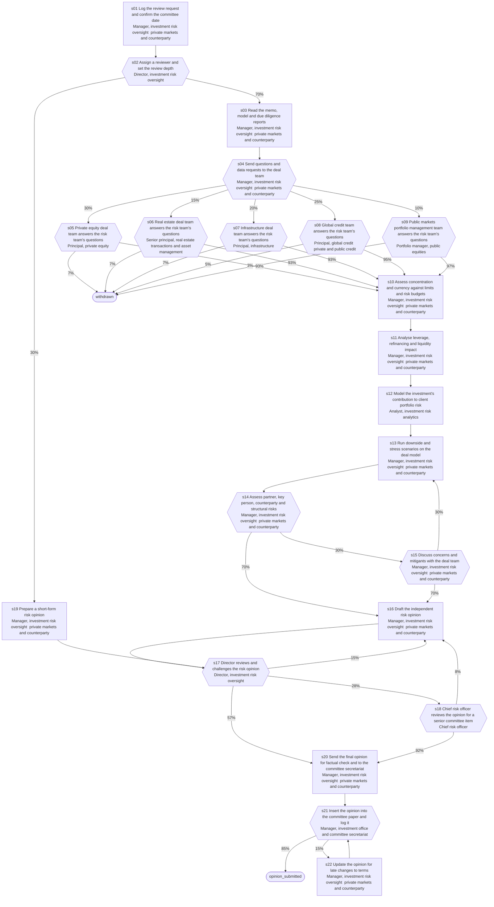

# Review new investments and mandates for risk (independent risk opinion)

`pam-new-investment-risk-review` · public-sector asset management · investment risk · part of `public-asset-manager`

Before the investment committee decides on a direct investment, co-investment, fund commitment, private loan or new external mandate, the investment risk oversight team writes an independent risk opinion that goes into the committee paper. A risk manager reads the memo and model, questions the deal team, checks concentration, currency, leverage and liquidity against limits and client policies, has portfolio risk model the investment's contribution to each client's risk, runs downside scenarios and drafts the opinion, which the director and, for larger items, the chief risk officer review. The review is squeezed between the deal team's memo and the committee paper deadline, waits on answers from busy deal teams, and is redone when terms change late.

| | |
|---|---|
| Unit of work | one risk review |
| Starts when | A deal team sends a draft investment memo, or a request for review with a target committee date, for a direct investment, co-investment, fund commitment, private loan or new mandate. |
| Done when | The director-approved (and, where needed, CRO-reviewed) independent risk opinion is filed in the committee paper, updated for any late term change; or the deal is withdrawn before the opinion is written. |
| Organisation | A Canadian provincial public-sector asset manager with about $79 billion for four client institutions, a growing private markets program and a five-person investment risk oversight team. (242 employees, 2019-2022) |
| Volume | 8 cases a month (range 6 to 14) |

## Where it sits

- Starts with **investment_memo** from pe-coinvest-screening-dd (25% of cases)
- Starts with **investment_memo** from real-asset-direct-investment-dd (25% of cases)
- Starts with **investment_memo** from private-credit-underwriting (20% of cases)
- Starts with **investment_memo** from fund-commitment (15% of cases)
- Starts with **investment_memo** from ext-manager-search-selection (15% of cases)
- Relies on **liquidity_report** from liquidity-forecasting (a standing input; it does not start a case)
- Relies on **investment_plan** from annual-investment-plan-benchmarks (a standing input; it does not start a case)
- Relies on **client_ips** from client-ips-asset-mix-review (a standing input; it does not start a case)
- Sends **risk_opinion** to investment-committee-approval (outcome: opinion_submitted)

## Flow

## Roles

| Role | Department | Layer | FTE on this process | Loaded cost per hour | Evidence |
|---|---|---|---:|---:|---|
| Manager, investment risk oversight (private markets and counterparty) | Investment risk oversight | senior specialist | 1 | 120 CAD | C |
| Director, investment risk oversight | Investment risk oversight | director | 0.08 | 240 CAD | C |
| Chief risk officer | Investment risk | executive | 0.01 | 850 CAD | C |
| Analyst, investment risk analytics | Portfolio risk and analytics | individual contributor | 0.1 | 65 CAD | B [jobbank_11101] |
| Principal, private equity | Private equity | senior specialist | 0.05 | 195 CAD | C |
| Senior principal, real estate (transactions and asset management) | Real estate | senior specialist | 0.02 | 195 CAD | C |
| Principal, infrastructure | Infrastructure | senior specialist | 0.03 | 195 CAD | C |
| Principal, global credit (private and public credit) | Global credit (public and private credit) | senior specialist | 0.04 | 195 CAD | C |
| Portfolio manager, public equities | Public equities | senior specialist | 0.01 | 195 CAD | C |
| Manager, investment office and committee secretariat | Investments | manager | 0.01 | 130 CAD | C |

## Steps

Hands-on time and the wait before each step show the most common value. Evidence tier A is a sourced number, B a sourced description, C the author's estimate.

| Step | Who | Kind | Hands-on | Wait before | Control | Evidence |
|---|---|---|---:|---:|---|---|
| **s01 Log the review request and confirm the committee date.** A manager in investment risk oversight records the request from a deal team in the review tracker with the asset class, size, owning client portfolios and target committee date, and asks for the draft memo, model and data room access. | Manager, investment risk oversight (private markets and counterparty) | intake | 30 min | 4.0 h |  | B [mgr_ar21] |
| **s02 Assign a reviewer and set the review depth.** The director of investment risk oversight assigns a reviewer and decides on a full review for new direct deals, co-investments, new strategies and large commitments, or a short-form review for re-ups with existing partners, small follow-ons and mandate resizing. | Director, investment risk oversight | judgment | 15 min | 8.0 h |  | B [volts], [plan_ar2021] |
| **s03 Read the memo, model and due diligence reports.** The reviewer reads the draft memo and the deal team's model and skims the key diligence reports (financial, technical, legal summary, operational due diligence on the manager or partner), noting assumptions, leverage terms, currency, exit and liquidity features and questions. | Manager, investment risk oversight (private markets and counterparty) | lookup | 3.0 h | 8.0 h |  | B [fsra2021], [hoopp_pmr] |
| **s04 Send questions and data requests to the deal team.** The reviewer emails the deal team a list of questions and requests: sensitivities, debt terms and covenants, hedging plans, look-through exposures, key person terms and how the investment is split across client portfolios. | Manager, investment risk oversight (private markets and counterparty) | communication | 40 min | 30 min |  | C |
| **s05 Private equity deal team answers the risk team's questions.** A senior member of the private equity deal team answers the question list, sends the latest model and sponsor materials, explains assumptions the risk manager queried and says which points the memo will address. Some deals drop out at this stage because a seller picks another bidder or diligence finds a problem. | Principal, private equity | communication | 2.0 h | 2.0 d |  | B [mgr_ar21], [volts] |
| **s06 Real estate deal team answers the risk team's questions.** A senior member of the real estate deal team answers the question list, sends the latest property model and debt terms, explains assumptions the risk manager queried and says which points the memo will address. Some deals drop out at this stage because a seller picks another bidder or diligence finds a problem. | Senior principal, real estate (transactions and asset management) | communication | 2.0 h | 2.0 d |  | B [mgr_ar21], [volts] |
| **s07 Infrastructure deal team answers the risk team's questions.** A senior member of the infrastructure deal team answers the question list, sends the latest asset model, debt terms and concession details, explains assumptions the risk manager queried and says which points the memo will address. Some deals drop out at this stage because a seller picks another bidder or diligence finds a problem. | Principal, infrastructure | communication | 2.0 h | 2.0 d |  | B [mgr_ar21], [volts] |
| **s08 Global credit team answers the risk team's questions.** A senior member of the global credit team answers the question list, sends the latest credit model, terms and rating analysis, explains assumptions the risk manager queried and says which points the memo will address. Some deals drop out at this stage because a seller picks another bidder or diligence finds a problem. | Principal, global credit (private and public credit) | communication | 2.0 h | 2.0 d |  | B [mgr_ar21], [volts] |
| **s09 Public markets portfolio management team answers the risk team's questions.** A senior member of the public markets portfolio management team answers the question list, sends the latest manager track record, guidelines and expected tracking error, explains assumptions the risk manager queried and says which points the memo will address. Some deals drop out at this stage because a seller picks another bidder or diligence finds a problem. | Portfolio manager, public equities | communication | 2.0 h | 2.0 d |  | B [mgr_ar21], [volts] |
| **s10 Assess concentration and currency against limits and risk budgets.** The reviewer adds the investment to current holdings by owning client portfolio and checks exposure to the single asset, sponsor or manager, sector, country and vintage against board limits, client policy constraints and the asset class risk budget, and looks at the currency exposure and planned hedging. | Manager, investment risk oversight (private markets and counterparty) | analysis | 2.5 h | 4.0 h | Pension Benefits Standards Regulations, 1985, Schedule III: the 10 per cent limit on investing in one person and the 30 per cent voting share limit for pension plan clients, plus each client's statement of investment policies | B [pbsr_sch3], [fsra2021] |
| **s11 Analyse leverage, refinancing and liquidity impact.** The reviewer reviews the debt package and covenants, refinancing dates and interest rate hedging, and estimates the investment's effect on each client's liquidity coverage, including unfunded commitments and capital calls, using the latest liquidity forecast. | Manager, investment risk oversight (private markets and counterparty) | analysis | 2.5 h | 1.0 h |  | B [mgr_ar21], [volts] |
| **s12 Model the investment's contribution to client portfolio risk.** An analyst in portfolio risk maps the investment to a proxy in the risk system and calculates its marginal contribution to total and active risk for each owning client portfolio and the change in factor exposures. | Analyst, investment risk analytics | analysis | 2.0 h | 1.0 d |  | B [mgr_ar21], [fsra2021] |
| **s13 Run downside and stress scenarios on the deal model.** The reviewer runs downside cases on the deal model and the portfolio, such as higher rates and refinancing costs, lower exit multiples, a revenue or occupancy shock and currency moves, separately and together, and notes the loss and covenant headroom in each. | Manager, investment risk oversight (private markets and counterparty) | analysis | 2.5 h | 4.0 h |  | B [fsra2021], [volts] |
| **s14 Assess partner, key person, counterparty and structural risks.** The reviewer weighs the sponsor or manager track record and alignment, key person and governance terms, counterparty and structural risks, and how the investment fits the risk appetite, and decides whether there are concerns to raise before writing. | Manager, investment risk oversight (private markets and counterparty) | judgment | 1.5 h | 30 min |  | B [volts], [hoopp_pmr] |
| **s15 Discuss concerns and mitigants with the deal team.** The reviewer meets the deal team to discuss the concerns, for example sizing, hedging, leverage or conditions, and records the mitigants the team accepts; where the structure or size changes the stress cases are rerun. | Manager, investment risk oversight (private markets and counterparty) | communication | 1.0 h | 1.0 d |  | C |
| **s16 Draft the independent risk opinion.** The reviewer writes the two to four page opinion for the committee paper: summary view and risk rating, key risks and mitigants, concentration, leverage, liquidity and stress results, fit with the risk budget and any recommended conditions. | Manager, investment risk oversight (private markets and counterparty) | drafting | 3.5 h | 4.0 h | Second-line independent risk opinion required in investment committee papers under the investment approval policy; risk function separate from investment teams (three lines model observed by FSRA) | B [mgr_ar21], [fsra2021], [volts] |
| **s17 Director reviews and challenges the risk opinion.** The director of investment risk oversight reads the opinion against the memo, challenges the rating and conditions, checks consistency with past opinions and either approves it, asks for changes or routes it to the chief risk officer for items going to the Management Investment Committee or the board. | Director, investment risk oversight | review | 1.0 h | 1.0 d | Investment risk oversight review standard: director sign-off of every risk opinion before submission | B [mgr_ar21] |
| **s18 Chief risk officer reviews the opinion for a senior committee item.** For investments going to the Management Investment Committee, which the chief risk officer co-chairs, or to the board, the CRO reads the opinion and memo and either agrees or asks for a stronger or different view. | Chief risk officer | review | 45 min | 1.0 d | Management Investment Committee mandate: CIO and CRO co-chair and every item needing board approval is first recommended by the committee | B [mgr_ar21] |
| **s19 Prepare a short-form risk opinion.** For a re-up with an existing partner, a small follow-on or a mandate resize, the reviewer checks the changes since the last review, updates concentration and liquidity figures and writes a one-page opinion. | Manager, investment risk oversight (private markets and counterparty) | drafting | 3.0 h | 1.0 d |  | C |
| **s20 Send the final opinion for factual check and to the committee secretariat.** The reviewer sends the approved opinion to the deal team to check facts, makes any factual corrections and files it with the investment office for the committee paper. | Manager, investment risk oversight (private markets and counterparty) | communication | 30 min | 2.0 h |  | C |
| **s21 Insert the opinion into the committee paper and log it.** The investment office adds the risk opinion to the committee paper behind the memo, records it in the committee tracker and circulates the paper by the deadline. | Manager, investment office and committee secretariat | coordination | 20 min | 4.0 h |  | B [mgr_ar21] |
| **s22 Update the opinion for late changes to terms.** When price, leverage, size or the client split changes after the paper is circulated, the reviewer updates the affected analysis, writes an addendum or revised opinion and gets the director's agreement by email. | Manager, investment risk oversight (private markets and counterparty) | drafting | 1.0 h | 1.0 d |  | C |

## Exceptions

| Exception | Share of cases | What happens |
|---|---:|---|
| Short-form review | 30% | Re-ups with existing partners, small follow-ons and mandate resizes get a one-page opinion without the full analysis. |
| Deal withdrawn during the review | 6% | The seller picks another bidder, exclusivity lapses or diligence finds a problem and the deal team drops the deal before the opinion is written. |
| Concerns lead to a restructured deal | 9% | The risk manager's concerns change the size, leverage or hedging, and the stress cases are rerun before the opinion is written. |
| Senior committee item | 28% | Investments above Investment Department Committee authority need the chief risk officer's review before the Management Investment Committee or the board. |
| Late change to terms | 15% | Price, leverage, size or client split changes after the paper is circulated and the opinion is updated with an addendum. |

## Benchmarks

| Metric | Value | Unit | Population | Evidence |
|---|---|---|---|---|
| cycle_time_days | p50 7, p90 14 | calendar days from the review request to the opinion filed in the committee paper | Independent risk reviews at a Canadian public-sector asset manager, 2019-2022 | C |
| private_equity_direct_and_coinvestment_deals_2021 | 8 | deals closed in 2021 | The model manager private equity | A [mgr_ar21] |
| single_entity_investment_limit | 0.1 | share of pension plan assets in one person or associated persons | Pension plans subject to Schedule III of the federal Pension Benefits Standards Regulations | A [pbsr_sch3] |
| voting_share_limit | 0.3 | share of votes to elect directors of one corporation | Pension plans subject to Schedule III, with exemptions for real estate, resource and investment corporations | A [pbsr_sch3] |

## Pain points

- Seller and committee deadlines leave little time for the review; the risk team often starts before the memo is final and must redo work when terms change late. (steps s03, s16, s22; C)
- Answers from deal teams busy with diligence and negotiation are slow, and some deals drop out after the risk team has started. (steps s05, s06, s07, s08, s09; C)
- Private assets have no market prices, so their contribution to portfolio risk rests on proxies that can understate risk; the risk system then in use gave limited insight into tail risks. (steps s12, s13; B [mgr_ar21], [fsra2021])
- Strategies with non-linear or tail risk can look harmless on value at risk; reviews need stress tests, liquidity and complexity checks at origination, which take senior time. (steps s11, s13, s14; B [volts])
- Concentration has to be checked by client portfolio because each client has its own policy and legal limits, done in spreadsheets from several systems. (steps s10; B [pbsr_sch3])

## Assumptions

- One case is one risk opinion for one committee submission. The deal team's diligence, memo drafting and memo revisions after the opinion are counted in the upstream workflows (fund commitment, manager search and the direct deal processes); only the deal team's time answering risk questions is counted here, split across the five teams in proportion to the process map's triggers.
- Handoff timing: the upstream fund commitment and manager search workflows model the risk opinion as one step with a two to seven day wait and four to fifteen hours of work. This workflow details that step; it runs longer for full reviews of direct deals because it includes waits on deal team answers and the portfolio risk analyst, and the review often starts while the memo is still being finished. The simulated median (about 9 days) is above the 7-day estimate because full reviews of direct deals make up most cases.
- Schedule III of the federal Pension Benefits Standards Regulations is cited for the 10 per cent and 30 per cent limits; it applies to Ontario pension plans through Ontario's pension regulation (author's knowledge, not opened). It binds the pension plan clients, not the insurance client insurance fund, whose own policy sets its limits.
- Review depth, shares of short-form reviews, senior committee items and late term changes are author estimates. The 2021 introduction of Investment Department Committees below the Management Investment Committee is from the annual report.
- The portfolio risk analyst and the investment office manager take part although the process map lists only the two investment risk oversight roles; both roles exist in the organisation file.
- Loaded costs come from the organisation file; investment professionals are priced from estimated total pay.
- Staffing: about 1.35 FTE stated (1.0 investment risk manager); hands-on time times volume implies a similar figure. The rest of the four managers' time goes to counterparty exposure monitoring, valuation challenge and portfolio-level private markets risk work.
- Times, waits and branch probabilities are author estimates (tier C) because no published time study of pre-committee risk reviews was found.

## Sources

- [mgr_ar21] The model manager 2021 Annual Report (link withheld) (The model manager, 2022). Enhanced quarterly risk reports for clients and the Board and a new Quarterly Risk Insights report in 2021; risk measured with sensitivities, historical and custom stress tests, total, active and factor risk and a liquidity coverage ratio; new risk and total portfolio management system selected in 2021 for delivery in 2022; investment risk support facilitates transaction reviews; private market risks assessed by a devoted team; Management Investment Committee co-chaired by the CIO and CRO and Investment Department Committees co-chaired by Investments and Investment Risk; three pools launched in 2021 and work begun on private equity and infrastructure pools; pooling brings efficiencies in pool activities and cash management; clean SOC 1 Type I report as at 30 September 2021. Read from a text copy saved under scratch/ by earlier work.
- [fsra2021] Alternative Assets and Risk Management: Insights into Practices Observed from FSRA's Review of Six Large Public Sector Pension Plans in Ontario (link withheld) (Financial Services Regulatory Authority of Ontario, 2021). The model manager took part for its work for the pension client; leading practices include stress testing built into due diligence before an alternative investment and run on an ongoing basis for board oversight, granular scenarios, internal risk ratings, three lines of defence, a centralized risk control team separate from investment teams with an independent reporting channel to senior management and the board, and liquidity management for severe events. Read from a text copy saved under scratch/ by earlier work.
- [volts] [VOLTS Investment Strategy Review: Summary of Results (AIMCo Board of Directors, June 30, 2020)](https://www.sfu.ca/~poitras/AIMCo_VOLTS.pdf) (Alberta Investment Management Corporation (copy hosted by Simon Fraser University), 2020). A legacy 95% value at risk system reported minimal risk for a strategy with tail losses; recommendations to expand board risk reporting with exposures against limits and periodic stress test results, and to require an independent risk review with stress tests, liquidity and complexity assessment at the origination of any new strategy or product. Read from a text copy saved under scratch/ by earlier work.
- [plan_ar2021] The national pension fund manager F2021 Annual Report (link withheld) (The national pension fund manager, 2021). Regular risk reports to senior management and the board; independent risk oversight; began expanding independent assessment of higher risk direct private transactions in fiscal 2021. Read from a text copy saved under scratch/ by earlier work.
- [hoopp_pmr] [Senior Director, Private Market Investment Risk (job posting)](https://builtintoronto.com/job/senior-director-private-market-investment-risk/10221275) (Healthcare of Ontario Pension Plan via Built In Toronto, 2026). A peer Ontario pension plan's private markets risk team oversees the risk review of private market transactions across private equity, real estate, infrastructure and venture capital and supports stress tests and board risk questions (posting outside the reference period).
- [pbsr_sch3] [Pension Benefits Standards Regulations, 1985 (SOR/87-19), Schedule III Permitted Investments](https://laws-lois.justice.gc.ca/eng/regulations/SOR-87-19/page-12.html) (Justice Laws Website, Government of Canada, 2025). Section 9: A plan may not lend or invest in one person or associated persons if exposure is or would be 10% or more of plan assets; section 11: A plan may not hold securities carrying more than 30% of the votes to elect directors, with exemptions for real estate, resource and investment corporations.
- [jobbank_11101] [Wages: Financial Analyst (NOC 11101) in the Toronto Region](https://www.jobbank.gc.ca/marketreport/wages-occupation/12417/22437) (Job Bank, Government of Canada, 2025). Toronto hourly wages for NOC 11101: low 27.97, median 41.60, high 73.57 (reference period 2023-2024).

Written by claude-opus on 2026-11-17.
