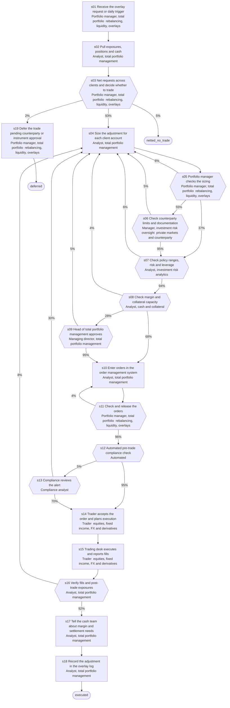

# Manage derivative overlays, currency hedges and leverage

`pam-overlay-fx-leverage` · public-sector asset management · investments (total portfolio management) · part of `public-asset-manager`

The total portfolio team uses equity and bond futures, currency forwards and swaps to rebalance client portfolios quickly, hedge foreign currency to each client's policy, run active asset allocation and dynamic currency positions and, from 2022, apply leverage at the total portfolio level. For each adjustment an analyst sizes the trades by client account, risk checks counterparty limits, policy ranges and leverage, the cash team checks margin capacity, larger changes go to the head of total portfolio management, and orders are keyed, released and sent to the trading desk, then verified after execution. Rolling contracts and keeping hedges in line with changing client weights make this steady daily work; stale exposure data, multiple checks run in sequence and margin needs in volatile markets are the main sources of delay and risk.

| | |
|---|---|
| Unit of work | one overlay adjustment |
| Starts when | An approved rebalancing proposal needs futures or currency changes, a liquidity report calls for freeing cash or margin, or the daily check shows a hedge ratio out of tolerance or a contract due to roll. |
| Done when | The adjustment has been executed, verified against target exposures, notified to the cash team and logged, or it was netted away or deferred. |
| Organisation | A provincial not-for-profit asset manager of about 240 staff that invests about $79 billion for a few public pension plans and an insurance board through pooled funds and segregated accounts, on a cost recovery basis. (242 employees, 2019-2022) |
| Volume | 30 cases a month (range 15 to 50) |

## Where it sits

- Starts with **rebalancing_proposal** from client-portfolio-rebalancing (75% of cases)
- Starts with **liquidity_report** from liquidity-forecasting (25% of cases)
- Relies on **security_reference_data** from data_vendors (a standing input; it does not start a case)
- Relies on **client_ips** from client-ips-asset-mix-review (a standing input; it does not start a case)
- Sends **trade_order** to trade-execution (outcome: executed)

## Flow

## Roles

| Role | Department | Layer | FTE on this process | Loaded cost per hour | Evidence |
|---|---|---|---:|---:|---|
| Portfolio manager, total portfolio (rebalancing, liquidity, overlays) | Total portfolio management and rebalancing | senior specialist | 0.4 | 195 CAD | B [jobbank_11101] |
| Analyst, total portfolio management | Total portfolio management and rebalancing | individual contributor | 0.45 | 85 CAD | B [jobbank_11101] |
| Managing director, total portfolio management | Total portfolio management and rebalancing | director | 0.03 | 420 CAD | C |
| Trader (equities, fixed income, FX and derivatives) | Public markets trading desk | senior specialist | 0.1 | 170 CAD | C |
| Analyst, investment risk analytics | Portfolio risk and analytics | individual contributor | 0.06 | 65 CAD | B [jobbank_11101] |
| Manager, investment risk oversight (private markets and counterparty) | Investment risk oversight | senior specialist | 0.03 | 120 CAD | B [jobbank_11101] |
| Analyst, cash and collateral | Cash, collateral and treasury operations | individual contributor | 0.05 | 56 CAD | B [jobbank_11101] |
| Compliance analyst | Compliance | individual contributor | 0.01 | 65 CAD | B [jobbank_11101] |

## Steps

Hands-on time and the wait before each step show the most common value. Evidence tier A is a sourced number, B a sourced description, C the author's estimate.

| Step | Who | Kind | Hands-on | Wait before | Control | Evidence |
|---|---|---|---:|---:|---|---|
| **s01 Receive the overlay request or daily trigger.** A total portfolio manager picks up the reason for an overlay change: an approved rebalancing proposal asking for futures or currency changes, a liquidity report action to free cash or margin, or the morning overlay check showing a client's currency hedge ratio outside tolerance or a futures or forward contract due to roll. | Portfolio manager, total portfolio (rebalancing, liquidity, overlays) | intake | 15 min | 2.0 h |  | B [mgr_ar21], [mgr_ar22] |
| **s02 Pull exposures, positions and cash.** A total portfolio analyst pulls the affected client accounts' futures and forward positions, foreign currency exposure including a look-through of pool holdings, cash and margin balances, and current prices and exchange rates. | Analyst, total portfolio management | lookup | 30 min | 2.0 h |  | C |
| **s03 Net requests across clients and decide whether to trade.** The portfolio manager nets the request against other clients' requests and against expected cash flows, which can cancel the need to trade, and decides whether to go ahead, or to defer when the trade needs an instrument or counterparty that is not yet approved. | Portfolio manager, total portfolio (rebalancing, liquidity, overlays) | judgment | 20 min | 30 min |  | B [nbim18] |
| **s04 Size the adjustment for each client account.** The analyst calculates, in the overlay workbook, the number of equity index or bond futures contracts, or the notional of currency forwards or swaps, needed to reach each client's target exposure, hedge ratio or leverage, choosing contract month or forward tenor and the roll date. | Analyst, total portfolio management | analysis | 40 min | 30 min |  | B [pclient_ar21], [russell_overlay] |
| **s05 Portfolio manager checks the sizing.** The portfolio manager checks the sized trades against the request and the client's targets, looking for sign errors and unreasonable sizes, and picks the instrument route. | Portfolio manager, total portfolio (rebalancing, liquidity, overlays) | review | 15 min | 1.0 h |  | C |
| **s06 Check counterparty limits and documentation.** For currency forwards and swaps, a manager in investment risk oversight checks that the chosen banks are approved, that the client account has signed ISDA and collateral agreements with them, and that exposure stays within each counterparty's credit limit after netting. | Manager, investment risk oversight (private markets and counterparty) | validation | 20 min | 2.0 h | Counterparty credit limits and ISDA netting requirements in the investment risk framework | A [mgr_ar21] |
| **s07 Check policy ranges, risk and leverage.** A risk analyst runs the post-trade exposures through the risk system: each client's asset mix ranges and restrictions, active risk and, from 2022, the client's leverage target and the pool-level leverage limits. | Analyst, investment risk analytics | validation | 20 min | 2.0 h | Client investment policy ranges and the model manager leverage framework and guideline (2022) | A [mgr_ar22], [iclient_if], [pclient_sipp] |
| **s08 Check margin and collateral capacity.** The cash and collateral analyst checks that each client account has the cash or treasury bills for initial margin on new futures, a buffer for daily variation margin and eligible collateral for forwards, and flags accounts where liquidity is tight. | Analyst, cash and collateral | validation | 15 min | 1.5 h |  | A [pclient_ar21], [osfi_e22] |
| **s09 Head of total portfolio management approves.** Adjustments above the portfolio manager's authority, those that change a client's leverage or use a new type of instrument, need the managing director's approval; routine rolls and small hedge resets do not. | Managing director, total portfolio management | approval | 15 min | 4.0 h | Delegated authorities within the Total Portfolio Investment Department Committee framework | B [mgr_ar21] |
| **s10 Enter orders in the order management system.** The analyst keys the orders by client account, or as a block with an allocation, with instrument, contract month or value date, quantity or notional and instructions such as a limit or a benchmark fixing time. | Analyst, total portfolio management | data entry | 15 min | 30 min |  | C |
| **s11 Check and release the orders.** The portfolio manager compares each staged order with the approved sizing and releases it to the trading desk, or sends it back for correction. | Portfolio manager, total portfolio (rebalancing, liquidity, overlays) | approval | 10 min | 20 min | Four-eyes control: orders keyed by one person and released by another | B [sifma_soc17] |
| **s12 Automated pre-trade compliance check.** The order management system checks each order against the client's investment guidelines, permitted instruments, restricted lists and counterparty eligibility, and blocks or flags any breach. | Automated | system auto | 0 min | 1 min | OSC exemption order on the model manager: compliance system prevents investments that contravene restrictions in each investment management agreement | B [osc_mgr_2017], [sifma_soc17] |
| **s13 Compliance reviews the alert.** A compliance analyst reviews the flagged order, clears a false alert caused by stale data or a coding gap, or confirms a true breach and sends the order back to be resized. | Compliance analyst | review | 20 min | 2.0 h | OSC exemption order on the model manager: compliance system and investment restrictions | C |
| **s14 Trader accepts the order and plans execution.** A trader picks up the order, checks contract liquidity, the roll spread or forward points and the time of day, and chooses how to execute: a broker algorithm or calendar spread for futures, or competitive quotes or a benchmark fixing for currency forwards. | Trader (equities, fixed income, FX and derivatives) | analysis | 10 min | 1.0 h |  | C |
| **s15 Trading desk executes and reports fills.** The desk executes the order with brokers or dealer platforms and reports fills, prices and allocations back to the total portfolio team through the order management system. | Trader (equities, fixed income, FX and derivatives) | coordination | 10 min | 4.0 h | Best execution policy (competitive quotes for currency forwards) | C |
| **s16 Verify fills and post-trade exposures.** The analyst compares fills with intended quantities and prices, recalculates each client's exposure, hedge ratio and leverage, and sends any residual from partial fills or market moves back for a top-up. | Analyst, total portfolio management | validation | 25 min | 4.0 h |  | C |
| **s17 Tell the cash team about margin and settlement needs.** The analyst sends the cash and collateral team the expected initial margin, the value dates and amounts of currency forward settlements and any collateral moves, so funding and the liquidity forecast are updated. | Analyst, total portfolio management | communication | 10 min | 30 min |  | B [mgr_ar21], [dnb24] |
| **s18 Record the adjustment in the overlay log.** The analyst records the reason, sizes by client, costs, approvals and resulting exposures in the overlay log used for monthly client reporting, attribution of active asset allocation and dynamic currency results, and audit. | Analyst, total portfolio management | data entry | 15 min | 4.0 h | Trade records and authorisation evidence kept for the SOC 1 control environment | B [mgr_ar20], [mgr_ar21] |
| **s19 Defer the trade pending counterparty or instrument approval.** When the trade needs a counterparty, clearing broker or instrument not yet approved for the client account, the portfolio manager defers it, starts the onboarding request and uses an approved alternative if one exists. | Portfolio manager, total portfolio (rebalancing, liquidity, overlays) | coordination | 30 min | 1.0 h |  | C |

## Exceptions

| Exception | Share of cases | What happens |
|---|---:|---|
| Netted away | 5% | Requests from different clients or expected cash flows offset each other, so no trade is needed. |
| Sizing or limit failure | 20% | The sizing check, counterparty limit, risk range, margin capacity or head of total portfolio management sends the trade back to be resized. |
| Compliance alert | 5% | Pre-trade compliance flags an order; most are false alerts, a few are true breaches that need resizing. |
| Residual after execution | 8% | Partial fills or market moves leave exposure off target and a top-up is sized. |
| Counterparty or instrument not approved | 2% | The trade needs a new counterparty, clearing broker or instrument and is deferred until onboarding completes. |

## Benchmarks

| Metric | Value | Unit | Population | Evidence |
|---|---|---|---|---|
| cycle_time_days | p50 2, p90 3.5 | calendar days from request to logged adjustment | Overlay adjustments at a Canadian public-sector asset manager | C |
| total_portfolio_leverage_end_2022 | 2700000000 | CAD | The model manager client portfolios | A [mgr_nr22] |
| currency_forwards_notional_one_client | 2021 6536649000, 2020 7209285000 | CAD notional, all maturing within one year | The pension client fund (an model manager client) | A [pclient_ar21] |
| variation_margin_minimum_transfer_amount_max | 750000 | CAD | Non-centrally cleared derivatives with OSFI-regulated counterparties | A [osfi_e22] |

## Pain points

- Exposure data is often stale or incomplete (pool look-through lags, quarter-old private values), so sizing errors and post-trade top-ups are common. (steps s02, s04, s16; C)
- Counterparty, risk, margin and approval checks run one after another, each with its own queue, which can push a same-day adjustment to the next day. (steps s06, s07, s08, s09; C)
- Futures margin and currency forward settlements can demand cash within a day or two when markets move sharply, which ties overlays to the liquidity forecast. (steps s08, s17; B [dnb24], [fsb24], [boc_san21])

## Assumptions

- Unit of work is one overlay adjustment across the affected client accounts; daily hedge-ratio resets and contract rolls are counted with the rebalancing trigger because they maintain overlay positions set through rebalancing proposals, as the process map lists only rebalancing and liquidity as triggers.
- Market data from data vendors and client investment policies (hedge ratios, leverage targets) are listed as standing inputs; neither is on the process_map entry.
- risk_analyst, investment_risk_manager, cash_collateral_analyst and compliance_analyst are organisation file roles not listed on this process_map entry; they perform the pre-trade checks.
- Trading execution, confirmation, settlement and daily margin calls are separate processes; the trader's steps here cover only accepting the order and reporting fills.
- The model manager has not published its overlay authorities, hedge tolerances or check sequence; shares and times are author estimates.
- Loaded costs are the organisation file's ranges.

## Sources

- [mgr_ar20] The model manager 2020 Annual Report (link withheld) (The model manager, 2021). 11 board, 6 finance and audit, 5 human resources and compensation and 5 nominating and governance meetings in 2020; the board meets at least once each quarter and met more often in 2020; investment strategies, benchmarks and investment policy statements formalised in 2019 and used from January 2020; money market line includes active asset allocation and dynamic foreign exchange; 2021 focus on client access to liquidity and total portfolio leverage; aim to balance liquidity against idle capital. Read from a text copy saved under scratch/.
- [mgr_ar21] The model manager 2021 Annual Report (link withheld) (The model manager, 2022). 10 board, 6 finance and audit, 6 human resources and compensation, 4 nominating and governance meetings and 2 Board Investment Committee meetings in 2021; nine directors; Board Investment Committee of all directors created 23 September 2021 to approve investment decisions and review asset allocation advice; four board committees and their mandates; annual board evaluation; Management Investment Committee co-chaired by the CIO and chief risk officer with the general counsel and other senior managers, which must first recommend every investment decision needing board approval; three Investment Department Committees (Total Portfolio, Equities and Credit, Real Assets) set up in 2021 that approve up to thresholds; Investment Approval Policy; one benchmark per asset class investment policy statement; benchmark policy (Risk researches and reviews, Management Investment Committee recommends, board approves); liquidity coverage ratio of high-quality liquid assets to stressed net outflows including client outflows, rebalancing, capital calls and foreign exchange hedging, under past stresses and a one-in-20-year event; counterparty exposure measured daily with ISDA netting and collateral; clean SOC 1 Type I report on control design. Read from a text copy saved under scratch/.
- [mgr_ar22] The model manager 2022 Annual Report (link withheld) (The model manager, 2023). 5 board, 7 Board Investment Committee, 6 finance and audit, 4 human resources and compensation and 5 nominating and governance meetings in 2022; board meets at least quarterly; Management Investment Committee composition and delegation to Investment Department Committees; benchmark policy; leverage used for the first time in 2022 at the total portfolio level and a leverage framework and guideline setting client targets and pool-level limits; new risk and total portfolio management system partly live December 2022; systematic rebalancing; currency hedging named as a useful tool; liquidity coverage ratio definition; expanded liquidity analysis in 2022. Read from a text copy saved under scratch/.
- [mgr_nr22] The model manager posts a -8.1% return in 2022, outperforms benchmark (news release) (link withheld) (The model manager via Cision Newswire, 2023). Leverage of ($2.7) billion applied at the total portfolio level at the end of 2022 on $69.1 billion of net investments; systematic rebalancing and liquidity management; 12 private equity direct and co-investments; board approved a five-year strategic plan for 2023 to 2027.
- [iclient_if] Insurance fund (The insurance client web page with the statement of investment policies and procedures) (link withheld) (The insurance client, 2025). The model manager is sole investment manager; the model manager establishes benchmarks and relative return and risk targets for each strategy; liquidity coverage monitored at least monthly; derivatives may be used to manage allocations including rebalancing; leverage target 10% within 5% to 15%; currency exposure handled under the insurance client or the model manager policies; performance, risk and compliance reviewed at least quarterly; SIPP reviewed every fiscal year.
- [pclient_sipp] Statement of Investment Policies and Procedures for the Public Service Pension Plan (approved 3 December 2025) (link withheld) (The pension client, 2025). Leverage may be used as defined in the model manager's Leverage Policy; portfolio leverage line in the strategic asset allocation; derivatives (futures, forwards, options, swaps) permitted for risk management and efficiency; asset class benchmarks listed, several hedged to Canadian dollars; total portfolio leverage such as repos outside the 10% debt limit. Read from a text copy saved under scratch/ (current policy, after the reference period).
- [pclient_ar21] The pension client 2021 Annual Report (link withheld) (The pension client, 2022). New strategic asset allocation approved April 2021 and implemented by the model manager over four years, adding portfolio leverage; futures subject to daily cash margining; foreign exchange forwards used for passive and active hedging; currency forwards notional of about $6.5 billion at end 2021, all maturing within one year. Read from a text copy saved under scratch/.
- [boc_san21] [COVID-19 crisis: Liquidity management at Canada's largest public pension funds (Staff Analytical Note 2021-11, abstract page)](https://www.bankofcanada.ca/2021/05/staff-analytical-note-2021-11/) (Bank of Canada, 2021). The eight largest Canadian public pension funds faced large demands for liquidity in March 2020, were generally resilient and relied heavily on core funding markets.
- [osc_mgr_2017] The model manager, Commission and Director decisions (exemptions for the model manager and its investment pools) (link withheld) (Ontario Securities Commission, 2017). Compliance system must prevent investments that contravene restrictions set out in each investment management agreement; fairness in allocating investment opportunities among members and pools; commodity futures advising rules. Read from a text copy saved under scratch/.
- [osfi_e22] [Guideline: Margin Requirements for Non-Centrally Cleared Derivatives (2020)](https://www.osfi-bsif.gc.ca/en/guidance/guidance-library/margin-requirements-non-centrally-cleared-derivatives) (Office of the Superintendent of Financial Institutions, 2020). Variation margin called daily with a minimum transfer amount of at most $750,000 and exchanged within two business days; initial margin phased in from September 2021 and September 2022; physically settled FX forwards and swaps excluded from margin requirements but counted toward thresholds.
- [dnb24] [Dutch pension funds can meet margin calls on derivatives, but depend on functioning money markets](https://www.dnb.nl/en/sector-news/supervision-2024/dutch-pension-funds-can-meet-margin-calls-on-derivatives-but-depend-on-functioning-money-markets) (De Nederlandsche Bank, 2024). Pension funds must post collateral within one or two days of a derivative losing value; they draw on cash, repo and money market funds; stress tests used sharp interest rate and currency shocks.
- [fsb24] [Liquidity Preparedness for Margin and Collateral Calls: Final report](https://www.fsb.org/2024/12/liquidity-preparedness-for-margin-and-collateral-calls-final-report/) (Financial Stability Board, 2024). Non-bank participants should include margin and collateral calls in liquidity risk management, stress test them under extreme but plausible conditions, hold sufficient liquid assets and keep collateral processes resilient; cites March 2020 and the September 2022 LDI fund episode.
- [nbim18] [The rule for rebalancing the equity share in the Government Pension Fund Global](https://nbim.no/en/publications/submissions-to-ministry/2018/the-rule-for-rebalancing-the-equity-share-in-the-government-pension-fund-global) (Norges Bank Investment Management, 2018). Large rebalancing trades are spread over time and use fund inflows to cut transaction costs; band-based triggers.
- [russell_overlay] [Overlay program with an OCIO (insight article)](https://russellinvestments.com/us/insights/articles/overlay-program-with-ocio) (Russell Investments, 2022). Futures overlays keep allocations on target without selling physical assets, useful with illiquid assets; swaps for precise hedges; collateral pools back overlay exposure.
- [sifma_soc17] [Asset Manager's Guide to SOC 1 (June 2017)](https://www.sifma.org/wp-content/uploads/2017/08/SIFMA_AMG_asset-managers-guide-soc-2017.pdf) (SIFMA Asset Management Group, 2017). Baseline control objective: trades properly authorised, settled and recorded in line with portfolio guidelines and account restrictions; block orders allocated by approved methods. Read from a text copy saved under scratch/.
- [jobbank_11101] [Wages: Financial Analyst (NOC 11101) in the Toronto Region](https://www.jobbank.gc.ca/marketreport/wages-occupation/12417/22437) (Job Bank, Government of Canada, 2025). Toronto hourly wages low $27.97, median $41.60, high $73.57 (reference period 2023-2024), used by the organisation file for analyst costs.

Written by claude-opus on 2026-11-17.
