# Screen and diligence private equity co-investments

`pam-pe-coinvest-screening-dd` · public sector asset management · private equity investing · part of `public-asset-manager`

General partners in the organisation's private equity funds offer it stakes in individual buyouts alongside the fund, usually with no management fee or carried interest but with a deadline of three to six weeks. A small team of associates and principals screens each offer against the private equity plan, reads the sponsor's diligence reports, rebuilds the returns model, adds its own expert calls and an ESG review, and writes a memo that the managing director, the independent risk team and the investment committee must clear before the deadline. Most of the elapsed time is waiting for the sponsor's answers, reviewers and committee slots, and many deals are lost after the work is done because the sponsor loses the auction or the team declines.

| | |
|---|---|
| Unit of work | one co-investment taken into due diligence |
| Starts when | A general partner offers a co-investment and the team signs a confidentiality agreement to look at it. |
| Done when | The deal is approved by the investment committee and handed to legal for closing, or it is declined or lost with the sponsor told and the file closed. |
| Organisation | A provincial public-sector asset manager of about 240 staff with a nine-person private equity team building a co-investment programme beside its fund commitments. (242 employees, 2019-2022) |
| Volume | 3 cases a month (range 2 to 5) |

## Where it sits

- Starts with **deal_opportunity** from general_partners (100% of cases)
- Relies on **investment_plan** from annual-investment-plan-benchmarks (a standing input; it does not start a case)
- Sends **investment_memo** to investment-committee-approval (outcome: approved)
- Sends **investment_memo** to new-investment-risk-review (outcome: approved)
- Sends **legal_instruction** to investment-legal-agreements (outcome: approved)

## Flow

```mermaid
flowchart TD
    s01["s01 Log the co-investment offer and request the NDA<br/>Associate, private equity"]
    s02{{"s02 Review and sign the confidentiality agreement<br/>Senior legal counsel, investments"}}
    s03["s03 Add the company to the watch list<br/>Compliance analyst"]
    s04["s04 Run the first screen in the data room<br/>Associate, private equity"]
    s05{{"s05 Decide whether to pursue and write a screening note<br/>Principal, private equity"}}
    s06{{"s06 Approve full diligence and adviser budget<br/>Managing director, private equity"}}
    s07["s07 Attend the sponsor deal team call and management presentation<br/>Associate, private equity"]
    s08["s08 Review the sponsor's diligence reports<br/>Associate, private equity"]
    s09["s09 Send follow-up questions to the sponsor<br/>Associate, private equity"]
    s10["s10 Wait for the sponsor's answers<br/>Outside party"]
    s11["s11 Rebuild and stress-test the returns model<br/>Associate, private equity"]
    s12["s12 Review ESG risks and the sponsor's ESG work<br/>Analyst, responsible investing and stewardship"]
    s13{{"s13 Run own diligence on the key risks<br/>Principal, private equity"}}
    s14["s14 Wait for an outside adviser's confirmatory work<br/>Outside party"]
    s15{{"s15 Decide whether to take the deal to committee<br/>Principal, private equity"}}
    s16["s16 Draft the investment memo<br/>Associate, private equity"]
    s17{{"s17 Review and revise the memo<br/>Principal, private equity"}}
    s18{{"s18 Managing director signs off the memo<br/>Managing director, private equity"}}
    s19["s19 Submit the memo to risk and the committee secretariat<br/>Associate, private equity"]
    s20{{"s20 Answer the independent risk review<br/>Principal, private equity"}}
    s21{{"s21 Present the deal at the investment committee<br/>Managing director, private equity"}}
    s22["s22 Confirm the commitment and allocation with the sponsor<br/>Principal, private equity"]
    s23{{"s23 Wait for the sponsor's final allocation<br/>Outside party"}}
    s24["s24 Send the legal instruction and hand over to closing<br/>Principal, private equity"]
    s25["s25 Tell the sponsor and close the file<br/>Associate, private equity"]
    s01 --> s02
    s02 -->|"85%"| s03
    s02 -->|"15%"| s02
    s03 --> s04
    s04 --> s05
    s05 -->|"75%"| s06
    s05 -->|"25%"| s25
    s06 -->|"90%"| s07
    s06 -->|"10%"| s25
    s07 --> s08
    s08 --> s09
    s09 --> s10
    s10 --> s11
    s11 --> s12
    s12 --> s13
    s13 -->|"25%"| s14
    s13 -->|"75%"| s15
    s14 --> s15
    s15 -->|"50%"| s16
    s15 -->|"8%"| s09
    s15 -->|"27%"| s25
    s15 -->|"15%"| end0
    s16 --> s17
    s17 -->|"75%"| s18
    s17 -->|"25%"| s16
    s18 -->|"85%"| s19
    s18 -->|"15%"| s16
    s19 --> s20
    s20 -->|"88%"| s21
    s20 -->|"12%"| s16
    s21 -->|"85%"| s22
    s21 -->|"8%"| s16
    s21 -->|"7%"| s25
    s22 --> s23
    s23 -->|"90%"| s24
    s23 -->|"10%"| end0
    s24 --> end1
    s25 --> end2
    end0(["lost"])
    end1(["approved"])
    end2(["declined"])
```

## Roles

| Role | Department | Layer | FTE on this process | Loaded cost per hour | Evidence |
|---|---|---|---:|---:|---|
| Associate, private equity | Private equity | individual contributor | 1.15 | 85 CAD | B [mgr_job_pe] |
| Principal, private equity | Private equity | senior specialist | 0.45 | 195 CAD | B [mgr_job_md], [mgr_ar20] |
| Managing director, private equity | Private equity | director | 0.06 | 420 CAD | B [mgr_job_md] |
| Analyst, responsible investing and stewardship | Responsible investing | individual contributor | 0.11 | 75 CAD | B [mgr_ar21] |
| Senior legal counsel, investments | Legal services | senior specialist | 0.03 | 170 CAD | C |
| Compliance analyst | Compliance | individual contributor | 0.01 | 65 CAD | C |

## Steps

Hands-on time and the wait before each step show the most common value. Evidence tier A is a sourced number, B a sourced description, C the author's estimate.

| Step | Who | Kind | Hands-on | Wait before | Control | Evidence |
|---|---|---|---:|---:|---|---|
| **s01 Log the co-investment offer and request the NDA.** A general partner emails a co-investment teaser with a response deadline and its confidentiality agreement. The associate records the company, sponsor, ticket size, structure (syndication after signing or co-underwriting before signing) and deadline in the pipeline tracker and sends the agreement to legal. | Associate, private equity | intake | 30 min | 4.0 h |  | B [mi_coinv], [ca_coinv] |
| **s02 Review and sign the confidentiality agreement.** Investment counsel compares the agreement with the organisation's standard positions: affiliates and clients covered, permission to share with advisers and financing sources, non-solicitation and term. Counsel marks up unacceptable clauses, agrees changes with the sponsor's lawyers and signs under delegated authority. | Senior legal counsel, investments | review | 45 min | 1.0 d | Legal review and signing authority for confidentiality agreements under the delegation of authority | B [legal500_coinv] |
| **s03 Add the company to the watch list.** The compliance analyst adds the target and, where relevant, its listed debt or equity and the sponsor's public vehicles to the watch or restricted list in the pre-trade compliance engine. This stops public market teams trading on information from the data room and records who is over the wall. | Compliance analyst | data entry | 10 min | 4.0 h | Ontario Securities Act section 76 (trading or tipping with undisclosed material facts); internal information barrier and restricted list procedure | C |
| **s04 Run the first screen in the data room.** The associate opens the virtual data room, reads the sponsor's investment memo and management materials and checks fit with the annual private equity plan: sector, region, ticket size, concentration and room in each client's allocation. The associate checks the sponsor's co-investment record and strike zone and runs a quick returns check on the sponsor's model. The time includes a share of the desk screening of the two or so offers turned down at first look for every one taken into diligence. | Associate, private equity | analysis | 6.0 h | 1.0 d |  | B [ca_coinv], [mgr_job_pe], [gkm], [ilpa_ddq] |
| **s05 Decide whether to pursue and write a screening note.** The principal goes through the screen with the associate, decides whether the deal merits full work and writes a short note to the managing director with the thesis, main risks, workplan, proposed adviser spend and the sponsor's deadline. | Principal, private equity | judgment | 1.5 h | 1.0 d |  | B [gkm], [ca_coinv] |
| **s06 Approve full diligence and adviser budget.** The managing director reads the note, usually at the weekly team meeting, confirms fit with the plan and relationship with the sponsor and approves time and outside adviser spend. Deals the managing director does not support are declined here. | Managing director, private equity | approval | 30 min | 1.0 d | Delegation of authority for pursuit decisions and external adviser spend | B [mgr_job_md] |
| **s07 Attend the sponsor deal team call and management presentation.** The associate prepares questions, then joins the sponsor's deal team call and the management presentation with the principal, covering the investment thesis, value creation plan, financing, exit routes and how the sponsor sized the co-investment tranche. | Associate, private equity | communication | 3.0 h | 3.0 d |  | B [ca_coinv], [mi_coinv], [ilpa_p3] |
| **s08 Review the sponsor's diligence reports.** The associate signs the advisers' non-reliance letters and reads the quality of earnings, commercial, legal, tax, insurance and environmental reports the sponsor commissioned, noting gaps, aggressive adjustments and questions for the sponsor. | Associate, private equity | review | 12.0 h | 1.0 d |  | B [legal500_coinv], [mi_coinv] |
| **s09 Send follow-up questions to the sponsor.** The associate consolidates open points from the reports, the call and the model into a question list, agrees it with the principal and sends it to the sponsor's deal team with a requested reply date. | Associate, private equity | communication | 2.0 h | 8.0 h |  | B [mi_coinv] |
| **s10 Wait for the sponsor's answers.** The sponsor's deal team answers questions, adds documents to the data room and sometimes arranges an expert or management follow-up call. Co-investors compete with lenders and other co-investors for the sponsor's attention. | Outside party | external wait | 0 min | 3.0 d |  | C |
| **s11 Rebuild and stress-test the returns model.** The associate rebuilds the sponsor's operating and financing case in the team's template, adds downside and exit-multiple cases, foreign exchange and fees, and computes IRR and multiple for the organisation's ticket and for each client's share. | Associate, private equity | analysis | 16.0 h | 1.0 d |  | B [mgr_job_pe], [mi_coinv] |
| **s12 Review ESG risks and the sponsor's ESG work.** The responsible investing analyst applies the organisation's ESG framework and sector standards, reads the sponsor's ESG diligence, screens news and controversy databases and estimates climate exposure, then writes the ESG section and any conditions for the memo. | Analyst, responsible investing and stewardship | review | 6.0 h | 4.0 h | Responsible investing policy: ESG assessment required in due diligence for direct and co-investments | B [mgr_ar21] |
| **s13 Run own diligence on the key risks.** The principal calls industry experts, references on management and the sponsor's operating partner, compares the entry price with listed and deal comparables and decides whether an own adviser is needed for a specific risk such as tax structure or a key customer. | Principal, private equity | analysis | 10.0 h | 4.0 h |  | B [ca_coinv], [mgr_job_md] |
| **s14 Wait for an outside adviser's confirmatory work.** An accounting, tax or industry adviser engaged for the co-investor does a narrow confirmatory review and reports back, usually within one to three weeks and against the sponsor's deadline. | Outside party | external wait | 0 min | 7.0 d |  | C |
| **s15 Decide whether to take the deal to committee.** The principal and associate go through the model, ESG view and risk findings and decide whether to write a memo, ask the sponsor more questions or decline. Some deals stop because the sponsor loses the auction or fills the tranche elsewhere. | Principal, private equity | judgment | 2.0 h | 12.0 h |  | B [gkm], [ca_coinv] |
| **s16 Draft the investment memo.** The associate writes the committee memo: thesis, sponsor and co-investment record, business and market, valuation and financing, returns and downside cases, key risks and mitigants, ESG, fees and terms, proposed size and split across client portfolios. | Associate, private equity | drafting | 20.0 h | 1.0 d |  | B [mgr_job_pe], [mgr_job_md] |
| **s17 Review and revise the memo.** The principal checks the memo against the model and diligence findings, sharpens the recommendation and sends comments back to the associate or forwards the memo to the managing director. | Principal, private equity | review | 4.0 h | 1.0 d |  | C |
| **s18 Managing director signs off the memo.** The managing director reads the memo, tests the sizing and fit with the private equity plan and either signs off for committee or asks for changes. | Managing director, private equity | review | 1.5 h | 1.0 d | Investment approval policy: asset class head sponsors every committee submission | B [mgr_job_md] |
| **s19 Submit the memo to risk and the committee secretariat.** The associate files the memo, model, ESG assessment and conflict declarations in the committee portal and sends them to the investment risk team for its independent opinion, asking for a committee slot before the sponsor's deadline. | Associate, private equity | coordination | 45 min | 2.0 h |  | C |
| **s20 Answer the independent risk review.** While the investment risk team writes its opinion, the principal answers its questions on leverage, concentration, currency, liquidity and valuation, and agrees any changes to the memo. | Principal, private equity | communication | 3.0 h | 2.0 d | Investment risk policy: an independent risk opinion accompanies every investment committee paper | C |
| **s21 Present the deal at the investment committee.** The managing director and principal present the memo at the next weekly or a special committee meeting chaired by the chief investment officer, answer questions and receive the decision: approve, approve with conditions, defer for more work or decline. | Managing director, private equity | approval | 2.0 h | 2.0 d | Board-approved investment approval authorities: investment committee approval of direct and co-investments within delegated limits | B [mgr_job_md] |
| **s22 Confirm the commitment and allocation with the sponsor.** The principal tells the sponsor the approved amount and any conditions, confirms the vehicle and closing timetable and asks for the final allocation. | Principal, private equity | communication | 1.5 h | 8.0 h |  | B [mi_coinv] |
| **s23 Wait for the sponsor's final allocation.** The sponsor collects indications from all co-investors, signs or completes the acquisition and confirms each allocation, which may be cut back. A few deals fall away because the sponsor loses or abandons the transaction. | Outside party | external wait | 0 min | 3.0 d |  | B [mi_coinv], [ca_coinv] |
| **s24 Send the legal instruction and hand over to closing.** The principal sends legal the term sheet, approved amount, conditions, client split and vehicle documents to review, copies private markets operations for funding, and updates the pipeline tracker. | Principal, private equity | drafting | 1.5 h | 4.0 h |  | B [legal500_coinv] |
| **s25 Tell the sponsor and close the file.** The associate tells the sponsor the organisation will not participate, keeping the relationship warm, records the reason in the pipeline tracker and asks compliance to lift the watch list entry when appropriate. | Associate, private equity | communication | 30 min | 1.0 d |  | C |

## Exceptions

| Exception | Share of cases | What happens |
|---|---:|---|
| Sponsor loses the auction or fills the tranche | 12% | In co-underwriting the sponsor has not yet won the company; when it loses, or fills the tranche with other co-investors, all diligence work is written off. |
| Second confidentiality round | 15% | The sponsor's lawyers reject the mark-up and the agreement goes round again, delaying data room access by a few days. |
| Own adviser engaged | 19% | A specific risk needs the organisation's own accountant, tax adviser or industry consultant, adding one to three weeks. |
| Committee defers or risk team objects | 7% | The risk opinion or the committee asks for more analysis, sending the memo back for a rewrite against the sponsor's deadline. |
| Allocation cut back | 5% | The tranche is oversubscribed and the sponsor allocates less than approved; the client split is redone before legal instruction. |

## Benchmarks

| Metric | Value | Unit | Population | Evidence |
|---|---|---|---|---|
| cycle_time_days | p50 35, p90 56 | calendar days from offer to binding commitment | Private equity co-investment syndications offered to limited partners | B [ca_coinv] |
| deal_funnel_close_rate_after_deep_diligence | 0.25 | share of deals deeply investigated that close | 79 private equity firms surveyed | A [gkm] |
| pe_co_investments_and_direct_deals_closed | 10 | transactions in 2021 | The model manager private equity | A [mgr_ar21] |
| typical_co_investment_size_vs_fund_commitment | 0.25 | ratio | Cambridge Associates rule of thumb | A [ca_coinv] |

## Pain points

- Sponsor deadlines of three to six weeks collide with a chain of internal sign-offs (managing director, independent risk, investment committee), so memos are written in a rush and committee slots are a bottleneck. (steps s06, s18, s20, s21; B [ca_coinv], [legal500_coinv])
- The team relies on reports the sponsor commissioned, under non-reliance letters, and has little time to commission its own work. (steps s08, s13; B [legal500_coinv], [mi_coinv])
- Model and memo work sits with one associate per deal, so two live deals at once stretch the team and errors between model and memo are found late. (steps s11, s16, s17; C)
- A large share of diligence ends with no investment because the sponsor loses the deal, the tranche is filled or the team declines, so much effort is written off. (steps s15, s23; B [gkm], [ca_coinv])

## Assumptions

- The case starts when the team signs a confidentiality agreement; offers declined at first look without one are not cases, but their screening time is folded into the first screen step.
- Investment committee decisions and independent risk opinions are separate processes; this workflow carries the deal team's time and the waits for those processes only.
- About 29% of cases end approved, consistent with ten private equity co-investments, direct deals and follow-ons in 2021 from about 36 diligence cases.
- The watch list step is modelled for every case although it matters most for listed targets or issuers with public debt.
- Waits include the elapsed spread of multi-day tasks, because the simulator adds hands-on minutes as elapsed time without working-day calendars.
- The cycle time benchmark covers completed syndications; the simulated median over all cases is shorter because many cases are declined within the first two weeks. Approved cases take about six weeks in the simulation.
- Roles, titles and hourly costs come from the organisation file; full-time equivalents are set from simulated hands-on time times volume, within the headcount left after other workflows.

## Sources

- [mgr_ar21] The model manager 2021 Annual Report (link withheld) (The model manager, 2022). Private equity: eight new co-investments or direct deals and two follow-on investments in 2021, four new fund partners committing $1.47 billion, two co-investments alongside Ardian and one alongside GI Partners; an ESG framework with sector-specific standards is used to assess fund managers and direct investments in due diligence. Infrastructure: over $3 billion of transactions in 2021, first control acquisition (100% of Pulse Clean Energy), about 10% of AusNet Services in a take-private alongside Brookfield and Canadian peers, direct investing alongside funds or strategic partners. Real estate: $225 million committed to 12 industrial development projects with WPT REIT, a multi-family joint venture, first life sciences co-investment, four properties sold. First Client Forum and an evolved client relationship management framework.
- [mgr_ar20] The model manager 2020 Annual Report (link withheld) (The model manager, 2021). 200 fund managers (including underlying funds) in mid-2019, 124 at end 2020 and a plan for about 80 to 85 by mid-2021; fund-of-funds eliminated; one-time manager transition costs in 2020 from repositioning public equity portfolios; hedge fund portfolio moved from fund-of-funds to direct hedge fund investments on a managed account platform; senior roles filled to support more direct and co-investing; a client engagement protocol rolled out to all employees in December 2020 setting guidelines and accountability for client communications.
- [ca_coinv] [Six Things to Know About Co-investments](https://www.cambridgeassociates.com/insight/six-things-to-know-about-co-investments/) (Cambridge Associates, 2023). A typical syndication lasts four to six weeks from first contact to binding agreement; in co-underwriting, LPs must commit in three to four weeks with no certainty the GP wins; LPs usually pay no management fee or carry; diligence should test the GP's co-investment track record, the deal's fit with the GP's strike zone, the deal team and deal merits, and require adequate materials and quarterly reporting; a typical co-investment is about 25% of a fund commitment; large programmes are limited mainly by time and resources to evaluate deals.
- [mi_coinv] [Private Equity Co-Investments: The Full Guide](https://mergersandinquisitions.com/private-equity-co-investments/) (Mergers & Inquisitions (Brian DeChesare), undated). LP side of a co-investment: GP extends the offer at its discretion, sends diligence materials, market research and its financial model; LPs review and do their own diligence over several weeks, stress-test the GP's materials and question consultant reports the GP commissioned; LPs give a size range and the GP allocates when oversubscribed; GPs want indications within days or weeks; most co-investments are fee-free and carry-free; pre-closing offers carry the risk that the GP does not win the deal.
- [legal500_coinv] [Private Equity Co-Investments (Pepper Hamilton LLP, J. Corelli and P. T. Le)](https://www.legal500.com/intelligence/united-states/corporate-commercial-law/private-equity-co-investments) (Legal 500, 2013). Co-investors must evaluate opportunities quickly; access to confidential information is fundamental and confidentiality agreements must allow sharing; sponsors may share diligence reports but advisers often require a non-reliance letter; deal documents are often take-it-or-leave-it; co-investor rights in the vehicle (pre-emptive, tag-along, information rights) need counsel review; each co-investor bears its own review costs.
- [ilpa_p3] [ILPA Principles 3.0](https://ilpa.org/wp-content/uploads/2019/06/ILPA-Principles-3.0_2019.pdf) (Institutional Limited Partners Association, 2019). Co-investment allocation: GPs should disclose an allocation framework, give prospective co-investors the reason for offering a co-investment tranche, disclose differentiated economics and allocate broken deal and co-investment expenses consistently; GPs may pre-qualify LPs' interest and ability to execute co-investments.
- [ilpa_ddq] [ILPA Due Diligence Questionnaire 2.0](https://ilpa.org/wp-content/uploads/2021/11/ILPA-DDQ-2.0.pdf) (Institutional Limited Partners Association, 2021). Section 5 on co-investments: the fund's co-investment policy and allocation, past co-investments, transaction fees, management fees and carry charged to co-investors, syndicated versus pre-signing co-underwriting deals, governance rights offered and treatment of broken-deal expenses.
- [gkm] [What Do Private Equity Firms Say They Do? (NBER Working Paper 21133)](http://www.nber.org/papers/w21133) (National Bureau of Economic Research (P. Gompers, S. Kaplan, V. Mukharlyamov), 2015). Survey of 79 PE firms: for every 100 opportunities considered, the average firm deeply investigates fewer than 24, signs fewer than 14 and closes 6; firms devote considerable resources to deals they do not do; about a third of closed deals come from investment bank auctions.
- [mgr_job_pe] Senior Analyst / Associate, Private Equity (The model manager job posting) (link withheld) (Canadian Venture Capital and Private Equity Association job board, undated). The model manager associate duties: assist the private equity team in due diligence for its funds and co-investments programme, build complex financial models and valuation analyses, prepare reports and presentation materials for investment committees; 1 to 5 years of private markets or banking experience.
- [mgr_job_md] Managing Director, Private Equity (Co-Investments) (The model manager job posting) (link withheld) (Simplify Jobs, undated). The model manager managing director leads sourcing, evaluation and execution of co-investments, secondaries and fund commitments; oversees due diligence (industry and company analysis, financial modelling, legal negotiations); prepares and presents deals to the investment committee; builds relationships with general partners.

Written by claude-opus on 2026-11-17.
