# Measure performance and attribution

`pam-performance-attribution` · public-sector asset management · investment operations (performance measurement and attribution) · part of `public-asset-manager`

After each month end the performance team calculates time-weighted returns net of all costs for every client portfolio and pool, by asset class, strategy and external mandate, compares them with Board-approved benchmarks and explains the difference through attribution. Work starts only when positions are reconciled and prices approved, and the results must agree with fund accounting's signed-off books, so breaks and data errors found late send the cycle back to recalculation. Private assets are carried at last quarter's values until new valuations are approved, which restates earlier months. A second analyst and the manager review before release, because the official returns feed client reports, board reports, manager monitoring and incentive pay.

| | |
|---|---|
| Unit of work | one monthly performance cycle for one client portfolio or pool |
| Starts when | Month end, with work starting once reconciled positions and approved prices are released for the portfolio or pool. |
| Done when | Official returns and attribution for the month are approved, the period is locked and the results are published to users. |
| Organisation | A Canadian provincial not-for-profit asset manager with five client portfolios and four pooled funds, a five-person performance team, a vendor performance system fed from the book of record and custodian, and spreadsheets for private assets and restatements. (242 employees, 2019-2022) |
| Volume | 9 cases a month (range 5 to 10) |

## Where it sits

- Starts with **pool_nav_package** from fund-accounting-close (35% of cases)
- Starts with **reconciled_positions** from daily-reconciliation (20% of cases)
- Starts with **security_reference_data** from investment-data-management (15% of cases)
- Starts with **approved_valuations** from private-quarterly-valuation (15% of cases)
- Starts with **client_ips** from client-ips-asset-mix-review (10% of cases)
- Starts with **client_service_request** from client-service-requests (5% of cases)
- Sends **performance_results** to client-monthly-reporting (outcome: any)
- Sends **performance_results** to client-quarterly-reporting (outcome: any)
- Sends **performance_results** to ext-manager-monitoring (outcome: any)
- Sends **performance_results** to annual-report-public-results (outcome: any)
- Sends **performance_results** to board-committee-meetings (outcome: any)
- Sends **performance_results** to client-service-requests (outcome: any)
- Sends **performance_results** to performance-compensation-cycle (outcome: any)

## Flow

```mermaid
flowchart TD
    s01["s01 Confirm month-end data readiness<br/>Analyst, performance measurement and attribution"]
    s02["s02 Load month-end holdings, transactions and cash flows<br/>Automated"]
    s03{{"s03 Check load completeness and interface exceptions<br/>Analyst, investment data"}}
    s04["s04 Fix mapping or reference data and reload<br/>Analyst, investment data"]
    s05{{"s05 Load and validate benchmark returns<br/>Analyst, investment data"}}
    s06["s06 Chase the index provider for missing or revised data<br/>Analyst, investment data"]
    s07["s07 Calculate returns<br/>Automated"]
    s08{{"s08 Review return outliers and tolerance exceptions<br/>Analyst, performance measurement and attribution"}}
    s09["s09 Investigate and correct the outlier<br/>Analyst, performance measurement and attribution"]
    s10{{"s10 Reconcile performance values and flows to the accounting package<br/>Analyst, performance measurement and attribution"}}
    s11{{"s11 Resolve the break with fund accounting<br/>Senior accountant, investment accounting"}}
    s12["s12 Apply cost accruals to produce net-of-cost returns<br/>Analyst, performance measurement and attribution"]
    s13["s13 Roll forward private asset values for cash flows<br/>Analyst, performance measurement and attribution"]
    s14{{"s14 Check for newly approved quarterly private valuations<br/>Analyst, performance measurement and attribution"}}
    s15["s15 Load approved valuations and recompute prior months<br/>Analyst, performance measurement and attribution"]
    s16["s16 Quantify the restatement and assess materiality<br/>Manager, performance measurement and attribution"]
    s17["s17 Notify users of restated months<br/>Analyst, performance measurement and attribution"]
    s18["s18 Run attribution<br/>Analyst, performance measurement and attribution"]
    s19{{"s19 Review attribution residuals and explain drivers<br/>Analyst, performance measurement and attribution"}}
    s20["s20 Prepare the performance package and checklist<br/>Analyst, performance measurement and attribution"]
    s21{{"s21 Second analyst reviews the package<br/>Analyst, performance measurement and attribution"}}
    s22{{"s22 Manager approves official returns<br/>Manager, performance measurement and attribution"}}
    s23["s23 Lock the period in the performance system<br/>Analyst, performance measurement and attribution"]
    s24{{"s24 Publish results and notify users<br/>Analyst, performance measurement and attribution"}}
    s25{{"s25 Answer user queries on released results<br/>Analyst, performance measurement and attribution"}}
    s01 --> s02
    s02 --> s03
    s03 -->|"85%"| s05
    s03 -->|"15%"| s04
    s04 --> s03
    s05 -->|"92%"| s07
    s05 -->|"8%"| s06
    s06 --> s05
    s07 --> s08
    s08 -->|"78%"| s10
    s08 -->|"22%"| s09
    s09 --> s07
    s10 -->|"82%"| s12
    s10 -->|"18%"| s11
    s11 -->|"50%"| s07
    s11 -->|"50%"| s10
    s12 --> s13
    s13 --> s14
    s14 -->|"20%"| s15
    s14 -->|"80%"| s18
    s15 --> s16
    s16 --> s17
    s17 --> s18
    s18 --> s19
    s19 -->|"90%"| s20
    s19 -->|"10%"| s18
    s20 --> s21
    s21 -->|"85%"| s22
    s21 -->|"15%"| s20
    s22 -->|"88%"| s23
    s22 -->|"12%"| s08
    s23 --> s24
    s24 -->|"75%"| end0
    s24 -->|"25%"| s25
    s25 -->|"90%"| end1
    s25 -->|"10%"| s20
    end0(["released"])
    end1(["released_with_queries"])
```

## Roles

| Role | Department | Layer | FTE on this process | Loaded cost per hour | Evidence |
|---|---|---|---:|---:|---|
| Analyst, performance measurement and attribution | Performance measurement and attribution | individual contributor | 2 | 56 CAD | B [jobbank_11101] |
| Manager, performance measurement and attribution | Performance measurement and attribution | manager | 0.35 | 90 CAD | B [jobbank_10010] |
| Analyst, investment data | Investment data management | individual contributor | 0.35 | 56 CAD | B [jobbank_11101] |
| Senior accountant, investment accounting | Investment accounting (pools and client portfolios) | individual contributor | 0.08 | 56 CAD | B [jobbank_11100] |

## Steps

Hands-on time and the wait before each step show the most common value. Evidence tier A is a sourced number, B a sourced description, C the author's estimate.

| Step | Who | Kind | Hands-on | Wait before | Control | Evidence |
|---|---|---|---:|---:|---|---|
| **s01 Confirm month-end data readiness.** The performance analyst checks the close tracker for the portfolio or pool: positions and cash reconciled to the custodian, month-end prices approved, corporate actions and trades for the month booked in the book of record. Performance runs cannot start on positions that still have open breaks. | Analyst, performance measurement and attribution | lookup | 20 min | 5.0 d |  | B [nmerb_ps] |
| **s02 Load month-end holdings, transactions and cash flows.** The overnight interface loads the month's positions, transactions, income and external cash flows from the book of record and custodian files into the performance system for every account in the portfolio or pool. | Automated | system auto | 0 min | 8.0 h |  | B [prim_rfp] |
| **s03 Check load completeness and interface exceptions.** An investment data analyst reviews the load report: record counts against the book of record, unmapped accounts or securities, missing prices and cash flows without a type, and fixes what can be fixed in reference data. | Analyst, investment data | validation | 45 min | 2.0 h |  | B [cutter_pma2025] |
| **s04 Fix mapping or reference data and reload.** The data analyst sets up the missing security or account mapping, corrects the cash flow classification with operations and asks technology to rerun the interface, then re-checks the load. | Analyst, investment data | data entry | 1.0 h | 8.0 h |  | C |
| **s05 Load and validate benchmark returns.** The data analyst loads month-end index returns and constituents from the index providers, rebuilds each client's blended policy benchmark from its current policy weights and each pool's strategy benchmark, and compares the results with vendor terminal values. | Analyst, investment data | validation | 1.0 h | 4.0 h | The model manager benchmark policy: only Board-approved benchmarks and client policy weights are used | B [mgr_ar22], [gips_ao] |
| **s06 Chase the index provider for missing or revised data.** The data analyst raises a ticket with the index provider for a missing return, a late constituent file or a revised index level, and waits for the corrected file before rebuilding the affected benchmarks. | Analyst, investment data | coordination | 30 min | 2.0 d |  | C |
| **s07 Calculate returns.** The performance system calculates daily time-weighted returns for every account, strategy, pool, asset class and the total portfolio, geometrically linked to monthly and longer periods, gross and net of external manager fees. | Automated | system auto | 0 min | 2.0 h |  | A [mgr_ar20], [gips_ao] |
| **s08 Review return outliers and tolerance exceptions.** The performance analyst reviews the exception report: accounts whose return differs from their benchmark or from the external manager's own reported return by more than tolerance, large cash flows, negative market values and returns that differ from the prior preliminary run. | Analyst, performance measurement and attribution | validation | 2.0 h | 2.0 h |  | B [aca_perf], [cfa_errors] |
| **s09 Investigate and correct the outlier.** The analyst traces the outlier to its cause, typically a missing or stale price, a cash flow booked on the wrong date, an unprocessed corporate action or a fee accrual, gets the record corrected by reconciliations or accounting and requests a recalculation. | Analyst, performance measurement and attribution | analysis | 1.5 h | 4.0 h |  | C |
| **s10 Reconcile performance values and flows to the accounting package.** Once fund accounting signs off the month, the analyst compares ending market values, income and external cash flows in the performance system with the signed-off NAV package for each account and pool, and lists differences above tolerance. | Analyst, performance measurement and attribution | validation | 1.5 h | 2.5 d | Performance measurement procedures: official returns use values and flows that agree to the signed-off accounting book of record | B [nmerb_ps], [sifma_soc1] |
| **s11 Resolve the break with fund accounting.** A fund accountant explains or corrects each difference, often an accrual posted after the performance load, a late private market booking or a pool unit transaction in the wrong period. If data changed, returns are recalculated. | Senior accountant, investment accounting | analysis | 1.0 h | 1.0 d |  | C |
| **s12 Apply cost accruals to produce net-of-cost returns.** The analyst loads the month's the model manager cost recovery accruals and external manager fee accruals by pool and client portfolio from the accounting package, applies them to produce returns net of all costs, and compares the cost drag with prior months. | Analyst, performance measurement and attribution | data entry | 1.0 h | 1.0 h |  | A [mgr_ar22], [gips_ao] |
| **s13 Roll forward private asset values for cash flows.** For private holdings without a new valuation the analyst carries the last approved quarter-end value forward, adjusted for the month's capital calls and distributions, and checks the private markets system totals against the accounting package. | Analyst, performance measurement and attribution | data entry | 1.0 h | 1.0 h |  | B [prim_rfp], [gips_ao] |
| **s14 Check for newly approved quarterly private valuations.** The analyst checks whether the valuation committee approved quarter-end private values since the last cycle. If so, the months since that quarter end must be recalculated and restated. | Analyst, performance measurement and attribution | judgment | 15 min | 0 min |  | B [ilpa_faq], [iclient_if] |
| **s15 Load approved valuations and recompute prior months.** The analyst loads the approved quarter-end values, replaces the rolled-forward estimates and recalculates returns for the quarter-end month and the months since, at holding, asset class and total portfolio level. | Analyst, performance measurement and attribution | analysis | 3.0 h | 8.0 h |  | A [gips_ao] |
| **s16 Quantify the restatement and assess materiality.** The manager reviews the size of the change to each month's total portfolio and asset class returns against the restatement policy thresholds, decides how it is disclosed to clients and the board, and records it in the restatement log. | Manager, performance measurement and attribution | judgment | 45 min | 12.0 h | Performance restatement and error correction policy (materiality thresholds, disclosure to clients and the board) | B [cfa_errors], [gips_ao] |
| **s17 Notify users of restated months.** The analyst sends the restatement memo to client reporting, the relevant investment teams and risk, so monthly and quarterly reports can show the bridge from reported to restated figures. | Analyst, performance measurement and attribution | communication | 30 min | 1.0 h |  | C |
| **s18 Run attribution.** The analyst runs attribution of the portfolio's excess return over its benchmark: for client portfolios by asset class allocation against policy weights and selection within each asset class; for pools by region, sector or external manager; with currency and overlay effects shown separately. | Analyst, performance measurement and attribution | analysis | 2.0 h | 2.0 h |  | B [prim_rfp], [mgr_ar22] |
| **s19 Review attribution residuals and explain drivers.** The analyst checks that the effects add up to the excess return with a small residual, investigates large residuals from cash flow timing or classification, and writes short explanations of the main contributors for the package. | Analyst, performance measurement and attribution | analysis | 1.5 h | 1.0 h |  | C |
| **s20 Prepare the performance package and checklist.** The analyst assembles returns by period, benchmark returns, value added, attribution and restatement notes into the standard package and completes the monthly sign-off checklist with links to the reconciliations. | Analyst, performance measurement and attribution | drafting | 1.5 h | 1.0 h |  | C |
| **s21 Second analyst reviews the package.** A second performance analyst who did not prepare the package re-performs key checks: total portfolio return against the sum of its parts, reconciliation tie-outs, benchmark construction and restatements, and returns errors to the preparer. | Analyst, performance measurement and attribution | review | 1.0 h | 8.0 h | Maker-checker review of official returns before release | B [aca_perf] |
| **s22 Manager approves official returns.** The manager of performance reviews the package, questions unusual results and restatements, and approves the month's official returns, which then become the figures used for client reports, board reports, manager monitoring and incentive pay. | Manager, performance measurement and attribution | approval | 1.0 h | 18.0 h | Performance results approval before release; official returns also drive incentive compensation | B [mgr_ar22], [sifma_soc1] |
| **s23 Lock the period in the performance system.** The analyst locks the month in the performance system so approved returns cannot be changed without a logged reopening approved by the manager. | Analyst, performance measurement and attribution | data entry | 15 min | 0 min | SOC 1 IT general controls over logical access and change management of approved performance data | B [sifma_soc1] |
| **s24 Publish results and notify users.** The analyst publishes approved results to the data warehouse and emails client reporting, investment teams, risk and finance that the month is final, attaching the package and any restatement notice. | Analyst, performance measurement and attribution | communication | 30 min | 1.0 h |  | C |
| **s25 Answer user queries on released results.** The analyst answers questions from portfolio managers, client reporting or relationship managers about a return, benchmark or attribution effect. Occasionally the query reveals an error, and a corrected package goes back through review and approval. | Analyst, performance measurement and attribution | communication | 1.0 h | 2.0 d |  | C |

## Exceptions

| Exception | Share of cases | What happens |
|---|---:|---|
| Interface load exceptions | 15% | New securities, unmapped accounts or unclassified cash flows stop a clean load; data management fixes reference data and reloads. |
| Missing or revised benchmark data | 8% | An index provider's file is late or revised, so benchmarks are rebuilt after the corrected file arrives. |
| Return outlier from a data error | 22% | A stale price, mis-dated cash flow or unprocessed corporate action produces an outlier; data is corrected and returns recalculated. |
| Break with the accounting package | 18% | Performance values or flows disagree with signed-off accounting; fund accounting explains or corrects and returns may be recalculated. |
| Restatement from new private valuations | 20% | Approved quarter-end private values replace rolled-forward estimates, restating earlier months; the manager assesses materiality and users are notified. |
| Correction after release | 2% | A user query reveals an error in released returns; the package is corrected, reviewed and re-approved. |

## Benchmarks

| Metric | Value | Unit | Population | Evidence |
|---|---|---|---|---|
| cycle_time_days | p50 14, p90 21 | calendar days from month end to approved official returns | Derived from public pension custody service levels for monthly performance | B [ocers_qa], [nmerb_ps] |
| preliminary_performance_deadline_business_days | 10 | business days after month end | Custody services RFP of a US county public pension system, 2022 | A [ocers_qa] |
| performance_delivery_after_close_business_days | 5 | business days after the month-end close | Custody bank performance standards of a US state educational retirement board, 2024 | A [nmerb_ps] |
| absolute_materiality_threshold_for_return_errors | low 11, high 50 | basis points | CFA Institute survey of 146 GIPS-compliant firms | A [cfa_errors] |
| share_of_firms_naming_data_integrity_a_top_challenge | 0.54 | share of surveyed firms | Cutter Associates performance measurement and attribution survey, 42 firms | A [cutter_pma2025] |

## Pain points

- Data quality problems (missing prices, mis-dated cash flows, unmapped securities) are found only when returns look wrong, forcing recalculation late in the cycle. (steps s03, s04, s08, s09; A [cutter_pma2025])
- Performance and accounting hold separate copies of values and flows, so a late accounting adjustment creates breaks and reruns. (steps s10, s11; C)
- Private asset values lag a quarter and are restated when approved, so the team recomputes past months and every report needs a bridge. (steps s13, s15, s16, s17; B [prim_rfp], [gips_ao])
- Restatements, private roll-forwards and attribution commentary live in spreadsheets maintained by one or two people, a key-person and unreviewed-change risk. (steps s13, s15, s19; B [aca_perf])

## Assumptions

- Nine cycles a month: five client portfolios and four pools at end 2021. Pool cycles are simpler (public assets, no private restatements), so per-case times are an average of the two kinds.
- The model manager calculates performance in-house on a vendor system fed from its book of record and the custodian; its exact system and timetable are not published.
- The case starts at month end; waiting for reconciled positions (s01) and the accounting sign-off (s10) is modelled as waits, not as upstream steps.
- Restatements affect about one cycle in five: client portfolios and any private pool in the month after quarter-end valuations are approved.
- Interface shares give the share of months in which each input is usually the last to arrive; every cycle uses all of them except client service requests, which add ad hoc reruns.
- Official returns also drive incentive pay, which is why approval sits with the manager and a second analyst reviews every package.
- Loaded hourly costs are from the organisation file. Stated FTE (2.8) is about twice the hands-on time implied by nine cycles a month, because analysts also answer ad hoc requests, support manager monitoring, maintain benchmarks and test system changes, which are not modelled here.

## Sources

- [mgr_ar20] The model manager 2020 Annual Report (link withheld) (The model manager, 2021). New client reporting suite in 2020 with a core set of concise reports for all clients; quarterly performance recaps, positioning and commentary; KPI framework; a consistent core team for client management teams and investment committees; cost allocation policy and guidelines for fair, consistent allocation to the model manager products, segregated assets and clients, overseen by a Cost Allocation Committee; tiered approval authorities; costs reported regularly to senior management, the Finance and Audit Committee and clients; returns net of all costs, time-weighted, based on daily calculations; total benchmark daily weighted by clients' investment in each strategy; 2020 total costs $384.3 million (55.3 cents per $100).
- [mgr_ar21] The model manager 2021 Annual Report (link withheld) (The model manager, 2022). Clean SOC 1 Type I report on the design of controls as at 30 September 2021, with Type II planned for 2022; Board and client reporting redesigned in 2021 including a Quarterly Risk Insights report; full cost recovery without profit; the model manager allocates to and recovers all operational costs from clients based on agreed cost allocation principles; 2021 total costs $473.7 million (63.1 cents per $100 of AUM), investment management costs $317.2 million, operating expenses $156.5 million; recovery of costs revenue $216.6 million; year-end receivable from clients for cost recoveries $36.6 million plus HST (2020: $17.7 million); external fees paid as agent and collected from clients; amounts collected in advance held as deferred recovery of costs; financial statements authorised by the Board on 24 February 2022; CEM benchmarking of costs.
- [mgr_ar22] The model manager 2022 Annual Report (link withheld) (The model manager, 2023). Inaugural SOC 1 Type 2 report with a clean opinion that controls were designed and operated effectively from 1 October 2021 to 30 September 2022; returns net of all costs using the time-weighted rate of return; benchmark policy under which Risk researches and reviews benchmarks, the Management Investment Committee recommends them and the Board approves them; net value added defined against the IPS benchmark; interim private markets administration software and a new risk and total portfolio system implemented in 2022.
- [iclient_if] Insurance fund (The insurance client web page with the statement of investment policies) (link withheld) (The insurance client, 2025). The model manager is sole investment manager; fund performance, risk and compliance are reviewed at least quarterly and the model manager's performance annually; liquidity monitored at least monthly; fair value estimates for non-traded investments made at least annually and reviewed at least quarterly, with third-party valuations checked for reasonableness by the model manager; the model manager establishes strategy benchmarks and must advise the insurance client of total fund benchmark changes.
- [sifma_soc1] [Asset Manager's Guide to SOC 1 (June 2017)](https://www.sifma.org/wp-content/uploads/2017/08/SIFMA_AMG_asset-managers-guide-soc-2017.pdf) (SIFMA Asset Management Group and Grant Thornton, 2017). Baseline asset manager SOC 1 scope including reconciliation and client reporting; baseline control objective that account statements reflect the correct holdings and market value and are provided to clients in a complete and timely manner; reconciliation objective that discrepancies are researched and resolved timely; account performance listed as not baseline and fee calculation and billing as another area to consider; IT general controls over job scheduling, logical access and change management.
- [gips_ao] [2020 GIPS Standards for Asset Owners](https://www.gipsstandards.org/wp-content/uploads/2021/02/2020_gips_standards_asset_owners.pdf) (CFA Institute, 2019). Time-weighted returns required for total funds; valuation at least monthly, at month end and on large cash flows; monthly returns geometrically linked; private market investments valued and returns calculated at least quarterly; when preliminary or estimated values are used the difference to the final value must be assessed and adjusted when the final value arrives (22.A.18); net-of-fees returns deduct transaction costs, external fees and investment management costs (22.A.24); material errors must be corrected and corrected reports given to the oversight body (21.A.16); benchmarks must reflect the mandate; reports to oversight bodies updated within 12 months of each annual period end.
- [cutter_pma2025] [Cutter reveals findings from Performance Measurement and Attribution Benchmarking Survey (news release)](https://www.cutterassociates.com/news/cutter-reveals-findings-from-performance-measurement-and-attribution-benchmarking-survey) (Cutter Associates, 2025). 42 firms with USD 7.2 trillion AUM: 54% name maintaining data integrity for calculations and meeting demand for more frequent and detailed reporting as top challenges; 48% satisfied with their performance solution; reliance on manual workarounds that contribute to operational errors; 61% plan a new performance system within two years.
- [cfa_errors] [How do firms treat errors in investment performance?](https://blogs.cfainstitute.org/marketintegrity/2023/08/24/how-do-firms-treat-errors-in-investment-performance/) (CFA Institute (Market Integrity Insights), 2023). Survey of 146 GIPS-compliant firms: most use a two-part materiality test with absolute thresholds of 11 to 50 basis points and relative thresholds of 5% to 10%; 78% keep an Excel error-correction log; 59% have a formal committee that reviews errors; errors occur even with tight controls.
- [aca_perf] [Operational challenges with performance calculation and reporting](https://www.acaglobal.com/?p=3460) (ACA Group, 2022). Performance calculations often rely on spreadsheet templates whose changes go unrecorded or unreviewed; key-person risk when one employee owns the models; responsibility split across fund accounting, investor relations, analytics and compliance; many managers lack written policies for performance calculation and review.
- [prim_rfp] [Request for Proposals: Investment Performance Reporting Services](https://www.mapension.com/wp-content/uploads/2023/03/Performance-Reporting-Support-Services-RFP-2023.pdf) (Massachusetts Pension Reserves Investment Management Board (PRIM), 2023). Scope for a public pension investment manager's performance reporting: monthly and quarterly packages from the custodian performance book of record; gross and net of fee returns at account, asset class and total fund level; benchmark comparison; attribution at total fund, asset class, sub asset class, manager and security level; custom benchmarks and composites. Sample report notes: private equity returns use the latest partnership valuations, typically lagging one calendar quarter, adjusted for cash flows; property and timber benchmarks lagged one quarter because they are published 25 days after quarter end.
- [ocers_qa] [Custody Services RFP: Questions and Answers (October 2022)](https://www.ocers.org/sites/main/files/file-attachments/custodian_services_rfp_questions_and_answers.pdf) (Orange County Employees Retirement System (OCERS), 2022). Preliminary monthly performance report covering benchmark, portfolio and composite performance required no later than ten business days after month end; finalized performance report must be issued before the next month end.
- [nmerb_ps] [Custody Bank RFP, Appendix F: Performance Standards and Related Key Performance Indicators](https://www.erb.nm.gov/wp-content/uploads/2024/09/NMERB-Custody-Bank-RFP-2024-09-03-INV_Performance-Standards.pdf) (New Mexico Educational Retirement Board, 2024). Month-end close targets: 5th business day for externally managed and cash accounts, 10th for internally managed and commingled funds, 15th for alternative investment accounts; external manager position reconciliations typically received on business days 3 to 5; variances above 10 basis points of NAV explained; performance reporting due 5 business days after the month-end close; a performance revision above 5 basis points from custodian error counts as a failure; asset servicing invoices within 60 days of period end.
- [ilpa_faq] [ILPA Reporting Template and ILPA Performance Templates: Frequently Asked Questions (January 2025)](https://ilpa.org/wp-content/uploads/2025/02/ILPA-Template-FAQs-2024.pdf) (Institutional Limited Partners Association, 2025). Suggested delivery timeline, deferring to fund documents: direct funds 60 days after quarter end and 120 days after fiscal year end; funds of funds 120 and 180 days.
- [jobbank_11101] [Wages: Financial Analyst (NOC 11101) near Toronto (ON)](https://www.jobbank.gc.ca/marketreport/wages-occupation/12417/22437) (Job Bank, Government of Canada, 2025). Toronto region hourly wages low $27.97, median $41.60, high $73.57 (reference period 2023-2024).
- [jobbank_10010] [Wages: Finance Director (NOC 10010) near Toronto (ON)](https://www.jobbank.gc.ca/marketreport/wages-occupation/1225/22437) (Job Bank, Government of Canada, 2025). Toronto region hourly wages low $41.21, median $62.37, high $96.15 (reference period 2023-2024).
- [jobbank_11100] [Wages: Accountant (NOC 11100) in the Toronto Region](https://www.jobbank.gc.ca/marketreport/wages-occupation/113/geo9219) (Job Bank, Government of Canada, 2025). Toronto region hourly wages low $25.00, median $41.34, high $74.36 (reference period 2023-2024).

Written by claude-opus on 2026-11-17.
