# Launch a new investment pool

`pam-pool-launch` · public-sector asset management · investment operations · part of `public-asset-manager`

When the asset manager decides to pool an asset class, a cross-functional project designs the pool's strategy and guidelines, legal form and tax structure, valuation and unit pricing rules, drafts the trust and subscription documents with outside counsel, gets client and board approval, opens custody accounts, registers the trust for tax and configures every investment system. On launch day the clients' existing holdings move into the pool in kind at agreed values in exchange for units, which must reconcile for every client. It happens once or twice a year, so few staff have done it before; outside counsel, the custodian, client governance and board calendars set most of the pace, and private market pools add tax and commercial complexity.

| | |
|---|---|
| Unit of work | one new pool |
| Starts when | The annual investment plan or a board decision calls for an asset class to be pooled and the pool project is opened. |
| Done when | The pool holds the transferred client assets, units are issued and reconciled for every client, pricing, transfer agency, accounting and tax processes have taken it over and the project is closed; or the project is deferred. |
| Organisation | A Canadian provincial public-sector asset manager with about $79 billion for four client institutions that moved from segregated client accounts to pools from 2020. (242 employees, 2019-2022) |
| Volume | 0.12 cases a month (range 0.03 to 0.25) |

## Where it sits

- Starts with **investment_plan** from annual-investment-plan-benchmarks (60% of cases)
- Starts with **board_resolution** from board-committee-meetings (40% of cases)
- Relies on **client_ips** from client-ips-asset-mix-review (a standing input; it does not start a case)
- Sends **pool_documents** to pool-unit-pricing (outcome: launched)
- Sends **pool_documents** to pool-unit-transactions (outcome: launched)
- Sends **pool_documents** to pool-income-allocation-tax (outcome: launched)
- Sends **change_request** to it-change-release (outcome: launched)
- Sends **client_account_setup** to custodian (outcome: launched)
- Sends **pool_documents** to client_pension_plan (outcome: launched)
- Sends **pool_documents** to client_insurance_board (outcome: launched)

## Flow

```mermaid
flowchart TD
    s01["s01 Open the pool project and draft the charter<br/>Vice president, investment operations"]
    s02["s02 Approve the charter, budget and steering committee<br/>Chief operating officer"]
    s03["s03 Define the pool's strategy, guidelines, benchmark and the holdings to move in<br/>Managing director, public equities"]
    s04["s04 Analyse the tax structure and transfer costs<br/>Manager, tax"]
    s05["s05 Choose the legal form and instruct outside counsel<br/>Senior legal counsel, investments"]
    s06["s06 Outside counsel drafts the pool documents<br/>Outside party"]
    s07{{"s07 Review the drafts against the exemption order and client agreements<br/>Senior legal counsel, investments"}}
    s08["s08 Write the valuation policy, unit classes and accounting rules<br/>Director, investment accounting"]
    s09["s09 Design unit pricing and transfer agency procedures<br/>Manager, pool unit pricing and transfer agency"]
    s10["s10 Brief each client and collect legal and tax comments<br/>Client relationship manager  lead for one or two clients"]
    s11{{"s11 Steering committee reviews the document package<br/>Chief operating officer"}}
    s12{{"s12 Board approves the pool, its investment policy and documents<br/>Outside party"}}
    s13["s13 Prepare the custody account opening package for the pool<br/>Vice president, investment operations"]
    s14{{"s14 Custodian opens pool accounts, market sub-accounts and the NAV service<br/>Outside party"}}
    s15["s15 Register the pool trust with the tax authorities<br/>Manager, tax"]
    s16["s16 Wait for the trust account number and foreign tax registrations<br/>Outside party"]
    s17["s17 Raise change requests to set the pool up in every system<br/>Director, investment and business applications"]
    s18["s18 Configure the pool in the investment systems<br/>Business systems analyst"]
    s19["s19 Code the pool's investment guidelines in the compliance engine<br/>Compliance analyst"]
    s20{{"s20 Run a mock valuation and unit issue with the custodian<br/>Manager, pool unit pricing and transfer agency"}}
    s21["s21 Prepare the in-kind transfer plan and launch calendar<br/>Vice president, investment operations"]
    s22["s22 Send subscription agreements and transfer directions to clients<br/>Client relationship manager  lead for one or two clients"]
    s23["s23 Clients approve and sign<br/>Outside party"]
    s24{{"s24 Go or no-go launch readiness review<br/>Chief operating officer"}}
    s25["s25 Custodian moves client holdings into the pool on launch date<br/>Outside party"]
    s26{{"s26 Reconcile transferred holdings and approve the opening unit price<br/>Manager, pool unit pricing and transfer agency"}}
    s27["s27 Resolve transfer breaks with the custodian and legacy managers<br/>Vice president, investment operations"]
    s28["s28 Approve the opening accounting for the pool and client portfolios<br/>Director, investment accounting"]
    s29["s29 Confirm units and send final pool documents to clients<br/>Client relationship manager  lead for one or two clients"]
    s30["s30 Hand over to business as usual and close the project<br/>Vice president, investment operations"]
    s01 --> s02
    s02 --> s03
    s03 --> s04
    s04 --> s05
    s05 --> s06
    s06 --> s07
    s07 -->|"55%"| s08
    s07 -->|"45%"| s06
    s08 --> s09
    s09 --> s10
    s10 --> s11
    s11 -->|"85%"| s12
    s11 -->|"10%"| s07
    s11 -->|"5%"| end0
    s12 -->|"90%"| s13
    s12 -->|"5%"| s07
    s12 -->|"5%"| end0
    s13 --> s14
    s14 -->|"85%"| s15
    s14 -->|"15%"| s13
    s15 --> s16
    s16 --> s17
    s17 --> s18
    s18 --> s19
    s19 --> s20
    s20 -->|"70%"| s21
    s20 -->|"30%"| s18
    s21 --> s22
    s22 --> s23
    s23 --> s24
    s24 -->|"85%"| s25
    s24 -->|"15%"| s20
    s25 --> s26
    s26 -->|"60%"| s28
    s26 -->|"40%"| s27
    s27 --> s26
    s28 --> s29
    s29 --> s30
    s30 --> end1
    end0(["deferred"])
    end1(["launched"])
```

## Roles

| Role | Department | Layer | FTE on this process | Loaded cost per hour | Evidence |
|---|---|---|---:|---:|---|
| Vice president, investment operations | Investment operations | director | 0.08 | 240 CAD | C |
| Chief operating officer | Operations, technology and data | executive | 0.01 | 750 CAD | C |
| Managing director, public equities | Public equities | director | 0.04 | 420 CAD | C |
| Manager, tax | Tax | manager | 0.06 | 130 CAD | C |
| Senior legal counsel, investments | Legal services | senior specialist | 0.05 | 170 CAD | C |
| Director, investment accounting | Investment accounting (pools and client portfolios) | director | 0.04 | 240 CAD | C |
| Manager, pool unit pricing and transfer agency | Pool unit pricing and transfer agency | manager | 0.05 | 90 CAD | B [jobbank_10010] |
| Client relationship manager (lead for one or two clients) | Client relationship management | senior specialist | 0.02 | 160 CAD | C |
| Director, investment and business applications | Investment and business applications | manager | 0.02 | 130 CAD | C |
| Business systems analyst | Investment and business applications | individual contributor | 0.12 | 75 CAD | C |
| Compliance analyst | Compliance | individual contributor | 0.02 | 65 CAD | C |

## Steps

Hands-on time and the wait before each step show the most common value. Evidence tier A is a sourced number, B a sourced description, C the author's estimate.

| Step | Who | Kind | Hands-on | Wait before | Control | Evidence |
|---|---|---|---:|---:|---|---|
| **s01 Open the pool project and draft the charter.** The vice president of investment operations, as project lead, writes the charter for the new pool: asset class, clients and holdings in scope, target launch date, workstreams (legal, tax, accounting, pricing, custody, systems, client) and owners, and a status-reporting rhythm, using the checklist from the last launch. | Vice president, investment operations | intake | 15.0 h | 5.0 d |  | B [mgr_ar20] |
| **s02 Approve the charter, budget and steering committee.** The chief operating officer reviews the charter, confirms the budget for outside counsel and systems work, names the steering committee and agrees the target date with the CIO. | Chief operating officer | approval | 1.0 h | 3.0 d | Internal project governance: executive sponsor approves charter, budget and steering committee | C |
| **s03 Define the pool's strategy, guidelines, benchmark and the holdings to move in.** The managing director for the asset class drafts the pool's investment policy statement: objective, benchmark, permitted investments, limits and the internal and external mandates it will hold, and lists which client holdings and mandates will move into the pool and which stay segregated. | Managing director, public equities | drafting | 1.7 d | 5.0 d |  | B [mgr_ar21], [osc_mgr_2017] |
| **s04 Analyse the tax structure and transfer costs.** The tax manager compares legal forms (unit trust or limited partnership) for the clients' tax status, foreign withholding tax treaty access through a pool, and transfer taxes, stamp duties and re-registration costs of moving holdings in kind market by market, often with outside tax advisers. | Manager, tax | analysis | 2.5 d | 5.0 d |  | B [mgr_ar21], [mgr_ar20] |
| **s05 Choose the legal form and instruct outside counsel.** Investment counsel agrees the legal form with tax and the asset class team, writes a term sheet for the trust declaration and subscription terms and instructs the outside law firm, setting the drafting timetable. | Senior legal counsel, investments | analysis | 8.0 h | 12.0 h |  | B [osc_mgr_2017] |
| **s06 Outside counsel drafts the pool documents.** The law firm drafts the declaration of trust, subscription agreement, risk disclosure statement and any offering memorandum, and returns marked drafts with open points for the model manager. | Outside party | external wait | 0 min | 21.0 d |  | C |
| **s07 Review the drafts against the exemption order and client agreements.** Investment counsel reviews each draft against the securities exemption order (units only to members that are accredited investors; withdrawal terms, no misrepresentation remedy and a risk disclosure statement in the agreement), the clients' investment management agreements and the tax memo, and sends comments back to the law firm. | Senior legal counsel, investments | review | 15.0 h | 2.0 d | Ontario Securities Commission decisions of 17 May 2017: prospectus and registration exemptions for the model manager pools apply only if units go to accredited investor members and the IMA or subscription agreement contains the required disclosures | A [osc_mgr_2017] |
| **s08 Write the valuation policy, unit classes and accounting rules.** The director of investment accounting writes the pool's valuation policy and pricing sources, unit classes, how income and expenses are allocated to unitholders, the year end and audit arrangements, and how client portfolios will account for units instead of the underlying holdings. | Director, investment accounting | drafting | 1.7 d | 5.0 d |  | B [bci_pf] |
| **s09 Design unit pricing and transfer agency procedures.** The manager of unit pricing defines dealing days and cut-offs, the initial unit price, the custodian's net asset value deliverables and checks, the register layout for each client and the pricing error policy for the new pool. | Manager, pool unit pricing and transfer agency | drafting | 1.2 d | 1.0 d |  | B [bci_pf] |
| **s10 Brief each client and collect legal and tax comments.** The relationship managers walk each client's staff, and often their lawyers and tax advisers, through the pool structure, documents, costs and the transfer plan, and collect comments and each client's internal approval steps. | Client relationship manager (lead for one or two clients) | communication | 10.0 h | 7.0 d |  | C |
| **s11 Steering committee reviews the document package.** The COO chairs the steering committee, which reviews the documents, policies, client comments, open risks and the timeline, and decides whether the package goes to the board. | Chief operating officer | review | 2.0 h | 7.0 d | Internal project governance: steering committee approval before board submission | B [mgr_ar20] |
| **s12 Board approves the pool, its investment policy and documents.** The package goes to the next board or committee meeting, where directors approve establishing the pool, its investment policy statement, valuation policy and documents, sometimes asking for changes first. | Outside party | approval | 0 min | 30.0 d | Board approval of new investment pools and their policies, with Finance and Audit Committee oversight of compliance in relation to the pools | B [mgr_ar21], [bci_pf] |
| **s13 Prepare the custody account opening package for the pool.** Investment operations confirms the custodian still meets the qualification standard, completes the custodian's account forms for the pool and each market sub-account, gathers the trust declaration, signing authorities, tax forms and identifiers, and submits the package. | Vice president, investment operations | data entry | 12.0 h | 2.0 d | OSC decisions of 17 May 2017: custodians of the model manager and pool assets must meet NI 81-102 section 6.2 or 6.3 qualifications | B [osc_mgr_2017], [statestreet_acct] |
| **s14 Custodian opens pool accounts, market sub-accounts and the NAV service.** The custodian runs its know-your-client and document checks, opens the pool's custody and cash accounts and local market sub-accounts, and sets up the fund accounting and net asset value service, chasing agent banks in markets that need local registration. | Outside party | external wait | 0 min | 28.0 d |  | B [statestreet_acct] |
| **s15 Register the pool trust with the tax authorities.** The tax manager files the trust account number application with a copy of the trust declaration, arranges foreign tax registrations and treaty forms the custodian needs, and sets up the pool's tax calendar. | Manager, tax | data entry | 8.0 h | 1.0 d | Income Tax Act trust filing obligations: a trust account number (Form T3APP with a copy of the trust document) is needed for the pool's T3 returns | B [cra_t3] |
| **s16 Wait for the trust account number and foreign tax registrations.** The Canada Revenue Agency issues the trust account number and foreign tax authorities or the custodian's agents confirm registrations; most of this wait overlaps with account opening. | Outside party | external wait | 0 min | 2.0 d |  | C |
| **s17 Raise change requests to set the pool up in every system.** The director of investment applications raises and prioritises change requests to add the pool to the book of record, compliance engine, risk system, performance system, data warehouse, unitholder register and accounting interfaces. | Director, investment and business applications | drafting | 8.0 h | 1.0 d |  | C |
| **s18 Configure the pool in the investment systems.** Business systems analysts set up the pool portfolio, unit classes, look-through hierarchies from clients to pool, benchmark, data feeds from the custodian and reports, and test each change in a test environment. | Business systems analyst | data entry | 3.3 d | 7.0 d |  | C |
| **s19 Code the pool's investment guidelines in the compliance engine.** A compliance analyst codes the pool's limits and permitted investments from the approved investment policy into the pre- and post-trade compliance rules and tests them against the holdings that will move in. | Compliance analyst | data entry | 10.0 h | 2.0 d |  | C |
| **s20 Run a mock valuation and unit issue with the custodian.** The unit pricing manager runs a dry run with the custodian: a test net asset value on test positions, an in-kind subscription and unit calculation in the register, accounting entries and the downstream feeds, and logs defects for fixing. | Manager, pool unit pricing and transfer agency | validation | 1.3 d | 5.0 d | SOC 1 control objectives over change management, new account set-up and net asset value processing require changes to be tested and approved before use | B [sifma_soc1], [mgr_ar21] |
| **s21 Prepare the in-kind transfer plan and launch calendar.** The project lead lists every holding each client will transfer, agrees the valuation point and prices for the transfer, plans foreign exchange, cash residuals and trades to align holdings, and sets the launch-day calendar with the custodian, external managers and clients. | Vice president, investment operations | analysis | 1.3 d | 2.0 d |  | B [russell_cs], [mgr_ar22] |
| **s22 Send subscription agreements and transfer directions to clients.** Relationship managers send each client the final subscription agreement with its accredited investor certification and the transfer direction listing the holdings to move, and answer last questions. | Client relationship manager (lead for one or two clients) | communication | 4.0 h | 2.0 d | OSC decisions of 17 May 2017: units only to members that certify accredited investor status, with the required disclosures in the IMA or subscription agreement | A [osc_mgr_2017] |
| **s23 Clients approve and sign.** Each client's authorised signers, after their own staff review and any board or committee approval the client's governance requires, sign the subscription agreement and transfer direction and return them to the relationship manager. | Outside party | external wait | 0 min | 14.0 d |  | C |
| **s24 Go or no-go launch readiness review.** The steering committee checks every workstream's readiness: documents signed, accounts and tax numbers in place, systems tested, transfer plan agreed and clients informed, and either confirms the launch date or postpones it to fix open items. | Chief operating officer | approval | 2.0 h | 3.0 d | Internal project governance: go or no-go decision before launch | C |
| **s25 Custodian moves client holdings into the pool on launch date.** On the launch date, usually a month end, the custodian moves the listed securities and cash free of payment from each client's accounts to the pool's accounts and the transition trades settle. | Outside party | external wait | 0 min | 3.0 d |  | B [mgr_ar20], [osc_mgr_2017] |
| **s26 Reconcile transferred holdings and approve the opening unit price.** The unit pricing manager reconciles what arrived in the pool against each client's transfer list at the agreed values, approves the opening net asset value and initial unit price, and hands the in-kind subscriptions to transfer agency for the register entries. | Manager, pool unit pricing and transfer agency | validation | 12.0 h | 1.0 d | SOC 1 control objectives: contributions processed and recorded accurately and positions reconciled to the custodian | B [sifma_soc1], [russell_cs] |
| **s27 Resolve transfer breaks with the custodian and legacy managers.** The project lead works with the custodian and any external manager to move missing positions, correct quantities and agree cash residuals, then asks for the transfer to be re-reconciled. | Vice president, investment operations | coordination | 4.0 h | 2.0 d |  | C |
| **s28 Approve the opening accounting for the pool and client portfolios.** The director of investment accounting approves the pool's opening balance sheet and the client portfolio entries that replace the transferred holdings with pool units at the agreed values, and confirms the pool is in the monthly close calendar. | Director, investment accounting | review | 6.0 h | 2.0 d | Pools' annual audited financial statements and the model manager's SOC 1 reporting to clients require accurate opening balances | B [mgr_ar21], [bci_pf] |
| **s29 Confirm units and send final pool documents to clients.** Relationship managers send each client its unit confirmation, the executed pool documents and policies and a short note on how its monthly report will now show the pool. | Client relationship manager (lead for one or two clients) | communication | 4.0 h | 1.0 d |  | C |
| **s30 Hand over to business as usual and close the project.** The project lead confirms the first daily prices, first month-end close and first client reports have run, hands open items to pricing, transfer agency, tax and accounting, records lessons learned for the next pool and closes the project. | Vice president, investment operations | coordination | 8.0 h | 14.0 d |  | B [mgr_ar22] |

## Exceptions

| Exception | Share of cases | What happens |
|---|---:|---|
| Extra legal drafting rounds | 45% | Open points with outside counsel, tax or clients send the documents back for another round. |
| Project deferred | 10% | The steering committee or board defers the pool, as happened to the global credit pool planned for 2021. |
| Custodian needs more documents or market registrations | 15% | The custodian or its agent banks ask for further documents, signatures or local registrations before opening accounts. |
| Defects found in the mock run | 30% | The dry run shows wrong hierarchies, feeds or unit calculations that must be fixed and retested. |
| Launch postponed at go or no-go | 15% | Open items at the readiness review move the launch to a later month end. |
| Transfer breaks | 40% | Some holdings do not arrive or arrive in the wrong quantity and are corrected with the custodian before units are confirmed. |

## Benchmarks

| Metric | Value | Unit | Population | Evidence |
|---|---|---|---|---|
| cycle_time_days | p50 270, p90 540 | calendar days from project start to project close | The model manager pool launches, 2020-2022 | B [mgr_ar20], [mgr_ar21], [mgr_ar22] |
| pools_launched_2020_2022 | 5 | pools | The model manager | A [mgr_ar20], [mgr_ar21], [mgr_ar22] |
| canadian_equity_pool_initial_transfer | 3500000000 | CAD | The model manager Canadian Public Equities Pool, November 2020 | A [mgr_ar20] |
| assets_in_pools_end_2021 | 29200000000 | CAD | The model manager | A [mgr_ar21] |
| infrastructure_pool_size_end_2022 | 8400000000 | CAD | The model manager Infrastructure Pool | A [mgr_ar22] |

## Pain points

- Private market pools need legal structures and asset transition plans that respect partnership agreements, co-investors and tax, so they launch in phases over years rather than months. (steps s04, s06, s07, s21; B [mgr_ar21], [mgr_ar22], [mgr_ar20])
- Custody account and market sub-account opening is paper-based and sequential, with documents checked by several teams and agent banks chased by email. (steps s13, s14; B [statestreet_acct])
- In-kind transfers save trading costs but involve many parties and carry operational risk; breaks must be cleared before units are confirmed for every client. (steps s21, s25, s26, s27; B [russell_cs])
- Launches are rare, so knowledge sits in a checklist and a few people; system set-up and testing across many platforms is redone for each pool. (steps s01, s18, s20, s30; C)
- Board meetings and each client's own governance set the pace of approvals and signatures. (steps s10, s12, s23; C)

## Assumptions

- One case is one pool from project start to project close. Later transfers of further holdings into an existing pool (such as the infrastructure pool's second phase) are treated as part of the launch.
- The in-kind subscriptions on launch day are entered in the unitholder register by the pool unit transactions process (its in-kind path), which lists pool launches as a trigger; this workflow reconciles the transfer and approves the opening price and accounting.
- Several steps run in parallel in practice (tax analysis and legal instructions; accounting and pricing design; account opening, tax registration and system set-up). They are listed in sequence with short waits and concurrent_with references, so the simulated elapsed time follows the longest chain.
- The asset class lead is shown as the managing director of public equities because four of the five pools in the period were public market pools; for the infrastructure pool the managing director of infrastructure played this part.
- The board is an external party in the organisation file, so its approval step uses role external with no hands-on time; preparing the board paper is inside the steering committee step.
- Business systems analysts and a compliance analyst take part although the process map does not list them; both roles exist in the organisation file.
- Loaded costs come from the organisation file. Staffing: about 0.5 FTE stated across eleven roles averaged over a year with roughly 1.4 launches; hands-on time times volume implies about 0.7 FTE, reflecting peaks of work around each launch.
- Times, waits and branch probabilities are author estimates (tier C); the overall duration is calibrated to the launch dates in the model manager's annual reports.

## Sources

- [mgr_ar20] The model manager 2020 Annual Report (link withheld) (The model manager, 2021). Canadian Public Equities Pool launched November 2020 with transfer of about $3.5 billion; detailed operational work on the architecture, governance and legal frameworks of public market pools; global and emerging markets equity pools established early 2021; private market pools could take several years for commercial, tax and regulatory reasons. Read from a text copy saved under scratch/ by earlier work.
- [mgr_ar21] The model manager 2021 Annual Report (link withheld) (The model manager, 2022). Enhanced quarterly risk reports for clients and the Board and a new Quarterly Risk Insights report in 2021; risk measured with sensitivities, historical and custom stress tests, total, active and factor risk and a liquidity coverage ratio; new risk and total portfolio management system selected in 2021 for delivery in 2022; investment risk support facilitates transaction reviews; private market risks assessed by a devoted team; Management Investment Committee co-chaired by the CIO and CRO and Investment Department Committees co-chaired by Investments and Investment Risk; three pools launched in 2021 and work begun on private equity and infrastructure pools; pooling brings efficiencies in pool activities and cash management; clean SOC 1 Type I report as at 30 September 2021. Read from a text copy saved under scratch/ by earlier work.
- [mgr_ar22] The model manager 2022 Annual Report (link withheld) (The model manager, 2023). More stress tests and scenario analysis in 2022 (historical, prospective single and combined shocks, inflation and rate scenarios); investment risk support facilitates transaction reviews and limit monitoring; Infrastructure Pool, the first private markets pool ($8.4 billion), needed legal structures and an asset transition plan, launched first phase October 2022 then transferred client holdings; new risk system partly live December 2022. Read from a text copy saved under scratch/ by earlier work.
- [osc_mgr_2017] The model manager, Commission and Director decisions (exemptions for the model manager and its investment pools) (link withheld) (Ontario Securities Commission, 2017). Pools issue units in exchange for cash or assets allocated from members' accounts; units only to the model manager members that are accredited investors; prospectus exemption conditional on the IMA or subscription agreement disclosing withdrawal terms, the absence of a misrepresentation remedy and a risk disclosure statement; custodians must meet NI 81-102 section 6.2 or 6.3 qualifications; each pool governed by an investment pool document. Read from a text copy saved under scratch/ by earlier work.
- [cra_t3] [T3 Trust Guide (T4013)](https://www.canada.ca/en/revenue-agency/services/forms-publications/publications/t4013/t3-trust-guide.html) (Canada Revenue Agency, 2025). A trustee applies for a trust account number with Form T3APP (or online registration) and sends a copy of the trust document; unit trust definitions.
- [bci_pf] [Pooled Funds (BCI web page)](https://www.bci.ca/investments/pooled-funds/) (British Columbia Investment Management Corporation, 2025). A peer public-sector manager holds all pooled assets in trust with clients holding units; its board approves pooled fund investment policies; public market pools open daily and private market pools typically annually; unit price is market value divided by units outstanding; pooled funds are audited and a SOC 1 audit is performed.
- [statestreet_acct] [Transforming custody account opening with technology (roundtable)](https://www.statestreet.com/in/en/insights/transforming-custody-account-opening-with-technology) (State Street, 2025). Custody account opening needs legal agreements, structure documents, tax forms and regulatory disclosures, some notarised or hand-signed; files reviewed by at least two people in separate teams; sequential, paper-based processing, re-keying and chasing of agent banks cause long timelines.
- [russell_cs] [Client case study: Managing transition costs when consolidating pension funds](https://russellinvestments.com/content/dam/ri/files/uk/Transition%20management%20case%20study.pdf) (Russell Investments, 2020). In-specie transfers instead of liquidation can materially reduce costs but carry operational risk; 17 parties coordinated with weekly project calls; a hybrid of in-specie transfers, cash redemptions, subscriptions and unit re-registrations. Read from a text copy saved under scratch/ by earlier work.
- [sifma_soc1] [Asset Manager's Guide to SOC 1 (June 2017)](https://www.sifma.org/wp-content/uploads/2017/08/SIFMA_AMG_asset-managers-guide-soc-2017.pdf) (SIFMA Asset Management Group and Grant Thornton, 2017). Baseline SOC 1 control objectives for asset managers: new account set-up authenticated and established accurately; trades properly authorized, allocated, settled and recorded accurately, completely and timely; contributions and distributions authorized; cash and positions reconciled to custodians; change management. Read from a text copy saved under scratch/ by earlier work.
- [jobbank_10010] [Wages: Finance Director (NOC 10010) in the Toronto Region](https://www.jobbank.gc.ca/marketreport/wages-occupation/1225/22437) (Job Bank, Government of Canada, 2025). Toronto hourly wages for NOC 10010: low 41.21, median 62.37, high 96.15 (reference period 2023-2024).

Written by claude-opus on 2026-11-17.
