# Invest or raise pool cash across mandates

`pam-pool-rebalancing-cash-deployment` · public-sector asset management · Investments (public equities and public market alternatives) · part of `public-asset-manager`

When clients buy or redeem units of a pool, or a mandate is added or terminated, the pool's portfolio managers must invest or raise that cash across the pool's internal sleeves and external manager mandates so the pool stays at its target structure and within its guidelines. An analyst works out the current weights and a draft allocation in a spreadsheet, the portfolio manager decides, larger moves need the managing director, internal orders pass pre-trade compliance on their way to the trading desk, and signed cash notices go to external managers. Most elapsed time is waiting for the dealing date, for managers to trade and for settlement; errors come from stale holdings data, hand-keyed notices and timing mismatches between unit dealing and trading.

| | |
|---|---|
| Unit of work | one pool cash deployment or raise |
| Starts when | A pool cash flow notice from transfer agency (net subscriptions or redemptions for a pool and dealing date), a new mandate ready for funding, or a transition plan that moves a terminated manager's assets. |
| Done when | The cash is invested or raised across sleeves and mandates, trades and transfers have settled, the pool is near its target structure and the case is logged; or the flow is withdrawn or netted to nothing. |
| Organisation | A Canadian provincial public-sector asset manager with about 240 staff running three public equity pools and a public market alternatives pool for five client portfolios, mixing internal strategies and external managers. (242 employees, 2019-2022) |
| Volume | 16 cases a month (range 5 to 30) |

## Where it sits

- Starts with **pool_cash_flow_notice** from pool-unit-transactions (82% of cases)
- Starts with **manager_mandate** from ext-manager-onboarding (8% of cases)
- Starts with **transition_plan** from ext-manager-termination-transition (10% of cases)
- Sends **trade_order** to trade-execution (outcome: deployed)
- Sends **funding_wire** to daily-cash-management (outcome: deployed)
- Sends **manager_cash_notice** to external_managers (outcome: deployed)
- Sends **fund_dealing_order** to hedge-fund-dealing (outcome: pma_dealt)
- Sends **manager_cash_notice** to external_managers (outcome: pma_dealt)
- Sends **funding_wire** to daily-cash-management (outcome: pma_dealt)

## Flow

```mermaid
flowchart TD
    s01{{"s01 Receive the pool cash flow notice<br/>Automated"}}
    s02["s02 Log the flow and pull pool holdings by sleeve and mandate<br/>Analyst, public equities"]
    s03["s03 Check pool cash, pending settlements and offsetting flows<br/>Analyst, public equities"]
    s04["s04 Draft the allocation across sleeves and mandates<br/>Analyst, public equities"]
    s05{{"s05 Decide which mandates to fund or draw and when<br/>Portfolio manager, public equities"}}
    s06{{"s06 Check the plan against pool guidelines and notice terms<br/>Analyst, public equities"}}
    s07{{"s07 Managing director approves a large or off-target allocation<br/>Managing director, public equities"}}
    s08{{"s08 Split the approved plan into orders and manager instructions<br/>Analyst, public equities"}}
    s09["s09 Generate and stage internal sleeve orders in the OMS<br/>Portfolio manager, public equities"]
    s10{{"s10 Run pre-trade compliance on the staged basket<br/>Automated"}}
    s11{{"s11 Compliance clears or rejects the pre-trade alert<br/>Compliance analyst"}}
    s12{{"s12 Release the basket to the trading desk<br/>Portfolio manager, public equities"}}
    s13["s13 Draft cash notices to external managers<br/>Analyst, public equities"]
    s14{{"s14 Approve and sign manager cash notices<br/>Portfolio manager, public equities"}}
    s15["s15 Send notices and confirm receipt with each manager<br/>Analyst, public equities"]
    s16["s16 Request transfers between the pool and mandate accounts<br/>Analyst, public equities"]
    s17["s17 Trades settle and managers invest or raise cash<br/>Outside party"]
    s18{{"s18 Check settled positions and residual cash<br/>Analyst, public equities"}}
    s19["s19 Chase a late manager or unexplained cash difference<br/>Analyst, public equities"]
    s20{{"s20 Review final weights and decide any top-up<br/>Portfolio manager, public equities"}}
    s21["s21 Record the deployment and inform operations and total portfolio<br/>Analyst, public equities"]
    s22["s22 Log the flow and model the PMA pool's liquidity<br/>Analyst, public market alternatives"]
    s23{{"s23 Decide how to fund or raise the PMA pool flow<br/>Portfolio manager, public market alternatives"}}
    s24{{"s24 Managing director approves the PMA allocation<br/>Managing director, public market alternatives"}}
    s25["s25 Prepare managed account notices and fund dealing requests<br/>Analyst, public market alternatives"]
    s26{{"s26 Sign notices and hand off dealing requests<br/>Portfolio manager, public market alternatives"}}
    s27["s27 Request transfers and wait for managed accounts to settle<br/>Analyst, public market alternatives"]
    s28{{"s28 Confirm the PMA flow is invested or raised and record it<br/>Analyst, public market alternatives"}}
    s01 -->|"82%"| s02
    s01 -->|"18%"| s22
    s02 --> s03
    s03 --> s04
    s04 --> s05
    s05 -->|"94%"| s06
    s05 -->|"3%"| s04
    s05 -->|"3%"| end0
    s06 -->|"22%"| s07
    s06 -->|"72%"| s08
    s06 -->|"6%"| s04
    s07 -->|"93%"| s08
    s07 -->|"7%"| s04
    s08 -->|"85%"| s09
    s08 -->|"15%"| s13
    s09 --> s10
    s10 -->|"94%"| s12
    s10 -->|"6%"| s11
    s11 -->|"65%"| s12
    s11 -->|"35%"| s09
    s12 -->|"72%"| s13
    s12 -->|"28%"| s16
    s13 --> s14
    s14 -->|"96%"| s15
    s14 -->|"4%"| s13
    s15 --> s16
    s16 --> s17
    s17 --> s18
    s18 -->|"90%"| s20
    s18 -->|"10%"| s19
    s19 --> s18
    s20 -->|"95%"| s21
    s20 -->|"5%"| s04
    s21 --> end1
    s22 --> s23
    s23 -->|"30%"| s24
    s23 -->|"70%"| s25
    s24 -->|"95%"| s25
    s24 -->|"5%"| s23
    s25 --> s26
    s26 -->|"96%"| s27
    s26 -->|"4%"| s25
    s27 --> s28
    s28 -->|"92%"| end2
    s28 -->|"8%"| s27
    end0(["netted_or_withdrawn"])
    end1(["deployed"])
    end2(["pma_dealt"])
```

## Roles

| Role | Department | Layer | FTE on this process | Loaded cost per hour | Evidence |
|---|---|---|---:|---:|---|
| Portfolio manager, public equities | Public equities | senior specialist | 0.3 | 195 CAD | C |
| Analyst, public equities | Public equities | individual contributor | 0.4 | 85 CAD | C |
| Managing director, public equities | Public equities | director | 0.02 | 420 CAD | C |
| Compliance analyst | Compliance | individual contributor | 0.01 | 65 CAD | C |
| Portfolio manager, public market alternatives | Public market alternatives | senior specialist | 0.06 | 195 CAD | C |
| Analyst, public market alternatives | Public market alternatives | individual contributor | 0.09 | 85 CAD | C |
| Managing director, public market alternatives | Public market alternatives | director | 0.01 | 420 CAD | C |

## Steps

Hands-on time and the wait before each step show the most common value. Evidence tier A is a sourced number, B a sourced description, C the author's estimate.

| Step | Who | Kind | Hands-on | Wait before | Control | Evidence |
|---|---|---|---:|---:|---|---|
| **s01 Receive the pool cash flow notice.** The transfer agency's pool cash flow notice (pool, net subscription or redemption amount, dealing date and settlement date), or a mandate funding or transition request from manager research, lands in the shared mailbox of the pool's portfolio managers. The mailbox rule and the subject line route equity pool items to public equities and public market alternatives items to that team. No one works on it yet. | Automated | system auto | 0 min | 0 min |  | B [mgr_ar21] |
| **s02 Log the flow and pull pool holdings by sleeve and mandate.** A public equities analyst records the flow in the pool cash flow tracker, pulls the pool's internal sleeve positions from the investment book of record and the external mandate account values from the custodian portal (usually as of the previous day), and calculates each sleeve's and mandate's weight against the pool's target structure, including flows already pending for the same pool. | Analyst, public equities | lookup | 45 min | 4.0 h |  | B [mgr_ar21], [bci_pf] |
| **s03 Check pool cash, pending settlements and offsetting flows.** The analyst opens the pool and mandate cash ledgers in the custodian portal and the cash team's forecast to see uninvested cash, unsettled trades, dividends and fees due, and any other flow for the same dealing date. Where one client's redemption offsets another client's subscription, only the net amount needs to be invested or raised. | Analyst, public equities | lookup | 25 min | 20 min |  | B [ca_rebal] |
| **s04 Draft the allocation across sleeves and mandates.** In the pool allocation workbook the analyst spreads a subscription toward underweight sleeves and mandates, or draws a redemption first from overweight and most liquid sleeves such as the internal index sleeve, keeping each external account above its minimum size and within the manager's agreed capacity. The workbook shows post-flow weights, residual cash and the change in active risk against the pool benchmark. | Analyst, public equities | analysis | 1.0 h | 30 min |  | B [ca_rebal] |
| **s05 Decide which mandates to fund or draw and when.** The pool's portfolio manager reviews the draft against current views of each strategy and manager (a manager on watch or under termination gets no new money), decides the split between internal sleeves and external mandates, whether to trade at the dealing-date close to match the unit price or phase a very large flow over several days, and whether to ask the total portfolio team to hold futures exposure on cash in the meantime. | Portfolio manager, public equities | judgment | 30 min | 2.0 h |  | B [callan_overlay], [ca_rebal] |
| **s06 Check the plan against pool guidelines and notice terms.** The analyst compares the post-flow weights with the ranges in the pool's investment policy statement (strategy and single-manager limits, maximum cash), checks the notice each external manager needs under its agreement, and runs the internal sleeve changes through the order management system's what-if compliance check. | Analyst, public equities | validation | 30 min | 30 min | Pool investment policy statement ranges and restrictions; the model manager's OSC exemption order requires board-approved policies that prevent investments contravening the restrictions in each investment management agreement | B [mgr_ar21], [osc_mgr_2017] |
| **s07 Managing director approves a large or off-target allocation.** For a flow above the portfolio manager's delegated limit, or one that leaves a strategy away from its target weight, the managing director of public equities reviews the workbook and the reasons and approves by email or asks for changes. | Managing director, public equities | approval | 15 min | 4.0 h | Delegated authority schedule within the public equities department (author's assumption; the model manager states that approval authorities between the Board, committees and departments are defined) | C [mgr_ar21] |
| **s08 Split the approved plan into orders and manager instructions.** The analyst records the final amounts per sleeve and mandate in the tracker, sets the cash to invest or raise in each internal sleeve for the portfolio manager, and lists the external mandates that need a cash notice and transfer. | Analyst, public equities | data entry | 20 min | 30 min |  | C |
| **s09 Generate and stage internal sleeve orders in the OMS.** The portfolio manager runs the order management system's rebalancing tool for each internal index or factor sleeve to buy or sell names in proportion to model weights for the cash amount, removes odd lots and tiny orders, checks the number of names and turnover, and stages the basket of security orders. | Portfolio manager, public equities | data entry | 30 min | 1.0 h |  | B [mgr_ar21] |
| **s10 Run pre-trade compliance on the staged basket.** The order management system checks every staged order against the pool's coded restrictions (restricted list, issuer and ownership limits, prohibited instruments) and either passes the basket or raises warnings or hard blocks. | Automated | system auto | 0 min | 1 min | Condition of the model manager's OSC exemption order: policies and controls that prevent investments contravening the restrictions in each investment management agreement; SOC 1 objective that trades follow portfolio guidelines | B [osc_mgr_2017], [sifma_soc] |
| **s11 Compliance clears or rejects the pre-trade alert.** A compliance analyst opens the alert, checks whether it is real or caused by reference data (for example a new security not yet classified), and either records an override with the reason or blocks the order so the portfolio manager amends the basket. | Compliance analyst | review | 15 min | 45 min | Compliance system under the OSC exemption order: overrides of investment restrictions decided by compliance, not the portfolio manager | B [osc_mgr_2017] |
| **s12 Release the basket to the trading desk.** On the dealing date the portfolio manager releases the basket to the trading desk in the order management system with instructions: target the close so trading matches the pool's unit price date, or work the orders through the day, and any limits. The orders then belong to trade execution. | Portfolio manager, public equities | communication | 10 min | 12.0 h |  | C [t1report] |
| **s13 Draft cash notices to external managers.** The analyst fills in the manager cash notice template for each mandate: account, currency, amount, add or withdraw, value date and, for withdrawals, the date by which the manager must have cash ready in the custody account. | Analyst, public equities | drafting | 30 min | 30 min |  | B [msbi_proc] |
| **s14 Approve and sign manager cash notices.** The portfolio manager, as an authorised signatory on the manager agreements, checks each notice against the approved allocation and signs it. Notices the manager would not accept, or that do not match, go back to the analyst. | Portfolio manager, public equities | approval | 10 min | 1.5 h | Investment management agreements: managers act only on instructions from authorised signatories named to them | B [sifma_soc] |
| **s15 Send notices and confirm receipt with each manager.** The analyst emails the signed notices to each manager's operations contacts with a copy to the custodian relationship team and the cash team, then follows up by email or phone until each manager acknowledges, and marks the tracker. | Analyst, public equities | communication | 20 min | 15 min |  | C |
| **s16 Request transfers between the pool and mandate accounts.** The analyst sends the cash team transfer requests for the settlement date: from the pool's cash account to each mandate's custody account for a subscription, or from mandate accounts back to the pool account once the managers' sales settle for a redemption, with the notice references. | Analyst, public equities | data entry | 15 min | 1.0 h |  | C |
| **s17 Trades settle and managers invest or raise cash.** Internal sleeve trades settle at the custodian two business days after trade date. External managers invest new cash within a few days of receiving it, or sell holdings so that cash is in their custody account by the requested date, and the custodian books the account transfers. | Outside party | external wait | 0 min | 2.0 d |  | B [t1report], [msbi_proc] |
| **s18 Check settled positions and residual cash.** The next morning the analyst checks the custodian and the book of record: transfers booked, internal trades settled at expected amounts, each manager's account shows the cash invested or raised, residual pool cash is within its limit and post-flow weights are close to plan. | Analyst, public equities | validation | 30 min | 12.0 h | SOC 1 control objective: trades and contributions recorded accurately, completely and timely in the client and pool accounts | B [sifma_soc] |
| **s19 Chase a late manager or unexplained cash difference.** The analyst emails or calls the manager's operations desk or the cash team to find out why cash was not invested or raised as asked (late sales, settlement fail, transfer booked to the wrong account) and agrees a new date. | Analyst, public equities | communication | 20 min | 8.0 h |  | C |
| **s20 Review final weights and decide any top-up.** The portfolio manager reviews the pool's post-flow weights and residual cash and either closes the case or asks for a small top-up rebalance where price moves or partial fills left a sleeve away from target. | Portfolio manager, public equities | review | 15 min | 4.0 h |  | C |
| **s21 Record the deployment and inform operations and total portfolio.** The analyst completes the tracker with amounts, dates, costs and reasons, files the notices and approvals, and emails unit pricing, investment accounting and the total portfolio team that the flow is fully invested or raised. | Analyst, public equities | drafting | 15 min | 2.0 h | Books and records condition of the OSC exemption order and SOC 1 evidence retention | B [osc_mgr_2017], [sifma_soc] |
| **s22 Log the flow and model the PMA pool's liquidity.** A public market alternatives analyst logs the flow and pulls the pool's holdings across managed accounts on the platform, fund investments and the cash and futures sleeve, with each holding's dealing frequency, notice period and any gate, then sketches which holdings can supply or absorb the cash by the dealing date. | Analyst, public market alternatives | lookup | 1.2 h | 4.0 h |  | B [mgr_ar21], [ca_rebal] |
| **s23 Decide how to fund or raise the PMA pool flow.** The PMA portfolio manager decides the sources and uses: the cash sleeve for immediate needs, instructions to managed account managers, subscriptions or redemptions in funds at their next dealing date, and whether a large redemption needs the total portfolio team to meet part of the client's need from other assets. | Portfolio manager, public market alternatives | judgment | 45 min | 4.0 h |  | C [ca_rebal] |
| **s24 Managing director approves the PMA allocation.** The managing director of public market alternatives reviews a large or weight-changing allocation, including any fund redemption that crystallises a holdback or a gate, and approves or asks for changes. | Managing director, public market alternatives | approval | 20 min | 4.0 h | Delegated authority schedule within the PMA department (author's assumption) | C |
| **s25 Prepare managed account notices and fund dealing requests.** The analyst drafts cash notices for the managed account managers and, where funds are used, a fund dealing request with fund, class, amount and dealing date for the hedge fund dealing team, which completes the subscription or redemption forms. | Analyst, public market alternatives | drafting | 45 min | 1.0 h |  | C |
| **s26 Sign notices and hand off dealing requests.** The PMA portfolio manager checks and signs the managed account notices, sends them to the managers and the platform operator, and passes any fund dealing request to the hedge fund dealing process before the fund's notice deadline. | Portfolio manager, public market alternatives | approval | 15 min | 2.0 h | Investment management and platform agreements: instructions only from authorised signatories | B [sifma_soc] |
| **s27 Request transfers and wait for managed accounts to settle.** The analyst sends the cash team the transfer requests between the pool account and the managed accounts and waits for the managers to invest or raise cash and the custodian to book the transfers. | Analyst, public market alternatives | data entry | 15 min | 2.0 d |  | C [t1report] |
| **s28 Confirm the PMA flow is invested or raised and record it.** The analyst checks the custodian for the transfers and the managed account cash, notes any fund dealing that will settle later, records the case in the tracker and tells unit pricing and the total portfolio team. | Analyst, public market alternatives | validation | 25 min | 12.0 h | SOC 1 control objective: contributions and distributions processed and recorded accurately | B [sifma_soc] |

## Exceptions

| Exception | Share of cases | What happens |
|---|---:|---|
| Large same-day redemptions from several clients | 5% | In market stress several clients redeem at once; the pool raises cash from its most liquid sleeves, the managing director approves, and some managers are asked to sell faster than usual. |
| Pre-trade compliance alert | 4% | The staged basket raises a warning or block; compliance overrides a false alert or the portfolio manager amends the basket. |
| Manager late or short | 9% | A manager has not invested or raised the cash by the date, or a transfer went to the wrong account; the analyst chases and rechecks. |
| New mandate funding | 8% | A newly onboarded mandate is funded by drawing from the internal index sleeve or other mandates rather than from a client flow. |
| Manager termination and transition | 10% | Assets of a terminated manager are moved in kind to a transition manager or another mandate and the proceeds reallocated; currency exposure is hedged in the meantime. |
| Hedge fund dealing needed | 7% | Part of a PMA pool flow is met by fund subscriptions or redemptions at the funds' next dealing dates, handed to hedge fund dealing. |
| Flow withdrawn or netted | 3% | Later instructions offset the flow before any trade is made. |

## Benchmarks

| Metric | Value | Unit | Population | Evidence |
|---|---|---|---|---|
| cycle_time_days | p50 5, p90 9 | calendar days from receipt of the pool cash flow notice to the logged, settled deployment | Daily-dealt institutional equity and alternatives pools mixing internal sleeves and external mandates | C [t1report], [msbi_proc], [callan_overlay] |
| withdrawal_notice_public_pooled_fund | 3 | business days of notice for withdrawals (four for contributions) | Minnesota State Board of Investment non-retirement pooled funds, 2024 procedures | A [msbi_proc] |
| us_transitions_with_long_implementation | 0.7 | share of U.S. manager transitions in 2015 with a delay or implementation period of one to 12 months | State Street research cited by MJ Hudson | A [mondaq_tm] |
| pooled_assets_end_2021 | 29.2 | CAD billions in four pools | The model manager | A [mgr_ar21] |

## Pain points

- Notices often arrive late in the day before the dealing date, leaving little time to plan, approve and stage orders, so work spills into the dealing morning. (steps s02, s12; C)
- External mandate values come from the custodian a day late and the allocation model lives in a spreadsheet outside the order system, so figures are re-keyed between tools. (steps s02, s04, s08; C)
- Unit dealing, trade settlement and manager trading run on different dates, so cash sits uninvested or exposure is short for days unless an overlay holds exposure. (steps s12, s17; B [callan_overlay], [t1report])
- False pre-trade compliance alerts from incomplete security reference data hold up baskets on the dealing date. (steps s10, s11; C)
- Hedge fund notice periods and gates make the PMA pool slow to raise cash. (steps s22, s23, s25; B [ca_rebal])

## Assumptions

- The model manager has not published how its pool managers deploy flows; steps follow common multi-manager pool practice and peer documents, and most times and probabilities are tier C estimates.
- Volume is the organisation file's 5 to 16 to 30 cases a month: net flows per pool per dealing date after netting, plus mandate fundings and transitions; one case may cover several mandates and an internal basket of many security orders.
- Trade execution, cash payments with dual authorisation, hedge fund dealing and transition management are separate processes; this workflow ends at their hand-off or waits for their results.
- Equity pool cases are worked by public equities analysts and portfolio managers; PMA cases by the PMA team. The 82/18 split is an estimate.
- The compliance analyst role is added to the process map's roles because pre-trade alerts need an independent reviewer; the time is small.
- Approval thresholds for the managing directors are assumed; the model manager states only that approval authorities are defined.
- Loaded costs per hour come from the organisation file (estimated total pay for investment professionals, loading 1.35).
- The cycle time benchmark is an estimate; the simulated median is compared with it.

## Sources

- [mgr_ar21] The model manager 2021 Annual Report (link withheld) (The model manager, 2022). Read as the text copy saved under scratch/. Three equity pools and the public market alternatives pool ($29.2 billion pooled at end 2021); pooling brings operational efficiencies in day-to-day pool activities and cash management; public equities combine internal fundamental, factor (size, quality, value, momentum) and index strategies with external managers; fixed income ($17.2 billion) is managed internally for capital preservation and liquidity against FTSE Canada government indices; global credit ($6.0 billion) does not separate public and private credit, plans to internalise through direct co-investments, invested US$500 million with Antares (sponsor-backed middle-market direct lending) and US$500 million with Ares; PMA uses a managed account platform with 12 managers; Investment Policy Statements per strategy set permitted investments and restrictions; Management Investment Committee and three Investment Department Committees (Total Portfolio, Equities and Credit, Real Assets) approve up to thresholds; clean SOC 1 Type I report at 30 September 2021.
- [osc_mgr_2017] The model manager, Commission and Director decisions (exemption order) (link withheld) (Ontario Securities Commission, 2017). Read as the text copy saved under scratch/. The model manager exempted from adviser registration on conditions; Board-approved policies must cover a compliance system, books and records, conflicts including front running, soft dollars and fairness in allocating investment opportunities among members and pools, prevention of investments that contravene restrictions set out in each investment management agreement, due diligence on sub-advisers, and due diligence on custodians and brokers before they hold or access assets.
- [sifma_soc] [Asset Manager's Guide to SOC 1](https://www.sifma.org/wp-content/uploads/2017/08/SIFMA_AMG_asset-managers-guide-soc-2017.pdf) (SIFMA Asset Management Group and Grant Thornton, 2017). Read as the text copy saved under scratch/. Baseline SOC 1 control objectives: trades properly authorised, settled and recorded in accordance with portfolio guidelines and account restrictions; contributions and distributions authorised by the client and processed accurately; other control areas include brokerage allocation (best execution, soft dollars, IPO and new issue allocation), broker selection and retention, trade aggregation, trade allocation, trade errors and guideline breaches.
- [t1report] [Accelerating the U.S. Securities Settlement Cycle to T+1](https://www.sifma.org/wp-content/uploads/2021/12/Accelerating-the-U.S.-Securities-Settlement-Cycle-to-T1-December-1-2021.pdf) (SIFMA, ICI and DTCC (with Deloitte), 2021). Read as the text copy saved under scratch/. Settlement cycle of trade date plus two days (T+2) in the period; about 20% of institutional allocations occur during the trading day and 80% after the close on trade date; confirmation and affirmation can only start once allocations are complete.
- [ca_rebal] [Rebalancing 2004](https://publishedresearch.cambridgeassociates.com/wp-content/uploads/2014/12/Rebalancing-2004.pdf) (Cambridge Associates LLC (Andre H. Mehta), 2004). Using cash flows such as contributions or redemptions to move portfolios toward target can almost eliminate the marginal cost of rebalancing; a rebalancing policy should document triggers, the method for allocating interim cash flows and the procedure for raising or holding cash, with clear responsibility; hedge funds and absolute return strategies are only semi-liquid and need advance notice for monthly, quarterly or annual redemptions; costs include commissions, spreads, market impact, time and resources.
- [callan_overlay] [Revisiting the Discussion About Futures-Based Portfolio Overlays](https://www.callan.com/?p=6116) (Callan (David Zee and William Emmett), 2020). Futures overlays keep beta exposure on idle cash awaiting withdrawal and keep risk allocations at target while cash is raised; overlay managers can take a direct custodian feed and rebalance the next day; implementation of an overlay programme takes about six to eight weeks.
- [msbi_proc] [Trusts and Other Participating Entities: Procedures (2024)](https://msbi.us/sites/default/files/2024-11/procedures_trusts_and_other_participating_entities_2024.pdf) (Minnesota State Board of Investment, 2024). A public pooled-fund provider asks for four business days' advance notice of contributions and at least three business days' notice of withdrawals; transactions settle on the third business day after notification if received before 2:00 PM; same-day trades are not allowed; trades of one million dollars or more need prior notice for internal control.
- [bci_pf] [BCI Pooled Funds - Structure & Performance](https://www.bci.ca/investments/pooled-funds/) (British Columbia Investment Management Corporation, 2026). Peer provincial manager: assets held in trust with clients holding units of pooled funds; public market pools open daily and private market pools typically annually; unit price is market value divided by units outstanding; the board approves pooled fund investment policies.
- [mondaq_tm] [Top Ten Tips For Transition Management](https://www.mondaq.com/uk/fund-management-reits/836798/top-ten-tips-for-transition-management) (MJ Hudson, republished by Mondaq, 2019). Read as the text copy saved under scratch/. Delays between a decision to change managers and implementation are an unmanaged risk; implementation shortfall is the standard cost measure; target managers are not always best placed to run a transition; currency exposure should be hedged during a transition; footnote: 70% of U.S. transitions in 2015 had a delay or implementation period of one to 12 months (State Street research).

Written by claude-opus on 2026-11-17.
