# Calculate and approve pool unit prices

`pam-pool-unit-pricing` · public-sector institutional asset management · investment operations · part of `public-asset-manager`

Each business day the custodian calculates a net asset value and unit value for every pool, and the model manager's four-person unit pricing team checks it before it is used to issue and redeem client units. An analyst confirms the NAV pack is complete, that positions are reconciled, works through price exceptions and stale prices, checks accruals and units outstanding, compares the day's return with the benchmark and proposes the price; the manager approves it. Most elapsed time is the custodian's overnight run and the morning wait for reconciliations; most rework comes from price challenges and custodian re-runs. A price later found wrong must be quantified against the NAV error policy and, if material, every affected client transaction reprocessed.

| | |
|---|---|
| Unit of work | one pool unit price for one valuation date |
| Starts when | The valuation point (4 p.m. Eastern) passes on a business day and the custodian runs its overnight NAV calculation for the pool. |
| Done when | The manager has approved the unit value, it is confirmed to the custodian and loaded in the unitholder register and downstream systems; or, for a price found wrong later, the error is corrected and the incident closed. |
| Organisation | A provincial not-for-profit asset manager of about 240 staff running four to five unitised pools for a handful of public pension and insurance clients, with a global custodian calculating NAVs. (242 employees, 2019-2022) |
| Volume | 84 cases a month (range 21 to 115) |

## Where it sits

- Starts with **custodian_statement** from custodian (85% of cases)
- Starts with **reconciled_positions** from daily-reconciliation (10% of cases)
- Starts with **approved_valuations** from private-quarterly-valuation (2% of cases)
- Starts with **security_reference_data** from investment-data-management (2% of cases)
- Starts with **pool_documents** from pool-launch (1% of cases)
- Sends **pool_unit_price** to pool-unit-transactions (outcome: any)
- Sends **pool_unit_price** to fund-accounting-close (outcome: any)
- Sends **risk_incident_report** to enterprise-operational-risk (outcome: price_corrected)

## Flow

```mermaid
flowchart TD
    s01{{"s01 Lock the valuation point and open the pricing cycle<br/>Automated"}}
    s02["s02 Hold the cycle over the weekend or holiday<br/>Automated"]
    s03["s03 Custodian prices holdings and strikes the draft NAV<br/>Outside party"]
    s04["s04 Publish NAV pack and exception reports to the portal<br/>Automated"]
    s05{{"s05 Check the NAV pack is complete<br/>Analyst, pool unit pricing and transfer agency"}}
    s06["s06 Chase the custodian for missing or late reports<br/>Analyst, pool unit pricing and transfer agency"]
    s07["s07 Custodian re-issues the NAV pack<br/>Outside party"]
    s08{{"s08 Confirm positions and cash are released by reconciliations<br/>Analyst, pool unit pricing and transfer agency"}}
    s09["s09 Resolve an open break with the reconciliations team<br/>Analyst, pool unit pricing and transfer agency"]
    s10{{"s10 Review price exceptions, stale prices and exchange rates<br/>Analyst, pool unit pricing and transfer agency"}}
    s11["s11 Research questioned prices with investment data management<br/>Analyst, investment data"]
    s12["s12 Custodian applies price overrides and re-runs the NAV<br/>Outside party"]
    s13["s13 Check income and corporate action accruals<br/>Analyst, pool unit pricing and transfer agency"]
    s14{{"s14 Check cost recovery and manager fee accruals<br/>Analyst, pool unit pricing and transfer agency"}}
    s15["s15 Investment accounting confirms an accrual rate<br/>Senior accountant, investment accounting"]
    s16{{"s16 Agree units outstanding to the unitholder register<br/>Analyst, pool unit pricing and transfer agency"}}
    s17["s17 Valuations confirms values of non-daily-priced holdings<br/>Senior analyst, valuations"]
    s18{{"s18 Compare the pool return with its benchmark and the prior day<br/>Analyst, pool unit pricing and transfer agency"}}
    s19{{"s19 Investigate an unexplained movement<br/>Analyst, pool unit pricing and transfer agency"}}
    s20["s20 Complete the pricing checklist and propose the price<br/>Analyst, pool unit pricing and transfer agency"]
    s21{{"s21 Manager reviews and approves the unit price<br/>Manager, pool unit pricing and transfer agency"}}
    s22["s22 Re-perform the queried check<br/>Analyst, pool unit pricing and transfer agency"]
    s23["s23 Release the approved price to the custodian and register<br/>Analyst, pool unit pricing and transfer agency"]
    s24{{"s24 Distribute the price to downstream users<br/>Automated"}}
    s25["s25 Quantify the price error and affected transactions<br/>Analyst, pool unit pricing and transfer agency"]
    s26{{"s26 Assess materiality and log the incident<br/>Manager, pool unit pricing and transfer agency"}}
    s27["s27 Approve the correction and client notice<br/>Vice president, investment operations"]
    s28["s28 Reprocess unit transactions and settle compensation<br/>Analyst, pool unit pricing and transfer agency"]
    s29["s29 Close the incident and record root cause<br/>Manager, pool unit pricing and transfer agency"]
    s01 -->|"77%"| s03
    s01 -->|"23%"| s02
    s02 --> s03
    s03 --> s04
    s04 --> s05
    s05 -->|"93%"| s08
    s05 -->|"7%"| s06
    s06 --> s07
    s07 --> s05
    s08 -->|"90%"| s10
    s08 -->|"10%"| s09
    s09 --> s10
    s10 -->|"62%"| s13
    s10 -->|"38%"| s11
    s11 --> s12
    s12 --> s13
    s13 --> s14
    s14 -->|"95%"| s16
    s14 -->|"5%"| s15
    s15 --> s16
    s16 -->|"75%"| s18
    s16 -->|"25%"| s17
    s17 --> s18
    s18 -->|"88%"| s20
    s18 -->|"12%"| s19
    s19 -->|"85%"| s20
    s19 -->|"15%"| s11
    s20 --> s21
    s21 -->|"94%"| s23
    s21 -->|"6%"| s22
    s22 --> s20
    s23 --> s24
    s24 -->|"98%"| end0
    s24 -->|"2%"| s25
    s25 --> s26
    s26 -->|"30%"| s27
    s26 -->|"70%"| s29
    s27 --> s28
    s28 --> s29
    s29 --> end1
    end0(["price_approved"])
    end1(["price_corrected"])
```

## Roles

| Role | Department | Layer | FTE on this process | Loaded cost per hour | Evidence |
|---|---|---|---:|---:|---|
| Analyst, pool unit pricing and transfer agency | Pool unit pricing and transfer agency | individual contributor | 1.45 | 56 CAD | B [jb11101] |
| Manager, pool unit pricing and transfer agency | Pool unit pricing and transfer agency | manager | 0.25 | 90 CAD | B [jb10010] |
| Analyst, investment data | Investment data management | individual contributor | 0.08 | 56 CAD | C |
| Senior accountant, investment accounting | Investment accounting (pools and client portfolios) | individual contributor | 0.02 | 56 CAD | C |
| Senior analyst, valuations | Valuations | senior specialist | 0.06 | 80 CAD | C |
| Vice president, investment operations | Investment operations | director | 0.01 | 240 CAD | C |

## Steps

Hands-on time and the wait before each step show the most common value. Evidence tier A is a sourced number, B a sourced description, C the author's estimate.

| Step | Who | Kind | Hands-on | Wait before | Control | Evidence |
|---|---|---|---:|---:|---|---|
| **s01 Lock the valuation point and open the pricing cycle.** At the 4 p.m. Eastern valuation point the custodian's fund accounting platform closes the pool's trade capture for the valuation date and captures closing prices, exchange rates and that day's unit transactions. Nothing is touched by the model manager staff; the step only opens the cycle and decides whether the next business day follows tonight or after a weekend or holiday. | Automated | system auto | 0 min | 0 min |  | C |
| **s02 Hold the cycle over the weekend or holiday.** When the valuation date is a Friday or the day before a holiday, the custodian produces the NAV pack on the next business day and the model manager's unit pricing team reviews it that morning. The price waits through the non-business days with no work done. | Automated | external wait | 0 min | 2.0 d |  | C |
| **s03 Custodian prices holdings and strikes the draft NAV.** Overnight the custodian loads vendor prices for every listed security, translates foreign holdings at the closing exchange rates, books income and expense accruals and the day's subscriptions and redemptions, and calculates a draft net asset value and unit value for each pool. It runs its own price tolerance and stale price checks under controls that its CSAE 3416 (SOC 1) report describes. | Outside party | external wait | 0 min | 15.0 h | Custodian's CSAE 3416 / SOC 1 Type 2 report covering NAV calculation and pricing controls | B [az_rfp], [bci_pf], [csae] |
| **s04 Publish NAV pack and exception reports to the portal.** The custodian portal publishes the draft NAV pack for each pool: holdings and prices, the trial balance, income and expense accruals, units outstanding, the unit value and the custodian's price exception, stale price and large movement reports. A scheduled job copies the files to the model manager's shared pricing folder. | Automated | system auto | 0 min | 10 min |  | C |
| **s05 Check the NAV pack is complete.** The unit pricing analyst opens the pack for the pool and confirms that every report is present and dated for the right valuation date, that the number of holdings and accounts matches yesterday's pack plus known changes, and that the pool's sub-accounts for each external manager are all included. | Analyst, pool unit pricing and transfer agency | lookup | 8 min | 20 min |  | B [fundcount] |
| **s06 Chase the custodian for missing or late reports.** The analyst emails and phones the custodian's fund accounting client service team, names the missing report or sub-account, and asks for a re-run or re-issue with an expected time. The manager is copied when the delay threatens the dealing cut-off for that day's unit transactions. | Analyst, pool unit pricing and transfer agency | communication | 15 min | 5 min |  | C |
| **s07 Custodian re-issues the NAV pack.** The custodian's team finds the missing feed or sub-account, re-runs the NAV for the pool and republishes the pack to the portal. The pricing team waits; other pools carry on in parallel. | Outside party | external wait | 0 min | 2.5 h |  | C |
| **s08 Confirm positions and cash are released by reconciliations.** The analyst checks the reconciliations team's release note or dashboard for the pool's custody and manager accounts and reads any open position or cash break larger than the pricing materiality limit. A clean release means the custodian's holdings behind the NAV agree with the model manager's book of record. | Analyst, pool unit pricing and transfer agency | lookup | 10 min | 30 min | Unit pricing procedure: holdings and cash reconciled in each pricing cycle before the price is approved (good practice in ASIC/APRA RG 94) | B [rg94], [fundcount] |
| **s09 Resolve an open break with the reconciliations team.** The analyst asks the reconciliation analyst which side is right, for example an unsettled trade or a corporate action the custodian has booked but the model manager has not, and agrees whether the NAV needs an adjustment or the break is a timing item that does not affect the price. The outcome is noted on the pricing checklist. | Analyst, pool unit pricing and transfer agency | coordination | 30 min | 1.5 h |  | C |
| **s10 Review price exceptions, stale prices and exchange rates.** The analyst works through the custodian's exception reports for the pool: securities whose price moved more than the tolerance for their asset type, prices unchanged for several days, missing or zero prices, differences between primary and secondary vendors, and the exchange rates used. Each item is either explained, for example by company news or a market move, or marked for challenge. | Analyst, pool unit pricing and transfer agency | validation | 25 min | 5 min | Pool valuation policy and unit pricing procedure: price tolerance, stale price and secondary source checks (RG 94 good practice) | B [rg94], [fundcount] |
| **s11 Research questioned prices with investment data management.** An investment data analyst looks up the questioned securities on market data terminals and the alternative vendor, checks for halts, corporate actions or delistings, and agrees an override price or confirms the original. The agreed price and its source are recorded in the price challenge log and sent to the custodian. | Analyst, investment data | lookup | 20 min | 45 min |  | C |
| **s12 Custodian applies price overrides and re-runs the NAV.** The custodian keys the agreed override prices, re-runs the pool NAV and republishes the revised pack. The analyst waits for the new unit value before moving on to accruals. | Outside party | external wait | 0 min | 1.5 h |  | C |
| **s13 Check income and corporate action accruals.** The analyst compares dividend and interest accruals in the trial balance with the day's ex-dates and coupon schedule, checks withholding tax rates on foreign dividends, and confirms that splits, mergers and spin-offs effective today are reflected in both quantities and prices. | Analyst, pool unit pricing and transfer agency | validation | 12 min | 5 min |  | B [fundcount], [rg94] |
| **s14 Check cost recovery and manager fee accruals.** The analyst checks that the daily accrual for the model manager's cost recovery charge and for each external manager's fee uses the rates in the current accrual schedule from investment accounting and that the running month-to-date totals look right against the pool's size. | Analyst, pool unit pricing and transfer agency | validation | 10 min | 0 min |  | B [bci_pf], [rg94] |
| **s15 Investment accounting confirms an accrual rate.** A senior investment accountant confirms the new cost recovery allocation rate or a changed external manager fee schedule, sends the updated accrual schedule, and asks the custodian to adjust the accrual if it was wrong. | Senior accountant, investment accounting | review | 20 min | 4.0 h |  | C |
| **s16 Agree units outstanding to the unitholder register.** The analyst compares the units outstanding in the NAV pack with the closing units in the unitholder register after the valuation date's subscriptions, redemptions and switches, client by client, and investigates any difference before the unit value is used. | Analyst, pool unit pricing and transfer agency | validation | 10 min | 0 min | Units in issue agreed to the register each valuation date; tested by the external auditor and in the custodian's CSAE 3416 report | B [rg94], [bci_fs21], [csae] |
| **s17 Valuations confirms values of non-daily-priced holdings.** For the public market alternatives pool, and from 2022 the infrastructure pool, a senior valuation analyst checks that each hedge fund or private holding is carried at the latest administrator estimate or valuation committee value, rolled forward for cash flows since, and flags any new monthly fund NAV that has arrived. | Senior analyst, valuations | review | 20 min | 2.0 h | Pool valuation policy: fair value of non-daily-priced holdings from approved valuations and administrator estimates | B [rg94] |
| **s18 Compare the pool return with its benchmark and the prior day.** The analyst calculates the day's change in unit value and compares it with the pool benchmark index return and with the change in the prior day's NAV, after allowing for currency moves and cash flows. A difference above the analytical tolerance needs a written explanation such as external manager positioning, fair value timing or a large flow. | Analyst, pool unit pricing and transfer agency | analysis | 15 min | 5 min | Unit pricing procedure: analytical review of unit value movement against benchmark (RG 94 tracking of prices against benchmarks) | B [rg94], [fundcount] |
| **s19 Investigate an unexplained movement.** The analyst asks the custodian to break down the day's NAV change by holding and asks the pool's portfolio manager or external manager liaison about trades and exposures, until the movement is explained or a wrong price, quantity or accrual is found. | Analyst, pool unit pricing and transfer agency | communication | 40 min | 1.0 h |  | C |
| **s20 Complete the pricing checklist and propose the price.** The analyst completes the daily pricing checklist with each check's result, attaches the exception explanations and challenge log, and marks the unit value as ready for approval in the shared pricing workbook. | Analyst, pool unit pricing and transfer agency | drafting | 10 min | 0 min |  | B [fundcount] |
| **s21 Manager reviews and approves the unit price.** The manager of unit pricing reads the checklist, re-performs the benchmark comparison, looks at every challenged price and override, and either approves the unit value for release or sends it back with questions. The approver must not be the analyst who prepared the checks. | Manager, pool unit pricing and transfer agency | approval | 12 min | 30 min | Unit pricing procedure: preparer and approver are different people (internal control over the pools' financial reporting) | C |
| **s22 Re-perform the queried check.** The analyst answers the manager's questions, re-performs the queried check or obtains the missing evidence, and updates the checklist before resubmitting. | Analyst, pool unit pricing and transfer agency | analysis | 20 min | 15 min |  | C |
| **s23 Release the approved price to the custodian and register.** The analyst confirms the final unit value to the custodian through the portal sign-off so the NAV is finalised, and keys the approved price into the unitholder register for that dealing date so the waiting subscriptions and redemptions can be priced. | Analyst, pool unit pricing and transfer agency | data entry | 8 min | 5 min |  | C |
| **s24 Distribute the price to downstream users.** The approved price flows to the data warehouse and on to client reporting, performance measurement and investment accounting, and the unit transactions team is notified that the dealing date can be processed. Most prices end here; a few are later found to be wrong. | Automated | system auto | 0 min | 15 min |  | C |
| **s25 Quantify the price error and affected transactions.** When fund accounting, the custodian or a later check finds a wrong price, the analyst recalculates the correct unit value for every affected valuation date, measures the error as a percentage of NAV, and lists the subscriptions, redemptions and switches priced at the wrong value with the gain or loss to each client. | Analyst, pool unit pricing and transfer agency | analysis | 2.0 h | 3.0 d |  | B [rg94], [cp130] |
| **s26 Assess materiality and log the incident.** The manager compares the error with the NAV error threshold in the pool's error correction policy, considers qualitative factors such as repeated small errors, decides whether transactions must be reprocessed and clients compensated, and logs the incident for enterprise risk. | Manager, pool unit pricing and transfer agency | judgment | 1.0 h | 4.0 h | Pool NAV error correction policy; industry thresholds of 0.3% (RG 94) to 0.5% of NAV (Central Bank of Ireland CP130, CSSF bond funds) | A [rg94], [cp130], [cssf] |
| **s27 Approve the correction and client notice.** The vice president of investment operations reviews the proposed reprocessing and compensation, agrees with the custodian who bears the cost when its error caused the problem, and approves the notice that the client relationship managers send to affected clients. | Vice president, investment operations | approval | 1.0 h | 1.0 d | NAV error correction policy: senior approval of reprocessing, compensation and client communication | B [rg94], [cp130] |
| **s28 Reprocess unit transactions and settle compensation.** The analyst reverses and rebooks the affected unit transactions in the register at the corrected prices, the custodian revises its records, and cash or extra units are moved between client accounts and the pool to make each party whole, with the cash team releasing any transfers. | Analyst, pool unit pricing and transfer agency | data entry | 4.0 h | 3.0 d |  | B [rg94] |
| **s29 Close the incident and record root cause.** The manager records the root cause, the amounts and the fixes in the incident log, adds any new check to the pricing procedure, and reports the incident in the monthly operations risk summary. | Manager, pool unit pricing and transfer agency | drafting | 30 min | 1.0 d | Operational incident log reviewed by enterprise risk and internal audit (RG 94 good practice on error tracking) | B [rg94] |

## Exceptions

| Exception | Share of cases | What happens |
|---|---:|---|
| Weekend or holiday hold | 23% | Friday and pre-holiday prices are reviewed on the next business day, adding two or three days of elapsed time with no work. |
| Incomplete or late NAV pack | 7% | A report or manager sub-account is missing and the custodian re-runs the pack. |
| Open reconciliation break on a pool account | 10% | The analyst must agree the NAV impact of an unresolved break before continuing. |
| Price challenge and NAV re-run | 38% | Out-of-tolerance, stale or missing prices are researched, overridden and the NAV re-run. |
| Unexplained movement against benchmark | 12% | The day's change is investigated with the custodian and portfolio managers; sometimes a price is wrong and the challenge loop repeats. |
| Manager sends price back | 6% | The approver queries a check and the analyst re-performs it. |
| Material price error after release | 0% | A wrong price above the policy threshold is found days later; transactions are reprocessed and clients compensated. |
| Immaterial price error after release | 1% | A small error is corrected going forward and logged without reprocessing. |

## Benchmarks

| Metric | Value | Unit | Population | Evidence |
|---|---|---|---|---|
| cycle_time_days | p50 0.9, p90 3.0 | calendar days from the 4 p.m. valuation point to manager approval of the unit price | Daily-priced institutional pools with custodian-calculated NAV and next-morning manager review | C |
| nav_error_materiality_threshold | low 0.3, mode 0.5, high 1.0 | % of NAV | Regulatory and supervisory thresholds for correcting and compensating NAV errors in Australia (0.3%), Ireland (proposed 0.5% for non-money-market funds) and Luxembourg (0.5% bond and mixed, 1.0% equity funds) | A [rg94], [cp130], [cssf] |
| price_challenge_rate | 0.38 | share of pool prices with at least one price challenged to the custodian | This workflow | C |
| post_release_price_error_rate | 0.015 | share of approved pool prices later found wrong (any size) | This workflow | C |

## Pain points

- The whole review is compressed into the morning after the custodian's overnight run; a late or incomplete pack or a re-run after price overrides pushes approval past the time unit transactions need the price. (steps s03, s06, s07, s12; B [fundcount])
- Price exception reports flag many movements that turn out to be genuine market moves, so analysts spend time clearing false positives while the real errors are prices that move inside the tolerance band. (steps s10, s11; B [rg94])
- Pricing waits for the reconciliations team to release positions, so a single open break on a pool account can hold up the price. (steps s08, s09; B [fundcount])
- The unitholder register is a custodian module supplemented by controlled spreadsheets, so agreeing units outstanding and keying the approved price are manual. (steps s16, s23; C)
- A price error found days later is expensive because every subscription, redemption and switch since the error must be recalculated, and pools have a few very large unitholders. (steps s25, s26, s27, s28; B [rg94])

## Assumptions

- The model manager has not published its pricing arrangements; the workflow follows the organisation file's assumption that the custodian calculates daily NAVs and the model manager's unit pricing team reviews and approves them.
- The case starts at the 4 p.m. valuation point and ends at manager approval (or, for the 1.5% of prices later found wrong, at incident closure). The validator's p90 is driven by the weekend and holiday hold.
- interfaces.triggered_by shares describe which input usually arrives last and releases the case: the custodian's NAV pack almost always, the reconciliations release on some days, and occasionally a new valuation, reference data fix or pool launch.
- Time and branch probabilities are author estimates (tier C) because no published time study of pension pool pricing was found; regulatory thresholds and control descriptions come from Australian, Irish and Luxembourg sources, as no current Canadian rule on NAV error thresholds could be opened.
- The data analyst (investment data management) and the vice president of investment operations take part although the organisation file's process map lists only four roles for this process; both roles exist in the organisation file.
- Loaded costs come from the organisation file: Job Bank Toronto wages deflated 9% to 2021, plus variable pay, times a 1.35 loading factor.
- Staffing: about 1.45 analyst FTE on pricing for four pools, with most of the rest of the three analysts' time on unit transactions; stated FTE (about 1.9) is close to the 2.0 implied by hands-on time and volume, and the team of four is fully used across pricing and transfer agency.

## Sources

- [rg94] [RG 94 Unit pricing: Guide to good practice](https://download.asic.gov.au/media/zn0cv11h/rg94-published-august-2008-20260409.pdf) (Australian Securities and Investments Commission and Australian Prudential Regulation Authority, 2008). Monitoring controls in unit pricing such as movements outside agreed tolerances and tracking prices against benchmarks; data feeds with stale prices, zero amounts and out-of-tolerance moves; reconciliations in each pricing cycle; incident and error logs; compensation when an error is 0.3% (30 basis points) or more; price as often as units can be bought or sold; batching of applications on the day a price is struck.
- [cp130] [CP130 Treatment, Correction and Redress of Errors in Investment Funds](https://www.centralbank.ie/docs/default-source/publications/consultation-papers/cp130/cp130-treatment-correction-and-redress-of-errors-in-investment-funds.pdf?sfvrsn=5) (Central Bank of Ireland, 2019). Proposed quantitative materiality threshold for NAV errors of 0.50% of NAV for funds other than money market funds (0.10% for money market funds), qualitative factors, aggregation of small errors over several valuation points, and the steps of identification, correction and redress.
- [cssf] [Circular CSSF 24/856: Protection of investors in case of an NAV calculation error, an instance of non-compliance with the investment rules and other errors at UCI level](https://cssf.lu/wp-content/uploads/CSSF24_856eng.pdf) (Commission de Surveillance du Secteur Financier (Luxembourg), 2024). NAV error tolerance thresholds of 0.50% of NAV for bond and mixed funds, 1.00% for equity funds and 0.20% for money market funds; significant NAV errors must be corrected and notified; replaces Circular CSSF 02/77, the rule in force during 2019 to 2022.
- [fundcount] [NAV Oversight: Controls, Review Workflow, and Common Breakpoints](https://fundcount.com/nav-oversight-controls-review-workflow-breakpoints/) (FundCount, 2026). Eight-step NAV review workflow (readiness, reconciliation review, pricing and stale price oversight, accrual review, investor allocations, analytical review, approval and release, remediation); stop-the-line criteria such as unreconciled positions, missing pricing approvals and unexplained NAV movement; common breakpoints including stale prices, FX inconsistency and NAV reruns.
- [bci_pf] [Pooled Funds (BCI web page)](https://www.bci.ca/investments/pooled-funds/) (British Columbia Investment Management Corporation, 2026). Peer provincial public-sector manager: clients hold units of pooled funds held in trust; unit price is market value divided by units outstanding; public market pools open daily and private market pools typically annually; expenses recovered through the unit value; custodian for public assets; SOC 1 audit of the manager.
- [bci_fs21] [Public Equity Pooled Fund Financial Statements, December 2021](https://www.bci.ca/wp-content/uploads/2023/05/PublicEquities-PooledFundFinancialStmts-Dec2021.pdf) (British Columbia Investment Management Corporation, 2022). Units issued and redeemed at a unit value equal to net assets divided by units outstanding on each valuation date, recorded on a trade date basis; open-ended pools where each client's units issued or redeemed depend on changes to its asset allocation; purchase and redemption limits set by the CIO; pool cash and liquidity monitored daily.
- [az_rfp] [RFP 24-01 Master Custody Services: Questions and Answers](https://www.aztreasury.gov/_files/ugd/8bb536_cde57ee3b57349cd83eee721a6ba7c95.pdf) (Arizona State Treasurer's Office, 2024). A public pool operator with 22 pools requires daily pricing of all investments and daily valuation of participant accounts, receives the custodian's NAV daily, and requires a daily compliance report by 9:00 a.m.
- [csae] [Reports on Controls at Service Organizations FAQs](https://www.bccpa.ca/kbase/kbase-search/assurance-standards/audit/guidance/reports-on-controls-at-service-organizations-faqs/) (Chartered Professional Accountants of British Columbia, 2021). CSAE 3416 (SOC 1 equivalent) reports on controls at a service organization relevant to user entities' financial reporting; Type 1 covers design at a date and Type 2 covers operating effectiveness over a period; used by user entities and their auditors.
- [jb11101] [Wages: Financial analyst (NOC 11101) in the Toronto region](https://www.jobbank.gc.ca/marketreport/wages-occupation/12417/22437) (Job Bank, Government of Canada, 2025). Toronto hourly wages low 27.97, median 41.60, high 73.57 dollars (reference period 2023-2024); the organisation file uses it as the proxy for operations analysts.
- [jb10010] [Wages: Finance director (NOC 10010) in the Toronto region](https://www.jobbank.gc.ca/marketreport/wages-occupation/1225/22437) (Job Bank, Government of Canada, 2025). Toronto hourly wages low 41.21, median 62.37, high 96.15 dollars (reference period 2023-2024); the organisation file uses it for operations managers.

Written by claude-opus on 2026-11-17.
