# Process pool subscriptions, redemptions and switches

`pam-pool-unit-transactions` · public-sector institutional asset management · investment operations (transfer agency) · part of `public-asset-manager`

The model manager's unit pricing team acts as transfer agent for its pools: it issues units when a client invests cash, cancels units when a client withdraws, and processes switches when a portfolio is rebalanced between pools. An analyst checks the instruction is authorised and before the cut-off, warns the pool managers of the flow, records it in the register with a second analyst's check, prices it at the unit value for the dealing date, arranges the cash or securities transfer with the cash team's dual authorisation, and confirms units to the client after the manager signs off. Pools have a few very large unitholders, so a single wrong price, date or account can move hundreds of millions of dollars between clients; most elapsed time is notice before the dealing date and the overnight wait for the price.

| | |
|---|---|
| Unit of work | one unit transaction |
| Starts when | A subscription, redemption or switch instruction for a client account and pool arrives from client service, total portfolio management or an onboarding transition. |
| Done when | Units are issued or cancelled in the register at the dealing date's approved price, cash or securities have settled, the manager has signed off and the client has a confirmation; or the instruction is withdrawn. |
| Organisation | A provincial not-for-profit asset manager of about 240 staff running four to five unitised pools for five client portfolios, keeping the unitholder register in-house on a custodian module with controlled spreadsheets. (242 employees, 2019-2022) |
| Volume | 45 cases a month (range 25 to 80) |

## Where it sits

- Starts with **subscription_redemption_instruction** from client-cash-flow-instructions (50% of cases)
- Starts with **subscription_redemption_instruction** from client-portfolio-rebalancing (42% of cases)
- Starts with **subscription_redemption_instruction** from client-onboarding-transition (3% of cases)
- Starts with **pool_documents** from pool-launch (3% of cases)
- Starts with **pool_unit_price** from pool-unit-pricing (2% of cases)
- Sends **pool_cash_flow_notice** to pool-rebalancing-cash-deployment (outcome: any)
- Sends **funding_wire** to daily-cash-management (outcome: units_settled)
- Sends **unitholder_register** to fund-accounting-close (outcome: units_settled)
- Sends **unit_transaction_confirmation** to client_pension_plan (outcome: units_settled)
- Sends **unit_transaction_confirmation** to client_insurance_board (outcome: units_settled)

## Flow

```mermaid
flowchart TD
    s01["s01 Receive the subscription, redemption or switch instruction<br/>Analyst, pool unit pricing and transfer agency"]
    s02{{"s02 Verify authority and instruction details<br/>Analyst, pool unit pricing and transfer agency"}}
    s03{{"s03 Return the instruction for correction<br/>Analyst, pool unit pricing and transfer agency"}}
    s04{{"s04 Check the dealing cut-off, notice period and pool limits<br/>Analyst, pool unit pricing and transfer agency"}}
    s05["s05 Agree a revised dealing date or a cut-off exception<br/>Manager, pool unit pricing and transfer agency"]
    s06["s06 Send the pool cash flow notice<br/>Analyst, pool unit pricing and transfer agency"]
    s07["s07 Enter the pending transaction in the unitholder register<br/>Analyst, pool unit pricing and transfer agency"]
    s08{{"s08 Second analyst checks the register entry<br/>Analyst, pool unit pricing and transfer agency"}}
    s09["s09 Correct the register entry<br/>Analyst, pool unit pricing and transfer agency"]
    s10["s10 Wait for the dealing date<br/>Automated"]
    s11["s11 Wait for the approved unit price for the dealing date<br/>Automated"]
    s12{{"s12 Calculate units issued or cancelled<br/>Analyst, pool unit pricing and transfer agency"}}
    s13["s13 Prepare the cash transfer instruction<br/>Analyst, pool unit pricing and transfer agency"]
    s14["s14 Prepare the in-kind transfer list<br/>Analyst, pool unit pricing and transfer agency"]
    s15["s15 Custodian moves securities free of payment<br/>Outside party"]
    s16{{"s16 Cash analyst verifies and authorises the transfer<br/>Analyst, cash and collateral"}}
    s17["s17 Second authoriser releases a large transfer<br/>Manager, cash, collateral and treasury operations"]
    s18["s18 Custodian settles the cash movement<br/>Outside party"]
    s19["s19 Confirm settlement and finalise units in the register<br/>Analyst, pool unit pricing and transfer agency"]
    s20{{"s20 Manager reviews and signs off the transaction<br/>Manager, pool unit pricing and transfer agency"}}
    s21["s21 Fix the error found at sign-off<br/>Analyst, pool unit pricing and transfer agency"]
    s22["s22 Send the unit transaction confirmation to the client<br/>Analyst, pool unit pricing and transfer agency"]
    s23{{"s23 Update investment accounting and client reporting<br/>Analyst, pool unit pricing and transfer agency"}}
    s24["s24 Reprocess the transaction at a corrected price<br/>Analyst, pool unit pricing and transfer agency"]
    s01 --> s02
    s02 -->|"92%"| s04
    s02 -->|"8%"| s03
    s03 -->|"95%"| s01
    s03 -->|"5%"| end0
    s04 -->|"93%"| s06
    s04 -->|"7%"| s05
    s05 --> s06
    s06 --> s07
    s07 --> s08
    s08 -->|"95%"| s10
    s08 -->|"5%"| s09
    s09 --> s08
    s10 --> s11
    s11 --> s12
    s12 -->|"90%"| s13
    s12 -->|"10%"| s14
    s13 --> s16
    s14 --> s15
    s15 --> s19
    s16 -->|"55%"| s17
    s16 -->|"42%"| s18
    s16 -->|"3%"| s13
    s17 --> s18
    s18 --> s19
    s19 --> s20
    s20 -->|"96%"| s22
    s20 -->|"4%"| s21
    s21 --> s20
    s22 --> s23
    s23 -->|"98%"| end1
    s23 -->|"2%"| s24
    s24 --> s20
    end0(["cancelled"])
    end1(["units_settled"])
```

## Roles

| Role | Department | Layer | FTE on this process | Loaded cost per hour | Evidence |
|---|---|---|---:|---:|---|
| Analyst, pool unit pricing and transfer agency | Pool unit pricing and transfer agency | individual contributor | 0.95 | 56 CAD | B [jb11101] |
| Manager, pool unit pricing and transfer agency | Pool unit pricing and transfer agency | manager | 0.2 | 90 CAD | B [jb10010] |
| Analyst, cash and collateral | Cash, collateral and treasury operations | individual contributor | 0.06 | 56 CAD | B [jb11101] |
| Manager, cash, collateral and treasury operations | Cash, collateral and treasury operations | manager | 0.03 | 90 CAD | B [jb10010] |

## Steps

Hands-on time and the wait before each step show the most common value. Evidence tier A is a sourced number, B a sourced description, C the author's estimate.

| Step | Who | Kind | Hands-on | Wait before | Control | Evidence |
|---|---|---|---:|---:|---|---|
| **s01 Receive the subscription, redemption or switch instruction.** The unit transactions analyst picks up the instruction from the transfer agency mailbox: a client contribution or withdrawal turned into a pool order by client service, a rebalancing switch approved by total portfolio management, or a transition order during onboarding. The analyst logs it in the transaction log with the pool, client account, amount or units, dealing date and source. | Analyst, pool unit pricing and transfer agency | intake | 8 min | 1.0 h |  | C |
| **s02 Verify authority and instruction details.** The analyst checks the signatures or approvals against the authorised signer list in the account set-up record, confirms that client service recorded a call-back to a known telephone number for client-originated instructions, and checks that the pool, account, currency and amount agree with the client's cash instruction or the rebalancing proposal. | Analyst, pool unit pricing and transfer agency | validation | 15 min | 10 min | Account set-up and investment management agreement: instructions only from authorised signers, verified by outbound call-back to a known number (business email compromise controls) | B [latham] |
| **s03 Return the instruction for correction.** The analyst emails client service or the total portfolio manager with what is missing or inconsistent and holds the order until a corrected, properly authorised instruction comes back. A few orders are withdrawn instead. | Analyst, pool unit pricing and transfer agency | communication | 15 min | 10 min |  | C |
| **s04 Check the dealing cut-off, notice period and pool limits.** The analyst checks that the instruction arrived before the cut-off for the requested dealing date, that large redemptions meet the notice period in the pool's subscription terms, and that the flow stays within any purchase or redemption limit the CIO has set for the pool's liquidity. | Analyst, pool unit pricing and transfer agency | validation | 8 min | 5 min | Pool constating documents and subscription terms: dealing cut-off, notice periods and CIO purchase and redemption limits | B [bci_fs21], [rg94] |
| **s05 Agree a revised dealing date or a cut-off exception.** The manager of unit pricing decides with the total portfolio manager or client relationship manager whether the order moves to the next dealing date or is accepted as an exception, for example a benefit payment that cannot wait, and records the reason. | Manager, pool unit pricing and transfer agency | approval | 15 min | 2.0 h | Pool subscription terms: exceptions to cut-off or limits approved by the manager and recorded | C |
| **s06 Send the pool cash flow notice.** The analyst emails the pool's portfolio managers, the trading desk and the cash team with the expected subscription or redemption, the dealing date and the settlement date so they can invest new cash or raise cash in time, and updates the pool cash flow forecast. | Analyst, pool unit pricing and transfer agency | communication | 12 min | 15 min |  | B [bci_fs21] |
| **s07 Enter the pending transaction in the unitholder register.** The analyst keys the pending subscription, redemption or switch into the register module (with a controlled spreadsheet for switches and in-kind items): client account, pool, dealing date, amount or units and settlement accounts. | Analyst, pool unit pricing and transfer agency | data entry | 15 min | 10 min |  | C |
| **s08 Second analyst checks the register entry.** A second unit pricing analyst compares the pending register entry field by field with the authorised instruction and initials the transaction log. The analyst who keyed the entry cannot check it. | Analyst, pool unit pricing and transfer agency | review | 10 min | 1.0 h | Transfer agency procedure: maker-checker review of every register entry | C |
| **s09 Correct the register entry.** The preparing analyst opens the flagged entry, corrects the field the checker marked against the authorised instruction, notes the change in the transaction log and sends the entry back for checking. | Analyst, pool unit pricing and transfer agency | data entry | 10 min | 15 min |  | C |
| **s10 Wait for the dealing date.** The order waits until its dealing date. Client cash instructions usually arrive one to several business days ahead; rebalancing switches are often dealt on the next business day. | Automated | external wait | 0 min | 1.0 d |  | C |
| **s11 Wait for the approved unit price for the dealing date.** The unit price for the dealing date is approved by the pricing team the next business morning, after the custodian's overnight NAV run. Orders are priced only at the unit value struck after the order was accepted. | Automated | external wait | 0 min | 1.1 d |  | B [ni81102], [bci_fs21] |
| **s12 Calculate units issued or cancelled.** The register calculates units as amount divided by the approved unit price (or value as units times price for unit-based redemptions); for a switch it prices the redemption leg in one pool and the subscription leg in the other. The analyst checks the price used, the rounding to the pool's decimal places and the value against the instruction. | Analyst, pool unit pricing and transfer agency | analysis | 15 min | 15 min | Pool terms: forward pricing at the unit price for the dealing date, never a price known before the order (principle of NI 81-102 adopted for the pools) | B [ni81102], [bci_fs21], [rg94] |
| **s13 Prepare the cash transfer instruction.** The analyst drafts the transfer in the custodian portal between the client's account and the pool's account for the settlement date, quoting the transaction reference, and attaches the priced transaction for the cash team. | Analyst, pool unit pricing and transfer agency | data entry | 15 min | 10 min |  | C |
| **s14 Prepare the in-kind transfer list.** For an in-kind subscription or redemption the analyst builds the list of securities to move at dealing-date prices, agrees it with the portfolio manager and the transition plan, and sends free-of-payment transfer instructions to the custodian. | Analyst, pool unit pricing and transfer agency | drafting | 4.0 h | 4.0 h |  | C |
| **s15 Custodian moves securities free of payment.** The custodian books the free-of-payment transfers between the client and pool custody accounts across markets and reports completion; foreign markets can take several days. | Outside party | external wait | 0 min | 2.0 d |  | C |
| **s16 Cash analyst verifies and authorises the transfer.** A cash and collateral analyst checks the draft transfer against the priced transaction and the account set-up, then gives the first authorisation in the custodian portal. Transfers above the second-signature threshold go on to a second authoriser. | Analyst, cash and collateral | approval | 10 min | 1.0 h | Payment release policy: the preparer cannot authorise; dual authorisation in the custodian portal | C |
| **s17 Second authoriser releases a large transfer.** The manager of cash, collateral and treasury operations reviews the large transfer and its support and gives the second release in the custodian portal. | Manager, cash, collateral and treasury operations | approval | 8 min | 1.0 h | Payment release policy: second authoriser above the dollar threshold | B [latham] |
| **s18 Custodian settles the cash movement.** The custodian books the cash between the client and pool accounts on the settlement date, usually the business day after the price is approved. | Outside party | external wait | 0 min | 4.0 h | Custodian's CSAE 3416 / SOC 1 controls over authorised cash movements, relied on by the model manager and the pools' auditor | B [ni81102], [csae] |
| **s19 Confirm settlement and finalise units in the register.** The analyst checks the custodian cash or securities statement for the settlement, marks the units as issued or cancelled, and agrees the register's closing units for the pool with the units outstanding the custodian will use in the next NAV. | Analyst, pool unit pricing and transfer agency | validation | 15 min | 30 min | Register units agreed to custodian units outstanding; tested by the pools' external auditor | B [rg94], [bci_fs21] |
| **s20 Manager reviews and signs off the transaction.** The manager of unit pricing reviews the transaction log entry, price, units, settlement evidence and register update and signs off in the log, or returns it with a query. | Manager, pool unit pricing and transfer agency | approval | 10 min | 2.0 h | Transfer agency procedure: manager sign-off independent of preparer and checker | C |
| **s21 Fix the error found at sign-off.** The analyst corrects the price, units or log entry the manager queried, reverses and rebooks in the register if needed, and resubmits for sign-off. | Analyst, pool unit pricing and transfer agency | data entry | 30 min | 30 min |  | C |
| **s22 Send the unit transaction confirmation to the client.** The analyst produces the confirmation showing the pool, dealing date, unit price, units issued or redeemed, value and the client's resulting holding, and sends it to the client's authorised contacts with a copy to the client relationship manager. | Analyst, pool unit pricing and transfer agency | communication | 12 min | 30 min |  | C |
| **s23 Update investment accounting and client reporting.** The analyst posts the final units and values to the shared register extract used by investment accounting, client reporting and performance, and confirms the final amount to the pool's portfolio managers and the cash team. | Analyst, pool unit pricing and transfer agency | communication | 10 min | 15 min |  | C |
| **s24 Reprocess the transaction at a corrected price.** When the pricing team corrects a dealing date's unit price, the analyst recalculates the units, reverses and rebooks the register entry, arranges any compensating transfer and sends a revised confirmation after manager sign-off. | Analyst, pool unit pricing and transfer agency | data entry | 1.0 h | 2.0 d | Pool NAV error correction policy: reprocess affected transactions when an error is material (thresholds of 0.3% to 0.5% of NAV in comparable regimes) | B [rg94], [cp130] |

## Exceptions

| Exception | Share of cases | What happens |
|---|---:|---|
| Unauthorised or incomplete instruction | 8% | Missing approval, wrong account or amount mismatch; returned and resubmitted, occasionally withdrawn. |
| Late order or pool limit | 7% | Received after cut-off, short of the notice period or above a CIO limit; manager moves the dealing date or approves an exception. |
| Keying error caught by checker | 5% | Second analyst finds a difference and the entry is corrected. |
| In-kind transfer | 10% | Securities move free of payment instead of cash, with a transfer list agreed with the portfolio manager. |
| Transfer rejected by authoriser | 3% | The cash analyst rejects the draft transfer for correction. |
| Price revised after processing | 2% | A corrected unit price forces reprocessing and a revised confirmation. |

## Benchmarks

| Metric | Value | Unit | Population | Evidence |
|---|---|---|---|---|
| cycle_time_days | p50 4, p90 7 | calendar days from receipt of the instruction to the client confirmation | In-house transfer agency for daily-dealt institutional pools with forward pricing and next-day settlement | C |
| settlement_deadline_public_funds | 3 | business days after the pricing date for payment of redemption proceeds (2014 consolidation; two business days from 2017) | Canadian public mutual funds under NI 81-102 (not binding on the model manager's pools) | A [ni81102] |
| instruction_return_rate | 0.08 | share of instructions returned for missing authority or detail | This workflow | C |

## Pain points

- The register is a custodian module topped up with spreadsheets for switches and in-kind items, so every transaction is keyed, checked by a second analyst and reconciled by hand. (steps s07, s08, s19; C)
- Instructions arrive by email with signatures and call-back evidence that must be checked manually; email instructions carry business email compromise risk on very large transfers. (steps s01, s02, s03; B [latham])
- Processing cannot start until the next-morning unit price is approved, so any delay in pricing delays confirmations and the cash teams' funding. (steps s11, s12; B [ni81102])
- Three separate approvals (checker, cash authorisers and manager sign-off) each wait for someone to be free, adding hours to every transaction. (steps s08, s16, s17, s20; C)

## Assumptions

- The model manager has not published its transfer agency arrangements; the workflow follows the organisation file's assumption that the register is kept in-house on custodian records with controlled spreadsheets, with practices drawn from a peer provincial manager (BCI) and Canadian public fund rules applied by analogy.
- The case runs from receipt of the instruction to the client confirmation; the notice period before the dealing date (mode one day) is the largest wait.
- interfaces.triggered_by shares: about half the transactions come from client cash instructions and four in ten from rebalancing switches; onboarding transitions and pool launches are occasional; the price input releases a few delayed cases.
- The manager of cash, collateral and treasury operations is added as second authoriser although the process map lists only three roles; the role exists in the organisation file.
- Branch probabilities and times are author estimates (tier C); no published time study of pension pool transfer agency was found.
- Loaded costs come from the organisation file (Job Bank Toronto wages deflated to 2021, plus variable pay, times 1.35).

## Sources

- [bci_fs21] [Public Equity Pooled Fund Financial Statements, December 2021](https://www.bci.ca/wp-content/uploads/2023/05/PublicEquities-PooledFundFinancialStmts-Dec2021.pdf) (British Columbia Investment Management Corporation, 2022). Units issued and redeemed at a unit value equal to net assets divided by units outstanding on each valuation date, recorded on a trade date basis; open-ended pools where each client's units issued or redeemed depend on changes to its asset allocation; purchase and redemption limits set by the CIO; pool cash and liquidity monitored daily.
- [bci_pf] [Pooled Funds (BCI web page)](https://www.bci.ca/investments/pooled-funds/) (British Columbia Investment Management Corporation, 2026). Peer provincial public-sector manager: clients hold units of pooled funds held in trust; unit price is market value divided by units outstanding; public market pools open daily and private market pools typically annually; expenses recovered through the unit value; custodian for public assets; SOC 1 audit of the manager.
- [ni81102] [National Instrument 81-102 Investment Funds (unofficial consolidation as of 22 September 2014)](https://www.osc.ca/sites/default/files/pdfs/irps/ni_20140922_81-102_81-102cp-unofficial-consolidated.pdf) (Ontario Securities Commission, 2014). Forward pricing: units issued and redeemed at the net asset value next determined after receipt of the order, and backward pricing not allowed; payment for purchases and redemption proceeds within a set number of business days of the pricing date (three in this consolidation, shortened to two in 2017).
- [rg94] [RG 94 Unit pricing: Guide to good practice](https://download.asic.gov.au/media/zn0cv11h/rg94-published-august-2008-20260409.pdf) (Australian Securities and Investments Commission and Australian Prudential Regulation Authority, 2008). Monitoring controls in unit pricing such as movements outside agreed tolerances and tracking prices against benchmarks; data feeds with stale prices, zero amounts and out-of-tolerance moves; reconciliations in each pricing cycle; incident and error logs; compensation when an error is 0.3% (30 basis points) or more; price as often as units can be bought or sold; batching of applications on the day a price is struck.
- [latham] [The Pervasive Threat of Business Email Compromise Fraud and How to Prevent It](https://www.lw.com/en/insights/2020/02/the-pervasive-threat-of-business-email-compromise-fraud-and-how-to-prevent-it) (Latham & Watkins, 2020). BEC losses of about US$1.7 billion from 23,775 complaints in 2019 (FBI IC3); the payer should always verify banking instructions by an outbound call to a known contact, never relying on caller ID or details in the email.
- [csae] [Reports on Controls at Service Organizations FAQs](https://www.bccpa.ca/kbase/kbase-search/assurance-standards/audit/guidance/reports-on-controls-at-service-organizations-faqs/) (Chartered Professional Accountants of British Columbia, 2021). CSAE 3416 (SOC 1 equivalent) reports on controls at a service organization relevant to user entities' financial reporting; Type 1 covers design at a date and Type 2 covers operating effectiveness over a period; used by user entities and their auditors.
- [cp130] [CP130 Treatment, Correction and Redress of Errors in Investment Funds](https://www.centralbank.ie/docs/default-source/publications/consultation-papers/cp130/cp130-treatment-correction-and-redress-of-errors-in-investment-funds.pdf?sfvrsn=5) (Central Bank of Ireland, 2019). Proposed quantitative materiality threshold for NAV errors of 0.50% of NAV for funds other than money market funds (0.10% for money market funds), qualitative factors, aggregation of small errors over several valuation points, and the steps of identification, correction and redress.
- [jb11101] [Wages: Financial analyst (NOC 11101) in the Toronto region](https://www.jobbank.gc.ca/marketreport/wages-occupation/12417/22437) (Job Bank, Government of Canada, 2025). Toronto hourly wages low 27.97, median 41.60, high 73.57 dollars (reference period 2023-2024); the organisation file uses it as the proxy for operations analysts.
- [jb10010] [Wages: Finance director (NOC 10010) in the Toronto region](https://www.jobbank.gc.ca/marketreport/wages-occupation/1225/22437) (Job Bank, Government of Canada, 2025). Toronto hourly wages low 41.21, median 62.37, high 96.15 dollars (reference period 2023-2024); the organisation file uses it for operations managers.

Written by claude-opus on 2026-11-17.
