# Underwrite private credit investments

`pam-private-credit-underwriting` · public-sector asset management · Investments (global credit) · part of `public-asset-manager`

The global credit team underwrites direct lending co-investments, loan participations and capital solutions offered by strategic partners and private equity sponsors, for its single global credit portfolio held in client accounts. After the pipeline meeting assigns a deal, an associate models the borrower and reviews structure, covenants and collateral, the principal holds diligence calls, compliance screens the parties, and the team writes a credit memo that the managing director, investment risk and an investment committee must approve before legal documents are instructed. Most elapsed time is waiting for data, answers, approvals and committee dates while the partner's own timetable presses; weak points are optimistic models, covenant details missed under time pressure and terms that change after approval.

| | |
|---|---|
| Unit of work | one private credit opportunity taken into due diligence |
| Starts when | The global credit pipeline meeting agrees to take a partner's or sponsor's private credit opportunity into due diligence. |
| Done when | The investment is approved, final terms are checked and the holding and monitoring schedule are ready for closing and funding; or the opportunity is declined, rejected or withdrawn. |
| Organisation | A Canadian provincial public-sector asset manager with about 240 staff whose nine-person global credit team mixes direct and co-investments with strategic credit partners. (242 employees, 2019-2022) |
| Volume | 3 cases a month (range 2 to 5) |

## Where it sits

- Starts with **deal_opportunity** from general_partners (85% of cases)
- Starts with **investment_plan** from annual-investment-plan-benchmarks (15% of cases)
- Sends **investment_memo** to investment-committee-approval (outcome: approved_for_closing)
- Sends **investment_memo** to new-investment-risk-review (outcome: approved_for_closing)
- Sends **legal_instruction** to investment-legal-agreements (outcome: approved_for_closing)
- Sends **investment_memo** to investment-committee-approval (outcome: rejected)
- Sends **investment_memo** to new-investment-risk-review (outcome: rejected)
- Sends **legal_instruction** to investment-legal-agreements (outcome: withdrawn)

## Flow

```mermaid
flowchart TD
    s01{{"s01 Agree to take the opportunity into due diligence<br/>Managing director, global credit"}}
    s02["s02 Review and sign the confidentiality agreement<br/>Senior legal counsel, investments"]
    s03["s03 Receive lender materials and data room access<br/>Outside party"]
    s04["s04 Review borrower materials and build the credit model<br/>Associate, global credit"]
    s05["s05 Analyse structure, covenants and collateral<br/>Associate, global credit"]
    s06["s06 Hold diligence calls with the partner, sponsor and management<br/>Principal, global credit  private and public credit"]
    s07["s07 Wait for answers to diligence questions<br/>Outside party"]
    s08["s08 Compare with public credit and size the position<br/>Associate, global credit"]
    s09["s09 Run conflict, sanctions and restricted list checks<br/>Compliance analyst"]
    s10{{"s10 Decide whether to proceed and at what size<br/>Principal, global credit  private and public credit"}}
    s11["s11 Draft the credit memo<br/>Associate, global credit"]
    s12["s12 Principal reviews and edits the memo<br/>Principal, global credit  private and public credit"]
    s13{{"s13 Managing director challenges the memo and sizing<br/>Managing director, global credit"}}
    s14["s14 Submit the memo to investment risk and the committee<br/>Principal, global credit  private and public credit"]
    s15{{"s15 Answer the investment risk team's questions<br/>Principal, global credit  private and public credit"}}
    s16{{"s16 Present the investment at the committee<br/>Principal, global credit  private and public credit"}}
    s17{{"s17 Board approves an investment above management's authority<br/>Outside party"}}
    s18["s18 Send the legal instruction with the approved terms<br/>Principal, global credit  private and public credit"]
    s19["s19 Receive final documents and the final allocation<br/>Outside party"]
    s20{{"s20 Check final terms and allocation against the approval<br/>Associate, global credit"}}
    s21{{"s21 Managing director approves changes to approved terms<br/>Managing director, global credit"}}
    s22["s22 Set up the holding and the covenant monitoring schedule<br/>Associate, global credit"]
    s01 -->|"60%"| s02
    s01 -->|"40%"| s03
    s02 --> s03
    s03 --> s04
    s04 --> s05
    s05 --> s06
    s06 --> s07
    s07 --> s08
    s08 --> s09
    s09 --> s10
    s10 -->|"70%"| s11
    s10 -->|"30%"| end0
    s11 --> s12
    s12 --> s13
    s13 -->|"82%"| s14
    s13 -->|"18%"| s11
    s14 --> s15
    s15 -->|"90%"| s16
    s15 -->|"10%"| s11
    s16 -->|"78%"| s18
    s16 -->|"5%"| s17
    s16 -->|"8%"| s11
    s16 -->|"9%"| end1
    s17 -->|"95%"| s18
    s17 -->|"5%"| end1
    s18 --> s19
    s19 --> s20
    s20 -->|"85%"| s22
    s20 -->|"15%"| s21
    s21 -->|"85%"| s22
    s21 -->|"10%"| s16
    s21 -->|"5%"| end2
    s22 --> end3
    end0(["declined_after_dd"])
    end1(["rejected"])
    end2(["withdrawn"])
    end3(["approved_for_closing"])
```

## Roles

| Role | Department | Layer | FTE on this process | Loaded cost per hour | Evidence |
|---|---|---|---:|---:|---|
| Associate, global credit | Global credit (public and private credit) | individual contributor | 0.75 | 85 CAD | C |
| Principal, global credit (private and public credit) | Global credit (public and private credit) | senior specialist | 0.55 | 195 CAD | C |
| Managing director, global credit | Global credit (public and private credit) | director | 0.06 | 420 CAD | C |
| Senior legal counsel, investments | Legal services | senior specialist | 0.02 | 170 CAD | C |
| Compliance analyst | Compliance | individual contributor | 0.02 | 65 CAD | C |

## Steps

Hands-on time and the wait before each step show the most common value. Evidence tier A is a sourced number, B a sourced description, C the author's estimate.

| Step | Who | Kind | Hands-on | Wait before | Control | Evidence |
|---|---|---|---:|---:|---|---|
| **s01 Agree to take the opportunity into due diligence.** At the weekly global credit pipeline meeting the managing director reviews the principal's screening note on a partner's or sponsor's offer (direct lending co-investment, loan participation, capital solution or separately managed account allocation), checks fit with the annual plan and current exposure, and assigns a principal and associate to diligence it. | Managing director, global credit | judgment | 20 min | 3.0 d |  | B [mgr_ar21], [mgr_gc] |
| **s02 Review and sign the confidentiality agreement.** Investment counsel reviews the sponsor's or agent's confidentiality agreement, adds public-sector records and regulator disclosure carve-outs and limits on use of information, and returns it for signature. | Senior legal counsel, investments | review | 45 min | 2.0 d | Legal review of confidentiality agreements before receiving private information | C |
| **s03 Receive lender materials and data room access.** The partner or agent provides the lender presentation, financial model, quality of earnings report, legal and commercial diligence reports and the draft term sheet or credit agreement in a virtual data room. | Outside party | external wait | 0 min | 2.0 d |  | C |
| **s04 Review borrower materials and build the credit model.** The associate works through the data room, rebuilds historical and projected earnings and cash flow, adjusts for the quality of earnings findings, and models leverage, interest coverage and free cash flow in base and downside cases to test repayment capacity. | Associate, global credit | analysis | 15.0 h | 1.0 d |  | B [occ_lpm], [fed_pc] |
| **s05 Analyse structure, covenants and collateral.** The associate reviews the term sheet or draft credit agreement: ranking and security package, pricing (spread, fees, floor), maturity and amortisation, financial maintenance covenants or their absence, permitted debt and distributions, and intercreditor terms, and compares them with recent market terms. | Associate, global credit | analysis | 6.0 h | 12.0 h |  | B [fed_pc], [imf_pc] |
| **s06 Hold diligence calls with the partner, sponsor and management.** The principal and associate meet the lead lender or partner, the private equity sponsor and company management to test the business plan, the sponsor's support and the partner's own underwriting and monitoring, and agree a list of follow-up questions. | Principal, global credit (private and public credit) | communication | 4.0 h | 2.0 d |  | B [fed_pc] |
| **s07 Wait for answers to diligence questions.** The partner, sponsor and company answer the follow-up questions and post extra documents to the data room, often in two or three rounds over a week or more. | Outside party | external wait | 0 min | 2.0 d |  | C |
| **s08 Compare with public credit and size the position.** The associate compares the expected return and loss with public high yield bonds and leveraged loans of similar risk, sizes the position in the single global credit portfolio against single-name and sector limits, and works out its split across the client accounts that hold global credit. | Associate, global credit | analysis | 4.0 h | 12.0 h |  | B [mgr_ar21], [mgr_gc], [pclient_sipp] |
| **s09 Run conflict, sanctions and restricted list checks.** A compliance analyst screens the borrower, sponsor and partner for sanctions and adverse media, checks for conflicts with other the model manager holdings, and puts any public issuer linked to the borrower on the restricted list because the team now holds private information. | Compliance analyst | validation | 1.0 h | 1.0 d | Securities law prohibition on trading with undisclosed material information; OSC exemption order conflict policies | B [osc_mgr_2017] |
| **s10 Decide whether to proceed and at what size.** The principal weighs the diligence findings, terms and relative value and decides whether to write a memo and at what size, or to decline because terms tightened, the allocation is too small or risks are too high. | Principal, global credit (private and public credit) | judgment | 1.0 h | 12.0 h |  | C [gkm] |
| **s11 Draft the credit memo.** The associate, with the principal, writes the credit memo: borrower and sponsor, industry, financial analysis and downside cases, structure, covenants and collateral, relative value against public credit, ESG risks, sizing and client account split, exceptions to policy and a recommended risk rating. | Associate, global credit | drafting | 15.0 h | 1.0 d |  | B [occ_lpm], [mgr_gc] |
| **s12 Principal reviews and edits the memo.** The principal checks the memo against the model and diligence findings, sharpens the risks and mitigants and the recommendation, and sends it to the managing director. | Principal, global credit (private and public credit) | review | 3.0 h | 1.0 d |  | C |
| **s13 Managing director challenges the memo and sizing.** The managing director of global credit reads the memo, challenges the downside case, terms and size, and either signs off for submission or returns it for more work. | Managing director, global credit | review | 1.5 h | 2.0 d | Investment approval policy: department head endorsement before committee submission | B [mgr_ar21] |
| **s14 Submit the memo to investment risk and the committee.** The principal sends the endorsed memo and model to the investment risk team for its independent opinion and to the investment office for the next Equities and Credit committee agenda, or the Management Investment Committee if the size is above the department committee's threshold. | Principal, global credit (private and public credit) | communication | 30 min | 4.0 h | The model manager Investment Approval Policy: committee approval within defined authorities, with Investment Risk co-chairing department committees | B [mgr_ar21], [mgr_ar22] |
| **s15 Answer the investment risk team's questions.** The investment risk manager reviews leverage, concentration, liquidity, currency and downside scenarios and sends questions; the principal answers them and adjusts the memo before the risk opinion is finalised. | Principal, global credit (private and public credit) | communication | 2.0 h | 3.0 d |  | B [mgr_ar22] |
| **s16 Present the investment at the committee.** At the committee meeting the principal and managing director present the memo with the risk opinion; the committee approves, approves with conditions, asks for changes or rejects, and anything above its authority goes on to the Board. | Principal, global credit (private and public credit) | communication | 1.0 h | 3.0 d | The model manager Investment Approval Policy: Investment Department Committee, Management Investment Committee and Board approval thresholds | B [mgr_ar21], [mgr_ar22] |
| **s17 Board approves an investment above management's authority.** The paper goes to the next Board Investment Committee or Board meeting through the board portal, and the directors approve or reject it after questioning management. | Outside party | external wait | 0 min | 14.0 d | The model manager Investment Approval Policy: material investment decisions approved by the Board after Management Investment Committee recommendation | B [mgr_ar21] |
| **s18 Send the legal instruction with the approved terms.** The principal instructs investment counsel with the approved amount by client account, the committee's conditions, the key terms to secure and the expected closing date. | Principal, global credit (private and public credit) | drafting | 1.5 h | 12.0 h |  | C |
| **s19 Receive final documents and the final allocation.** Counsel and the agent negotiate the credit or co-investment documents, and the lead lender confirms the final allocation, which may be cut if the deal is oversubscribed. | Outside party | external wait | 0 min | 5.0 d |  | C |
| **s20 Check final terms and allocation against the approval.** The associate compares the final pricing, covenants, security, size and client account split with what the committee approved and lists any differences. | Associate, global credit | validation | 2.0 h | 12.0 h | Investment approval policy: material changes from approved terms need re-approval | B [occ_lpm] |
| **s21 Managing director approves changes to approved terms.** The managing director decides whether the changes are within tolerance and approves them, sends a material change back to the committee, or withdraws. | Managing director, global credit | approval | 30 min | 1.0 d | Delegated authority to approve non-material changes to approved terms | C [occ_lpm] |
| **s22 Set up the holding and the covenant monitoring schedule.** The associate records the approved investment and client split for the closing and funding team and sets up the monitoring file: reporting dates, covenant tests, amendment and consent contacts at the partner, and the first quarterly valuation input. | Associate, global credit | data entry | 2.0 h | 12.0 h |  | B [occ_lpm], [fed_pc], [imf_pc] |

## Exceptions

| Exception | Share of cases | What happens |
|---|---:|---|
| Declined or lost after diligence | 30% | Terms tighten, the allocation is too small, the partner closes before approval or diligence shows too much risk. |
| Memo returned by the managing director | 13% | The managing director returns the memo for more downside work or a smaller size. |
| Risk findings require rework | 6% | Investment risk's questions lead to a revised memo before the opinion is final. |
| Board approval | 3% | An investment above management's authority waits for the Board or its investment committee. |
| Terms change after approval | 9% | Final pricing, covenants or size differ from approval; the managing director approves or sends it back to committee. |

## Benchmarks

| Metric | Value | Unit | Population | Evidence |
|---|---|---|---|---|
| cycle_time_days | p50 35, p90 60 | calendar days from the decision to start due diligence to approval and checked final terms | Private credit co-investments and direct loans with a strategic partner at a public-sector asset manager | C [imf_pc] |
| deep_due_diligence_to_close_rate | 0.26 | share of deeply diligenced opportunities that close (6.1 of 23.7 per 100 considered) | Private equity investors surveyed by Gompers, Kaplan and Mukharlyamov | A [gkm] |
| average_private_credit_interest_coverage | 2.0 | times (2023) | Private credit borrowers (Federal Reserve analysis) | A [fed_pc] |
| global_credit_assets_end_2021 | 6.0 | CAD billions | The model manager | A [mgr_ar21] |

## Pain points

- Partners and sponsors set tight timetables, so modelling and covenant review are compressed and the risk review gets little time. (steps s04, s05, s15; B [imf_pc])
- Committee dates and approval availability add days to each round, and memos often go back for rework. (steps s13, s15, s16; C [mgr_ar21])
- Final allocations and terms can change after approval, forcing re-approval or a smaller position. (steps s19, s20, s21; C)
- Private information on borrowers restricts public market teams, so restricted list checks must be timely. (steps s09; B [osc_mgr_2017])

## Assumptions

- The case starts when the pipeline meeting takes an opportunity into due diligence, as the unit of work states; earlier screening of offers is not counted.
- The independent risk review and the committee decision are separate processes; this workflow shows the deal team's part (answering questions, presenting) and waits for their decisions.
- Legal negotiation and closing are separate processes; the case waits for final documents and allocation and ends when final terms are checked and the monitoring schedule is set up. Covenant monitoring after funding is ongoing work outside the case.
- The proceed rate after diligence (70%), the committee outcomes and all times are author estimates; the private equity survey funnel is used only as a lower anchor.
- Investment counsel and the compliance analyst are added from the organisation file for the confidentiality agreement and restricted list checks.
- Loaded costs per hour come from the organisation file.

## Sources

- [mgr_ar21] The model manager 2021 Annual Report (link withheld) (The model manager, 2022). Read as the text copy saved under scratch/. Three equity pools and the public market alternatives pool ($29.2 billion pooled at end 2021); pooling brings operational efficiencies in day-to-day pool activities and cash management; public equities combine internal fundamental, factor (size, quality, value, momentum) and index strategies with external managers; fixed income ($17.2 billion) is managed internally for capital preservation and liquidity against FTSE Canada government indices; global credit ($6.0 billion) does not separate public and private credit, plans to internalise through direct co-investments, invested US$500 million with Antares (sponsor-backed middle-market direct lending) and US$500 million with Ares; PMA uses a managed account platform with 12 managers; Investment Policy Statements per strategy set permitted investments and restrictions; Management Investment Committee and three Investment Department Committees (Total Portfolio, Equities and Credit, Real Assets) approve up to thresholds; clean SOC 1 Type I report at 30 September 2021.
- [mgr_ar22] The model manager 2022 Annual Report (link withheld) (The model manager, 2023). Read as the text copy saved under scratch/. Investment Department Committees for Total Portfolio, Equities and Credit and Real Assets, co-chaired by Investments and Investment Risk with Legal and Responsible Investing, approve decisions up to thresholds; Management Investment Committee co-chaired by the CIO and CRO recommends anything needing Board approval.
- [osc_mgr_2017] The model manager, Commission and Director decisions (exemption order) (link withheld) (Ontario Securities Commission, 2017). Read as the text copy saved under scratch/. The model manager exempted from adviser registration on conditions; Board-approved policies must cover a compliance system, books and records, conflicts including front running, soft dollars and fairness in allocating investment opportunities among members and pools, prevention of investments that contravene restrictions set out in each investment management agreement, due diligence on sub-advisers, and due diligence on custodians and brokers before they hold or access assets.
- [mgr_gc] Global Credit (The model manager web page) (link withheld) (The model manager, 2026). One consolidated global credit portfolio across public credit (investment grade and high yield bonds, leveraged loans, specialty credit) and private credit (direct middle-market lending, structured credit and capital solutions, real asset lending); bond selection by credit analysis; ESG risk analysis in direct investment decisions; strategic partners include Antares, Ares, Blackstone, Carlyle and KKR; managing directors of global credit.
- [pclient_sipp] Statement of Investment Policies and Procedures for the Public Service Pension Plan (link withheld) (The pension client, 2025). Read as the text copy saved under scratch/. Permitted investments are those in the applicable the model manager Investment Policy Statements (cash and short-term, fixed income including private placements, private debt); investments must comply with the Income Tax Act, the Pension Benefits Act and the Federal Investment Rules (Schedule III of the Pension Benefits Standards Regulations); the fund may not lend to or invest in one related group more than 10% of plan market value unless government-guaranteed; government bond allocation split into short, mid and long term with ranges.
- [occ_lpm] [Loan Portfolio Management, Comptroller's Handbook (April 1998, updated 2017)](https://occ.gov/publications-and-resources/publications/comptrollers-handbook/files/lending-loan-portfolio-risk-management/pub-ch-loan-portfolio-mgmt-previous.pdf) (Office of the Comptroller of the Currency, 2017). Read as the text copy saved under scratch/. The first defence against credit risk is sound underwriting standards, a balanced approval process and competent lending staff; loan policy should say who may approve covenant violations and exceptions; an approval package should contain financial information, terms and repayment structure, pricing, covenants and reporting requirements, exceptions to policy with mitigants and a risk rating; concentrations of credit should be identified and managed.
- [fed_pc] [Private Credit: Characteristics and Risks (FEDS Notes)](https://www.federalreserve.gov/econres/notes/feds-notes/private-credit-characteristics-and-risks-20240223.html) (Board of Governors of the Federal Reserve System (Fang Cai and Sharjil Haque), 2024). Direct lending is typically bilateral or a small club; borrowers are middle-market firms mostly backed by private equity sponsors; loans are mostly senior secured and almost all floating rate; lenders monitor through covenants and can renegotiate with a small creditor group; recent deals often lack maintenance covenants; loans are usually held to maturity or refinancing; average loan size above US$80 million since 2022; average interest coverage about 2.0x.
- [imf_pc] [Fast-Growing $2 Trillion Private Credit Market Warrants Closer Watch](https://www.imf.org/en/Blogs/Articles/2024/04/08/fast-growing-USD2-trillion-private-credit-market-warrants-closer-watch) (International Monetary Fund (IMF Blog), 2024). Private credit grew by financing firms too large or risky for banks and too small for public markets, with speed and flexibility as drivers; pension funds and insurers are drawn by returns and low volatility; competition has weakened underwriting standards and loosened covenants; loans are marked quarterly with models and data gaps hamper monitoring; market about US$2.1 trillion in 2023.
- [gkm] [What Do Private Equity Firms Say They Do? (NBER Working Paper 21133)](https://www.nber.org/papers/w21133.pdf) (National Bureau of Economic Research (Paul Gompers, Steven N. Kaplan and Vladimir Mukharlyamov), 2015). Read as the text copy saved under scratch/. Survey deal funnel: of 100 opportunities considered, 49 get limited due diligence, 24 deep due diligence, 22 reach term sheets, 14 a signed letter of intent and 6 close.

Written by claude-opus on 2026-11-17.
