# Close and fund private investments

`pam-private-deal-closing-funding` · public sector asset management · legal and investment operations · part of `public-asset-manager`

After a private investment is approved and its documents are negotiated, investment counsel and a paralegal run the closing: subscription agreements, tax and KYC forms for fund commitments, or funds flow, conditions and consents for direct and co-investments. Two officers sign for the model manager as agent for each owning client account, private markets operations sets up the commitment or holding split across those accounts, verifies the wire instructions by call-back and pays from several client accounts with dual approval. Closings slow down when the fund administrator returns the subscription package, when a competition filing is needed, and when sponsors set closing dates at short notice that strain same-day funding and approvals.

| | |
|---|---|
| Unit of work | one closing (direct deal or fund commitment) |
| Starts when | Investment counsel receives a committee-approved deal or fund commitment with negotiated execution versions, or a committee decision on a sponsor-led co-investment whose documents are largely fixed. |
| Done when | The investment is closed and funded or the subscription accepted, the commitment or holding is set up and split across client accounts, and the closing set and key terms are filed; or the closing is abandoned. |
| Organisation | A provincial not-for-profit asset manager of about $79 billion that closes about 35 direct and co-investment transactions and 15 fund commitments a year, held mainly in segregated client accounts. (242 employees, 2019-2022) |
| Volume | 4.5 cases a month (range 3 to 7) |

## Where it sits

- Starts with **legal_agreement** from investment-legal-agreements (70% of cases)
- Starts with **ic_decision** from investment-committee-approval (30% of cases)
- Sends **commitment_record** to capital-call-processing (outcome: closed)
- Sends **commitment_record** to private-asset-monitoring (outcome: closed)
- Sends **commitment_record** to private-quarterly-valuation (outcome: closed)
- Sends **funding_wire** to daily-cash-management (outcome: closed)
- Sends **media_release** to media-stakeholder-relations (outcome: closed)
- Sends **legal_agreement** to general_partners (outcome: closed)

## Flow

```mermaid
flowchart TD
    s01["s01 Open the closing matter and confirm the approval scope<br/>Senior legal counsel, investments"]
    s02{{"s02 Build the closing checklist and signing plan<br/>Law clerk and paralegal"}}
    s03["s03 Complete the subscription agreement and investor questionnaire<br/>Law clerk and paralegal"]
    s04["s04 Prepare tax forms and self-certifications<br/>Analyst, tax"]
    s05["s05 Assemble the KYC and anti-money-laundering package<br/>Law clerk and paralegal"]
    s06{{"s06 Fund administrator pre-reviews the subscription package<br/>Outside party"}}
    s07["s07 Correct subscription deficiencies<br/>Law clerk and paralegal"]
    s08["s08 Check the funds flow and ownership split  private equity<br/>Associate, private equity"]
    s09["s09 Check the funds flow and ownership split  infrastructure or private credit<br/>Associate, infrastructure"]
    s10["s10 Check the funds flow and ownership split  real estate<br/>Associate, real estate"]
    s11{{"s11 Track closing conditions and deliverables<br/>Senior legal counsel, investments"}}
    s12["s12 Prepare and file regulatory notifications<br/>Senior legal counsel, investments"]
    s13{{"s13 Wait for clearances and third-party consents<br/>Outside party"}}
    s14["s14 Update the restricted or watch list<br/>Compliance analyst"]
    s15{{"s15 Check final documents against the approval<br/>Senior legal counsel, investments"}}
    s16{{"s16 Committee re-approves changed terms<br/>Chief investment officer"}}
    s17["s17 Authorised officers sign the execution documents<br/>General counsel and corporate secretary"]
    s18["s18 Set up the commitment or holding in the private markets system<br/>Analyst, private markets operations"]
    s19{{"s19 Independently check the set-up<br/>Manager, private markets operations"}}
    s20{{"s20 Obtain and verify the wire instructions<br/>Analyst, private markets operations"}}
    s21["s21 Escalate and re-verify suspicious instructions<br/>Manager, private markets operations"]
    s22["s22 Arrange funding and foreign exchange for the client accounts<br/>Analyst, cash and collateral"]
    s23["s23 Create the payment instructions<br/>Analyst, private markets operations"]
    s24{{"s24 Approve the payment instructions<br/>Manager, private markets operations"}}
    s25["s25 Senior approval of a large closing payment<br/>Vice president, investment operations"]
    s26["s26 Hold payments and release them on the closing date<br/>Automated"]
    s27["s27 General partner accepts the subscription at its closing date<br/>Outside party"]
    s28{{"s28 Confirm the closing and record the funded amounts<br/>Analyst, private markets operations"}}
    s29["s29 Clear the announcement and pass it to communications<br/>Senior legal counsel, investments"]
    s30["s30 Compile the closing set and record key terms<br/>Law clerk and paralegal"]
    s01 --> s02
    s02 -->|"30%"| s03
    s02 -->|"32%"| s08
    s02 -->|"18%"| s09
    s02 -->|"21%"| s10
    s03 --> s04
    s04 --> s05
    s05 --> s06
    s06 -->|"72%"| s15
    s06 -->|"28%"| s07
    s07 --> s06
    s08 --> s11
    s09 --> s11
    s10 --> s11
    s11 -->|"12%"| s12
    s11 -->|"85%"| s14
    s11 -->|"3%"| end0
    s12 --> s13
    s13 -->|"97%"| s14
    s13 -->|"3%"| end0
    s14 --> s15
    s15 -->|"96%"| s17
    s15 -->|"4%"| s16
    s16 -->|"90%"| s17
    s16 -->|"10%"| end0
    s17 --> s18
    s18 --> s19
    s19 -->|"75%"| s20
    s19 -->|"17%"| s27
    s19 -->|"8%"| s18
    s20 -->|"94%"| s22
    s20 -->|"6%"| s21
    s21 --> s22
    s22 --> s23
    s23 --> s24
    s24 -->|"60%"| s25
    s24 -->|"40%"| s26
    s25 --> s26
    s26 --> s28
    s27 --> s28
    s28 -->|"20%"| s29
    s28 -->|"80%"| s30
    s29 --> s30
    s30 --> end1
    end0(["abandoned"])
    end1(["closed"])
```

## Roles

| Role | Department | Layer | FTE on this process | Loaded cost per hour | Evidence |
|---|---|---|---:|---:|---|
| Senior legal counsel, investments | Legal services | senior specialist | 0.3 | 170 CAD | B [mgr_ar21], [jb_41101] |
| Law clerk and paralegal | Legal services | individual contributor | 0.35 | 50 CAD | C |
| Analyst, private markets operations | Private markets operations | individual contributor | 0.25 | 56 CAD | C |
| Manager, private markets operations | Private markets operations | manager | 0.06 | 90 CAD | C |
| Associate, private equity | Private equity | individual contributor | 0.06 | 85 CAD | C |
| Associate, infrastructure | Infrastructure | individual contributor | 0.03 | 85 CAD | C |
| Associate, real estate | Real estate | individual contributor | 0.04 | 85 CAD | C |
| Analyst, tax | Tax | individual contributor | 0.03 | 56 CAD | C |
| Compliance analyst | Compliance | individual contributor | 0.01 | 65 CAD | C |
| General counsel and corporate secretary | Legal and compliance | executive | 0.02 | 750 CAD | C |
| Chief investment officer | Investments | executive | 0.002 | 1800 CAD | B [mgr_ar21] |
| Analyst, cash and collateral | Cash, collateral and treasury operations | individual contributor | 0.02 | 56 CAD | C |
| Vice president, investment operations | Investment operations | director | 0.01 | 240 CAD | C |

## Steps

Hands-on time and the wait before each step show the most common value. Evidence tier A is a sourced number, B a sourced description, C the author's estimate.

| Step | Who | Kind | Hands-on | Wait before | Control | Evidence |
|---|---|---|---:|---:|---|---|
| **s01 Open the closing matter and confirm the approval scope.** Investment counsel receives the committee decision and the negotiated documents, reads the approval conditions, the approved amount and how it is split across the owning client accounts, opens a closing matter in the document system and names the deal team, operations and outside counsel contacts. | Senior legal counsel, investments | intake | 45 min | 12.0 h |  | B [mgr_ar21] |
| **s02 Build the closing checklist and signing plan.** The paralegal builds the closing checklist from the agreement: deliverables, conditions, consents, signatories for the model manager as agent for each owning client account, tax and KYC forms and the funding timetable, and circulates it to the deal team, operations and outside counsel. | Law clerk and paralegal | drafting | 2.0 h | 8.0 h |  | C |
| **s03 Complete the subscription agreement and investor questionnaire.** For a fund commitment the paralegal completes the general partner's subscription agreement and investor questionnaire for each owning client account: legal name, investor category, regulatory and public body status, bank details, notice contacts and the committed amount, checking the answers against prior subscriptions. | Law clerk and paralegal | data entry | 4.0 h | 1.0 d |  | B [pew_msa], [l500_subs] |
| **s04 Prepare tax forms and self-certifications.** The tax analyst completes the tax forms the fund asks for, such as Form W-8BEN-E for United States funds and residency self-certifications, for each client entity, confirms the treaty or exemption position the client relies on and returns signed forms to the paralegal. | Analyst, tax | data entry | 1.0 h | 1.0 d |  | B [irs_w8] |
| **s05 Assemble the KYC and anti-money-laundering package.** The paralegal gathers what the fund administrator needs to identify the investor: constating documents and statutory basis of each client body, incumbency and signing authority certificates, the investment management agreement extract appointing the model manager and lists of directors, and sends the draft package for pre-review. | Law clerk and paralegal | coordination | 2.0 h | 12.0 h |  | B [l500_subs] |
| **s06 Fund administrator pre-reviews the subscription package.** The general partner's counsel or fund administrator checks the draft subscription agreement, questionnaire, tax forms and KYC documents against its own requirements and either clears them or returns a list of deficiencies, usually by email. | Outside party | external wait | 0 min | 4.0 d |  | B [l500_subs] |
| **s07 Correct subscription deficiencies.** The paralegal fixes the items the administrator raised, obtains corrected certificates or forms from the tax team or the client's corporate secretary, and resends the corrected pages with a covering note listing each change. | Law clerk and paralegal | data entry | 1.0 h | 12.0 h |  | B [l500_subs] |
| **s08 Check the funds flow and ownership split (private equity).** The private equity associate reviews the draft funds flow memo from the sponsor's or buyer's counsel for co-investments alongside a lead sponsor: purchase price, adjustments, fees and expenses, the amount payable by each owning client account and holding entity, and the currency, and reconciles it to the approved amount and split. | Associate, private equity | validation | 4.0 h | 3.0 d |  | B [dealroom_ff] |
| **s09 Check the funds flow and ownership split (infrastructure or private credit).** The infrastructure or private credit associate reviews the draft funds flow memo from the sponsor's or buyer's counsel for direct infrastructure and credit deals: purchase price, adjustments, fees and expenses, the amount payable by each owning client account and holding entity, and the currency, and reconciles it to the approved amount and split. | Associate, infrastructure | validation | 4.0 h | 3.0 d |  | B [dealroom_ff] |
| **s10 Check the funds flow and ownership split (real estate).** The real estate associate reviews the draft funds flow memo from the sponsor's or buyer's counsel for property acquisitions and joint ventures: purchase price, adjustments, fees and expenses, the amount payable by each owning client account and holding entity, and the currency, and reconciles it to the approved amount and split. | Associate, real estate | validation | 5.0 h | 3.0 d |  | B [dealroom_ff] |
| **s11 Track closing conditions and deliverables.** Investment counsel works through the closing checklist with outside counsel: conditions precedent, third-party consents, officer certificates, resolutions of holding entities, and any regulatory notification, and decides whether a filing must be made before closing. | Senior legal counsel, investments | coordination | 4.0 h | 1.0 d |  | B [osler_comp], [cb_2024] |
| **s12 Prepare and file regulatory notifications.** With outside counsel, investment counsel prepares the Competition Act pre-merger notification or Investment Canada Act filing, or a request for an advance ruling certificate, collects the client and the model manager information the forms need and coordinates filing with the other parties. | Senior legal counsel, investments | drafting | 6.0 h | 1.0 d | Competition Act (Canada) Part IX pre-merger notification and Investment Canada Act | B [osler_comp] |
| **s13 Wait for clearances and third-party consents.** The deal waits for the statutory waiting period to expire or for an advance ruling certificate, and for consents from lenders, landlords or co-owners; outside counsel answers any information request from the regulator. | Outside party | external wait | 0 min | 30.0 d |  | A [osler_comp] |
| **s14 Update the restricted or watch list.** The compliance analyst adds the target, its listed affiliates or the sponsor's listed holdings to the restricted or watch list in the code of conduct system for the period around signing and closing, and records who on the deal team holds confidential information. | Compliance analyst | data entry | 20 min | 4.0 h | Securities Act (Ontario) prohibition on trading or tipping with undisclosed material information, applied through the code of conduct restricted list | C |
| **s15 Check final documents against the approval.** Investment counsel compares the execution versions, funds flow and subscription pages with the committee approval: amount, client account split, structure and any approval conditions, and confirms every checklist item is ready. A material change in terms goes back for re-approval. | Senior legal counsel, investments | validation | 1.0 h | 1.0 d | The model manager Investment Approval Policy and committee delegated authorities: execution must stay within the approved terms | B [mgr_ar21] |
| **s16 Committee re-approves changed terms.** The deal team circulates a short update paper to the committee that approved the deal, chaired or co-chaired by the chief investment officer, which approves the changed price, structure or split by email or at a special meeting, or withdraws approval. | Chief investment officer | approval | 30 min | 2.0 d | The model manager Investment Approval Policy: re-approval of material changes to approved terms | B [mgr_ar21] |
| **s17 Authorised officers sign the execution documents.** Two authorised signing officers, usually the general counsel with a senior investment officer, sign the agreements, subscription pages and certificates for the model manager as agent for each owning client account, often electronically; signature pages are held in escrow until closing. | General counsel and corporate secretary | approval | 30 min | 1.0 d | The model manager signing authority policy: two authorised signatories for investment agreements made as agent for clients | B [dealroom_ff] |
| **s18 Set up the commitment or holding in the private markets system.** The private markets operations analyst creates the fund commitment or direct holding in the private markets system: legal entity, currency, commitment or cost amount, split across owning client accounts, fee terms, reporting contacts and investor portal access, and requests custodian set-up of the new asset. | Analyst, private markets operations | data entry | 2.0 h | 1.0 d |  | B [l500_subs] |
| **s19 Independently check the set-up.** The manager of private markets operations compares the system record with the signed documents, approval and funds flow, ticks the set-up checklist and either releases it or sends it back for correction. | Manager, private markets operations | review | 30 min | 8.0 h | Maker-checker review of new investment records before payments or valuations use them | C |
| **s20 Obtain and verify the wire instructions.** The analyst takes the payee's wire instructions from the funds flow or closing notice and compares them with instructions received earlier, then calls a known contact at the sponsor, seller's counsel or administrator on a number already on file to confirm them. | Analyst, private markets operations | validation | 30 min | 2.0 h | Call-back verification of new or changed payment instructions | B [ic3_bec], [dealroom_ff] |
| **s21 Escalate and re-verify suspicious instructions.** The manager escalates instructions that changed late or could not be confirmed, calls the counterparty's finance lead and the deal counsel independently, obtains signed confirmation and records the outcome before any payment is set up. | Manager, private markets operations | validation | 45 min | 8.0 h | Call-back verification of new or changed payment instructions | B [ic3_bec] |
| **s22 Arrange funding and foreign exchange for the client accounts.** The cash and collateral analyst checks that each owning client account will hold enough cash in the right currency on the closing date, books foreign exchange or raises cash from money market holdings, and confirms the funding to private markets operations. | Analyst, cash and collateral | coordination | 30 min | 12.0 h |  | C |
| **s23 Create the payment instructions.** The analyst keys one payment instruction per owning client account in the custodian portal with the verified beneficiary details, amount, currency and value date, attaching the funds flow and approval as support. | Analyst, private markets operations | data entry | 40 min | 4.0 h |  | C |
| **s24 Approve the payment instructions.** The manager of private markets operations compares each instruction with the funds flow, approval and verified instructions and releases it in the custodian portal as second approver; payments above the senior threshold also need the vice president. | Manager, private markets operations | approval | 15 min | 4.0 h | Dual authorisation of payments in the custodian portal under the model manager's payment authority matrix | B [dealroom_ff] |
| **s25 Senior approval of a large closing payment.** The vice president of investment operations reviews the payment against the approval and funds flow and gives the senior release required for large amounts, usually the day before closing. | Vice president, investment operations | approval | 15 min | 4.0 h | Payment authority matrix: senior approval above a threshold | C |
| **s26 Hold payments and release them on the closing date.** The custodian holds the approved payments until the value date and sends the wires on the closing morning, while counsel runs the closing call and releases signature pages once receipt of funds is confirmed. | Automated | system auto | 0 min | 2.0 d |  | B [dealroom_ff] |
| **s27 General partner accepts the subscription at its closing date.** For fund commitments without a payment at closing, the general partner countersigns and accepts the subscription at the fund's next closing date and sends a welcome letter and portal access; the first capital call follows later. | Outside party | external wait | 0 min | 7.0 d |  | C |
| **s28 Confirm the closing and record the funded amounts.** The analyst confirms the wires settled or the subscription was accepted, records the funded or committed amount by client account in the private markets system and notifies the deal team, valuations, accounting and the cash team. | Analyst, private markets operations | validation | 30 min | 12.0 h |  | C |
| **s29 Clear the announcement and pass it to communications.** Investment counsel agrees with the counterparty what can be disclosed about the transaction, checks the deal facts and approved wording with the deal team, and sends the cleared facts to corporate communications for a news release. | Senior legal counsel, investments | review | 1.0 h | 1.0 d | Confidentiality clauses of the transaction documents and the model manager disclosure practice | B [mgr_nr21] |
| **s30 Compile the closing set and record key terms.** The paralegal collects the signed documents, certificates and wire confirmations into the closing set in the document system, records reporting, consent and fee obligations in the term tracker and sends the commitment record to capital calls, asset monitoring and valuations. | Law clerk and paralegal | drafting | 4.0 h | 3.0 d |  | C |

## Exceptions

| Exception | Share of cases | What happens |
|---|---:|---|
| Subscription package returned by the administrator | 8% | About 28% of fund subscription packages come back with deficiencies (wrong investor category, stale certificates, tax form errors) and go through another round. |
| Competition or foreign investment filing | 8% | Control acquisitions above the thresholds need a Competition Act notification or Investment Canada Act filing and wait 30 to 60 days for clearance and consents. |
| Changed or unconfirmed wire instructions | 5% | Late changes to payee details are escalated and re-verified by call-back before any payment. |
| Terms changed beyond the approval | 4% | Price, structure or client split moves outside the approval and the committee re-approves or withdraws. |
| Closing abandoned | 3% | The sponsor cuts back or withdraws the co-investment allocation, the deal terminates, or a clearance or re-approval fails. |

## Benchmarks

| Metric | Value | Unit | Population | Evidence |
|---|---|---|---|---|
| cycle_time_days | p50 21, p90 60 | calendar days from receipt of the approved, negotiated documents to closing set filed | Closings of fund commitments and mid-market co-investments by a Canadian public asset manager | C [dealroom_ff], [osler_comp], [bcg_close] |
| direct_and_coinvestment_transactions | 35 | transactions in 2021 | This organisation | A [mgr_nr21] |
| pe_new_coinvestments_and_direct_deals | 8 | new deals in 2021 plus two follow-ons | This organisation, private equity | A [mgr_ar21] |
| competition_act_waiting_period | 30 | calendar days after filing | Notifiable transactions in Canada | A [osler_comp] |
| funds_flow_lock_before_closing | low 1, high 3 | business days | Private M&A closings | B [dealroom_ff] |
| signing_to_closing_large_deals | 191 | average days, 2018-2022 | Deals over US$2 billion worldwide | A [bcg_close] |
| bec_exposed_losses | 43312749946 | USD, June 2016 to December 2021 | Complaints to the FBI Internet Crime Complaint Center | A [ic3_bec] |

## Pain points

- Sponsors set closing dates at short notice, so funding, foreign exchange and senior approvals are squeezed into the last day or two. (steps s22, s24, s25, s26; C)
- Each sponsor has its own subscription form and KYC list, so packages are filled by hand for each client account and often come back for corrections. (steps s03, s05, s06, s07; B [pew_msa], [l500_subs])
- The same commitment data is keyed into the subscription pages, the private markets system and the custodian portal, with checks at each step. (steps s18, s19, s23; B [l500_subs])
- Payment fraud through changed wire instructions is a standing risk at every closing. (steps s20, s21; A [ic3_bec])

## Assumptions

- Mix of closings: 30% fund subscriptions and 70% direct and co-investments, split 45% private equity, 25% infrastructure and private credit, 30% real estate. The infrastructure associate also stands in for private credit deals, whose associates sit in global credit.
- The case starts when negotiated documents arrive (70%, from investment-legal-agreements) or when a committee decision arrives for a sponsor-led co-investment with largely fixed documents (30%). Negotiation of the agreements themselves is in investment-legal-agreements and, for fund partnership agreements, in fund-commitment.
- The step graph cannot remember which path a case came from, so the branch after the set-up check (17% of all closings have no payment at closing) is drawn for every case; in practice only fund subscriptions take it.
- The model manager signs as agent for each owning client account; two authorised signatories and a senior payment approval threshold are assumed from common practice because the model manager's signing and payment authorities are not public.
- Outside law firm hours are not modelled as roles; they show as waits and in counsel's coordination time.
- Regulatory filings are assumed on about 12% of direct closings, mainly real estate and infrastructure control deals in Canada; minority co-investments rarely file.
- The initial capital call of a new fund commitment is handled in capital-call-processing; announcements are drafted and issued in media-stakeholder-relations from the facts counsel clears here.
- tax_analyst, compliance_analyst, general_counsel, cio, cash_collateral_analyst and head_investment_operations are organisation file roles that the process map does not list for this process; they appear for short steps.
- Loaded costs come from the organisation file (Job Bank Toronto wages deflated to 2021, variable pay and a 1.35 loading). Hands-on time of about 25 hours a closing across in-house roles is the author's estimate.
- The simulated 90th percentile (about 40 days) is below the 60-day estimate because regulatory filings and long sponsor delays fall on fewer than one closing in ten.
- Web searching ran out while the later workflows were researched; this file's sources were opened before that.

## Sources

- [mgr_nr21] The model manager posts 2021 net return of 9.6%, outperforms benchmark (news release, 25 April 2022) (link withheld) (The model manager via Cision Newswire, 2022). 35 direct and co-investment transactions in 2021; private equity made four new fund commitments totalling $1.5 billion; named commitments of US$500 million and US$325 million; $79 billion of assets.
- [mgr_ar21] The model manager 2021 Annual Report (link withheld) (The model manager, 2022). Investment Approval Policy sets board approval of material investment decisions; the Management Investment Committee (CIO and CRO co-chairs, with the General Counsel) recommends every decision needing board approval and delegates to three Investment Department Committees with thresholds, with Legal represented; private equity closed $2.3 billion of transactions in 2021 including eight new co-investments or direct deals and two follow-on investments.
- [pew_msa] [ILPA issues model subscription agreement for private equity funds](https://privateequitywire.com/ilpa-issues-model-subscription-agreement-private-equity-funds/) (Private Equity Wire, 2017). ILPA released a model subscription agreement because fund closing was a priority for improvement; each manager recreated the core agreement for each fund; standard language reduces review time and legal cost for both parties.
- [l500_subs] [The use of online subscription agreements in private markets (Travers Smith briefing)](https://www.legal500.com/intelligence/united-kingdom/finance-and-banking/the-use-of-online-subscription-agreements-in-private-markets) (Legal 500 (originally on Mondaq), 2025). Subscription agreements collect bank details, regulatory status and investor assurances through branching questionnaires; there is no industry standard form; finalising and signing usually takes several rounds of email with the sponsor or its lawyers; collating investor KYC materials is labour intensive; the sponsor re-keys the data into its systems; manual collation risks error.
- [irs_w8] [About Form W-8 BEN-E](https://www.irs.gov/forms-pubs/about-form-w-8-ben-e) (Internal Revenue Service, undated). Foreign entities use Form W-8BEN-E to document their status for chapter 3 and chapter 4 (withholding and FATCA) purposes.
- [ic3_bec] [Business Email Compromise: The $43 Billion Scam (PSA I-050422-PSA)](https://www.ic3.gov/PSA/2022/PSA220504) (Federal Bureau of Investigation, Internet Crime Complaint Center, 2022). 241,206 business email compromise incidents and US$43.3 billion of exposed losses from June 2016 to December 2021; use secondary channels or two-factor authentication to verify requests to change account information.
- [dealroom_ff] [Flow of funds in M&A: what it is, who prepares it and what goes on it](https://dealroom.net/blog/flow-of-funds-in-m-a) (DealRoom, undated). The funds flow memo shows where every dollar goes, by bank account; buyer's counsel drafts it and the other side confirms; first draft about one week before closing and final version locked one to three business days before; payment schedule commonly due three business days before closing; call back every set of wire instructions on an independently obtained number and require two approvers above a set amount.
- [osler_comp] [Competition law and foreign investment review (Canadian public company M&A report)](https://www.osler.com/en/insights/reports/canadian-public-company-mergers-and-acquisitions/competition-law-and-foreign-investment-review/) (Osler, Hoskin & Harcourt LLP, 2025). Competition Act pre-merger notification when parties exceed $400 million and the target exceeds the transaction-size threshold ($93 million in 2024); a notifiable transaction cannot close until a 30-day waiting period expires, extended by a supplementary information request; advance ruling certificates usually within 14 to 21 days; Investment Canada Act review of up to 45 days, extendable by 30, and notifications that can be filed up to 30 days after closing.
- [cb_2024] [Pre-merger notification transaction-size threshold to remain at $93M in 2024](https://www.canada.ca/en/competition-bureau/news/2024/02/pre-merger-notification-transaction-size-threshold-to-remain-at-93m-in-2024.html) (Competition Bureau Canada, 2024). Advance notice is generally required when the target's Canadian assets or revenues exceed $93 million and the parties' combined Canadian assets or revenues exceed $400 million; the threshold stays at the prior year's level when not adjusted.
- [bcg_close] [Deals are taking longer to close](https://www.bcg.com/publications/2024/deals-are-taking-longer-to-close) (Boston Consulting Group, 2024). Signing to closing for deals over $2 billion averaged 191 days in 2018 to 2022, up 11%; about 40% of deals closed later than announced; regulatory issues and complex structures were the most common causes of delay.
- [jb_41101] [Wages, Insurance Lawyer (NOC 41101) near Toronto (ON)](https://www.jobbank.gc.ca/marketreport/wages-occupation/15837/22437) (Job Bank, Government of Canada, 2025). NOC 41101 lawyers, Toronto region hourly wages: low $33.65, median $69.74, high $112.98 (reference period 2023-2024).

Written by claude-opus on 2026-11-17.
