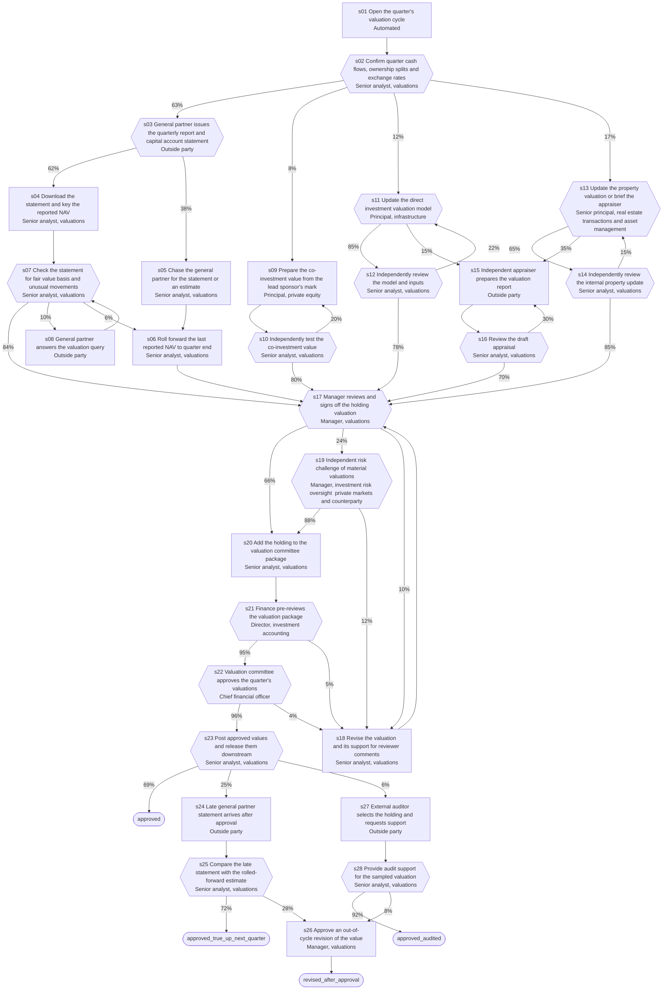

# Value private investments each quarter (fund interests, co-investments, direct holdings and properties)

`pam-private-quarterly-valuation` · Public sector institutional asset management · Investment operations (valuations) · part of `public-asset-manager`

Each quarter a four-person valuations team sets the fair value of about 300 private holdings that the manager holds for its pension and insurance clients: interests in private funds valued from the general partner's statement, co-investments valued from the lead sponsor's mark, and direct infrastructure, credit and property holdings valued from deal team models or independent appraisals. Each value is checked by staff independent of the deal team, signed off by the valuations manager and approved as a set by a management valuation committee, then released to unit pricing, accounting and performance. The process is slow because general partners report 45 to 90 days after quarter end, so many fund values are rolled forward with market proxies and revised later, and because a small team must challenge models built by senior investment staff before a fixed committee date.

| | |
|---|---|
| Unit of work | one private holding valued for a quarter |
| Starts when | Quarter end, followed by the arrival of the general partner's statement, the asset's quarterly operating report or an appraisal report for the holding. |
| Done when | The holding's fair value for the quarter is approved by the valuation committee and released to pool unit pricing, investment accounting and performance, with any later true-up or audit adjustment recorded. |
| Organisation | A provincial not-for-profit asset manager with about 240 staff and $79 billion under management, investing for four public sector clients through pools and segregated accounts, with private assets held through funds, co-investments and direct holdings. (242 employees, 2019-2022) |
| Volume | 100 cases a month (range 80 to 130) |

## Where it sits

- Starts with **gp_quarterly_report** from general_partners (63% of cases)
- Starts with **asset_monitoring_report** from private-asset-monitoring (25% of cases)
- Starts with **valuation_report** from third_party_appraisers (7% of cases)
- Starts with **commitment_record** from private-deal-closing-funding (5% of cases)
- Sends **approved_valuations** to pool-unit-pricing (outcome: any)
- Sends **approved_valuations** to fund-accounting-close (outcome: any)
- Sends **approved_valuations** to performance-attribution (outcome: any)

## Flow

## Roles

| Role | Department | Layer | FTE on this process | Loaded cost per hour | Evidence |
|---|---|---|---:|---:|---|
| Senior analyst, valuations | Valuations | senior specialist | 2.5 | 80 CAD | B [fsra2021], [jobbank_11101] |
| Manager, valuations | Valuations | manager | 0.6 | 120 CAD | C |
| Principal, private equity | Private equity | senior specialist | 0.15 | 195 CAD | C |
| Senior principal, real estate (transactions and asset management) | Real estate | senior specialist | 0.5 | 195 CAD | C |
| Principal, infrastructure | Infrastructure | senior specialist | 0.5 | 195 CAD | C |
| Manager, investment risk oversight (private markets and counterparty) | Investment risk oversight | senior specialist | 0.15 | 120 CAD | B [fsra2021] |
| Director, investment accounting | Investment accounting (pools and client portfolios) | director | 0.02 | 240 CAD | C |
| Chief financial officer | Finance | executive | 0.01 | 750 CAD | C |

## Steps

Hands-on time and the wait before each step show the most common value. Evidence tier A is a sourced number, B a sourced description, C the author's estimate.

| Step | Who | Kind | Hands-on | Wait before | Control | Evidence |
|---|---|---|---:|---:|---|---|
| **s01 Open the quarter's valuation cycle.** On the first business day after quarter end the private markets system rolls the period forward, carries the last approved value of every holding into the new quarter, loads quarter-end exchange rates and creates a task list showing each holding's type, owning client accounts, last statement date and valuation method. | Automated | system auto | 0 min | 0 min |  | B [iclient2019] |
| **s02 Confirm quarter cash flows, ownership splits and exchange rates.** The analyst checks that every capital call, distribution and fee for the holding up to quarter end is booked in the private markets system, ties them to custodian cash records, and confirms the split of the holding across client accounts and the exchange rate used, so that the value can be rolled forward or compared later. | Senior analyst, valuations | validation | 15 min | 3.0 d |  | B [kroll2020], [ilpa_p3] |
| **s03 General partner issues the quarterly report and capital account statement.** The general partner posts the fund's quarterly financial statements and the investor's capital account statement on its investor portal or emails them. Valuations waits until the statement arrives or until the internal cut-off date set for the valuation committee package, whichever comes first. | Outside party | external wait | 0 min | 40.0 d |  | B [ilpa_p3], [kroll2020] |
| **s04 Download the statement and key the reported NAV.** The analyst logs in to the general partner's portal, downloads the PDF statement, files it in the document system and types the reported net asset value, statement date, currency, unfunded commitment and fee and carried interest lines into the private markets system against the right fund interest and client accounts. | Senior analyst, valuations | data entry | 25 min | 12.0 h |  | C |
| **s05 Chase the general partner for the statement or an estimate.** For a statement that has not arrived, the analyst emails the general partner's investor relations team asking for the expected date and for a preliminary or flash NAV estimate, and notes any reply so the roll-forward can use the best available information. | Senior analyst, valuations | communication | 15 min | 0 min |  | B [kroll2020] |
| **s06 Roll forward the last reported NAV to quarter end.** The analyst starts from the last reported NAV, adds capital calls and subtracts distributions since that date, then applies the movement of a public market proxy index chosen for the fund's strategy, adjusted for the fund's lower volatility, and converts to Canadian dollars. A general partner estimate replaces the proxy when one was given. | Senior analyst, valuations | analysis | 45 min | 1.0 d | The model manager valuation policy on adjusting reported NAV to the measurement date (IPEV Guidelines section 4.2) | B [ipev2022], [kroll2020] |
| **s07 Check the statement for fair value basis and unusual movements.** The analyst compares the reported NAV with last quarter and with the cash flows, reads the general partner's explanation of valuation changes, checks that the statement date matches quarter end and that carried interest is deducted, and flags any movement above the policy threshold or any sign that the NAV is not fair value based. | Senior analyst, valuations | validation | 30 min | 0 min | The model manager Investments Valuation Policy, which client investment policies require the model manager to apply (written policy with documented inputs and review, as recommended by the IPEV Guidelines): evidence that reported NAV is fair value based before it is used (IPEV 4.1) | B [ipev2022], [ilpa_p3], [ifrs13] |
| **s08 General partner answers the valuation query.** The general partner's finance or investor relations team replies to the question, for example explaining a large write-up, a change of method, a missing distribution or a fee line, sometimes after a call with the deal team. | Outside party | external wait | 0 min | 4.0 d |  | C |
| **s09 Prepare the co-investment value from the lead sponsor's mark.** The private equity principal collects the lead sponsor's quarterly mark and the company's latest results, checks that the security held matches the sponsor's, applies the model manager's ownership share and exchange rate, and writes a short note on the multiple, debt and any change since last quarter. | Principal, private equity | analysis | 1.5 h | 28.0 d |  | B [fsra2021], [optrust2021] |
| **s10 Independently test the co-investment value.** A valuation analyst recalculates the implied multiple from the company's results, compares it with listed peers and the entry multiple used at purchase, and checks the sponsor's value against the model manager's own proxy model before accepting it or sending questions back to the deal team. | Senior analyst, valuations | validation | 1.2 h | 1.0 d | Client investment policy (The insurance client statement of investment policies and procedures): valuations reviewed and approved by qualified personnel independent of those who transact or manage the investment | B [iclient_sipp], [fsra2021], [ipev2022] |
| **s11 Update the direct investment valuation model.** The infrastructure or credit principal updates the discounted cash flow model with the asset's quarterly results, revised forecasts from management, current discount rate and exchange rate evidence, recalibrates to the entry price where the asset is recent, and drafts a valuation memo explaining the change from last quarter. | Principal, infrastructure | analysis | 4.0 h | 24.0 d |  | B [ipev2022], [fsra2021], [optrust2021] |
| **s12 Independently review the model and inputs.** A valuation analyst traces the model's revenue and cost inputs to the asset report, compares the discount rate with recent transactions and broker surveys, reruns the sensitivity table and reviews the memo, then accepts the value or returns it to the principal with challenges. | Senior analyst, valuations | validation | 3.0 h | 1.0 d | Client investment policy (The insurance client statement of investment policies and procedures): valuations reviewed and approved by qualified personnel independent of those who transact or manage the investment | B [iclient_sipp], [fsra2021] |
| **s13 Update the property valuation or brief the appraiser.** The real estate principal takes the operating partner's quarterly report, updates rent roll, leasing, capital spending and the capitalisation and discount rates in the property model, and, where an external appraisal is scheduled this quarter, sends the appraiser the data pack and answers questions. | Senior principal, real estate (transactions and asset management) | analysis | 3.0 h | 21.0 d |  | B [optrust2021], [iclient_sipp], [plan_is2022] |
| **s14 Independently review the internal property update.** A valuation analyst compares the property's capitalisation rate and market rent with recent transactions and broker surveys, checks the change since the last appraisal and accepts the value or returns it to the real estate team with questions. | Senior analyst, valuations | validation | 1.0 h | 1.0 d | Client investment policy (The insurance client statement of investment policies and procedures): valuations reviewed and approved by qualified personnel independent of those who transact or manage the investment | B [iclient_sipp], [fsra2021] |
| **s15 Independent appraiser prepares the valuation report.** An accredited appraisal or valuation firm inspects or desk-reviews the asset, builds its own income and comparable sales or transaction analysis, and issues a draft report with a value conclusion for the quarter end. | Outside party | external wait | 0 min | 18.0 d | The model manager valuation policy: external appraisal or valuation on a rolling cycle for material direct holdings (peer practice: annually for significant assets, at least every three years otherwise) | B [optrust2021], [plan_ar2021], [iclient_sipp] |
| **s16 Review the draft appraisal.** A valuation analyst reads the draft report, checks the rent roll, cash flows and rates against the model manager's data and market evidence, and either accepts the value or sends comments back to the appraiser for a revised draft. | Senior analyst, valuations | validation | 2.0 h | 1.0 d | Client investment policy: third-party valuations provided to the model manager must be reviewed and assessed for reasonableness by the model manager | A [iclient_sipp] |
| **s17 Manager reviews and signs off the holding valuation.** The valuations manager reviews the holding's file: method, inputs, support, change from last quarter and any open questions, applying the policy's materiality thresholds. The manager signs off, sends it back for more support, or flags it as material or judgmental for independent risk review. | Manager, valuations | review | 20 min | 1.0 d | The model manager Investments Valuation Policy, which client investment policies require the model manager to apply (written policy with documented inputs and review, as recommended by the IPEV Guidelines): manager review of each holding valuation | B [ipev2022], [fsra2021], [pclient_sipp] |
| **s18 Revise the valuation and its support for reviewer comments.** The analyst adds the missing support, corrects the input or calculation the reviewer questioned, or obtains a revised figure from the deal team, and updates the valuation file and memo before resubmitting it for review. | Senior analyst, valuations | drafting | 40 min | 1.0 d |  | C |
| **s19 Independent risk challenge of material valuations.** A manager in investment risk oversight reviews material or judgmental valuations, such as large direct holdings or large write-ups, comparing the assumptions with the risk team's own view of the asset and market evidence, and records agreement or a challenge. | Manager, investment risk oversight (private markets and counterparty) | review | 40 min | 2.0 d | The model manager risk policy: second-line review of material valuations by a risk team separate from the investment team (FSRA leading practice) | B [fsra2021] |
| **s20 Add the holding to the valuation committee package.** The analyst adds the signed-off value to the committee package: the summary table by asset class and client, movement analysis, list of rolled-forward and stale values, external appraisals done this quarter and backtesting of last quarter's estimates against statements received since. | Senior analyst, valuations | drafting | 15 min | 1.0 d |  | B [ipev2022], [fsra2021] |
| **s21 Finance pre-reviews the valuation package.** The director of investment accounting reads the package before the meeting, checks that the values tie to what will be booked for each pool and client portfolio, and asks about any value that looks out of line with cash flows or the prior quarter. | Director, investment accounting | review | 1 min | 2.0 d |  | C |
| **s22 Valuation committee approves the quarter's valuations.** The management valuation committee, chaired by the chief financial officer with the chief risk officer and the head of investment operations, reviews the package, discusses large movements, rolled-forward values and appraisal results, and approves the set or asks for more work on particular holdings. | Chief financial officer | approval | 0.6 min | 6.0 d | The model manager Investments Valuation Policy, which client investment policies require the model manager to apply (written policy with documented inputs and review, as recommended by the IPEV Guidelines): approval by an independent internal valuation committee | B [ipev2022], [ipev_page], [plan_ar2021], [iclient_sipp] |
| **s23 Post approved values and release them downstream.** The analyst marks the value approved in the private markets system, which flows to the warehouse, and emails pool unit pricing, investment accounting and performance that the quarter's approved valuations are released, with the list of rolled-forward values that may later be revised. | Senior analyst, valuations | data entry | 8 min | 12.0 h |  | C |
| **s24 Late general partner statement arrives after approval.** The general partner's statement for the quarter arrives after the committee approved a rolled-forward value, often 60 to 90 days after quarter end, or later for year-end audited statements. | Outside party | external wait | 0 min | 18.0 d |  | B [ilpa_p3], [kroll2020] |
| **s25 Compare the late statement with the rolled-forward estimate.** The analyst keys the late NAV, measures the difference from the approved estimate, records it in the backtesting log, and decides under the policy threshold whether the difference is taken up in next quarter's value or needs an out-of-cycle revision. | Senior analyst, valuations | analysis | 30 min | 1.0 d |  | B [ipev2022] |
| **s26 Approve an out-of-cycle revision of the value.** The valuations manager approves a revised value and notifies unit pricing, accounting, performance and client reporting so that prior period figures can be restated or adjusted, logging the revision for the next committee meeting. | Manager, valuations | approval | 30 min | 1.0 d | The model manager Investments Valuation Policy, which client investment policies require the model manager to apply (written policy with documented inputs and review, as recommended by the IPEV Guidelines): revisions above threshold approved and reported to the committee | C |
| **s27 External auditor selects the holding and requests support.** At year end the auditor of the pools and of the client funds samples holdings, requests the general partner statements, audited fund financial statements, roll-forward workings, models and appraisal reports, and sends confirmations to general partners. | Outside party | external wait | 0 min | 10.0 d | Annual audit of the pools' and client funds' financial statements: audit evidence over existence and valuation of private fund interests and direct holdings | B [ca2006] |
| **s28 Provide audit support for the sampled valuation.** The analyst assembles the support file, walks the auditor through the method and roll-forward, answers follow-up questions and, if the audited fund statements show a different year-end NAV, agrees an adjustment with the auditor. | Senior analyst, valuations | communication | 2.0 h | 2.0 d |  | B [ca2006] |

## Exceptions

| Exception | Share of cases | What happens |
|---|---:|---|
| Statement not received by the cut-off | 24% | The general partner has not reported by the cut-off, so the analyst chases it, rolls the last NAV forward with cash flows and a proxy index, and compares the estimate with the statement when it arrives. |
| Query to the general partner | 6% | A large or unexplained movement, a date mismatch or a missing distribution leads to a question to the general partner before the NAV is accepted. |
| Deal team valuation challenged | 7% | The valuations team returns a co-investment mark, a direct model or a property update to the deal team with challenges on inputs such as discount or capitalisation rates. |
| Draft appraisal sent back for comments | 3% | The analyst finds factual errors or unsupported rates in an appraiser's draft and asks for a revised report. |
| Material true-up after approval | 7% | A late statement differs from the approved roll-forward by more than the policy threshold, so the manager approves an out-of-cycle revision that flows to pricing, accounting and client reports. |
| Year-end audit sample | 6% | In the December quarter the auditor samples the holding and asks for full support; a few lead to an agreed adjustment. |

## Benchmarks

| Metric | Value | Unit | Population | Evidence |
|---|---|---|---|---|
| cycle_time_days | p50 55, p90 85 | calendar days from quarter end to an approved value for the holding (including later true-ups) | Canadian public sector asset managers and pension investment managers valuing private holdings quarterly | C [plan_q2f2022], [ilpa_p3] |
| quarterly_results_publication_lag_days | 43 | calendar days after quarter end | The national pension fund manager, quarter ended 30 September 2021 | A [plan_q2f2022] |
| general_partner_annual_report_deadline_days | 90 | days after fiscal year end | ILPA Principles 3.0 recommendation for private fund annual reports including audited statements | A [ilpa_p3] |
| external_valuation_cycle_years | significant_assets 1, other_assets_above_threshold 3 | years between external valuations | OPTrust, an Ontario public sector pension plan, 2021 policy | A [optrust2021] |
| minimum_review_frequency_non_traded_assets | valued at least annually, reviewed at least quarterly | policy frequency | The insurance client insurance fund policy for assets managed by the model manager; the national pension fund manager reviews and updates private asset values at least quarterly | A [iclient2019], [iclient_sipp], [plan_is2022] |

## Pain points

- General partners report 45 to 90 days after quarter end, so a quarter of holdings are approved on a rolled-forward estimate and revised later, which ripples into unit prices, performance and client reports. (steps s03, s05, s06, s24, s25, s26; B [ipev2022], [kroll2020])
- Statements come as PDFs from dozens of general partner portals in different layouts and are keyed by hand, which costs time at quarter end and lets keying errors through. (steps s04, s07; C)
- Direct holdings are first valued by the deal teams that bought them, so a small valuations team must challenge senior investment staff's models under time pressure. (steps s09, s10, s11, s12, s13, s14; B [iclient_sipp], [fsra2021])
- About 300 holdings pass through one manager's review before a fixed committee date, so reviews queue and the package is built in a rush. (steps s17, s20, s22; C)
- Year-end audits ask for audited fund statements that are often not ready, so analysts roll audited figures forward and answer extensive auditor requests. (steps s27, s28; B [ca2006])

## Assumptions

- Holding mix per quarter: about 190 fund interests (63%), 25 private equity co-investments (8%), 35 infrastructure and private credit direct holdings (12%) and 50 real estate properties and co-investments (17%), consistent with the org file's demand driver note; the split is tier C.
- The direct infrastructure path uses the infrastructure principal role for both infrastructure and private credit holdings; private credit principals sit in global credit in the org file and do similar work.
- A management valuation committee chaired by the chief financial officer, with the chief risk officer and the vice president of investment operations, approves the full set; only the chair's time is modelled, as a per holding share of the meeting. The model manager's actual committee structure was not found in public sources.
- Committee and review steps are written per holding: touch minutes are the holding's share of batch work, and waits reflect the fixed committee date, so the simulated spread of cycle times is wider than the real one, where most values are approved on the same day.
- The internal cut-off for general partner statements is assumed near day 50 after quarter end; 38% of fund statements miss it, which matches the org file's 45 to 90 day arrival range.
- External appraisal or valuation falls on about 35% of property cases and 15% of direct infrastructure and credit cases each quarter, a rolling cycle between annual and three-yearly as in peer policies.
- The insurance client investment policy cited is the version on the web page in 2025; the requirements quoted are assumed to have applied in 2019 to 2022 as well, as the org file also assumes.
- Loaded costs per hour are taken unchanged from the org file (wage plus variable pay times a 1.35 loading).
- The simulation counts the year-end audit sample on 6% of all holdings (about a quarter of holdings in the December quarter); audit hours outside the sample are not modelled.

## Sources

- [ipev2022] [International Private Equity and Venture Capital Valuation Guidelines, December 2022 edition (PDF copy)](https://www.dirittobancario.it/wp-content/uploads/2023/02/IPEV-Valuation-Guidelines.pdf) (International Private Equity and Venture Capital Valuation Board (IPEV), 2022). Fair value assessed at each measurement date; NAV reported by the fund manager as the starting point for a fund interest, adjusted for known or knowable changes when the NAV date differs from the measurement date (section 4.1 and 4.2); calibration to the price of a recent investment; better practice of a written valuation policy, documented inputs, an independent internal valuation committee or external advisers, and backtesting.
- [ipev_page] [Valuation Guidelines (IPEV web page)](https://www.privateequityvaluation.com/Valuation-Guidelines) (IPEV Board, 2025). Editions of the guidelines (2012, 2015, 2018, 2022, 2025) and endorsement by industry bodies including ILPA.
- [fsra2021] [Alternative Assets and Risk Management: Insights into Practices Observed from FSRA's Review of Six Large Public Sector Pension Plans in Ontario](https://fsrao.ca/media/4946/download) (Financial Services Regulatory Authority of Ontario, 2021). Written valuation policies setting frequency, qualified internal staff and criteria for external advisors; valuation of internally managed assets reviewed at least semi-annually; materiality thresholds to triage assets for external review; review of a portion of externally managed fund values; proxy benchmark models for co-investments; independent risk control team with oversight by the board.
- [optrust2021] [OPTrust 2021 Funding and Financial Statements Report](https://select.optrust.com/documents/OPTrust-2021-FSR.pdf) (OPSEU Pension Trust, 2022). Real estate, private equity and infrastructure valued at least annually; investments above thresholds valued externally at least once every three years, or annually for significant investments; fund and co-investment fair values based on the value reported by the fund manager and updated for material factors known at the valuation date.
- [iclient_sipp] Insurance fund: statement of investment policies and procedures (The insurance client web page) (link withheld) (The insurance client, 2025). Client policy for an model manager client: non-traded investments valued at least annually and reviewed at least quarterly; valuations reviewed and approved by qualified personnel independent of those who transact or manage the investment; third-party valuations provided to the model manager must be reviewed and assessed for reasonableness by the model manager; independent appraisal, discounted cash flow and comparable transactions as accepted techniques.
- [ilpa_p3] [ILPA Principles 3.0: financial disclosures (annual and quarterly reporting)](https://ilpa.org/wp-content/flash/ILPA%20Principles%203.0/inc/html/34.html) (Institutional Limited Partners Association, 2019). Annual reports including audited financial statements within 90 days of year end; quarterly unaudited statements with an explanation of quarter-to-quarter valuation changes and a summary of capital calls and distributions.
- [plan_is2022] Investment Statement for the base plan and additional plan investment portfolios (February 2022) (link withheld) (The national pension fund manager, 2022). Fair values of non-traded private assets reviewed and updated at least quarterly; oversight of valuation by finance professionals independent of investment departments; risk-based use of third-party appraisers and external valuation experts; regular review of external managers' valuation practices.
- [plan_q2f2022] The national pension fund manager net assets total $541.5 billion at second quarter fiscal 2022 (news release) (link withheld) (The national pension fund manager via Cision Newswire, 2021). Quarter ended 30 September 2021 reported on 12 November 2021, 43 days after quarter end, including private equity values.
- [kroll2020] [Coronavirus Pandemic and Public Market Volatility: How Should Institutional Investors be Valuing Fund Interests at March 31, 2020? (webcast slides, 7 April 2020)](https://www.kroll.com/-/media/assets/pdfs/webcasts/coronavirus-institutional-investors-webcast-slides.pdf) (Duff & Phelps (Kroll), 2020). Bringing a lagged fund NAV in phase: adjust for capital calls and distributions in the intervening period, then for market movement using a benchmark or synthetic index adjusted for volatility; assess the GP's valuation policy, auditor and history of audit adjustments; option to contact the GP for an estimate.
- [ca2006] [Auditing Alternative Investments (research note, September 2006)](https://publishedresearch.cambridgeassociates.com/wp-content/uploads/2006/09/Auditing-Alternative-Investments-Sept-2006.pdf) (Cambridge Associates, 2006). Auditor expectations under the AICPA alternative investments practice aid: a fund manager confirmation alone is not sufficient evidence; investors need a documented valuation process; audited fund statements often require a roll-forward to the investor's reporting date.
- [iclient2019] The insurance client Pension Fund Statement of Investment Policies and Procedures, effective January 1, 2019 (link withheld) (The insurance client, 2019). Client policy in force in the reference period: fair value under IFRS; estimates of the fair value of investments not traded on an organized market made no less frequently than quarterly, by independent expert appraisal, discounted cash flows or comparable sales.
- [plan_ar2021] The national pension fund manager F2021 Annual Report (link withheld) (The national pension fund manager, 2021). Finance group oversees valuation independently of investment departments; third-party appraisers used in a risk-based manner for the most subjective values; governance by a management Valuation Committee and the Board's Audit Committee, with internal and external auditors; regular review of external managers' valuation practices.
- [pclient_sipp] Statement of Investment Policies and Procedures for the Public Service Pension Plan (approved December 3, 2025) (link withheld) (The pension client, 2025). An model manager client's policy: all private investments (direct, co-investments and fund investments in real estate, private equity, infrastructure and private debt) valued in accordance with the model manager Investments Valuation Policy, with the pension client monitoring its application.
- [jobbank_11101] [Wages: Financial Analyst (NOC 11101) in the Toronto Region](https://www.jobbank.gc.ca/marketreport/wages-occupation/12417/22437) (Job Bank, Government of Canada, 2025). Toronto hourly wages for NOC 11101: low 27.97, median 41.60, high 73.57 (reference period 2023-2024).
- [ifrs13] [IFRS 13 Fair Value Measurement (IFRS Foundation standard page)](https://www.ifrs.org/issued-standards/list-of-standards/ifrs-13-fair-value-measurement/) (IFRS Foundation, 2011). Fair value is the price that would be received to sell an asset in an orderly transaction between market participants (an exit price).

Written by claude-opus on 2026-11-17.
