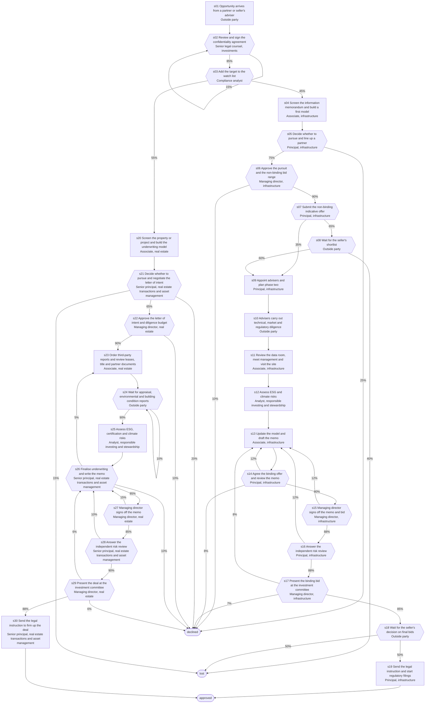

# Screen and diligence infrastructure and real estate direct investments

`pam-real-asset-direct-investment-dd` · public sector asset management · infrastructure and real estate investing · part of `public-asset-manager`

The infrastructure and real estate teams evaluate direct purchases, take-privates, joint ventures and development projects brought by fund partners, operating partners and sellers' advisers. Infrastructure assets are usually sold in two-round auctions: the team screens the information memorandum, submits a non-binding offer with a partner and, if shortlisted, runs technical, market, regulatory and legal diligence with outside advisers before the investment committee approves a binding bid. Real estate deals are more often negotiated with a letter of intent followed by appraisal, environmental and building condition reports. Most elapsed time is spent waiting for sellers, advisers and committee dates, and much of the work is written off when the team is not shortlisted or is outbid.

| | |
|---|---|
| Unit of work | one direct real asset opportunity taken into due diligence |
| Starts when | A partner or seller's adviser offers a direct infrastructure or real estate opportunity and the team signs a confidentiality agreement to evaluate it. |
| Done when | The investment committee approves a bid or purchase and legal is instructed, or the team declines, is not shortlisted or is outbid. |
| Organisation | A provincial public-sector asset manager of about 240 staff with nine infrastructure and ten real estate staff investing directly and alongside partners. (242 employees, 2019-2022) |
| Volume | 4 cases a month (range 3 to 7) |

## Where it sits

- Starts with **deal_opportunity** from general_partners (55% of cases)
- Starts with **deal_opportunity** from portfolio_companies (45% of cases)
- Relies on **investment_plan** from annual-investment-plan-benchmarks (a standing input; it does not start a case)
- Sends **investment_memo** to investment-committee-approval (outcome: approved)
- Sends **investment_memo** to new-investment-risk-review (outcome: approved)
- Sends **legal_instruction** to investment-legal-agreements (outcome: approved)

## Flow

## Roles

| Role | Department | Layer | FTE on this process | Loaded cost per hour | Evidence |
|---|---|---|---:|---:|---|
| Associate, infrastructure | Infrastructure | individual contributor | 0.85 | 85 CAD | B [otpp_job] |
| Principal, infrastructure | Infrastructure | senior specialist | 0.4 | 195 CAD | B [otpp_job], [mgr_ar21] |
| Managing director, infrastructure | Infrastructure | director | 0.06 | 420 CAD | C |
| Associate, real estate | Real estate | individual contributor | 0.45 | 85 CAD | C |
| Senior principal, real estate (transactions and asset management) | Real estate | senior specialist | 0.55 | 195 CAD | B [mgr_ar21] |
| Managing director, real estate | Real estate | director | 0.06 | 420 CAD | C |
| Analyst, responsible investing and stewardship | Responsible investing | individual contributor | 0.12 | 75 CAD | B [mgr_ar21] |
| Senior legal counsel, investments | Legal services | senior specialist | 0.04 | 170 CAD | C |
| Compliance analyst | Compliance | individual contributor | 0.01 | 65 CAD | C |

## Steps

Hands-on time and the wait before each step show the most common value. Evidence tier A is a sourced number, B a sourced description, C the author's estimate.

| Step | Who | Kind | Hands-on | Wait before | Control | Evidence |
|---|---|---|---:|---:|---|---|
| **s01 Opportunity arrives from a partner or seller's adviser.** A fund partner, operating partner, joint venture partner or the seller's financial adviser sends a teaser and confidentiality agreement for an infrastructure business, a property or a development project. About half come through a strategic partner and half through brokered sales. | Outside party | intake | 0 min | 0 min |  | B [mgr_ar21], [trowers] |
| **s02 Review and sign the confidentiality agreement.** Investment counsel checks the agreement against the organisation's standard positions on affiliates and clients, sharing with advisers, lenders and consortium partners, non-solicitation and standstill, marks up what is unacceptable and signs under delegated authority. | Senior legal counsel, investments | review | 45 min | 1.0 d | Legal review and signing authority for confidentiality agreements | B [trowers], [wedlake] |
| **s03 Add the target to the watch list.** The compliance analyst adds the target, any listed parent or bonds and the deal team to the watch list in the pre-trade compliance engine, which matters most for take-privates of listed companies. | Compliance analyst | data entry | 10 min | 4.0 h | Ontario Securities Act section 76 (trading or tipping with undisclosed material facts); internal information barrier procedure | C |
| **s04 Screen the information memorandum and build a first model.** The infrastructure associate reads the information memorandum and seller's model, checks fit with the infrastructure plan (sector, region, core or core-plus risk, ticket size, concentration) and builds a first long-term cash flow model to frame a value range. | Associate, infrastructure | analysis | 12.0 h | 3.0 d |  | B [otpp_job], [wsp] |
| **s05 Decide whether to pursue and line up a partner.** The principal reviews the screen, decides whether the asset fits and is winnable, sounds out a fund or consortium partner where the ticket is too large to take alone and recommends a pursuit to the managing director. | Principal, infrastructure | judgment | 3.0 h | 1.0 d |  | B [mgr_ar21], [gkm] |
| **s06 Approve the pursuit and the non-binding bid range.** The managing director reviews the recommendation, agrees the partner approach, the indicative value range and the phase-one budget, or stops the pursuit. | Managing director, infrastructure | approval | 1.0 h | 2.0 d | Delegation of authority for pursuit decisions, non-binding offers and external adviser spend | C |
| **s07 Submit the non-binding indicative offer.** The principal agrees the indicative price, funding plan and key conditions with the partner and submits the non-binding offer letter by the seller's deadline. Bilateral deals with a partner skip the seller's shortlist. | Principal, infrastructure | communication | 4.0 h | 7.0 d |  | B [wedlake], [papermark] |
| **s08 Wait for the seller's shortlist.** The seller and its adviser compare indicative offers on price, certainty of funds and experience and invite a shortlist into the second round with full data room access. | Outside party | external wait | 0 min | 10.0 d |  | B [papermark], [wedlake] |
| **s09 Appoint advisers and plan phase two.** The principal agrees scopes, fees and cost sharing with the partner and signs engagement letters with technical, market, legal, tax, accounting and insurance advisers, and sets the second-round workplan and deadlines. | Principal, infrastructure | coordination | 6.0 h | 1.0 d | Delegation of authority for pursuit decisions, non-binding offers and external adviser spend | B [otpp_job], [afry], [wsp] |
| **s10 Advisers carry out technical, market and regulatory diligence.** The advisers review asset condition, lifecycle and capital costs, demand and revenue forecasts, the regulatory regime, environmental liabilities, tax structure, contracts and insurance, and issue red-flag and final reports. | Outside party | external wait | 0 min | 21.0 d |  | B [wsp], [afry], [papermark] |
| **s11 Review the data room, meet management and visit the site.** Alongside the advisers, the associate works through the data room and seller Q&A, attends management presentations and a site visit, and tracks the issues list with the partner's team. | Associate, infrastructure | analysis | 1.2 d | 4.0 h |  | B [trowers], [otpp_job] |
| **s12 Assess ESG and climate risks.** The responsible investing analyst applies the ESG framework with sector standards to the advisers' environmental and social findings, assesses climate transition and physical risk and governance rights, and writes the ESG section and conditions. | Analyst, responsible investing and stewardship | review | 8.0 h | 4.0 h | Responsible investing policy: ESG assessment in due diligence for direct investments | B [mgr_ar21], [wsp] |
| **s13 Update the model and draft the memo.** The associate builds the advisers' findings and lender financing terms into the long-term model, runs downside and sensitivity cases and drafts the committee memo with the proposed bid, governance rights, risks and client split. | Associate, infrastructure | drafting | 1.7 d | 3.0 d |  | B [otpp_job] |
| **s14 Agree the binding offer and review the memo.** The principal agrees the final price, consortium terms and the sale agreement mark-up with the partner and outside counsel, reviews the memo against the model and decides whether a binding bid is worth making. | Principal, infrastructure | review | 15.0 h | 2.0 d |  | B [wedlake], [trowers] |
| **s15 Managing director signs off the memo and bid.** The managing director tests the bid price, partner terms and fit with the infrastructure plan and signs off the memo for committee or sends it back. | Managing director, infrastructure | review | 2.0 h | 1.0 d | Investment approval policy: asset class head sponsors every committee submission | C |
| **s16 Answer the independent risk review.** The principal files the submission and answers the investment risk team's questions on leverage, regulatory and construction risk, currency, concentration and liquidity while it writes its opinion. | Principal, infrastructure | communication | 4.0 h | 3.0 d | Investment risk policy: independent risk opinion with every committee paper | C |
| **s17 Present the binding bid at the investment committee.** The managing director and principal present the memo and risk opinion to the investment committee, which approves the bid up to a maximum price, approves with conditions, defers or declines. | Managing director, infrastructure | approval | 2.0 h | 2.0 d | Board-approved investment approval authorities for direct investments | C |
| **s18 Wait for the seller's decision on final bids.** The consortium submits its binding offer; the seller compares final bids, may ask for a best and final round and grants exclusivity to one bidder. Many well-worked bids lose on price. | Outside party | external wait | 0 min | 7.0 d |  | B [papermark] |
| **s19 Send the legal instruction and start regulatory filings.** The principal instructs legal to finalise the sale and consortium agreements, plans merger and foreign investment filings with outside counsel and hands funding needs to private markets operations. | Principal, infrastructure | drafting | 2.0 h | 4.0 h | Competition Act (Canada) pre-merger notification and 30-day waiting period when thresholds are met; foreign investment approvals where the asset is | B [cb_merger] |
| **s20 Screen the property or project and build the underwriting model.** The real estate associate reviews the rent roll, operating statements, development budget or joint venture proposal, checks fit with the real estate plan (sector, market, risk, concentration) and builds an underwriting model with market rents, cap rates and financing. | Associate, real estate | analysis | 10.0 h | 1.0 d |  | B [mgr_ar21] |
| **s21 Decide whether to pursue and negotiate the letter of intent.** The senior principal decides whether the deal fits, negotiates price, the due diligence period and key joint venture terms with the seller or operating partner and prepares a letter of intent. | Senior principal, real estate (transactions and asset management) | judgment | 5.0 h | 3.0 d |  | C |
| **s22 Approve the letter of intent and diligence budget.** The managing director approves signing the non-binding letter of intent and the budget for appraisal, environmental, building condition, survey and legal work, or stops the deal. | Managing director, real estate | approval | 1.0 h | 1.0 d | Delegation of authority for pursuit decisions, non-binding offers and external adviser spend | C |
| **s23 Order third-party reports and review leases, title and partner documents.** The associate engages the appraiser and environmental, building condition, survey and zoning consultants, tours the property with the partner, and reviews leases, tenant estoppels, title and the joint venture or development agreements with outside counsel. | Associate, real estate | coordination | 20.0 h | 5.0 d | Real estate investment procedures and lender requirements: Phase I environmental assessment and building condition report before acquisition | B [burke] |
| **s24 Wait for appraisal, environmental and building condition reports.** The consultants inspect the site, search records and deliver draft and final reports. If the Phase I finds a recognised environmental condition, a Phase II with soil and groundwater sampling adds weeks. | Outside party | external wait | 0 min | 15.0 d |  | B [burke] |
| **s25 Assess ESG, certification and climate risks.** The responsible investing analyst reviews building certifications and energy data, environmental findings, physical climate risk and the partner's ESG practices, and writes the ESG section. | Analyst, responsible investing and stewardship | review | 5.0 h | 4.0 h | Responsible investing policy: ESG assessment in due diligence for direct investments | B [mgr_ar21] |
| **s26 Finalise underwriting and write the memo.** The senior principal updates the underwriting for the appraisal and consultants' capital needs, renegotiates price if findings justify it and writes the committee memo with returns, risks, partner terms and client split. | Senior principal, real estate (transactions and asset management) | drafting | 1.0 d | 3.0 d |  | C |
| **s27 Managing director signs off the memo.** The managing director tests the underwriting, partner terms and fit with the real estate plan and signs off the memo or asks for changes. | Managing director, real estate | review | 1.5 h | 1.0 d | Investment approval policy: asset class head sponsors every committee submission | C |
| **s28 Answer the independent risk review.** The senior principal files the submission and answers the investment risk team's questions on leverage, development and leasing risk, market concentration and currency. | Senior principal, real estate (transactions and asset management) | communication | 3.0 h | 2.0 d | Investment risk policy: independent risk opinion with every committee paper | C |
| **s29 Present the deal at the investment committee.** The managing director presents the memo and risk opinion to the investment committee, which approves, approves with conditions, defers or declines. | Managing director, real estate | approval | 1.5 h | 2.0 d | Board-approved investment approval authorities for direct investments | C |
| **s30 Send the legal instruction to firm up the deal.** The senior principal instructs legal to waive conditions or finalise the purchase or joint venture agreement within the due diligence period and gives private markets operations the funding date. | Senior principal, real estate (transactions and asset management) | drafting | 2.0 h | 4.0 h |  | C |

## Exceptions

| Exception | Share of cases | What happens |
|---|---:|---|
| Not shortlisted in an auction | 7% | The indicative offer is below the seller's shortlist and phase-one work is written off. |
| Outbid after full diligence | 7% | The consortium submits an approved binding bid but loses on price after paying advisers. |
| Phase II environmental assessment | 5% | The Phase I finds a recognised environmental condition, so sampling and a remediation estimate extend the due diligence period or reopen price. |
| Diligence finding ends a property deal | 3% | Capital needs, title or lease issues found in diligence cannot be bridged by a price cut. |
| Committee defers or risk team objects | 6% | The memo returns for more analysis, squeezing the bid deadline or the condition period. |

## Benchmarks

| Metric | Value | Unit | Population | Evidence |
|---|---|---|---|---|
| cycle_time_days | p50 60, p90 105 | calendar days from confidentiality agreement to committee-approved binding bid or firm purchase | Competitive auctions and negotiated property purchases | B [papermark], [wedlake] |
| auction_shortlist_rate | 0.6 | share of indicative bidders shortlisted | Limited auctions | B [papermark] |
| infrastructure_transactions_2021 | 3000000000 | CAD | The model manager infrastructure | A [mgr_ar21] |
| merger_review_initial_waiting_period | 30 | days | Notifiable mergers in Canada | A [cb_merger] |

## Pain points

- In auctions much of the work is written off: about four in ten indicative bids are not shortlisted and about half of approved binding bids are outbid. (steps s08, s18; B [papermark])
- Second-round timetables are set by the seller, so the team must manage many advisers in parallel and fit memo, risk review and committee into the last two weeks. (steps s10, s13, s16, s17; B [otpp_job], [trowers])
- Property deals wait on consultants' reports, and a Phase II or appraisal gap can force a price renegotiation late in the condition period. (steps s24, s26; B [burke])
- The same associates build models, chase the data room and draft memos, so two live auctions at once create a bottleneck. (steps s11, s13; C)

## Assumptions

- One workflow covers both teams: after the shared confidentiality and watch list steps, 45% of cases follow the infrastructure auction track and 55% the real estate letter-of-intent track, each staffed by its own team.
- The cycle time benchmark covers cases that reach approval. In the simulation approved infrastructure bids take about 82 days and approved real estate deals about 50 days; the median over all cases is about 40 days because some 40% are declined within the first two weeks.
- Decline notifications to sellers and partners are folded into the decision steps rather than modelled as a separate step.
- Investment committee decisions, independent risk opinions, legal negotiation and closing are separate processes; this workflow carries the deal team's time and the waits for them.
- Outside advisers' work is modelled as waits; their fees, often shared with consortium partners, are not labour in this model.
- Waits include the elapsed spread of multi-day tasks because the simulator adds hands-on minutes as elapsed time without working-day calendars.
- Roles, titles and hourly costs come from the organisation file; full-time equivalents are set from simulated hands-on time times volume, within the headcount left after other workflows.

## Sources

- [mgr_ar21] The model manager 2021 Annual Report (link withheld) (The model manager, 2022). Private equity: eight new co-investments or direct deals and two follow-on investments in 2021, four new fund partners committing $1.47 billion, two co-investments alongside Ardian and one alongside GI Partners; an ESG framework with sector-specific standards is used to assess fund managers and direct investments in due diligence. Infrastructure: over $3 billion of transactions in 2021, first control acquisition (100% of Pulse Clean Energy), about 10% of AusNet Services in a take-private alongside Brookfield and Canadian peers, direct investing alongside funds or strategic partners. Real estate: $225 million committed to 12 industrial development projects with WPT REIT, a multi-family joint venture, first life sciences co-investment, four properties sold. First Client Forum and an evolved client relationship management framework.
- [wedlake] [Under the hammer: the auction process in M&A](https://wedlakebell.com/uncategorised/under-the-hammer-the-auction-process-in-ma/) (Wedlake Bell LLP, undated). Auction stages: information memorandum under confidentiality agreement, non-binding indicative offers with valuation method and funding, shortlist chosen on price, speed, certainty of funds and experience, fuller due diligence with enquiries and draft sale agreement, final offers with mark-ups, exclusivity often 2 to 6 weeks; buyer protections lighter than in bilateral deals.
- [trowers] [Auction sales](https://www.trowers.com/insights/2025/july/auction-sales) (Trowers & Hamlins LLP, 2025). Bidders sign a confidentiality agreement, receive the information memorandum and a process letter, submit non-binding indicative offers; preferred bidders get the data room or vendor due diligence reports, due diligence calls and management presentations, a seller-friendly draft sale agreement, then submit final offers with their mark-up in signable form.
- [papermark] [Competitive bidding process: how to run an M&A auction](https://www.papermark.com/blog/competitive-bidding-process-selling-a-business) (Papermark (blog), 2026). Limited auction: 10 to 20 NDAs, round one indications of interest over 4 to 6 weeks from 4 to 8 bidders, round two with management meetings and data room over 4 to 8 weeks with 3 to 5 shortlisted, best and final from 2 to 3, exclusivity 30 to 60 days; 4 to 8 months from launch to closing.
- [wsp] [Investor advisory (technical due diligence services)](https://www.wsp.com/en-gb/services/investor-advisory) (WSP, undated). Technical due diligence for infrastructure investors: asset condition and lifecycle planning, operating and capital cost projections, capacity, health and safety, environmental and social review, climate risk, regulatory review, contract review and demand and revenue projections.
- [afry] [M&A transactions and due diligence](https://afry.com/en/area/ma-transactions-and-due-diligence) (AFRY, undated). Buy-side diligence on energy and infrastructure: market, commercial and regulatory review, operational and technical performance, asset base quality, maintenance backlog, environmental liabilities and remediation, ESG and capex and opex; scope designed case by case.
- [burke] [Third party reports for due diligence (client alert)](https://www.burkelaw.com/alert-third-party-reports-for-due-diligence) (Burke, Warren, MacKay & Serritella, P.C., undated). Buyers commission third-party reports during the purchase agreement's due diligence period: land title survey, property condition assessment with a 10-year capital budget, Phase I environmental site assessment (Phase II sampling if conditions are found; commercial lenders require a Phase I) and zoning report; obtain consultant bids and time frames while negotiating.
- [cb_merger] [Overview of the merger review process](https://competition-bureau.canada.ca/en/node/451) (Competition Bureau Canada, undated). Mergers above financial thresholds must be notified before closing; after a complete notification an initial 30-day waiting period applies unless waived; a supplementary information request starts a further 30-day period; parties may request an advance ruling certificate.
- [otpp_job] [Investment Associate, Infrastructure & Natural Resources (Ontario Teachers' job posting)](https://builtinlondon.uk/job/investment-associate-infrastructure-natural-resources/10081637) (Built In London, undated). Canadian pension plan infrastructure associate: assist due diligence and build findings into the financial model, sensitivity and scenario analysis, work with external advisers, consultants and partners to assess risks and submit competitive bids under tight timelines, prepare investment recommendations, support acquisition debt financing.
- [gkm] [What Do Private Equity Firms Say They Do? (NBER Working Paper 21133)](http://www.nber.org/papers/w21133) (National Bureau of Economic Research (P. Gompers, S. Kaplan, V. Mukharlyamov), 2015). Survey of 79 PE firms: for every 100 opportunities considered, the average firm deeply investigates fewer than 24, signs fewer than 14 and closes 6; firms devote considerable resources to deals they do not do; about a third of closed deals come from investment bank auctions.

Written by claude-opus on 2026-11-17.
