# Recruit and onboard staff

`pam-recruit-onboard-staff` · public sector asset management · human resources · part of `public-asset-manager`

The model manager grew from about 207 staff at the end of 2020 to 328 at the end of 2022, so two talent acquisition partners and their manager ran a steady flow of hires. A hiring manager raises a requisition against the board-approved staffing budget, HR sets the pay band, posts the role or engages a search firm, screens and phone-screens candidates and coordinates two interview rounds with a panel and case study. Offers are approved within the band, background checks and notice periods follow, and HR operations sets up payroll, access and code of conduct onboarding. Calendar slots for panels, candidate notice periods and restarts when no finalist fits make the elapsed time long.

| | |
|---|---|
| Unit of work | one hire |
| Starts when | A hiring manager raises a requisition for a budgeted new role or a replacement, under the approved annual budget and headcount plan. |
| Done when | The new hire has started, is on payroll, has system access requested and is enrolled in code of conduct attestation and mandatory training; or the requisition is cancelled or the offer withdrawn. |
| Organisation | A provincial not-for-profit asset manager in one Toronto office, growing quickly from about 100 staff in 2018 toward 300. (242 employees, 2019-2022) |
| Volume | 5 cases a month (range 3 to 8) |

## Where it sits

- Starts with **annual_budget** from annual-cost-budget (60% of cases)
- Starts with **job_application** from candidates (40% of cases)
- Sends **new_hire** to payroll-benefits (outcome: hired)
- Sends **new_hire** to it-service-access (outcome: hired)
- Sends **new_hire** to code-of-conduct-attestations (outcome: hired)
- Sends **job_offer** to candidates (outcome: hired)
- Sends **job_offer** to candidates (outcome: offer_withdrawn)

## Flow

```mermaid
flowchart TD
    s01["s01 Raise the requisition<br/>Hiring manager  manager or director in any department"]
    s02{{"s02 Check the requisition against the headcount plan<br/>Talent acquisition partner"}}
    s03{{"s03 Finance approves a position outside the plan<br/>Director, financial planning, cost allocation and client billing"}}
    s04["s04 Head of HR approves the requisition<br/>Senior vice president, human resources"]
    s05["s05 Set the job level and pay band<br/>Manager, total rewards and HR operations"]
    s06{{"s06 Hold the intake meeting<br/>Talent acquisition partner"}}
    s07["s07 Post the role and source candidates<br/>Talent acquisition partner"]
    s08["s08 Engage a search firm<br/>Manager, talent acquisition and HR business partnering"]
    s09["s09 Applications arrive or the search firm builds a slate<br/>Outside party"]
    s10["s10 Screen the applications<br/>Talent acquisition partner"]
    s11["s11 Hold phone screens<br/>Talent acquisition partner"]
    s12{{"s12 Hiring manager reviews the shortlist<br/>Hiring manager  manager or director in any department"}}
    s13["s13 Schedule the interviews<br/>Talent acquisition partner"]
    s14["s14 Hold first-round interviews<br/>Hiring manager  manager or director in any department"]
    s15["s15 Hold final panel interviews and assessments<br/>Hiring manager  manager or director in any department"]
    s16{{"s16 Debrief and select the candidate<br/>Hiring manager  manager or director in any department"}}
    s17["s17 Check references<br/>Talent acquisition partner"]
    s18["s18 Build the offer within the pay band<br/>Manager, total rewards and HR operations"]
    s19{{"s19 Head of HR approves the offer<br/>Senior vice president, human resources"}}
    s20["s20 Chief executive approves a senior offer<br/>President and chief executive officer"]
    s21{{"s21 Make the verbal offer and negotiate<br/>Talent acquisition partner"}}
    s22["s22 Issue the written offer and background check consent<br/>Talent acquisition partner"]
    s23{{"s23 Background check provider completes the checks<br/>Outside party"}}
    s24{{"s24 Review an adverse background finding<br/>Manager, talent acquisition and HR business partnering"}}
    s25["s25 Candidate works out the notice period<br/>Outside party"]
    s26["s26 Set up the employee record and payroll<br/>HR operations and payroll specialist"]
    s27["s27 Request system access and compliance onboarding<br/>HR operations and payroll specialist"]
    s28["s28 Run the first-day orientation and mandatory training<br/>HR operations and payroll specialist"]
    s01 --> s02
    s02 -->|"85%"| s04
    s02 -->|"15%"| s03
    s03 -->|"85%"| s04
    s03 -->|"15%"| end0
    s04 --> s05
    s05 --> s06
    s06 -->|"70%"| s07
    s06 -->|"30%"| s08
    s07 --> s09
    s08 --> s09
    s09 --> s10
    s10 --> s11
    s11 --> s12
    s12 -->|"90%"| s13
    s12 -->|"10%"| s09
    s13 --> s14
    s14 --> s15
    s15 --> s16
    s16 -->|"85%"| s17
    s16 -->|"15%"| s09
    s17 --> s18
    s18 --> s19
    s19 -->|"88%"| s21
    s19 -->|"8%"| s20
    s19 -->|"4%"| s18
    s20 --> s21
    s21 -->|"80%"| s22
    s21 -->|"10%"| s18
    s21 -->|"10%"| s16
    s22 --> s23
    s23 -->|"96%"| s25
    s23 -->|"4%"| s24
    s24 -->|"50%"| s25
    s24 -->|"50%"| end1
    s25 --> s26
    s26 --> s27
    s27 --> s28
    s28 --> end2
    end0(["cancelled"])
    end1(["offer_withdrawn"])
    end2(["hired"])
```

## Roles

| Role | Department | Layer | FTE on this process | Loaded cost per hour | Evidence |
|---|---|---|---:|---:|---|
| Talent acquisition partner | Talent acquisition and HR business partnering | individual contributor | 0.9 | 55 CAD | B [gem_2022], [aihr_req] |
| Manager, talent acquisition and HR business partnering | Talent acquisition and HR business partnering | manager | 0.05 | 95 CAD | C |
| Senior vice president, human resources | Human resources | director | 0.03 | 290 CAD | B [osc_mgr_2017] |
| HR operations and payroll specialist | Total rewards and HR operations | individual contributor | 0.12 | 50 CAD | C |
| Manager, total rewards and HR operations | Total rewards and HR operations | manager | 0.05 | 100 CAD | B [mgr_ar21] |
| Director, financial planning, cost allocation and client billing | Financial planning, cost allocation and client billing | director | 0.005 | 240 CAD | C |
| President and chief executive officer | Executive office and board secretariat | executive | 0.001 | 1800 CAD | C |
| Hiring manager (manager or director in any department) | Various | manager | 0.7 | 150 CAD | C |

## Steps

Hands-on time and the wait before each step show the most common value. Evidence tier A is a sourced number, B a sourced description, C the author's estimate.

| Step | Who | Kind | Hands-on | Wait before | Control | Evidence |
|---|---|---|---:|---:|---|---|
| **s01 Raise the requisition.** The hiring manager fills in the requisition in the HR system: title, team, reason (new role or replacement), level, target start date and cost centre, attaches or updates the job description and submits it to talent acquisition. | Hiring manager (manager or director in any department) | data entry | 45 min | 1.0 d |  | B [aihr_req] |
| **s02 Check the requisition against the headcount plan.** The talent acquisition partner checks that the role is in the approved budget and headcount plan for the team or replaces a leaver, that the job description is current and the requisition is complete, and routes it for approval. | Talent acquisition partner | validation | 30 min | 1.0 d | Board-approved annual budget and staffing plan; the board may not delegate budget approval | B [aihr_req], [osc_mgr_2017] |
| **s03 Finance approves a position outside the plan.** The director of financial planning reviews the cost of an unbudgeted role, its effect on the cost recovery budget charged to clients and offsets elsewhere, and approves it, defers it to next year's budget or rejects it. | Director, financial planning, cost allocation and client billing | approval | 40 min | 3.0 d | Delegation of financial authority for unbudgeted headcount | B [aihr_req] |
| **s04 Head of HR approves the requisition.** The senior vice president of human resources approves the requisition in the HR system after checking the role against the organisation design and the year's hiring priorities. | Senior vice president, human resources | approval | 15 min | 1.0 d | HR policy: requisition approval before recruiting starts | B [aihr_req] |
| **s05 Set the job level and pay band.** The total rewards manager evaluates the job against the model manager's job architecture and market survey data, confirms the level and the base salary band and incentive target, and records them on the requisition. | Manager, total rewards and HR operations | analysis | 1.0 h | 1.0 d |  | B [mgr_ar21] |
| **s06 Hold the intake meeting.** The talent acquisition partner meets the hiring manager to agree the candidate profile, must-have skills, interview panel and assessment, the sourcing plan and whether a search firm is needed for a senior or scarce role. | Talent acquisition partner | coordination | 1.0 h | 2.0 d |  | B [aihr_req] |
| **s07 Post the role and source candidates.** The partner writes and posts the advertisement on the careers page, LinkedIn and job boards with the accessibility and accommodation statement, and searches LinkedIn and past applicants for people to approach. | Talent acquisition partner | drafting | 2.0 h | 8.0 h | Accessibility for Ontarians with Disabilities Act, Integrated Accessibility Standards (O. Reg. 191/11): notify applicants that accommodation is available | C |
| **s08 Engage a search firm.** The talent acquisition manager selects a search firm from the approved list, agrees the fee (usually a share of first-year pay) and the brief, and briefs the firm with the hiring manager. | Manager, talent acquisition and HR business partnering | coordination | 1.5 h | 1.0 d | Procurement policy: approved supplier list and signed fee agreement | C |
| **s09 Applications arrive or the search firm builds a slate.** Applications come in through the HR system over two to three weeks, or the search firm approaches and screens candidates and presents a slate, often after a month. | Outside party | external wait | 0 min | 10.0 d |  | B [gem_2022] |
| **s10 Screen the applications.** The partner reads the résumés against the must-have criteria, rejects those that do not fit with a standard message and builds a long list of a dozen or so candidates for phone screens. | Talent acquisition partner | analysis | 3.0 h | 1.0 d |  | B [gem_2022] |
| **s11 Hold phone screens.** The partner books and holds 20 to 30 minute calls with six to ten candidates to check interest, pay expectations, notice period and fit, and writes short notes for the hiring manager. | Talent acquisition partner | communication | 5.0 h | 2.0 d |  | C |
| **s12 Hiring manager reviews the shortlist.** The hiring manager reviews the shortlist and screen notes and chooses three to five candidates to interview, or asks for a different profile. | Hiring manager (manager or director in any department) | judgment | 1.0 h | 2.0 d |  | C |
| **s13 Schedule the interviews.** The partner coordinates calendars of the candidates, hiring manager and panel members, books video or in-office interviews and sends interview guides and candidate packs. | Talent acquisition partner | coordination | 1.5 h | 12.0 h |  | C |
| **s14 Hold first-round interviews.** The hiring manager and one colleague interview three to five candidates for about an hour each using the structured guide, score them and agree who goes to the final round. | Hiring manager (manager or director in any department) | judgment | 5.0 h | 4.0 d |  | B [glassdoor_tth] |
| **s15 Hold final panel interviews and assessments.** Two or three finalists meet a panel of three or four, often including a senior leader, and complete a case study, model test or presentation; panel members score them against the profile. | Hiring manager (manager or director in any department) | judgment | 9.0 h | 5.0 d |  | B [glassdoor_tth] |
| **s16 Debrief and select the candidate.** The hiring manager and partner hold the debrief with the panel, compare scores and evidence and select the preferred candidate and a runner-up, or decide that no one fits and sourcing must restart. | Hiring manager (manager or director in any department) | judgment | 1.0 h | 1.0 d |  | B [gem_2022] |
| **s17 Check references.** With the candidate's consent the partner calls two or three referees, usually former managers, using a standard question set and records the answers for the hiring manager. | Talent acquisition partner | communication | 2.0 h | 2.0 d |  | C |
| **s18 Build the offer within the pay band.** The total rewards manager proposes base salary, incentive target and any signing or relocation terms within the band, checks internal equity with peers in the same level and prepares the offer approval form. | Manager, total rewards and HR operations | analysis | 1.0 h | 1.0 d |  | B [mgr_ar21] |
| **s19 Head of HR approves the offer.** The senior vice president of human resources approves the offer terms, or sends them back if they exceed the band or create an equity problem; senior and executive offers go on to the chief executive. | Senior vice president, human resources | approval | 15 min | 1.0 d | Compensation policy: offer approval within band and above-band approval | C |
| **s20 Chief executive approves a senior offer.** For managing director, vice president and executive roles the chief executive reviews and approves the offer, sometimes after a final meeting with the candidate. | President and chief executive officer | approval | 20 min | 2.0 d | Delegation of authority: CEO approval of senior appointments | C |
| **s21 Make the verbal offer and negotiate.** The partner calls the candidate with the offer, answers questions on pay, pension, benefits and hybrid work, and handles counter-proposals or a counter-offer from the current employer. | Talent acquisition partner | communication | 1.5 h | 12.0 h |  | B [gem_2022], [top100] |
| **s22 Issue the written offer and background check consent.** The partner generates the offer letter and employment agreement from templates, sends them for electronic signature with the background check consent and authorisation forms, and tracks the signed return. | Talent acquisition partner | drafting | 45 min | 8.0 h | Consumer Reporting Act (Ontario): notice and consent before obtaining a consumer report for employment | C |
| **s23 Background check provider completes the checks.** The screening provider runs the criminal record, education, employment history and, for finance roles, credit checks, and reports results through its portal; foreign degrees and employers take longer. | Outside party | external wait | 0 min | 5.0 d | Pre-employment screening policy for a financial services employer | A [bgc_tat] |
| **s24 Review an adverse background finding.** The talent acquisition manager reviews the adverse or unverifiable item with the candidate, decides with the hiring manager and legal whether it is relevant to the role and either confirms or withdraws the offer. | Manager, talent acquisition and HR business partnering | judgment | 1.0 h | 1.0 d |  | C |
| **s25 Candidate works out the notice period.** The new hire resigns and works the notice period with the current employer, usually two to four weeks and up to three months for senior investment staff, while HR prepares for the start date. | Outside party | external wait | 0 min | 14.0 d |  | C |
| **s26 Set up the employee record and payroll.** The HR operations specialist creates the employee record in the HR system, enters pay, incentive target and benefits class, collects tax forms and banking details and sends the new hire to the outsourced payroll provider for the next pay run. | HR operations and payroll specialist | data entry | 1.0 h | 1.0 d | Income Tax Act payroll withholding: employee tax credit forms collected at hire | C |
| **s27 Request system access and compliance onboarding.** The specialist raises the IT access and equipment request based on the role's access profile, orders the building pass and enrols the new hire for code of conduct attestation and personal trading account disclosure. | HR operations and payroll specialist | coordination | 30 min | 8.0 h | OSC exemption order for the model manager: code of conduct and personal trading restrictions for personnel | B [osc_mgr_2017] |
| **s28 Run the first-day orientation and mandatory training.** On the start date the specialist welcomes the new hire, collects signed policy acknowledgements, confirms access works and enrols them in mandatory training: health and safety awareness, workplace harassment, accessibility, code of conduct and the DEI module. | HR operations and payroll specialist | communication | 2.0 h | 0 min | Occupational Health and Safety Act (Ontario) and O. Reg. 297/13 awareness training; workplace harassment policy and training | B [mgr_ar21], [shrm_onb] |

## Exceptions

| Exception | Share of cases | What happens |
|---|---:|---|
| No suitable finalist | 15% | The panel finds no one who fits and sourcing restarts, adding three to six weeks. |
| Offer declined or countered | 20% | The candidate declines (turn to the runner-up) or asks for better terms that need new approval. |
| Unbudgeted position | 15% | The role is outside the approved headcount plan and finance must approve it; some are deferred. |
| Search firm hire | 30% | Senior or scarce roles go to a search firm, which takes longer to present a slate. |
| Adverse background finding | 4% | An adverse or unverifiable item is reviewed and about half lead to withdrawal of the offer. |

## Benchmarks

| Metric | Value | Unit | Population | Evidence |
|---|---|---|---|---|
| cycle_time_days | p50 90, p90 150 | calendar days from requisition to the new hire's first day | Professional hires at a Canadian public sector investment organisation (author's estimate) | C [bersin_tth], [glassdoor_tth], [gem_2022] |
| interview_process_days_canada | 22.1 | days, 2014 | Glassdoor interview reviews, Canada | A [glassdoor_tth] |
| time_to_hire_average | 2022 43, 2023 44 | days | Employers in the Josh Bersin Company and AMS study | A [bersin_tth] |
| offer_acceptance_rate | 0.81 | share of offers accepted | Gem customers, September 2021 to March 2022 | A [gem_2022] |
| cost_per_hire | 4700 | USD | SHRM benchmarking data, 2022 | A [shrm_cph] |
| headcount_growth | end_2020 207, end_2021 257, end_2022 328 | employees | This organisation | A [mgr_ar20], [mgr_ar22] |

## Pain points

- Booking interview panels with senior investment staff takes weeks, and two interview rounds plus a case study stretch the process. (steps s13, s14, s15; B [glassdoor_tth])
- Two partners carry a high requisition load during rapid growth, so screening and phone screens queue. (steps s10, s11; B [mgr_ar22])
- Finalists decline or are countered by their employer, sending the search back to the runner-up or to sourcing. (steps s16, s21; A [gem_2022])
- Notice periods for senior investment hires delay start dates by months after the offer. (steps s25; C)

## Assumptions

- hiring_manager is not in the organisation file; it stands for whichever manager or director owns the role, and its touch minutes include interview panel colleagues' time. Its cost blends manager and managing director rates.
- hr_rewards_manager, director_fpa and ceo are organisation file roles that the process map does not list for this process; they set pay bands, approve unbudgeted roles and approve senior offers.
- Triggers: the approved budget and headcount plan opens about 60% of requisitions (new roles in a growth period) and applications from candidates and search firms account for the rest; both describe the same hire.
- Setting up payroll, access and compliance enrolment runs during the notice period and is marked concurrent; IT account creation, benefits enrolment and the attestation itself are counted in it-service-access, payroll-benefits and code-of-conduct-attestations.
- Ontario rules named as controls (accessibility notice to applicants, consent before a credit check, health and safety awareness training) could not be opened because the Ontario e-Laws site refused automated access; they are named from general knowledge and the steps are tier C or B on other sources.
- The organisation file's 5 hires a month is below what the model manager's reported growth implies (about 6 in 2021 and 8 in 2022 counting turnover); the process map range is kept and the gap is noted.
- Loaded costs come from the organisation file (Job Bank Toronto wages deflated to 2021, variable pay and a 1.35 loading). Hands-on time of about 45 hours per hire across roles is the author's estimate. The simulated 90th percentile (about 112 days) is below the 150-day estimate because long senior searches and three-month notice periods are a small share of hires.
- Web searching ran out while this workflow was researched, so sources were limited to pages fetched by address; most US benchmarks are used only as ranges for a Canadian employer.

## Sources

- [mgr_ar20] The model manager 2020 Annual Report (link withheld) (The model manager, 2021). 207 full-time employees at 31 December 2020; hired a chief operations officer and filled senior investment and support roles to support more direct and co-investing.
- [mgr_ar21] The model manager 2021 Annual Report (link withheld) (The model manager, 2022). Diversity, equity and inclusion embedded in talent strategy and recruitment; DEI topics embedded in employee orientation and onboarding for new hires; the Human Resources and Compensation Committee oversees the compensation framework.
- [mgr_ar22] The model manager 2022 Annual Report (link withheld) (The model manager, 2023). In 2022 the model manager team grew from 257 to 328 people, an increase of 28%, to enhance operations, internalise strategies and build systems; operating expenses rose mainly because of headcount.
- [osc_mgr_2017] The model manager, Commission and Director decisions (exemptions for the model manager and its investment pools) (link withheld) (Ontario Securities Commission, 2017). The model manager Board may not delegate approval of the model manager's budget, including its budget for staffing; board-approved policies must restrict personal trading and prohibit insider trading by the model manager personnel.
- [top100] The model manager's public purpose inspires its employees (employer review) (link withheld) (Canada's Top 100 Employers (Mediacorp Canada), 2026). 406 full-time employees in 2026; orientation programme for new graduates; performance reviews every six months; defined benefit pension; hybrid work; paid internships; recruits analysts, senior analysts and associates.
- [glassdoor_tth] [Why is hiring taking longer? New insights from Glassdoor data](https://api.glassdoor.com/blog/growing-hiring-times/) (Glassdoor Economic Research, 2015). Average interview process of 22.1 days in Canada in 2014, the shortest of the countries studied; hiring times grew 3.3 to 3.7 days since 2009; larger companies and government employers take longer; group panel interviews add about 5.6 to 6.8 days; based on more than 340,000 interview reviews.
- [bersin_tth] [Time-to-hire rates increasing significantly for almost all roles](https://www.hrdive.com/news/time-to-hire-rates-increasing-significantly-for-almost-all-roles/652449/) (HR Dive, 2023). Josh Bersin Company and AMS report: average time to hire 44 days in 2023, up from 43 days a year earlier; professional services above average at 47 days; specialised roles and small talent pools take longest.
- [gem_2022] [2022 recruiting benchmarks](https://gem.com/blog/2022-recruiting-benchmarks) (Gem, 2022). Median time to hire 23 days (September 2021 to March 2022, up from 18); 74 candidates per hire; offer acceptance 81% on average (86% for non-technical roles); stage pass-through rates pre-onsite 11%, onsite 34%, offer 45%, hire 81%.
- [shrm_cph] [The real costs of recruitment](https://shrm.org/topics-tools/news/talent-acquisition/real-costs-recruitment) (Society for Human Resource Management, 2022). SHRM benchmarking data: average cost per hire nearly US$4,700.
- [aihr_req] [What is a job requisition? A full guide and free form template](https://www.aihr.com/blog/job-requisition/) (AIHR, undated). Hiring manager raises the requisition with title, reason, salary range, start date and budget; HR checks it, the department head approves need and budget, finance approves if extra budget is needed, executives approve senior roles, then HR holds a job intake; approvals can take about a week and stall when no budget exists.
- [shrm_onb] [Onboarding: process](https://www.shrm.org/topics-tools/topics/onboarding/process) (Society for Human Resource Management, undated). Preboarding after offer acceptance; orientation covering policies, required paperwork and mandatory training spread over a few days; buddies; onboarding spanning about a year.
- [bgc_tat] [How long do background checks take](https://www.backgroundchecks.com/blog/how-long-do-background-checks-take) (BackgroundChecks.com, undated). Traditional timelines: criminal database 2 to 3 days, county search 3 to 7, employment verification 5 to 10, education verification 7 to 14; industry average 7 to 10 days for traditional checks.

Written by claude-opus on 2026-11-17.
