# Report risk and run stress tests (monthly risk report pack)

`pam-risk-reporting-stress-testing` · public-sector asset management · investment risk · part of `public-asset-manager`

Each month the portfolio risk team turns the month-end risk run into a report pack for each of five client portfolios and for the CIO: exposures, active risk against budget, limit use and breaches, liquidity coverage, counterparty exposure and standard stress results. In quarter-end months it also selects and runs a fuller set of stress scenarios and writes the quarterly risk report for the board and the client boards, which the chief risk officer approves. Most of the elapsed time is waiting for reconciled month-end data, inputs from the liquidity and counterparty teams and review slots; most of the effort is re-cutting the same numbers into each client's own format. Private assets modelled through proxies, data breaks and a legacy risk system replaced in 2022 are the usual sources of rework.

| | |
|---|---|
| Unit of work | one monthly risk report pack |
| Starts when | Month end: the month-end positions, prices and benchmarks are loaded and the monthly reporting cycle opens. |
| Done when | The monthly pack has been approved and released to the CIO and client reporting; in quarter-end months the quarterly risk report has also been approved by the chief risk officer and filed for the board and client boards; any follow-up question has been answered. |
| Organisation | A Canadian provincial public-sector asset manager with about $79 billion for four client institutions and five client portfolios, with a nine-person portfolio risk team. (242 employees, 2019-2022) |
| Volume | 6 cases a month (range 5 to 8) |

## Where it sits

- Starts with **risk_report** from daily-risk-limit-monitoring (45% of cases)
- Starts with **reporting_dataset** from data-warehouse-operations (25% of cases)
- Starts with **liquidity_report** from liquidity-forecasting (15% of cases)
- Starts with **risk_report** from counterparty-credit-exposure-monitoring (10% of cases)
- Starts with **client_service_request** from client-service-requests (5% of cases)
- Relies on **client_ips** from client-ips-asset-mix-review (a standing input; it does not start a case)
- Relies on **security_reference_data** from investment-data-management (a standing input; it does not start a case)
- Sends **risk_report** to client-monthly-reporting (outcome: any)
- Sends **risk_report** to client-quarterly-reporting (outcome: released_quarterly)
- Sends **risk_report** to board-committee-meetings (outcome: released_quarterly)
- Sends **risk_report** to client-ips-asset-mix-review (outcome: any)
- Sends **risk_report** to client-service-requests (outcome: released_with_follow_up)

## Flow

```mermaid
flowchart TD
    s01["s01 Load month-end positions, prices and benchmarks into the risk system<br/>Automated"]
    s02["s02 Open the monthly cycle and roll forward the report packs<br/>Analyst, investment risk analytics"]
    s03{{"s03 Check month-end data completeness against accounting and reconciliations<br/>Analyst, investment risk analytics"}}
    s04["s04 Correct upstream security, price or holdings data<br/>Analyst, investment data"]
    s05["s05 Run month-end risk analytics and standard stress scenarios<br/>Automated"]
    s06{{"s06 Review month-end risk results and explain changes<br/>Analyst, investment risk analytics"}}
    s07["s07 Collect liquidity coverage and counterparty exposure inputs<br/>Analyst, investment risk analytics"]
    s08["s08 Summarise limit use, breaches and policy range status for the month<br/>Analyst, investment risk analytics"]
    s09["s09 Build the client-specific risk exhibits<br/>Analyst, investment risk analytics"]
    s10{{"s10 Reconcile the exhibits to the risk system and accounting values<br/>Analyst, investment risk analytics"}}
    s11["s11 Write the risk commentary<br/>Senior manager, investment risk"]
    s12{{"s12 Director reviews the pack and commentary<br/>Director, portfolio risk and analytics"}}
    s13{{"s13 Publish the monthly pack to the CIO, client reporting and relationship managers<br/>Analyst, investment risk analytics"}}
    s14["s14 Answer follow-up questions on the pack<br/>Analyst, investment risk analytics"]
    s15["s15 Select and calibrate the quarter's stress scenarios<br/>Senior manager, investment risk"]
    s16["s16 Run quarterly stress tests and stressed liquidity coverage<br/>Analyst, investment risk analytics"]
    s17{{"s17 Review stress results for plausibility<br/>Senior manager, investment risk"}}
    s18["s18 Build the quarterly risk insights exhibits for the board and client boards<br/>Analyst, investment risk analytics"]
    s19["s19 Draft the board risk report narrative<br/>Senior manager, investment risk"]
    s20{{"s20 Director reviews the quarterly risk report<br/>Director, portfolio risk and analytics"}}
    s21{{"s21 Chief risk officer approves the quarterly risk report<br/>Chief risk officer"}}
    s22{{"s22 Submit the board paper and send quarterly pages to client reporting<br/>Analyst, investment risk analytics"}}
    s23["s23 Run an additional scenario requested by the CIO, board or a client<br/>Analyst, investment risk analytics"]
    s24["s24 Review and send the follow-up answer<br/>Senior manager, investment risk"]
    s01 --> s02
    s02 --> s03
    s03 -->|"70%"| s05
    s03 -->|"30%"| s04
    s04 --> s05
    s05 --> s06
    s06 -->|"88%"| s07
    s06 -->|"12%"| s04
    s07 --> s08
    s08 --> s09
    s09 --> s10
    s10 -->|"85%"| s11
    s10 -->|"15%"| s09
    s11 --> s12
    s12 -->|"82%"| s13
    s12 -->|"18%"| s11
    s13 -->|"60%"| end0
    s13 -->|"7%"| s14
    s13 -->|"33%"| s15
    s14 --> s24
    s15 --> s16
    s16 --> s17
    s17 -->|"85%"| s18
    s17 -->|"15%"| s16
    s18 --> s19
    s19 --> s20
    s20 -->|"85%"| s21
    s20 -->|"15%"| s19
    s21 -->|"90%"| s22
    s21 -->|"10%"| s19
    s22 -->|"85%"| end1
    s22 -->|"15%"| s23
    s23 --> s24
    s24 --> end2
    end0(["released"])
    end1(["released_quarterly"])
    end2(["released_with_follow_up"])
```

## Roles

| Role | Department | Layer | FTE on this process | Loaded cost per hour | Evidence |
|---|---|---|---:|---:|---|
| Analyst, investment risk analytics | Portfolio risk and analytics | individual contributor | 0.9 | 65 CAD | B [jobbank_11101] |
| Senior manager, investment risk | Portfolio risk and analytics | senior specialist | 0.35 | 120 CAD | C |
| Director, portfolio risk and analytics | Portfolio risk and analytics | director | 0.04 | 240 CAD | C |
| Chief risk officer | Investment risk | executive | 0.01 | 850 CAD | C |
| Analyst, investment data | Investment data management | individual contributor | 0.03 | 56 CAD | B [jobbank_11101] |

## Steps

Hands-on time and the wait before each step show the most common value. Evidence tier A is a sourced number, B a sourced description, C the author's estimate.

| Step | Who | Kind | Hands-on | Wait before | Control | Evidence |
|---|---|---|---:|---:|---|---|
| **s01 Load month-end positions, prices and benchmarks into the risk system.** After the last business day of the month the overnight feeds load end-of-day positions from the book of record, prices, exchange rates and benchmark constituents into the risk system. The month-end run reuses the daily risk batch, so nothing is touched by hand. | Automated | system auto | 0 min | 12.0 h |  | B [mgr_ar21], [barraone] |
| **s02 Open the monthly cycle and roll forward the report packs.** A risk analyst opens the reporting calendar, copies last month's workbook and slide templates for each client portfolio and the total fund pack, updates dates and benchmark names and notes which month is a quarter end. | Analyst, investment risk analytics | coordination | 30 min | 8.0 h |  | C |
| **s03 Check month-end data completeness against accounting and reconciliations.** The analyst compares market values by portfolio and pool in the risk system with the reconciled book of record and the preliminary month-end accounting values, checks that private holdings carry the latest valuations rolled forward for calls and distributions, and that pooled and external fund holdings are looked through. Gaps or breaks are listed for data management. | Analyst, investment risk analytics | validation | 1.5 h | 2.0 d |  | B [mgr_ar21], [fsra2021] |
| **s04 Correct upstream security, price or holdings data.** An investment data analyst fixes the security master record, missing or stale price, private holding mapping or look-through file named in the exception list and tells the risk analyst, who re-maps any proxy in the risk system before the rerun. | Analyst, investment data | data entry | 45 min | 4.0 h |  | C |
| **s05 Run month-end risk analytics and standard stress scenarios.** The risk system recalculates total and active risk, value at risk, factor and currency exposures and risk contributions for every client portfolio, pool and strategy, and runs the standard library of historical stress scenarios such as the 2008 crisis and March 2020. | Automated | system auto | 0 min | 10.0 h |  | B [mgr_ar21], [barraone] |
| **s06 Review month-end risk results and explain changes.** The analyst compares each portfolio's risk numbers with last month, traces large moves to trades, market moves or asset mix changes, and checks that private asset proxies and leverage look sensible. Moves that cannot be explained are usually data errors and go back for correction. | Analyst, investment risk analytics | analysis | 3.0 h | 2.0 h |  | B [mgr_ar21] |
| **s07 Collect liquidity coverage and counterparty exposure inputs.** The analyst takes the month-end liquidity coverage results from the total portfolio team's weekly liquidity forecast and the counterparty exposure figures from investment risk oversight, checks they are for the same date, and chases either team when they are late. | Analyst, investment risk analytics | lookup | 45 min | 1.0 d |  | B [mgr_ar21] |
| **s08 Summarise limit use, breaches and policy range status for the month.** The analyst pulls the month's warnings and breaches from the daily limit log, computes month-end use of active risk budgets, leverage, currency and concentration limits and each client's policy ranges, and notes how each breach was cured or excepted. | Analyst, investment risk analytics | analysis | 1.0 h | 30 min | Board-approved investment risk limits and client statements of investment policies (The insurance client policy requires performance, risk and compliance to be reviewed at least quarterly) | B [iclient_if], [mgr_ar21] |
| **s09 Build the client-specific risk exhibits.** The analyst exports tables from the risk system and fills each client's own template: exposures by asset class and factor, risk contributions, limit use, liquidity coverage, counterparty exposure and standard stress results. Each client wants a different layout and level of detail, so the same numbers are re-cut and re-charted several times. | Analyst, investment risk analytics | drafting | 5.0 h | 4.0 h |  | B [mgr_ar21] |
| **s10 Reconcile the exhibits to the risk system and accounting values.** A second analyst ticks the totals in each exhibit back to the risk system export and the month-end market values and asset mix used in the client monthly report, and lists differences for the preparer to fix. | Analyst, investment risk analytics | validation | 1.0 h | 4.0 h | Risk reporting procedure: four-eyes check of report figures before review | C |
| **s11 Write the risk commentary.** A senior risk manager writes a page per pack on what drove risk this month, how active risk compares with the budget, any limit events and their cure, liquidity coverage and points to watch, in the tone each client prefers. | Senior manager, investment risk | drafting | 2.5 h | 1.0 d |  | B [mgr_ar21] |
| **s12 Director reviews the pack and commentary.** The director of portfolio risk reads each pack, challenges explanations of large moves and limit events, checks that wording is consistent across clients and either approves release or sends comments back to the risk manager. | Director, portfolio risk and analytics | review | 1.0 h | 1.0 d | Risk management framework: independent risk measurement and reporting with director sign-off before release | B [mgr_ar21], [fsra2021] |
| **s13 Publish the monthly pack to the CIO, client reporting and relationship managers.** The analyst saves the final PDF and workbook, completes the release checklist, emails the pack to the CIO and portfolio managers and sends each client's risk page to client reporting for the monthly client report, then logs the release date. | Analyst, investment risk analytics | communication | 30 min | 2.0 h |  | B [mgr_ar21], [iclient_if] |
| **s14 Answer follow-up questions on the pack.** When the CIO, a relationship manager or a client's staff asks why a number moved or wants a different cut of exposures, the analyst reruns or re-cuts the analysis in the risk system and drafts a short answer. | Analyst, investment risk analytics | drafting | 2.0 h | 2.0 d |  | C |
| **s15 Select and calibrate the quarter's stress scenarios.** The risk manager chooses the quarter's scenarios: historical events, prospective shocks such as an inflation surge, stagflation, an equity crash or a rate rise, and any client-requested scenario, sets shock sizes for each risk factor and for private asset proxies, and agrees the set with the director. | Senior manager, investment risk | judgment | 2.5 h | 1.0 d |  | B [mgr_ar22], [fsra2021], [volts] |
| **s16 Run quarterly stress tests and stressed liquidity coverage.** The analyst runs each scenario for every client portfolio, pool and the total fund, adds the liquidity coverage under stress using the liquidity team's outflow assumptions, and exports results by asset class and factor. | Analyst, investment risk analytics | analysis | 7.0 h | 12.0 h |  | B [mgr_ar21], [mgr_ar22] |
| **s17 Review stress results for plausibility.** The risk manager compares stress losses with past quarters and with simple rules of thumb, checks that private asset results move consistently with public markets and asks for reruns where a result looks wrong. | Senior manager, investment risk | review | 1.5 h | 12.0 h |  | C |
| **s18 Build the quarterly risk insights exhibits for the board and client boards.** The analyst builds the quarterly exhibits: total fund and client risk against appetite, concentrations, limit breaches in the quarter, liquidity coverage, counterparty exposure and the stress test results, in the board template and in each client's quarterly format. | Analyst, investment risk analytics | drafting | 7.0 h | 12.0 h |  | B [mgr_ar21], [volts] |
| **s19 Draft the board risk report narrative.** The risk manager writes the narrative for the board paper: key risks and how they changed, limit events and remediation, liquidity position, what the stress tests show and any proposed limit or methodology changes. | Senior manager, investment risk | drafting | 4.0 h | 1.0 d |  | B [mgr_ar21] |
| **s20 Director reviews the quarterly risk report.** The director reviews the exhibits and narrative for accuracy, consistency with the monthly packs and messages for the board, and returns comments to the risk manager. | Director, portfolio risk and analytics | review | 1.5 h | 1.0 d |  | C |
| **s21 Chief risk officer approves the quarterly risk report.** The chief risk officer reads the board paper, may ask for an extra scenario or a change of emphasis, and approves it for the board and client board packages. | Chief risk officer | approval | 1.0 h | 2.0 d | Board Investment Committee mandate to monitor the principal risks of investment activities, with the chief risk officer accountable for risk reporting to the board | B [mgr_ar21] |
| **s22 Submit the board paper and send quarterly pages to client reporting.** The analyst files the approved paper with the board secretariat by the paper deadline and sends each client's quarterly risk and stress pages to the client reporting and relationship teams for the client board reports. | Analyst, investment risk analytics | communication | 45 min | 4.0 h |  | B [mgr_ar21] |
| **s23 Run an additional scenario requested by the CIO, board or a client.** The analyst defines and runs the extra scenario or sensitivity, such as a deeper inflation shock or a currency move, and drafts a one-page answer with the results for the portfolios concerned. | Analyst, investment risk analytics | analysis | 4.0 h | 2.0 d |  | B [mgr_ar22] |
| **s24 Review and send the follow-up answer.** The risk manager checks the answer against the pack, edits the wording and sends it to the person who asked, copying the relationship manager when a client asked. | Senior manager, investment risk | review | 40 min | 12.0 h |  | C |

## Exceptions

| Exception | Share of cases | What happens |
|---|---:|---|
| Month-end data gaps or breaks | 30% | Unmapped securities, stale private values or missing look-through holdings are fixed by data management and the risk batch is rerun overnight. |
| Unexplained risk change traced to data | 12% | A move the analyst cannot explain turns out to be a data or mapping error and goes back for correction and rerun. |
| Exhibit figures do not reconcile | 15% | The second analyst finds a pasted figure or chart that does not agree with the risk system or accounting values. |
| Director sends commentary back | 18% | The director challenges an explanation or wording and the risk manager revises the commentary. |
| Quarter-end stress testing and board report | 33% | In quarter-end months the pack is extended with the quarter's stress scenarios and the board's quarterly risk report, reviewed by the director and approved by the chief risk officer. |
| Follow-up question or extra scenario | 12% | The CIO, the board or a client asks for an explanation or an extra scenario after release. |

## Benchmarks

| Metric | Value | Unit | Population | Evidence |
|---|---|---|---|---|
| cycle_time_days | p50 10, p90 30 | calendar days from month end to release of the monthly pack (quarter-end packs end when the board report is filed) | Monthly risk packs of a Canadian public-sector asset manager, 2019-2022 | C |
| client_risk_review_frequency | at least quarterly | frequency | The insurance client insurance fund, managed by the model manager | A [iclient_if] |
| board_meetings_2021 | 10 | board meetings per year | The model manager board, 2021 | A [mgr_ar21] |
| value_at_risk_confidence_level | 0.95 | confidence level of annual value at risk used by peers | Canadian public pension investment managers (the national pension fund manager, AIMCo) | A [plan_ar2021], [volts] |

## Pain points

- Each client wants its own report format, so the same risk numbers are re-cut, re-charted and re-checked several times; the model manager redesigned its reporting in 2021 partly to make it scalable as clients are added. (steps s09, s10, s18; B [mgr_ar21])
- Private assets are modelled through proxies and lagged valuations and not all private market risks can be aggregated, so month-end data checks and reruns take much of the first week. (steps s03, s04, s05, s16; B [mgr_ar21], [fsra2021])
- Value at risk measures understate tail and non-linear risks, so boards need stress test results reported regularly; designing plausible scenarios across public and private assets takes senior time each quarter. (steps s15, s16, s17; B [volts], [mgr_ar22])
- The legacy risk system was being replaced (selected in 2021, partly live in December 2022), so exhibits were assembled by exporting to spreadsheets and slides by hand. (steps s09, s16, s18; B [mgr_ar21], [mgr_ar22])
- Director and chief risk officer review slots around board paper deadlines delay quarter-end reports. (steps s12, s20, s21; C)

## Assumptions

- Unit and volume: five client portfolio packs and one total fund and CIO pack a month (mode 6). In quarter-end months each pack is extended and the board's quarterly risk report is produced; this is modelled as a 0.33 branch per pack rather than as separate cases.
- The daily risk calculation belongs to daily-risk-limit-monitoring and this process reuses its month-end run. The client-specific quarterly pages for client board meetings and the risk manager's presentation are counted in client-quarterly-reporting (its steps s07 and s26); this workflow produces the stress results and quarterly risk report those steps use, so the two do not double count.
- Cycle time runs from month end to release of the monthly pack, or to filing of the quarterly board report in quarter-end months. The monthly pack is released before the client monthly report's risk section is assembled about 12 to 13 days after month end.
- The model manager used a legacy third-party risk system until its replacement was implemented in 2022; BarraOne is cited only as an example of the factor, value at risk and stress capabilities such systems have, not as the model manager's vendor.
- interfaces.triggered_by shares describe which input usually arrives last and releases the pack: the month-end daily risk run, the warehouse reporting data set, the weekly liquidity report, the counterparty exposure review or, rarely, a client request.
- The investment data analyst takes part to correct upstream data although the process map lists only risk roles; the role exists in the organisation file.
- Loaded costs come from the organisation file: Job Bank Toronto wages deflated 9% to 2021, plus variable pay, times a 1.35 loading for analysts and managers; investment professionals and executives are priced from estimated total pay.
- Staffing: about 1.3 FTE in total (0.9 analyst, 0.35 senior manager). Hands-on time times volume implies a similar figure; the rest of the five analysts' and three senior managers' time goes to daily monitoring, asset mix reviews and client quarterly reports.
- Times, waits and rework probabilities are author estimates (tier C) because no published time study of risk reporting at pension investment managers was found.

## Sources

- [mgr_ar21] The model manager 2021 Annual Report (link withheld) (The model manager, 2022). Enhanced quarterly risk reports for clients and the Board and a new Quarterly Risk Insights report in 2021; risk measured with sensitivities, historical and custom stress tests, total, active and factor risk and a liquidity coverage ratio; new risk and total portfolio management system selected in 2021 for delivery in 2022; investment risk support facilitates transaction reviews; private market risks assessed by a devoted team; Management Investment Committee co-chaired by the CIO and CRO and Investment Department Committees co-chaired by Investments and Investment Risk; three pools launched in 2021 and work begun on private equity and infrastructure pools; pooling brings efficiencies in pool activities and cash management; clean SOC 1 Type I report as at 30 September 2021. Read from a text copy saved under scratch/ by earlier work.
- [mgr_ar22] The model manager 2022 Annual Report (link withheld) (The model manager, 2023). More stress tests and scenario analysis in 2022 (historical, prospective single and combined shocks, inflation and rate scenarios); investment risk support facilitates transaction reviews and limit monitoring; Infrastructure Pool, the first private markets pool ($8.4 billion), needed legal structures and an asset transition plan, launched first phase October 2022 then transferred client holdings; new risk system partly live December 2022. Read from a text copy saved under scratch/ by earlier work.
- [fsra2021] Alternative Assets and Risk Management: Insights into Practices Observed from FSRA's Review of Six Large Public Sector Pension Plans in Ontario (link withheld) (Financial Services Regulatory Authority of Ontario, 2021). The model manager took part for its work for the pension client; leading practices include stress testing built into due diligence before an alternative investment and run on an ongoing basis for board oversight, granular scenarios, internal risk ratings, three lines of defence, a centralized risk control team separate from investment teams with an independent reporting channel to senior management and the board, and liquidity management for severe events. Read from a text copy saved under scratch/ by earlier work.
- [volts] [VOLTS Investment Strategy Review: Summary of Results (AIMCo Board of Directors, June 30, 2020)](https://www.sfu.ca/~poitras/AIMCo_VOLTS.pdf) (Alberta Investment Management Corporation (copy hosted by Simon Fraser University), 2020). A legacy 95% value at risk system reported minimal risk for a strategy with tail losses; recommendations to expand board risk reporting with exposures against limits and periodic stress test results, and to require an independent risk review with stress tests, liquidity and complexity assessment at the origination of any new strategy or product. Read from a text copy saved under scratch/ by earlier work.
- [plan_ar2021] The national pension fund manager F2021 Annual Report (link withheld) (The national pension fund manager, 2021). Regular risk reports to senior management and the board; independent risk oversight; began expanding independent assessment of higher risk direct private transactions in fiscal 2021. Read from a text copy saved under scratch/ by earlier work.
- [iclient_if] Insurance fund: statement of investment policies and procedures (The insurance client web page) (link withheld) (The insurance client, 2025). The model manager is sole investment manager; the fund's performance, risk and compliance are reviewed at least quarterly; sensitivity analysis and stress testing are listed risk management tools.
- [barraone] [BarraOne (MSCI product page)](https://www.msci.com/data-and-analytics/portfolio-management/barra-one) (MSCI, 2025). Factor risk models, value at risk and full revaluation stress tests with user-defined and historical scenarios across public and private assets, with automated risk reporting workflows.
- [jobbank_11101] [Wages: Financial Analyst (NOC 11101) in the Toronto Region](https://www.jobbank.gc.ca/marketreport/wages-occupation/12417/22437) (Job Bank, Government of Canada, 2025). Toronto hourly wages for NOC 11101: low 27.97, median 41.60, high 73.57 (reference period 2023-2024).

Written by claude-opus on 2026-11-17.
