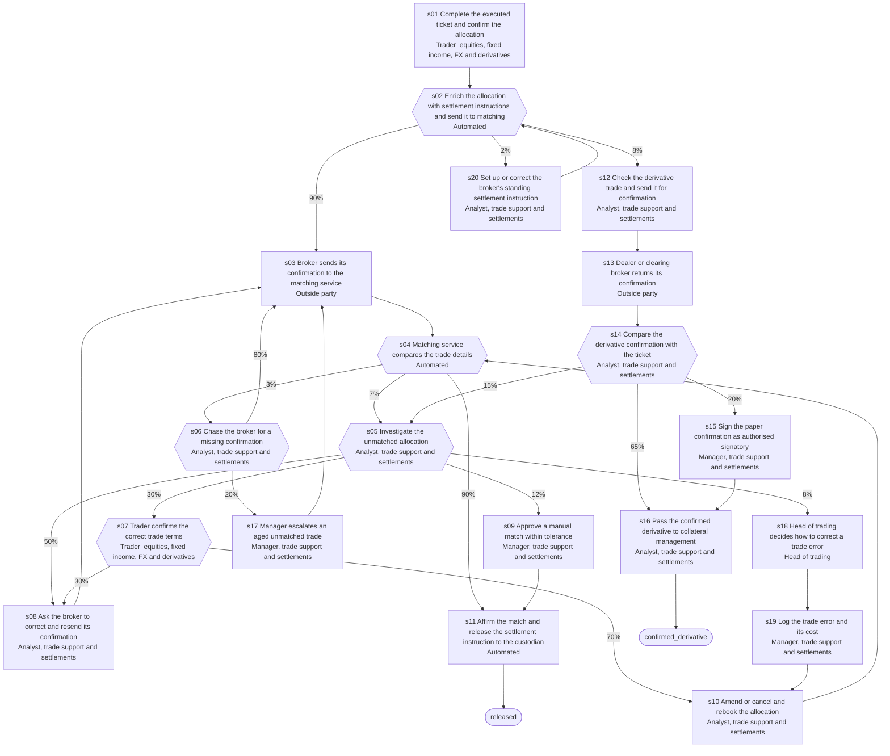

# Capture and confirm trades (one trade allocation)

`pam-trade-capture-confirmation` · public-sector asset management · investment operations · part of `public-asset-manager`

Every trade the internal desk executes is split into allocations across pools and client accounts, and each allocation must agree with the broker's confirmation before its settlement instruction goes to the custodian. Most equity, bond and FX allocations match automatically in the matching service within hours; trade support analysts work the exceptions, asking the trader to confirm terms or the broker to correct its details, forcing small commission differences within tolerance and chasing missing confirmations before the noon T+1 matching deadline. Derivatives are confirmed against ISDA terms, some on paper, and passed to collateral management. Broker instruction errors, manual allocations, paper derivative confirmations and volume peaks on rebalancing days cause most of the work.

| | |
|---|---|
| Unit of work | one trade allocation |
| Starts when | A trader completes an executed order in the order management system and its allocations are sent for matching, or a broker's confirmation arrives for an allocation. |
| Done when | The allocation is matched and affirmed and its settlement instruction is released to the custodian, or the derivative is confirmed and passed to collateral management. |
| Organisation | A Canadian provincial public-sector asset manager with about $40 billion of internally traded public assets, a four-person trading desk and a six-person trade support team using a software-as-a-service order management system and a central matching service. (242 employees, 2019-2022) |
| Volume | 1,600 cases a month (range 1,000 to 2,600) |

## Where it sits

- Starts with **trade_ticket** from trade-execution (85% of cases)
- Starts with **trade_confirmation** from brokers_counterparties (15% of cases)
- Sends **settlement_instruction** to trade-settlement-fails (outcome: released)
- Sends **trade_ticket** to investment-compliance-monitoring (outcome: any)
- Sends **trade_ticket** to collateral-margin (outcome: confirmed_derivative)

## Flow

## Roles

| Role | Department | Layer | FTE on this process | Loaded cost per hour | Evidence |
|---|---|---|---:|---:|---|
| Analyst, trade support and settlements | Trade support and settlements | individual contributor | 0.95 | 56 CAD | B [jobbank_11101] |
| Manager, trade support and settlements | Trade support and settlements | manager | 0.06 | 90 CAD | B [jobbank_10010] |
| Trader (equities, fixed income, FX and derivatives) | Public markets trading desk | senior specialist | 0.2 | 170 CAD | C |
| Head of trading | Public markets trading desk | manager | 0.01 | 280 CAD | C |

## Steps

Hands-on time and the wait before each step show the most common value. Evidence tier A is a sourced number, B a sourced description, C the author's estimate.

| Step | Who | Kind | Hands-on | Wait before | Control | Evidence |
|---|---|---|---:|---:|---|---|
| **s01 Complete the executed ticket and confirm the allocation.** After execution the trader checks that the fills from the trading platform carry the right broker, price, commission and fees, and confirms the split of the block across pools and client accounts set before the trade; most splits are calculated by the order management system pro rata. | Trader (equities, fixed income, FX and derivatives) | data entry | 0.5 min | 15 min |  | B [sifma_soc1] |
| **s02 Enrich the allocation with settlement instructions and send it to matching.** The book of record adds the broker's standing settlement instructions and the custodian account, calculates the settlement date and net amount, and sends the allocation to the matching service and the trade to post-trade compliance; derivatives go to the derivative confirmation route. | Automated | system auto | 0 min | 5 min |  | B [ni24101] |
| **s03 Broker sends its confirmation to the matching service.** The broker or FX bank books the allocations in its own system and sends its confirmation to the matching service; trades done in Asian or European hours or late in the day arrive the next morning. | Outside party | external wait | 0 min | 2.0 h |  | B [dtcc_2025], [ni24101] |
| **s04 Matching service compares the trade details.** The matching service compares security, quantity, price, commission, fees, net amount, trade and settlement dates and settlement instructions within agreed tolerances and flags matched, mismatched or unconfirmed allocations. | Automated | system auto | 0 min | 5 min | National Instrument 24-101: dealer and adviser policies must achieve matching of institutional DAP/RAP trades no later than noon Eastern Time on T+1, with quarterly exception reports if under 90 per cent; the model manager provides a trade-matching statement | A [ni24101], [dtcc_2025] |
| **s05 Investigate the unmatched allocation.** A trade support analyst opens the exception queue, compares the model manager's allocation with the broker's confirmation field by field and finds the cause, usually commission or fee rounding, a quantity split, a wrong settlement instruction or settlement date, or occasionally a real trade error. | Analyst, trade support and settlements | analysis | 12 min | 1.0 h |  | B [dtcc_2025] |
| **s06 Chase the broker for a missing confirmation.** The analyst emails or calls the broker's middle office for confirmations still missing late in the day or on the morning of T+1, and watches the noon T+1 deadline. | Analyst, trade support and settlements | communication | 6 min | 2.0 h |  | B [ni24101], [cibcm17] |
| **s07 Trader confirms the correct trade terms.** The analyst asks the trader which price, commission or allocation is right; the trader checks the execution record and confirms whether the model manager's ticket or the broker's confirmation is wrong. | Trader (equities, fixed income, FX and derivatives) | review | 4 min | 1.0 h | Operations may not change trade economics without front-office confirmation (SOC 1 objective that trades are properly authorized and recorded) | B [sifma_soc1] |
| **s08 Ask the broker to correct and resend its confirmation.** The analyst sends the broker the correct details and asks it to cancel and resend its confirmation, then waits for it to match. | Analyst, trade support and settlements | communication | 6 min | 15 min |  | C |
| **s09 Approve a manual match within tolerance.** For a small commission or fee difference within the agreed tolerance, the manager reviews the difference and approves forcing the match so the trade can settle, recording the reason. | Manager, trade support and settlements | approval | 5 min | 1.0 h | Trade support procedures: tolerance for commission and fee differences and manager approval of forced matches | C |
| **s10 Amend or cancel and rebook the allocation.** The analyst amends the allocation in the order management system, or cancels and rebooks it, with the trader's confirmation attached, and the corrected allocation is resent to the matching service. | Analyst, trade support and settlements | data entry | 10 min | 15 min |  | C |
| **s11 Affirm the match and release the settlement instruction to the custodian.** Once matched, the affirmation is recorded and the settlement instruction goes to the custodian over SWIFT, and the settled-trade status will feed reconciliations and cash management. | Automated | system auto | 0 min | 10 min | SOC 1 baseline control objective: trades properly authorized, allocated, settled and recorded accurately, completely and timely | B [sifma_soc1], [mgr_ar21] |
| **s12 Check the derivative trade and send it for confirmation.** For an OTC forward or swap the analyst checks the ticket against the counterparty's ISDA and credit support terms and affirms it on the electronic confirmation platform or waits for the dealer's paper confirmation; for futures the analyst checks the clearing broker's give-up. | Analyst, trade support and settlements | data entry | 8 min | 1.0 h |  | B [isda_obs2013] |
| **s13 Dealer or clearing broker returns its confirmation.** The dealer affirms on the platform or sends a paper or PDF confirmation; the clearing broker confirms the futures give-up. Paper confirmations for less standard trades take days. | Outside party | external wait | 0 min | 12.0 h |  | A [isda_obs2013] |
| **s14 Compare the derivative confirmation with the ticket.** The analyst compares every economic and legal term of the dealer's confirmation with the ticket and the ISDA terms, and routes differences to the exception process. | Analyst, trade support and settlements | validation | 10 min | 2.0 h |  | C |
| **s15 Sign the paper confirmation as authorised signatory.** The manager reviews the analyst's comparison of the paper confirmation, signs it under the model manager's signing authorities for ISDA trades and returns it to the dealer by email or courier. | Manager, trade support and settlements | approval | 5 min | 4.0 h | Signing authority policy for derivative confirmations under ISDA master agreements | C |
| **s16 Pass the confirmed derivative to collateral management.** The analyst records the confirmed derivative so the collateral team includes it in margin and exposure calculations and the counterparty exposure review, and files the confirmation. | Analyst, trade support and settlements | communication | 5 min | 30 min |  | B [mgr_ar21] |
| **s17 Manager escalates an aged unmatched trade.** The manager calls the broker's operations lead, or involves the trader or head of trading, to resolve trades still unmatched near noon on T+1 that risk failing, and logs the item. | Manager, trade support and settlements | judgment | 20 min | 4.0 h |  | B [cibcm17] |
| **s18 Head of trading decides how to correct a trade error.** When the wrong security, size or side was traded or allocated, the head of trading decides how to correct it, who bears the cost and whether a client is affected, with compliance informed. | Head of trading | judgment | 30 min | 2.0 h |  | B [sifma_soc1] |
| **s19 Log the trade error and its cost.** The manager records the error, its cause, cost and correction in the trade error register for compliance and the quarterly review, and instructs the analyst to cancel and rebook the allocation. | Manager, trade support and settlements | data entry | 20 min | 4.0 h | Trade error policy and SOC 1 control objective over trade errors: errors recorded, corrected and clients made whole | B [sifma_soc1] |
| **s20 Set up or correct the broker's standing settlement instruction.** The analyst obtains the broker's new standing settlement instructions through an authenticated message or verifies them by calling a known contact, enters them, and a second person approves before the allocation is enriched again. | Analyst, trade support and settlements | data entry | 20 min | 2.0 h | Payment and settlement instruction changes verified through a known contact and approved by a second person | B [fc_fraud] |

## Exceptions

| Exception | Share of cases | What happens |
|---|---:|---|
| Mismatch with the broker | 7% | Commission, price, quantity split, settlement date or instruction differs and is fixed by the model manager, the broker or a forced match. |
| Missing broker confirmation | 3% | The broker has not confirmed by end of day; the analyst chases and the manager escalates near the noon T+1 deadline. |
| Derivative confirmation | 8% | Futures and OTC derivatives are confirmed against ISDA terms, some on paper signed by the manager, and passed to collateral management. |
| Trade error | 1% | The wrong security, size or side was traded or allocated; the head of trading decides the correction and the error is logged. |
| Missing or outdated settlement instruction | 2% | The broker's standing settlement instruction is missing or changed and must be verified and approved before matching. |

## Benchmarks

| Metric | Value | Unit | Population | Evidence |
|---|---|---|---|---|
| cycle_time_days | p50 0.2, p90 1.0 | calendar days from completed ticket to settlement instruction released | Internally executed trade allocations of a Canadian institutional investor, 2019-2022 | B [ni24101], [dtcc_2025] |
| institutional_trade_matching_deadline | noon Eastern Time on T+1 | deadline | DAP/RAP trades of institutional investors in Canada | A [ni24101], [cibcm17] |
| matching_exception_threshold | 0.9 | share of DAP/RAP trades matched on time below which a registered firm files a quarterly exception report | Registered dealers and advisers in Canada | A [ni24101] |
| same_day_match_rate_automated | all 0.924, equities 0.948, fixed_income 0.899 | share of allocations matched on trade date | European transactions on a central matching service, 2025 (outside the reference period) | A [dtcc_2025] |
| derivative_confirmations_outstanding | interest_rate 1.0, equity 6.1 | business days of trades unconfirmed | 77 ISDA member firms, 2013 (before the reference period) | A [isda_obs2013] |

## Pain points

- Brokers' wrong or outdated settlement instructions and commission rounding cause most mismatches, which are worked one by one in an exception queue. (steps s05, s08, s09, s20; B [dtcc_2025])
- The noon T+1 matching deadline under T+2 settlement leaves little time to fix late or missing confirmations before trades fail. (steps s06, s17; B [ni24101], [cibcm17])
- Less standard derivatives are still confirmed on paper and take days, needing manual comparison and a signature. (steps s12, s13, s14, s15; B [isda_obs2013])
- Allocation volumes spike on month ends, rebalancing and pool transition days, when exception queues grow. (steps s01, s05; C)

## Assumptions

- One case is one allocation of an executed internal trade to one pool or client account. External managers' trades are matched by those managers and the custodian and are outside this process.
- The process ends when the settlement instruction is released; settlement monitoring and fails belong to trade-settlement-fails, which lists this process as its main trigger.
- About 90% of equity, bond and FX allocations match automatically on first pass; the 2025 European matching rate is used only as an order of magnitude because no Canadian figure for the period was found.
- The model manager is exempt from adviser registration under the 2017 OSC decisions, so the NI 24-101 obligations fall on its dealers and custodian; the model manager's part is the trade-matching statement and timely matching.
- The head of trading takes part for trade errors although the process map lists only the trader, trade support analyst and manager; the role exists in the organisation file.
- Loaded costs come from the organisation file: Job Bank Toronto wages deflated 9% to 2021, plus variable pay, times a 1.35 loading.
- Staffing: about 1.2 FTE stated (0.95 analyst); hands-on time times volume implies a similar figure. With 1.75 analyst FTE already on settlements and reconciliations, the six-person team has room for counterparty onboarding and corporate action support.
- Per-allocation times, exception shares and waits are author estimates (tier C).

## Sources

- [ni24101] [National Instrument 24-101 Institutional Trade Matching and Settlement (consolidated to 5 September 2017)](https://www.fcnb.ca/sites/default/files/2020-02/24-101-NI-CONS-2017-09-05-E.pdf) (Canadian Securities Administrators (via Financial and Consumer Services Commission of New Brunswick), 2017). Matching means trade details and settlement instructions are reported, verified, confirmed and affirmed among trade-matching parties; registered dealers and advisers must have policies to match DAP/RAP trades no later than noon Eastern Time on T+1; institutional investors sign a trade-matching agreement or statement; quarterly exception report if less than 90% matched on time. Read from a text copy saved under scratch/ by earlier work.
- [cibcm17] [Shortening the Settlement Cycle: Final CSA Amendments to NI 24-101](https://www.cibcmellon.com/en/_locale-assets/pdf/our-thinking/2017/ot201707-csa-ni-24-101-en.pdf) (CIBC Mellon, 2017). Canada moved to T+2 settlement on 5 September 2017; the institutional trade matching deadline became noon on T+1 for all trades because later matching leaves too little time to avoid fails. Read from a text copy saved under scratch/ by earlier work.
- [dtcc_2025] [Same-day matching rates a crucial indicator in run-up to T+1 in Europe](https://www.dtcc.com/insights/2025/same-day-matching-rates-a-crucial-indicator-in-run-up-to-t1-in-europe) (DTCC, 2025). Users of automated trade matching achieve an average 92.4% same-day matching (equities 94.83%, fixed income 89.9%, some markets as low as 78.5%); firms using fax, email or spreadsheets for allocation have higher error and fail rates (2025, outside the reference period).
- [isda_obs2013] [ISDA Publishes 2013 Operations Benchmarking Survey](https://mondovisione.com/media-and-resources/news/isda-publishes-2013-operations-benchmarking-survey-2013425/) (Mondo Visione (ISDA news release), 2013). 77 firms: 100% of eligible credit derivatives and 92% of interest rate derivatives confirmed electronically; outstanding confirmations 0.3 business days for credit, 1.0 for rates and 6.1 for equity derivatives (before the reference period).
- [sifma_soc1] [Asset Manager's Guide to SOC 1 (June 2017)](https://www.sifma.org/wp-content/uploads/2017/08/SIFMA_AMG_asset-managers-guide-soc-2017.pdf) (SIFMA Asset Management Group and Grant Thornton, 2017). Baseline SOC 1 control objectives for asset managers: new account set-up authenticated and established accurately; trades properly authorized, allocated, settled and recorded accurately, completely and timely; contributions and distributions authorized; cash and positions reconciled to custodians; change management. Read from a text copy saved under scratch/ by earlier work.
- [mgr_ar21] The model manager 2021 Annual Report (link withheld) (The model manager, 2022). Enhanced quarterly risk reports for clients and the Board and a new Quarterly Risk Insights report in 2021; risk measured with sensitivities, historical and custom stress tests, total, active and factor risk and a liquidity coverage ratio; new risk and total portfolio management system selected in 2021 for delivery in 2022; investment risk support facilitates transaction reviews; private market risks assessed by a devoted team; Management Investment Committee co-chaired by the CIO and CRO and Investment Department Committees co-chaired by Investments and Investment Risk; three pools launched in 2021 and work begun on private equity and infrastructure pools; pooling brings efficiencies in pool activities and cash management; clean SOC 1 Type I report as at 30 September 2021. Read from a text copy saved under scratch/ by earlier work.
- [fc_fraud] [8 Ways to Strengthen Protection Against Funds Transfer Fraud](https://fundbanking.firstcitizens.com/insights/operating-best-practices/funds-transfer-fraud-prevention) (First Citizens Bank, 2026). Verify all banking changes using a known, previously validated phone number; two people approve any change to standing payment instructions; no single person should initiate, approve and record transactions.
- [jobbank_11101] [Wages: Financial Analyst (NOC 11101) in the Toronto Region](https://www.jobbank.gc.ca/marketreport/wages-occupation/12417/22437) (Job Bank, Government of Canada, 2025). Toronto hourly wages for NOC 11101: low 27.97, median 41.60, high 73.57 (reference period 2023-2024).
- [jobbank_10010] [Wages: Finance Director (NOC 10010) in the Toronto Region](https://www.jobbank.gc.ca/marketreport/wages-occupation/1225/22437) (Job Bank, Government of Canada, 2025). Toronto hourly wages for NOC 10010: low 41.21, median 62.37, high 96.15 (reference period 2023-2024).

Written by claude-opus on 2026-11-17.
