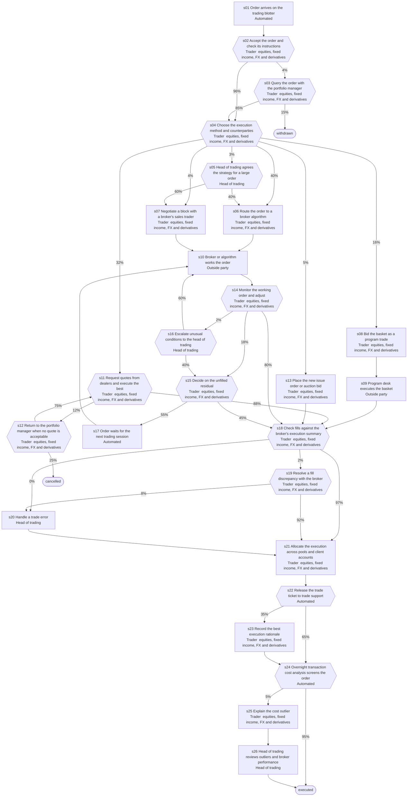

# Execute public market trades

`pam-trade-execution` · public-sector asset management · Investments (public markets trading desk) · part of `public-asset-manager`

A four-person trading desk executes the orders that internal equity, fixed income and credit portfolio managers, pool cash deployments and total portfolio overlays release to it. A trader accepts each order, chooses between a broker algorithm, a negotiated block, a program trade for baskets, competing dealer quotes for bonds and currency, or a new issue or auction order, and watches it until filled, carried over or cancelled. Fills are checked against broker summaries and allocated across pools and client accounts the same day so trade support can match them, and overnight cost analysis flags expensive orders. Delays come from large orders worked over hours or days, quotes outside limits and fill discrepancies; errors come from manual allocation and voice fills.

| | |
|---|---|
| Unit of work | one order executed |
| Starts when | A compliance-checked order from a portfolio manager, a pool cash deployment, an overlay adjustment or a newly approved counterparty's first order appears on the desk blotter. |
| Done when | The order is filled or its residual cancelled, the allocated trade ticket has gone to trade support and the next-day cost review is closed; or the order is withdrawn or cancelled. |
| Organisation | A Canadian provincial public-sector asset manager with about 240 staff and a small internal desk trading equities, government bonds, credit, currency and futures for pools and client accounts. (242 employees, 2019-2022) |
| Volume | 900 cases a month (range 500 to 1,500) |

## Where it sits

- Starts with **trade_order** from internal-equity-decisions (58% of cases)
- Starts with **trade_order** from internal-fixed-income-credit-decisions (30% of cases)
- Starts with **trade_order** from pool-rebalancing-cash-deployment (6% of cases)
- Starts with **trade_order** from overlay-fx-leverage (6% of cases)
- Starts with **approved_counterparty** from counterparty-onboarding (0% of cases)
- Sends **trade_ticket** to trade-capture-confirmation (outcome: executed)
- Sends **trade_order** to brokers_counterparties (outcome: executed)

## Flow

## Roles

| Role | Department | Layer | FTE on this process | Loaded cost per hour | Evidence |
|---|---|---|---:|---:|---|
| Trader (equities, fixed income, FX and derivatives) | Public markets trading desk | senior specialist | 2.3 | 170 CAD | C |
| Head of trading | Public markets trading desk | manager | 0.45 | 280 CAD | C |

## Steps

Hands-on time and the wait before each step show the most common value. Evidence tier A is a sourced number, B a sourced description, C the author's estimate.

| Step | Who | Kind | Hands-on | Wait before | Control | Evidence |
|---|---|---|---:|---:|---|---|
| **s01 Order arrives on the trading blotter.** An order released by a public equity, fixed income or credit portfolio manager, a pool cash deployment basket or a total portfolio overlay order appears on the desk's blotter in the order management system with the originator's instructions, already through pre-trade compliance. | Automated | system auto | 0 min | 0 min |  | B [factset_desk] |
| **s02 Accept the order and check its instructions.** A trader picks up the order, checks the security, side, size against average daily volume or market depth, limit and urgency, whether the market is open, and that the brokers or dealers it may go to are approved with room under their counterparty limits, then accepts it. | Trader (equities, fixed income, FX and derivatives) | review | 1 min | 10 min | Approved broker and counterparty list: brokers pass due diligence before handling assets (OSC exemption order condition) and counterparty limits are loaded from counterparty onboarding | B [osc_mgr_2017], [cfa_tse] |
| **s03 Query the order with the portfolio manager.** The trader messages or calls the portfolio manager to explain the issue (limit away from the market, size large against volume, halted security, news) and suggests a wider limit, longer horizon or smaller size, then waits for the amended or confirmed order. | Trader (equities, fixed income, FX and derivatives) | communication | 5 min | 30 min |  | B [cfa_tse] |
| **s04 Choose the execution method and counterparties.** The trader decides how to execute: a broker algorithm or direct market access for routine equity and futures orders, a negotiated block with a broker's sales trader for large or illiquid names, a program trade for a rebalancing basket, requests for quotes to several dealers for bonds and currency, or an order into a new issue or auction. Very large or sensitive orders need the head of trading's agreement. | Trader (equities, fixed income, FX and derivatives) | judgment | 1 min | 2 min |  | B [cfa_tse], [greenwich_ht], [factset_desk] |
| **s05 Head of trading agrees the strategy for a large order.** The head of trading reviews the pre-trade cost estimate, the order's share of daily volume and the risk of information leakage, and agrees the broker shortlist, horizon and whether to seek a block or a risk price. | Head of trading | approval | 8 min | 20 min | Trade management policy: senior sign-off on execution strategy above size or liquidity thresholds | C [cfa_tse] |
| **s06 Route the order to a broker algorithm.** The trader picks an approved broker and algorithm (VWAP, implementation shortfall, percent of volume, target close or a dark aggregator), sets the limit, participation rate and start and end times in the execution system and sends it electronically. | Trader (equities, fixed income, FX and derivatives) | data entry | 1 min | 2 min | Approved broker list and best execution policy | B [nber_algo], [cfa_tse] |
| **s07 Negotiate a block with a broker's sales trader.** The trader calls or chats with an approved broker on a recorded line, describes the order without revealing more than needed, asks for natural block interest or a capital commitment, agrees the commission and hands over the order. | Trader (equities, fixed income, FX and derivatives) | communication | 10 min | 5 min | Approved broker list, recorded lines and conflict policies (front running, soft dollars) under the OSC exemption order | B [osc_mgr_2017], [cfa_tse] |
| **s08 Bid the basket as a program trade.** For a pool deployment or rebalancing basket the trader sends anonymised basket characteristics to three or four program desks, compares their agency or risk bids, awards the basket and agrees the benchmark, usually the close. The work is shared across every order in the basket, so time per order is small. | Trader (equities, fixed income, FX and derivatives) | coordination | 0.4 min | 30 min | Best execution policy: competitive bids for program trades | B [cfa_tse] |
| **s09 Program desk executes the basket.** A risk bid is filled at once at the agreed price; an agency program is worked by the broker through the day to the benchmark, often the close, and fills for each security come back to the execution system. | Outside party | external wait | 0 min | 3.0 h |  | C [cfa_tse] |
| **s10 Broker or algorithm works the order.** The algorithm or broker slices the order into many child orders across exchanges and dark pools according to the chosen strategy until it completes, reaches its end time or hits its limit; fills stream back to the execution system. | Outside party | external wait | 0 min | 2.0 h |  | A [nber_algo] |
| **s11 Request quotes from dealers and execute the best.** For bonds, money market instruments, currency forwards and swaps the trader sends a request for quotes to three to five approved dealers on a multi-dealer platform or by chat, compares the prices, executes with the best and keeps the losing quotes as best execution evidence; if no quote is within the limit the trader goes back to the portfolio manager. | Trader (equities, fixed income, FX and derivatives) | judgment | 5 min | 5 min | Best execution policy requiring competing quotes for over-the-counter trades; FX Global Code principle on fair and transparent order handling | B [cfa_tse], [fxgc] |
| **s12 Return to the portfolio manager when no quote is acceptable.** The trader tells the portfolio manager the best levels available; the manager accepts, changes the bond or size, or cancels, and the trader asks for quotes again or closes the order. | Trader (equities, fixed income, FX and derivatives) | communication | 5 min | 30 min |  | C |
| **s13 Place the new issue order or auction bid.** The trader places the portfolio manager's order with the syndicate desk of a new issue, or the bid through a government securities distributor for an auction, before the book or bidding closes, then waits for the allocation, which is often smaller than the order. | Trader (equities, fixed income, FX and derivatives) | communication | 5 min | 15 min |  | C |
| **s14 Monitor the working order and adjust.** While the order works the trader watches fills against arrival price and interval VWAP, changes participation or limits when prices move, pauses for news or halts, and switches broker if performance is poor. | Trader (equities, fixed income, FX and derivatives) | analysis | 1 min | 0 min |  | B [cfa_tse], [factset_desk] |
| **s15 Decide on the unfilled residual.** At the end time or the close the trader checks the unfilled quantity, consults the portfolio manager on a material residual, and either carries it to the next session with a handover note or cancels it as a partial fill. | Trader (equities, fixed income, FX and derivatives) | judgment | 3 min | 10 min |  | C |
| **s16 Escalate unusual conditions to the head of trading.** The trader brings the head of trading an order that is moving the price, a broker outage or a news event; the head decides whether to continue, change broker or strategy, or stop and consult the portfolio manager. | Head of trading | judgment | 8 min | 15 min | Trade policy escalation procedures | B [cfa_tse] |
| **s17 Order waits for the next trading session.** The order management system rolls the carried order to the next session as a good-till-cancelled order; over a weekend or holiday the wait is longer. | Automated | system auto | 0 min | 16.7 h |  | C |
| **s18 Check fills against the broker's execution summary.** When the order is done the trader compares the fills in the execution system with the broker's or dealer's end-of-day summary (quantity, average price, commission) and keys any voice fills that did not arrive electronically. | Trader (equities, fixed income, FX and derivatives) | validation | 0.5 min | 15 min | SOC 1 control objective: trades authorised and recorded accurately, completely and timely | B [sifma_soc], [mgr_ar21] |
| **s19 Resolve a fill discrepancy with the broker.** The trader asks the broker's desk to correct or cancel the wrong fill, checks the corrected execution report and notes the fix. | Trader (equities, fixed income, FX and derivatives) | communication | 8 min | 1.0 h |  | C |
| **s20 Handle a trade error.** The head of trading confirms the error, decides the correcting trade, makes sure the pool or client account is made whole and the cost borne by whoever caused it, informs the portfolio manager and compliance and logs the incident. | Head of trading | approval | 40 min | 30 min | Trade error policy (SOC 1 control area: trade errors and guideline breaches); client made whole | B [sifma_soc], [cfa_tse] |
| **s21 Allocate the execution across pools and client accounts.** The trader confirms the allocation of the block across pools and client accounts in the order management system, using the portfolio manager's pre-allocation and pro rata shares for partial fills at the average price, so trade support can confirm with the broker on trade date. | Trader (equities, fixed income, FX and derivatives) | data entry | 0.5 min | 30 min | Fair allocation of investment opportunities among members and pools (OSC exemption order condition); FX Global Code principle 47 on allocating block transactions promptly | B [osc_mgr_2017], [fxgc], [t1report] |
| **s22 Release the trade ticket to trade support.** The order management system sends the allocated trade ticket with price, quantity, broker, commission and settlement details to trade support and the matching service for confirmation with the broker before the matching deadline. | Automated | system auto | 0 min | 1 min | NI 24-101: institutional trades matched as soon as practical and by noon on T+1 | A [ni24101], [t1report] |
| **s23 Record the best execution rationale.** The trader notes in the execution system why the broker, dealer or venue was chosen, the competing quotes or bids received and any block or risk price, so the decision can be reviewed later. | Trader (equities, fixed income, FX and derivatives) | drafting | 1 min | 30 min | Trade policy record keeping for best execution; books and records condition of the OSC exemption order | B [cfa_tse], [osc_mgr_2017] |
| **s24 Overnight transaction cost analysis screens the order.** Overnight the transaction cost analysis service compares the order's prices with arrival price, interval VWAP and the close and flags orders whose cost falls outside set limits for their size and difficulty. | Automated | system auto | 0 min | 16.0 h |  | B [cfa_tse], [factset_desk] |
| **s25 Explain the cost outlier.** The trader opens the order's timeline of fills, market moves and news and writes a short explanation of why costs were high (news, thin liquidity, poor broker or algorithm performance, late start). | Trader (equities, fixed income, FX and derivatives) | analysis | 8 min | 8.0 h |  | C |
| **s26 Head of trading reviews outliers and broker performance.** At the weekly review the head of trading goes through outliers and explanations, decides whether broker or algorithm choices should change and keeps notes for the periodic best execution report. | Head of trading | review | 1.5 min | 3.0 d | Best execution monitoring under the trade policy | B [cfa_tse] |

## Exceptions

| Exception | Share of cases | What happens |
|---|---:|---|
| Order queried with the portfolio manager | 4% | The trader cannot work the order as instructed and agrees a change with the portfolio manager, who sometimes withdraws it. |
| Unfilled residual carried over | 4% | A large or illiquid order is not complete at the close and is carried to the next session. |
| No acceptable dealer quote | 4% | Bond or currency quotes are outside the limit; the portfolio manager adjusts or cancels. |
| Fill discrepancy | 2% | The broker summary differs from the fills recorded; the broker corrects it. |
| Trade error | 0% | A wrong side, quantity, security or account is traded; the head of trading corrects it and logs the incident. |
| Cost outlier review | 5% | Overnight cost analysis flags the order; the trader explains it and the head of trading reviews it weekly. |

## Benchmarks

| Metric | Value | Unit | Population | Evidence |
|---|---|---|---|---|
| cycle_time_days | p50 1.0, p90 2.0 | calendar days from the order reaching the blotter to the close of the next-day cost screen | Institutional multi-asset trading desk | C [nber_algo], [t1report] |
| average_algorithmic_parent_order_duration | 84 | minutes | 2.3 million parent orders from 961 institutions | A [nber_algo] |
| share_of_us_institutional_equity_volume_high_touch | 0.44 | share of volume, year to Q1 2021 | U.S. institutional equity investors (Coalition Greenwich) | A [greenwich_ht] |
| institutional_trade_matching_threshold | 0.9 | share of trades by value and volume to be matched by noon on T+1 before an exception report is required | Canadian registered dealers and advisers under NI 24-101 | A [ni24101] |

## Pain points

- Three traders cover equities, bonds, currency and futures across time zones, so orders queue at the open, at month end and on index dates. (steps s02, s04; C)
- Bond and currency trades are priced by chat or platform quotes and some fills arrive by voice, so they are keyed by hand and checked against broker summaries. (steps s11, s18, s19; B [cfa_tse])
- Allocation across pools and several client accounts happens after the close under a matching deadline, inviting misallocations. (steps s21, s22; B [t1report], [ni24101])
- Large or illiquid orders run over several sessions, delaying the portfolio managers' intended positions. (steps s14, s15, s17; B [cfa_tse], [nber_algo])

## Assumptions

- The model manager has not described its trading desk; the organisation file assumes one of a head of trading and three traders. Practices follow industry guidance and a peer desk design.
- Order sources follow the process map: about 58% equity, 30% fixed income and credit, 6% pool deployment baskets and 5.5% overlays; a newly approved counterparty starts only a handful of first trades.
- Execution method shares (40% algorithm, 16% program, 32% request for quotes, 5% new issue or auction, 4% negotiated block, 3% large orders needing the head of trading) are author estimates.
- Trade capture, confirmation and settlement belong to trade support; this workflow ends at the trade ticket and the next-day cost screen.
- Time spent watching markets and talking to brokers outside individual orders is in the traders' stated full-time equivalents but not in per-order touch times.
- Loaded costs per hour come from the organisation file.

## Sources

- [mgr_ar21] The model manager 2021 Annual Report (link withheld) (The model manager, 2022). Read as the text copy saved under scratch/. Three equity pools and the public market alternatives pool ($29.2 billion pooled at end 2021); pooling brings operational efficiencies in day-to-day pool activities and cash management; public equities combine internal fundamental, factor (size, quality, value, momentum) and index strategies with external managers; fixed income ($17.2 billion) is managed internally for capital preservation and liquidity against FTSE Canada government indices; global credit ($6.0 billion) does not separate public and private credit, plans to internalise through direct co-investments, invested US$500 million with Antares (sponsor-backed middle-market direct lending) and US$500 million with Ares; PMA uses a managed account platform with 12 managers; Investment Policy Statements per strategy set permitted investments and restrictions; Management Investment Committee and three Investment Department Committees (Total Portfolio, Equities and Credit, Real Assets) approve up to thresholds; clean SOC 1 Type I report at 30 September 2021.
- [osc_mgr_2017] The model manager, Commission and Director decisions (exemption order) (link withheld) (Ontario Securities Commission, 2017). Read as the text copy saved under scratch/. The model manager exempted from adviser registration on conditions; Board-approved policies must cover a compliance system, books and records, conflicts including front running, soft dollars and fairness in allocating investment opportunities among members and pools, prevention of investments that contravene restrictions set out in each investment management agreement, due diligence on sub-advisers, and due diligence on custodians and brokers before they hold or access assets.
- [sifma_soc] [Asset Manager's Guide to SOC 1](https://www.sifma.org/wp-content/uploads/2017/08/SIFMA_AMG_asset-managers-guide-soc-2017.pdf) (SIFMA Asset Management Group and Grant Thornton, 2017). Read as the text copy saved under scratch/. Baseline SOC 1 control objectives: trades properly authorised, settled and recorded in accordance with portfolio guidelines and account restrictions; contributions and distributions authorised by the client and processed accurately; other control areas include brokerage allocation (best execution, soft dollars, IPO and new issue allocation), broker selection and retention, trade aggregation, trade allocation, trade errors and guideline breaches.
- [t1report] [Accelerating the U.S. Securities Settlement Cycle to T+1](https://www.sifma.org/wp-content/uploads/2021/12/Accelerating-the-U.S.-Securities-Settlement-Cycle-to-T1-December-1-2021.pdf) (SIFMA, ICI and DTCC (with Deloitte), 2021). Read as the text copy saved under scratch/. Settlement cycle of trade date plus two days (T+2) in the period; about 20% of institutional allocations occur during the trading day and 80% after the close on trade date; confirmation and affirmation can only start once allocations are complete.
- [cfa_tse] [Trade Strategy and Execution (refresher reading)](https://cfainstitute.org/insights/professional-learning/refresher-readings/2024/trade-strategy-execution) (CFA Institute, 2024). Order, security, market and portfolio manager inputs (size against daily volume, liquidity, volatility, urgency) drive trade strategy; algorithm classes are scheduled, liquidity seeking, arrival price, dark aggregators and smart order routers; equities trade largely electronically except very large or illiquid trades, fixed income bilaterally through dealers, currencies OTC; index and liquidity-driven trades use the close; arrival price, VWAP and close benchmarks; implementation shortfall is the standard cost measure; a written trade policy covers best execution, trade errors, eligible brokers and venues and execution monitoring, and all trades should be evaluated with transaction cost analysis.
- [nber_algo] [The Anatomy of Trading Algorithms](https://conference.nber.org/conf_papers/f145256/f145256.pdf) (Tyler Beason and Sunil Wahal, Arizona State University (NBER conference paper), 2020). Read as the text copy saved under scratch/. 2.3 million algorithmic parent orders from 961 institutions; the average parent order tries to trade US$287,000 over 84 minutes, 4.8% of volume over its duration, and generates hundreds of child orders; VWAP, TWAP, implementation shortfall, target close and percent of volume algorithms are standard broker offerings.
- [fxgc] [FX Global Code (updated December 2024; first published 2017)](https://www.globalfxc.org/docs/fx_global.pdf) (Global Foreign Exchange Committee, 2024). Read as the text copy saved under scratch/. Principle 9: handle orders fairly and with transparency; Principle 17: disclosure of last look; Principle 47: review, affirm and allocate block transactions as soon as practicable, with each underlying counterparty approved.
- [ni24101] [CSA Notice and Request for Comment: Proposed Amendments to NI 24-101 Institutional Trade Matching and Settlement](https://asc.ca/-/media/ASC-Documents-part-1/Regulatory-Instruments/2022/12/6054716-Proposed-Amendments-to-NI-24-101.pdf) (Alberta Securities Commission (Canadian Securities Administrators), 2022). Read as the text copy saved under scratch/. Dealers and advisers trading for institutional investors must have policies to match trades as soon as practical and by noon on T+1 in the period; firms below 90% matched by the deadline must file a quarterly exception report (moratorium from July 2020); proposal to move the deadline to 9 p.m. on trade date for T+1.
- [factset_desk] [How Leading Buy-Side Trading Desks Are Rethinking Execution Management](https://insight.factset.com/how-leading-buy-side-trading-desks-are-rethinking-execution-management) (FactSet (Rob Watts), 2026). Orders begin in portfolio or order management systems and pass compliance checks before the desk; fills and execution details flow back to the OMS for downstream processes; desks automate routine orders under rules they set and keep larger, less liquid or opaque orders high touch; broker selection is a trader judgement; TCA compares outcomes across brokers and venues.
- [greenwich_ht] [High-Touch Equity Trading Declines](https://www.marketsmedia.com/high-touch-equity-trading-declines/) (Markets Media (Coalition Greenwich data), 2021). High-touch trading fell to 44% of U.S. institutional equity volume in the year to Q1 2021 from 56% in 2012; algorithmic, DMA and smart order routing rose to 35% from 29%.

Written by claude-opus on 2026-11-17.
