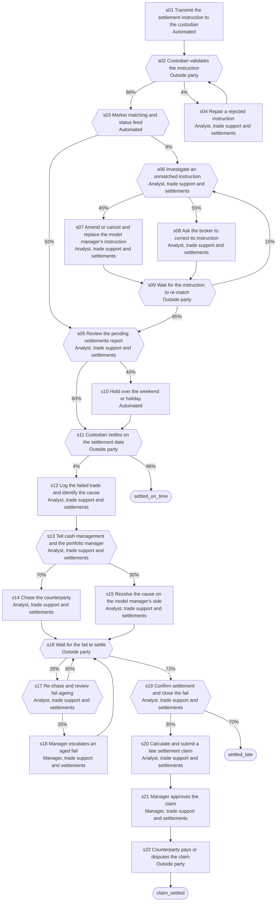

# Settle trades and resolve failed settlements

`pam-trade-settlement-fails` · public-sector institutional asset management · investment operations (trade support and settlements) · part of `public-asset-manager`

After a trade is captured and confirmed, the custodian settles it in the market two business days later (T+2 in the period). Most trades settle with no human touch; the trade support team watches pending settlements, repairs instructions the custodian rejects, fixes mismatches with brokers before settlement date, and chases fails until they settle, keeping the cash team informed and claiming interest when a counterparty's fail costs money. Fails cluster in emerging markets, securities on loan and wrong standing settlement instructions, and the work is concentrated in morning reviews of status reports.

| | |
|---|---|
| Unit of work | one trade settlement |
| Starts when | The book of record releases a confirmed trade allocation's settlement instruction to the custodian. |
| Done when | The trade has settled and the settlement status has been passed to reconciliations and cash management; for late settlements, the fail is closed and any interest claim resolved. |
| Organisation | A provincial not-for-profit asset manager of about 240 staff with internal public market strategies and about 120 external managers, settling through one global custodian. (242 employees, 2019-2022) |
| Volume | 1,600 cases a month (range 1,000 to 2,600) |

## Where it sits

- Starts with **settlement_instruction** from trade-capture-confirmation (90% of cases)
- Starts with **settlement_status** from custodian (7% of cases)
- Starts with **reconciliation_breaks** from daily-reconciliation (3% of cases)
- Sends **settlement_instruction** to custodian (outcome: any)
- Sends **settlement_status** to daily-reconciliation (outcome: any)
- Sends **settlement_status** to daily-cash-management (outcome: any)

## Flow

## Roles

| Role | Department | Layer | FTE on this process | Loaded cost per hour | Evidence |
|---|---|---|---:|---:|---|
| Analyst, trade support and settlements | Trade support and settlements | individual contributor | 1.6 | 56 CAD | B [jb11101] |
| Manager, trade support and settlements | Trade support and settlements | manager | 0.12 | 90 CAD | B [jb10010] |

## Steps

Hands-on time and the wait before each step show the most common value. Evidence tier A is a sourced number, B a sourced description, C the author's estimate.

| Step | Who | Kind | Hands-on | Wait before | Control | Evidence |
|---|---|---|---:|---:|---|---|
| **s01 Transmit the settlement instruction to the custodian.** Once trade capture and confirmation are complete, the book of record sends the settlement instruction for each allocation to the custodian as a SWIFT receive or deliver message with the counterparty's standing settlement instructions, quantity, net amount and settlement date. No one touches a clean instruction. | Automated | system auto | 0 min | 0 min |  | B [cibcm17] |
| **s02 Custodian validates the instruction.** The custodian checks the message format, the security identifier, the safekeeping account and the place of settlement, and either accepts the instruction and forwards it to the local market or depository, or rejects it back with a reason. | Outside party | external wait | 0 min | 30 min | Custodian's CSAE 3416 / SOC 1 controls over receipt, validation and settlement of client instructions, relied on by the model manager and its auditors | C [csae] |
| **s03 Market matching and status feed.** The custodian or its sub-custodian matches the model manager's instruction with the broker's instruction at the depository (CDS in Canada, DTC in the United States, local depositories elsewhere) and sends matched or unmatched status messages, which load into the settlement dashboard overnight. | Automated | system auto | 0 min | 4.0 h |  | B [ni24101], [cibcm22] |
| **s04 Repair a rejected instruction.** The trade support analyst reads the custodian's rejection reason, corrects the standing settlement instruction, account or security identifier in the book of record from the approved counterparty set-up, and resends the instruction. | Analyst, trade support and settlements | data entry | 15 min | 4.0 h | Settlement instructions only from the approved counterparty set-up (standing settlement instruction database) | C |
| **s05 Review the pending settlements report.** Each morning the analyst scans the custodian's pending settlements report for trades due to settle today and tomorrow, looking for unmatched, partially matched or at-risk items and for large cash amounts the cash team needs to know about. A matched trade takes seconds of attention. | Analyst, trade support and settlements | review | 0.6 min | 10.0 h |  | C |
| **s06 Investigate an unmatched instruction.** The analyst compares the model manager's instruction with the counterparty's alleged instruction shown by the custodian: standing settlement instructions, quantity, price, net amount, trade and settlement dates and place of settlement. The analyst decides which side is wrong, using the trade ticket and broker confirmation. | Analyst, trade support and settlements | analysis | 20 min | 8.0 h |  | B [cibcm17] |
| **s07 Amend or cancel and replace the model manager's instruction.** The analyst corrects the trade or allocation in the book of record, confirms the change with the trader or external manager where the economics change, and cancels and replaces the settlement instruction. A second analyst checks every amendment before it is released. | Analyst, trade support and settlements | data entry | 15 min | 15 min | Trade support procedure: settlement instruction amendments checked by a second person before release | C |
| **s08 Ask the broker to correct its instruction.** The analyst emails or phones the broker's settlement desk with the model manager's details and asks it to amend its instruction at the depository, quoting the trade reference. | Analyst, trade support and settlements | communication | 10 min | 10 min |  | C |
| **s09 Wait for the instruction to re-match.** The corrected instruction or the broker's amendment goes to the depository and the analyst waits for the matched status to come back. | Outside party | external wait | 0 min | 4.0 h |  | C |
| **s10 Hold over the weekend or holiday.** Trades executed on a Thursday or Friday, or before a holiday, have a settlement window that spans non-business days, so they wait until settlement date with nothing done. | Automated | external wait | 0 min | 2.0 d |  | C |
| **s11 Custodian settles on the settlement date.** On settlement date the depository exchanges securities against cash between the custodian and the broker's agent. Most trades settle on time two business days after trade date; a few fail because a party lacks securities or cash or the instructions never matched. | Outside party | external wait | 0 min | 1.0 d | T+2 standard settlement cycle for Canadian and US equities and long-term debt from 5 September 2017 (market and depository rules), with NI 24-101 trade matching | A [cibcm17], [cds_t1], [esma_trv] |
| **s12 Log the failed trade and identify the cause.** The analyst records the fail in the fails tracker from the custodian's fail report with the counterparty, market, amount and reason code, such as counterparty lacking securities, the model manager lacking securities on loan, insufficient cash or an unmatched instruction. | Analyst, trade support and settlements | analysis | 15 min | 2.0 h |  | C |
| **s13 Tell cash management and the portfolio manager.** The analyst emails the cash team the cash that will not arrive or leave today so the account funding and overdraft forecast can be changed, and tells the portfolio manager or external manager liaison when the fail affects a position they plan to trade. | Analyst, trade support and settlements | communication | 10 min | 5 min |  | C |
| **s14 Chase the counterparty.** The analyst contacts the broker's settlement desk for an expected delivery or payment date, asks whether a partial delivery is possible and records the answer in the tracker. | Analyst, trade support and settlements | communication | 10 min | 2.0 h |  | C |
| **s15 Resolve the cause on the model manager's side.** The analyst works with the securities lending agent to recall lent securities, with the cash team to cover a cash or currency shortfall, or with the custodian to move securities between accounts, so the model manager can deliver or pay. | Analyst, trade support and settlements | coordination | 30 min | 4.0 h |  | C |
| **s16 Wait for the fail to settle.** The failed trade stays open at the depository and is retried each settlement cycle until the missing securities or cash arrive. | Outside party | external wait | 0 min | 1.0 d |  | C |
| **s17 Re-chase and review fail ageing.** The analyst re-chases open fails each morning, updates the ageing in the tracker and flags fails older than the escalation trigger, or in markets with forced buy-in rules, to the manager. | Analyst, trade support and settlements | communication | 10 min | 30 min |  | C |
| **s18 Manager escalates an aged fail.** The manager of trade support raises the fail with the broker's operations management and the model manager's head of trading, considers a buy-in or cancellation, and decides whether the trading desk should stop routing orders to a persistently failing broker. | Manager, trade support and settlements | judgment | 30 min | 8.0 h | Trade support fails escalation procedure and counterparty performance review | B [icma] |
| **s19 Confirm settlement and close the fail.** The analyst confirms settlement on the custodian statement, closes the tracker entry with the number of days failed, and decides whether the cost of the fail justifies an interest claim against the counterparty. | Analyst, trade support and settlements | validation | 8 min | 1.0 h |  | C |
| **s20 Calculate and submit a late settlement claim.** The analyst calculates the interest cost of the late cash at the overnight rate for the days failed, or passes through any depository cash penalty, prepares the claim with the trade details and emails it to the counterparty in the weekly or monthly claims batch. | Analyst, trade support and settlements | drafting | 40 min | 1.0 d |  | B [icma] |
| **s21 Manager approves the claim.** The manager reviews the claim amount and support and approves it for sending, or drops claims below the minimum worth pursuing. | Manager, trade support and settlements | approval | 10 min | 8.0 h | Trade support procedure: claims approved by the manager with a minimum claim amount | C |
| **s22 Counterparty pays or disputes the claim.** The broker checks the claim against its own records and pays it, nets it against claims it has on the model manager, or disputes it; the analyst follows up until it is paid or written off. | Outside party | external wait | 0 min | 10.0 d |  | C |

## Exceptions

| Exception | Share of cases | What happens |
|---|---:|---|
| Instruction rejected by the custodian | 4% | Format, security, account or standing instruction problem; repaired and resent. |
| Unmatched at the depository | 8% | The model manager's and the broker's instructions disagree; the wrong side amends and the trade re-matches. |
| Failed settlement caused by the counterparty | 3% | Broker lacks securities or cash; chased daily until it delivers. |
| Failed settlement caused on the model manager's side | 1% | Securities on loan not recalled, cash or currency shortfall or wrong account. |
| Aged fail escalated | 0% | A fail past the escalation trigger goes to the manager and the trading desk, with a buy-in considered. |
| Late settlement interest claim | 1% | The model manager claims the interest cost of a counterparty fail. |

## Benchmarks

| Metric | Value | Unit | Population | Evidence |
|---|---|---|---|---|
| cycle_time_days | p50 2, p90 4 | calendar days from settlement instruction to settlement | Canadian and US equities and long-term debt under the T+2 standard settlement cycle (5 September 2017 to May 2024) | A [cibcm17] |
| settlement_fail_rate | low 0.02, mode 0.04, high 0.09 | share of trades failing on settlement date | Low: Canadian dollar settlement through CDS (below 2%, comparable to T+2 levels); high: EU equities by value (7% in 2H19, 8% in 2H20, 9% in 1H21); mode: author blend for a global institutional account | A [cds_t1], [esma_trv] |
| institutional_trade_matching_threshold | 0.9 | share of DAP/RAP trades by value and volume matched by noon on T+1, below which a registered firm files a quarterly exception report | Canadian registered dealers and advisers under NI 24-101 | A [ni24101], [cibcm17] |
| csdr_cash_penalty_liquid_shares | 1.0 | basis points of the failed trade value per day of fail (EU CSDR penalty regime) | EU central securities depositories under CSDR | A [icma] |

## Pain points

- Standing settlement instructions held in several places (book of record, custodian, brokers, external managers) drift apart, so rejections and mismatches recur for the same counterparties. (steps s04, s06, s07; C)
- Status arrives in batches and the team works the pending report each morning, so a mismatch found late on settlement date minus one often cannot be fixed before settlement. (steps s03, s05, s06; B [cibcm17])
- Fails in emerging markets and on lent securities take days of repeated chasing by email and phone, tracked in a spreadsheet. (steps s14, s15, s16, s17; C)
- Interest claims are small and slow to collect, so many are not pursued and the cost of counterparty fails is absorbed by the pools. (steps s19, s20, s21, s22; B [icma])

## Assumptions

- The unit of work is one trade allocation's settlement, so the median case is a clean trade with only the morning pending review as hands-on time; mean hands-on time is a few minutes per trade.
- The settlement cycle is T+2 throughout the reference period; non-North American markets with T+3 and FX spot are folded into the ranges.
- Fail and mismatch rates are author estimates bounded by published Canadian (below 2%) and EU (7% to 9% by value for equities) rates; the model manager publishes no settlement statistics.
- CSDR cash penalties applied only to EU settlements from February 2022; for most of the period late settlement costs were recovered, if at all, through bilateral interest claims.
- Cases start when the instruction is released after confirmation; matching and affirmation work before that belongs to the trade capture and confirmation process.
- Loaded costs come from the organisation file (Job Bank Toronto wages deflated to 2021, plus variable pay, times 1.35).

## Sources

- [cibcm17] [Shortening the Settlement Cycle: Final CSA Amendments to NI 24-101](https://www.cibcmellon.com/en/_locale-assets/pdf/our-thinking/2017/ot201707-csa-ni-24-101-en.pdf) (CIBC Mellon, 2017). Canada's move from T+3 to T+2 settlement set for 5 September 2017, aligned with the United States; institutional trade matching deadline of noon on T+1 and 90 per cent exception threshold kept; custodian trade notification deadline of 10:30 a.m. ET on settlement date minus one under T+2, to leave time to solve problems and avoid failed trades.
- [cibcm22] [T+1 Settlement Efforts (Our Thinking, September 2022)](https://www.cibcmellon.com/en/_locale-assets/pdf/our-thinking/2022/ot202209-t+1-settlement-efforts.pdf) (CIBC Mellon, 2022). In 2022 Canada still settled on T+2 with an NI 24-101 matching deadline of noon on T+1; the move to T+1 would require allocation, matching and confirmation on trade date.
- [ni24101] [National Instrument 24-101 Institutional Trade Matching and Settlement (consolidated to 5 September 2017)](https://www.fcnb.ca/sites/default/files/2020-02/24-101-NI-CONS-2017-09-05-E.pdf) (Financial and Consumer Services Commission (New Brunswick), 2017). Registered dealers and advisers must match delivery-against-payment and receipt-against-payment institutional trades no later than noon Eastern Time on T+1; institutional investors sign a trade-matching agreement or statement; quarterly exception report when less than 90 per cent of trades by value or volume are matched by the deadline.
- [cds_t1] [T+1: One Day to Settle (CDS key initiatives page)](https://cds.ca/solutions/cds-key-initiatives/t-1) (CDS Clearing and Depository Services (TMX Group), 2026). Canada moved to T+1 settlement on 27 May 2024; after the move the Canadian dollar settlement fail rate is typically below 2%, comparable to T+2 levels.
- [esma_trv] [ESMA Report on Trends, Risks and Vulnerabilities No. 2, 2021](https://www.esma.europa.eu/sites/default/files/library/esma50-165-1842_trv2-2021.pdf) (European Securities and Markets Authority, 2021). Settlement fail rates at EU central securities depositories by value: equities 9% in the first half of 2021, 8% in the second half of 2020, a 14% peak in the COVID-19 stress and 7% in the second half of 2019; sovereign bonds 3% and corporate bonds 1.8% in the first half of 2021.
- [icma] [CSDR framework for late settlement penalties (ICMA briefing note)](https://www.icmagroup.org/assets/documents/Regulatory/Secondary-markets/ICMA_CSDR-Late-settlement-penalties_brifing-note_Mar-2017-(updated-033017).pdf) (International Capital Market Association, 2017). Economics of failing; failed-to parties make interest claims against the failing party; the US Treasury fails charge of 3% less the federal funds rate; CSDR daily cash penalty rates such as 1.0 basis point a day for liquid shares and 0.1 to 0.2 basis point for bonds.
- [csae] [Reports on Controls at Service Organizations FAQs](https://www.bccpa.ca/kbase/kbase-search/assurance-standards/audit/guidance/reports-on-controls-at-service-organizations-faqs/) (Chartered Professional Accountants of British Columbia, 2021). CSAE 3416 (SOC 1 equivalent) reports on controls at a service organization relevant to user entities' financial reporting; Type 1 covers design at a date and Type 2 covers operating effectiveness over a period; used by user entities and their auditors.
- [jb11101] [Wages: Financial analyst (NOC 11101) in the Toronto region](https://www.jobbank.gc.ca/marketreport/wages-occupation/12417/22437) (Job Bank, Government of Canada, 2025). Toronto hourly wages low 27.97, median 41.60, high 73.57 dollars (reference period 2023-2024); the organisation file uses it as the proxy for operations analysts.
- [jb10010] [Wages: Finance director (NOC 10010) in the Toronto region](https://www.jobbank.gc.ca/marketreport/wages-occupation/1225/22437) (Job Bank, Government of Canada, 2025). Toronto hourly wages low 41.21, median 62.37, high 96.15 dollars (reference period 2023-2024); the organisation file uses it for operations managers.

Written by claude-opus on 2026-11-17.
