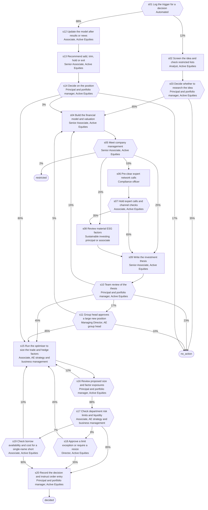

# Research companies and make active equity portfolio decisions

`pim-ae-fundamental-research` · asset management (public pension fund) · public equity investing · part of `pension-investment-manager`

Active Equities teams in the Americas, Europe and Asia research listed companies and decide to open, add to, trim or exit positions in a concentrated long/short, market-neutral portfolio. Most decisions start from results or news on a held name and take a few days; new positions need weeks of modelling, management meetings, expert calls and a team review. Every decision then passes through an optimiser that sizes the trade and hedges unwanted factor exposures, and a department limit check, before orders go to the central trading desk. Waiting for management meetings, weekly team reviews and earnings-season bunching drive elapsed time; inside information controls and optimiser reruns add steps.

| | |
|---|---|
| Unit of work | one portfolio decision (new position, add, trim or exit) |
| Starts when | A new idea or an event on a held company (results, news, price move, risk flag) prompts a review. |
| Done when | A recorded portfolio decision with target size and hedges is sent to order capture, or the review ends with no action (idea dropped, hold, or name restricted). |
| Organisation | A very large Canadian national pension fund manager whose 137-person Active Equities department runs fundamental long/short public equity portfolios with internal teams. (2,052 employees, 2019-2022) |
| Volume | 350 cases a month (range 250 to 500) |

## Where it sits

- Starts with **company_information** from listed_companies (60% of cases)
- Starts with **market_data** from data_vendors (40% of cases)
- Relies on **department_mandate** from tf-capital-allocation (a standing input; it does not start a case)
- Sends **portfolio_decision** to mkt-order-capture (outcome: decided)

## Flow

## Roles

| Role | Department | Layer | FTE on this process | Loaded cost per hour | Evidence |
|---|---|---|---:|---:|---|
| Principal and portfolio manager, Active Equities | Active Equities | supervisor | 8 | 571 CAD | C [ar22] |
| Senior Associate, Active Equities | Active Equities | senior specialist | 22 | 293 CAD | C [fe_day] |
| Associate, Active Equities | Active Equities | individual contributor | 12 | 155 CAD | C [fe_day] |
| Analyst, Active Equities | Active Equities | individual contributor | 1.5 | 104 CAD | C |
| Associate, AE strategy and business management | AE strategy and business management | individual contributor | 3.5 | 148 CAD | C [ar21] |
| Director, Active Equities | Active Equities | manager | 0.4 | 1080 CAD | C |
| Managing Director, AE group head | Active Equities | director | 0.2 | 1662 CAD | C |
| Sustainable investing principal or associate | Sustainable investing | senior specialist | 0.8 | 267 CAD | B [si22] |
| Compliance officer | Compliance | individual contributor | 0.05 | 122 CAD | C [goodwin_mnpi] |

## Steps

Hands-on time and the wait before each step show the most common value. Evidence tier A is a sourced number, B a sourced description, C the author's estimate.

| Step | Who | Kind | Hands-on | Wait before | Control | Evidence |
|---|---|---|---:|---:|---|---|
| **s01 Log the trigger for a decision.** A trigger for a portfolio decision reaches the team: a new idea from screens, conferences or broker research, or an event on a held name such as quarterly results, a price move through a target, news or a risk report flag. The trigger is noted on the team's coverage list. | Automated | intake | 0 min | 0 min |  | C [fe_day] |
| **s02 Screen the idea and check restricted lists.** An analyst pulls financials, valuation multiples, liquidity, ownership and existing fund exposure from Bloomberg and the data platform, checks the name against the restricted and watch lists in the compliance system, and writes a one-page summary for the portfolio manager. | Analyst, Active Equities | lookup | 2.0 h | 1.0 d | Insider trading law and the fund's Code of Conduct: restricted and watch list check before research contact with a company | B [cfa_strat], [goodwin_mnpi] |
| **s03 Decide whether to research the idea.** The portfolio manager reads the summary, compares the idea with the team's pipeline, mandate and current exposures, and decides at the weekly team meeting or by message whether an analyst should spend time on full research. | Principal and portfolio manager, Active Equities | judgment | 30 min | 1.0 d |  | B [fe_day] |
| **s04 Build the financial model and valuation.** A senior associate studies filings, industry data and competitors, builds or rebuilds a three-statement model with scenarios, and turns the forecasts into a target price and expected return for the long or short case. | Senior Associate, Active Equities | analysis | 1.0 d | 1.0 d |  | B [cfa_strat] |
| **s05 Meet company management.** The senior associate requests a meeting through investor relations or a broker conference, prepares questions, meets management (in person or by video), and writes up notes, taking care not to receive material non-public information. If inside information is received, the name is restricted and the work stops. | Senior Associate, Active Equities | communication | 4.0 h | 7.0 d | Selective disclosure rules (U.S. Regulation FD, Canadian National Policy 51-201) and insider trading law: no material non-public information in management meetings | B [fe_day] |
| **s06 Pre-clear expert network calls.** A compliance officer reviews the request to speak with industry experts through an expert network, checks that the experts are not current employees of the company or bound by confidentiality, and approves the calls with standard compliance reminders and a log entry. | Compliance officer | approval | 10 min | 4.0 h | Policies to prevent misuse of material non-public information: logging and review of expert network communications (SEC April 2022 risk alert expectations; fund MNPI policy) | B [goodwin_mnpi] |
| **s07 Hold expert calls and channel checks.** An associate schedules and holds calls with former employees, customers or suppliers arranged by the expert network, and checks channel data, then summarises what the calls show about demand, pricing and competitors. | Associate, Active Equities | analysis | 6.0 h | 3.0 d |  | C |
| **s08 Review material ESG factors.** A Sustainable Investing specialist reviews the company against the industry materiality framework, checks disclosures, controversies and climate exposure, and sends a short note on material sustainability risks for the thesis. | Sustainable investing principal or associate | analysis | 4.0 h | 3.0 d | Sustainable investing policy: material sustainability factors reviewed for significant public equity investments | B [si22] |
| **s09 Write the investment thesis.** The senior associate writes the thesis: business, variant view, valuation and target price, catalysts, key risks, ESG points, bear case, proposed size and exit triggers, and files it in the team's research repository. | Senior Associate, Active Equities | drafting | 10.0 h | 1.0 d |  | B [fe_day] |
| **s10 Team review of the thesis.** At the weekly team meeting the senior associate presents the thesis and the portfolio manager and colleagues challenge assumptions, valuation and risks. The portfolio manager approves, asks for more work or rejects the idea. | Principal and portfolio manager, Active Equities | review | 1.5 h | 3.0 d | Team investment review of new positions under AE investment process | B [fe_day] |
| **s11 Group head approves a large new position.** For a position above the portfolio manager's size authority, the group head reads the thesis and the proposed size, discusses risks with the team and approves, approves a smaller size, sends it back or declines. | Managing Director, AE group head | approval | 1.0 h | 2.0 d | Delegated investment authorities under the investment policies, standards and procedures required by the fund's governing act s.35 | C [fund_act] |
| **s12 Update the model after results or news.** An associate reads the results release, filing or news, updates the model and estimates, compares the numbers with the thesis and consensus, and flags whether the thesis still holds. | Associate, Active Equities | analysis | 2.5 h | 12.0 h |  | B [fe_day] |
| **s13 Recommend add, trim, hold or exit.** The senior associate writes a short note comparing the price with the target, the updated estimates and the thesis milestones, and recommends adding, trimming, holding or exiting, with a suggested size change. | Senior Associate, Active Equities | drafting | 1.0 h | 12.0 h |  | B [cfa_strat] |
| **s14 Decide on the position.** The portfolio manager reads the note, checks the position's weight and contribution to risk, and decides to add, trim, exit or hold, or asks for a full re-underwrite if the thesis looks broken. | Principal and portfolio manager, Active Equities | judgment | 30 min | 1.0 d |  | C |
| **s15 Run the optimiser to size the trade and hedge factors.** The portfolio strategy associate runs the portfolio optimiser with the new target weight, the risk model and constraints on gross and net exposure, country, sector and style factors, liquidity and trading cost, and produces the proposed single-name trade and the hedging trades. | Associate, AE strategy and business management | analysis | 45 min | 4.0 h |  | A [ar22], [cfa_pc] |
| **s16 Review proposed size and factor exposures.** The portfolio manager checks the optimiser's proposal: whether the hedges keep the intended single-name bet, the resulting factor and country exposures, liquidity in days of volume and expected trading cost, and accepts it or changes constraints for a rerun. | Principal and portfolio manager, Active Equities | review | 20 min | 4.0 h |  | B [cfa_pc] |
| **s17 Check department risk limits and liquidity.** The portfolio strategy associate checks the post-trade portfolio against department limits on potential loss, gross and net exposure, single-name concentration and liquidity, and flags any breach or any single-name short that needs a borrow check. | Associate, AE strategy and business management | validation | 20 min | 1.0 h | Department risk limits within the fund's risk appetite framework | C [fund_act] |
| **s18 Approve a limit exception or require a resize.** A director reviews the breach, the rationale and the expected duration, and either approves a temporary exception with conditions or asks for a smaller trade or extra hedge. | Director, Active Equities | approval | 30 min | 1.0 d | Limit exceptions approved above the portfolio manager | C |
| **s19 Check borrow availability and cost for a single-name short.** An associate asks the prime brokers for availability and the borrow fee, checks recall risk and short interest, and confirms whether the short can be held at an acceptable cost. | Associate, Active Equities | lookup | 20 min | 1.0 h |  | C |
| **s20 Record the decision and instruct order entry.** The portfolio manager records the decision in the decision log with rationale, target size and urgency, and enters or instructs the orders for the single-name trade and its hedges, which go to order capture and pre-trade compliance. | Principal and portfolio manager, Active Equities | communication | 20 min | 1.0 h | Decision record kept for investment oversight and internal audit | B [cfa_tse] |

## Exceptions

| Exception | Share of cases | What happens |
|---|---:|---|
| Inside information received | 0% | Management or an adviser discloses inside information; the name goes on the restricted list and research stops until it is public. |
| Thesis broken on a held name | 3% | Results contradict the thesis, so the position is re-underwritten from the model up before the add, trim or exit decision. |
| Optimiser rerun | 9% | The optimiser's hedges dilute the intended bet or create an unwanted exposure, so constraints are changed and the run repeated. |
| Department limit breach | 6% | The trade would breach a department limit; a director approves an exception or the trade is resized. |
| Short not borrowable at acceptable cost | 0% | A single-name short is too costly or scarce to borrow, so another hedge or a smaller position is used. |

## Benchmarks

| Metric | Value | Unit | Population | Evidence |
|---|---|---|---|---|
| cycle_time_days | p50 4, p90 15 | calendar days from trigger to recorded decision or no-action | Fundamental long/short equity decisions at a large institutional investor | C [fe_day] |
| ae_gross_assets | 74000000000 | CAD at March 31, 2022 | Active Equities department | A [ar22] |
| ae_full_time_employees | 137 | employees at March 31, 2022 | Active Equities department | A [ar22] |
| ae_operating_costs | 303000000 | CAD, fiscal 2021 (including C$63 million transaction costs and C$225 million operating expenses) | Active Equities department | A [ar21] |

## Pain points

- Results for most holdings arrive in a few weeks each quarter, so model updates and position reviews bunch up and queues lengthen in earnings season. (steps s12, s13, s14; B [fe_day])
- Management meetings and expert calls depend on outside calendars and take one to three weeks to arrange. (steps s05, s07; C)
- The optimiser's hedges can dilute or distort the intended single-name bet, so portfolio managers rerun it with new constraints. (steps s15, s16; B [ar22], [cfa_pc])
- Emerging market names carry regulatory risk that company models miss; regulatory changes in China caused AE's fiscal 2022 loss. (steps s04, s09, s10; A [ar22])
- Controls on inside information (restricted lists, expert call pre-clearance and logging) add waits and can stop research on a name. (steps s02, s05, s06; B [goodwin_mnpi])

## Assumptions

- Cases include reviews that end with no trade (idea dropped, hold, restricted); about 77% of cases end in an order-producing decision, which then becomes several orders across days, accounts and hedges in mkt-order-capture.
- New ideas are 12% of cases and events on held names 88%; these shares, the outcome shares and all hands-on times are the author's estimates.
- ae_bm stands in for the Research & Portfolio Strategy group named in the F2021 report, which runs portfolio construction; the organisation file has no separate role for it.
- The team review step counts only the portfolio manager's time although several team members attend; the extra meeting time is part of the unrecorded load behind the stated FTE.
- Stated FTE is set above the FTE implied by hands-on time because analysts and portfolio managers also spend time on reading, conferences and monitoring that does not attach to one decision.
- Large positions need group head (ae_md) approval and limit exceptions need a director; AE's actual size authorities are not public.
- compliance_officer is an organisation role not listed for this process; it is added for expert call pre-clearance. ae_smd is listed but takes no per-decision step.
- Relationship investments and pre-IPO stakes, which go to the Portfolio Execution Committee, follow ae-ri-source-diligence and are excluded.
- Loaded costs come from the organisation file and include large incentive pay.

## Sources

- [ar21] The model fund F2021 Annual Report (fiscal year ended March 31, 2021) (link withheld) (The model fund, 2021). Active Equities invests in common equity of public companies through Active Fundamental Equities, Relationship Investments and Thematic Investing across five investment teams in the Americas, Europe and Asia, plus a Research & Portfolio Strategy group; AE costs of C$303 million including C$63 million transaction costs
- [ar22] The model fund F2022 Annual Report (fiscal year ended March 31, 2022) (link withheld) (The model fund, 2022). AE uses proprietary company-specific fundamental research to find high-conviction single-company investments assembled into a concentrated long/short market-neutral portfolio through an optimisation that removes unintended factor exposures; 137 full-time employees, gross assets C$74 billion, presence in 7 offices; fiscal 2022 loss from regulatory changes in China
- [si22] 2022 Report on Sustainable Investing (link withheld) (The model fund, 2022). Research reports identify material sustainability risks and guide diligence when considering significant investments in publicly traded companies; proprietary industry materiality framework drawing on SASB and TCFD
- [cfa_pc] [Active Equity Investing: Portfolio Construction (refresher reading)](https://www.cfainstitute.org/insights/professional-learning/refresher-readings/2025/active-equity-investing-portfolio-construction) (CFA Institute, 2025). Building blocks: rewarded factor exposures (overweight, underweight or neutralise), alpha skill, position sizing and breadth; portfolio construction as optimisation with an objective function and constraints on concentration, factor exposures, leverage and liquidity; long/short trades risk reduction against cost and complexity
- [cfa_strat] [Active Equity Investing: Strategies (refresher reading)](https://www.cfainstitute.org/insights/professional-learning/refresher-readings/2025/active-equity-investing-strategies) (CFA Institute, 2025). Bottom-up process: define and prescreen the universe, understand the industry and business, forecast financial performance, convert forecasts to a target price, construct the portfolio and rebalance under a buy and sell discipline; fundamental analysis examines business model, competitive advantage, management and governance
- [cfa_tse] [Trade Strategy and Execution (refresher reading)](https://cfainstitute.org/insights/professional-learning/refresher-readings/2024/trade-strategy-execution) (CFA Institute, 2024). Alpha decay drives trade urgency; portfolio managers need to work closely with traders to set trading strategy; order size judged against average daily volume
- [goodwin_mnpi] [SEC's Division of Examinations Issues Risk Alert Regarding MNPI and Code of Ethics Compliance](https://www.goodwinlaw.com/en/insights/publications/2022/05/05_02-secs-division-of-examinations-issues-risk) (Goodwin Procter LLP, 2022). SEC April 2022 risk alert: advisers must have policies reasonably designed to prevent misuse of material non-public information, including documenting and reviewing communications with expert network consultants, due diligence on alternative data providers, and restricted lists for securities about which the adviser has inside information
- [fe_day] [A Day in the Life of an Investment Research Analyst](https://www.fe.training/free-resources/careers-in-finance/a-day-in-the-life-of-an-investment-research-analyst/) (Financial Edge Training, 2024). Buy-side analysts generate ideas and monitor holdings, update models and estimates, change models most often in earnings season, speak to management after results under strict disclosure rules, write detailed reports challenged in an investment committee, and hold weekly team meetings on holdings and opportunities
- [fund_act] the fund's governing act (S.C. 1997, c. 40), sections 34 and 35 (link withheld) (Government of Canada, Justice Laws Website, 2022). The board must establish investment policies, standards and procedures that a person of ordinary prudence would exercise in dealing with the property of others, and the Board and its subsidiaries must follow them; the investment committee requires procedures to monitor compliance with investment policies

Written by claude-opus on 2026-11-17.
