# Underwrite private credit investments

`pim-ci-credit-underwriting` · asset management (public pension fund) · private credit investing · part of `pension-investment-manager`

Credit Investments deal teams take a private credit opportunity that passed screening, usually a loan to a private equity sponsor-backed company or a structured or real asset financing, and underwrite it: data room review, a cash flow and recovery model, management and sponsor meetings, a term sheet negotiated against competing lenders, adviser diligence, tax, ESG and legal input, an internal rating and a credit memo. The department committee approves smaller credits and recommends larger ones to the Portfolio Execution Committee. About 40% of credits are lost to other lenders, declined or dropped. Sponsor timetables, adviser reports, inputs from other teams and memo edits take most of the elapsed time, and bespoke structures handled with little standardisation raise legal and operational risk.

| | |
|---|---|
| Unit of work | one credit in underwriting |
| Starts when | A screening memo recommending a private credit opportunity is approved and the team is invited to provide terms. |
| Done when | A credit memo is submitted to Risk and the Portfolio Execution Committee or approved within department authority, or the credit is declined or lost. |
| Organisation | A very large Canadian national pension fund manager whose 137-person Credit Investments department lends directly and through partners across corporate, structured and real asset credit. (2,052 employees, 2019-2022) |
| Volume | 18 cases a month (range 12 to 26) |

## Where it sits

- Starts with **screening_memo** from ci-originate-screen (100% of cases)
- Relies on **due_diligence_report** from external_advisors (a standing input; it does not start a case)
- Relies on **tax_structure_memo** from fin-tax-structuring (a standing input; it does not start a case)
- Relies on **esg_assessment** from ra-si-esg-assessment (a standing input; it does not start a case)
- Relies on **department_mandate** from tf-capital-allocation (a standing input; it does not start a case)
- Sends **term_sheet** to fin-tax-structuring (outcome: any)
- Sends **term_sheet** to ra-si-esg-assessment (outcome: any)
- Sends **investment_memo** to risk-transaction-review (outcome: memo_to_pec)
- Sends **investment_memo** to tf-pec-approval (outcome: memo_to_pec)
- Sends **approval_decision** to lc-negotiate-close (outcome: approved_in_department)

## Flow

```mermaid
flowchart TD
    s01["s01 Accept the screening memo and staff the deal team<br/>Director, Credit Investments"]
    s02["s02 Clear conflicts and bring the team over the wall<br/>Compliance officer"]
    s03["s03 Review the data room and lender materials<br/>Associate, Credit Investments"]
    s04["s04 Send diligence questions and chase answers<br/>Analyst, Credit Investments"]
    s05{{"s05 Wait for borrower and sponsor answers<br/>Outside party"}}
    s06["s06 Build the credit model and downside cases<br/>Senior Associate, Credit Investments"]
    s07{{"s07 Review the model, leverage and recovery analysis<br/>Principal, Credit Investments"}}
    s08["s08 Meet management and the sponsor<br/>Principal, Credit Investments"]
    s09{{"s09 Early-look committee approves the term sheet and diligence spend<br/>Managing Director, CI group head"}}
    s10["s10 Draft the term sheet and structure<br/>Senior Associate, Credit Investments"]
    s11{{"s11 Negotiate terms with the sponsor or arranger<br/>Director, Credit Investments"}}
    s12["s12 Engage lender counsel and diligence advisers<br/>Associate, Credit Investments"]
    s13["s13 Receive advisers' diligence reports<br/>Outside party"]
    s14["s14 Review adviser findings and update the model<br/>Senior Associate, Credit Investments"]
    s15{{"s15 Decide whether to continue after diligence<br/>Director, Credit Investments"}}
    s16["s16 Integrate the tax structure memo and ESG assessment<br/>Associate, Credit Investments"]
    s17["s17 Review key legal terms and security<br/>Legal counsel"]
    s18["s18 Assign the internal credit rating and size the hold<br/>Senior Associate, Credit Investments"]
    s19["s19 Draft the credit investment memo<br/>Senior Associate, Credit Investments"]
    s20{{"s20 Review and edit the memo<br/>Director, Credit Investments"}}
    s21{{"s21 Check approval authority, limits and sign-offs<br/>Associate, CI business management"}}
    s22{{"s22 Department investment committee decides<br/>Managing Director, CI group head"}}
    s23["s23 Submit the memo to Risk and the committee secretariat<br/>Associate, Credit Investments"]
    s24["s24 Record the department approval and hand over to closing<br/>Associate, Credit Investments"]
    s01 --> s02
    s02 --> s03
    s03 --> s04
    s04 --> s05
    s05 -->|"96%"| s06
    s05 -->|"4%"| end0
    s06 --> s07
    s07 -->|"80%"| s08
    s07 -->|"20%"| s06
    s08 --> s09
    s09 -->|"83%"| s10
    s09 -->|"5%"| s06
    s09 -->|"12%"| end1
    s10 --> s11
    s11 -->|"75%"| s12
    s11 -->|"10%"| s10
    s11 -->|"15%"| end0
    s12 --> s13
    s13 --> s14
    s14 --> s15
    s15 -->|"84%"| s16
    s15 -->|"6%"| s11
    s15 -->|"10%"| end1
    s16 --> s17
    s17 --> s18
    s18 --> s19
    s19 --> s20
    s20 -->|"75%"| s21
    s20 -->|"25%"| s19
    s21 -->|"90%"| s22
    s21 -->|"10%"| s19
    s22 -->|"62%"| s23
    s22 -->|"22%"| s24
    s22 -->|"10%"| s19
    s22 -->|"6%"| end1
    s23 --> end2
    s24 --> end3
    end0(["lost"])
    end1(["declined"])
    end2(["memo_to_pec"])
    end3(["approved_in_department"])
```

## Roles

| Role | Department | Layer | FTE on this process | Loaded cost per hour | Evidence |
|---|---|---|---:|---:|---|
| Managing Director, CI group head | Credit Investments | director | 0.4 | 1662 CAD | C |
| Director, Credit Investments | Credit Investments | manager | 1.9 | 1080 CAD | C |
| Principal, Credit Investments | Credit Investments | supervisor | 2 | 571 CAD | C |
| Senior Associate, Credit Investments | Credit Investments | senior specialist | 9.5 | 293 CAD | C |
| Associate, Credit Investments | Credit Investments | individual contributor | 4.5 | 155 CAD | C |
| Analyst, Credit Investments | Credit Investments | individual contributor | 0.6 | 104 CAD | C |
| Associate, CI business management | CI business management | individual contributor | 0.3 | 148 CAD | C [ar22] |
| Compliance officer | Compliance | individual contributor | 0.1 | 122 CAD | C |
| Legal counsel | Legal | senior specialist | 0.8 | 373 CAD | B [ar22] |

## Steps

Hands-on time and the wait before each step show the most common value. Evidence tier A is a sourced number, B a sourced description, C the author's estimate.

| Step | Who | Kind | Hands-on | Wait before | Control | Evidence |
|---|---|---|---:|---:|---|---|
| **s01 Accept the screening memo and staff the deal team.** A Credit Investments director reads the approved screening memo, opens the credit in the deal pipeline, names a principal, senior associate, associate and analyst, and sets a workplan against the sponsor's or arranger's timetable. | Director, Credit Investments | coordination | 1.0 h | 12.0 h |  | C |
| **s02 Clear conflicts and bring the team over the wall.** A compliance officer checks the borrower and sponsor against existing holdings, other deal teams and the restricted list, records the non-disclosure agreement, adds the borrower to the watch list and, where the borrower has public securities, restricts public credit trading by the team. | Compliance officer | validation | 30 min | 4.0 h | Insider trading law and the fund's information barrier policy separating private-side borrower information from public credit trading | C [ar21] |
| **s03 Review the data room and lender materials.** An associate works through the lender presentation, financial statements, the sponsor's quality of earnings and commercial reports, customer and contract data in the virtual data room, and logs questions and red flags. | Associate, Credit Investments | analysis | 20.0 h | 8.0 h |  | C [feds_pc] |
| **s04 Send diligence questions and chase answers.** An analyst consolidates the question list, submits it through the data room or to the arranger, tracks open items and chases the borrower and sponsor for missing documents. | Analyst, Credit Investments | communication | 3.0 h | 4.0 h |  | C |
| **s05 Wait for borrower and sponsor answers.** The borrower, sponsor and their advisers answer questions, add documents and provide reliance on their diligence reports. Some processes are pulled or awarded to another lender at this stage. | Outside party | external wait | 0 min | 3.0 d |  | C |
| **s06 Build the credit model and downside cases.** A senior associate builds the cash flow model: revenue and margin drivers, leverage and interest coverage, free cash flow after capital spending, debt paydown, covenant headroom, enterprise value and recovery under base, downside and severe cases, including higher floating rates. | Senior Associate, Credit Investments | analysis | 20.0 h | 8.0 h | Written, measurable underwriting standards with borrower stress testing (leveraged lending guidance as industry reference) | B [fed_sr13], [feds_pc], [imf_gfsr] |
| **s07 Review the model, leverage and recovery analysis.** The principal challenges the forecast, adjustments to earnings, leverage, coverage and recovery assumptions, compares them with similar credits in the book, and sends the model back for changes or clears it. | Principal, Credit Investments | review | 4.0 h | 1.0 d | Four-eyes review of credit analysis before committee | C |
| **s08 Meet management and the sponsor.** The principal and senior associate meet the company's management and the private equity sponsor, test the business plan, use of proceeds and sponsor support, and write up the meeting notes. | Principal, Credit Investments | communication | 6.0 h | 2.0 d |  | C [feds_pc] |
| **s09 Early-look committee approves the term sheet and diligence spend.** The group head and senior team review a short early-look paper with the credit case, proposed structure and pricing, and approve issuing a term sheet and spending on lender counsel and advisers, ask for more work or decline. | Managing Director, CI group head | approval | 1.0 h | 2.0 d | CI delegated authorities under the investment policies, standards and procedures required by the fund's governing act s.35 | C [fund_act] |
| **s10 Draft the term sheet and structure.** The senior associate drafts the term sheet: facility type and seniority, size and hold, pricing and fees, amortisation, financial covenants or covenant-lite terms, security package, reporting and transfer rules, and shares it with Tax and Sustainable Investing for their reviews. | Senior Associate, Credit Investments | drafting | 8.0 h | 8.0 h |  | B [feds_pc] |
| **s11 Negotiate terms with the sponsor or arranger.** The director negotiates pricing, leverage, covenants and documentation points with the sponsor or arranger against competing lenders' offers, and agrees terms in principle, revises the term sheet, or loses the deal. | Director, Credit Investments | communication | 6.0 h | 2.0 d |  | B [imf_blog], [feds_pc] |
| **s12 Engage lender counsel and diligence advisers.** An associate gets fee quotes, signs engagement letters with lender counsel and any appraiser, industry consultant or insurance adviser, sends scopes and data room access, and sets report dates. | Associate, Credit Investments | coordination | 4.0 h | 1.0 d |  | C |
| **s13 Receive advisers' diligence reports.** Lender counsel, appraisers and consultants complete their work and send draft reports on legal structure and security, asset values or the market. | Outside party | external wait | 0 min | 5.0 d |  | C |
| **s14 Review adviser findings and update the model.** The senior associate reads the reports, updates the model and structure for new findings, and lists open issues that need terms changes or protections. | Senior Associate, Credit Investments | review | 8.0 h | 8.0 h |  | C |
| **s15 Decide whether to continue after diligence.** The director weighs the findings against the credit case and agreed terms, and decides to continue, reopen terms with the sponsor, or drop the credit. | Director, Credit Investments | judgment | 1.5 h | 1.0 d |  | C |
| **s16 Integrate the tax structure memo and ESG assessment.** An associate collects the tax structure memo on withholding and holding entity choices and the sustainability assessment, including the climate framework where climate risk is material, chases them if late, and works their conclusions into the model and memo. | Associate, Credit Investments | analysis | 4.0 h | 1.0 d |  | B [si22] |
| **s17 Review key legal terms and security.** In-house legal counsel reviews lender counsel's findings and the draft commitment papers or credit agreement, focusing on security, guarantees, covenants, transfer restrictions and any bespoke features, and sends comments. | Legal counsel | review | 5.0 h | 1.0 d | Legal review of bespoke transaction terms before commitment | B [ar22] |
| **s18 Assign the internal credit rating and size the hold.** The senior associate scores the borrower with the internal rating model, compares it with the portfolio's target credit quality and concentration, and sets the proposed hold and any sell-down. | Senior Associate, Credit Investments | judgment | 2.0 h | 4.0 h | Internal credit rating methodology and portfolio credit quality targets | B [ar22] |
| **s19 Draft the credit investment memo.** The senior associate writes the memo: borrower and sponsor, credit thesis, structure and terms, model cases, recovery, rating, tax, ESG and legal findings, risks and mitigants, returns and fit with the program mandate. | Senior Associate, Credit Investments | drafting | 18.0 h | 8.0 h |  | C |
| **s20 Review and edit the memo.** The director reads the memo with the model, edits the thesis and risk sections, checks numbers against the model and term sheet, and sends it back for another draft or clears it. | Director, Credit Investments | review | 4.0 h | 1.0 d | Senior review of investment memos before committee | C |
| **s21 Check approval authority, limits and sign-offs.** A CI business management associate checks which approval tier applies, that statutory issuer and related-party limits and program limits are met, that tax, ESG and legal sign-offs are attached, and that the memo uses the current template. | Associate, CI business management | validation | 1.0 h | 12.0 h | The model fund Regulations s.11 (10% of assets in one issuer) and s.16 (related-party transactions); delegated authority limits | B [fund_regs], [ar22] |
| **s22 Department investment committee decides.** The group head and senior members review the memo with the deal team, and approve it within department authority, recommend it to the Portfolio Execution Committee, send it back for more work, or decline it. | Managing Director, CI group head | approval | 2.0 h | 2.0 d | CI delegated authorities under the fund's governing act s.35 investment policies | C [fund_act] |
| **s23 Submit the memo to Risk and the committee secretariat.** An associate files the final memo and appendices in the memo repository, sends them to the Risk transaction review team and the Portfolio Execution Committee secretariat, and records the submission in the deal pipeline. | Associate, Credit Investments | communication | 1.0 h | 4.0 h |  | C |
| **s24 Record the department approval and hand over to closing.** An associate records the approval and conditions in the deal pipeline and memo repository, and notifies Legal, Tax, Risk and private investment operations so documentation, funding and booking can start. | Associate, Credit Investments | communication | 40 min | 4.0 h |  | C |

## Exceptions

| Exception | Share of cases | What happens |
|---|---:|---|
| Lost to another lender | 14% | The sponsor or arranger picks a lender with better terms or more certainty, usually during term negotiation. |
| Declined at early look | 12% | The early-look committee declines before adviser spending starts. |
| Dropped on diligence findings | 7% | Adviser reports or management meetings reveal problems the terms cannot fix. |
| Terms reopened after diligence | 4% | Findings require re-pricing, tighter covenants or more security, so terms go back to the sponsor. |
| Memo redrafts | 30% | The director, the authority check or the committee sends the memo back for another draft. |

## Benchmarks

| Metric | Value | Unit | Population | Evidence |
|---|---|---|---|---|
| cycle_time_days | p50 35, p90 65 | calendar days from screening approval to memo submitted, department approval, decline or loss | Private credit underwriting at a large institutional direct lender | C [feds_pc] |
| ci_net_assets | 54000000000 | CAD at March 31, 2022 | Credit Investments department | A [ar22] |
| ci_average_credit_rating | B+ | average credit rating of the portfolio, fiscal 2022 | Credit Investments department | A [ar22] |
| private_credit_mean_interest_coverage | 2.0 | times (EBITDA to interest), 2023 | U.S. private credit borrowers | A [feds_pc] |
| direct_loan_post_default_value | 0.33 | share of par recovered after default | Direct lending loans | A [feds_pc] |
| global_private_credit_market | 2100000000000 | USD assets and committed capital, 2023 | Global private credit | A [imf_blog] |

## Pain points

- Private credit transactions are processed with little standardisation and automation, so authority checks, sign-offs and hand-overs are manual and error-prone. (steps s12, s21, s24; A [ar22])
- Bespoke structures need legal review and raise legal risk, and late legal points can reopen terms. (steps s10, s17, s15; A [ar22])
- Sponsors run competitive processes and expect quick, certain answers, so teams lose deals on terms and timing. (steps s11, s05; B [imf_blog], [feds_pc])
- The memo waits for tax and ESG inputs from other teams that arrive late or change after structure changes. (steps s16; C)
- Several rounds of memo edits between the senior associate, the director and the committee. (steps s19, s20, s22; C)

## Assumptions

- The process starts when the screening memo is approved and ends at memo submission, department approval, decline or loss; final documentation and funding are in lc-negotiate-close and private investment operations.
- A two-stage committee (early look, then department investment committee) is assumed as common practice; CI's actual committee structure and authority limits are not public.
- The share recommended to the Portfolio Execution Committee is set so that about 8 CI memos a month reach it, matching the CI share assumed in pim-tf-pec-approval; about 15% of credits are approved within department authority.
- The organisation file lists no output for credits approved within department authority; this workflow sends an approval_decision to lc-negotiate-close for them.
- Due diligence reports, tax structure memos and ESG assessments arrive during a case and are standing inputs, not triggers; term sheets go to Tax and Sustainable Investing for every credit that reaches s10.
- compliance_officer and legal_counsel are organisation roles not listed for this process; they are added for wall-crossing and legal review.
- Hands-on times count focused work; stated FTE is a little above the implied FTE because deal teams also spend unrecorded time on calls, travel and amendments to existing loans.
- Loaded costs come from the organisation file and include large incentive pay.

## Sources

- [ar21] The model fund F2021 Annual Report (fiscal year ended March 31, 2021) (link withheld) (The model fund, 2021). Credit Investments invests in public and private credit across the capital structure, liquid/syndicated and direct; Americas Leveraged Finance invests in leveraged loans, unitranche loans, bridge financings, mezzanine debt and preferred equity and owns Antares Capital, a lender to middle-market private equity sponsors
- [ar22] The model fund F2022 Annual Report (fiscal year ended March 31, 2022) (link withheld) (The model fund, 2022). CI net assets C$54 billion, 137 full-time employees, average credit rating B+; moderate operational risk from lack of standardisation and automation in processing private credit transactions; increased regulatory and legal risk from the bespoke nature of some private credit transactions; returns attributed to underwriting discipline and partnerships
- [si22] 2022 Report on Sustainable Investing (link withheld) (The model fund, 2022). Climate Change Security Selection Framework applied to any direct investment requiring Portfolio Execution Committee approval where climate risk is potentially material; structured reviews of material sustainability factors in diligence
- [feds_pc] [Private Credit: Characteristics and Risks (FEDS Notes)](https://www.federalreserve.gov/econres/notes/feds-notes/private-credit-characteristics-and-risks-20240223.html) (Board of Governors of the Federal Reserve System, 2024). Private credit lends to middle-market firms with revenues of US$10 million to US$1 billion, mostly private equity sponsor-backed; terms set by bilateral negotiation, increasingly club deals; almost all floating rate; direct lending loans senior secured; mean interest coverage around 2.0x versus 2.7x for leveraged loan borrowers (2023); lenders hold loans to maturity or refinancing; borrowers pay for speed and certainty of execution and customisation; post-default value about 33% for direct loans
- [imf_blog] [Fast-Growing $2 Trillion Private Credit Market Warrants Closer Watch](https://www.imf.org/en/Blogs/Articles/2024/04/08/fast-growing-usd2-trillion-private-credit-market-warrants-closer-watch) (International Monetary Fund (IMF Blog), 2024). Private credit topped US$2.1 trillion in assets and committed capital in 2023; borrowers are smaller and carry more debt than leveraged loan or bond issuers; growth driven by speed, flexibility and attentiveness to borrowers; competition with banks pressures underwriting standards and covenants
- [imf_gfsr] [Global Financial Stability Report, April 2024 (chapter on private credit)](https://www.imf.org/en/Publications/GFSR/Issues/2024/04/16/global-financial-stability-report-april-2024) (International Monetary Fund, 2024). Private credit traditionally provides loans to mid-sized firms outside banks and public debt markets; vulnerabilities include relatively fragile borrowers, multiple layers of leverage and stale, potentially subjective valuations
- [fed_sr13] [SR 13-3: Interagency Guidance on Leveraged Lending](https://www.federalreserve.gov/supervisionreg/srletters/sr1303.htm) (Board of Governors of the Federal Reserve System, 2013). Underwriting standards should be clear, written and measurable and reflect risk appetite; periodic loan- and portfolio-level stress tests on leveraged loans; regular reporting on the leveraged portfolio
- [fund_regs] The model fund Regulations (SOR/99-190) (link withheld) (Government of Canada, Justice Laws Website, 2022). Section 11: no more than 10% of the book value of assets in securities of one person or associated persons; section 16: prohibition on transactions with related parties, with exceptions in section 17
- [fund_act] the fund's governing act (S.C. 1997, c. 40), sections 34 and 35 (link withheld) (Government of Canada, Justice Laws Website, 2022). The board must establish investment policies, standards and procedures that a person of ordinary prudence would exercise in dealing with the property of others, and the Board must follow them

Written by claude-opus on 2026-11-17.
