# Select external managers and negotiate mandates

`pim-cmf-select-external-managers` · pension fund investment management · capital markets investing (External Portfolio Management) · part of `pension-investment-manager`

External Portfolio Management picks hedge fund and public market managers to run part of the fund's money alongside its internal programs, and negotiates fee terms that pay managers mainly for performance. After a manager passes an informal screen, the team analyses the track record, meets the managers, sends a due diligence questionnaire and runs investment diligence and reference calls, while Risk checks overlap with internal programs, Investment Operations runs independent operational due diligence and Compliance and Legal review conflicts and fund documents. The principal then negotiates fees and terms, a memo goes through the director and managing director to Risk and the Portfolio Execution Committee, and the engagement is approved by the CEO under delegation or by the Board's Investment Strategy Committee. Waiting for managers' answers, meeting slots and committee dates takes most of the four to six months, and cases drop out at screening, operational review, fee talks or committee.

| | |
|---|---|
| Unit of work | one manager engagement |
| Starts when | A program mandate calls for a new or replacement manager, or a manager's offering passes EPM's informal screen, and the team opens a formal review. |
| Done when | The engagement is approved by the PEC and by the CEO or the Investment Strategy Committee, the manager is notified and the terms are handed to Legal and operations, or the review is closed with a recorded decline. |
| Organisation | A Canadian national pension fund investment manager whose External Portfolio Management group keeps relationships with more than 60 asset managers across equities, credit, rates, currencies and commodities. (2,052 employees, 2019-2022) |
| Volume | 1 cases a month (range 0.5 to 2) |

## Where it sits

- Starts with **fund_offering_memo** from external_managers (55% of cases)
- Starts with **department_mandate** from tf-capital-allocation (35% of cases)
- Starts with **approval_decision** from ex-board-investment-approval (10% of cases)
- Sends **investment_memo** to risk-transaction-review (outcome: any)
- Sends **investment_memo** to tf-pec-approval (outcome: any)

## Flow

```mermaid
flowchart TD
    s01["s01 Open the review and gather materials<br/>Associate, CMF"]
    s02["s02 Analyse track record and strategy fit<br/>Senior Associate, CMF"]
    s03{{"s03 Meet the manager and decide whether to proceed<br/>Principal and portfolio manager, CMF"}}
    s04["s04 Send the due diligence questionnaire and document list<br/>Associate, CMF"]
    s05["s05 Manager completes the questionnaire<br/>Outside party"]
    s06{{"s06 Review responses and log gaps<br/>Associate, CMF"}}
    s06b["s06b Manager supplies missing answers<br/>Outside party"]
    s07["s07 Run investment due diligence meetings<br/>Principal and portfolio manager, CMF"]
    s08["s08 Call references<br/>Senior Associate, CMF"]
    s09["s09 Risk checks exposure overlap and liquidity terms<br/>Senior Associate, Risk"]
    s10["s10 Review operational documents<br/>Senior Associate, funds operations"]
    s11["s11 Hold the operational due diligence meeting<br/>Senior Associate, funds operations"]
    s12{{"s12 Sign off the operational due diligence rating<br/>Director, private investment operations"}}
    s13{{"s13 Run compliance and conflict checks<br/>Compliance officer"}}
    s14["s14 Review fund documents and mandate terms<br/>Legal counsel"]
    s15["s15 Negotiate fees and key terms<br/>Principal and portfolio manager, CMF"]
    s16{{"s16 Manager responds to the term proposal<br/>Outside party"}}
    s17["s17 Draft the investment memo<br/>Senior Associate, CMF"]
    s18{{"s18 Director reviews the memo<br/>Director, portfolio management, CMF"}}
    s19{{"s19 Managing director sponsors the memo<br/>Managing Director, CMF group head"}}
    s20{{"s20 Present to the Portfolio Execution Committee<br/>Director, portfolio management, CMF"}}
    s21["s21 CEO approves under delegated authority<br/>President and Chief Executive Officer"]
    s22{{"s22 Investment Strategy Committee approves the engagement<br/>Outside party"}}
    s23["s23 Notify the manager and hand off for documentation<br/>Associate, CMF"]
    s01 --> s02
    s02 --> s03
    s03 -->|"75%"| s04
    s03 -->|"25%"| end0
    s04 --> s05
    s05 --> s06
    s06 -->|"75%"| s07
    s06 -->|"25%"| s06b
    s06b --> s07
    s07 --> s08
    s08 --> s09
    s09 --> s10
    s10 --> s11
    s11 --> s12
    s12 -->|"88%"| s13
    s12 -->|"7%"| s11
    s12 -->|"5%"| end1
    s13 -->|"97%"| s14
    s13 -->|"3%"| end1
    s14 --> s15
    s15 --> s16
    s16 -->|"75%"| s17
    s16 -->|"20%"| s15
    s16 -->|"5%"| end2
    s17 --> s18
    s18 -->|"82%"| s19
    s18 -->|"18%"| s17
    s19 -->|"92%"| s20
    s19 -->|"8%"| s17
    s20 -->|"48%"| s21
    s20 -->|"32%"| s22
    s20 -->|"12%"| s17
    s20 -->|"8%"| end3
    s21 --> s23
    s22 -->|"97%"| s23
    s22 -->|"3%"| end3
    s23 --> end4
    end0(["declined_at_screen"])
    end1(["declined_after_diligence"])
    end2(["declined_on_terms"])
    end3(["declined_at_committee"])
    end4(["engaged"])
```

## Roles

| Role | Department | Layer | FTE on this process | Loaded cost per hour | Evidence |
|---|---|---|---:|---:|---|
| Managing Director, CMF group head | Capital Markets and Factor Investing | director | 0.02 | 1662 CAD | B [ar21] |
| Director, portfolio management, CMF | Capital Markets and Factor Investing | manager | 0.05 | 1080 CAD | C [ar21] |
| Principal and portfolio manager, CMF | Capital Markets and Factor Investing | supervisor | 0.4 | 571 CAD | B [ar21], [preqin15] |
| Senior Associate, CMF | Capital Markets and Factor Investing | senior specialist | 0.35 | 293 CAD | C [ar21] |
| Associate, CMF | Capital Markets and Factor Investing | individual contributor | 0.12 | 155 CAD | C [aima_ddq] |
| Senior Associate, funds operations | Funds operations | senior specialist | 0.22 | 169 CAD | B [sbai2024] |
| Director, private investment operations | Private investment operations | manager | 0.01 | 478 CAD | C |
| Senior Associate, Risk | Risk | senior specialist | 0.06 | 267 CAD | C [ar21] |
| Legal counsel | Legal | senior specialist | 0.12 | 373 CAD | C [nc_imd] |
| Compliance officer | Compliance | individual contributor | 0.03 | 122 CAD | B [nc_imd] |
| President and Chief Executive Officer | Office of the President and CEO | executive | 0.001 | 3397 CAD | B [ar21], [ar20] |

## Steps

Hands-on time and the wait before each step show the most common value. Evidence tier A is a sourced number, B a sourced description, C the author's estimate.

| Step | Who | Kind | Hands-on | Wait before | Control | Evidence |
|---|---|---|---:|---:|---|---|
| **s01 Open the review and gather materials.** An EPM associate logs the manager in the deal pipeline system against the program mandate it would fill, arranges a non-disclosure agreement and collects the pitch book, monthly return history and offering documents. | Associate, CMF | intake | 2.0 h | 2.0 d |  | B [ar21], [preqin15] |
| **s02 Analyse track record and strategy fit.** A senior associate analyses the return series for risk-adjusted performance, drawdowns, factor exposures and correlation with the fund's internal programs and existing managers, and estimates the strategy's capacity and the fees it would cost. | Senior Associate, CMF | analysis | 16.0 h | 3.0 d |  | B [ar21] |
| **s03 Meet the manager and decide whether to proceed.** A principal meets the portfolio manager, tests the strategy story against the analysis and decides with the director whether to open full due diligence or decline. | Principal and portfolio manager, CMF | judgment | 5.0 h | 7.0 d | Board-approved framework for engaging external managers: demonstrated expertise and value net of fees | B [ar21], [nc_imd] |
| **s04 Send the due diligence questionnaire and document list.** The associate sends the AIMA-style due diligence questionnaire with the hedge fund module and a list of documents: offering memorandum, fund agreements, audited financials, regulatory filings, compliance manual, valuation policy and controls reports. | Associate, CMF | communication | 2.0 h | 1.0 d |  | B [aima_ddq], [nc_imd] |
| **s05 Manager completes the questionnaire.** The manager's investor relations, compliance and operations staff complete the questionnaire, often adapting a standard response, and upload the requested documents to a data room for the review team. | Outside party | external wait | 0 min | 15.0 d |  | C [aima_ddq] |
| **s06 Review responses and log gaps.** The associate reads the responses against the questionnaire, checks each requested document arrived and is current, and lists missing or unclear answers for the manager. | Associate, CMF | validation | 8.0 h | 2.0 d |  | B [aima_ddq] |
| **s06b Manager supplies missing answers.** The manager answers the follow-up questions on the gap list and sends the missing or updated documents, usually after at least one reminder from the associate. | Outside party | external wait | 0 min | 7.0 d |  | C |
| **s07 Run investment due diligence meetings.** The principal holds deep-dive sessions with the portfolio managers, risk manager and analysts, usually including an onsite visit or, in 2020 and 2021, a video visit, and tests how the edge, risk limits and team will hold up. | Principal and portfolio manager, CMF | analysis | 1.0 d | 10.0 d |  | B [sbai2024], [preqin15] |
| **s08 Call references.** A senior associate calls three to five references, including other investors, former colleagues and service providers, and writes up what each said about the team, conduct and operations. | Senior Associate, CMF | lookup | 5.0 h | 4.0 d |  | B [nc_imd] |
| **s09 Risk checks exposure overlap and liquidity terms.** A Risk senior associate maps the strategy's factor and position exposures against internal programs and existing managers, checks leverage and the fit of redemption terms with the fund's liquidity needs, and sends a note to the deal team. | Senior Associate, Risk | analysis | 8.0 h | 1.0 d |  | C [ar21] |
| **s10 Review operational documents.** A senior associate in funds operations reviews the valuation policy, administrator and custodian arrangements, auditor, controls reports, compliance manual, cyber security and business continuity, and lists the high-risk areas for the meeting. | Senior Associate, funds operations | review | 16.0 h | 3.0 d | Operational due diligence performed by Investment Operations, independent of the investment team | B [sbai2024], [aima_journal] |
| **s11 Hold the operational due diligence meeting.** The ODD reviewer meets the manager's chief operating officer, chief financial officer and compliance officer, walks through the high-risk areas and trade-to-cash flows, and confirms key facts with the administrator. | Senior Associate, funds operations | analysis | 8.0 h | 10.0 d |  | B [aima_journal], [sbai2024] |
| **s12 Sign off the operational due diligence rating.** The director of private investment operations reviews the ODD report and rating, agrees any conditions the manager must meet and signs off, or rejects the manager on operational grounds. | Director, private investment operations | approval | 1.5 h | 2.0 d | Independent ODD sign-off with a right to reject on operational grounds | B [sbai2024] |
| **s13 Run compliance and conflict checks.** A compliance officer screens the manager, fund and principals against sanctions and adverse news, checks placement agent and political contribution disclosures and staff conflicts of interest, and signs a compliance note. | Compliance officer | validation | 4.0 h | 4.0 d | Code of Conduct conflict of interest procedures and anti-corruption policy | B [nc_imd], [ar22] |
| **s14 Review fund documents and mandate terms.** Legal counsel reviews the offering memorandum, fund agreements or the managed account agreement and lists terms to negotiate: liquidity and gates, transparency, key person, most favoured nation rights, indemnities and fee mechanics. | Legal counsel | review | 15.0 h | 5.0 d | Legal review of fund documents before commitment | B [nc_imd] |
| **s15 Negotiate fees and key terms.** The principal proposes the fee structure and terms: a lower management fee, a performance fee only above a hurdle, part of the fee deferred or treated as an advance on performance fees, a longer commitment for lower fees, capacity and co-investment rights, plus the legal points from counsel. | Principal and portfolio manager, CMF | communication | 10.0 h | 4.0 d |  | A [ar21], [hfa19] |
| **s16 Manager responds to the term proposal.** The manager reviews the proposal with its counsel and replies with accepted terms, a counter-proposal or a refusal; strong or capacity-constrained managers concede little. | Outside party | external wait | 0 min | 10.0 d |  | B [ar21], [hfa19] |
| **s17 Draft the investment memo.** A senior associate writes the memo recommending the engagement: strategy and role in the program, track record, diligence and reference findings, risk overlap, ODD rating, compliance note, fee terms and expected value net of fees. | Senior Associate, CMF | drafting | 1.0 d | 3.0 d |  | B [ar21], [nc_imd] |
| **s18 Director reviews the memo.** An EPM director challenges the recommendation, checks the figures and the fit with the program mandate and returns the memo for changes when needed. | Director, portfolio management, CMF | review | 4.0 h | 2.0 d |  | C |
| **s19 Managing director sponsors the memo.** The CMF managing director reads the memo, confirms the department sponsors the engagement within its mandate and authorises submission to Risk and the Portfolio Execution Committee. | Managing Director, CMF group head | approval | 2.0 h | 2.0 d | Investment Management Authorities: department sponsorship before committee submission | B [ar21] |
| **s20 Present to the Portfolio Execution Committee.** The director submits the memo for Risk's independent opinion and to the Portfolio Execution Committee, waits for a meeting slot and presents the engagement; the committee approves, asks for more work or declines. | Director, portfolio management, CMF | communication | 3.0 h | 12.0 d | ISRC sub-committee mandate: the PEC reviews new investments and manager engagements within Investment Management Authorities | B [ar22], [ar21] |
| **s21 CEO approves under delegated authority.** For engagements below the Board's size threshold, the President and CEO reviews the PEC-approved memo and signs the approval under authority delegated by the Board. | President and Chief Executive Officer | approval | 30 min | 3.0 d | the fund's governing act s. 34(b) (investment committee approves external manager engagements) with Board delegation to the CEO below a defined size | A [ar21], [ar20], [isc_tor] |
| **s22 Investment Strategy Committee approves the engagement.** Larger engagements go through the board secretariat to the next meeting of the Board's Investment Strategy Committee, an outside body, which approves or declines the engagement. | Outside party | external wait | 0 min | 25.0 d | the fund's governing act s. 34(b) and ISC terms of reference 5.5(b): the investment committee approves engagement of external managers with discretionary authority | A [isc_tor], [inv_stmt], [ar22] |
| **s23 Notify the manager and hand off for documentation.** The associate tells the manager the engagement is approved, sends the approved terms to Legal for final agreements and to funds operations for subscription and onboarding, and adds the manager to the monitoring list. | Associate, CMF | communication | 2.0 h | 1.0 d |  | C |

## Exceptions

| Exception | Share of cases | What happens |
|---|---:|---|
| Declined after the first meeting | 25% | The manager's story or analysis does not hold up and the review is closed before questionnaires are sent. |
| Operational conditions or fail | 12% | ODD finds weaknesses; the manager must fix them before approval (for example appoint an independent administrator), or the manager is rejected. |
| Second round of fee negotiation | 20% | The manager counters the fee proposal and the principal negotiates again; a few talks end without acceptable terms. |
| Committee asks for more work | 12% | The PEC asks for more analysis, for example on overlap with internal strategies, and the memo returns for redrafting. |
| Board approval required | 32% | The engagement exceeds the size delegated to the CEO and waits for the next Investment Strategy Committee meeting. |

## Benchmarks

| Metric | Value | Unit | Population | Evidence |
|---|---|---|---|---|
| cycle_time_days | p50 135, p90 220 | calendar days from opening the review to approval and handoff | Hedge fund and public market manager selections by institutional investors | B [preqin15] |
| investors_rejecting_95pct_of_proposals_at_first_stage | 0.59 | share of investors | Preqin survey of over 100 hedge fund investors, 2015 | A [preqin15] |
| share_doing_full_odd_for_new_managers | 0.77 | share of respondents | SBAI 2024 ODD survey | A [sbai2024] |
| external_managers_in_epm | 60 | managers (more than) | This organisation, F2021 | A [ar21] |
| external_management_and_performance_fees | management 1294000000, performance 2386000000 | CAD, fiscal 2022 (all external managers including private funds) | This organisation | A [ar22] |
| average_hedge_fund_management_fee | 0.013 | share of assets a year | Industry, as reported by AIMA | A [hfa19] |

## Pain points

- Most of the elapsed time is waiting on managers for questionnaire answers, meetings and fee replies. (steps s05, s07, s11, s16; C [preqin15])
- Operational reviewers often lack time to finish before the investment team wants to commit, and findings can send the case back late. (steps s10, s11, s12; A [sbai2024])
- Strong managers resist fee alignment terms, so negotiation takes rounds and sometimes ends the review. (steps s15, s16; B [ar21], [hfa19])
- Approval runs through director, managing director, Risk, PEC and then the CEO or Board committee, each on its own calendar. (steps s18, s19, s20, s21, s22; B [ar21], [ar22])

## Assumptions

- The unit counts formal reviews opened (about one a month); unsolicited pitches rejected in informal triage are not counted.
- A Board decision starts a case when the Investment Strategy Committee approves a new external program or asks for a manager to be replaced; Board approval of individual engagements inside a case is the wait at s22.
- Risk's formal opinion and the PEC meeting are separate processes; here they are folded into the wait at s20.
- pio_director (ODD sign-off) and the CEO (delegated approval) are not in the process map's role list but are in the organisation file.
- The split between CEO-delegated and Board approvals (60/40 of approved cases) is the author's estimate; the delegation threshold is not published.
- Final legal agreements and subscription are handled in the legal closing and fund subscription processes after this workflow ends.
- Loaded costs are taken from the organisation file.

## Sources

- [ar21] The model fund F2021 Annual Report (fiscal year ended March 31, 2021) (link withheld) (The model fund, 2021). TFM responsibilities (Strategic Exposures, current-year target exposures and range expectations, alignment of departments); Active Portfolio Management gives annual factor, geographic and sector guidance to 20 investment programs; Portfolio Design sets targeted allocation to programs within risk appetite and liquidity constraints; TFM's annual portfolio design process with departments and Risk over one- and five-year periods narrows each program to a preferred five-year deployment range; Balancing and Collateral group delivers required financial leverage; FCT executes financing and the term debt programme; External Portfolio Management has more than 60 managers and negotiates fees for alignment. Read from a text copy saved under scratch/.
- [ar22] The model fund F2022 Annual Report (fiscal year ended March 31, 2022) (link withheld) (The model fund, 2022). Strategic Portfolios: six asset classes and three regions, indicative allocations five years out (base plan public equity 23%, private equity 23%, public fixed income 32%, credit 17%, real assets 31%, cash and absolute return -27%); strategic mix of factor exposures and leverage reviewed at least triennially; CIO accountable for designing Strategic Portfolios and recommending market risk and leverage targets; ISRC with Portfolio Execution, Portfolio Strategy, Investment Risk and Operational and Legal Risk committees; Business Plan includes the Strategic Portfolios; leverage defined (term debt, commercial paper, secured borrowing, synthetic financing); recourse leverage C$122 billion in F2022, 18% to 25% of net assets over five years; Board limit of 45% of net assets from April 1, 2022, reviewed yearly with risk appetite; 10-day liquidity coverage ratio 2.9x against 1.0x; leverage-related expenses C$295 million. Read from a text copy saved under scratch/.
- [ar20] The model fund 2020 Annual Report (link withheld) (The model fund, 2020). Board governance of investment strategy: Risk Policy and risk appetite approved annually, Reference Portfolios, Business Plan with confirmation or adjustment of the Strategic Portfolios and Target Portfolios' allocation bands, Investment Statements; Board approves external manager appointments as required by the Act, delegating to the CEO those below a defined size; five key return-risk factors used in portfolio construction. Read from a text copy saved under scratch/.
- [isc_tor] Terms of Reference for the Investment Strategy Committee (June 22, 2022) (link withheld) (The model fund, 2022). The committee reviews the Investment Framework annually and the Reference and Strategic Portfolios at least every three years, receives quarterly reports on performance and pipelines, oversees criteria and process for selecting external managers with discretionary authority and approves their engagement as specified in the Authorities Policy. Read from a text copy saved under scratch/.
- [inv_stmt] Statement of Investment Objectives, Policies, Return Expectations and Risk Management for the Investment Portfolios of the Base plan and the Additional plan (version effective April 2, 2025) (link withheld) (The model fund, 2025). Strategic Portfolios at Reference Portfolio risk (s. 5.3), reviewed at least triennially (s. 5.4), target allocations reviewed annually; Board approves market risk, liquidity and leverage limits annually (ss. 9.2, 9.5); leverage limits are a maximum relative to net assets; liquidity practices cover debt service, margin and transactions (s. 9.6); debt may be issued through a dedicated subsidiary with a guarantee (s. 8); transactions and external manager engagements above Board-set limits need ISC approval (s. 9.9). Later than the reference period; used for practice. Read from a text copy saved under scratch/.
- [sbai2024] [SBAI 2024 Operational Due Diligence Practices Survey](https://sbai.org/asset/F03D5F7C-D906-44C2-95E68B62FDEC57F6) (Standards Board for Alternative Investments, 2024). 70% of institutional investors have dedicated ODD teams, 80% of them reporting outside the investment function; 77% do a full ODD review at the start of a new manager relationship; 60% conduct onsite reviews for new managers (7% do not, some used virtual reviews during COVID-19); results go to the investment committee alone for 50%; 32% of dedicated ODD teams have a formal veto, used rarely or at most once a year by 73% of them; a sizeable minority lack time to complete reviews. Later than the reference period; read from a text copy saved under scratch/.
- [aima_journal] [Operational due diligence: what are investors seeking? (AIMA Journal, edition 120)](https://www.aima.org/journal/aima-journal---edition-120/article/operational-due-diligence-what-are-investors-seeking.html) (Alternative Investment Management Association, 2019). ODD teams collect as many documents as possible before meetings and focus onsite time on high-risk areas; meetings now run at least twice as long as the couple of hours they once took; reviews cover compliance controls, valuation, service providers, independent administration, personnel and legal documents; requests on a week's notice are impractical.
- [aima_ddq] [Due Diligence Questionnaires (2019 edition)](https://www.aima.org/compass/ddqs/ddqs-2019.html) (Alternative Investment Management Association, 2019). The 2019 AIMA Illustrative Questionnaire for the Due Diligence of Investment Managers with hedge fund, managed account, credit and other strategy modules and topic modules (cyber security, responsible investment, outsourcing); investors use it as an early step that guides follow-up questions and allows like-for-like comparison of managers.
- [preqin15] [How investors source and select hedge funds (Preqin Investor Outlook H2 2015 excerpt)](https://www.hedgeweek.com/how-investors-source-and-select-hedge-funds/) (Hedgeweek, 2015). Survey of over 100 hedge fund investors: about 13 proposals a month; 59% reject 95% or more at the first stage; 57% monitor 10 funds or fewer pre-investment; a third decide within three months of receiving a proposal and 38% spend at least six months evaluating a fund; sources are consultants (47%), own outreach (36%), peers (25%) and databases (21%).
- [hfa19] [Hedge fund fees: should 1 or 30 be the new 2 and 20 (guest post from RCM Alternatives)](https://hedgefundalpha.com/news/hedge-fund-fees-should-1-or-30-be-the-new-2-20/) (Hedge Fund Alpha, 2019). The 1-or-30 structure (1% management fee credited against a 30% share of alpha) reportedly designed by Albourne and the Teacher Retirement System of Texas; classic 2 and 20; average hedge fund management fee about 1.3% according to AIMA; strong or capacity-constrained managers charge more.
- [nc_imd] [External Investment Manager and Vehicle Selection Policy and Procedures (IMD-POL-1001)](https://www.nctreasurer.gov/documents/files/imd/meetingdocumentsarchives/meeting5-29-13/iacvehicleselection-052913/download) (North Carolina Department of State Treasurer, Investment Management Division, 2013). Public pension manager selection: screen and short-form questionnaire, preliminary conference calls on operations, risk, compliance, conflicts and willingness to accept preferred terms, informal reference calls, finalist interviews with risk, operations and compliance; documents requested before the recommendation memo (compliance manual, SSAE 16 report and others); independent compliance review and signed compliance report before approval. Read from a text copy saved under scratch/.

Written by claude-opus on 2026-11-17.
