# Prepare Board and committee meeting packages

`pim-ex-board-reporting` · pension fund investment management · corporate governance (board secretariat) · part of `pension-investment-manager`

The board secretariat prepares the papers for each meeting of the Board of Directors and its five standing committees, about 36 regular and 18 special meetings in fiscal 2022. The corporate secretary sets the agenda with the chair and CEO, a specialist calls for papers from Finance, Risk, Total Fund Management, Talent, Legal, Compliance and Internal Audit, the accountable executives sign off their papers, and the CEO and chair preview the pack before it is published on the board portal about a week before the meeting. After the meeting the secretariat drafts minutes, gets them reviewed and circulates the action log. Late papers, several layers of executive sign-off and long packs make the cycle slow, and most elapsed time is owners drafting and waiting for the meeting date.

| | |
|---|---|
| Unit of work | one Board or committee meeting |
| Starts when | A meeting on the annual Board calendar comes due (or a special meeting is called) and the papers it needs are being produced by the reporting processes. |
| Done when | The package was published to directors, the meeting was held, the chair-approved draft minutes and action log were circulated and the record was filed; formal minute approval happens at the next meeting. |
| Organisation | A Canadian national pension fund investment manager with about 2,050 employees, an independent Board of 11 to 12 directors and five standing committees, governed by a federal statute. (2,052 employees, 2019-2022) |
| Volume | 3 cases a month (range 2 to 5) |

## Where it sits

- Starts with **performance_report** from fin-performance-attribution (25% of cases)
- Starts with **risk_report** from risk-market-limit-monitoring (20% of cases)
- Starts with **risk_report** from risk-limit-breach-escalation (3% of cases)
- Starts with **stress_test_report** from risk-stress-testing (7% of cases)
- Starts with **financial_statements** from fin-quarterly-financial-statements (12% of cases)
- Starts with **business_plan** from fin-business-plan-budget (8% of cases)
- Starts with **audit_report** from ia-internal-audit (12% of cases)
- Starts with **compliance_report** from lc-compliance-attestations (13% of cases)
- Sends **board_package** to board (outcome: meeting_completed)

## Flow

```mermaid
flowchart TD
    s01["s01 Draft agenda from the annual timetable<br/>Managing Director, Associate Corporate Secretary"]
    s02["s02 Agree agenda with chair and CEO<br/>Managing Director, Associate Corporate Secretary"]
    s03["s03 Issue call for papers<br/>Governance and board secretariat specialist"]
    s04["s04 Track submissions and chase late papers<br/>Governance and board secretariat specialist"]
    s04b["s04b Chase revised papers<br/>Governance and board secretariat specialist"]
    s05{{"s05 Check papers for completeness and format<br/>Governance and board secretariat specialist"}}
    s06{{"s06 CFRO signs off finance and risk papers<br/>Senior Managing Director and Chief Financial and Risk Officer"}}
    s07["s07 Head of Risk reviews the risk report<br/>Managing Director, Head of Risk"]
    s08{{"s08 CIO signs off portfolio and investment papers<br/>Senior Managing Director and Chief Investment Officer"}}
    s09["s09 Head of internal audit clears the audit report<br/>Managing Director, Head of Assurance and Advisory"]
    s09b["s09b Chief Compliance Officer clears the compliance report<br/>Managing Director, Chief Compliance Officer"]
    s10["s10 Chief Talent Officer signs off compensation papers<br/>Senior Managing Director and Chief Talent Officer"]
    s11{{"s11 General Counsel reviews governance items and resolutions<br/>Senior Managing Director, General Counsel and Corporate Secretary"}}
    s12{{"s12 Corporate secretary reviews the draft pack<br/>Managing Director, Associate Corporate Secretary"}}
    s13{{"s13 CEO clears the pack<br/>President and Chief Executive Officer"}}
    s14{{"s14 Chair previews the pack<br/>Outside party"}}
    s15{{"s15 Compile and publish the pack on the board portal<br/>Governance and board secretariat specialist"}}
    s16["s16 Post late and corrected papers<br/>Governance and board secretariat specialist"]
    s17{{"s17 Directors read the pack before the meeting<br/>Outside party"}}
    s18["s18 Relay directors' advance questions<br/>Governance and board secretariat specialist"]
    s19["s19 Run the meeting and record proceedings<br/>Managing Director, Associate Corporate Secretary"]
    s20["s20 Draft minutes and the action log<br/>Governance and board secretariat specialist"]
    s21{{"s21 Corporate secretary reviews draft minutes<br/>Managing Director, Associate Corporate Secretary"}}
    s22["s22 General Counsel reviews sensitive minutes<br/>Senior Managing Director, General Counsel and Corporate Secretary"]
    s23{{"s23 Committee chair reviews draft minutes<br/>Outside party"}}
    s24["s24 Circulate minutes and action log to owners<br/>Governance and board secretariat specialist"]
    s25["s25 File the record and report to the Board<br/>Governance and board secretariat specialist"]
    s01 --> s02
    s02 --> s03
    s03 --> s04
    s04 --> s05
    s04b --> s05
    s05 -->|"15%"| s04b
    s05 -->|"32%"| s06
    s05 -->|"10%"| s07
    s05 -->|"19%"| s08
    s05 -->|"13%"| s10
    s05 -->|"11%"| s11
    s06 -->|"51%"| s08
    s06 -->|"24%"| s09
    s06 -->|"24%"| s12
    s07 --> s06
    s08 -->|"52%"| s11
    s08 -->|"48%"| s12
    s09 --> s09b
    s09b --> s12
    s10 --> s12
    s11 -->|"66%"| s12
    s11 -->|"34%"| s09b
    s12 -->|"88%"| s13
    s12 -->|"12%"| s04b
    s13 -->|"92%"| s14
    s13 -->|"8%"| s12
    s14 -->|"90%"| s15
    s14 -->|"10%"| s12
    s15 -->|"40%"| s16
    s15 -->|"60%"| s17
    s16 --> s17
    s17 -->|"35%"| s18
    s17 -->|"65%"| s19
    s18 --> s19
    s19 --> s20
    s20 --> s21
    s21 -->|"30%"| s22
    s21 -->|"70%"| s23
    s22 --> s23
    s23 -->|"88%"| s24
    s23 -->|"12%"| s20
    s24 --> s25
    s25 --> end0
    end0(["meeting_completed"])
```

## Roles

| Role | Department | Layer | FTE on this process | Loaded cost per hour | Evidence |
|---|---|---|---:|---:|---|
| Managing Director, Associate Corporate Secretary | Board secretariat | director | 0.4 | 623 CAD | C [ar22], [diligent] |
| Governance and board secretariat specialist | Board secretariat | individual contributor | 1.2 | 111 CAD | C [diligent], [bi_packs] |
| President and Chief Executive Officer | Office of the President and CEO | executive | 0.05 | 3397 CAD | C [boardpro] |
| Senior Managing Director and Chief Financial and Risk Officer | CFRO office | executive | 0.03 | 1603 CAD | C [ar22] |
| Senior Managing Director and Chief Investment Officer | Total Fund Management | executive | 0.03 | 2564 CAD | C [ar22], [isc_tor] |
| Senior Managing Director, General Counsel and Corporate Secretary | General Counsel's office and legal operations | executive | 0.03 | 1603 CAD | C [ar22], [act_11_22] |
| Senior Managing Director and Chief Talent Officer | Talent (human resources) | executive | 0.02 | 1282 CAD | C [ar22] |
| Managing Director, Head of Risk | Risk | director | 0.02 | 1246 CAD | C [ar22] |
| Managing Director, Head of Assurance and Advisory | Assurance and advisory (internal audit) | director | 0.01 | 762 CAD | C [ar22] |
| Managing Director, Chief Compliance Officer | Compliance | director | 0.01 | 762 CAD | C [ar22] |

## Steps

Hands-on time and the wait before each step show the most common value. Evidence tier A is a sourced number, B a sourced description, C the author's estimate.

| Step | Who | Kind | Hands-on | Wait before | Control | Evidence |
|---|---|---|---:|---:|---|---|
| **s01 Draft agenda from the annual timetable.** The Managing Director, Associate Corporate Secretary opens the committee's annual timetable and the action log from the last meeting, lists the standing items due (quarterly reports, policy reviews, approvals) and adds items management has flagged, then drafts the agenda with time slots and paper owners. | Managing Director, Associate Corporate Secretary | drafting | 2.0 h | 12.0 h |  | B [isc_tor], [diligent] |
| **s02 Agree agenda with chair and CEO.** The corporate secretary walks the committee chair and the CEO through the draft agenda by call, adjusts items, order and time allocations, and records the chair's approval of the final agenda and the list of papers required. | Managing Director, Associate Corporate Secretary | coordination | 1.0 h | 2.0 d | Board and committee guidelines: the chair approves the agenda | B [boardpro] |
| **s03 Issue call for papers.** A board secretariat specialist emails each paper owner the approved agenda item, the paper template with its cover sheet (purpose, decision sought, key points), the page guideline and the submission deadline, and sets up the meeting folder on the board portal. | Governance and board secretariat specialist | communication | 2.0 h | 4.0 h |  | B [diligent], [bi_packs] |
| **s04 Track submissions and chase late papers.** While owners in Finance, Risk, Total Fund Management, Talent, Legal and Internal Audit draft their papers, the specialist keeps a tracker of each paper's status, sends reminders before and after the deadline and escalates missing papers to the corporate secretary. | Governance and board secretariat specialist | coordination | 6.0 h | 12.0 d |  | C [bi_packs], [diligent] |
| **s04b Chase revised papers.** When a paper is returned, the specialist logs the reason in the tracker, agrees a resubmission date with the owner, follows up until the revised paper arrives and sends it back through the completeness check and executive sign-off. | Governance and board secretariat specialist | coordination | 1.0 h | 2.0 d |  | C |
| **s05 Check papers for completeness and format.** The specialist opens each paper, checks the cover sheet, page length, numbering and cross-references, confirms figures match the source report named, and returns papers that miss the template or the decision request before routing the rest to the accountable executive by meeting type. | Governance and board secretariat specialist | validation | 7.0 h | 1.0 d |  | B [diligent] |
| **s06 CFRO signs off finance and risk papers.** The Chief Financial and Risk Officer reads the financial statements, business plan, performance and expense papers for the meeting, asks owners for changes by email and confirms the papers can go to the directors. | Senior Managing Director and Chief Financial and Risk Officer | approval | 1.5 h | 2.0 d | Board expectations of management: timely disclosure of all material information; executive accountability for papers | B [ar22] |
| **s07 Head of Risk reviews the risk report.** The Managing Director, Head of Risk reads the quarterly risk report, limit usage, breach summaries and stress test results, checks the narrative explains the movements and agrees any changes with the risk team before passing it to the CFRO. | Managing Director, Head of Risk | review | 2.0 h | 2.0 d | Investment Statement s. 9.10: total risk exposures reported to the Board at least quarterly | B [ar22] |
| **s08 CIO signs off portfolio and investment papers.** The Chief Investment Officer reads the portfolio performance, pipeline, portfolio design and transaction papers, checks that messages are consistent across departments and the performance report, and approves them or sends comments back to the owners. | Senior Managing Director and Chief Investment Officer | approval | 2.0 h | 2.0 d | ISC terms of reference: quarterly reports on portfolio performance and pipelines; CIO accountability | B [isc_tor], [ar20] |
| **s09 Head of internal audit clears the audit report.** The Managing Director, Head of Assurance and Advisory reviews the internal audit status report, open findings and plan changes for the Audit Committee and confirms the content independently of management. | Managing Director, Head of Assurance and Advisory | review | 1.5 h | 2.0 d | Audit Committee oversight of internal audit; internal audit reports functionally to the Audit Committee chair | B [ar22], [ar20] |
| **s09b Chief Compliance Officer clears the compliance report.** The Chief Compliance Officer reviews the compliance report on Code of Conduct attestations, breaches and regulatory matters, checks names and cases are presented appropriately and approves it for the pack. | Managing Director, Chief Compliance Officer | review | 1.0 h | 1.0 d | Governance Committee oversight of the Code of Conduct | B [ar22] |
| **s10 Chief Talent Officer signs off compensation papers.** The Chief Talent Officer reviews the HRCC papers on incentive outcomes, compensation framework, succession and organisation changes, checks figures with Total Rewards and approves them. | Senior Managing Director and Chief Talent Officer | approval | 2.0 h | 2.0 d | HRCC mandate: committee reviews compensation framework and succession | B [ar22] |
| **s11 General Counsel reviews governance items and resolutions.** The General Counsel and Corporate Secretary reviews draft resolutions, governance policy changes and any matter needing legal privilege, checks wording against the Act and by-laws, and returns comments to the secretariat. | Senior Managing Director, General Counsel and Corporate Secretary | review | 1.5 h | 2.0 d | the fund's governing act and by-laws: form of Board resolutions and conflict disclosure | B [act_11_22], [ar22] |
| **s12 Corporate secretary reviews the draft pack.** The corporate secretary reads the assembled papers against the agenda, checks the decision requested in each cover sheet, removes duplication and sends papers back to owners when a paper is unclear, too long or inconsistent with another. | Managing Director, Associate Corporate Secretary | review | 4.0 h | 1.0 d | Corporate Secretary accountability for Board materials | B [diligent], [bi_packs] |
| **s13 CEO clears the pack.** The President and CEO reads the cover memo and key papers, asks for changes to messages or emphasis and confirms the pack can go to the chair. | President and Chief Executive Officer | approval | 1.5 h | 2.0 d | Board expectations of management: CEO accountable for material disclosed to the Board | B [diligent], [boardpro] |
| **s14 Chair previews the pack.** The committee chair, an independent director outside the organisation, reviews the near-final pack on the portal, sometimes after a short call with the corporate secretary, and asks for any last changes. | Outside party | external wait | 0 min | 2.0 d |  | B [boardpro], [diligent] |
| **s15 Compile and publish the pack on the board portal.** The specialist merges the final papers into the meeting book, adds the agenda, previous minutes and action log, bookmarks and paginates a pack that often runs to a few hundred pages, sets reader permissions and publishes it with a notice to directors. | Governance and board secretariat specialist | data entry | 7.0 h | 6.0 h | Information security: board portal access limited to named directors and officers | B [bi_packs], [diligent] |
| **s16 Post late and corrected papers.** When an owner misses the pack deadline or a figure changes, the specialist loads the supplementary paper or corrected page, flags it in the portal and notifies directors of the change. | Governance and board secretariat specialist | data entry | 1.0 h | 2.0 d |  | B [bi_packs], [diligent] |
| **s17 Directors read the pack before the meeting.** Directors, who are outside the organisation, read the pack on the portal in the days before the meeting; the elapsed time is set by how far ahead of the meeting the pack was published. | Outside party | external wait | 0 min | 7.0 d |  | A [bi_packs], [diligent] |
| **s18 Relay directors' advance questions.** The specialist collects questions sent by directors, forwards each to the paper owner, gathers short written answers or adds the topic to the presenter's briefing, and posts responses to the portal before the meeting. | Governance and board secretariat specialist | communication | 1.0 h | 1.0 d |  | C |
| **s19 Run the meeting and record proceedings.** The corporate secretary attends the videoconference meeting as secretary, confirms quorum, records decisions, dissents and declared conflicts, keeps notes of discussion and actions, and leaves for the sessions held without management. | Managing Director, Associate Corporate Secretary | coordination | 4.0 h | 1.0 d | the fund's governing act ss. 21 and 22: dissent and conflicts of interest entered in the minutes | B [ar22], [act_11_22] |
| **s20 Draft minutes and the action log.** A specialist writes the draft minutes from the secretary's notes and recording of decisions, words each resolution as passed, and updates the action log with owners and due dates. | Governance and board secretariat specialist | drafting | 8.0 h | 2.0 d | the fund's governing act s. 19(2): written resolutions kept with the minutes; corporate records | B [boardpro], [act_11_22] |
| **s21 Corporate secretary reviews draft minutes.** The corporate secretary compares the draft minutes with the meeting notes and resolutions, tightens wording on sensitive matters and decides whether the General Counsel needs to see them. | Managing Director, Associate Corporate Secretary | review | 2.0 h | 1.0 d |  | C |
| **s22 General Counsel reviews sensitive minutes.** The General Counsel reads minutes that record conflicts, dissents, written resolutions or privileged legal advice and confirms the record meets the Act and protects privilege. | Senior Managing Director, General Counsel and Corporate Secretary | review | 1.0 h | 2.0 d | the fund's governing act ss. 19 to 22: resolutions, dissent and conflicts recorded in the minutes | B [act_11_22] |
| **s23 Committee chair reviews draft minutes.** The draft minutes go to the committee chair, who reads them on the portal and returns comments or approval for circulation; formal approval follows at the next meeting. | Outside party | external wait | 0 min | 3.0 d |  | B [boardpro] |
| **s24 Circulate minutes and action log to owners.** The specialist posts the chair-approved draft minutes for directors, sends each action owner their items with due dates and updates the tracker that feeds the next meeting's agenda. | Governance and board secretariat specialist | communication | 1.5 h | 1.0 d |  | B [boardpro] |
| **s25 File the record and report to the Board.** The specialist files the pack, minutes and signed resolutions in the document store, and for committee meetings adds the minutes to the next Board pack so the committee chair can report orally, as the terms of reference require. | Governance and board secretariat specialist | data entry | 1.0 h | 1.0 d | ISC terms of reference s. 6.0: committee reports to the Board by distributing minutes and an oral report | B [isc_tor] |

## Exceptions

| Exception | Share of cases | What happens |
|---|---:|---|
| Paper rewritten after secretariat or corporate secretary review | 25% | A paper misses the template, runs too long or conflicts with another paper and goes back to its owner, who revises it and gets executive sign-off again. |
| CEO or chair asks for changes | 18% | The CEO or the committee chair asks for a different emphasis or extra information, so the corporate secretary works the change through the owner before publication. |
| Late or corrected papers after publication | 40% | An owner misses the pack deadline (for example quarter-end figures not final) or finds an error, and a supplementary paper is posted a few days before the meeting. |
| Special meeting at short notice | 25% | A special meeting for a time-critical approval runs the same steps compressed into a few days with a short pack; Board transaction approvals are handled in the separate Board investment approval process. |
| Minutes edited after chair review | 12% | The chair asks for wording changes and the minutes cycle through drafting and review again. |

## Benchmarks

| Metric | Value | Unit | Population | Evidence |
|---|---|---|---|---|
| cycle_time_days | p50 48, p90 65 | calendar days from drafting the agenda to filing the chair-approved minutes | Board and committee meetings of a large Canadian pension investment manager | C [diligent], [boardpro], [bi_packs] |
| regular_board_and_committee_meetings_per_year | 36 | meetings (fiscal 2022) | This organisation | A [ar22] |
| board_and_committee_meetings_held_per_year_including_special | 54 | meetings (fiscal 2022) | This organisation | A [ar22] |
| minimum_isc_meetings_per_year | 4 | meetings | Investment Strategy Committee | A [isc_tor] |
| average_board_pack_length | 226 | pages | Board Intelligence client and survey base | A [bi_packs] |
| share_of_directors_receiving_pack_under_five_days_before | 0.55 | share | Board Intelligence survey respondents | A [bi_packs] |
| recommended_pack_distribution_lead_time | low 7, high 10 | days before the meeting | Practitioner guidance | A [diligent] |

## Pain points

- Papers arrive late from owners who are also closing the quarter, compressing secretariat and executive review into a few days and forcing supplementary papers after the pack is published. (steps s04, s16; B [bi_packs], [diligent])
- Several layers of sign-off (owner, executive, corporate secretary, CEO, chair) add days of waiting for busy approvers and can send a paper back to the start. (steps s06, s08, s12, s13, s14; C)
- Packs run to hundreds of pages, so checking consistency of figures across papers is slow and errors slip through to corrections. (steps s05, s12, s15; A [bi_packs])
- Minutes take one to three weeks to reach directors because they pass through the corporate secretary, sometimes the General Counsel, and the chair. (steps s20, s21, s22, s23; C [boardpro])

## Assumptions

- The unit of work mixes regular Board and committee meetings; routing shares at s05 follow the F2022 regular meeting mix (Board and ISC eight each, other committees five each) and lean toward the Board and ISC because most special meetings were Board or ISC meetings.
- Paper drafting by owners (risk, performance, financial statements, business plan, audit and compliance reports) is counted in the upstream processes; here it appears only as the wait at s04.
- Board directors are outside parties, so the chair's preview (s14), directors' reading (s17) and the chair's minute review (s23) are external waits with no labour cost.
- The process map gives no trigger for HRCC papers (the compensation cycle does not produce to this process); HRCC meetings are covered by the routing at s05 and the CTO sign-off at s10.
- Trigger shares are the author's mapping of which upstream report anchors each kind of meeting; in practice the annual calendar starts each case.
- The secretariat's internal approval thresholds, pack deadlines and minute turnaround targets are not published; times are estimates anchored on practitioner guidance.
- Loaded costs are taken from the organisation file (total compensation including incentive pay times 1.25 overhead over 1,950 paid hours).
- The simulated median runs about 10% above the benchmark estimate because paper rework, CEO and chair changes and minute edits loop back through review steps in about 45% of meetings.

## Sources

- [ar22] The model fund F2022 Annual Report (fiscal year ended March 31, 2022) (link withheld) (The model fund, 2022). Eight regularly scheduled Board meetings, five Audit, five HRCC, five Governance, five Risk and eight Investment Strategy Committee meetings in F2022, plus special meetings (attendance table shows up to 14 Board, 12 ISC, 6 Audit, 7 Governance, 9 HRCC and 6 Risk meetings held); all meetings by videoconference; sessions without management at every regular meeting; committee mandates; Board receives quarterly reports on growth, business plan progress, risk, returns and value-added; General Counsel is also Corporate Secretary. Read from a text copy saved under scratch/.
- [ar21] The model fund F2021 Annual Report (fiscal year ended March 31, 2021) (link withheld) (The model fund, 2021). Nine regularly scheduled Board meetings, six Audit, six HRCC, seven Governance, six Risk and eight Investment Committee meetings in F2021, plus special meetings; Board meets alone with the CEO and CFRO at every regular meeting. Read from a text copy saved under scratch/.
- [ar20] The model fund 2020 Annual Report (link withheld) (The model fund, 2020). Six regularly scheduled Board meetings, four Audit, five HRCC, six Governance and six Investment Committee meetings in F2020; the Board receives comprehensive quarterly reports on portfolio growth and composition, business plan progress, total portfolio risk, returns and value-added. Read from a text copy saved under scratch/.
- [isc_tor] Terms of Reference for the Investment Strategy Committee (June 22, 2022) (link withheld) (The model fund, 2022). The committee is the full Board and meets at least four times a year; annual timetable of agenda items by meeting (Mar/Apr, May, June, Sep, Nov, Feb); quarterly reports on performance and pipelines; it reports to the Board by distributing its minutes and an oral report at the next Board meeting. Read from a text copy saved under scratch/.
- [act_11_22] the fund's governing act (S.C. 1997, c. 40), sections 11 to 22 (link withheld) (Justice Laws Website, Government of Canada, 2024). Written resolutions signed by all directors are valid and kept with the minutes (s. 19); directors may take part by telephone or other facilities (s. 20); a director's dissent must be entered in the minutes or sent in writing (s. 21); conflicts of interest must be disclosed and entered in the minutes (s. 22).
- [bi_packs] [A guide to creating effective board packs](https://www.boardintelligence.com/blog/a-guide-to-creating-effective-board-packs) (Board Intelligence, undated). Average board pack 226 pages, up 30% since 2019, with only 40% under 100 pages; papers should be no longer than five pages; packs ideally reach directors at least a week ahead but 55% of directors receive them fewer than five days before; set submission deadlines early, review in a tracked workflow and distribute through a board portal.
- [boardpro] [Top tips for managing the board meeting cycle](https://boardpro.com/blog/top-tips-for-the-board-meeting-cycle) (BoardPro, undated). The CEO and chair build the agenda and the chair approves it; the pack should reach directors the week before; draft minutes go to the chair within two to three working days and to all directors within a week; actions carry completion dates; approvals between meetings are ratified at the next meeting.
- [diligent] [Board pack: guide and best practices](https://diligent.com/en-au/resources/blog/board-pack) (Diligent, undated). Steps: define objectives, prepare the agenda, set submission deadlines for executives and committees, collect and check documents, organise by priority, distribute at least 7 to 10 days before the meeting (10 to 14 days for complex meetings); late contributions hold up the whole pack; the preparer is usually the company secretary working with the CEO, CFO and committee chairs; packs typically 30 to 100 pages.

Written by claude-opus on 2026-11-17.
