# Prepare the annual report and audited financial statements (one annual report)

`pim-fin-annual-report` · pension fund investment management · finance and financial reporting · part of `pension-investment-manager`

Once a year the fund must give its annual report, with consolidated financial statements audited by the external auditor, to the federal and provincial finance ministers within 60 days of its March 31 year end and make it public. Fund accounting drafts the statements and notes from the approved year-end net asset value, Performance, Risk, Total Rewards and the Board secretariat write their sections, and Communications writes the narrative and produces the English and French editions. The draft passes a tie-out, director, auditor, controller, legal, CFRO and CEO review before the Audit Committee recommends it and the Board approves it. The work is squeezed into the six weeks after year end, so late valuations, auditor comments and changes that must be pushed through tie-out and translation again set the pace.

| | |
|---|---|
| Unit of work | one annual report |
| Starts when | The fund accounting director opens the annual report project in mid January, about eleven weeks before the March 31 year end; the year-end performance report, the audit report and the compensation decisions feed it as they arrive. |
| Done when | The Board-approved annual report with audited statements is delivered to the federal and provincial finance ministers within 60 days of year end and published in English and French. |
| Organisation | A Canadian national pension fund investment manager with about 2,000 employees, one C$539 billion fund, IFRS statements and a Crown corporation reporting regime. (2,052 employees, 2019-2022) |
| Volume | 0.083 cases a month (range 0.083 to 0.083) |

## Where it sits

- Starts with **performance_report** from fin-performance-attribution (34% of cases)
- Starts with **audit_report** from fin-external-audit (33% of cases)
- Starts with **compensation_decision** from tal-compensation-cycle (33% of cases)
- Relies on **net_asset_value** from fin-monthly-nav-close (a standing input; it does not start a case)
- Relies on **valuation** from fin-quarterly-valuation (a standing input; it does not start a case)
- Sends **board_package** to board (outcome: delivered_and_published)
- Sends **annual_report** to government_stewards (outcome: delivered_and_published)
- Sends **annual_report** to public (outcome: delivered_and_published)
- Sends **annual_report** to pac-results-communications (outcome: delivered_and_published)
- Sends **annual_report** to pac-stewards-public-meetings (outcome: delivered_and_published)

## Flow

```mermaid
flowchart TD
    s01["s01 Kick off the annual report project<br/>Director, fund accounting and financial reporting"]
    s02["s02 Agree the year-end timetable and key judgments with the auditor<br/>Director, fund accounting and financial reporting"]
    s03["s03 Draft the narrative sections<br/>Communications specialist"]
    s04["s04 Roll forward statement and note shells and update policies<br/>Senior Associate, fund accounting"]
    s05["s05 Fiscal year ends and the year-end ledger cut-off runs<br/>Automated"]
    s06["s06 Receive the approved year-end NAV and draft the statements<br/>Senior Associate, fund accounting"]
    s07["s07 Collect note inputs from contributor teams<br/>Associate or analyst, fund accounting"]
    s08["s08 Draft the notes to the statements<br/>Senior Associate, fund accounting"]
    s09["s09 Tie out statements and notes<br/>Associate or analyst, fund accounting"]
    s10{{"s10 Director reviews statements and notes<br/>Director, fund accounting and financial reporting"}}
    s11["s11 Correct note tables and re-tie changed figures<br/>Senior Associate, fund accounting"]
    s12["s12 Write the performance sections of the MD&A<br/>Director, performance, reporting and analytics"]
    s13["s13 Draft the financial and risk sections of the MD&A<br/>Director, fund accounting and financial reporting"]
    s14["s14 Draft the compensation discussion and analysis<br/>Total rewards specialist"]
    s15["s15 Draft the governance section<br/>Managing Director, Associate Corporate Secretary"]
    s16["s16 Auditor reviews the draft statements, notes and MD&A<br/>Outside party"]
    s17{{"s17 Clear auditor comments and update the drafts<br/>Senior Associate, fund accounting"}}
    s18{{"s18 Controller reviews the full report for consistency<br/>Managing Director, Finance  controller"}}
    s19["s19 Legal review of the report<br/>Senior Managing Director, General Counsel and Corporate Secretary"]
    s20{{"s20 CFRO reviews and signs off statements and MD&A<br/>Senior Managing Director and Chief Financial and Risk Officer"}}
    s21["s21 CEO reviews the report and signs management's responsibility<br/>President and Chief Executive Officer"]
    s22["s22 Prepare the Audit Committee and Board package<br/>Governance and board secretariat specialist"]
    s23{{"s23 Audit Committee reviews and recommends the statements<br/>Outside party"}}
    s24["s24 Board approves the statements and annual report<br/>Outside party"]
    s25["s25 Auditor signs and releases the audit opinion<br/>Outside party"]
    s26["s26 Typeset, translate and proof the final report<br/>Communications specialist"]
    s27{{"s27 Tie out the typeset report to the approved statements<br/>Associate or analyst, fund accounting"}}
    s28{{"s28 Push proof corrections through design and translation<br/>Communications specialist"}}
    s29["s29 Deliver the report to the ministers and publish it<br/>Managing Director, Associate Corporate Secretary"]
    s01 --> s02
    s02 --> s03
    s03 --> s04
    s04 --> s05
    s05 --> s06
    s06 --> s07
    s07 --> s08
    s08 --> s09
    s09 --> s10
    s10 -->|"80%"| s12
    s10 -->|"20%"| s11
    s11 --> s10
    s12 --> s13
    s13 --> s14
    s14 --> s15
    s15 --> s16
    s16 --> s17
    s17 -->|"75%"| s18
    s17 -->|"25%"| s16
    s18 -->|"85%"| s19
    s18 -->|"15%"| s17
    s19 --> s20
    s20 -->|"95%"| s21
    s20 -->|"5%"| s17
    s21 --> s22
    s22 --> s23
    s23 -->|"95%"| s24
    s23 -->|"5%"| s17
    s24 --> s25
    s25 --> s26
    s26 --> s27
    s27 -->|"70%"| s29
    s27 -->|"30%"| s28
    s28 -->|"85%"| s29
    s28 -->|"15%"| s27
    s29 --> end0
    end0(["delivered_and_published"])
```

## Roles

| Role | Department | Layer | FTE on this process | Loaded cost per hour | Evidence |
|---|---|---|---:|---:|---|
| Director, fund accounting and financial reporting | Finance - Fund accounting and financial reporting | manager | 0.06 | 512 CAD | C |
| Senior Associate, fund accounting | Finance - Fund accounting and financial reporting | senior specialist | 0.15 | 196 CAD | B [src11] |
| Associate or analyst, fund accounting | Finance - Fund accounting and financial reporting | individual contributor | 0.1 | 96 CAD | B [src11], [src9] |
| Director, performance, reporting and analytics | Finance - Performance, reporting and analytics | manager | 0.03 | 512 CAD | C |
| Total rewards specialist | Talent (human resources) - Total rewards | senior specialist | 0.03 | 151 CAD | C |
| Managing Director, Associate Corporate Secretary | Executive office and board secretariat - Board secretariat | director | 0.01 | 623 CAD | C |
| Governance and board secretariat specialist | Executive office and board secretariat - Board secretariat | individual contributor | 0.01 | 111 CAD | C |
| Communications specialist | Public affairs and communications - Corporate communications | individual contributor | 0.17 | 111 CAD | C |
| Managing Director, Finance (controller) | Finance, Analytics and Risk - Finance | director | 0.01 | 1108 CAD | C |
| Senior Managing Director, General Counsel and Corporate Secretary | Legal and compliance - General Counsel's office and legal operations | executive | 0.01 | 1603 CAD | C |
| Senior Managing Director and Chief Financial and Risk Officer | Finance, Analytics and Risk - CFRO office | executive | 0.01 | 1603 CAD | C |
| President and Chief Executive Officer | Executive office and board secretariat - Office of the President and CEO | executive | 0.01 | 3397 CAD | C |

## Steps

Hands-on time and the wait before each step show the most common value. Evidence tier A is a sourced number, B a sourced description, C the author's estimate.

| Step | Who | Kind | Hands-on | Wait before | Control | Evidence |
|---|---|---|---:|---:|---|---|
| **s01 Kick off the annual report project.** In mid January the fund accounting director and the communications lead open the project: they confirm the publication date working back from the 60-day statutory deadline, the page plan, section owners (Finance, Performance, Risk, Total Rewards, Board secretariat, Communications) and the drafting and review timetable, and circulate it to contributors. | Director, fund accounting and financial reporting | coordination | 5.0 h | 0 min |  | B [src6], [src4] |
| **s02 Agree the year-end timetable and key judgments with the auditor.** The director meets the external auditor's engagement team to fix dates for draft statements, fieldwork on valuations, Audit Committee and Board meetings and opinion signing, and to agree the treatment of new standards and significant judgments such as Level 3 fair values before year end. | Director, fund accounting and financial reporting | coordination | 8.0 h | 5.0 d |  | B [src6], [src1] |
| **s03 Draft the narrative sections.** Communications specialists interview the Chair, CEO and department heads, then write the chair's report, president's message, strategy, people and investment highlight pages against the page plan, using last year's text and approved messages. Drafts go to owners for comment in two or three rounds. | Communications specialist | drafting | 6.2 d | 3.0 d |  | B [src6], [src1] |
| **s04 Roll forward statement and note shells and update policies.** A senior associate copies last year's statements and notes into this year's working file, updates note structures for new or amended IFRS requirements and changes in holdings, and drafts accounting policy memos for new transaction types so that numbers can be dropped in after year end. | Senior Associate, fund accounting | drafting | 1.7 d | 0 min |  | B [src1], [src11] |
| **s05 Fiscal year ends and the year-end ledger cut-off runs.** The fiscal year ends on March 31 and the investment book of record runs the year-end cut-off. The annual report project waits on the calendar until then; narrative drafting continues in the background. | Automated | system auto | 0 min | 57.0 d |  | A [src1] |
| **s06 Receive the approved year-end NAV and draft the statements.** When the March close and year-end private valuations are approved, the senior associate pulls the final trial balance from the book of record and the private investments system, maps accounts to statement lines, fills the balance sheet, net income, changes in net assets and cash flow statements for the base and additional plan accounts, and casts them. | Senior Associate, fund accounting | drafting | 1.8 d | 8.0 d |  | B [src5], [src11] |
| **s07 Collect note inputs from contributor teams.** An associate sends requests and chases Valuations for fair value hierarchy and Level 3 tables, Risk for market, credit and liquidity risk figures, Treasury for debt and collateral, Tax, and Legal for commitments, guarantees and subsidiaries, and logs what has arrived against the note checklist. | Associate or analyst, fund accounting | coordination | 1.2 d | 0 min |  | C |
| **s08 Draft the notes to the statements.** The senior associate writes the notes: accounting policies, fair value hierarchy and Level 3 movements and sensitivities, derivatives, risk management, debt, commitments and guarantees, related parties and subsidiaries. Each note table is built from the contributor schedules and checked against the ledger. | Senior Associate, fund accounting | drafting | 4.2 d | 7.2 h |  | B [src1] |
| **s09 Tie out statements and notes.** Associates tick and tie every figure in the statements and notes to the trial balance, contributor schedules and between notes, recalculate totals and percentages, and log each difference for the preparer to fix. | Associate or analyst, fund accounting | validation | 3.3 d | 4.8 h | Disclosure controls and internal control over financial reporting evaluated under the CEO/CFRO certification (COSO 2013) | B [src9], [src1] |
| **s10 Director reviews statements and notes.** The fund accounting director reads the full statements and notes against the tie-out file and the prior year, challenges unusual movements and disclosures, and either signs the review checklist or sends notes back for correction. | Director, fund accounting and financial reporting | review | 12.0 h | 7.2 h | Management review control within internal control over financial reporting, externally audited from fiscal 2022 | B [src1] |
| **s11 Correct note tables and re-tie changed figures.** The senior associate works through the director's review comments, corrects the affected note tables or wording, re-ties only the changed figures to the schedules and ledger, and returns the marked pages for re-review. | Senior Associate, fund accounting | drafting | 10.0 h | 2.4 h |  | C |
| **s12 Write the performance sections of the MD&A.** The performance director takes the final annual and five-year returns and dollar value-added for the fund, departments and programs, writes the fund performance and department performance pages and key performance indicator tables, and agrees every figure to the signed-off performance report. | Director, performance, reporting and analytics | drafting | 1.7 d | 7.2 h |  | B [src1] |
| **s13 Draft the financial and risk sections of the MD&A.** The fund accounting director assembles the MD&A sections on fund composition, costs, leverage, risk and financial policies and controls, using the reviewed statements, Risk's limit and exposure figures and the cost analysis, and writes the commentary on the year. | Director, fund accounting and financial reporting | drafting | 2.9 d | 0 min |  | B [src1] |
| **s14 Draft the compensation discussion and analysis.** Total rewards specialists write the HRCC letter draft, incentive plan description and named executive compensation tables once the HRCC has approved incentive awards based on the five-year results, and agree pay figures to payroll and the award calculations. | Total rewards specialist | drafting | 1.7 d | 12.0 h |  | B [src1] |
| **s15 Draft the governance section.** The associate corporate secretary updates the governance practices section, committee mandates, Board attendance table and director biographies from the Board records, and confirms each director's details. | Managing Director, Associate Corporate Secretary | drafting | 10.0 h | 0 min |  | B [src1] |
| **s16 Auditor reviews the draft statements, notes and MD&A.** The external auditor's team reads the draft statements and notes against its audit work, completes its disclosure checklist, reads the MD&A for consistency with the statements and returns a list of comments. | Outside party | external wait | 0 min | 1.5 d | the fund's governing act s. 40: annual auditor's report on the financial statements and the record of investments | B [src5], [src1] |
| **s17 Clear auditor comments and update the drafts.** The senior associate works through the comment list, agrees wording changes or provides support, updates the statements, notes and MD&A, re-ties changed figures and sends a marked version back to the auditor. | Senior Associate, fund accounting | drafting | 1.2 d | 4.8 h |  | C |
| **s18 Controller reviews the full report for consistency.** The Managing Director, Finance reads the whole draft report, front narrative included, checks key figures against the statements and performance report, looks for messages that disagree between sections and sends sections back to their owners when needed. | Managing Director, Finance (controller) | review | 8.0 h | 12.0 h | Disclosure controls and procedures evaluated under the CEO/CFRO certification | B [src6], [src1] |
| **s19 Legal review of the report.** The General Counsel's office reads the report for legal risk: forward-looking statements wording, governance and compensation disclosures, litigation and guarantee notes and statements about the mandate, and marks required changes. | Senior Managing Director, General Counsel and Corporate Secretary | review | 4.0 h | 7.2 h | Internal practice of legal review of public disclosures | C |
| **s20 CFRO reviews and signs off statements and MD&A.** The Chief Financial and Risk Officer reviews the statements, MD&A and certification support, discusses open judgments with the controller and auditor, and signs the management representation letter and his part of the management responsibility statement. | Senior Managing Director and Chief Financial and Risk Officer | approval | 5.0 h | 7.2 h | CEO/CFRO certification of internal control over financial reporting and disclosure controls (voluntary, not required by law) | A [src1] |
| **s21 CEO reviews the report and signs management's responsibility.** The President and CEO reviews the president's message and the overall report, asks for final wording changes and signs Management's Responsibility for Financial Reporting and the certification together with the CFRO. | President and Chief Executive Officer | approval | 3.0 h | 7.2 h | CEO/CFRO certification and management responsibility statement | A [src1] |
| **s22 Prepare the Audit Committee and Board package.** A board secretariat specialist assembles the draft annual report, statements, auditor's report draft, certification memo and cover papers, checks that versions match, and posts the package to the board portal ahead of the meetings. | Governance and board secretariat specialist | coordination | 4.0 h | 2.4 h |  | B [src1] |
| **s23 Audit Committee reviews and recommends the statements.** At its scheduled May meeting the Audit Committee meets management and the auditor, reviews the statements, MD&A and auditor's findings, meets the auditor without management and recommends the statements and MD&A to the Board. | Outside party | external wait | 0 min | 2.0 d | the fund's governing act s. 31(c) and (d): audit committee reviews the annual statements and meets the auditor before Board approval | A [src5], [src1] |
| **s24 Board approves the statements and annual report.** The Board of Directors approves the consolidated statements and the annual report; a director signs to evidence approval and the Audit Committee chair signs the Investment Certificate on behalf of the Board. | Outside party | external wait | 0 min | 7.2 h | the fund's governing act s. 39(7): board approves the annual statements, evidenced by a director's signature; Investment Certificate required by the Act | A [src1], [src2], [src3], [src5] |
| **s25 Auditor signs and releases the audit opinion.** After its subsequent events procedures the external auditor signs the independent auditor's report on the statements and, from fiscal 2022, on internal control over financial reporting, and releases it for inclusion in the report. | Outside party | external wait | 0 min | 1.0 d | the fund's governing act s. 40 and s. 51(3)(b): auditor's report included in the annual report | A [src1], [src2], [src3] |
| **s26 Typeset, translate and proof the final report.** Communications specialists send final approved text to the design agency for typesetting and to translators for the French edition, check designer proofs page by page, and push late changes through both languages. Earlier sections were translated in batches during drafting. | Communications specialist | coordination | 4.2 d | 7.2 h |  | B [src8], [src1], [src6] |
| **s27 Tie out the typeset report to the approved statements.** Associates compare every figure in the typeset English and French proofs with the approved statements and tie-out file, check page references and cross-references, and send a correction list to Communications. | Associate or analyst, fund accounting | validation | 1.7 d | 4.8 h | Disclosure controls: published report must agree with Board-approved statements | B [src9], [src6] |
| **s28 Push proof corrections through design and translation.** A communications specialist sends the correction list to the designer and translators, checks the corrected English and French pages, and has the associate re-check the changed figures before the files are released. | Communications specialist | coordination | 8.0 h | 7.2 h |  | B [src6], [src8] |
| **s29 Deliver the report to the ministers and publish it.** The associate corporate secretary sends the annual report to the federal Minister of Finance and the provincial finance ministers within the 60-day limit, confirms receipt, and Communications posts it on the website for the public and the results release. | Managing Director, Associate Corporate Secretary | communication | 2.0 h | 7.2 h | the fund's governing act s. 51(1): report to the Minister and provincial ministers within 60 days after year end and made public | A [src4], [src10] |

## Exceptions

| Exception | Share of cases | What happens |
|---|---:|---|
| Auditor re-reviews significant changes | 25% | Changes made to clear auditor comments, often on Level 3 fair value tables or new disclosures, are large enough that the auditor reviews the marked draft again. |
| Director sends notes back | 20% | The director's review finds note tables or disclosures that need rework before the MD&A can be finished. |
| Controller sends sections back | 15% | The controller finds messages or figures that disagree between the narrative, MD&A and statements and returns sections to their owners. |
| Late changes after Board review | 10% | The CFRO or the Audit Committee asks for wording or disclosure changes that must be cleared with the auditor and re-tied. |
| Proof corrections | 30% | The tie-out of the typeset proofs finds figures, page references or French text that differ from the approved version and the designer must correct them. |
| Special examination year | 17% | In the year a statutory special examination is completed (at least every six years, most recently February 2022) its results are reported, adding content and Audit Committee time without changing the path. |

## Benchmarks

| Metric | Value | Unit | Population | Evidence |
|---|---|---|---|---|
| cycle_time_days | p50 130, p90 140 | calendar days from project kickoff in mid January to delivery and publication | Canadian national pension fund with a March 31 year end, fiscal 2020 to 2022 | C [src1], [src2], [src3], [src10] |
| days_from_year_end_to_board_approval | low 42, mode 43, high 45 | calendar days | The model fund fiscal 2020, 2021 and 2022 | A [src1], [src2], [src3] |
| days_from_year_end_to_audit_opinion | low 43, mode 46, high 48 | calendar days | The model fund fiscal 2020, 2021 and 2022 | A [src1], [src2], [src3] |
| statutory_deadline_days | 60 | days after year end to deliver the annual report to ministers | the fund's governing act | A [src4] |
| audit_report_lag_days | low 50.8, mode 63.1, high 79.9 | average days from year end to audit opinion by sextile | US public companies in the Blankley et al. study summarised by Audit Analytics | A [src7] |
| translation_throughput | 2500 | words per translator per day | Professional translators, general content | A [src8] |

## Pain points

- Statements and notes cannot be finished until the year-end close and private valuations are approved, which compresses drafting, review and audit into about four weeks. (steps s06, s08, s16; C [src1])
- Every late change has to be re-tied, re-reviewed by the auditor and pushed through typesetting and French translation again. (steps s17, s26, s27; B [src6], [src8])
- Figures are typed by hand from spreadsheets into Word and design files, so the same number appears in many places and tie-outs are long and repeated. (steps s09, s27; B [src9])
- Narrative written before year end can drift from final numbers and messages, and the inconsistency is found only at the controller's full read. (steps s03, s18; B [src6])
- Many senior reviewers in sequence (director, auditor, controller, legal, CFRO, CEO, Audit Committee, Board) each wait on calendars in the same weeks. (steps s18, s19, s20, s21, s23; C)

## Assumptions

- The case starts at a project kickoff in mid January (tier C) so the elapsed time includes about 75 days before year end; the 49 to 56 days after year end are anchored on observed approval, opinion and release dates.
- The three process map triggers (performance report, audit report, compensation decision) are all needed and none alone starts the case; the shares are nominal. The year-end net asset value and valuations are listed as standing inputs although the process map does not list them for this process.
- Touch minutes are total person-minutes for a team; the simulator adds them to elapsed time as if one person worked serially, so waits after year end are set short to keep the post-year-end span near the observed 49 to 56 days.
- The external audit fieldwork itself belongs to the separate external audit support process; this workflow keeps only the auditor's review of drafts and its opinion as outside waits.
- Board, Audit Committee and auditor steps are outside parties (role external) because the organisation file models them as external parties.
- Rewards specialists, the board secretariat specialist, associates in fund accounting and the CEO are added from the organisation file although the process map does not list them; the head of total rewards' review is folded into the specialists' drafting step, and the Managing Director, Corporate Communications' theme and final file approvals are folded into the kickoff and the production steps, so neither process map role has its own step.
- FTE figures are annual hours on this process divided by about 1,560 working hours; staffing on this one annual case is small compared with the headcount of each role.
- Loaded hourly costs come from the organisation file, which scales compensation to personnel expenses with an overhead factor of 1.25.

## Sources

- [src1] The model fund F2022 Annual Report (fiscal year ended March 31, 2022) (link withheld) (The model fund, 2022). Report structure (strategy, MD&A, compensation discussion, governance, statements and notes from page 86); Board approval of the statements on May 12, 2022 and auditor's report dated May 16, 2022; Audit Committee reviews and recommends statements and MD&A; CEO/CFRO certification of internal control and disclosure controls under COSO 2013, done voluntarily; Investment Certificate signed by the Audit Committee chair; first external audit of internal control over financial reporting; five Audit Committee and eight Board meetings; report also available in French; Minister tables the report in Parliament. Read from a text copy saved under scratch/ar22.txt.
- [src2] The model fund F2021 Annual Report (fiscal year ended March 31, 2021) (link withheld) (The model fund, 2021). Statements approved by the Board and authorized for issue on May 13, 2021; auditor's report dated May 13, 2021. Read from a text copy saved under scratch/ar21.txt.
- [src3] The model fund 2020 Annual Report (link withheld) (The model fund, 2020). Statements approved by the Board and authorized for issue on May 15, 2020; auditor's report dated May 18, 2020. Read from a text copy saved under scratch/ar20.txt.
- [src4] the fund's governing act, sections 47 to 52 (link withheld) (Justice Laws Website, Government of Canada, 2024). s. 51(1) annual report to the Minister and provincial ministers as soon as possible and within 60 days after year end and made public; s. 51(2) tabling in each House within 15 sitting days; s. 51(3) contents include the financial statements and auditor's report; s. 50 quarterly statements within 45 days; s. 52 public meetings every two years.
- [src5] the fund's governing act, sections 31 to 46 (audit committee, financial statements, auditor) (link withheld) (Justice Laws Website, Government of Canada, 2024). s. 31(c) and (d) audit committee reviews and approves the annual financial statements before the board and meets the auditor; s. 39(4) to (7) annual statements, approval by the board evidenced by a director's signature; s. 40 annual auditor's report including on the record of investments.
- [src6] [Preparing the annual report (By All Accounts, January 2022)](https://icaew.com/technical/corporate-reporting/corporate-reporting-resources/by-all-accounts/by-all-accounts-archives/jan-2022-issue/overcoming-the-challenges-faced-when-preparing-the-annual-report) (ICAEW, 2022). Practitioner guidance: start early, executive sponsor and project manager, section owners and an annual report committee meeting against a timetable, draft narrative before financials are ready, settle judgments with auditors at planning, cold reviews for consistency and cross-references, printer proof checks, late changes as a common problem.
- [src7] [Are lengthy audit report lags a warning signal?](https://blog.auditanalytics.com/are-lengthy-audit-report-lags-a-warning-signal/) (Audit Analytics, 2016). Average audit report lag of 50.8 days in the fastest sextile, 63.1 days in the third and 79.9 days in the slowest sextile of the study sample; 65% of large accelerated filers with December year ends filed in the five days before the 60-day deadline.
- [src8] [Translation turnaround times: what's realistic and what vendors won't tell you](https://translated.com/resources/realistic-translation-turnaround-times-guide) (Translated, 2024). About 2,500 words a day per professional translator as a starting benchmark, 1,500 to 2,000 for marketing copy and about 1,500 for technical text; a second linguist's review adds one to two days.
- [src9] [Financial statement tie-out](https://www.dfinsolutions.com/knowledge-hub/thought-leadership/knowledge-resources/financial-statement-tie-out) (DFIN Solutions, 2025). Tie-out steps (gather figures, compare line items, investigate mismatches, correct, sign off); figures repeated across statements must match; transposed digits and omitted items as common errors; process is time-intensive.
- [src10] The model fund net assets total $539 billion at 2022 fiscal year-end (news release) (link withheld) (The model fund via Cision Newswire, 2022). Fiscal 2022 results released on May 19, 2022, citing page references in the Fiscal 2022 Annual Report.
- [src11] Senior Analyst, Group Accounting and Reporting (job posting, the model fund, Toronto) (link withheld) (Built In Toronto, 2025). Prepares and reviews monthly, quarterly and annual investment and financial schedules for external reporting, supports audit requests on statements and controls; CPA or CFA and 4 to 7 years of investment accounting; SimCorp Dimension.

Written by claude-opus on 2026-11-17.
