# Account for investment transactions and income daily (one business day's cycle)

`pim-fin-investment-accounting` · pension fund investment management · finance (fund accounting) · part of `pension-investment-manager`

Each business day the fund's accounting book of record, SimCorp Dimension, posts the day's trades, income accruals, FX revaluation, derivative and collateral entries and the private investment cash flows that other systems send it. The next morning fund accountants check that the batch and interfaces are complete, clear the exception queue and suspense accounts, review income, FX, derivative, private and treasury postings, prepare manual journals for flows the systems could not post, and tie the ledger to the positions and cash that reconciliation has agreed with the custodian. A senior associate approves manual journals and signs off the day's ledger, which is then posted to the corporate general ledger. Late private investment data, missing reference data and waiting for the custodian reconciliation are the usual reasons the day slips.

| | |
|---|---|
| Unit of work | one business day's investment accounting cycle |
| Starts when | The trading day closes and SimCorp starts its overnight accounting batch for that day. |
| Done when | The day's investment ledger is signed off by a senior associate, posted to the corporate general ledger and locked. |
| Organisation | A very large Canadian national pension fund investment manager that invests one fund globally with mostly internal teams, keeps its investment accounting in-house on SimCorp Dimension and reports under IFRS as an investment entity. (2,052 employees, 2019-2022) |
| Volume | 21 cases a month (range 20 to 23) |

## Where it sits

- Starts with **position_record** from mkt-reconcile (30% of cases)
- Starts with **accounting_entries** from io-corporate-actions (14% of cases)
- Starts with **accounting_entries** from io-collateral-margin (12% of cases)
- Starts with **accounting_entries** from io-capital-calls (9% of cases)
- Starts with **accounting_entries** from io-distributions (8% of cases)
- Starts with **accounting_entries** from io-private-cash-settlement (5% of cases)
- Starts with **accounting_entries** from io-manager-fees (5% of cases)
- Starts with **accounting_entries** from io-hedge-fund-subscriptions (2% of cases)
- Starts with **accounting_entries** from tf-plan-transfers (4% of cases)
- Starts with **accounting_entries** from cmf-term-debt-issuance (3% of cases)
- Starts with **accounting_entries** from fin-foreign-tax-filings (8% of cases)
- Sends **ledger_postings** to fin-monthly-nav-close (outcome: day_closed)
- Sends **accounting_entries** to fin-foreign-tax-filings (outcome: day_closed)

## Flow

```mermaid
flowchart TD
    s01["s01 Run the overnight accounting batch<br/>Automated"]
    s02["s02 Load interface postings from other systems<br/>Automated"]
    s03{{"s03 Check batch completion and interface control totals<br/>Associate or analyst, fund accounting"}}
    s04["s04 Raise an incident for a failed job or interface<br/>Associate or analyst, fund accounting"]
    s05["s05 Rerun the failed job or interface<br/>Automated"]
    s06{{"s06 Work the exception queue and clear suspense<br/>Associate or analyst, fund accounting"}}
    s07["s07 Request a reference data fix<br/>Associate or analyst, fund accounting"]
    s08["s08 Reprocess suspended entries after the data fix<br/>Automated"]
    s09["s09 Review income accruals and corporate action postings<br/>Associate or analyst, fund accounting"]
    s10["s10 Review FX rates and revaluation postings<br/>Associate or analyst, fund accounting"]
    s11["s11 Review derivative, financing and collateral postings<br/>Associate or analyst, fund accounting"]
    s12{{"s12 Review private investment cash flows<br/>Associate or analyst, fund accounting"}}
    s13["s13 Prepare manual journal entries with support<br/>Associate or analyst, fund accounting"]
    s14{{"s14 Review and approve manual journals<br/>Senior Associate, fund accounting"}}
    s15["s15 Check treasury, plan transfer and account allocation postings<br/>Associate or analyst, fund accounting"]
    s16{{"s16 Tie the accounting ledger to the reconciled positions and cash<br/>Associate or analyst, fund accounting"}}
    s17{{"s17 Investigate ledger differences with operations<br/>Associate or analyst, fund accounting"}}
    s18["s18 Record investment holding subsidiary activity<br/>Associate or analyst, fund accounting"]
    s19{{"s19 Run the daily trial balance and movement analytics<br/>Associate or analyst, fund accounting"}}
    s20{{"s20 Investigate an unexplained movement<br/>Senior Associate, fund accounting"}}
    s21{{"s21 Review the daily checklist and sign off the ledger<br/>Senior Associate, fund accounting"}}
    s22{{"s22 Review aged suspense and large manual journals<br/>Director, fund accounting and financial reporting"}}
    s23["s23 Post the day's ledger to the corporate general ledger<br/>Automated"]
    s01 --> s02
    s02 --> s03
    s03 -->|"10%"| s04
    s03 -->|"90%"| s06
    s04 --> s05
    s05 --> s06
    s06 -->|"25%"| s07
    s06 -->|"75%"| s09
    s07 --> s08
    s08 --> s09
    s09 --> s10
    s10 --> s11
    s11 --> s12
    s12 -->|"35%"| s13
    s12 -->|"65%"| s15
    s13 --> s14
    s14 -->|"90%"| s15
    s14 -->|"10%"| s13
    s15 --> s16
    s16 -->|"20%"| s17
    s16 -->|"80%"| s18
    s17 -->|"40%"| s13
    s17 -->|"60%"| s18
    s18 --> s19
    s19 -->|"15%"| s20
    s19 -->|"85%"| s21
    s20 -->|"45%"| s13
    s20 -->|"55%"| s21
    s21 -->|"5%"| s06
    s21 -->|"20%"| s22
    s21 -->|"75%"| s23
    s22 -->|"92%"| s23
    s22 -->|"8%"| s13
    s23 --> end0
    end0(["day_closed"])
```

## Roles

| Role | Department | Layer | FTE on this process | Loaded cost per hour | Evidence |
|---|---|---|---:|---:|---|
| Associate or analyst, fund accounting | Fund accounting and financial reporting | individual contributor | 6.5 | 96 CAD | B [src3], [src7] |
| Senior Associate, fund accounting | Fund accounting and financial reporting | senior specialist | 2 | 196 CAD | B [src3] |
| Director, fund accounting and financial reporting | Fund accounting and financial reporting | manager | 0.25 | 512 CAD | C |

## Steps

Hands-on time and the wait before each step show the most common value. Evidence tier A is a sourced number, B a sourced description, C the author's estimate.

| Step | Who | Kind | Hands-on | Wait before | Control | Evidence |
|---|---|---|---:|---:|---|---|
| **s01 Run the overnight accounting batch.** After the day's trading cut-off, SimCorp runs its overnight jobs: it posts the day's trades on trade date, accrues interest and dividends, revalues foreign currency balances at the day's FX rates, marks positions to the loaded prices and generates the accounting entries and sub-ledger balances. | Automated | system auto | 0 min | 7.0 h |  | B [src1], [src2] |
| **s02 Load interface postings from other systems.** Interfaces bring in entries from the private investments administration system (capital calls, distributions, fees, closings), the collateral system (margin and collateral), treasury activity and plan transfers. Validation rules park any entry with an unknown account, security or transaction type in a suspense account and an exception queue. | Automated | system auto | 0 min | 30 min |  | B [src4] |
| **s03 Check batch completion and interface control totals.** First thing in the morning an accountant checks that every overnight job finished, and compares record counts and amount totals of each interface with the sending system's control report. Missing prices or FX rates and incomplete loads are flagged before anyone reviews balances. | Associate or analyst, fund accounting | validation | 30 min | 5.0 h | Completeness and accuracy controls over interfaces and batch processing within internal control over financial reporting (COSO 2013), certified by the CEO and CFRO and audited by the external auditor | B [src1], [src5] |
| **s04 Raise an incident for a failed job or interface.** The accountant logs a ticket with the technology support team, describing the failed job or file and its business impact, and agrees whether to rerun it or wait for a corrected file from the source system. | Associate or analyst, fund accounting | communication | 20 min | 10 min |  | C |
| **s05 Rerun the failed job or interface.** Technology support fixes the cause or obtains a corrected file and reruns the job, and SimCorp regenerates the affected entries. | Automated | system auto | 0 min | 3.0 h |  | C |
| **s06 Work the exception queue and clear suspense.** Accountants open the exception queue and suspense accounts, identify each parked entry, and fix the account mapping, transaction type or portfolio, or write down what reference data is missing. Items left in suspense are listed with their age. | Associate or analyst, fund accounting | data entry | 2.5 h | 20 min |  | B [src3], [src6] |
| **s07 Request a reference data fix.** The accountant emails or tickets investment data management with the security or account that is missing or wrong in the security master, for example a new bond with no coupon schedule or a swap with the wrong currency, and asks for the fix. | Associate or analyst, fund accounting | communication | 20 min | 15 min |  | C |
| **s08 Reprocess suspended entries after the data fix.** Once data management corrects the security master, SimCorp reprocesses the suspended transactions and accruals and moves them out of suspense. | Automated | system auto | 0 min | 4.0 h |  | C |
| **s09 Review income accruals and corporate action postings.** Accountants compare the day's dividend, coupon and withholding tax postings with the corporate actions calendar and the custodian's income reports, check that dividends were accrued on ex-date and that large accrual movements make sense. | Associate or analyst, fund accounting | review | 1.2 h | 10 min |  | B [src1], [src5] |
| **s10 Review FX rates and revaluation postings.** An accountant checks that the day's closing FX rates loaded from the single approved source, that revaluation of foreign currency balances and unsettled forwards posted, and that large FX gains or losses match the day's currency moves. | Associate or analyst, fund accounting | review | 30 min | 5 min |  | B [src1], [src5], [src6] |
| **s11 Review derivative, financing and collateral postings.** Accountants check futures variation margin, swap resets and accruals, option premiums, repo and securities lending entries, and the collateral postings from the collateral system, and tie cash margin to the day's margin summary. | Associate or analyst, fund accounting | review | 1.2 h | 5 min |  | B [src1] |
| **s12 Review private investment cash flows.** Accountants check capital calls, distributions, manager fees and closing payments posted from the private investments system against the cash that moved at the custodian, and look for flows that are known but not yet booked because notices or allocations arrived late. | Associate or analyst, fund accounting | review | 1.2 h | 5 min |  | B [src3], [src5] |
| **s13 Prepare manual journal entries with support.** For a flow or correction the systems cannot post, the accountant prepares a manual journal in SimCorp with the amounts, accounts and portfolio, attaches the notice, wire confirmation or calculation, and writes a reason code. | Associate or analyst, fund accounting | drafting | 40 min | 20 min |  | B [src3], [src5] |
| **s14 Review and approve manual journals.** A senior associate checks each manual journal against its support, confirms the accounts and amounts, and approves it in SimCorp or sends it back. The preparer cannot approve their own journal. | Senior Associate, fund accounting | approval | 20 min | 2.0 h | Independent review and approval of manual journal entries with support under internal control over financial reporting (COSO 2013) | B [src5], [src6], [src1] |
| **s15 Check treasury, plan transfer and account allocation postings.** An accountant checks term debt, commercial paper and financing entries, any plan transfer in or out that day, and that income, expenses and transfers are split correctly between the base plan and additional plan accounts. | Associate or analyst, fund accounting | review | 30 min | 10 min |  | B [src1] |
| **s16 Tie the accounting ledger to the reconciled positions and cash.** Once reconciliation has signed off the custodian reconciliation, accountants compare SimCorp accounting positions and cash by account with the reconciled position record and tie sub-ledger balances to the ledger, and list any difference. | Associate or analyst, fund accounting | validation | 1.2 h | 4.0 h | Sub-ledger to ledger and book of record to custodian position and cash reconciliation as key controls over financial reporting (COSO 2013) | B [src3], [src5] |
| **s17 Investigate ledger differences with operations.** The accountant traces each difference to the transaction behind it, asks reconciliation, trade support or private operations what happened, and books or requests the correcting entry. | Associate or analyst, fund accounting | analysis | 1.0 h | 4.0 h |  | C |
| **s18 Record investment holding subsidiary activity.** Accountants record the day's transactions in the investment holding subsidiaries, such as capital contributions, loans and dividends to the parent, and update the look-through records of their underlying investments. These subsidiaries are carried at fair value rather than consolidated. | Associate or analyst, fund accounting | data entry | 1.0 h | 10 min |  | B [src1] |
| **s19 Run the daily trial balance and movement analytics.** An accountant runs the daily trial balance and a net asset movement report by portfolio, and compares the change in net assets with market moves, cash flows and transfers to flag unusual items for the senior. | Associate or analyst, fund accounting | analysis | 40 min | 30 min |  | B [src5] |
| **s20 Investigate an unexplained movement.** The senior associate looks into the flagged item with the accountant and the investment or operations team, decides whether it is a booking error or a real economic movement, and asks for a correcting journal if needed. | Senior Associate, fund accounting | judgment | 45 min | 2.0 h |  | C |
| **s21 Review the daily checklist and sign off the ledger.** The senior associate reviews the completed daily checklist, the open suspense list with ages, the tie-out and the movement commentary, and signs off the day's ledger or sends items back. | Senior Associate, fund accounting | review | 40 min | 3.0 h | Daily review and sign-off of investment accounting as a control over financial reporting (COSO 2013, CEO/CFRO certification) | B [src1], [src5] |
| **s22 Review aged suspense and large manual journals.** Once a week the director reviews suspense items older than a few days, the log of manual journals and any journal above the senior's limit, asks for clearing dates and approves the large journals. | Director, fund accounting and financial reporting | approval | 40 min | 4.0 h | Management authorities: journal approval limits and monthly suspense ageing review | B [src1], [src6] |
| **s23 Post the day's ledger to the corporate general ledger.** The approved day's summarised investment entries are interfaced from SimCorp to the corporate ERP general ledger and the day is locked, so month-end close and tax receive final balances. | Automated | system auto | 0 min | 1.0 h |  | B [src4] |

## Exceptions

| Exception | Share of cases | What happens |
|---|---:|---|
| Failed overnight job or interface | 10% | A batch job or interface fails; the accountant raises an incident and the day waits for the rerun before review can start. |
| Missing reference data | 25% | New securities or swaps lack static data, so their entries sit in suspense until data management fixes the security master. |
| Late private investment data | 35% | Capital calls, distributions or fees are known from cash movements but not booked by the systems, so accountants post manual journals that a senior approves. |
| Ledger does not tie to reconciled positions | 20% | A difference between the accounting ledger and the reconciled position record is traced with operations and corrected. |

## Benchmarks

| Metric | Value | Unit | Population | Evidence |
|---|---|---|---|---|
| cycle_time_days | p50 1.3, p90 2.5 | calendar days from the end of trading day T to sign-off of that day's ledger | Daily investment accounting at large in-house asset owners | C |
| straight-through processing rate claimed for an outsourced investment accounting service | 0.95 | share of transactions processed without manual touch (more than) | SimCorp marketing claim for its investment accounting service | A [src4] |

## Pain points

- Private investment cash flows arrive late or without allocation detail, so accountants post and later reverse manual journals. (steps s12, s13, s14; B [src5])
- Missing security master data parks entries in suspense until another team fixes it. (steps s06, s07, s08; C)
- The ledger tie-out waits for the reconciliation team's sign-off, which itself waits for custodian files and break investigation. (steps s16, s17; C)
- Investment holding subsidiaries add a second layer of records that must stay consistent with the parent's fair value of each subsidiary. (steps s18; B [src1])

## Assumptions

- The organisation file's process description says holding subsidiaries add consolidation entries; the F2022 annual report says investment holding subsidiaries are not consolidated but carried at fair value as the organisation is an investment entity under IFRS 10. This file models subsidiary bookkeeping and look-through records, not consolidation.
- Touch minutes are the person-minutes of the accountants on the critical path for the whole fund. In practice several accountants work steps s09 to s12 in parallel by asset class; the simulator adds them in sequence, so its cycle time is longer than the elapsed time of a normal day.
- fte_on_process (about 9 FTE) is set near the top of the validator's range because many accountants spend part of each day on these steps; the organisation file gives 45 accountants, 25 seniors and 4 directors in fund accounting and financial reporting, who also run month-end close, financial statements and audit.
- Branch probabilities (10% failed jobs, 25% days with missing reference data, 35% days with manual private journals, 20% tie-out differences) are the author's estimates.
- The annual report says plan transfers arrive weekly, while the organisation file's tf-plan-transfers process has one or two cases a month; this file only checks the postings and does not depend on the count.
- Loaded hourly costs are the organisation file's, which include incentive pay and an overhead factor of 1.25; they are far above the Job Bank Toronto median for NOC 11100 of 41.34 an hour (2023-2024).
- The simulated median cycle time (about 2.1 days) is above the 1.3-day benchmark estimate mainly because parallel review steps are added in sequence by the simulator.

## Sources

- [src1] The model fund F2022 Annual Report (fiscal year ended March 31, 2022) (link withheld) (The model fund, 2022). Investment entity under IFRS 10; investment holding subsidiaries not consolidated but measured at fair value through profit and loss based on their underlying investments; trade date recording; FX translation at transaction date and remeasurement at each balance sheet date; dividends recognised at ex-date; weekly transfers from the plan and at least monthly returns; separate base and additional plan accounts; CEO/CFRO ICFR certification against COSO 2013 and first external audit of ICFR in fiscal 2022. Read from the text of the downloaded PDF.
- [src2] The model fund Goes Live with SimCorp to Support Growth (link withheld) (SimCorp via Cision, 2010). The model fund uses SimCorp Dimension for portfolio accounting, treasury and performance measurement after bringing record keeping, accounting and performance measurement in-house from a third party.
- [src3] Senior Analyst, Group Accounting and Reporting (job posting, the model fund, Toronto) (link withheld) (Built In Toronto, 2025). Investment & Fund Accounting team oversees the accounting book of record for investments in SimCorp Dimension; daily fund accounting including reconciliations of net asset value and cash flows; period-end close of the investment ledger with sub-ledger to general ledger reconciliations, adjusting journal entries and exception handling of transactions; audit requests; CPA or CFA and 4 to 7 years of experience.
- [src4] [SimCorp Investment Accounting Services](https://simcorp.com/Solutions/Point-Solutions/Investment-Accounting-Services) (SimCorp, 2026). Unified accounting book of record across asset classes, off-the-shelf connectivity to custodians and the general ledger, highly automated service claiming over 95% straight-through processing rates.
- [src5] [NAV Oversight: Controls, Review Workflow, and Common Breakpoints](https://fundcount.com/nav-oversight-controls-review-workflow-breakpoints/) (FundCount, 2024). Book cash reconciled to bank or custodian with unreconciled cash zero or fully explained; one FX source across ledger, positions and reports; fee and expense accruals tied to terms; each manual journal needs a support package and reason code, and entries after cutoff need explicit approval; separation of preparation from approval; breakpoints include late trades, FX inconsistency, corporate actions and unsupported manual journals.
- [src6] [Month-End Close Errors: Controller's 20-Point Checklist](https://madrasaccountancy.com/blog-posts/month-end-close-errors-controllers-20-point-checklist) (Madras Accountancy, 2026). Clear clearing and suspense accounts so nothing ages beyond one close cycle; FX revaluation entries tie to sub-ledgers; preparer and approver stamps on material journals and reconciliations; maker-checker enforced.
- [src7] [Wages: Accountant (NOC 11100) in the Toronto Region](https://www.jobbank.gc.ca/marketreport/wages-occupation/113/geo9219) (Job Bank, Government of Canada, 2025). NOC 11100 hourly wages, Toronto Region: low 25.00, median 41.34, high 74.36 (reference period 2023-2024).

Written by claude-opus on 2026-11-17.
