# Close the month and produce the fund's net asset value (one monthly close)

`pim-fin-monthly-nav-close` · pension fund investment management · finance (fund accounting and financial reporting) · part of `pension-investment-manager`

Each month fund accounting closes the investment ledger and produces the fund's month-end net asset value for the base and additional plan accounts, which performance measurement uses for monthly returns and, each quarter, the financial statements team uses for the statements due to the ministers within 45 days. Accountants confirm the month's daily cycles are closed, reconcile every sub-ledger to the ledger and to custodian and counterparty statements, book fee, interest and expense accruals, record external managers' month-end values or estimates, and either roll private values forward for cash flows or, in quarter-end months, record the newly approved private valuations. Senior associates review reconciliations and journals, the director approves the NAV pack and the controller gives final approval. Late manager values and the wait for quarter-end private valuations set the length of the close.

| | |
|---|---|
| Unit of work | one monthly close |
| Starts when | The last business day of the month ends and the month-end batch runs on the final daily ledger. |
| Done when | The controller approves the month-end net asset value, the period is locked and the NAV is sent to performance measurement and, at quarter end, to financial statements. |
| Organisation | A very large Canadian national pension fund investment manager that invests one fund globally with mostly internal teams, keeps its books in SimCorp Dimension and a corporate ERP, and reports as an IFRS investment entity. (2,052 employees, 2019-2022) |
| Volume | 1 cases a month (range 1 to 1) |

## Where it sits

- Starts with **ledger_postings** from fin-investment-accounting (35% of cases)
- Starts with **price_data** from io-price-daily-nav (20% of cases)
- Starts with **valuation** from fin-quarterly-valuation (15% of cases)
- Starts with **manager_report** from cmf-monitor-external-managers (10% of cases)
- Starts with **ledger_postings** from fin-expense-management (12% of cases)
- Starts with **ledger_postings** from tal-payroll (8% of cases)
- Sends **net_asset_value** to fin-performance-attribution (outcome: nav_approved)
- Sends **net_asset_value** to fin-quarterly-financial-statements (outcome: nav_approved)

## Flow

```mermaid
flowchart TD
    s01["s01 Run the month-end batch<br/>Automated"]
    s02["s02 Confirm the close calendar and cut-offs with input owners<br/>Senior Associate, fund accounting"]
    s03["s03 Confirm the month's daily cycles are closed and apply cut-off<br/>Associate or analyst, fund accounting"]
    s04["s04 Prepare month-end reconciliations<br/>Associate or analyst, fund accounting"]
    s05["s05 Book month-end accruals and corporate ledger postings<br/>Associate or analyst, fund accounting"]
    s06["s06 Run close status meetings and track the checklist<br/>Director, fund accounting and financial reporting"]
    s07{{"s07 Wait for external managers' month-end values<br/>Outside party"}}
    s08["s08 Chase late external fund values<br/>Senior Associate, fund accounting"]
    s09{{"s09 Record external fund values and true up prior estimates<br/>Associate or analyst, fund accounting"}}
    s10["s10 Hand over approved quarter-end private valuations<br/>Senior Associate or Principal, Valuations"]
    s11["s11 Record private valuations and holding subsidiary fair values<br/>Associate or analyst, fund accounting"]
    s12{{"s12 Check recorded values against approved valuations<br/>Senior Associate or Principal, Valuations"}}
    s13["s13 Roll forward private values for the month's cash flows<br/>Associate or analyst, fund accounting"]
    s14["s14 Run the month-end NAV and account allocation<br/>Automated"]
    s15["s15 Analyse NAV movements and write variance commentary<br/>Associate or analyst, fund accounting"]
    s16{{"s16 Review reconciliations, accruals and journals<br/>Senior Associate, fund accounting"}}
    s17["s17 Post adjusting journals and re-run<br/>Associate or analyst, fund accounting"]
    s18{{"s18 Review and approve the NAV pack<br/>Director, fund accounting and financial reporting"}}
    s19{{"s19 Give final approval of the month-end NAV<br/>Managing Director, Finance  controller"}}
    s20["s20 Lock the period and distribute the NAV<br/>Associate or analyst, fund accounting"]
    s01 --> s02
    s02 --> s03
    s03 --> s04
    s04 --> s05
    s05 --> s06
    s06 --> s07
    s07 -->|"75%"| s09
    s07 -->|"25%"| s08
    s08 --> s09
    s09 -->|"33%"| s10
    s09 -->|"67%"| s13
    s10 --> s11
    s11 --> s12
    s12 -->|"90%"| s14
    s12 -->|"10%"| s11
    s13 --> s14
    s14 --> s15
    s15 --> s16
    s16 -->|"75%"| s18
    s16 -->|"25%"| s17
    s17 --> s14
    s18 -->|"85%"| s19
    s18 -->|"15%"| s17
    s19 -->|"95%"| s20
    s19 -->|"5%"| s17
    s20 --> end0
    end0(["nav_approved"])
```

## Roles

| Role | Department | Layer | FTE on this process | Loaded cost per hour | Evidence |
|---|---|---|---:|---:|---|
| Associate or analyst, fund accounting | Fund accounting and financial reporting | individual contributor | 1.8 | 96 CAD | B [src8], [src10] |
| Senior Associate, fund accounting | Fund accounting and financial reporting | senior specialist | 0.9 | 196 CAD | B [src8] |
| Director, fund accounting and financial reporting | Fund accounting and financial reporting | manager | 0.3 | 512 CAD | C |
| Managing Director, Finance (controller) | Finance | director | 0.03 | 1108 CAD | C |
| Senior Associate or Principal, Valuations | Valuations | senior specialist | 0.15 | 267 CAD | B [src1] |

## Steps

Hands-on time and the wait before each step show the most common value. Evidence tier A is a sourced number, B a sourced description, C the author's estimate.

| Step | Who | Kind | Hands-on | Wait before | Control | Evidence |
|---|---|---|---:|---:|---|---|
| **s01 Run the month-end batch.** On the last business day SimCorp takes the month-end prices and FX rates from the daily valuation, runs month-end accruals and amortisation and produces the preliminary month-end balances once the last daily ledger is closed. | Automated | system auto | 0 min | 15.0 h |  | B [src3], [src8] |
| **s02 Confirm the close calendar and cut-offs with input owners.** A senior associate confirms the close calendar with operations, valuations, expense management, payroll and the external managers team: the dates by which late trades, accruals, manager NAVs and private valuations must reach fund accounting. | Senior Associate, fund accounting | coordination | 1.0 h | 1.0 h |  | B [src7] |
| **s03 Confirm the month's daily cycles are closed and apply cut-off.** An accountant checks that every daily ledger in the month was signed off, that trades booked late with month-end trade dates are in, and that suspense is cleared or listed with an owner. | Associate or analyst, fund accounting | validation | 2.0 h | 1.0 h |  | B [src6], [src7] |
| **s04 Prepare month-end reconciliations.** Accountants reconcile every sub-ledger to the general ledger and the custodian, bank and counterparty month-end statements for cash, positions, pending trades, receivables, payables, collateral and debt, and document each reconciling item with preparer evidence. | Associate or analyst, fund accounting | validation | 1.2 d | 2.0 h | Month-end account reconciliations with preparer and reviewer evidence as key controls over financial reporting (COSO 2013), certified by the CEO and CFRO and audited by the external auditor | B [src8], [src1], [src5] |
| **s05 Book month-end accruals and corporate ledger postings.** Accountants accrue external management and performance fees from manager reports and agreements, interest on term debt and commercial paper, and take in the month's operating expense and payroll postings from the corporate ledger, then allocate costs between the base and additional plan accounts. | Associate or analyst, fund accounting | data entry | 15.0 h | 1.0 h |  | B [src6], [src1] |
| **s06 Run close status meetings and track the checklist.** The director holds short close calls through the first week and a half, tracks each checklist item and late input, and decides which items can be estimated and which must wait. | Director, fund accounting and financial reporting | coordination | 4.0 h | 1.0 h |  | C [src6] |
| **s07 Wait for external managers' month-end values.** External hedge fund and public market managers and fund administrators deliver month-end NAV statements or estimates through portals and email, typically one to two weeks after month end. | Outside party | external wait | 0 min | 5.0 d |  | B [src1], [src3] |
| **s08 Chase late external fund values.** A senior associate chases managers and administrators that have not reported, with the external manager monitoring team, and agrees an estimate based on the manager's flash return or the prior value rolled forward where no value arrives in time. | Senior Associate, fund accounting | communication | 1.0 h | 2.0 d |  | B [src3] |
| **s09 Record external fund values and true up prior estimates.** Accountants record the month-end external fund values, replace last month's estimates with final values and book the difference, and keep a log of estimates used so they can be trued up next month. | Associate or analyst, fund accounting | data entry | 4.0 h | 1.0 h |  | B [src3] |
| **s10 Hand over approved quarter-end private valuations.** In quarter-end months the valuations team sends the private investment fair values approved through its quarterly process and the Valuation Committee, with a schedule of each holding's value, change, method and roll-forward adjustments. | Senior Associate or Principal, Valuations | communication | 2.0 h | 12.0 d |  | B [src1], [src3] |
| **s11 Record private valuations and holding subsidiary fair values.** Accountants post the change in fair value of each private investment and update the fair value of each investment holding subsidiary from its underlying investments, debt and accumulated income, and reconcile the totals to the valuation schedule. | Associate or analyst, fund accounting | data entry | 16.0 h | 4.0 h |  | B [src1] |
| **s12 Check recorded values against approved valuations.** A valuations senior compares the values recorded in the ledger with the approved valuation schedule and the data used for the fair value hierarchy disclosures, and signs that they agree or lists corrections. | Senior Associate or Principal, Valuations | review | 4.0 h | 1.0 d | Valuation policy and Valuation Committee governance: recorded fair values must agree with approved valuations, with Finance oversight independent of investment departments | B [src1], [src6] |
| **s13 Roll forward private values for the month's cash flows.** In months without new quarterly valuations, accountants carry each private holding at its last approved value adjusted for capital calls, distributions and FX since the valuation date, and note any known event that may need a valuation update. | Associate or analyst, fund accounting | data entry | 4.0 h | 1.0 h |  | B [src3] |
| **s14 Run the month-end NAV and account allocation.** SimCorp recalculates month-end net assets with all accruals, fund values and private values, allocates income and net assets between the base and additional plan accounts, and produces the trial balance and NAV pack. | Automated | system auto | 0 min | 1.0 h |  | B [src1] |
| **s15 Analyse NAV movements and write variance commentary.** Accountants compare the month's change in net assets by asset class and department with returns, cash flows and plan transfers, explain large variances in commentary, and list unexplained items for review. | Associate or analyst, fund accounting | analysis | 12.0 h | 2.0 h |  | B [src6] |
| **s16 Review reconciliations, accruals and journals.** Senior associates review and sign each reconciliation, the accrual calculations, the estimate log and every manual journal of the close with its support, and send corrections back to the preparers. | Senior Associate, fund accounting | review | 15.0 h | 12.0 h | Preparer and reviewer sign-off on reconciliations and manual journals within internal control over financial reporting (COSO 2013) | B [src7], [src6], [src1] |
| **s17 Post adjusting journals and re-run.** Accountants book the corrections and late items with support and reason codes, and the NAV is recalculated for another review. | Associate or analyst, fund accounting | data entry | 3.0 h | 4.0 h |  | B [src8], [src6] |
| **s18 Review and approve the NAV pack.** The director reviews the NAV pack, variance commentary, open items, estimates used and stop-the-line conditions, challenges the team on large movements and approves the pack or sends items back. | Director, fund accounting and financial reporting | approval | 4.0 h | 12.0 h | Close policy: director approval of the month-end NAV pack before release | B [src6] |
| **s19 Give final approval of the month-end NAV.** The managing director and controller reviews the summary NAV, the key judgments, estimates and open items, and approves the month-end net asset value, which supports the CEO and CFRO certification at year end. | Managing Director, Finance (controller) | approval | 2.0 h | 1.0 d | CEO/CFRO certification of internal control over financial reporting (COSO 2013) supported by controller sign-off of period results; external auditor's ICFR audit | B [src1] |
| **s20 Lock the period and distribute the NAV.** An accountant locks the month in SimCorp and the corporate ledger, files the close evidence, and sends the approved net asset values to performance measurement and, in quarter-end months, to the financial statements team. | Associate or analyst, fund accounting | communication | 2.0 h | 1.0 h |  | B [src8] |

## Exceptions

| Exception | Share of cases | What happens |
|---|---:|---|
| Quarter-end close with private valuations | 33% | The close waits for the valuations team's approved quarter-end private values, which depend on GP and partner reports arriving weeks after quarter end; accountants then record values and subsidiary fair values and valuations checks them. |
| Late external manager values | 25% | Some managers or administrators miss the cut-off; the senior chases them and an estimate is used and trued up next month. |
| Review corrections and re-run | 30% | Senior, director or controller review finds errors or late items; adjusting journals are posted and the NAV is re-run and reviewed again. |

## Benchmarks

| Metric | Value | Unit | Population | Evidence |
|---|---|---|---|---|
| cycle_time_days | p50 14, p90 35 | calendar days from the last business day of the month to controller approval of the month-end NAV | Monthly NAV close at a large asset owner with private assets, two ordinary months and one quarter-end month per quarter | C [src2], [src4], [src5] |
| monthly close cycle time, median | 6.4 | calendar days from trial balance to consolidated statements | About 2,300 organisations in APQC's General Accounting benchmark (all industries) | A [src4] |
| month-end close at a large US public pension before automation | 8 | business days (at least) | One US public pension fund over USD 100 billion with an eight-person investment accounting team | A [src5] |
| deadline for quarterly financial statements | 45 | days after quarter end | The model fund, first three fiscal quarters | A [src2] |

## Pain points

- External managers and administrators report month-end values one to two weeks late, so estimates are used and trued up the following month. (steps s07, s08, s09; B [src3])
- Quarter-end closes wait weeks for private valuations, which are themselves based on GP and partner reports that lag the quarter end. (steps s10, s11, s12; B [src1], [src9])
- Month-end reconciliations across custodians, counterparties, sub-ledgers and holding subsidiaries take most of the team's time, with spreadsheets for evidence. (steps s04, s16; B [src5], [src8])
- Three review layers (senior, director, controller) each add a wait for availability, and corrections loop back through re-runs. (steps s16, s17, s18, s19; C)

## Assumptions

- One month in three is a quarter-end close; the simulated distribution mixes both, so its median reflects ordinary months and its 90th percentile the quarter-end months.
- Touch minutes are team person-minutes per close; several accountants work reconciliations, accruals and fund values in parallel, so the simulator, which adds them in sequence, overstates elapsed time by a few days in an ordinary month.
- fte_on_process (about 3.2 FTE) averages close work over the month; the organisation file gives 45 accountants and 25 seniors in fund accounting and financial reporting, who also run daily accounting, financial statements, holding subsidiary accounts and audit.
- The wait for quarter-end private valuations (mode 12 days after manager values arrive) is the author's estimate chosen so quarter-end closes finish within the 45-day statement deadline.
- The month-end close for this organisation is not published; the 14-day median and 35-day 90th percentile are the author's estimates.
- Operating expense and payroll postings arrive from the corporate ERP (fin-expense-management and tal-payroll) and are allocated between the base and additional plan accounts in step s05.
- Loaded hourly costs are the organisation file's, which include incentive pay and a 1.25 overhead factor; they are far above the Job Bank Toronto median for NOC 11100 of 41.34 an hour (2023-2024).
- The simulated median cycle time (about 19 days) is above the 14-day benchmark estimate mainly because parallel close work is added in sequence by the simulator; the 90th percentile (about 34 days) matches quarter-end closes that finish inside the 45-day statement deadline.

## Sources

- [src1] The model fund F2022 Annual Report (fiscal year ended March 31, 2022) (link withheld) (The model fund, 2022). CEO/CFRO evaluation of internal control over financial reporting against COSO 2013, done voluntarily, and the first external audit of ICFR by Deloitte in fiscal 2022; Finance oversees valuation independently with Valuation Committee and Audit Committee governance; fund investments valued at NAV reported by administrators or managers; investment holding subsidiaries carried at fair value; separate base and additional plan accounts. Read from the text of the downloaded PDF.
- [src2] the fund's governing act, sections 47 to 52 (link withheld) (Justice Laws Website, Government of Canada, 2024). Quarterly financial statements to the ministers within 45 days after each of the first three quarters (s. 50(1)); annual report within 60 days after the financial year end (s. 51(1)); special examination at least every six years (s. 47(1)).
- [src3] [2020 GIPS Standards for Asset Owners](https://www.gipsstandards.org/wp-content/uploads/2021/02/2020_gips_standards_asset_owners.pdf) (CFA Institute, 2020). Total funds valued at least monthly as of month end and private market portfolios at least quarterly; when the last available historical price or a preliminary estimated value is used, assess the difference from the final value and adjust when it is received (22.A.18, 22.A.20, 22.A.30).
- [src4] [Metric of the Month: Cycle Time for Monthly Close](https://www.cfo.com/news/metric-of-the-month-cycle-time-for-monthly-close/659297/) (CFO.com (APQC), 2018). APQC General Accounting benchmark, about 2,300 organisations: monthly close from trial balance to consolidated statements takes 4.8 calendar days or less for the top quartile, a median of 6.4 days and 10 or more days for the bottom quartile.
- [src5] [Large US public pension achieves significant efficiency gains with SimCorp](https://www.simcorp.com/en/insights/industry-articles/2023/efficiency-gains-public-pension-fund) (SimCorp, 2023). A US public pension fund with over USD 100 billion: before its move to SimCorp Dimension the month-end close took the whole eight-person investment accounting team at least eight business days, with manual reconciliations between systems; afterwards one to two business days per accountant (vendor-reported).
- [src6] [NAV Oversight: Controls, Review Workflow, and Common Breakpoints](https://fundcount.com/nav-oversight-controls-review-workflow-breakpoints/) (FundCount, 2024). Eight-step NAV review workflow: pre-close readiness, reconciliation review, valuation review, accruals review, allocations, analytical review with variance commentary, final NAV approval with documented approvers, post-close retrospective; stop-the-line conditions such as unreconciled cash or positions, missing valuation approvals and unexplained NAV movement; manual journals need support and reason codes.
- [src7] [Month-End Close Errors: Controller's 20-Point Checklist](https://madrasaccountancy.com/blog-posts/month-end-close-errors-controllers-20-point-checklist) (Madras Accountancy, 2026). Close calendar with checkpoints; clear suspense so nothing ages beyond one close; preparer and approver stamps on material journals and reconciliations; close only after exceptions are cleared or tracked.
- [src8] Senior Analyst, Group Accounting and Reporting (job posting, the model fund, Toronto) (link withheld) (Built In Toronto, 2025). Investment & Fund Accounting team runs the period-end close of the investment ledger in SimCorp Dimension, with sub-ledger to general ledger reconciliations, adjusting journal entries, exception handling, NAV and cash flow reconciliations, monthly, quarterly and annual schedules and audit support.
- [src9] [ILPA Principles 3.0, reporting section](https://ilpa.org/wp-content/flash/ILPA%20Principles%203.0/inc/html/34.html) (Institutional Limited Partners Association, 2019). Limited partners should receive quarterly unaudited statements and a summary of capital calls and distributions, and annual information within 90 days of year end.
- [src10] [Wages: Accountant (NOC 11100) in the Toronto Region](https://www.jobbank.gc.ca/marketreport/wages-occupation/113/geo9219) (Job Bank, Government of Canada, 2025). NOC 11100 hourly wages, Toronto Region: low 25.00, median 41.34, high 74.36 (reference period 2023-2024).

Written by claude-opus on 2026-11-17.
