# Calculate performance and attribution against benchmarks

`pim-fin-performance-attribution` · asset management (public pension fund investment) · finance (performance measurement and reporting) · part of `pension-investment-manager`

Each month the performance team turns the closed net asset value into returns for the total fund, each investment department and each program, compares them with the Reference Portfolios and with risk-adjusted public market benchmarks, and explains the dollar value-added net of all costs. Analysts load index data and cost allocations, run the performance module, check hundreds of portfolios for anomalies and chase data breaks with fund accounting, then seniors reconcile to accounting income, attribute the value-added and draft a report the director approves. In quarter-end months the team waits for approved private valuations, calculates private program returns against lagged public benchmarks and prepares Board, statutory and incentive figures that the controller signs off. Data breaks, benchmark definitions, private asset lags and currency effects make the cycle slow and error-prone.

| | |
|---|---|
| Unit of work | one monthly performance cycle |
| Starts when | Fund accounting releases the month-end net asset value. |
| Done when | The monthly performance report is published, and in quarter-end months the final quarterly returns and value-added are signed off and released to Board, statutory and compensation reporting. |
| Organisation | A national public pension investment manager of about 2,000 staff with an in-house 30-person performance group using SimCorp Dimension, spreadsheets and a data warehouse. (2,052 employees, 2019-2022) |
| Volume | 1 cases a month (range 1 to 1) |

## Where it sits

- Starts with **net_asset_value** from fin-monthly-nav-close (100% of cases)
- Sends **performance_report** to tf-capital-allocation (outcome: any)
- Sends **performance_report** to ex-board-reporting (outcome: quarter_end_published)
- Sends **performance_report** to tal-compensation-cycle (outcome: quarter_end_published)
- Sends **performance_report** to fin-annual-report (outcome: quarter_end_published)

## Flow

```mermaid
flowchart TD
    s01["s01 Open cycle on NAV release<br/>Analyst, performance and attribution"]
    s02["s02 Load and check benchmark index returns<br/>Analyst, performance and attribution"]
    s03["s03 Load cost allocations for net returns<br/>Analyst, performance and attribution"]
    s04["s04 Run return and benchmark calculations<br/>Automated"]
    s05{{"s05 Run reasonableness checks<br/>Analyst, performance and attribution"}}
    s06["s06 Raise data breaks with accounting and pricing<br/>Analyst, performance and attribution"]
    s07["s07 Correct bookings or prices behind breaks<br/>Senior Associate, fund accounting"]
    s08{{"s08 Recalculate and re-check corrected portfolios<br/>Analyst, performance and attribution"}}
    s09{{"s09 Reconcile returns to accounting income<br/>Senior Associate, performance and attribution"}}
    s10["s10 Calculate Reference Portfolio and program benchmarks<br/>Analyst, performance and attribution"]
    s11["s11 Compute value-added and attribution<br/>Senior Associate, performance and attribution"]
    s12["s12 Send preliminary results to departments<br/>Analyst, performance and attribution"]
    s13{{"s13 Resolve department queries<br/>Senior Associate, performance and attribution"}}
    s14["s14 Draft monthly performance report<br/>Senior Associate, performance and attribution"]
    s15{{"s15 Director reviews report<br/>Director, performance, reporting and analytics"}}
    s16{{"s16 Publish monthly report<br/>Analyst, performance and attribution"}}
    s17["s17 Load quarter-end private valuations<br/>Analyst, performance and attribution"]
    s18["s18 Calculate private program returns with lagged benchmarks<br/>Senior Associate, performance and attribution"]
    s19["s19 Finalise quarterly and five-year value-added<br/>Senior Associate, performance and attribution"]
    s20["s20 Prepare Board and quarterly results inputs<br/>Senior Associate, performance and attribution"]
    s21{{"s21 Director reviews quarter-end results<br/>Director, performance, reporting and analytics"}}
    s22["s22 Controller signs off quarter-end performance<br/>Managing Director, Finance  controller"]
    s23["s23 Release quarter-end performance<br/>Analyst, performance and attribution"]
    s01 --> s02
    s02 --> s03
    s03 --> s04
    s04 --> s05
    s05 -->|"55%"| s09
    s05 -->|"45%"| s06
    s06 --> s07
    s07 --> s08
    s08 -->|"88%"| s09
    s08 -->|"12%"| s06
    s09 -->|"90%"| s10
    s09 -->|"10%"| s06
    s10 --> s11
    s11 --> s12
    s12 --> s13
    s13 -->|"85%"| s14
    s13 -->|"15%"| s11
    s14 --> s15
    s15 -->|"82%"| s16
    s15 -->|"18%"| s14
    s16 -->|"67%"| end0
    s16 -->|"33%"| s17
    s17 --> s18
    s18 --> s19
    s19 --> s20
    s20 --> s21
    s21 -->|"85%"| s22
    s21 -->|"15%"| s20
    s22 --> s23
    s23 --> end1
    end0(["monthly_published"])
    end1(["quarter_end_published"])
```

## Roles

| Role | Department | Layer | FTE on this process | Loaded cost per hour | Evidence |
|---|---|---|---:|---:|---|
| Analyst, performance and attribution | Performance, reporting and analytics | individual contributor | 1.4 | 104 CAD | B [src4], [src8] |
| Senior Associate, performance and attribution | Performance, reporting and analytics | senior specialist | 1.3 | 204 CAD | C [src4] |
| Director, performance, reporting and analytics | Performance, reporting and analytics | manager | 0.12 | 512 CAD | C |
| Senior Associate, fund accounting | Fund accounting and financial reporting | senior specialist | 0.06 | 196 CAD | C |
| Managing Director, Finance (controller) | Finance | director | 0.02 | 1108 CAD | C [src6] |

## Steps

Hands-on time and the wait before each step show the most common value. Evidence tier A is a sourced number, B a sourced description, C the author's estimate.

| Step | Who | Kind | Hands-on | Wait before | Control | Evidence |
|---|---|---|---:|---:|---|---|
| **s01 Open cycle on NAV release.** When fund accounting releases the month-end net asset value, an analyst opens the monthly performance checklist, confirms the close is final for all portfolios, and notes any portfolios flagged as provisional by accounting. | Analyst, performance and attribution | intake | 1.0 h | 7.2 h |  | C [src4] |
| **s02 Load and check benchmark index returns.** Analysts load month-end levels and returns for the indexes behind the Reference Portfolios and every department and program benchmark from data vendors, in local currency and Canadian dollars, and check for missing values, late restatements and hedged versus unhedged series. | Analyst, performance and attribution | data entry | 10.0 h | 2.4 h |  | B [src2], [src3] |
| **s03 Load cost allocations for net returns.** An analyst loads the month's operating, management fee and transaction cost allocations by department and program from Finance so that returns and value-added can be shown net of all costs, and checks totals against the expense ledger. | Analyst, performance and attribution | data entry | 4.0 h | 0 min |  | B [src1] |
| **s04 Run return and benchmark calculations.** The performance module of the investment book of record runs overnight to calculate daily-linked time-weighted returns for every portfolio, program, department and the total fund, and the matching benchmark returns, in local currency and Canadian dollars. | Automated | system auto | 0 min | 14.4 h |  | B [src5], [src2] |
| **s05 Run reasonableness checks.** Analysts compare each portfolio's return with its exposures and market moves, look for outliers such as large returns on small portfolios, large cash flows on the wrong day, missing prices or currency mismatches, and run automated control reports across several hundred portfolios. | Analyst, performance and attribution | validation | 1.7 d | 2.4 h | Performance measurement policies and procedures: analytical review and reasonability checks before release | B [src4] |
| **s06 Raise data breaks with accounting and pricing.** An analyst writes up each break with the portfolio, amount and likely cause, such as a late trade booking, a stale external fund value or a portfolio mapped to the wrong program, and sends it to fund accounting or pricing operations to fix. | Analyst, performance and attribution | communication | 5.0 h | 2.4 h |  | C |
| **s07 Correct bookings or prices behind breaks.** Fund accounting senior associates correct transactions, accruals or prices in the book of record, or confirm the number is right with an explanation, and tell performance when the portfolio can be recalculated. | Senior Associate, fund accounting | data entry | 8.0 h | 1.0 d | Internal control over financial reporting: accounting corrections reviewed and approved | C |
| **s08 Recalculate and re-check corrected portfolios.** After the overnight recalculation an analyst re-checks only the portfolios that had breaks, confirms each correction flowed through to returns and benchmark comparisons, and closes the tickets or reopens those still wrong. | Analyst, performance and attribution | validation | 5.0 h | 14.4 h |  | C [src4] |
| **s09 Reconcile returns to accounting income.** A senior associate ties the total fund and department dollar returns to fund accounting's net income and change in net assets less net transfers from the pension plan, and explains or escalates any difference above tolerance. | Senior Associate, performance and attribution | validation | 14.0 h | 4.8 h | Reconciliation of performance returns to audited accounting results | C [src1] |
| **s10 Calculate Reference Portfolio and program benchmarks.** An analyst builds the Reference Portfolio returns from index returns at target weights and the department and program benchmarks from risk-adjusted combinations of public market indexes, with and without foreign currency effects, and checks benchmark changes against Board-approved definitions. | Analyst, performance and attribution | analysis | 16.0 h | 2.4 h | Board-approved total Fund benchmarks; Management-developed department benchmarks | B [src1] |
| **s11 Compute value-added and attribution.** A senior associate calculates dollar and percentage value-added against the Reference Portfolios and splits the difference into the effect of the market risk target, diversification and leverage, balancing, and investment selection by department, with currency shown separately, for the month, year to date and five years. | Senior Associate, performance and attribution | analysis | 1.2 d | 4.8 h |  | B [src1], [src3] |
| **s12 Send preliminary results to departments.** An analyst sends each investment department's business management team its preliminary returns, benchmark returns and value-added with a short list of drivers and asks for comments by a set date. | Analyst, performance and attribution | communication | 4.0 h | 2.4 h |  | B [src4] |
| **s13 Resolve department queries.** Departments question numbers that do not match their own estimates, such as a deal booked in the wrong month or a benchmark that missed a strategy change. A senior associate investigates each query and either explains it or sends the case back for recalculation. | Senior Associate, performance and attribution | analysis | 10.0 h | 1.5 d |  | C |
| **s14 Draft monthly performance report.** A senior associate drafts the monthly report for the CIO, senior management and Total Fund Management: total fund and department returns, benchmark returns, value-added, drivers and currency effects, with charts and a short commentary. | Senior Associate, performance and attribution | drafting | 20.0 h | 4.8 h |  | C [src4] |
| **s15 Director reviews report.** The performance director checks the key numbers against the reconciliation and last month's report, tests whether the commentary explains the value-added honestly, and approves or returns it with comments. | Director, performance, reporting and analytics | review | 6.0 h | 16.8 h | Management review and sign-off of performance reporting | C |
| **s16 Publish monthly report.** An analyst distributes the approved report, loads the results to the reporting platform used by Total Fund Management and the departments, and archives the cycle evidence. In quarter-end months the work continues once the quarterly private valuations are approved. | Analyst, performance and attribution | communication | 4.0 h | 4.8 h |  | B [src7], [src2] |
| **s17 Load quarter-end private valuations.** When the quarterly private valuations are approved and fund accounting re-releases the quarter-end net asset value, an analyst loads the new values, general partner capital account data and cash flows for private programs and checks that every holding has a current-quarter value. | Analyst, performance and attribution | data entry | 14.0 h | 8.0 d |  | C [src6] |
| **s18 Calculate private program returns with lagged benchmarks.** A senior associate calculates quarterly time-weighted and money-weighted returns for private equity, credit and real asset programs and compares them with their public market benchmarks, applying the agreed lag so that benchmark and valuation periods match. | Senior Associate, performance and attribution | analysis | 1.9 d | 7.2 h |  | B [src2], [src1] |
| **s19 Finalise quarterly and five-year value-added.** The senior associate re-runs total fund and department attribution with the final private results and updates cumulative five-year dollar value-added used in the incentive plan and the Board's quarterly report, noting changes from the monthly flash. | Senior Associate, performance and attribution | analysis | 1.2 d | 7.2 h | Incentive plan rules: five-year cumulative dollar value-added against the Reference Portfolios | B [src1] |
| **s20 Prepare Board and quarterly results inputs.** A senior associate prepares performance tables and commentary for the Board's quarterly package, the quarterly results release and, at fiscal year end, the annual report and compensation calculations. | Senior Associate, performance and attribution | drafting | 1.7 d | 7.2 h |  | B [src1], [src6] |
| **s21 Director reviews quarter-end results.** The performance director reviews the final private returns, value-added and Board materials, checks consistency with the monthly flash and financial statements, and approves or sends items back. | Director, performance, reporting and analytics | review | 9.0 h | 16.8 h | Management review of quarter-end performance before Board reporting | C |
| **s22 Controller signs off quarter-end performance.** The managing director and controller reviews the reconciliation of performance to the financial statements and signs off the figures that go to the Board, the stewards' quarterly statements and the public release. | Managing Director, Finance (controller) | approval | 3.0 h | 1.0 d | Controller sign-off of results reported under the fund's governing act s. 50 and 51 (quarterly statements within 45 days, annual report within 60 days) | C [src6] |
| **s23 Release quarter-end performance.** An analyst sends the signed-off figures to the Board secretariat for the Board package, to Finance for the quarterly statements and annual report, to Talent for incentive calculations and to Total Fund Management for capital allocation, and archives the evidence. | Analyst, performance and attribution | communication | 4.0 h | 4.8 h |  | C [src1] |

## Exceptions

| Exception | Share of cases | What happens |
|---|---:|---|
| Data breaks need recalculation | 50% | Reasonableness checks or the accounting reconciliation find bookings, prices or mappings that are wrong; accounting fixes them and the calculation is re-run. |
| Department disputes a result | 15% | A department shows that a benchmark or allocation is wrong and the attribution is recalculated before the report. |
| Quarter-end private results | 33% | After the monthly flash the team waits for approved private valuations, computes private program returns with lagged benchmarks and prepares Board and statutory figures for controller sign-off. |
| Fiscal year end | 8% | The March cycle also produces annual report tables and the five-year value-added used for incentive multipliers, with extra review by Talent and the Board's committees. |

## Benchmarks

| Metric | Value | Unit | Population | Evidence |
|---|---|---|---|---|
| cycle_time_days | p50 12, p90 36 | calendar days from NAV release to report publication (final quarter-end release in quarter-end months) | Large Canadian public pension investment managers with in-house performance teams | C [src6], [src7] |
| quarterly_statement_deadline_days | 45 | days after quarter end | The model fund (statutory) | A [src6] |

## Pain points

- Data breaks found after the close (late bookings, stale external values, mis-mapped portfolios) force recalculation loops with fund accounting. (steps s05, s06, s07, s08; B [src4])
- Private assets are valued quarterly and late, so monthly value-added for private departments is provisional and benchmark lags must be matched by hand. (steps s17, s18; B [src2], [src7])
- Benchmark definitions, leverage adjustments and currency effects are complex, and departments dispute results tied to their incentive pay. (steps s10, s11, s13; B [src1], [src3])
- Figures are re-keyed into several report versions (management, Board, release, annual report), which creates consistency checks at every review. (steps s14, s20, s21; C)

## Assumptions

- One case is one monthly cycle for the whole fund; hands-on minutes are team totals summed across the analysts or seniors working on a step, so touch times are tens of hours. The simulator adds touch time to elapsed time as if one person did it, which overstates elapsed time for team steps; waits were set low to compensate, and the simulated monthly path (about 17 days from NAV release) is still longer than the estimated 12.
- About 2 to 3 FTE of the 30-person performance group are on this production cycle; the rest work on analytics, benchmark design, private markets reporting, systems and ad hoc requests, which are outside this process.
- Quarter-end months are modelled as the monthly flash followed by a final quarter-end pass once private valuations are approved; a third of cycles take the quarter-end path.
- The benchmark lag convention for private programs (for example one quarter) is assumed, not taken from the organisation's disclosures.
- Department business management teams review preliminary results; their time is not modelled here because their roles are outside this process in the organisation file.
- fa_senior_accountant and fin_md_controller are in the organisation file but not in this process's role list there; they are added for correction work and quarter-end sign-off.
- Hands-on times, waits and rework rates are tier C estimates unless a source is cited. Loaded hourly costs come from the organisation file.

## Sources

- [src1] The model fund F2022 Annual Report (link withheld) (The model fund, 2022). Fund performance measured against the Reference Portfolios as percentage and dollar value-added net of all costs; five-year attribution to market risk targeting (+3.1%), diversification and leverage (-1.9%) and investment selection (+2.7%); department value-added against risk-adjusted public market benchmarks excluding foreign currency; Board approves total Fund benchmarks and receives quarterly value-add reports; incentive plan uses five-year cumulative DVA (target C$8.2 billion). Read from a text extraction of the PDF, which is larger than the web fetch limit.
- [src2] [2020 GIPS Standards for Asset Owners](https://www.gipsstandards.org/wp-content/uploads/2021/02/2020_gips_standards_asset_owners.pdf) (CFA Institute, 2019). Total funds valued and time-weighted returns calculated at least monthly; private market investment portfolios valued and returns calculated at least quarterly; benchmarks must reflect the mandate; money-weighted returns optional.
- [src3] [Portfolio Performance Evaluation (refresher reading)](https://www.cfainstitute.org/insights/professional-learning/refresher-readings/2026/portfolio-performance-evaluation) (CFA Institute, 2026). Measurement, attribution and appraisal; return versus risk attribution; macro attribution of sponsor decisions versus micro attribution of manager decisions; valid benchmarks and the effect of misspecification.
- [src4] Associate, Performance (12-month contract) (job posting) (link withheld) (The model fund via Built In Toronto, 2025). Performance team ensures portfolio returns, benchmark returns and attribution are calculated correctly, runs reasonability checks, investigates discrepancies, prepares reports for investment groups and Management, builds automated control checks; Excel, SQL, Python and SimCorp Dimension.
- [src5] The model fund Goes Live with SimCorp to Support Growth (link withheld) (SimCorp via Cision, 2010). SimCorp Dimension used for portfolio accounting, treasury and performance measurement after bringing these in-house from an outsourced provider.
- [src6] the fund's governing act, sections 47 to 52 (link withheld) (Government of Canada, Justice Laws, 2026). Quarterly financial statements to the ministers within 45 days of quarter end (s. 50); annual report within 60 days of year end with a statement of the extent objectives were met (s. 51).
- [src7] [Reports](https://sib.wa.gov/reports.html) (Washington State Investment Board, 2026). Public pension practice: monthly report of market values and a comprehensive quarterly report with performance for all funds.
- [src8] [Wages: Financial Analyst (NOC 11101) in Canada](https://www.jobbank.gc.ca/marketreport/wages-occupation/12417/ca) (Government of Canada Job Bank, 2026). Hourly wages for NOC 11101 in Canada and Ontario: low 28.21, median 43.27, high 72.36 (2023-2024).

Written by claude-opus on 2026-11-17.
