# Prepare quarterly financial statements

`pim-fin-quarterly-financial-statements` · asset management (public pension fund investment) · finance and financial reporting · part of `pension-investment-manager`

For the first three quarters of each fiscal year the fund must send condensed financial statements to the federal and provincial finance ministers within 45 days of quarter end and publish them within seven days after that. Fund accounting rolls forward the templates, waits for the approved quarter-end net asset value, maps the trial balance to statement lines for the base and additional plan accounts, prepares the notes with inputs from Valuations, Performance and Legal, and drafts the results commentary. The package is tied out and reviewed by the director, controller and CFRO, reviewed by the Audit Committee, translated into French, laid out and published with the results release. The wait for quarter-end private valuations leaves about two weeks for all of this.

| | |
|---|---|
| Unit of work | one quarterly statement |
| Starts when | The first, second or third quarter of the fiscal year ends; drafting of figures starts when the monthly close delivers the approved quarter-end net asset value. |
| Done when | The statements have been sent to the ministers and published in English and French with the results release. |
| Organisation | A very large Canadian public pension investment manager that publishes quarterly statements for one fund with base and additional plan accounts. (2,052 employees, 2019-2022) |
| Volume | 0.25 cases a month (range 0.25 to 0.25) |

## Where it sits

- Starts with **net_asset_value** from fin-monthly-nav-close (100% of cases)
- Sends **financial_statements** to government_stewards (outcome: published)
- Sends **financial_statements** to pac-results-communications (outcome: any)
- Sends **financial_statements** to ex-board-reporting (outcome: any)

## Flow

```mermaid
flowchart TD
    s01["s01 Issue the quarterly reporting timetable and assign sections<br/>Director, fund accounting and financial reporting"]
    s02["s02 Roll forward the statement templates, notes and comparatives<br/>Senior Associate, fund accounting"]
    s03["s03 Send information requests to input owners<br/>Senior Associate, fund accounting"]
    s04["s04 Receive the approved quarter-end NAV and trial balance<br/>Senior Associate, fund accounting"]
    s05["s05 Map the trial balance to statement lines<br/>Associate or analyst, fund accounting"]
    s06["s06 Prepare the note schedules<br/>Associate or analyst, fund accounting"]
    s07["s07 Provide Level 3 valuation technique and sensitivity tables<br/>Senior Associate or Principal, Valuations"]
    s08["s08 Provide quarterly and multi-year returns for the commentary<br/>Senior Associate, performance and attribution"]
    s09["s09 Confirm commitments, contingencies and subsequent events with Legal<br/>Legal counsel"]
    s10["s10 Draft the results commentary and key figures<br/>Senior Associate, fund accounting"]
    s11{{"s11 Tie out the statements, notes and commentary<br/>Senior Associate, fund accounting"}}
    s12["s12 Correct the drafts and re-check changed items<br/>Associate or analyst, fund accounting"]
    s13{{"s13 Review the full draft package<br/>Director, fund accounting and financial reporting"}}
    s14{{"s14 Controller review and sign-off<br/>Managing Director, Finance  controller"}}
    s15{{"s15 CFRO review and approval<br/>Senior Managing Director and Chief Financial and Risk Officer"}}
    s16["s16 Send the approved draft for French translation<br/>Senior Associate, fund accounting"]
    s17["s17 Prepare and send the Audit Committee materials<br/>Director, fund accounting and financial reporting"]
    s18{{"s18 Audit Committee reviews the quarterly statements<br/>Outside party"}}
    s19["s19 Incorporate Audit Committee comments<br/>Senior Associate, fund accounting"]
    s20["s20 Receive the French translation<br/>Outside party"]
    s21["s21 Check the French version figures and tables<br/>Senior Associate, fund accounting"]
    s22["s22 Lay out the statements in the publication template<br/>Communications specialist"]
    s23{{"s23 Proofread the typeset files against the approved source<br/>Associate or analyst, fund accounting"}}
    s24["s24 Send the statements to the federal and provincial finance ministers<br/>Director, fund accounting and financial reporting"]
    s25["s25 Publish the statements with the results release<br/>Communications specialist"]
    s01 --> s02
    s02 --> s03
    s03 --> s04
    s04 --> s05
    s05 --> s06
    s06 --> s07
    s07 --> s08
    s08 --> s09
    s09 --> s10
    s10 --> s11
    s11 -->|"78%"| s13
    s11 -->|"22%"| s12
    s12 --> s13
    s13 -->|"75%"| s14
    s13 -->|"25%"| s12
    s14 -->|"85%"| s15
    s14 -->|"15%"| s12
    s15 -->|"90%"| s16
    s15 -->|"10%"| s12
    s16 --> s17
    s17 --> s18
    s18 -->|"85%"| s20
    s18 -->|"15%"| s19
    s19 --> s20
    s20 --> s21
    s21 --> s22
    s22 --> s23
    s23 -->|"85%"| s24
    s23 -->|"15%"| s22
    s24 --> s25
    s25 --> end0
    end0(["published"])
```

## Roles

| Role | Department | Layer | FTE on this process | Loaded cost per hour | Evidence |
|---|---|---|---:|---:|---|
| Director, fund accounting and financial reporting | Fund accounting and financial reporting | manager | 0.05 | 512 CAD | C [src9] |
| Senior Associate, fund accounting | Fund accounting and financial reporting | senior specialist | 0.12 | 196 CAD | B [src9] |
| Associate or analyst, fund accounting | Fund accounting and financial reporting | individual contributor | 0.12 | 96 CAD | B [src9] |
| Managing Director, Finance (controller) | Finance | director | 0.01 | 1108 CAD | C |
| Senior Managing Director and Chief Financial and Risk Officer | CFRO office | executive | 0.004 | 1603 CAD | B [src3] |
| Senior Associate or Principal, Valuations | Valuations | senior specialist | 0.02 | 267 CAD | C [src3] |
| Senior Associate, performance and attribution | Performance, reporting and analytics | senior specialist | 0.015 | 204 CAD | C |
| Legal counsel | Legal | senior specialist | 0.003 | 373 CAD | C |
| Communications specialist | Corporate communications | individual contributor | 0.02 | 111 CAD | C [src3] |

## Steps

Hands-on time and the wait before each step show the most common value. Evidence tier A is a sourced number, B a sourced description, C the author's estimate.

| Step | Who | Kind | Hands-on | Wait before | Control | Evidence |
|---|---|---|---:|---:|---|---|
| **s01 Issue the quarterly reporting timetable and assign sections.** At quarter end the fund accounting director confirms the timetable back from the 45-day deadline (NAV date, drafts, reviews, Audit Committee date, translation, release date agreed with Public Affairs) and assigns statements and notes to accountants. | Director, fund accounting and financial reporting | coordination | 2.0 h | 1.0 d |  | B [src1], [src5], [src6] |
| **s02 Roll forward the statement templates, notes and comparatives.** A senior associate copies last quarter's statement file, updates dates and headings, inserts the prior-year same-quarter and year-to-date comparatives for the base plan, additional plan and total columns, and flags notes that need new wording for events in the quarter. | Senior Associate, fund accounting | drafting | 12.0 h | 1.0 d |  | B [src2], [src7] |
| **s03 Send information requests to input owners.** The senior associate sends requests with due dates to Valuations (Level 3 disclosures), Performance (returns), Treasury (debt and financing), Legal (commitments and contingencies), Tax and Risk, using last quarter's templates. | Senior Associate, fund accounting | communication | 2.0 h | 4.0 h |  | C |
| **s04 Receive the approved quarter-end NAV and trial balance.** When the controller approves the quarter-end close, the senior associate pulls the final trial balance and net asset value for the base and additional plan accounts from the book of record and confirms that no late adjustments are pending. | Senior Associate, fund accounting | intake | 1.0 h | 27.0 d |  | B [src3], [src9] |
| **s05 Map the trial balance to statement lines.** Accountants map ledger accounts to the lines of the condensed statements (net income, changes in net assets, cash flows and financial position) for the base plan, additional plan and total, and reconcile totals to the approved NAV. | Associate or analyst, fund accounting | data entry | 12.0 h | 1.0 h |  | B [src2], [src9] |
| **s06 Prepare the note schedules.** Accountants prepare the note tables: investments by asset class, fair value hierarchy and Level 3 movements, investment holding subsidiaries, derivatives, debt and financing, commitments and guarantees, and plan transfers, each tied to ledger or sub-ledger data. | Associate or analyst, fund accounting | drafting | 1.2 d | 1.0 h |  | B [src7], [src3] |
| **s07 Provide Level 3 valuation technique and sensitivity tables.** A senior valuation professional fills in the table of valuation techniques, unobservable input ranges and the sensitivity of Level 3 values to reasonable alternative assumptions, from the approved quarter-end valuations. | Senior Associate or Principal, Valuations | drafting | 8.0 h | 0 min |  | B [src3] |
| **s08 Provide quarterly and multi-year returns for the commentary.** A performance senior associate sends the quarter's net return, five- and ten-year annualised returns and net income by account for the base and additional plan, reconciled to the NAV. | Senior Associate, performance and attribution | analysis | 6.0 h | 0 min |  | B [src5], [src6] |
| **s09 Confirm commitments, contingencies and subsequent events with Legal.** Legal counsel answers the quarterly inquiry on new guarantees, indemnities, litigation and commitments signed in the quarter, and on significant transactions after quarter end that may need disclosure. | Legal counsel | review | 2.0 h | 4.0 h |  | C |
| **s10 Draft the results commentary and key figures.** The senior associate drafts the results commentary and a key figures sheet (net assets, net income, net contributions, returns by account and since inception) that Public Affairs uses for the news release and presentation. | Senior Associate, fund accounting | drafting | 10.0 h | 1.0 h |  | B [src4], [src5] |
| **s11 Tie out the statements, notes and commentary.** The senior associate casts every table, ticks each figure to the trial balance, sub-ledger schedules and the returns schedule, checks cross-references between statements and notes, and documents the tie-out as evidence of the control. | Senior Associate, fund accounting | validation | 15.0 h | 1.0 h | Internal control over financial reporting (COSO 2013): independent tie-out of published statements, evaluated by the CEO and CFRO and audited by the external auditor | B [src3] |
| **s12 Correct the drafts and re-check changed items.** An accountant corrects mapping, note or commentary errors raised by the tie-out or a reviewer, re-ticks the changed figures and updates the open-points log. | Associate or analyst, fund accounting | data entry | 4.0 h | 1.0 h |  | C |
| **s13 Review the full draft package.** The director reads the statements, notes and commentary, compares movements with last quarter and the NAV pack, challenges unusual items and sends review points back or passes the package to the controller. | Director, fund accounting and financial reporting | review | 6.0 h | 4.0 h | Preparer and reviewer sign-off on published financial statements within internal control over financial reporting | C [src3] |
| **s14 Controller review and sign-off.** The managing director and controller reviews the package, key judgments and disclosure changes, and signs off or sends points back. | Managing Director, Finance (controller) | review | 3.0 h | 12.0 h |  | C [src3] |
| **s15 CFRO review and approval.** The Chief Financial and Risk Officer reads the statements and commentary, tests key messages against the results narrative and approves the package for the Audit Committee and translation. | Senior Managing Director and Chief Financial and Risk Officer | approval | 1.5 h | 12.0 h | Financial reporting policy: CFRO approval before Audit Committee review | B [src3], [src4] |
| **s16 Send the approved draft for French translation.** The senior associate sends the approved English statements and commentary to the translation provider with the glossary of standard terms and the deadline. | Senior Associate, fund accounting | communication | 45 min | 1.0 h |  | B [src3], [src4] |
| **s17 Prepare and send the Audit Committee materials.** The director assembles the draft statements, commentary, key judgments, valuation summary and a cover memo, and sends them to the board secretariat for the Audit Committee package on the board portal. | Director, fund accounting and financial reporting | drafting | 4.0 h | 1.0 h |  | B [src4] |
| **s18 Audit Committee reviews the quarterly statements.** The Audit Committee reviews the statements at a meeting or by written circulation, asks management questions and clears them for release, sometimes with drafting comments. | Outside party | external wait | 0 min | 2.0 d | Audit Committee review of all public financial reports (organisation practice beyond the fund's governing act s. 31 duties for annual statements) | B [src4], [src2] |
| **s19 Incorporate Audit Committee comments.** The senior associate makes the agreed drafting changes in both the statements and the commentary, records them and sends the changed passages to the translator. | Senior Associate, fund accounting | data entry | 3.0 h | 2.0 h |  | C |
| **s20 Receive the French translation.** The translation provider returns the French statements and commentary, usually while the Audit Committee review is under way, with queries on any terms not in the agreed glossary. | Outside party | external wait | 0 min | 12.0 h |  | C [src3] |
| **s21 Check the French version figures and tables.** The senior associate compares every figure, table and note reference in the French version with the final English text and returns corrections to the translator. | Senior Associate, fund accounting | validation | 4.0 h | 1.0 h |  | C |
| **s22 Lay out the statements in the publication template.** A communications specialist places the final English and French text and tables into the designed publication template and produces the PDFs for the website. | Communications specialist | drafting | 6.0 h | 4.0 h |  | C |
| **s23 Proofread the typeset files against the approved source.** An accountant proofreads the typeset English and French PDFs against the approved statements, line by line for figures and headings, and sends layout errors back. | Associate or analyst, fund accounting | validation | 4.0 h | 1.0 h | Internal control over financial reporting: published figures agree to the approved statements | C |
| **s24 Send the statements to the federal and provincial finance ministers.** The director sends the final statements to the federal Minister of Finance and the provincial finance ministers within 45 days of quarter end and keeps evidence of the date sent. | Director, fund accounting and financial reporting | communication | 1.0 h | 4.0 h | the fund's governing act s. 50(1): quarterly statements to the ministers within 45 days after the quarter | A [src1] |
| **s25 Publish the statements with the results release.** A communications specialist posts the English and French statements on the website at the time of the results news release, within seven days of sending them to the ministers. | Communications specialist | communication | 1.0 h | 2.0 h | the fund's governing act s. 50(2): quarterly statements made public within seven days after they are sent to the ministers | A [src1], [src5], [src6] |

## Exceptions

| Exception | Share of cases | What happens |
|---|---:|---|
| Tie-out differences | 22% | The tie-out finds statements, notes or commentary that do not agree, and an accountant corrects them before the director's review. |
| Reviewer points | 40% | The director, controller or CFRO sends points back for correction and the package is re-reviewed. |
| Audit Committee comments | 15% | The committee clears the statements with drafting comments that must be reflected in both languages. |
| Late quarter-end NAV | 10% | Late private valuations or close adjustments push the NAV into the last two weeks and the team works on preliminary figures to hold the release date. |

## Benchmarks

| Metric | Value | Unit | Population | Evidence |
|---|---|---|---|---|
| cycle_time_days | p50 43, p90 45 | calendar days from quarter end to statements sent and published | This organisation, fiscal 2022 quarterly releases | B [src5], [src6], [src1] |
| statutory_deadline_ministers | 45 | days after quarter end | The model fund quarterly statements | A [src1] |
| statutory_deadline_public | 7 | days after sending to ministers | The model fund quarterly statements | A [src1] |
| quarterly_reporting_lag_accelerated_filers | 2007 36, 2018 34 | average days from quarter end to filing | About 1,500 US accelerated filers with a 40-day deadline | A [src8] |

## Pain points

- The approved quarter-end NAV arrives about a month after quarter end because private valuations take that long, leaving about two weeks for statements, reviews, committee, translation and layout. (steps s04, s05, s06; B [src1], [src3])
- Note tables are built and tied out in spreadsheets, so corrections ripple through several files. (steps s06, s11, s12; B [src9])
- Several sequential reviews (director, controller, CFRO, Audit Committee) each can send the package back. (steps s13, s14, s15, s18; C)
- Bilingual publication adds translation, checking and a second layout under deadline. (steps s16, s20, s21, s22, s23; B [src3])

## Assumptions

- The case starts at quarter end with planning steps; the trigger from the monthly close (the approved quarter-end net asset value) arrives at step s04, about 30 days after quarter end, consistent with the organisation's monthly close workflow.
- Touch minutes are team person-minutes. Several accountants work notes, schedules and inputs in parallel, but the simulator adds them in sequence, so post-NAV waits are set short to keep elapsed time realistic.
- The Audit Committee is outside the organisation (the Board is an external party), so its review is an external wait; the board secretariat's package work is in ex-board-reporting.
- Translation by an outside provider and layout by Public Affairs in a designed template are the author's assumptions; the organisation publishes in both official languages.
- The external auditor is assumed not to perform a formal review engagement on the quarterly statements; this is not published.
- Volume is three statements a year (0.25 a month); fte_on_process averages about 50 hours of work a month across roles. At this volume hands-on time implies about 0.3 FTE.
- The simulated 90th percentile can exceed the 45-day statutory limit because the simulator draws each wait independently; in practice the deadline compresses the later steps.
- val_senior, perf_senior, legal_counsel, fa_accountant and comms_specialist are organisation roles that the process map does not list for this process; they are added for the inputs and publication steps. The performance team's returns are an input the process map does not show.
- Loaded costs per hour are the organisation file's (total compensation scaled to F2022 personnel expense, times an overhead factor of 1.25, divided by 1,950 hours).

## Sources

- [src1] the fund's governing act, sections 47 to 52 (link withheld) (Justice Laws Website, Government of Canada, 2024). Quarterly financial statements for the first, second and third quarters must be sent to the federal and provincial finance ministers within 45 days after the quarter (s. 50(1)) and made public within seven days after they are sent (s. 50(2)); the annual report is due within 60 days of year end (s. 51)
- [src2] the fund's governing act (S.C. 1997, c. 40), sections 27 to 46 (link withheld) (Justice Laws Website, Government of Canada, 2024). Quarterly financial statements must contain the information required in the annual statements for the most recent three months, except that a balance sheet is not required, with year-to-date comparison with the prior year (s. 39(6)); statements are prepared jointly and separately for the base plan and additional plan (s. 39(8)); the board approves only the annual statements (s. 39(7)); the audit committee's statutory duties cover the annual statements (s. 31)
- [src3] The model fund F2022 Annual Report (fiscal year ended March 31, 2022) (link withheld) (The model fund, 2022). Quarterly financial statements are shared with the federal and provincial finance ministers and published on the website in both official languages; the Audit Committee oversees financial reporting and internal controls; CEO/CFRO evaluation of internal control over financial reporting against COSO 2013, done voluntarily, and the first external audit of those controls in fiscal 2022; disclosure controls evaluated by management
- [src4] The model fund F2021 Annual Report (fiscal year ended March 31, 2021) (link withheld) (The model fund, 2021). All public financial reports are reviewed by the Audit Committee, which recommends their approval to the full Board; quarterly financial statements are published in both official languages with related news releases; performance results are disseminated quarterly
- [src5] The model fund net assets total $519.6 billion at first quarter fiscal 2022 (news release) (link withheld) (CNW Group (Newswire), 2021). Released August 13, 2021 for the quarter ended June 30, 2021 (44 days); reports net assets and returns for the base plan and additional plan accounts; a French version is linked
- [src6] The model fund net assets total $550.4 billion at third quarter fiscal 2022 (news release) (link withheld) (CNW Group (Newswire), 2022). Released February 10, 2022 for the quarter ended December 31, 2021 (41 days); base plan and additional plan reported separately; a French version is linked
- [src7] [IAS 34 Interim Financial Reporting](https://www.ifrs.org/issued-standards/list-of-standards/ias-34-interim-financial-reporting/) (IFRS Foundation, 2024). An interim report contains condensed financial statements with comparative prior-period information and selected explanatory notes, uses the same accounting policies as the annual statements, focuses on changes since the last annual period and generally needs more estimation
- [src8] [Filing, fast and slow: reporting lag and stock returns (research summary)](https://www.cxoadvisory.com/?p=32905) (CXO Advisory, 2019). About 1,500 US accelerated filers, 2007 to 2018: average quarterly reporting lag fell from 36 days to 34 days; about half of firms file within a few days of the 40-day quarterly deadline
- [src9] Senior Analyst, Group Accounting and Reporting (job posting, the model fund, Toronto) (link withheld) (Built In Toronto, 2025). The Investment and Fund Accounting team runs the period-end close of the investment ledger in SimCorp Dimension, prepares and reviews monthly, quarterly and annual investment and financial schedules and answers audit requests on financial statements and accounting controls

Written by claude-opus on 2026-11-17.
