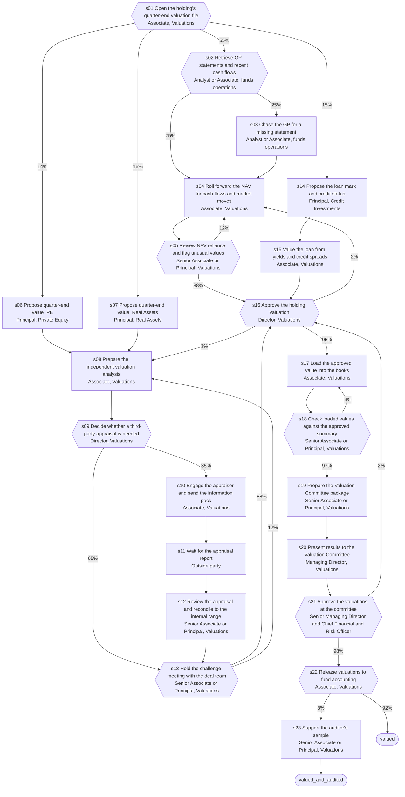

# Value private investments each quarter

`pim-fin-quarterly-valuation` · pension fund investment management · finance (valuations) · part of `pension-investment-manager`

Every quarter the fund values about 1,600 private holdings: fund and co-investment interests from the managers' reported net asset values, and direct companies, real assets and loans from models. Deal teams propose values for direct holdings and an independent valuation group in Finance rebuilds the key inputs, engages third-party appraisers for the most subjective assets, challenges the deal teams and approves each value before the Valuation Committee signs off. Late GP statements, quarter-end financials that arrive weeks after quarter end and judgment-heavy holdings squeeze the work into the 45 days before quarterly statements are due.

| | |
|---|---|
| Unit of work | one private holding valued |
| Starts when | The quarter ends and the holding's quarter-end valuation file is opened. |
| Done when | The Valuation Committee has approved the holding's fair value and it is released to fund accounting, with auditor questions closed where sampled. |
| Organisation | A very large Canadian national pension fund manager with an independent valuation group in Finance, governed by a management Valuation Committee and the Board's Audit Committee. (2,052 employees, 2019-2022) |
| Volume | 533 cases a month (range 430 to 670) |

## Where it sits

- Starts with **gp_report** from pe-gp-monitoring (55% of cases)
- Starts with **portfolio_company_report** from pe-asset-management (14% of cases)
- Starts with **portfolio_company_report** from ra-asset-management (16% of cases)
- Starts with **portfolio_company_report** from ci-loan-monitoring (15% of cases)
- Relies on **appraisal_report** from third_party_appraisers (a standing input; it does not start a case)
- Sends **appraisal_request** to third_party_appraisers (outcome: any)
- Sends **valuation** to fin-monthly-nav-close (outcome: any)
- Sends **valuation** to fin-external-audit (outcome: any)

## Flow

## Roles

| Role | Department | Layer | FTE on this process | Loaded cost per hour | Evidence |
|---|---|---|---:|---:|---|
| Managing Director, Valuations | Valuations | director | 0.35 | 900 CAD | C [src1] |
| Director, Valuations | Valuations | manager | 1.5 | 625 CAD | B [src1], [src2] |
| Senior Associate or Principal, Valuations | Valuations | senior specialist | 6.5 | 267 CAD | B [src1] |
| Associate, Valuations | Valuations | individual contributor | 12 | 126 CAD | C [src1] |
| Principal, Private Equity | Private Equity | supervisor | 2 | 571 CAD | C [src2] |
| Principal, Real Assets | Real Assets | supervisor | 2.6 | 571 CAD | C [src2] |
| Principal, Credit Investments | Credit Investments | supervisor | 0.7 | 571 CAD | C |
| Analyst or Associate, funds operations | Funds operations | individual contributor | 1.3 | 89 CAD | B [src8] |
| Senior Managing Director and Chief Financial and Risk Officer | CFRO office | executive | 0.05 | 1603 CAD | C [src1] |

## Steps

Hands-on time and the wait before each step show the most common value. Evidence tier A is a sourced number, B a sourced description, C the author's estimate.

| Step | Who | Kind | Hands-on | Wait before | Control | Evidence |
|---|---|---|---:|---:|---|---|
| **s01 Open the holding's quarter-end valuation file.** A valuation associate rolls the holding's file forward from last quarter, pulls cost, cash flows and the prior value from the private investments system, and assigns the holding to its review path. | Associate, Valuations | data entry | 15 min | 1.0 d |  | C [src1] |
| **s02 Retrieve GP statements and recent cash flows.** A funds operations analyst downloads the latest capital account statement from the GP portal, records the reported NAV and its reference date, and lists calls and distributions since that date. | Analyst or Associate, funds operations | lookup | 25 min | 3.0 d |  | B [src8], [src7] |
| **s03 Chase the GP for a missing statement.** The analyst emails the GP's investor relations team or fund administrator for the missing statement and records a fallback: use the prior NAV rolled forward if it does not arrive in time. | Analyst or Associate, funds operations | communication | 20 min | 2.0 d |  | B [src7] |
| **s04 Roll forward the NAV for cash flows and market moves.** A valuation associate adjusts the reported NAV for calls and distributions since its date and, where the lag is long or markets moved sharply, applies an index-based adjustment. | Associate, Valuations | analysis | 30 min | 3.0 d |  | B [src3] |
| **s05 Review NAV reliance and flag unusual values.** A senior valuation professional checks the NAV date, the GP's fair value policy and audit opinion, compares the change with peers and public markets, and sends back roll-forwards that look wrong. | Senior Associate or Principal, Valuations | review | 20 min | 3.0 d | IFRS 13 fair value measurement and the valuation policy: validate reliance on manager NAVs | B [src2], [src4] |
| **s06 Propose quarter-end value (PE).** The PE deal principal updates the holding's valuation model with the latest financials, budget, net debt and comparable multiples or cash flow forecasts, and submits a proposed value with a short explanation of the change. | Principal, Private Equity | analysis | 4.0 h | 9.0 d |  | B [src2] |
| **s07 Propose quarter-end value (Real Assets).** The Real Assets deal principal updates the holding's valuation model with the latest financials, budget, net debt and comparable multiples or cash flow forecasts, and submits a proposed value with a short explanation of the change. | Principal, Real Assets | analysis | 4.0 h | 9.0 d |  | B [src2] |
| **s08 Prepare the independent valuation analysis.** A valuation associate rebuilds the key inputs independently: comparable company multiples, recent transactions, discount and capitalization rates, calibration to the entry price, and sets a fair value range to test the deal team's number. | Associate, Valuations | analysis | 4.0 h | 2.0 d | Valuation policy: fair values prepared or approved by Finance independently of the investment department | B [src3], [src1], [src4] |
| **s09 Decide whether a third-party appraisal is needed.** The valuation director applies the risk-based selection (size, complexity, change since last appraisal, annual rotation for real estate) and decides whether this holding gets an external appraisal this quarter. | Director, Valuations | judgment | 10 min | 1.0 d | Valuation policy: risk-based use of third-party appraisers; GIPS 22.A.33 annual external valuation of directly owned real estate | B [src2], [src5] |
| **s10 Engage the appraiser and send the information pack.** A valuation associate issues the engagement under the master agreement, sends the model, financials and business plan, and agrees the delivery date before the committee. | Associate, Valuations | communication | 1.5 h | 1.0 d |  | B [src1] |
| **s11 Wait for the appraisal report.** The appraisal firm reviews the information, asks management and the deal team questions and delivers a draft report with a value range. | Outside party | external wait | 0 min | 7.0 d |  | C [src5] |
| **s12 Review the appraisal and reconcile to the internal range.** The senior valuation professional reads the appraisal, checks its inputs and method against the internal analysis and the deal team's proposal, and raises questions with the appraiser where the values differ. | Senior Associate or Principal, Valuations | review | 3.0 h | 1.0 d |  | B [src1], [src2] |
| **s13 Hold the challenge meeting with the deal team.** A senior valuation professional at principal level meets the deal team, walks through differences between the proposed value and the independent range, agrees the value or asks for more support, and records the rationale. | Senior Associate or Principal, Valuations | judgment | 1.0 h | 2.0 d |  | B [src1] |
| **s14 Propose the loan mark and credit status.** The credit principal reports the borrower's latest results, covenant compliance and any amendments, and proposes the mark or flags impairment risk. | Principal, Credit Investments | analysis | 1.0 h | 6.0 d |  | C [src1] |
| **s15 Value the loan from yields and credit spreads.** A valuation associate prices the loan with a discounted cash flow at a market yield from comparable loans and spread data, and compares the result with the principal's mark. | Associate, Valuations | analysis | 1.5 h | 1.0 d |  | B [src1] |
| **s16 Approve the holding valuation.** The valuation director reviews the file, the rationale and the movement from last quarter and signs off the value, or sends it back for rework. | Director, Valuations | approval | 10 min | 2.0 d | Valuation policy: director sign-off of each private holding value | B [src1] |
| **s17 Load the approved value into the books.** A valuation associate keys or uploads the approved value into the private investments system and the investment book of record for the quarter-end date. | Associate, Valuations | data entry | 10 min | 1.0 d |  | C |
| **s18 Check loaded values against the approved summary.** A second valuation professional compares the values in the private investments system and the book of record with the approved valuation summary and clears any differences before reporting. | Senior Associate or Principal, Valuations | validation | 5 min | 1.0 d | Internal control over financial reporting: independent check of loaded values | C |
| **s19 Prepare the Valuation Committee package.** The senior valuation professional adds the holding to the committee package: movements above threshold, key judgments, appraisal results and differences with deal teams. | Senior Associate or Principal, Valuations | drafting | 8 min | 3.0 d |  | B [src1] |
| **s20 Present results to the Valuation Committee.** The head of Valuations presents quarter-end results, significant judgments and appraisal outcomes to the committee and answers questions on material holdings. | Managing Director, Valuations | communication | 4 min | 9.0 d |  | B [src1], [src6] |
| **s21 Approve the valuations at the committee.** The CFRO, as chair, weighs the committee discussion and approves the quarter-end valuations as a set, or asks for a change to a specific holding before release. | Senior Managing Director and Chief Financial and Risk Officer | approval | 2 min | 0 min | Valuation Committee approval of quarter-end fair values; Audit Committee oversight | B [src1] |
| **s22 Release valuations to fund accounting.** A valuation associate marks the quarter's values final in the system and notifies fund accounting so they flow into the net asset value and financial statements. | Associate, Valuations | communication | 5 min | 4.0 h |  | B [src6] |
| **s23 Support the auditor's sample.** For holdings in the external auditor's sample, the senior valuation professional sends the model, appraisal and rationale, answers the auditor's valuation specialists and records agreed points. | Senior Associate or Principal, Valuations | communication | 3.0 h | 3.0 d | External audit of fair values in the financial statements | B [src2], [src1] |

## Exceptions

| Exception | Share of cases | What happens |
|---|---:|---|
| Late or missing GP statement | 14% | The GP's statement is not in the portal; the analyst chases and the team rolls forward the prior NAV if it does not arrive. |
| Stale NAV needs a market adjustment | 7% | The NAV is old or markets moved sharply (as in March 2020), so the roll-forward is redone with an index adjustment. |
| Third-party appraisal | 10% | About a third of direct holdings each quarter get an external appraisal that must be reconciled to the internal range. |
| Valuation disagreement with the deal team | 4% | The deal team's value is outside the independent range and more analysis or support is needed before agreement. |
| Auditor sample | 8% | The external auditor selects the holding and asks for the model, appraisal and rationale. |

## Benchmarks

| Metric | Value | Unit | Population | Evidence |
|---|---|---|---|---|
| cycle_time_days | p50 32, p90 42 | calendar days from quarter end to approved value released | Private holdings of a large Canadian pension fund reporting under the fund's governing act | B [src6] |
| level3_sensitivity | decrease -8600, increase 10100 | CAD millions change in net assets from reasonable alternative assumptions, March 31, 2022 | Level 3 investments excluding manager-valued funds | A [src1] |
| valuation_frequency_private | 4 | valuations a year at least | Private market investments under GIPS for asset owners | A [src5] |
| real_estate_external_valuation_interval | 12 | months at most | Directly owned real estate under GIPS for asset owners | A [src5] |
| gp_annual_report_lag | 90 | days after fund year end | ILPA recommended practice for private funds | A [src7] |

## Pain points

- GP statements arrive late, so fund values are rolled forward from older NAVs and trued up a quarter later. (steps s02, s03, s04; A [src3], [src7])
- Portfolio company quarter-end numbers arrive two to three weeks after quarter end, leaving little time for independent analysis, appraisals and challenge before the 45-day deadline. (steps s06, s07, s08, s11, s13; B [src6])
- Values are re-keyed from spreadsheets into the private investments system and the book of record and then checked by hand. (steps s17, s18; C)
- Judgment-heavy holdings produce disagreements between deal teams, appraisers and the valuation group that take meetings to settle. (steps s12, s13; A [src1])

## Assumptions

- Holding mix per quarter: 55% fund and co-investment interests at NAV, 30% direct equity and real assets (45% PE, 55% RA), 15% private loans; estimated from the org file's holding counts and the Level 3 split.
- About 35% of direct holdings get a third-party appraisal in a given quarter, consistent with appraisals for most direct investments on a rotation and annual external valuation of directly owned real estate.
- The Valuation Committee is assumed to be chaired by the CFRO with the controller, head of Valuations and head of Risk; its membership is not published.
- Committee and approval steps carry only the per-holding share of meeting time; most holdings are approved in bulk and only material ones are discussed.
- Waits are set so that holdings reach the committee about four to five weeks after quarter end; the simulator treats holdings independently, while in practice the committee date is the same for all of them.
- Hands-on time for direct holdings (about 15 hours each) dominates the staffing; fund holdings take about 1.5 hours each.
- The volume is quarterly work spread over three months as the organisation file does; peak load in the six weeks after quarter end is about twice the average.

## Sources

- [src1] The model fund F2022 Annual Report (fiscal year ended March 31, 2022) (link withheld) (The model fund, 2022). Finance oversees valuation processes, controls and results independently of investment departments; third-party appraisers and external valuation experts used in a risk-based manner for the most subjective fair values; Valuation Committee (management) and Audit Committee (Board) govern valuation; Level 3 split PE 44%, RA 37%, CI 13%; fund investments generally valued at NAV reported by managers; Level 3 sensitivity minus C$8.6 billion to plus C$10.1 billion; EBITDA multiples, discount rates and terminal capitalization rates as key inputs
- [src2] The model fund F2021 Annual Report (fiscal year ended March 31, 2021) (link withheld) (The model fund, 2021). Private investment fair values use comparable company multiples, recent transactions, DCF and other industry methods; independent third-party appraisals sought for most direct investments, selected by materiality and complexity; procedures to validate reliance on manager NAVs; Deloitte as auditor
- [src3] [International Private Equity and Venture Capital Valuation Guidelines (December 2018 edition)](https://www.privateequityvaluation.com/Portals/0/Documents/Guidelines/IPEV%20Valuation%20Guidelines%20-%20December%202018.pdf?ver=2018-12-21-085233-863&timestamp=1545382360113) (IPEV Board, 2018). Fair value assessed at each measurement date; calibration to the price of a recent investment; backtesting; reported fund NAV as a starting point with adjustments for time lag, subsequent cash flows, market changes and carried interest
- [src4] [IFRS 13 Fair Value Measurement](https://www.ifrs.org/issued-standards/list-of-standards/ifrs-13-fair-value-measurement/) (IFRS Foundation, 2024). Defines fair value as an exit price in an orderly transaction and requires fair value disclosures
- [src5] [2020 GIPS Standards for Asset Owners](https://www.gipsstandards.org/wp-content/uploads/2021/02/2020_gips_standards_asset_owners.pdf) (CFA Institute, 2020). Private market investments valued at least quarterly as of each quarter end (22.A.30); directly owned real estate externally valued at least every 12 months by an independent certified appraiser (22.A.33, 22.A.34)
- [src6] the fund's governing act (S.C. 1997, c. 40), sections 47 to 52 (link withheld) (Justice Laws Website, Government of Canada, 2024). Quarterly financial statements to the ministers within 45 days of quarter end (s. 50); annual report within 60 days of year end (s. 51); special examination at least every six years (s. 47)
- [src7] [ILPA Principles 3.0](https://ilpa.org/wp-content/uploads/2019/06/ILPA-Principles-3.0_2019.pdf) (Institutional Limited Partners Association, 2019). Fund annual reports with audited statements within 90 days of year end; quarterly explanation of valuation changes and methodology changes
- [src8] [Senior Analyst, Investment Operations (18-month contract) (job posting)](https://builtinmontreal.com/job/senior-analyst-investment-operations-18-month-contract/3994827) (Built In Montreal, 2025). Funds operations prepare fee accruals, capital calls and NAV calculations for external funds

Written by claude-opus on 2026-11-17.
