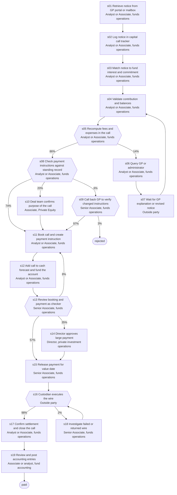

# Process capital calls from general partners

`pim-io-capital-calls` · asset management (public pension fund investment) · investment operations (private funds) · part of `pension-investment-manager`

General partners of the private funds the organisation has committed to send capital call notices asking it to pay part of its unfunded commitment, usually with about ten business days' notice. Funds operations analysts retrieve each notice from a portal or mailbox, check the amount, balances and fees against the commitment record and fund terms, verify the payment instructions, book the call and set up the payment, which a second person reviews and, for large amounts, a director approves. The payment is released through the custodian on the due date, the liquidity team is told in advance, and Finance posts the accounting entries. Notices come in many formats and portals, discrepancies need back-and-forth with administrators, and changed bank details carry fraud risk, while missing a due date can trigger default remedies.

| | |
|---|---|
| Unit of work | one capital call notice |
| Starts when | A general partner or its administrator issues a capital call notice to the organisation's investing entity. |
| Done when | The call is paid on the due date, booked and posted to the accounting records, or a fraudulent notice is blocked. |
| Organisation | A national public pension investment manager of about 2,000 staff with C$44 to 54 billion of unfunded private fund commitments, whose 22-person funds operations team pays calls through a global custodian. (2,052 employees, 2019-2022) |
| Volume | 260 cases a month (range 190 to 340) |

## Where it sits

- Starts with **capital_call_notice** from general_partners (100% of cases)
- Sends **cash_movement** to custodian (outcome: paid)
- Sends **accounting_entries** to fin-investment-accounting (outcome: paid)
- Sends **cash_forecast** to tf-liquidity-forecast (outcome: any)

## Flow

## Roles

| Role | Department | Layer | FTE on this process | Loaded cost per hour | Evidence |
|---|---|---|---:|---:|---|
| Analyst or Associate, funds operations | Funds operations | individual contributor | 3.8 | 89 CAD | B [src3], [src8] |
| Senior Associate, funds operations | Funds operations | senior specialist | 1.2 | 169 CAD | C [src3], [src5] |
| Director, private investment operations | Private investment operations | manager | 0.08 | 478 CAD | C |
| Associate, Private Equity | Private Equity | individual contributor | 0.12 | 155 CAD | C |
| Associate or analyst, fund accounting | Fund accounting and financial reporting | individual contributor | 0.33 | 96 CAD | C |

## Steps

Hands-on time and the wait before each step show the most common value. Evidence tier A is a sourced number, B a sourced description, C the author's estimate.

| Step | Who | Kind | Hands-on | Wait before | Control | Evidence |
|---|---|---|---:|---:|---|---|
| **s01 Retrieve notice from GP portal or mailbox.** An analyst sees a capital call alert in the shared funds operations mailbox, logs into the general partner's or administrator's investor portal with two-factor authentication, and downloads the notice and any cover letter. Portals differ for almost every manager, and some notices still arrive only as email attachments. | Analyst or Associate, funds operations | intake | 8 min | 7.2 h |  | C [src7] |
| **s02 Log notice in capital call tracker.** The analyst records the fund, investing entity, notice date, due date, currency and amount in the team's capital call tracker so that every open call and its deadline is visible to the team and to Treasury. | Analyst or Associate, funds operations | data entry | 8 min | 29 min |  | C |
| **s03 Match notice to fund interest and commitment.** The analyst opens the fund interest in the private investments administration system and pulls the commitment, the investing subsidiary, prior contributions and distributions, recallable amounts and the fee terms from the agreement and side letter. | Analyst or Associate, funds operations | lookup | 8 min | 1.2 h |  | B [src1] |
| **s04 Validate contribution and balances.** The analyst recomputes the organisation's share of the call from its percentage of commitments, checks that unfunded commitment, cumulative contributions and cumulative distributions before the notice agree with its own records, and that the call does not exceed the remaining commitment or the investment period limits. | Analyst or Associate, funds operations | validation | 15 min | 1.2 h | Investment Operations procedure: validate every capital call against commitment records before payment | B [src1] |
| **s05 Recompute fees and expenses in the call.** For calls that include management fees, fund expenses or interest on a subscription line, the analyst recomputes the fee on the agreed basis, applies offsets and side letter discounts, and checks expense categories against the partnership agreement. | Analyst or Associate, funds operations | validation | 10 min | 0 min | Fee validation against LPA and side letter terms | B [src1] |
| **s06 Query GP or administrator.** The analyst emails the general partner's investor relations or the fund administrator with the specific difference, such as a fee offset not applied, a balance that does not match the last notice or a missing breakdown, and asks for an explanation or corrected notice. | Analyst or Associate, funds operations | communication | 20 min | 2.4 h |  | B [src1] |
| **s07 Wait for GP explanation or revised notice.** The administrator answers or reissues the notice. Small differences are often explained without a change; others lead to a corrected notice that must be validated again before the due date. | Outside party | external wait | 0 min | 2.0 d |  | C |
| **s08 Check payment instructions against standing record.** The analyst compares the bank, account number, beneficiary and reference in the notice with the verified standing instructions held for the fund. Calls that are large, first calls, or name an unexpected investment are routed to the deal team. | Analyst or Associate, funds operations | validation | 8 min | 0 min | Payment fraud controls: instructions must match a verified standing record | B [src4], [src5] |
| **s09 Call back GP to verify changed instructions.** A senior associate calls the general partner's finance contact on the phone number already on file, never one in the notice, to confirm the new account, obtains signed confirmation, and has a second person approve the change to the standing record before any payment. | Senior Associate, funds operations | validation | 40 min | 12.0 h | Call-back to a known, previously validated number and dual approval of payee changes (funds transfer fraud prevention) | B [src5], [src4] |
| **s10 Deal team confirms purpose of the call.** The investment associate who follows the fund confirms that the investment named in the notice is one the general partner discussed, that the amount is consistent with the deal size, and flags any concern, such as a call for a deal the fund should be excused from. | Associate, Private Equity | validation | 20 min | 12.0 h |  | B [src1] |
| **s11 Book call and create payment instruction.** The analyst books the contribution in the private admin system split by investment, fees, expenses and amounts inside or outside the commitment, and creates a payment instruction in the custodian platform for the due date from the investing subsidiary's account. | Analyst or Associate, funds operations | data entry | 15 min | 2.4 h |  | B [src3] |
| **s12 Add call to cash forecast and fund the account.** The analyst adds the amount, currency and value date to the daily cash forecast sent to the liquidity team and, if the investing subsidiary lacks cash in that currency, asks Treasury to fund the account or buy the currency before the due date. | Analyst or Associate, funds operations | communication | 10 min | 0 min |  | B [src10], [src2] |
| **s13 Review booking and payment as checker.** A senior associate who did not prepare the entry compares the booking and the payment instruction with the notice, the validation workpaper and the verified bank details, then approves both in the systems or returns them. | Senior Associate, funds operations | review | 15 min | 12.0 h | Maker-checker review of transactions and payments; no single person initiates, approves and records | B [src5] |
| **s14 Director approves large payment.** The director of private investment operations reviews the approval package for payments above the senior's limit, checks the call against the commitment and any deal team comment, and approves in the custodian platform. | Director, private investment operations | approval | 10 min | 12.0 h | Payment authority limits under Management Authorities | C |
| **s15 Release payment for value date.** On the business day before or on the due date a second authorised user releases the approved payment in the custodian platform, which sends it as a SWIFT payment instruction for same-day value. Payments are timed to the due date to keep cash invested. | Senior Associate, funds operations | data entry | 8 min | 8.0 d | Dual authorisation in the custodian platform: releaser differs from initiator | B [src2], [src5] |
| **s16 Custodian executes the wire.** The custodian debits the investing subsidiary's account and sends the wire to the fund's bank. A small share fail or return, for example because of intermediary bank details, insufficient cash or sanctions screening holds. | Outside party | external wait | 0 min | 2.4 h |  | C |
| **s17 Confirm settlement and close the call.** The analyst checks the custodian statement for the debit, settles the pending transaction in the private admin system, saves the confirmation and any GP receipt acknowledgement, and closes the tracker line. | Analyst or Associate, funds operations | validation | 10 min | 1.0 d |  | C [src5] |
| **s18 Investigate failed or returned wire.** A senior associate works with the custodian and the general partner to find why the wire failed, corrects the routing or funds the account, and re-sends the same day where possible, telling the general partner if payment will be late. | Senior Associate, funds operations | communication | 1.0 h | 4.8 h |  | B [src6] |
| **s19 Review and post accounting entries.** A fund accounting associate reviews the journal entries generated from the private admin system into the investment book of record, checks the cash and investment cost entries against the settled transaction, and posts them for the daily accounting close. | Associate or analyst, fund accounting | review | 10 min | 1.0 d | Internal control over financial reporting: review of investment accounting entries | C |

## Exceptions

| Exception | Share of cases | What happens |
|---|---:|---|
| Discrepancy with the GP | 14% | Balances, fees or the breakdown do not agree with the organisation's records; the analyst queries the administrator and re-validates the answer or a corrected notice. |
| Changed payment instructions | 6% | The notice shows new bank details; a senior associate calls back on the known number and a second person approves the change before payment. A few turn out to be spoofed notices and are blocked. |
| Large or unusual call | 20% | The deal team confirms the investment and amount, and payments above the senior's limit go to the director. |
| Failed wire | 2% | The custodian rejects or the bank returns the payment; operations fix the cause and re-send to avoid default interest. |
| Short notice or netted call | 5% | Some calls give fewer than ten business days or are netted against a distribution in the same notice, which compresses the review or adds a distribution split to the validation. |

## Benchmarks

| Metric | Value | Unit | Population | Evidence |
|---|---|---|---|---|
| cycle_time_days | p50 15, p90 18 | calendar days from notice retrieval to payment booked in the accounting records | Institutional LPs paying private fund capital calls on the due date | C [src2] |
| notice_period_business_days | 10 | business days | Private equity funds following ILPA Principles | A [src2] |

## Pain points

- Notices arrive through dozens of different portals and formats, so retrieval and keying take time and errors creep in when the same data is typed into the tracker, the admin system and the custodian platform. (steps s01, s02, s11; B [src1], [src7])
- Fee and balance checks depend on reading partnership agreements and side letters, and differences take days of email with administrators inside a short notice window. (steps s05, s06, s07; B [src1])
- Spoofed notices with changed bank details are a real fraud risk, and the call-back and second approval add delay to a minority of calls. (steps s08, s09; B [src4], [src5])

## Assumptions

- Distribution notices are handled in io-distributions; netted call-and-distribution notices are treated here as calls.
- Most elapsed time is a deliberate calendar wait until the due date (s15), because payments are timed to keep cash invested; review work is done in the first two or three days.
- Payment authority thresholds, branch shares, discrepancy and failure rates and all hands-on times are tier C estimates.
- The organisation file's description says inconsistent notice formats slow review, which this file reflects in retrieval, validation and query steps.
- Loaded hourly costs come from the organisation file.

## Sources

- [src1] [Capital Call & Distribution Notice Best Practices, Version 1.1 (revised September 2016)](https://ilpa.org/wp-content/uploads/2019/05/ILPA-Best-Practices-Capital-Calls-Distribution-Notices_Version-1.1.pdf) (Institutional Limited Partners Association (ILPA), 2016). Notice content: LP and fund unfunded commitment and cumulative contributions and distributions before and after the notice, itemised investments, management fee calculations and offsets, due date, currency and FX, detailed payment instructions, beginning balance variance to the prior notice; purpose of reducing LP processing errors and times.
- [src2] [ILPA Principles 3.0](https://ilpa.org/wp-content/uploads/2019/06/ILPA-Principles-3.0_2019.pdf) (Institutional Limited Partners Association (ILPA), 2019). LPs should have a window of at least 10 business days to respond to capital call requests; GPs should give quarterly projections of calls and distributions; disclosure of subscription credit facilities.
- [src3] Senior Analyst, Investment Operations (18-month contract) (job posting) (link withheld) (The model fund via Built In Montreal, 2025). Funds Operations within Private Investment Operations; nine-member External Funds Operations team supports capital calls, redemptions and invoice payments, closings, system set-ups, transaction entries, settlements and reconciliations.
- [src4] [Sequoia says phishing scheme tried to get LP to wire money](https://www.cnbc.com/2018/10/02/sequoia-says-phishing-scheme-tried-to-get-lp-to-wire-money.html) (CNBC, 2018). A spoofed email copying a real capital call notice asked an LP to wire a capital call to a bank account in Mexico; business email compromise risk in capital calls.
- [src5] [Funds transfer fraud prevention](https://fundbanking.firstcitizens.com/insights/operating-best-practices/funds-transfer-fraud-prevention) (First Citizens Bank Fund Banking (formerly SVB Private Funds CFO Insights), 2026). Call back on a known, previously validated phone number and never use contact details in the requesting message; dual authorisation of changes to payment instructions; no single person should initiate, approve and record transactions; daily reconciliation.
- [src6] [Understanding LPA default remedies](https://www.mayerbrown.com/en/pdf/insights/publications/2024/08/understanding-lpa-default-remedies) (Mayer Brown, 2024). Remedies against an LP that fails to fund a call: default interest at a punitive rate, overcalls on other LPs, capital account cram-downs of 50 to 100%, forced sale at discounts such as 50%, withheld distributions, suspended voting and side letter rights.
- [src7] [2024 Private Investment Operational DDQ Analysis](https://publishedresearch.cambridgeassociates.com/?p=19112) (Cambridge Associates, 2025). 65% of private fund managers used a third-party administrator in 2018 and 83% in 2024; most funds rely on a single bank for capital calls and distributions.
- [src8] [Wages: Financial Control Officer (NOC 11100) near Toronto (ON)](https://www.jobbank.gc.ca/marketreport/wages-occupation/133/22437) (Government of Canada Job Bank, 2026). Toronto region hourly wages for NOC 11100: low 25.00, median 41.34, high 74.36 (2023-2024).
- [src9] The model fund F2021 Annual Report (link withheld) (The model fund, 2021). Unfunded commitments of investment holding subsidiaries C$44,244 million at March 31, 2021; Funds and Secondaries relationships with 131 fund managers and PE Asia with 37.
- [src10] The model fund F2022 Annual Report (link withheld) (The model fund, 2022). Unfunded commitments of investment holding subsidiaries C$54,064 million at March 31, 2022; 10-day Liquidity Coverage Ratio of 2.9x measures liquid assets against obligations over any 10-day period. Read from a text extraction of the PDF, which is larger than the web fetch limit.

Written by claude-opus on 2026-11-17.
