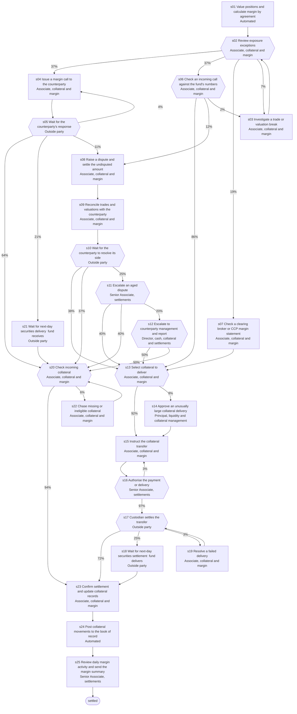

# Process margin calls and manage collateral

`pim-io-collateral-margin` · asset management (public pension fund investment) · investment operations · part of `pension-investment-manager`

The collateral team in investment operations exchanges margin every business day with the fund's OTC derivative, repo and securities lending counterparties and its clearing brokers, so that neither side is exposed if the other defaults. Overnight the collateral system calculates what is owed under each agreement; in the morning associates check exceptions, issue calls where the fund is owed, check calls received against their own numbers, pay cleared margin in cash, and select and instruct collateral through the custodian with a second person authorising each movement. Most calls settle the same or next day, but disputes over missing trades or valuations take days of reconciliation and escalation, and volumes and amounts jump in volatile markets such as March 2020. The team sends a daily margin summary to the liquidity team and counterparty risk.

| | |
|---|---|
| Unit of work | one margin call |
| Starts when | The overnight margin calculation shows collateral due to or from a counterparty above the minimum transfer amount, or a counterparty, clearing broker or central counterparty sends a call. |
| Done when | The agreed collateral has settled, balances are updated and posted to the book of record, and the call is included in the daily margin summary. |
| Organisation | A national pension fund manager of about C$540 billion with C$122 billion of recourse leverage through swaps, futures, repo and securities lending with about 60 counterparties and clearing brokers. (2,052 employees, 2019-2022) |
| Volume | 1,400 cases a month (range 1,000 to 2,000) |

## Where it sits

- Starts with **margin_call** from counterparties (80% of cases)
- Starts with **margin_call** from ccp (20% of cases)
- Sends **collateral_transfer** to counterparties (outcome: settled)
- Sends **settlement_instruction** to custodian (outcome: settled)
- Sends **margin_summary** to tf-liquidity-forecast (outcome: settled)
- Sends **margin_summary** to risk-counterparty-credit (outcome: settled)
- Sends **accounting_entries** to fin-investment-accounting (outcome: settled)

## Flow

## Roles

| Role | Department | Layer | FTE on this process | Loaded cost per hour | Evidence |
|---|---|---|---:|---:|---|
| Associate, collateral and margin | Public markets operations - Cash, collateral and settlements | individual contributor | 6 | 89 CAD | C [job_ccs] |
| Senior Associate, settlements | Public markets operations - Cash, collateral and settlements | senior specialist | 1.5 | 156 CAD | C [job_ccs] |
| Director, cash, collateral and settlements | Public markets operations - Cash, collateral and settlements | manager | 0.15 | 432 CAD | C [job_ccs] |
| Principal, liquidity and collateral management | Total Fund Management - Balancing, liquidity and collateral (treasury) | supervisor | 0.1 | 540 CAD | C [ar21] |

## Steps

Hands-on time and the wait before each step show the most common value. Evidence tier A is a sourced number, B a sourced description, C the author's estimate.

| Step | Who | Kind | Hands-on | Wait before | Control | Evidence |
|---|---|---|---:|---:|---|---|
| **s01 Value positions and calculate margin by agreement.** After the valuation date closes, the collateral system takes trade populations and end-of-day valuations from the book of record and pricing, applies each credit support annex's threshold, minimum transfer amount, independent amount and rounding, and calculates the call due to or from each counterparty, clearing broker and repo or lending counterparty. | Automated | system auto | 0 min | 20 min |  | B [osfi_e22], [ar22] |
| **s02 Review exposure exceptions.** The collateral associate opens the morning exception screen and checks agreements with large day-over-day exposure changes, trades missing on one side, unpriced positions and agreements near threshold. Agreements that look wrong are held back for investigation before any call is sent or accepted. | Associate, collateral and margin | validation | 4 min | 1.0 h |  | B [emir149], [job_ccs] |
| **s03 Investigate a trade or valuation break.** The associate compares the agreement's trade list and valuations with the book of record and asks trade support or pricing operations to fix a missing booking, a late novation or a stale price, then reruns the agreement. | Associate, collateral and margin | coordination | 20 min | 1.0 h |  | C |
| **s04 Issue a margin call to the counterparty.** Where the fund is owed collateral above the minimum transfer amount, the associate issues the call by the agreement's notification time through the electronic margin messaging network or by email, with the exposure, collateral held and amount requested. | Associate, collateral and margin | communication | 4 min | 30 min | Daily variation margin call and collection under OSFI Guideline E-22 and counterparty swap dealer rules (17 CFR 23.153) | B [osfi_e22], [cftc_vm], [lseg_mm] |
| **s05 Wait for the counterparty's response.** The counterparty's collateral team checks the call against its own numbers and either agrees, agrees part and disputes the rest, or asks for the call to be reissued. Responses usually come back within a few hours. | Outside party | external wait | 0 min | 2.0 h |  | C |
| **s06 Check an incoming call against the fund's numbers.** When a counterparty's call arrives, the associate matches it to the agreement, compares the counterparty's exposure and collateral balance with the fund's own calculation and accepts it if the difference is within tolerance. | Associate, collateral and margin | validation | 5 min | 1.5 h | Calls are paid only after independent recalculation against agreement terms | C |
| **s07 Check a clearing broker or CCP margin statement.** For futures and cleared swaps, the associate checks the clearing broker's daily statement of variation and initial margin against expected moves on the fund's positions. Cleared margin must be paid in cash by the deadline even if a question is raised afterwards. | Associate, collateral and margin | validation | 3 min | 30 min |  | B [dnb24] |
| **s08 Raise a dispute and settle the undisputed amount.** The associate records the dispute with a reason code (trade population, valuation, collateral balance or terms), agrees the undisputed part so it can move today, and sends the counterparty the trade-level detail needed to reconcile. | Associate, collateral and margin | communication | 15 min | 15 min | Dispute resolution procedures required by OSFI Guideline E-22 and EMIR Delegated Regulation 149/2013 Article 15 | B [osfi_e22], [emir149], [lseg_mm] |
| **s09 Reconcile trades and valuations with the counterparty.** The associate exchanges trade files with the counterparty, matches trades, notionals and valuations line by line, and works out which side has the missing trade, stale price or wrong collateral balance. | Associate, collateral and margin | analysis | 40 min | 2.0 h |  | B [emir149] |
| **s10 Wait for the counterparty to resolve its side.** The counterparty corrects its booking or valuation, or explains why the fund's figure is wrong. Most disputes close within a day or two; some age past five business days. | Outside party | external wait | 0 min | 20.0 h |  | B [emir149] |
| **s11 Escalate an aged dispute.** A senior associate reviews disputes open several days, calls the counterparty's collateral manager, proposes a split or a third-party valuation and reports aged disputes to the director and Risk. | Senior Associate, settlements | coordination | 45 min | 1.0 d |  | B [emir149], [osfi_e22] |
| **s12 Escalate to counterparty management and report.** The settlements director raises long-running or large disputes with the counterparty's management, informs counterparty credit risk, and arranges regulatory dispute reporting where the counterparty's rules require it. | Director, cash, collateral and settlements | coordination | 1.0 h | 3.0 d | Reporting of disputes above EUR 15 million outstanding at least 15 business days (EMIR Delegated Regulation 149/2013 Article 15) for EU counterparties | B [emir149] |
| **s13 Select collateral to deliver.** For calls the fund must pay, the associate chooses what to deliver from the eligible collateral schedule: cash in the right currency or government bonds from the inventory TFM has made available, taking haircuts into account. Initial margin goes to a segregated account at a third-party custodian. | Associate, collateral and margin | judgment | 5 min | 15 min |  | B [osfi_e22], [ar21], [bis_d499] |
| **s14 Approve an unusually large collateral delivery.** For a very large call, such as on a volatile day, the TFM liquidity and collateral principal confirms which cash or securities to use so that the liquidity buffer and funding plans stay intact. | Principal, liquidity and collateral management | approval | 10 min | 30 min | Collateral optimisation and liquidity limits managed by Total Fund Management | B [ar21], [boc21], [is25] |
| **s15 Instruct the collateral transfer.** The associate creates the cash wire or securities delivery in the collateral system, which sends a SWIFT instruction to the custodian with the counterparty's standing settlement instructions. | Associate, collateral and margin | data entry | 4 min | 10 min |  | B [job_ccs] |
| **s16 Authorise the payment or delivery.** A senior associate who did not create the instruction checks amount, currency, counterparty and settlement instructions against the agreed call and releases it to the custodian. | Senior Associate, settlements | approval | 2 min | 30 min | Maker-checker release of cash and securities movements | C |
| **s17 Custodian settles the transfer.** The custodian moves the cash, or delivers securities that can settle the same day, and reports the status. Securities that settle on the next business day go to a separate wait. | Outside party | external wait | 0 min | 1.5 h |  | B [osfi_e22], [cftc_vm] |
| **s18 Wait for next-day securities settlement (fund delivers).** When the fund delivers bonds rather than cash, the securities usually settle on the next business day through the custodian and the settlement depository, so the call stays pending overnight. | Outside party | external wait | 0 min | 20.0 h |  | B [osfi_e22] |
| **s19 Resolve a failed delivery.** The associate works with the custodian and counterparty on why the delivery failed, such as wrong instructions, a cut-off missed or securities not available, and re-instructs or substitutes cash. | Associate, collateral and margin | coordination | 25 min | 2.0 h |  | C |
| **s20 Check incoming collateral.** For calls the fund is owed, the associate checks the custodian report that the cash or securities arrived on time, in the agreed amount and are eligible after haircuts, and marks the call settled. | Associate, collateral and margin | validation | 4 min | 2.0 h |  | B [osfi_e22] |
| **s21 Wait for next-day securities delivery (fund receives).** When the counterparty delivers securities rather than cash, they usually arrive on the next business day, so the associate checks receipt the following morning. | Outside party | external wait | 0 min | 20.0 h |  | B [osfi_e22] |
| **s22 Chase missing or ineligible collateral.** The associate contacts the counterparty about collateral that has not arrived or is ineligible, agrees a replacement or a new value date and records the late delivery for counterparty credit review. | Associate, collateral and margin | communication | 20 min | 4.0 h |  | C |
| **s23 Confirm settlement and update collateral records.** The associate marks the call settled, updates collateral held and posted by agreement and checks that the collateral system and custodian balances agree for that agreement. | Associate, collateral and margin | validation | 3 min | 30 min |  | C |
| **s24 Post collateral movements to the book of record.** An interface posts cash collateral movements, interest and securities pledges from the collateral system to the investment book of record for accounting and reconciliation. | Automated | system auto | 0 min | 1.0 h |  | B [ar22] |
| **s25 Review daily margin activity and send the margin summary.** At the end of the day a senior associate reviews settled, pending and disputed calls, collateral posted and received and excess collateral, and sends the margin summary to TFM's liquidity team and counterparty credit risk. | Senior Associate, settlements | review | 2 min | 1.0 h | Daily reporting of margin and collateral positions to treasury and counterparty risk | B [fsb24] |

## Exceptions

| Exception | Share of cases | What happens |
|---|---:|---|
| Exposure break before calling | 7% | A missing booking, late novation or stale price makes an agreement's exposure wrong; trade support or pricing must fix it before the call goes out. |
| Margin dispute | 10% | The counterparty disputes an outgoing call, or the fund questions an incoming one; the undisputed amount moves and the rest is reconciled trade by trade. |
| Aged dispute escalation | 3% | A dispute stays open beyond several business days and is escalated to senior staff, counterparty management and, for EU counterparties above EUR 15 million for 15 business days, regulatory reporting. |
| Failed or late collateral delivery | 4% | A delivery fails or incoming collateral is late, short or ineligible and must be chased, re-instructed or substituted. |
| Large call on a volatile day | 8% | An unusually large call needs TFM's liquidity and collateral principal to confirm which cash or securities to use. |

## Benchmarks

| Metric | Value | Unit | Population | Evidence |
|---|---|---|---|---|
| cycle_time_days | p50 0.5, p90 1.6 | calendar days from the morning margin calculation to settled, recorded collateral included in the daily summary | Bilateral, repo and cleared margin calls at a large buy-side firm | B [cftc_vm], [osfi_e22] |
| vm_minimum_transfer_amount_max | 750000 | CAD | OSFI-regulated covered entities | A [osfi_e22] |
| im_threshold_max | 75000000 | CAD, consolidated group | OSFI-regulated covered entities | A [osfi_e22] |
| dispute_escalation_trigger | 5 | business days unresolved | EU counterparties under EMIR | A [emir149] |
| peer_margin_calls_peak_week_march_2020 | 30000000000 | CAD cumulative across the eight largest Canadian public pension funds | Canada's Big Eight public pension funds | A [boc21] |

## Pain points

- Disputes over trade populations and valuations need manual trade-by-trade reconciliation by email and file exchange and can stay open for days. (steps s08, s09, s10, s11; B [emir149])
- Exposure accuracy depends on upstream trade booking and pricing; a missing trade or stale price holds back the call or causes a dispute. (steps s01, s02, s03; C)
- Volumes and amounts spike in volatile markets, compressing the time to check, select and deliver collateral while liquidity is under strain. (steps s06, s13, s14; A [boc21], [fsb24])
- Counterparties not on electronic messaging still exchange calls by email, adding re-keying and matching work. (steps s04, s06; B [lseg_mm])

## Assumptions

- One case is one call in either direction on one agreement and value date; about 37% are calls the fund issues, 37% calls it receives, 19% cleared margin and 7% start with an exposure break. These shares are estimates.
- Dispute rates (about 11% to 12% of bilateral calls) and resolution times are estimates; no public dispute statistics were opened because the ISDA survey pages could not be fetched.
- Cycle time is measured from the morning when the overnight margin calculation is available, not from the close of the valuation date; about 25% of deliveries are assumed to be securities settling the next business day.
- The team is the Cash, collateral and settlements team in the organisation file; the 10 collateral associates are assumed to spend about 60% of their time on call processing and the rest on agreement set-up, initial margin segregation, reconciliations and reporting.
- The organisation file gives the collateral associate role a lower loaded cost than settlement senior associates; labour cost per call is driven by those figures.
- Collateral optimisation decisions on what inventory is available are made in Total Fund Management outside this process; only approval of unusually large deliveries is shown.
- Web search capacity ran out during research, so vendor process documentation and ISDA margin surveys could not be opened; affected numbers are tier C.

## Sources

- [ar22] The model fund F2022 Annual Report (fiscal year ended March 31, 2022) (link withheld) (The model fund, 2022). Credit risk on OTC contracts limited through authorised counterparties, exposure limits, master netting agreements and collateral under ISDA and Global Master Repurchase Agreements; daily settlement of variation margin on certain derivatives; Note 15 collateral held and pledged on repo, securities lending and derivatives; Risk and three lines of defence
- [ar21] The model fund F2021 Annual Report (fiscal year ended March 31, 2021) (link withheld) (The model fund, 2021). Payment obligations include collateral and margin requirements; Balancing & Collateral group responsible for optimising the Fund's collateral; multi-year initiative to modernise public markets trading and collateral management technology and controls; cash pledged and held as collateral on OTC derivatives (C$1,142 million pledged and C$1,955 million held at March 31, 2021)
- [is25] Statement of Investment Objectives, Policies, Return Expectations and Risk Management for the Investment Portfolios of the Base plan and the Additional plan (effective April 2, 2025) (link withheld) (The model fund, 2025). Liquidity must meet collateral, margin or mark-to-market requirements of derivatives and other contracts
- [osfi_e22] [Guideline E-22: Margin Requirements for Non-Centrally Cleared Derivatives](https://www.osfi-bsif.gc.ca/en/guidance/guidance-library/margin-requirements-non-centrally-cleared-derivatives) (Office of the Superintendent of Financial Institutions (Canada), 2020). Covered entities include pension funds above C$12 billion notional; variation margin calculated and called within two business days of execution and daily thereafter, exchanged by the second business day after the call; minimum transfer amount not above C$750,000; initial margin threshold up to C$75 million; phase-in from September 2021 for groups above C$75 billion and from September 2022 above C$12 billion; eligible collateral; initial margin exchanged gross and segregated, no rehypothecation; dispute resolution procedures required before trading and timely initiation in a dispute
- [cftc_vm] [17 CFR 23.153 Variation margin requirements (Legal Information Institute copy)](https://www.law.cornell.edu/cfr/text/17/23.153) (U.S. Commodity Futures Trading Commission via Cornell Legal Information Institute, 2021). Swap dealers collect or post variation margin on or before the business day after execution and each business day thereafter; minimum transfer amount; no violation if timely formal dispute resolution is pursued
- [emir149] [Commission Delegated Regulation (EU) No 149/2013 (EMIR risk mitigation techniques for OTC derivatives)](https://eur-lex.europa.eu/eli/reg_del/2013/149/oj) (European Union (EUR-Lex), 2013). Article 15: agreed procedures to record and monitor valuation and collateral disputes, specific process for disputes unresolved after five business days, reporting of disputes above EUR 15 million outstanding at least 15 business days; Article 13: daily portfolio reconciliation for 500 or more outstanding contracts with financial counterparties
- [bis_d499] [Margin requirements for non-centrally cleared derivatives (revised April 2020)](https://www.bis.org/bcbs/publ/d499.htm) (Basel Committee on Banking Supervision and IOSCO, 2020). Final two initial margin phases deferred by one year; final phase on 1 September 2022
- [boc21] [COVID-19 crisis: Liquidity management at Canada's largest public pension funds (Staff Analytical Note 2021-11)](https://bankofcanada.ca/san2021-11) (Bank of Canada (Bedard-Page, Bolduc-Zuluaga, Demers, Dion, Pandey, Berger-Soucy and Walton), 2021). All of the Big Eight apply a liquidity coverage ratio framework: liquidity buffer over potential stressed outflows, kept above one; buffers are mostly high-quality assets and funding sources, not cash; March 2020 margin calls peaked at about C$30 billion cumulatively across the Big Eight in the week of March 16; some funds could not roll US commercial paper and built precautionary liquidity; Big Eight issued about C$19 billion of long-term debt March to May 2020
- [dnb24] [Dutch pension funds can meet margin calls on derivatives, but depend on functioning money markets](https://www.dnb.nl/en/sector-news/supervision-2024/dutch-pension-funds-can-meet-margin-calls-on-derivatives-but-depend-on-functioning-money-markets) (De Nederlandsche Bank and Dutch Authority for the Financial Markets, 2024). Collateral must typically be provided within one or two days of a margin call; cleared derivative margin must be met in cash; funds use cash, repo, money market funds and high-quality bonds in that order; repo access may fail in broad stress
- [fsb24] [Liquidity Preparedness for Margin and Collateral Calls: Final report](https://www.fsb.org/2024/12/liquidity-preparedness-for-margin-and-collateral-calls-final-report/) (Financial Stability Board, 2024). Margin and collateral calls rose sharply and frequently in March 2020, Archegos, 2022 commodities and LDI episodes; recommendations on liquidity governance, stress testing, resilient operational and collateral management processes, sufficient liquid assets and regular interaction with counterparties and service providers
- [lseg_mm] [Margin Manager (product page, formerly AcadiaSoft)](https://www.lseg.com/en/post-trade/solutions/streamline/margin-manager) (London Stock Exchange Group, n.d.). Electronic margin call messaging for pledging and receiving margin, dispute reasons and audit trail; over 1,600 firms on the network; used by the majority of firms that exchange margin; covers repo, securities lending, cleared and futures workflows
- [job_ccs] [Associate, Cash, Collateral & Settlements Operations (job posting)](https://builtintoronto.com/job/associate-cash-collateral-settlements-operations/7434948) (Built In Toronto, 2025). Cash, collateral and settlements team at this organisation settles equities, bonds, repo, money markets, securities lending and FX; works with brokers, custodians and prime brokers; uses Bloomberg, SimCorp and affirmation platforms; escalates and resolves issues against market deadlines

Written by claude-opus on 2026-11-17.
