# Price securities and produce the daily fund valuation (one daily valuation)

`pim-io-price-daily-nav` · pension fund investment management · investment operations (pricing and valuation) · part of `pension-investment-manager`

Every business day the pricing team values the fund's public holdings so that Total Fund Management, Risk and liquidity forecasting can manage exposures the next morning. Vendor closing prices, evaluated bond prices, derivative prices and FX rates load overnight and automated rules flag missing, stale, zero and out-of-tolerance prices. Early the next morning analysts work the exceptions by asset class, ask dealers for quotes, challenge doubtful evaluated prices with the vendor and propose overrides, which a senior approves; halted or illiquid instruments go to Finance valuations for a fair value adjustment. The latest private and external fund values are applied, SimCorp runs the valuation, the movement is checked against benchmarks and the senior signs it off. Illiquid bonds, OTC derivatives, late vendor files and corporate action jumps make the morning slow.

| | |
|---|---|
| Unit of work | one daily valuation |
| Starts when | North American markets close on a business day and the last regional vendor price files and FX rates become available. |
| Done when | The signed-off prices and net asset value by portfolio and account are published to Total Fund Management, Risk, liquidity forecasting and the month-end close. |
| Organisation | A very large Canadian national pension fund investment manager that invests one fund globally with mostly internal teams and values its public holdings daily in SimCorp Dimension from several price vendors. (2,052 employees, 2019-2022) |
| Volume | 21 cases a month (range 20 to 23) |

## Where it sits

- Starts with **market_data** from data_vendors (50% of cases)
- Starts with **position_record** from mkt-reconcile (35% of cases)
- Starts with **reference_data** from io-data-management (15% of cases)
- Sends **net_asset_value** to tf-balancing-rebalance (outcome: released)
- Sends **net_asset_value** to tf-currency-management (outcome: released)
- Sends **net_asset_value** to risk-market-limit-monitoring (outcome: released)
- Sends **price_data** to fin-monthly-nav-close (outcome: released)

## Flow

```mermaid
flowchart TD
    s01["s01 Load vendor end-of-day prices and FX rates<br/>Automated"]
    s02["s02 Run automated price validation rules<br/>Automated"]
    s03{{"s03 Check load completeness and position coverage<br/>Analyst, pricing and valuation operations"}}
    s04["s04 Request missing prices or a re-delivery<br/>Analyst, pricing and valuation operations"]
    s05["s05 Wait for the vendor or broker to supply the price<br/>Outside party"]
    s06["s06 Work equity and listed fund price exceptions<br/>Analyst, pricing and valuation operations"]
    s07["s07 Work fixed income price exceptions<br/>Analyst, pricing and valuation operations"]
    s08{{"s08 Check derivative and OTC valuations<br/>Analyst, pricing and valuation operations"}}
    s09["s09 Request broker quotes and raise vendor challenges<br/>Analyst, pricing and valuation operations"]
    s10["s10 Wait for dealer quotes<br/>Outside party"]
    s11["s11 Prepare override proposals with evidence<br/>Analyst, pricing and valuation operations"]
    s12{{"s12 Approve price overrides and stale exceptions<br/>Senior Associate, pricing and valuation operations"}}
    s13["s13 Approve a fair value adjustment<br/>Senior Associate or Principal, Valuations"]
    s14["s14 Apply the latest private and external fund values<br/>Analyst, pricing and valuation operations"]
    s15["s15 Run the daily valuation<br/>Automated"]
    s16{{"s16 Review the valuation movement<br/>Analyst, pricing and valuation operations"}}
    s17{{"s17 Investigate an unexplained valuation movement<br/>Analyst, pricing and valuation operations"}}
    s18["s18 Sign off and release the daily valuation<br/>Senior Associate, pricing and valuation operations"]
    s19{{"s19 Publish the valuation and prices downstream<br/>Automated"}}
    s20["s20 Process a late correction and re-release<br/>Analyst, pricing and valuation operations"]
    s01 --> s02
    s02 --> s03
    s03 -->|"12%"| s04
    s03 -->|"88%"| s06
    s04 --> s05
    s05 --> s06
    s06 --> s07
    s07 --> s08
    s08 -->|"45%"| s09
    s08 -->|"40%"| s11
    s08 -->|"15%"| s14
    s09 --> s10
    s10 --> s11
    s11 --> s12
    s12 -->|"8%"| s13
    s12 -->|"5%"| s11
    s12 -->|"87%"| s14
    s13 --> s14
    s14 --> s15
    s15 --> s16
    s16 -->|"12%"| s17
    s16 -->|"88%"| s18
    s17 -->|"60%"| s15
    s17 -->|"40%"| s18
    s18 --> s19
    s19 -->|"95%"| end0
    s19 -->|"5%"| s20
    s20 --> s15
    end0(["released"])
```

## Roles

| Role | Department | Layer | FTE on this process | Loaded cost per hour | Evidence |
|---|---|---|---:|---:|---|
| Analyst, pricing and valuation operations | Pricing, valuation and performance operations | individual contributor | 4 | 85 CAD | C [src7] |
| Senior Associate, pricing and valuation operations | Pricing, valuation and performance operations | senior specialist | 1.2 | 164 CAD | C |
| Senior Associate or Principal, Valuations | Valuations | senior specialist | 0.3 | 267 CAD | C [src1] |

## Steps

Hands-on time and the wait before each step show the most common value. Evidence tier A is a sourced number, B a sourced description, C the author's estimate.

| Step | Who | Kind | Hands-on | Wait before | Control | Evidence |
|---|---|---|---:|---:|---|---|
| **s01 Load vendor end-of-day prices and FX rates.** As each region closes, scheduled jobs load exchange closing prices, evaluated bond prices, derivative settlement prices and the closing FX rates from the price vendors into the SimCorp price tables, with a primary and a secondary source for most instrument types. | Automated | system auto | 0 min | 2.5 h |  | B [src1], [src2] |
| **s02 Run automated price validation rules.** Validation rules compare each price with the secondary source, with the previous day and with its index or curve move, and flag prices that are missing, zero, unchanged for several days or outside tolerance, producing the exception list by asset class. | Automated | system auto | 0 min | 15 min | Pricing and valuation policy: automated stale, missing, zero and tolerance checks against secondary sources and benchmarks | B [src2], [src3] |
| **s03 Check load completeness and position coverage.** At the start of the early shift an analyst confirms every vendor file arrived, then checks that every position in the reconciled position record has a price and every currency has a rate, listing new securities with no price. | Analyst, pricing and valuation operations | validation | 25 min | 11.0 h |  | C |
| **s04 Request missing prices or a re-delivery.** The analyst asks the vendor's support desk to re-send or correct the file, sets up a price source for new securities with investment data management, or requests a quote from the trading desk's brokers for instruments no vendor covers. | Analyst, pricing and valuation operations | communication | 15 min | 10 min |  | C |
| **s05 Wait for the vendor or broker to supply the price.** The vendor re-delivers the file or the broker sends a quote; if nothing arrives before the release deadline the previous price is carried and flagged as stale. | Outside party | external wait | 0 min | 1.5 h |  | C |
| **s06 Work equity and listed fund price exceptions.** Analysts check each flagged equity, ETF and listed fund price against the exchange close in Bloomberg, look for splits, special dividends, halts and ticker changes that explain a jump, and either accept the price or propose the secondary source or an override. | Analyst, pricing and valuation operations | analysis | 1.5 h | 10 min |  | B [src2], [src3] |
| **s07 Work fixed income price exceptions.** Analysts compare flagged evaluated bond prices with the move in the benchmark curve and the issuer's spreads, the secondary vendor and any dealer runs, and decide whether the vendor price is credible or needs a challenge or override. | Analyst, pricing and valuation operations | analysis | 2.0 h | 5 min |  | B [src1], [src4] |
| **s08 Check derivative and OTC valuations.** Analysts check futures and listed option settlement prices, compare model values of swaps, forwards and OTC options with counterparty and collateral marks, and investigate large differences in curves or volatility inputs. | Analyst, pricing and valuation operations | analysis | 1.5 h | 5 min |  | B [src1] |
| **s09 Request broker quotes and raise vendor challenges.** For doubtful bond or derivative prices the analyst asks two or three dealers for quotes through Bloomberg or email and logs a formal challenge with the evaluated pricing vendor, attaching the evidence. The challenge outcome is tracked over the following days. | Analyst, pricing and valuation operations | communication | 30 min | 10 min |  | B [src4] |
| **s10 Wait for dealer quotes.** Dealers answer the quote requests during the morning; quotes that do not arrive before the cut-off leave the vendor or previous price in place with a stale flag. | Outside party | external wait | 0 min | 1.0 h |  | C |
| **s11 Prepare override proposals with evidence.** The analyst enters each proposed override, secondary-source switch or stale-price carry in SimCorp with a reason code, the evidence (quotes, exchange data, curve move) and the value impact. | Analyst, pricing and valuation operations | drafting | 30 min | 10 min |  | B [src3] |
| **s12 Approve price overrides and stale exceptions.** A senior associate who did not propose them reviews the overrides, secondary-source switches and stale prices beyond the policy limit with their evidence and approves, rejects, or sends instruments that need a fair value judgment to Finance valuations. | Senior Associate, pricing and valuation operations | approval | 30 min | 45 min | Pricing policy: price overrides need a reason code and approval by someone other than the preparer, within internal control over financial reporting | B [src3], [src1] |
| **s13 Approve a fair value adjustment.** A Finance valuations senior reviews halted, suspended, defaulted or thinly traded instruments, or a market closed on a holiday, and approves a fair value adjustment or model value under the valuation policy, recording it for the Valuation Committee. | Senior Associate or Principal, Valuations | approval | 45 min | 3.0 h | Valuation policy with Finance oversight independent of investment departments and Valuation Committee governance; IFRS 13 exit price measurement | B [src1], [src5] |
| **s14 Apply the latest private and external fund values.** The analyst checks that private holdings carry their latest approved quarterly valuation rolled forward for capital calls and distributions since that date, that external fund values reflect the latest administrator NAV, and that FX rates match the approved source. | Analyst, pricing and valuation operations | validation | 30 min | 10 min |  | B [src1], [src6] |
| **s15 Run the daily valuation.** SimCorp values every position with the approved prices and FX rates and produces the net asset value by portfolio, asset class and investment department, and for the base and additional plan accounts. | Automated | system auto | 0 min | 20 min |  | B [src8] |
| **s16 Review the valuation movement.** The analyst compares each portfolio's change in value with its benchmark index and currency moves, sorts positions by profit and loss, and flags moves that the market does not explain. | Analyst, pricing and valuation operations | analysis | 40 min | 15 min |  | B [src2] |
| **s17 Investigate an unexplained valuation movement.** The analyst traces the move to a wrong price, a missing corporate action adjustment or a position error, asks reconciliation or trade support when the quantity is wrong, and corrects the price before re-running. | Analyst, pricing and valuation operations | analysis | 45 min | 15 min |  | C |
| **s18 Sign off and release the daily valuation.** The senior associate reviews the exception summary, open challenges, stale prices and the movement review and signs off, which releases the valuation to Total Fund Management, Risk and liquidity forecasting. | Senior Associate, pricing and valuation operations | review | 20 min | 20 min | Pricing and valuation policy: daily sign-off of price validation before the valuation is released | C [src3] |
| **s19 Publish the valuation and prices downstream.** The signed-off prices and net asset values are published to the data platform and the risk platform, where Total Fund Management, Risk and liquidity forecasting pick them up for the morning's exposure, limit and rebalancing work. | Automated | system auto | 0 min | 10 min |  | C |
| **s20 Process a late correction and re-release.** When a vendor correction or a late position fix arrives after release, the analyst loads the corrected price or waits for the position fix, tells Total Fund Management and Risk which numbers will change, and re-runs the valuation for sign-off. | Analyst, pricing and valuation operations | coordination | 30 min | 2.0 h |  | C [src2] |

## Exceptions

| Exception | Share of cases | What happens |
|---|---:|---|
| Missing vendor file or unpriced new security | 12% | A vendor file is late or partial, or a new security has no price source; the analyst requests a re-delivery or a quote and carries the old price if nothing arrives. |
| Doubtful evaluated price challenged | 45% | Dealer quotes are requested and a challenge logged with the vendor; an override is proposed and approved for the day while the challenge is followed up. |
| Fair value adjustment by Finance valuations | 7% | A halted, suspended, defaulted or thinly traded instrument, or a closed market, needs a judgment that Finance valuations approves. |
| Unexplained valuation movement | 12% | A portfolio moves more than its benchmark explains; the analyst traces and corrects the price or position and re-runs. |
| Correction after release | 5% | A vendor correction or late position fix forces a re-run after the valuation was published, and downstream users are told. |

## Benchmarks

| Metric | Value | Unit | Population | Evidence |
|---|---|---|---|---|
| cycle_time_days | p50 0.75, p90 0.95 | calendar days from the North American market close on day T to release of the signed-off valuation | Daily valuation of public holdings at a large in-house asset owner | C |
| minimum valuation frequency for total fund returns | monthly (private market portfolios quarterly) | frequency | Asset owners claiming compliance with the 2020 GIPS standards | A [src6] |

## Pain points

- Evaluated bond prices and OTC derivative values lag fast markets, so analysts spend the morning gathering dealer quotes and logging challenges whose outcome arrives days later. (steps s07, s08, s09, s10; B [src4], [src1])
- Vendor feeds carry stale, zero and out-of-tolerance prices and wrong FX rates that must be caught before release. (steps s02, s03, s06; B [src2])
- Private holdings are carried at lagged quarterly values, so the daily valuation of a large part of the fund is an estimate. (steps s14; B [src6], [src1])
- The morning deadline is tight; late corrections after release force re-runs and messages to Total Fund Management and Risk. (steps s18, s19, s20; C)

## Assumptions

- The pricing team works an early-morning shift so the valuation can be released before Total Fund Management and Risk start; the overnight wait before the first analyst step is set to about 11 hours.
- Touch minutes on the parallel exception steps (s06 to s08) are team person-minutes; the simulator adds them in sequence, so its cycle time runs longer than the real morning.
- Branch shares (12% days with missing files, 45% with challenges, 8% of override sets needing Finance valuations, 12% unexplained movements, 5% late corrections) are the author's estimates; no public source gives them.
- val_senior (Finance valuations) approves fair value adjustments for public instruments; the organisation file places daily pricing in investment operations and independent valuation in Finance.
- A vendor price feed system (price_feeds) is added because the organisation file lists Bloomberg but no separate evaluated pricing feed; vendor names are not public.
- US Rule 2a-5 does not apply to this Canadian organisation; it is cited only as a description of common pricing service oversight practice, including price challenges.
- Loaded hourly costs are the organisation file's, which include incentive pay and a 1.25 overhead factor and sit far above the Job Bank Toronto median for NOC 11109 (34.62 an hour, 2023-2024).
- The simulated median cycle time (about 1.2 days) is above the 0.75-day benchmark estimate mainly because the parallel exception steps are added in sequence by the simulator.

## Sources

- [src1] The model fund F2022 Annual Report (fiscal year ended March 31, 2022) (link withheld) (The model fund, 2022). Public equities valued at quoted market prices; marketable bonds at quoted prices or discounted cash flows on benchmark curves and issuer spreads; exchange-traded derivatives at quoted prices; OTC derivatives by models using observable inputs and consensus pricing from independent brokers or third-party vendors; fund investments at NAV reported by administrators or managers; fair value hierarchy Levels 1 to 3; Finance oversees valuation processes independently of investment departments; Valuation Committee and Audit Committee governance; daily monitoring of potential investment losses. Read from the text of the downloaded PDF.
- [src2] [Unit pricing: Guide to good practice (Regulatory Guide 94)](https://download.asic.gov.au/media/zn0cv11h/rg94-published-august-2008-20260409.pdf) (ASIC and APRA, 2008). Commercial data feeds for listed equity and derivative prices may include stale prices, zero amounts or daily movements outside accepted tolerances, and incorrect FX rates are seen; monitoring controls should measure movements outside acceptable ranges and track prices against benchmarks; estimates must be checked against up-to-date prices and values should not be stale; rectification documented.
- [src3] [NAV Oversight: Controls, Review Workflow, and Common Breakpoints](https://fundcount.com/nav-oversight-controls-review-workflow-breakpoints/) (FundCount, 2024). Stale prices defined per asset class and escalated above the policy limit; exceptions where a secondary pricing source was used are reviewed; illiquid assets need an approved methodology and memos; overrides need a reason code and reviewer approval; one FX source; stale pricing as the first common breakpoint.
- [src4] [17 CFR 270.2a-5 Fair value determination and readily available market quotations](https://www.law.cornell.edu/cfr/text/17/270.2a-5) (Legal Information Institute, Cornell Law School, 2020). US fund rule requiring assessment of valuation risks, consistent methodologies, testing of methodologies, and oversight of pricing services including initiating price challenges as appropriate; used here as a description of common practice, not a rule that binds the organisation.
- [src5] [IFRS 13 Fair Value Measurement](https://www.ifrs.org/issued-standards/list-of-standards/ifrs-13-fair-value-measurement/) (IFRS Foundation, 2026). Fair value is the price that would be received to sell an asset or paid to transfer a liability in an orderly transaction (an exit price).
- [src6] [2020 GIPS Standards for Asset Owners](https://www.gipsstandards.org/wp-content/uploads/2021/02/2020_gips_standards_asset_owners.pdf) (CFA Institute, 2020). Total funds valued at fair value under a written valuation policy; when the last available historical price or a preliminary estimate is used the asset owner assesses the difference and adjusts when the final value arrives; total funds valued at least monthly and private market portfolios at least quarterly.
- [src7] [Wages: Financial Compliance Officer (NOC 11109) in the Toronto Region](https://www.jobbank.gc.ca/marketreport/wages-occupation/296408/geo9219) (Job Bank, Government of Canada, 2025). NOC 11109 hourly wages, Toronto Region: low 23.00, median 34.62, high 66.46 (reference period 2023-2024).
- [src8] The model fund Goes Live with SimCorp to Support Growth (link withheld) (SimCorp via Cision, 2010). SimCorp Dimension used for portfolio accounting, treasury and performance measurement.

Written by claude-opus on 2026-11-17.
