# Settle private investment cash flows at closing (one closing or follow-on cash flow)

`pim-io-private-cash-settlement` · pension fund investment management · investment operations · part of `pension-investment-manager`

When a direct private investment closes, a loan is drawn or a follow-on investment or sale settles, the direct private investment operations team moves the money through the fund's holding subsidiaries and the custodian. Analysts set up the investment in the private investments system, check the funds flow against the approval and documents, a senior associate verifies every payee's wire instructions by calling a known contact, the payment is keyed by one person and approved by two authorised signatories, and it is released on the closing call before the payment cut-off. Afterwards the transaction is booked, fund accounting posts the entries and cash is reconciled to the custodian statement. Large irrevocable wires make the process a target for spoofed instructions, and late funds flow changes and slipping closing dates create most of the rework.

| | |
|---|---|
| Unit of work | one closing or follow-on cash flow |
| Starts when | Legal sends a closing funds request with the funds flow memo for a closing, or the credit team sends a drawdown, repayment or follow-on funding request. |
| Done when | The payment or receipt has settled, is booked in the private investments system, posted by fund accounting and reconciled to the custodian statement; or the payment is blocked as suspected fraud or cancelled because the deal terminated. |
| Organisation | A Canadian national pension fund investment manager with about 2,000 employees that makes large direct private investments through holding subsidiaries and settles cash through a global custodian. (2,052 employees, 2019-2022) |
| Volume | 40 cases a month (range 28 to 55) |

## Where it sits

- Starts with **closing_funds_request** from lc-negotiate-close (55% of cases)
- Starts with **closing_funds_request** from ci-loan-monitoring (45% of cases)
- Relies on **approval_decision** from tf-pec-approval (a standing input; it does not start a case)
- Sends **cash_movement** to custodian (outcome: settled)
- Sends **accounting_entries** to fin-investment-accounting (outcome: settled)
- Sends **cash_forecast** to tf-liquidity-forecast (outcome: any)

## Flow

```mermaid
flowchart TD
    s01{{"s01 Receive the closing funds request and open a case<br/>Analyst or Associate, direct private investment operations"}}
    s02["s02 Set up the investment, entity and counterparty records<br/>Analyst or Associate, direct private investment operations"]
    s03{{"s03 Check the funds flow against the approval and documents<br/>Analyst or Associate, direct private investment operations"}}
    s04["s04 Query the deal team and counsel on discrepancies<br/>Analyst or Associate, direct private investment operations"]
    s05{{"s05 Verify payee wire instructions by call-back<br/>Senior Associate, direct private investment operations"}}
    s06{{"s06 Resolve changed or unverifiable instructions<br/>Director, private investment operations"}}
    s07["s07 Arrange funding, FX and the cash forecast<br/>Analyst or Associate, direct private investment operations"]
    s08["s08 Create the payment instruction<br/>Analyst or Associate, direct private investment operations"]
    s09{{"s09 Review the payment as checker<br/>Senior Associate, direct private investment operations"}}
    s10{{"s10 Director gives the second authorised approval<br/>Director, private investment operations"}}
    s11["s11 Head of investment operations approves a very large payment<br/>Managing Director, Head of Investment Operations"]
    s12{{"s12 Release the payment on closing confirmation<br/>Senior Associate, direct private investment operations"}}
    s13{{"s13 Hold and re-date the payment for a delayed closing<br/>Analyst or Associate, direct private investment operations"}}
    s14["s14 Custodian executes the wire<br/>Outside party"]
    s15{{"s15 Confirm receipt and finality of the payment<br/>Analyst or Associate, direct private investment operations"}}
    s16["s16 Investigate a returned or delayed wire<br/>Senior Associate, direct private investment operations"]
    s17["s17 Record the transaction in the private investments system<br/>Analyst or Associate, direct private investment operations"]
    s18["s18 Prepare accounting entries and support for fund accounting<br/>Analyst or Associate, direct private investment operations"]
    s19{{"s19 Fund accounting reviews and posts the entries<br/>Senior Associate, fund accounting"}}
    s20["s20 Reconcile cash to the custodian statement and close the case<br/>Analyst or Associate, direct private investment operations"]
    s21["s21 Send the receiving account details and confirm them by call<br/>Senior Associate, direct private investment operations"]
    s22{{"s22 Monitor and match incoming proceeds<br/>Analyst or Associate, direct private investment operations"}}
    s23["s23 Chase late or short proceeds<br/>Senior Associate, direct private investment operations"]
    s01 -->|"50%"| s02
    s01 -->|"50%"| s03
    s02 --> s03
    s03 -->|"70%"| s05
    s03 -->|"18%"| s21
    s03 -->|"12%"| s04
    s04 --> s03
    s05 -->|"94%"| s07
    s05 -->|"6%"| s06
    s06 -->|"85%"| s05
    s06 -->|"15%"| end0
    s07 --> s08
    s08 --> s09
    s09 -->|"92%"| s10
    s09 -->|"8%"| s08
    s10 -->|"82%"| s12
    s10 -->|"15%"| s11
    s10 -->|"3%"| s08
    s11 --> s12
    s12 -->|"95%"| s14
    s12 -->|"5%"| s13
    s13 -->|"80%"| s12
    s13 -->|"20%"| end1
    s14 --> s15
    s15 -->|"97%"| s17
    s15 -->|"3%"| s16
    s16 --> s14
    s17 --> s18
    s18 --> s19
    s19 -->|"90%"| s20
    s19 -->|"10%"| s17
    s20 --> end2
    s21 --> s22
    s22 -->|"95%"| s17
    s22 -->|"5%"| s23
    s23 --> s22
    end0(["blocked"])
    end1(["cancelled"])
    end2(["settled"])
```

## Roles

| Role | Department | Layer | FTE on this process | Loaded cost per hour | Evidence |
|---|---|---|---:|---:|---|
| Analyst or Associate, direct private investment operations | Private investment operations - Direct private investment operations | individual contributor | 1.75 | 89 CAD | B [src4] |
| Senior Associate, direct private investment operations | Private investment operations - Direct private investment operations | senior specialist | 0.48 | 169 CAD | B [src4] |
| Director, private investment operations | Investment operations - Private investment operations | manager | 0.07 | 478 CAD | C |
| Managing Director, Head of Investment Operations | Investment operations - Investment operations leadership and controls | director | 0.01 | 900 CAD | B [src8] |
| Senior Associate, fund accounting | Finance - Fund accounting and financial reporting | senior specialist | 0.2 | 196 CAD | C |

## Steps

Hands-on time and the wait before each step show the most common value. Evidence tier A is a sourced number, B a sourced description, C the author's estimate.

| Step | Who | Kind | Hands-on | Wait before | Control | Evidence |
|---|---|---|---:|---:|---|---|
| **s01 Receive the closing funds request and open a case.** A direct operations analyst receives the funds request from Legal or the credit team with the funds flow memo, payee wire instruction letters and the expected closing date, logs it in the closings tracker and confirms which holding subsidiary pays or receives. | Analyst or Associate, direct private investment operations | intake | 20 min | 4.0 h |  | B [src4], [src1] |
| **s02 Set up the investment, entity and counterparty records.** The analyst creates the investment, the holding subsidiary's interest, the issuer or borrower and the payee in the private investments system, attaches the signed documents and enters commitment, currency, ownership and fee terms for later bookings. | Analyst or Associate, direct private investment operations | data entry | 1.2 h | 2.0 h |  | B [src4] |
| **s03 Check the funds flow against the approval and documents.** The analyst compares the amounts, currencies, payees, paying entities and purpose in the funds flow memo with the approval decision, the signed agreements and the tax review, recalculates totals and withholding, and notes any mismatch. | Analyst or Associate, direct private investment operations | validation | 30 min | 1.0 h | Payments must match an approved transaction and its signed documents (management authorities) | C |
| **s04 Query the deal team and counsel on discrepancies.** The analyst emails the deal team and counsel with the discrepancy list, waits for a corrected funds flow or an explanation, and updates the tracker. | Analyst or Associate, direct private investment operations | communication | 30 min | 8.0 h |  | C |
| **s05 Verify payee wire instructions by call-back.** A senior associate calls the payee's known contact on a number taken from the counterparty record or an independent source, never from the instruction letter or email, confirms the bank, account and beneficiary name, and records who confirmed and when. | Senior Associate, direct private investment operations | validation | 40 min | 4.0 h | Wire fraud controls: verify payment instructions and changes through a separate, previously validated channel | B [src2], [src3], [src7] |
| **s06 Resolve changed or unverifiable instructions.** The private investment operations director reviews instructions that changed late or could not be confirmed, has counsel confirm them with the counterparty's lawyers, involves information security if the email looks spoofed, and either clears a re-verification or blocks the payment. | Director, private investment operations | judgment | 1.0 h | 12.0 h | Two-person approval of changes to payment instructions | B [src3], [src2] |
| **s07 Arrange funding, FX and the cash forecast.** The analyst tells the liquidity team the amount, currency and value date so it enters the cash forecast, books or requests the FX trade if the payment is in another currency, and instructs funding of the paying holding subsidiary's account from the parent. | Analyst or Associate, direct private investment operations | coordination | 40 min | 1.0 h |  | C |
| **s08 Create the payment instruction.** The analyst keys the wire in the custodian's payment portal or the SWIFT interface from the verified instructions: debit account, amount, currency, value date, beneficiary bank and account, and the reference counsel expects. | Analyst or Associate, direct private investment operations | data entry | 25 min | 1.0 h |  | C |
| **s09 Review the payment as checker.** A senior associate compares the keyed payment with the funds flow, the call-back record and the approval, checks the value date against the closing date and the payment system cut-off, and approves it in the portal as first authorised signatory or rejects it. | Senior Associate, direct private investment operations | review | 20 min | 2.0 h | Maker-checker: the person who keys a payment cannot approve it | B [src3], [src5] |
| **s10 Director gives the second authorised approval.** The private investment operations director reviews the payment, the supporting funds flow and verification evidence, and gives the second authorisation required by the bank mandate, or sends it back. | Director, private investment operations | approval | 10 min | 3.0 h | Banking resolutions and signing authorities: two authorised approvers for each wire | C |
| **s11 Head of investment operations approves a very large payment.** For payments above the director's limit the Managing Director, Head of Investment Operations reviews the pack and adds the approval required by the payment authority matrix. | Managing Director, Head of Investment Operations | approval | 10 min | 4.0 h | Payment authority matrix: extra approval above a dollar threshold | B [src7], [src8] |
| **s12 Release the payment on closing confirmation.** On the closing day the senior associate waits for counsel to confirm on the closing call that conditions are met and signatures are released, then releases the pre-approved wire before the payment system cut-off and emails the reference to counsel. | Senior Associate, direct private investment operations | coordination | 20 min | 1.0 d |  | B [src5], [src6] |
| **s13 Hold and re-date the payment for a delayed closing.** When the closing slips the analyst cancels or holds the wire, re-dates the funding and FX, updates the cash forecast and re-submits the payment for approval when a new date is set; a terminated deal is closed out. | Analyst or Associate, direct private investment operations | coordination | 30 min | 2.0 d |  | C |
| **s14 Custodian executes the wire.** The custodian bank screens and sends the payment through the high-value payment system and its correspondent network to the beneficiary bank. | Outside party | external wait | 0 min | 2.0 h |  | B [src5] |
| **s15 Confirm receipt and finality of the payment.** The analyst checks the custodian status and the payment reference, gets confirmation from counsel or the escrow agent that funds arrived, and updates the closings tracker. | Analyst or Associate, direct private investment operations | validation | 20 min | 2.0 h |  | C |
| **s16 Investigate a returned or delayed wire.** A senior associate traces the payment with the custodian and the correspondent bank, corrects beneficiary details through a fresh verified instruction if needed, and re-sends it. | Senior Associate, direct private investment operations | coordination | 1.0 h | 4.0 h |  | C |
| **s17 Record the transaction in the private investments system.** The analyst books the cash flow against the investment: cost or proceeds, fees and expenses, commitment drawn or repaid, and ownership change, and attaches the funds flow, approvals and confirmations. | Analyst or Associate, direct private investment operations | data entry | 45 min | 8.0 h |  | B [src4] |
| **s18 Prepare accounting entries and support for fund accounting.** The analyst generates the accounting entries from the booking, maps them to the holding subsidiary and investment, and sends the support pack (funds flow, wire confirmation, agreement extracts) to fund accounting. | Analyst or Associate, direct private investment operations | drafting | 30 min | 1.0 h |  | C |
| **s19 Fund accounting reviews and posts the entries.** A fund accounting senior associate checks the entries against the support and the ledger, posts them to the investment book of record and returns any errors to operations. | Senior Associate, fund accounting | review | 30 min | 1.0 d | Internal control over financial reporting: independent review before posting | C |
| **s20 Reconcile cash to the custodian statement and close the case.** The analyst matches the payment or receipt on the custodian cash statement to the booking and the funds flow, clears any difference and closes the case in the tracker. | Analyst or Associate, direct private investment operations | validation | 20 min | 1.0 d | Cash reconciliation separated from payment initiation and approval | B [src3], [src4] |
| **s21 Send the receiving account details and confirm them by call.** For proceeds the senior associate sends the holding subsidiary's receiving account details on letterhead to the buyer's counsel or agent and confirms them by phone so the payer can verify them, guarding against spoofed instructions. | Senior Associate, direct private investment operations | communication | 30 min | 4.0 h | Wire fraud controls: payment details confirmed through a separate channel | B [src2], [src7] |
| **s22 Monitor and match incoming proceeds.** On the closing or repayment date the analyst watches the custodian account for the incoming wire, matches the amount and reference to the funds flow, and tells the liquidity team when cash arrives. | Analyst or Associate, direct private investment operations | lookup | 30 min | 1.0 d |  | C |
| **s23 Chase late or short proceeds.** A senior associate contacts the buyer's agent or borrower and the custodian to trace the missing or short payment and agrees when the balance will arrive. | Senior Associate, direct private investment operations | coordination | 45 min | 12.0 h |  | C |

## Exceptions

| Exception | Share of cases | What happens |
|---|---:|---|
| Funds flow discrepancy | 12% | Amounts, payees or entities in the funds flow do not match the approval or the signed agreements, and counsel or the deal team must correct the memo. |
| Changed or unverifiable wire instructions | 6% | A payee's bank details change late or cannot be confirmed by call-back; the director has counsel confirm them, and suspected spoofing blocks the payment. |
| Very large payment | 15% | The amount is above the director's payment limit and the head of investment operations adds an approval, often on the closing day. |
| Closing delayed or terminated | 5% | Conditions are not met on the expected date; funding, FX and the wire are re-dated, and occasionally the deal terminates. |
| Returned or late wire | 3% | A correspondent bank returns or holds the payment and it must be traced and re-sent. |
| Booking error found by fund accounting | 10% | Fund accounting returns entries with cost, fee or entity errors for correction before posting. |

## Benchmarks

| Metric | Value | Unit | Population | Evidence |
|---|---|---|---|---|
| cycle_time_days | p50 6, p90 13 | calendar days from funds request received to cash reconciled and case closed | Direct private investment closings and loan cash flows at a large pension investment manager | C |
| bec_exposed_losses | 43312749946 | USD exposed losses, June 2016 to December 2021 | Business email compromise incidents reported worldwide | A [src2] |
| fedwire_third_party_cutoff | 18:45 ET | deadline for third-party transfers each business day | Fedwire Funds Service | A [src5] |
| unfunded_commitments_holding_subsidiaries | 54064000000 | CAD at March 31, 2022 | The model fund investment holding subsidiaries | A [src1] |

## Pain points

- Funds flow memos are finalised days or hours before closing and change late, forcing re-checks, re-keying and new approvals under time pressure. (steps s03, s04, s08; C)
- Spoofed or changed wire instructions are a constant risk on large irrevocable payments, and call-backs depend on reaching the right person in time. (steps s05, s06, s21; A [src2], [src3], [src5])
- Approvers must be available on the closing day before the payment cut-off, often across time zones. (steps s10, s11, s12; B [src5])
- The same deal data are typed into the private investments system, the payment portal and the accounting entries, so keying errors surface late at posting or reconciliation. (steps s02, s08, s17, s19; B [src4])

## Assumptions

- Trigger shares (55% closings from Legal, 45% loan drawdowns, repayments and follow-ons from Credit) are estimates; the process map gives no split.
- About 82% of cases are payments and 18% receipts; receipts skip the call-back, maker-checker and approval steps but confirm the fund's own receiving details by phone.
- The approval decision is listed as a standing input because the funds flow is checked against it; it does not start a case.
- The director's payment limit, the head of investment operations' approval tier and the shares of exceptions are estimates; the organisation does not publish its payment authorities.
- The case clock includes the wait from payment approval to the closing date, which depends on how early Legal sends the request.
- Loaded hourly costs come from the organisation file (overhead factor 1.25).

## Sources

- [src1] The model fund F2022 Annual Report (fiscal year ended March 31, 2022) (link withheld) (The model fund, 2022). Private investments are held through investment holding subsidiaries managed by the organisation and not consolidated; unfunded commitments of investment holding subsidiaries C$54,064 million at March 31, 2022 (C$44,244 million a year earlier); rising threats from phishing and cyber fraud. Read from a text copy saved under scratch/ar22.txt.
- [src2] [Business Email Compromise: The $43 Billion Scam (Public Service Announcement I-050422-PSA)](https://www.ic3.gov/PSA/2022/PSA220504) (Federal Bureau of Investigation, Internet Crime Complaint Center, 2022). 241,206 domestic and international BEC incidents and US$43.3 billion exposed losses from June 2016 to December 2021; verify requests to change account information through secondary channels or two-factor authentication; review accounts for irregularities.
- [src3] [Funds transfer fraud prevention](https://fundbanking.firstcitizens.com/insights/operating-best-practices/funds-transfer-fraud-prevention) (First Citizens Bank, Fund Banking, 2024). Call back on a previously validated number and never use contact details in the request; two people approve changes to payment instructions; separate initiation, approval and recording; pause and validate under time pressure; private fund example of a fraudulent distribution wire after an emailed bank change.
- [src4] Senior Analyst, Investment Operations (18-month contract) (job posting) (link withheld) (Built In Montreal, 2025). The model fund private investment operations staff assist investment closings through documentation review, system set-ups, transaction entries and settlements, working with investment departments, Finance, Legal and Risk; reconcile records; nine-member team in Funds Operations.
- [src5] [Fedwire Funds Service](https://www.federalreserve.gov/paymentsystems/fedfunds_about.htm) (Board of Governors of the Federal Reserve System, 2024). Real-time gross settlement used for large-value, time-critical payments; transfers are immediate, final and irrevocable once processed; business day ends 7:00 p.m. ET with a 6:45 p.m. ET deadline for third-party transfers.
- [src6] [Sale processes](https://macabacus.com/mechanics/sale-processes) (Macabacus, 2024). Closing follows signing once regulatory approvals and conditions are met, a few weeks for private companies and over a year with significant regulatory hurdles.
- [src7] [The pervasive threat of business email compromise fraud and how to prevent it (Client Alert 2590)](https://www.lw.com/en/insights/2020/02/the-pervasive-threat-of-business-email-compromise-fraud-and-how-to-prevent-it) (Latham & Watkins, 2020). Payer should always verify banking instructions by an outbound phone call to a known contact at the payee; agree the verification procedure at the start of each transaction; treat changed payment details with extra suspicion; require phone authorisation with banks above a threshold. Read from a text copy saved by earlier work under scratch/pam-pool-unit-pricing/bec.txt.
- [src8] Mike Leader, Managing Director, Head of Investment Operations (organisation chart profile) (link withheld) (The Org, 2024). The model fund has a Managing Director, Head of Investment Operations.

Written by claude-opus on 2026-11-17.
