# Negotiate documents and close private transactions

`pim-lc-negotiate-close` · pension fund investment management · legal · part of `pension-investment-manager`

After an investment is approved, in-house legal counsel and external law firms negotiate the purchase, shareholder, credit or fund documents, keep the final terms within the approval, and get them signed by authorised officers of the fund's holding subsidiaries. Deals that cannot close at signing wait for merger control and foreign investment clearances and third-party consents. At closing, the deal team and Tax check the funds flow, operations wires the money and the documents go to the asset management teams. Counterparty turnaround and regulatory waiting periods set the pace, multi-jurisdiction signatures are slow to collect, and about one approved deal in five never closes.

| | |
|---|---|
| Unit of work | one closing |
| Starts when | The Portfolio Execution Committee or the Board approves a transaction and Legal receives the approval decision. |
| Done when | The transaction is closed, funds are settled and documents are handed over, or the deal is lost or terminated. |
| Organisation | A very large Canadian national pension fund manager closing direct private equity, real asset, credit and fund transactions worldwide through investment holding subsidiaries. (2,052 employees, 2019-2022) |
| Volume | 30 cases a month (range 20 to 42) |

## Where it sits

- Starts with **approval_decision** from tf-pec-approval (92% of cases)
- Starts with **approval_decision** from ex-board-investment-approval (8% of cases)
- Relies on **tax_structure_memo** from fin-tax-structuring (a standing input; it does not start a case)
- Relies on **transaction_documents** from external_advisors (a standing input; it does not start a case)
- Sends **restricted_list_update** to lc-personal-trading-preclearance (outcome: any)
- Sends **transaction_documents** to sellers_advisors (outcome: closed)
- Sends **subscription_documents** to general_partners (outcome: closed)
- Sends **subscription_documents** to io-hedge-fund-subscriptions (outcome: closed)
- Sends **closing_funds_request** to io-private-cash-settlement (outcome: closed)
- Sends **transaction_documents** to pe-asset-management (outcome: closed)
- Sends **transaction_documents** to ra-asset-management (outcome: closed)
- Sends **transaction_documents** to ci-loan-monitoring (outcome: closed)
- Sends **subscription_documents** to pe-gp-monitoring (outcome: closed)
- Sends **regulatory_filing_request** to lc-foreign-regulatory-filings (outcome: closed)

## Flow

```mermaid
flowchart TD
    s01["s01 Assign counsel and open the closing matter<br/>Director, senior legal counsel"]
    s02["s02 Build the closing checklist and signing plan<br/>Paralegal and legal coordinator"]
    s03["s03 Instruct external counsel on the approved terms<br/>Legal counsel"]
    s04["s04 Negotiate definitive agreement drafts<br/>Legal counsel"]
    s05{{"s05 Wait for the counterparty's response<br/>Outside party"}}
    s06{{"s06 Resolve open business points  PE<br/>Principal, Private Equity"}}
    s07{{"s07 Resolve open business points  Real Assets<br/>Principal, Real Assets"}}
    s08{{"s08 Resolve open business points  credit<br/>Principal, Credit Investments"}}
    s09{{"s09 Confirm tax structure and tax terms<br/>Senior Associate or Principal, Tax"}}
    s10{{"s10 Confirm final terms are within the approval<br/>Director, senior legal counsel"}}
    s11{{"s11 Approve changed terms by circulation<br/>Senior Managing Director and Chief Investment Officer"}}
    s12["s12 Obtain subsidiary resolutions and signing authorities<br/>Legal counsel"]
    s13["s13 Update the restricted list for signing<br/>Compliance officer"]
    s14{{"s14 Collect signatures and exchange signature pages<br/>Paralegal and legal coordinator"}}
    s15["s15 Prepare and file merger and foreign investment notices<br/>Legal counsel"]
    s16{{"s16 Wait for regulatory clearances and third-party consents<br/>Outside party"}}
    s17["s17 Track conditions precedent and chase deliverables<br/>Paralegal and legal coordinator"]
    s18{{"s18 Prepare closing deliverables and bring-down certificates<br/>Legal counsel"}}
    s19["s19 Check the funds flow memo  PE<br/>Principal, Private Equity"]
    s20["s20 Check the funds flow memo  Real Assets<br/>Principal, Real Assets"]
    s21["s21 Check the funds flow memo  credit<br/>Principal, Credit Investments"]
    s22{{"s22 Review withholding and tax payments in the funds flow<br/>Senior Associate or Principal, Tax"}}
    s23["s23 Send the closing funds request to operations<br/>Legal counsel"]
    s24{{"s24 Hold the closing call and release signatures<br/>Legal counsel"}}
    s25["s25 Send regulatory and ownership filing requests<br/>Legal counsel"]
    s26["s26 Compile closing set and hand over the deal<br/>Paralegal and legal coordinator"]
    s01 --> s02
    s02 --> s03
    s03 --> s04
    s04 --> s05
    s05 -->|"40%"| s06
    s05 -->|"32%"| s07
    s05 -->|"18%"| s08
    s05 -->|"10%"| end0
    s06 -->|"35%"| s04
    s06 -->|"65%"| s09
    s07 -->|"35%"| s04
    s07 -->|"65%"| s09
    s08 -->|"35%"| s04
    s08 -->|"65%"| s09
    s09 -->|"90%"| s10
    s09 -->|"10%"| s04
    s10 -->|"88%"| s12
    s10 -->|"7%"| s11
    s10 -->|"5%"| end1
    s11 -->|"90%"| s12
    s11 -->|"10%"| end1
    s12 --> s13
    s13 --> s14
    s14 -->|"62%"| s15
    s14 -->|"38%"| s18
    s15 --> s16
    s16 -->|"98%"| s17
    s16 -->|"2%"| end1
    s17 --> s18
    s18 -->|"45%"| s19
    s18 -->|"35%"| s20
    s18 -->|"20%"| s21
    s19 --> s22
    s20 --> s22
    s21 --> s22
    s22 -->|"93%"| s23
    s22 -->|"7%"| s18
    s23 --> s24
    s24 -->|"97%"| s25
    s24 -->|"3%"| s23
    s25 --> s26
    s26 --> end2
    end0(["lost"])
    end1(["terminated"])
    end2(["closed"])
```

## Roles

| Role | Department | Layer | FTE on this process | Loaded cost per hour | Evidence |
|---|---|---|---:|---:|---|
| Director, senior legal counsel | Legal | manager | 0.4 | 739 CAD | C [src1] |
| Legal counsel | Legal | senior specialist | 6.5 | 373 CAD | B [src1] |
| Paralegal and legal coordinator | Legal | individual contributor | 2.4 | 89 CAD | C [src1] |
| Senior Associate or Principal, Tax | Tax | senior specialist | 1.2 | 258 CAD | C [src1] |
| Principal, Private Equity | Private Equity | supervisor | 0.9 | 571 CAD | C |
| Principal, Real Assets | Real Assets | supervisor | 0.7 | 571 CAD | C |
| Principal, Credit Investments | Credit Investments | supervisor | 0.4 | 571 CAD | C |
| Compliance officer | Compliance | individual contributor | 0.1 | 122 CAD | C [src1] |
| Senior Managing Director and Chief Investment Officer | Total Fund Management | executive | 0.01 | 2564 CAD | C |

## Steps

Hands-on time and the wait before each step show the most common value. Evidence tier A is a sourced number, B a sourced description, C the author's estimate.

| Step | Who | Kind | Hands-on | Wait before | Control | Evidence |
|---|---|---|---:|---:|---|---|
| **s01 Assign counsel and open the closing matter.** A legal director reads the approval decision and conditions, assigns in-house counsel and a paralegal based on workload and jurisdiction, and confirms the external law firm already working on the deal. | Director, senior legal counsel | coordination | 30 min | 8.0 h |  | C [src1] |
| **s02 Build the closing checklist and signing plan.** The paralegal opens the matter file and builds the closing checklist: documents, signatories, subsidiary resolutions, regulatory filings, third-party consents and closing deliverables, with owners and dates. | Paralegal and legal coordinator | drafting | 2.0 h | 8.0 h |  | C |
| **s03 Instruct external counsel on the approved terms.** Legal counsel sends external counsel the approved price limits, conditions and structure, agrees a fee estimate and the drafting plan for the definitive agreements. | Legal counsel | communication | 1.5 h | 4.0 h | Expense management policy with seniority-based approval of external legal fees | B [src1] |
| **s04 Negotiate definitive agreement drafts.** Legal counsel and external counsel turn the purchase or credit agreement, shareholder or partnership agreement and disclosure schedules, keep an issues list and hold negotiation calls with the counterparty's counsel. | Legal counsel | drafting | 8.0 h | 4.0 h |  | B [src8], [src7] |
| **s05 Wait for the counterparty's response.** The seller, sponsor, borrower or general partner and their counsel review the draft and return a markup. In auctions the seller may instead choose another bidder. | Outside party | external wait | 0 min | 3.0 d |  | C [src8] |
| **s06 Resolve open business points (PE).** The PE deal principal reviews the counterparty's markup with legal counsel, decides price adjustment, indemnity, governance and covenant points within the approval, and gives instructions for the next turn. | Principal, Private Equity | judgment | 3.0 h | 1.0 d |  | B [src8] |
| **s07 Resolve open business points (Real Assets).** The Real Assets deal principal reviews the counterparty's markup with legal counsel, decides price adjustment, indemnity, governance and covenant points within the approval, and gives instructions for the next turn. | Principal, Real Assets | judgment | 3.0 h | 1.0 d |  | B [src8] |
| **s08 Resolve open business points (credit).** The credit deal principal reviews the counterparty's markup with legal counsel, decides price adjustment, indemnity, governance and covenant points within the approval, and gives instructions for the next turn. | Principal, Credit Investments | judgment | 3.0 h | 1.0 d |  | B [src8] |
| **s09 Confirm tax structure and tax terms.** A tax senior associate checks the final structure steps, holding entities, tax representations, indemnities and withholding provisions against the tax structure memo and signs off or asks for changes. | Senior Associate or Principal, Tax | review | 3.0 h | 2.0 d | Tax department sign-off on transaction structure and tax terms | C [src1] |
| **s10 Confirm final terms are within the approval.** The legal director compares the final price, leverage, governance terms and conditions with the committee's approval and conditions, and records that they fit or that a new approval is needed. | Director, senior legal counsel | validation | 1.0 h | 1.0 d | Investment Management Authorities: execution must stay within approved terms | B [src2] |
| **s11 Approve changed terms by circulation.** The committee chair reviews a short note on the changed price or terms and approves by email, or asks for the item to return to a full meeting. | Senior Managing Director and Chief Investment Officer | approval | 30 min | 2.0 d | Investment Management Authorities: re-approval for material changes | C [src2] |
| **s12 Obtain subsidiary resolutions and signing authorities.** Legal counsel prepares resolutions for the investment holding subsidiaries, collects approvals from their directors, some of them in Luxembourg or other jurisdictions, and confirms authorised signatories and incumbency certificates. | Legal counsel | coordination | 2.0 h | 2.0 d | Signing authority policy and corporate governance of investment holding subsidiaries | B [src1], [src2] |
| **s13 Update the restricted list for signing.** A compliance officer adds the target or issuer to the restricted list before signing or announcement and confirms the deal team and Legal remain behind the information barrier. | Compliance officer | data entry | 20 min | 2.0 h | Securities law insider trading prohibitions and the Code of Conduct restricted list | B [src1] |
| **s14 Collect signatures and exchange signature pages.** The paralegal circulates execution versions, collects e-signatures or scanned pages from authorised signatories in several offices, and exchanges pages with the counterparty's counsel at signing. | Paralegal and legal coordinator | coordination | 2.0 h | 1.0 d |  | C [src7] |
| **s15 Prepare and file merger and foreign investment notices.** Legal counsel works with local counsel to prepare competition filings (for example HSR or EU) and foreign investment filings (for example CFIUS or UK national security), supplies the fund's ownership and government relationship information and answers regulators' questions. | Legal counsel | drafting | 6.0 h | 1.0 d | Merger control and foreign investment laws (HSR Act, CFIUS rules, UK National Security and Investment Act and others): no closing before clearance | B [src3], [src4], [src5] |
| **s16 Wait for regulatory clearances and third-party consents.** Regulators run their waiting periods and reviews, and landlords, lenders, partners or customers give change of control consents. A few deals are blocked or pass the outside date. | Outside party | external wait | 0 min | 30.0 d |  | B [src3], [src4], [src5], [src7] |
| **s17 Track conditions precedent and chase deliverables.** The paralegal runs weekly checklist calls, records each condition and deliverable as satisfied and chases counterparties, local counsel and the insurance broker for outstanding items. | Paralegal and legal coordinator | coordination | 4.0 h | 1.0 d |  | C [src9] |
| **s18 Prepare closing deliverables and bring-down certificates.** Legal counsel settles officer and bring-down certificates, legal opinions, payoff letters and the closing statement with external counsel, and asks counsel for the funds flow memo. | Legal counsel | drafting | 5.0 h | 1.0 d |  | C [src7] |
| **s19 Check the funds flow memo (PE).** The PE deal principal checks the funds flow memo prepared by counsel against the purchase agreement and the final closing statement: price, adjustments, debt payoffs, fees and each payee. | Principal, Private Equity | validation | 2.0 h | 1.0 d |  | C [src6] |
| **s20 Check the funds flow memo (Real Assets).** The Real Assets deal principal checks the funds flow memo prepared by counsel against the purchase agreement and the final closing statement: price, adjustments, debt payoffs, fees and each payee. | Principal, Real Assets | validation | 2.0 h | 1.0 d |  | C [src6] |
| **s21 Check the funds flow memo (credit).** The credit deal principal checks the funds flow memo prepared by counsel against the purchase agreement and the final closing statement: price, adjustments, debt payoffs, fees and each payee. | Principal, Credit Investments | validation | 2.0 h | 1.0 d |  | C [src6] |
| **s22 Review withholding and tax payments in the funds flow.** The tax senior associate checks withholding, transfer taxes and any tax clearance certificates required for payments to non-resident sellers and confirms the amounts in the funds flow. | Senior Associate or Principal, Tax | review | 1.0 h | 1.0 d | Income tax withholding and transfer tax rules in each jurisdiction | C |
| **s23 Send the closing funds request to operations.** Legal counsel sends direct operations the signed funds flow, payee wire details obtained from counsel and the closing date, so operations can set up the investment and verify and release the wires. | Legal counsel | communication | 45 min | 4.0 h | Legal requests the funds; operations verifies wire instructions by call-back and releases with two authorised approvals | B [src6], [src10] |
| **s24 Hold the closing call and release signatures.** On the closing day legal counsel confirms with counterparty counsel that all deliverables are in escrow and the wires have arrived, then releases signature pages and declares the deal closed. | Legal counsel | coordination | 1.5 h | 2.0 d |  | C |
| **s25 Send regulatory and ownership filing requests.** Legal counsel lists the post-closing filings triggered by the deal, such as ownership reports, foreign investment notifications and beneficial ownership updates, and sends requests to Compliance. | Legal counsel | communication | 1.0 h | 1.0 d | Post-closing ownership and foreign investment filing rules in each market | B [src1] |
| **s26 Compile closing set and hand over the deal.** The paralegal collects final executed documents from external counsel, files the closing set, updates the pipeline system and sends key terms and obligations to asset management, fund monitoring and operations. | Paralegal and legal coordinator | communication | 4.0 h | 3.0 d |  | C |

## Exceptions

| Exception | Share of cases | What happens |
|---|---:|---|
| Lost after approval | 16% | The seller picks another bidder or the counterparty walks away during final negotiation. |
| Terms move outside the approval | 7% | Price, leverage or governance terms change; the chair approves by circulation or the deal stops. |
| Structure change late in negotiation | 10% | Tax or counterparty changes the structure, and documents are redrafted. |
| Regulatory review or consents | 62% | Closing waits for merger control, foreign investment clearances and third-party consents; a second request or national security investigation can add months. |
| Funds flow correction | 7% | Tax or the deal team finds a wrong amount or payee and counsel reissues the funds flow. |
| Deal blocked or outside date passes | 1% | A regulator blocks the deal or conditions are not met by the outside date. |

## Benchmarks

| Metric | Value | Unit | Population | Evidence |
|---|---|---|---|---|
| cycle_time_days | p50 50, p90 120 | calendar days from approval to closing or termination | Private transactions by large institutional investors | B [src7], [src8], [src3] |
| hsr_waiting_period_days | 30 | calendar days | US HSR filings | A [src3] |
| cfius_notice_review_days | 45 | calendar days review, plus 45 days investigation as needed | CFIUS notices | A [src4] |
| uk_nsi_review_working_days | 30 | working days | UK NSI Act mandatory notifications | A [src5] |
| bec_exposed_losses | 43312749946 | USD, June 2016 to December 2021 | BEC incidents reported to IC3 and partners | A [src6] |

## Pain points

- Each round of drafting waits days for the counterparty, and business points go back and forth between counsel and the deal team. (steps s04, s05, s06, s07, s08; B [src8])
- Regulatory waiting periods and national security reviews set the closing date and can add months; filings need the fund's government ownership details in each country. (steps s15, s16; A [src3], [src4], [src5])
- Collecting resolutions and signatures from holding subsidiaries and signatories in several offices and time zones delays signing. (steps s12, s14; C [src2])
- Funds flow memos are assembled late and checked by hand; payee errors and wire fraud attempts are a known risk at closing. (steps s19, s20, s21, s22, s23; A [src6])

## Assumptions

- The process starts at approval; purchase agreement markups started during diligence continue here.
- About 16% of approved deals are lost to another bidder or a counterparty walk-away (a 10% chance at each drafting round), 4% stop because terms move outside the approval, and about 1% fail on regulation, so about 78% close. This matches roughly 30 cases a month starting and 20 to 23 closing.
- 38% of signings close at the same time (fund subscriptions, many credit deals and small private deals); 62% wait for regulatory clearances or consents.
- Department shares (PE 45%, RA 35%, CI 20%) are estimates; the funds flow check branch is drawn independently of the earlier negotiation branch, which does not change costs because the three principal roles have the same loaded cost.
- External law firm hours are not modelled as roles; they appear only as waits and as work in the in-house counsel steps.
- The Competition Bureau page could not be opened, so Canadian merger review times are not cited; US and UK rules are cited instead because many of the fund's deals are foreign.
- legal_md is listed for this process in the organisation file but is not given a step; directors assign and check matters and the MD's time is mainly escalation. tfm_cio is added for re-approval by circulation.

## Sources

- [src1] The model fund F2022 Annual Report (fiscal year ended March 31, 2022) (link withheld) (The model fund, 2022). Legal and regulatory risk managed through due diligence, protections and risk sharing, monitoring of foreign direct investment, sanctions and securities rules, with advice from external counsel; transaction-related expenses include legal and tax advisory fees for private market transactions; strict pre-clearance procedures and restrictions on personal trading in prescribed circumstances; investments held through investment holding subsidiaries
- [src2] The model fund F2021 Annual Report (fiscal year ended March 31, 2021) (link withheld) (The model fund, 2021). Investment Management Authorities set transaction approval authorities; investment holding subsidiaries hold private investments and carry unfunded commitments; Deloitte LLP as auditor
- [src3] [Premerger Notification and the Merger Review Process](https://www.ftc.gov/advice-guidance/competition-guidance/guide-antitrust-laws/mergers/premerger-notification-merger-review-process) (U.S. Federal Trade Commission, 2024). HSR filings: parties wait 30 days before closing unless early termination is granted; a Second Request extends the waiting period until substantial compliance plus 30 more days
- [src4] [CFIUS Overview](https://www.cfius.gov/about/overview/) (Committee on Foreign Investment in the United States, U.S. Department of the Treasury, 2024). Declarations with a 30-day assessment; notices with a 45-day review, a 45-day investigation as needed and a 15-day presidential review; mandatory declarations where a foreign government acquires a substantial interest in certain U.S. businesses
- [src5] [National Security and Investment Act: guidance on acquisitions](https://www.gov.uk/guidance/national-security-and-investment-act-guidance-on-acquisitions) (UK Government (GOV.UK), 2024). Mandatory notification in 17 sectors at 25%, 50% and 75% thresholds; review up to 30 working days; assessment 30 working days extendable by 45; completing a notifiable acquisition without approval makes it void
- [src6] [Business Email Compromise: The $43 Billion Scam (Public Service Announcement I-050422-PSA)](https://www.ic3.gov/PSA/2022/PSA220504) (Federal Bureau of Investigation, Internet Crime Complaint Center, 2022). 241,206 BEC incidents and US$43.3 billion exposed losses June 2016 to December 2021; verify changes in payment account information through a secondary channel
- [src7] [Sale Processes](https://macabacus.com/mechanics/sale-processes) (Macabacus, 2024). Negotiations end with a definitive acquisition agreement; closing takes another few weeks for private companies to over a year for deals with significant regulatory hurdles
- [src8] [Sell-side M&A process](https://www.wallstreetprep.com/knowledge/sell-side-process/) (Wall Street Prep, 2024). Negotiation stage of 6-8 weeks: draft agreement circulated, exclusivity with one bidder, final terms approved by the seller's board, definitive agreement signed
- [src9] [Reps & Warranties Insurance (RWI) Fast Facts](https://www.srsacquiom.com/resources/reps-warranties-insurance-rwi-fast-facts) (SRS Acquiom, 2021). Formal RWI underwriting 1-2 weeks before binding at signing
- [src10] [Senior Analyst, Investment Operations (18-month contract) (job posting)](https://builtinmontreal.com/job/senior-analyst-investment-operations-18-month-contract/3994827) (Built In Montreal, 2025). External Funds Operations team of nine assists investment closings through documentation review, system setups, transaction entries and settlements

Written by claude-opus on 2026-11-17.
